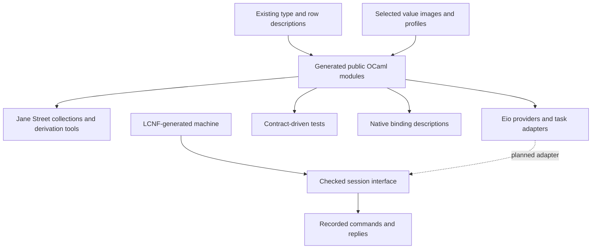

# OCaml interfaces generated from Effect4

Status: research note, not authority. Review starts at `021b35c45e1a0a9b14c9354ffaa93b495c89e011` on `refactor/phase1-phase3`.
The research uses three GPT-6.1 Sol agents and a coordinating review.
Production development continues during the review.
The evidence files record each probe's source hashes and observed revision.

The strengthened recommendation is a mathematical model of native OCaml interfaces, with generated values that inhabit the actual library types.
Each interface combines its precise type relationships with laws for values, operations and resource state.
The owner's clarification makes this the central target.
The [native-interface proposal](native-interfaces.md) develops that target and its first Eio consumer.

The earlier adapter and derivation probes supply practical foundations for it.
They expose application data, typed operations and resource interfaces through established OCaml libraries.
The generated machine keeps its existing program representation and canonical bytes.

The decisive probe uses OCaml representation re-export: an adapter adds operations to the exact existing generated type.
Jane Street's derivation tools then supply inspection, comparison, hashing, binary conversion and runtime type descriptions.
An existing typed heterogeneous map supplies native service storage.
These are concrete library interfaces the generator can target now.

## Recommended directions

| Priority | Generate or expose | Reuse | Evidence and benefit |
| --- | --- | --- | --- |
| Foundation | A mathematical contract for actual native type relationships and operations | Eio provider interfaces; Jane Street abstract types, indexed keys and collection interfaces | Proposed model with native interoperability probes. Enables reusable guarantees at the library interface. |
| Supporting slice | A separate adapter module for an existing generated type | Representation re-export, `ppx_sexp_conv`, `ppx_compare`, `ppx_hash` | Executed against `Eff_types.service_key`. Adds familiar operations while retaining the exact original OCaml type. |
| Supporting slice | A typed key and selected operation dictionary per adapter | `Base.Type_equal.Id`, `Core.Univ_map`, comparator witnesses | Executed. Supports typed service storage and rejects mixed collection orderings through OCaml compilation. |
| Next | A modeled application record and one repository interface | Abstract `.mli` interfaces, the selected `Modeled.image`, existing row contracts | Proposed generation over the to-do application. Enables typed application libraries and inspection tools. |
| Next | A scoped native provider and completion adapter | Eio; domain-local-await for notifications; Picos when scheduler portability matters | Executed standalone library probes. Reuses task execution and cleanup mechanisms behind the checked session. |
| Consumer-led | A generic inspector or explicitly versioned native transport | `Typerep`, `bin_prot`, binary shapes | Executed samples. Reflection and transport remain optional views, with their own identity and admission rules. |
| Pilot | Contracts on a small existing `.mli` | Gospel and Ortac | Source-reviewed, unrun candidate. Generates checks around actual OCaml calls. |
| Named foreign library | Typed binding descriptions and C binding rules | Ctypes and Cstubs | Source-reviewed, unrun. Reuses C calling conventions and binding generation. |

Rocq is useful when a specific verified component already exists or needs a separate proof development.
It offers no direct shortcut for checking the current Lean-to-OCaml output.
The detailed comparison also covers Why3, Cameleer, CFML and VOCaL.

## Question

Which established OCaml mechanisms give this project more useful interfaces, conversions, concurrency and native integration?
Which mathematical distinctions must those interfaces retain?
The owner's follow-up specifically asks for Jane Street, Rocq and other verification tooling, without rebuilding their infrastructure.

Finishing criteria for this investigation:

- Trace the actual LCNF lowering and public types from current source.
- Exercise promising installed libraries against actual generated types where practical.
- Retain positive examples and deliberate failures that distinguish competing designs.
- Name concrete generated artifacts, consumers and existing libraries for each recommendation.
- Separate executed probes, source review, existing proof references and proposals.

Decisions rows 391 and 392 pause new lowering proof obligations.
This note proposes interface designs and optional mathematical criteria.
It creates no new proof graph, ruling or production implementation.

## What was read or run

| Investigation | Retained report | Evidence |
| --- | --- | --- |
| Current compiler and public generated types | [Lowering](lowering/note.md) | Source review, Lean syntax-checker controls, actual OCaml compiler controls |
| Value representations and conversions | [Conversions](conversions/note.md) | Current generated type group, current wire implementation, Sexplib, Zarith and Quickcheck in isolated builds |
| Eio resources, effects and tasks | [Eio](eio/note.md) | Actual installed Eio and OCaml effect execution, plus a deliberate compiler rejection |
| Jane Street interface mechanisms | [Jane Street](conversions/ecosystem.md) | Primary-source research and separate installed-library probes |
| Rocq and other verification tooling | [Verification tooling](lowering/verified-ecosystem.md) | Primary-source research and installed-tool inventory |
| Native bindings and scheduler interoperability | [Interop](eio/interop-ecosystem.md) | Primary-source research and separate installed-library probes |
| Actual native interfaces and their mathematical contracts | [Native interfaces](native-interfaces.md), [Eio controls](eio/native-contract/note.md) | Stronger model proposal and ordinary Eio clients consuming custom and standard providers |
| Selection of value encodings | [Lean probe](ModelProbe.lean), [output](model-probe.log) | Finite evaluation of existing `Image`, `Model.refusal` and `Val.hasTy` definitions |

The coordinator independently reruns the original probes and the later Jane Street and scheduler-interoperability probes.
The reproduction commands and measured results accompany each report.
No whole-project build or behavior gate is claimed by this investigation.
The Lean probes use existing compiled imports, whose hashes are retained.
The packet check measures the retained outcomes and verifies local links and selected hashes:

```sh
python3 docs/research/2026-10-15-ocaml-seam-probes/verify.py
```

Its [receipt](verification.json) records the measured checks and changes since each slice's source snapshot.
The root [model runner](capture_model.py) records source and direct compiled-import hashes before and after execution.
Run it through `scratch/lean-slot.sh` to share the repository's Lean slot.
These receipt checks do not replace the individual probe commands or production behavior gates.

The relevant authorities are `ocaml/README.md`, `ocaml/STANDARDS.md`, `docs/core/lcnf-route.md`, `docs/core/host-boundary.md` and `docs/core/semantics.md`.
The cleanup brief is `docs/research/2026-10-14-lowering-cleanup/prompt.md`.
The earlier ecosystem plans are historical context, especially `docs/research/2026-09-07-ocaml-proposals.md`.
Their old avatar architecture and performance measurements are not current evidence.

## Findings

### The useful foundation already exists

The project has several distinct type descriptions, each serving a different job.

| Existing description | Its job | What an OCaml interface can reuse |
| --- | --- | --- |
| `Ty` and `CTy` | Describe program values and their normalized types | Field structure, supported operations, normalization and admission |
| `Store.Image` | Chooses an exact encoding for a particular carrier | Explicit read/write adapters and their intended value frames |
| `Schema.Model.algAt` and `Modeled` | Derive a carrier and its selected image from supported program types | Application record interfaces and conversion generation |
| Row tables and `RowProtocol` | Describe requests, replies, errors and declared conditions | Typed service methods, dispatch and contract tests |
| `OCaml5.Ml` | Describes the syntax emitted by the lowering | Generated implementation and interface artifacts |
| `Run`, `Live` and the command journal | Describe checked interaction and replay | A host adapter's call identity, receipt and application boundary |

`Store.Image` lives in `src/Effect4/Store/Carrier/Image.lean`.
`Modeled` lives in `src/Effect4/Schema/Modeled.lean`.
`RowProtocol` lives in `src/Effect4/Program/RowProtocol.lean`.

The current OCaml program types already share `ocaml/eff/eff_types.ml`.
The old proposal to remove duplicate program representations has already landed.
The concurrent K1b commit also moves boundary values, errors and completions into that shared module.
This report recommends consumers of that consolidation.

### A type name does not select a conversion

The Lean probe shows two round-tripping encodings of a product.
Only the runtime tuple encoding passes program product membership.
Likewise, the generic stored encoding of a Lean integer differs from the program integer encoding.

This is a useful design constraint, rather than a reason to invent another type language.
A generated adapter should name its selected `Image`, program type and target profile.
`Modeled.image` already makes that choice for its supported data fragment.

The current modeled fragment supports required records containing supported scalar and container fields.
It refuses optional keys, identities and several richer constructors.
An optional value under a required key differs from an optional key.
An untagged program union also differs from an OCaml sum carrying an extra branch tag.

### Existing derivation tools already work on the generated types

The later probe adds operations through a representation re-export in a separate adapter module.
The generated carrier needs no edits and gains no dependency on Jane Street libraries.
The derived reader returns the original `Eff_types.service_key` directly.
The OCaml compiler checks that the re-export matches the original record declaration.

This gives a practical division of work.
Effect4 generates the type view and selects appropriate interfaces.
Existing PPX tools generate the ordinary library operations.
The [Jane Street report](conversions/ecosystem.md) retains the compiled example and its actual generated expansion.

A public re-export supplies operations on raw values.
It does not prevent a client from constructing an invalid natural or another out-of-profile value.
A checked data module must hide the raw type equality and expose validating constructors and readers.
Its implementation can still use the existing carrier without copying values into another representation.

The conversion probe derives Sexplib converters and grammars on a copy of the actual generated mutual type group.
It exercises one sample of every `Ty` constructor and a nested program.
Their S-expression and existing wire round trips pass.
The logs distinguish those samples from the separate ordinary-record Quickcheck tests.

The deliberate failures show why derivation needs a codec admission boundary.
Generic S-expression conversion accepts a negative natural and invalid UTF-8 bytes that the existing wire encoder refuses.
It normalizes record order and hexadecimal integer spellings.
Generic float conversion loses NaN payload bits.
Opaque-resource S-expression rendering loses identity and cannot reconstruct the resource.

S-expressions therefore offer immediate inspection, fixture and configuration tooling.
The project's canonical bytes remain the basis for stored identity.
An additional native transport codec needs its own version and domain policy.

### Typed registries and ordering already have reusable implementations

`Type_equal.Id` and `Core.Univ_map` store different native types in one table through typed keys.
The probe retrieves the value through its original key.
Neither a wrong-type key nor a recreated same-type key can retrieve it through the same display name.
Generate each process-local key once, beside the adapter's operations.
Keep the stable service identifier separate from that process-local key.

Comparator witnesses similarly record a collection's ordering policy in its OCaml type.
The compiler rejects the probe's attempt to combine ascending and descending sets.
These mechanisms support service tables, caches, maps and sets without another heterogeneous storage implementation.

`Typerep` adds typed field inspection when a runtime tool needs it.
The probe reads a record field through its typed accessor.
Its type description does not select the program-value encoding.

`bin_prot` supplies a useful optional transport interface.
The probe detects a renamed field through its binary shape, while the raw bytes still decode under the renamed record.
The receiving adapter must check the shape explicitly.
Native type identity, binary shape and canonical content identity answer different questions.

### OCaml abstraction provides useful guarantees at low cost

The generated representation exposes some distinct Lean identities as the same OCaml integer type.
The compiler permits mixing those identities and constructing negative natural literals before a program membership check.
An isolated abstract-module prototype rejects those constructions.
The existing `E4_clock.t` already demonstrates this pattern with exact storage and checked numeric conversion.

The internal syntax checker checks selected structural conditions.
Actual OCaml compilation checks expression typing and external names.
The retained controls exercise both checks.
This division favors generated public OCaml interfaces and ordinary OCaml type checking at the library boundary.

### Resource interfaces need construction and lifetime rules

The Eio probes demonstrate typed dispatch through an existential resource provider.
The compiler rejects a resource that lacks the requested interface tag.
However, Eio's public constructor allows a claimed tag with an empty provider, which fails when called.
A file can also escape its switch while retaining its OCaml type, then fail on use after close.

A generated resource factory can prevent missing-provider construction in its public API.
The session still needs a correspondence between logical handles, actual resources and their ownership phases.
An interface tag alone supplies none of that lifecycle information.

The task probes also distinguish suspension, completion, cancellation and cleanup.
Cancellation keeps earlier host state, and cleanup needs explicit execution.
Native worker jobs can return typed results without becoming the machine's recorded fibers.

## Proposals

### Generate small modules with established interfaces

The proposed public layer has three kinds of module.
These are generated views of existing descriptions, not additional stored program languages.

| Module kind | Generated contents | Existing machinery it can use | Capability unlocked |
| --- | --- | --- | --- |
| Data | Abstract type, checked constructors, selected codecs, equality and inspection | OCaml signatures, Jane Street derivers, comparators and type witnesses | Typed configuration, CLI tools, collections, fixtures and application messages |
| Operation | Request, answer and error modules, stable operation identity, callable interface | First-class modules or functors, typed registries, existing row admission | Reusable service implementations and heterogeneous typed dispatch |
| Resource | Sealed provider factory, supported methods and logical resource identity | Eio resource providers and the existing session lifecycle | Files, network connections, database handles and scoped external services |

A shared native type key can supply evidence that stored and requested types agree.
Distinct keys may still name the same OCaml type.
The selected codec answers how one value crosses the boundary.
The operation contract answers what the operation does.
Those questions remain separate even when one generated module packages their answers.



The checked OCaml session remains the LC-7 prerequisite in the inspected tree.
Its planned byte entry points are not described as already implemented here.
Data interfaces, inspection tools and byte-conversion experiments can proceed independently of that prerequisite.

### Use verification tooling around a real interface

Rocq extraction starts with a Rocq program and produces OCaml.
It does not validate this project's existing Lean-to-OCaml output.
A second extraction route would duplicate work without improving the first consumer.

Gospel and Ortac offer a more direct experiment: contracts on an OCaml interface and generated tests against its implementation.
The promising consumer is a small host adapter or collection interface with an existing Lean model.
The generator should reuse that model's observations instead of independently restating the machine.
Unsupported contracts and omitted operations must remain visible in the result.

Why3, Cameleer and other proof tools remain options for a separately chosen foreign component.
Their value depends on the component and the guarantees needed.
The [verification report](lowering/verified-ecosystem.md) compares their actual input languages and limits.
This proposal adds no requirement to prove the whole compiler again.

### Keep concurrency and foreign access behind generated operations

An Eio implementation can perform an operation, submit a keyed completion and let the session select its application.
Its task or continuation remains a native host value.
The recorded program keeps operation names, values and decisions.

Picos is interesting when one native client must work under different scheduler implementations.
Ctypes is interesting when a generated interface must call a C library through a shared binding description.
Neither requires the machine to store native continuations or raw pointers.
The [interop report](eio/interop-ecosystem.md) identifies the concrete binding forms and prerequisite interfaces.

The Picos probe runs one unchanged structured-job client under FIFO, thread and multidomain schedulers.
The completion probe also runs one unchanged domain-local-await client on a plain domain and inside Eio.
It transfers copied bytes before waking the receiver.
These examples reuse existing scheduler protocols and implement no Effect4 machine.

### First mathematical slice: an actual native interface with laws

Model Eio's source and sink interfaces, including their hidden state and caller-supplied mutable buffers.
Generate providers at those actual Eio types and retain their relation to the model.
The new native probe shows standard Eio consumers using such provider shapes directly.
Its partial-I/O controls identify behaviors that the contract must cover.

The [native-interface proposal](native-interfaces.md) records the proposed laws, assumptions and existing semantic owners.
The [Jane Street model](conversions/native-model.md) offers another small instance: typed keys and immutable map operations.
Both target reusable interface guarantees.
They do not claim that library type declarations alone prove arbitrary provider behavior.

### Supporting slice: generated adapters and one application interface

Start with a separate adapter library for one existing named generated carrier.
Generate its representation re-export, selected library operations and process-local type key.
Bundle its existing codec through an OCaml module type.
Use `Core.Univ_map` for one typed host service table.

The existing to-do application provides a concrete starting point.
Its record and repository rows live in `Test/Dogfood/Scenario/Todo.lean`.
Start with the record's required natural, string and Boolean fields.
Concurrent LC-6 work is adding the generated to-do host.
The proposed data facade and provider interface should consume that work.
They should not introduce another repository implementation.

1. Generate an OCaml data module from the selected record description and value image.
2. Expose checked construction through its public interface.
3. Generate S-expression inspection and typed collection support through existing libraries.
4. Compare accepted values with Lean's byte encoder and retain malformed-value controls.
5. Generate one repository operation interface from its row description.
6. Connect that interface to the checked session when LC-7 is available.

The initial modules demonstrate application usefulness without requiring resource transfer or a new scheduler.
Later slices can add an Eio implementation and a contract-generated test harness.
Resource-bearing operations follow once their ownership interface has a concrete consumer.

### Mathematical criteria for these interfaces

The existing theory already gives the organizing concepts.
The [model note](model.md) records the proposed equations, observations and explicit boundaries.
These criteria guide interface choice and tests under the current proof pause.

| Question | Existing placement | Consumer and limit |
| --- | --- | --- |
| Does this conversion use the selected value image? | `store-typing`, `exact-codecs`; `modeled-membership`, `modeled-codec`; R3 | Generated data modules, within their declared modeled and scalar profiles |
| Do the generated tools use the same field description? | `initial-algebras-folds`; existing fold construction; R3 | Codec, interface and inspection producers, without an extra canonical descriptor |
| Does the native operation answer its checked call? | `host-session-protocol`; `reply-at-call-instance`, `keys-once`; R6 and R13 | Generated service adapters, with actual host behavior still tested or assumed |
| Which resource owns cleanup at each phase? | `scope-lifetime-finalization`, `host-session-protocol`; R11 | Resource-bearing adapters, beyond static interface tags |
| Which native executions are allowed? | `translation-simulation`, `reactive-scheduling`; R8 and R12 | Named adapters and observations, with progress assumptions stated separately |

## What this does not establish

The probes demonstrate library compatibility and particular boundary behaviors.
They do not establish universal converter correctness, whole-machine agreement with Eio, compiler correctness or host progress.
Existing theorem references retain their own premises and fragments.
No theorem receives a new axiom receipt in this research.

The packet changes research files only.
It installs no packages and changes no production source, generated artifact, decision register or canonical wire format.
Concurrent production changes are recorded separately from this work.
