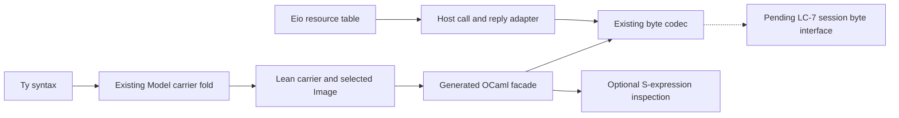

# OCaml carrier and conversion probes

The existing carrier fold can support generated OCaml adapters without another program representation.
The first slice should expose a modeled record through an abstract OCaml interface and the existing byte codec.
The session byte interface remains pending under LC-7.

**The first constraint is frame selection.** A carrier's Lean type does not choose its program-value encoding.
`Canonical Int` writes constructor frames in `src/Effect4/Store/Domain/Canonical.lean`.
Program integer operations read `nat` and `negInt` frames in `src/Effect4/Machine/Integers.lean`.
`Image.pair` and `Image.tuple2` also write different frames for the same product carrier.
The latter serves program product membership in `src/Effect4/Store/Carrier/Image/Containers.lean`.
Derived structural records and named program records likewise have different layouts.
Select `Modeled.image` for a modeled program value.
Do not substitute an arbitrary `Canonical` instance with the same endpoint type.

## Scope and finishing criteria

This note uses the [target workflow](/Users/pooks/.codex/skills/lean-reification-target/SKILL.md) and the [writing skill](/Users/pooks/.agents/skills/writing/SKILL.md).
Rows 391 and 392 of `docs/core/decisions.md` pause new lowering proof obligations.
The mathematical conditions below describe optional design criteria for concrete consumers.
They do not resume the paused proof programme.

Finished research has these artifacts:

- A source map distinguishes program types, value frames, target syntax, generated carriers and host resources.
- Runnable probes use installed libraries and copied source in a private temporary workspace.
- Positive cases and deliberate failures expose normalization, refusal and information loss.
- Each proposed direction names its first consumer and its remaining boundary.

`provenance.json` records the retained probe run's commit and source hashes.
`run.log` records versions, commands, diagnostic output and measured case totals.
Initial inspection uses branch `refactor/phase1-phase3` at `021b35c45e1a0a9b14c9354ffaa93b495c89e011`.
The initial dirty paths are `src/OCaml5/Lcnf/ClockFlow.lean` and `tools/view/make_videos.py`.
The coordinator's later probe run records commit `57d352bbb0f14578de9e5302b41244e65ae19984`.
Concurrent generated-file changes continue after initial inspection.
Use each run's source hashes and saved working diff to identify its exact inputs.
This seat changes no production, generated, authority, register or root file.
This seat runs no main-checkout Lake or dune build.

## Source map

The terms exact embedding, fold and codec admission use `docs/core/controlled-english.md`.
Each representation below owns a different sort.

| Sort | Existing owner | Relevant boundary |
| --- | --- | --- |
| Program | `Eff`, `src/Effect4/Program/Eff.lean` | The one program IR remains canonical. |
| Program type | `Ty`, `src/Effect4/Program/TyCore.lean` | Constructors include records, unions, nominal applications and identities. |
| Canonical program type | `CTy`, `src/Effect4/Program/Ty.lean` | `CTy.ofRaw` normalizes syntax. It does not retain raw type identity. |
| Stored value | `Store.Val`, `src/Effect4/Store/Carrier/Val.lean` | One frame tree carries content references and live handles as distinct constructors. |
| Exact value image | `Image`, `src/Effect4/Store/Carrier/Image.lean` | `toVal`, `ofVal`, `ofVal_toVal` and `ofVal_exact` specify a selected layout. |
| Shape-bearing carrier | `Canonical`, `src/Effect4/Store/Domain/Canonical.lean` | Adds a shape and its acceptance law to a value image. |
| Program membership | `ValueModel`, `src/Effect4/Laws/Program/ValueModel.lean` | Separates an image, canonical type and allocation-dependent membership premises. |
| Type-directed carrier | `Model.algAt`, `src/Effect4/Schema/Modeled.lean` | A `TyAlgebra` produces a dependent carrier paired with its `Image`. |
| Named Lean facade | `Modeled`, `src/Effect4/Schema/Modeled.lean` | An instance transports the fold's image through two inverse carrier maps. |
| Target syntax | `OCaml5.Ml.Ty`, `src/OCaml5/Ml/Syntax.lean` | Describes OCaml annotations. It does not replace `Ty`. |
| Carrier-generation view | `OTy`, `src/OCaml5/Eff/World.lean` | Projects the selected declaration inventory into target carrier spellings. |
| Generated OCaml carriers | `ocaml/eff/eff_types.ml` | LCNF emits mutually recursive OCaml types from Lean declarations. |
| Generated wire adapters | `ocaml/eff/eff_wire.ml` | Reuse `Eff_frame` and the assigned wire tags. |
| Actual host resources | `Eio.Resource.t`, installed `eio/resource.mli` | Contains a host value and its interface handler. It remains outside stored program syntax. |

`Ty` normalization has meaningful erasures in `src/Effect4/Program/Ty.lean`.
`normalize` orders unions and record fields, merges equivalent type forms, and normalizes children.
`normalize_tuple_pair` identifies a two-item tuple with a product.
`normalize_app_nil` identifies a nullary nominal application with a handle type.
The proposed adapters should state whether they consume raw `Ty` or `CTy`.



The generated OCaml facade and host resource table arrows are proposed consumers.
The diagram does not assert that either exists for arbitrary modeled types.
The module `src/Effect4/Api/RunnerBytes.lean` uses existing generated runner codecs at its byte boundary.
LC-7 names `Live.startBytes`, `Live.feedBytes` and `Live.viewBytes` in `docs/research/2026-10-14-lowering-cleanup/prompt.md`.
Those session entries remain planned in the reviewed tree.

## Existing modeling facilities

`Model.algAt` already supports distinct identity contexts in `src/Effect4/Schema/Modeled.lean`.
`Leaves.refused` gives the checked domain no identity carrier.
`Leaves.opaque` carries an identity as its existing value tree without inspecting it.
That choice does not validate a live host object or its ownership.

The checked domain includes unit, naturals, strings, booleans, options, lists, products and ascending required-field records.
`refusalAlg` refuses optional fields and record names outside canonical byte order.
It also refuses identities, type variables, integers, unions, literals, exceptions, exits, causes, maps, tuples, nominal applications and other unsupported constructors.
Tuple carriers exist for stored step results, while the checked domain still refuses tuple types.

`deriveModeled` in `src/Effect4/Schema/Modeled/Derive.lean` supplies the existing record derivation.
Its initial profile accepts monomorphic structures with independent fields and field-level `Modeled` instances.
It checks renames, rejects duplicate spellings, sorts fields canonically, and writes the carrier maps with their inverse equations.
It refuses parameters, universe parameters, dependent fields and proposition fields.

`Model.member` and `Modeled.member` appear in `src/Effect4/Laws/Schema/Modeled.lean`.
They connect supported images to program value membership.
`Modeled.codec_roundtrip` additionally assumes value-specific codec admission at the normalized type.
A large natural can have a value image while lacking the target JSON image.
These are reviewed proof references, not fresh build or axiom-audit evidence from this seat.

`Image.sum` in `src/Effect4/Store/Carrier/Image/Containers.lean` keeps a branch tag in a constructor frame.
`Ty.union` does not add that tag to its member values.
For example, a natural also inhabits the integer branch.
An ordinary OCaml sum therefore cannot automatically provide an injective value image for every program union.
Use a disjoint tagged-record profile first, or retain a selected representative with a named normalization policy.
`wireAlgebra.ty_union` in `src/Effect4/Schema/Codec.lean` already follows the encoder's canonical branch when reading.
The public codec refuses overlapping images that cannot reconstruct the selected value.

## Runnable probe

Run the standalone driver from the repository root:

```sh
python3 docs/research/2026-10-15-ocaml-seam-probes/conversions/run.py
```

`run.py` creates a temporary dune workspace and copies the existing generated carrier group.
It adds `[@@deriving sexp, sexp_grammar]` to that copied declaration group.
It copies the current framing kernel, generated wire adapters and exact clock implementation.
It installs no package and edits no source input.

The measured tool versions and installed packages appear in `run.log`.
The exercised packages include OCaml, dune, `sexplib`, `ppx_sexp_conv`, `base_quickcheck`, `ppx_compare` and Zarith.
The installed primary-source hashes appear under `installed_sources` in `provenance.json`.
The probe catches converter exceptions for observation.
A public adapter should return a located refusal instead.

| Finite observation | Result recorded by `run.log` | Limit |
| --- | --- | --- |
| One value for each generated `Ty` constructor | S-expression and current wire round trips pass. | Constructor coverage is not exhaustive value coverage or admission coverage. |
| One nested `Eff` | S-expression and current wire round trips pass. | No execution comparison occurs. |
| Negative `Lit_nat` | The generic S-expression reader accepts it. The wire encoder refuses it. | Raw OCaml constructors retain values outside Lean's image. |
| Invalid UTF-8 string | Generic S-expression conversion keeps the bytes. The wire encoder refuses them. | Byte-string serialization is not UTF-8 codec admission. |
| Hexadecimal integer spelling | The reader accepts it and the writer emits decimal. | Raw S-expression identity is lost. |
| Record field permutation | The reader accepts it and the writer emits declaration order. | Exactness needs a named field-order normalizer. |
| Duplicate, extra or missing required record fields | The default generated reader refuses them. | Optional attributes can change this policy. |
| Union order and optional-field syntax | Raw `Ty` S-expression round trips retain them. | This does not establish `Model.refusal = none`. |
| Natural beyond native `int` | The generic integer converter refuses it. | Its domain remains bounded even when Lean `Nat` is not. |
| Large exact clock | Canonical decimal round trip passes. Bounded numeric observation refuses. | Exact storage and bounded observation are separate APIs. |
| Noncanonical decimal spellings | The exact clock reader refuses them. | No normalization silently repairs the input. |
| Abstract clock client | OCaml rejects an integer supplied as `E4_clock.t`. | Module abstraction protects construction, not external semantics. |
| Distinct opaque resources | Their printed inspection values coincide and decoding refuses. | `[@sexp.opaque]` loses resource identity. |
| Distinct NaN payloads | Generic float serialization emits one spelling and reconstructs canonical bits. | It cannot replace a bit-preserving binary64 image. |
| Ordinary `Payload` record | Deterministic derived Quickcheck round trips pass. | These samples do not cover the generated carrier group. |
| Deliberately discarded record field | Quickcheck reports a retained counterexample. | This detects the planted defect only. |

The probe prints actual case totals and the minimized mutation witness.
The generated group test and the ordinary record property test have distinct scopes.
The code uses neither `Obj` nor `Marshal`.
Equality in the probe compares concrete generated data, not abstract resources.

## Library roles and evidence

| Library or facility | Practical role | Evidence and boundary |
| --- | --- | --- |
| [`ppx_sexp_conv`](https://github.com/janestreet/ppx_sexp_conv) | Generates inspection converters and grammars from existing OCaml declarations. | Official documentation and installed-source review. The finite probe exercises the installed version. No Lean theorem certifies this PPX. |
| [`Sexplib`](https://github.com/janestreet/sexplib) | Parses and prints S-expression trees. | Official source and the installed probe. Text formatting and comments do not retain source-byte identity. |
| [`Base_quickcheck`](https://github.com/janestreet/base_quickcheck) | Supplies generators, shrinkers and retained failing examples. | Installed `test_intf.ml` documents deterministic configuration and shrinking. The planted loss demonstrates the detector. |
| [`Zarith`](https://github.com/ocaml/Zarith/blob/release-1.14/z.mli) | Supplies exact host integers behind abstract natural and clock APIs. | Official interface and copied `E4_clock` finite controls. This adds no target-wide arithmetic guarantee. |
| [`Eio.Resource`](https://github.com/ocaml-multicore/eio) | Supplies host capability interfaces over actual resource values. | Installed `resource.mli` states its existential resource representation. This seat runs no Eio scheduling or cancellation test. |
| Existing generated folds | Produce multiple views from canonical signatures. | `TyAlgebra`, `cata_ty` and fusion facilities exist in `Program/Fold.lean` and `Program/TyFoldExtras.lean`. No new fold law is needed for this research. |

S-expression derivation is useful for diagnostics, fixtures and user-editable configuration.
It should sit beside the existing canonical wire format.
An inspection format must not silently become the content-addressed identity format.
Full float bits should use explicit unsigned bit data when that distinction matters.
An opaque capability should expose a host resource key and metadata, never a serialized host resource value.

## Directions

| Direction | First consumer | Domain, normalization and refusal | Why it is compelling |
| --- | --- | --- | --- |
| Generate a typed OCaml facade from `Modeled` descriptions | A named record through the existing byte codec; request/reply integration after LC-7 | Start within `Model.refusal = none`; use the selected `Modeled.image`; refuse unsupported fields before emission. | Reuses existing record derivation and membership connections. Avoids duplicate layout decisions. |
| Derive optional S-expression inspection from generated declarations | CLI program inspection and fixtures | Use ordinary generated converters for inspection. Canonical input requires re-emission checks or a named normalizer. | The finite probe derives the entire existing mutual carrier group. |
| Give scalars abstract target interfaces | Naturals in generated application records | Distinguish exact Zarith naturals, bounded profile naturals and native indices. Refuse at explicit conversions. | Current `E4_clock` already demonstrates exact storage, checked observation and hidden constructors. |
| Extend modeled carriers through disjoint records and explicit field presence | Rich application errors and optional input records | Admit tagged disjoint unions first. Distinguish an absent key from a present optional value. Refuse ambiguous overlapping images. | Adds application expressiveness while keeping existing value frames and the canonical `Ty`. |
| Generate adapter-focused property tooling | Request/reply adapter maintenance | Derive ordinary generators from admitted source descriptions. Include frame, scalar and loss mutations with an independent byte observer. | Installed Quickcheck finds and shrinks a deliberately lost field. |

Avoid a universal OCaml runtime type descriptor as the first slice.
The existing `Ty` fold already supplies carrier structure and refusal.
If an indexed host witness becomes useful, derive it as a view from that source.
Give it a concrete consumer before extending target syntax or adding another recursive descriptor.

## First vertical slice

Choose one monomorphic application record with required natural, boolean, string, list and optional-value fields.
An optional-value field uses `Ty.option`; it does not make the record key optional.
This selection stays within the current modeled checked domain.

1. Derive its existing Lean `Modeled` instance.
2. Generate its OCaml record and abstract checked constructor from the same selected field description.
3. Generate read/write adapters using `Modeled.image` and the existing byte codec.
4. Add optional S-expression inspection on the generated carrier.
5. Test malformed frames, invalid UTF-8, negative naturals, scalar bounds and dropped fields.
6. Compare the accepted record's bytes with Lean's existing encoder through the coordinator's owned build lane.

The facade exposes checked data to application code.
Connect the facade to the session byte interface when LC-7 provides it.
The actual Eio resource remains in a host resource table behind the request/reply adapter.
This first slice establishes no general Eio resource lifecycle or host ownership result.

## Optional mathematical design criteria

These criteria are proposals, not new planned goals or assigned proof work.
Rows 391 and 392 continue to govern lowering work.

| Criterion | Placement and existing property | Reach and consumer | Exclusion |
| --- | --- | --- | --- |
| The selected carrier writes values that inhabit its declared type. | `store-typing`, R3, existing `modeled-membership` | The modeled record within `Model.refusal = none`; application request/reply adapter. | Identities, optional keys and refused constructors remain outside. |
| Reading a written carrier reconstructs it, and accepted frames are exactly its image. | `exact-codecs`, R3, existing `Image` laws and `modeled-codec` | Selected `Modeled.image`; existing byte adapters and the first facade. | JSON still requires codec admission. Generic PPX has no inherited theorem. |
| Generated views read the same selected constructor and field description. | `initial-algebras-folds`, R3, existing fold uniqueness and fusion facilities | Concrete codec, interface and inspection producers; generator-maintenance consumer. | This is not a generic compiler stage law. |
| Scalar narrowing either returns the same natural or refuses without replacing the stored value. | `translation-simulation`, R8, existing profile question and DI-56 | Abstract natural facade and its bounded observation; first record adapter. | A finite `E4_clock` control does not establish all target arithmetic. |
| Resource metadata does not create or revive an actual resource. | `host-session-protocol`, R6, existing boundary and reply-admission questions | Host resource table and generated request/reply adapter, only when that consumer is selected. | Ownership, retirement, cancellation and eventual response need their own host design. |

Every optional criterion names a consumer and an existing semantic concept.
The note proposes no theorem without such a consumer.

## Prior context and current limits

The prior external-runtime packet is `docs/research/2026-09-30-external-runtime-contract.md`.
Its identity and admission cautions motivate the current source checks.
The current tree, inspected hashes and finite probes supply this note's concrete findings.
The older packet does not establish the current compiler, runtime, ownership or adapter behavior.

No universal conversion theorem follows from these probes.
No Lean declaration is rebuilt or axiom-audited by this seat.
No claim about whole-machine storage, compiler correctness, arbitrary union recovery or Eio execution follows.
