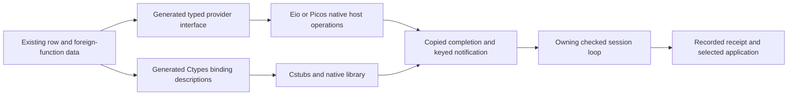

# Reuse native binding and scheduling libraries

Effect4 can generate small interface descriptions and reuse existing OCaml runtimes behind them.
The strongest candidates are Ctypes binding descriptions, sealed module interfaces, and a portable native job interface.
These mechanisms unlock foreign libraries, replaceable providers, concurrent work, and cross-domain completion delivery.

**Role:** practical interface research.
**Evidence:** primary documentation, installed source, and executed standalone interoperability probes.
**Scope:** native host bindings around the generated machine.
**Limit:** no new production implementation, installation, representation, or proof obligation.

## 1. Generate Ctypes descriptions and reuse Cstubs

[Ctypes](https://ocaml.org/p/ctypes/0.24.0/doc/ctypes/Ctypes/index.html) represents C argument and result types as typed OCaml values.
A binding description can name the C symbol and its argument types.
Effect4 can generate that description from its foreign-function realization data.
The description belongs to a target interface, rather than stored `Eff` syntax.

[Cstubs](https://yallop.github.io/ocaml-ctypes/Cstubs.html) consumes a binding functor and generates the C and OCaml stubs.
The same description can also support dynamic bindings through `Foreign`.
This removes the need to write a separate C conversion function for each imported operation.
Its concurrency policy can release the OCaml runtime lock during a call.
That policy does not make a blocking C call into an Eio asynchronous operation.

The first useful outputs are a binding description, a generated public interface, and the stub-generation build rule.
[Dune's ctypes support](https://dune.readthedocs.io/en/stable/foreign-code.html) accepts type and function description functors, headers, and build flags.
Its documentation marks that integration experimental.
A direct Cstubs generator remains an alternative when stable build control matters.

The concrete consumers differ:

| Consumer | What Effect4 generates | What the existing library supplies |
| --- | --- | --- |
| A native host row calls a C library | Ctypes type and symbol descriptions, plus typed row conversion calls | Generated calling stubs and C compiler layout checks |
| An OCaml client calls the LC-9 C face | Opaque-handle and byte-buffer binding descriptions after the ABI is fixed | Ctypes pointer access and generated stubs |
| A C application embeds an OCaml library, if later requested | Inverted-stub descriptions of the exported OCaml interface | `Cstubs_inverted` generates C entry points, a header, and OCaml registration code |

[Cstubs_inverted](https://yallop.github.io/ocaml-ctypes/Cstubs_inverted.html) serves the last consumer.
It does not implement the selected LC-9 route, which uses Lean's own compiled machine.
LC-9 in `docs/research/2026-10-14-lowering-cleanup/prompt.md` keeps `Live` opaque and exchanges other values as bytes.
Its status framing, ownership, initialization, and handle release remain part of that interface.
Ctypes does not infer those rules from a raw Lean export.

Keep the C boundary small: an opaque session handle, byte spans, explicit lengths, status, and release operations.
Do not mirror Lean or OCaml heap layouts across it.
Ctypes `ocaml` pointers refer into movable OCaml storage.
The [Ctypes documentation](https://ocaml.org/p/ctypes/0.24.0/doc/ctypes/Ctypes/index.html) forbids retaining those pointers or calling OCaml through functions receiving them.
Copied bytes or explicitly owned C buffers give the native adapter a clearer lifetime.

The [Foreign API](https://yallop.github.io/ocaml-ctypes/Foreign.html) exposes callback runtime-lock and thread-registration controls.
Retain any callback closure for its entire native registration.
A native callback should publish a completion and notify the owning session loop.
It should not execute machine steps or perform Eio scheduler effects on an arbitrary foreign thread.
This leaves one reusable runtime integration, instead of a custom callback convention for every operation.

**Feasibility:** Ctypes is absent from the installed switch.
`interop-capture.json` records the failed package lookup.
No Ctypes binding compiles or runs in this packet.
Its API assessment uses the documentation linked above, including versioned Ctypes 0.24.0 type documentation.
Pin and test the selected Ctypes release before adopting the generator.

## 2. Generate sealed module interfaces and provider factories

OCaml already provides replaceable implementations with hidden carrier types.
An [OCaml module type signature](https://ocaml.org/manual/5.1/modtypes.html) specifies required values and types.
An abstract type hides its constructors and implementation.
A functor consumes such an implementation while retaining its type relationships.
This is the existing pattern behind Ctypes description functors.

For Effect4, generate the public `.mli` from the same row declarations that supply method arguments and answers.
Generate one provider factory for each interface family.
The factory can construct an Eio resource or an ordinary module value.
The existing Eio provider probe demonstrates typed existential dispatch without an application-owned cast.

This gives a repository client one method interface with an in-memory provider and an Eio provider.
It also gives tests a mock provider with the same types.
The small new abstraction is the generated interface and its provider construction rule.
The runtime remains the existing Eio resource mechanism or OCaml module system.

Seal the provider's public constructor.
The earlier probe shows that an unsealed Eio phantom tag can advertise an absent method.
Provider factories address that construction boundary.
Reply admission still checks the actual call instance.
Resource ownership still needs the host lifecycle already specified in `docs/core/host-boundary.md`.

`OCaml5.Ml.Decl.moduleD` in `src/OCaml5/Ml/Syntax.lean` already represents named functor definitions.
The syntax does not yet provide a structured public `.mli` module-signature node.
A signature projection therefore needs an explicit `.mli` rendering extension or another named generator output.
That is a code-generation extension, without another stored program representation.

`E4_sched.engine` already uses a record of functions in `ocaml/engine/e4_sched.mli`.
Keep that small interface for an individual session engine.
Use a functor where the chosen library requires one, such as Ctypes binding descriptions.
No wholesale functor conversion is needed.

## 3. Reuse a scheduler protocol for native jobs and completions

[Picos](https://ocaml-multicore.github.io/picos/doc/picos/Picos/index.html) separates concurrent abstractions from their scheduler.
Its structured library supplies promises and groups whose children finish before the group exits.
Effect4 can generate row-facing methods that call those existing primitives.
It does not need to implement another native promise or structured job library.

`interop_probe.ml` runs one unchanged structured job function on the installed Picos FIFO, thread, and multidomain schedulers.
Each finite run returns the same result and finishes each sample cleanup.
`interop-probe.log` records the actual results.
The probes implement no custom scheduler and run no Effect4 machine.

The smaller completion interface is [domain-local-await](https://github.com/ocaml-multicore/domain-local-await).
It supplies an await operation and an idempotent release operation.
The installed Eio runtime supplies its scheduler-specific implementation.
The probe uses one unchanged completion function on a plain domain and inside Eio.
Its producer publishes copied bytes through an `Atomic` value before releasing the waiter.
The same code tolerates a repeated release.

These are two useful integration levels:

| Need | Reusable mechanism | Minimal Effect4 addition |
| --- | --- | --- |
| Compose native jobs, cancellation, and joins across compatible schedulers | Picos structured promises and its scheduler protocol | A row adapter that posts typed job completions |
| Receive a foreign or cross-domain notification inside Eio | domain-local-await | A payload slot and the existing keyed completion envelope |

Picos does not automatically make arbitrary Eio operations portable.
Its [project README](https://github.com/ocaml-multicore/picos) discusses Eio compatibility as integration work.
domain-local-await provides a narrower suspension mechanism, without a shared cancellation or resource model.
Keep those distinctions when choosing an adapter.

The existing `E4_trigger` already borrows the Picos one-shot trigger design.
Its definition in `ocaml/engine/e4_trigger.mli` replaces the resume closure with a mailbox address.
Keep that data boundary for machine-visible work.
Native Picos or Eio jobs remain host implementation objects.
Generated machine tasks remain recorded machine data.

## Recommended small interfaces

Start with generated data-row provider methods and the checked session's existing command interface.
Use Eio for the first native implementation already supported by the installed environment.
Add Ctypes when a named foreign-library consumer justifies it.
Use Picos when a host library needs scheduler portability, rather than replacing the machine's decision scheduler.

These proposals serve existing host-protocol and context interfaces under R6 and R8.
Resource transfer serves R11, and recorded scheduling choices serve R12 and R13.
Decisions rows 391 and 392 keep new LCNF lowering proof obligations paused.
The next checks are generated-interface compilation, a named native-library call, and a session transcript through the real checked adapter.

## Reproduction and evidence

Run `sh docs/research/2026-10-15-ocaml-seam-probes/eio/interop-run.sh`.
The script copies its input into a temporary directory and uses installed packages.
It leaves the original Eio probe files intact.

`interop-capture.json` records tool versions, source hashes, package lookup results, and the observed checkout.
The installed sources bind these tests to Picos 0.6.0, Eio 1.2, and domain-local-await 1.0.1.
The finite probes establish the sample results, without general fairness, performance, cancellation, or trace-agreement claims.
