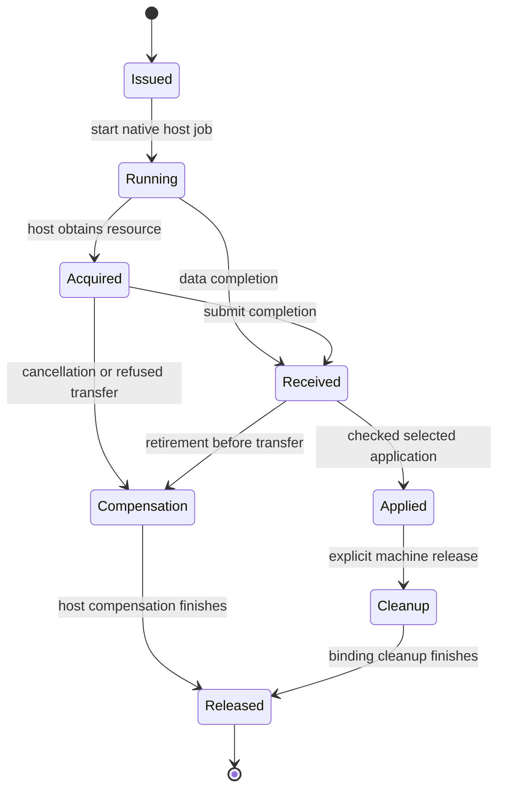

# Eio, tasks, and the checked OCaml session

Eio can supply concurrent host operations around the generated machine.
The useful interface separates host completion, checked receipt, selected application, and resource ownership.
The finite probes exercise actual Eio and OCaml effects.
They establish no agreement with the Effect4 machine.

**Role:** interface research and finite host controls.
**Evidence:** source inspection, compiled positive controls, a compiler refusal, and executed finite probes.
**Scope:** the installed `effect4` switch, standalone programs, and the source hashes in `sources.json`.

The stopping criteria require reproducible probes, exact package records, checked source references, and ranked consumers.
This packet meets those criteria without changing production or generated files.
Decisions rows 391 and 392 pause new LCNF lowering proof obligations.
The criteria below propose interface tests and mathematical descriptions, without restarting that programme.

## Existing decisions and current consumers

`ocaml/README.md` names the LCNF projection as the machine.
It archives the former avatar and daemon on `archive/ocaml5-avatar`.
The archived daemon uses Unix transport and describes an Eio replacement as future work.
Its proposed transport replacement does not establish an existing Eio session implementation.

`E4_sched.engine` in `ocaml/engine/e4_sched.mli` supplies the active native host with machine operations.
The scheduler owns each machine on one domain.
Its worker performs one machine step at a time.
Its mailbox records accepted decisions.
Its observation ring can report gaps and does not replace the receipt log.

`ocaml/gen/roots.json` currently selects `Api.run`, `Api.replay`, and machine coverage roots.
The generated `Task_start`, `Task_resume`, and `Task_wake` constructors describe machine work.
They do not hold OCaml continuations or Eio fibers.
The checked session projection remains the LC-7 consumer named by `ocaml/README.md`.

`Rows.receive` and `Rows.answer` in `src/Effect4/Run/Basic.lean` already separate receipt from application.
`Rows.receive` emits bind and submit commands.
`Rows.answer` also emits apply.
`Run.Observation` exposes awaiting calls, pending receipts, retired keys, and applications.
An Eio adapter can use that existing distinction.

The comodel design already exists in `docs/research/2026-10-09-host-coalgebra.md`.
Concept 9 in `docs/core/semantics.md` adopts hosts as `Effects.Comodel` values.
Concept 10 places the driver observations under R6.
The typed-indexed review rejects global reactor equality and retains host-state correspondence as a separate issue.
These findings recommend an adapter to that design, rather than a new program representation.

## Primary sources and pins

`sources.json` records the observed checkout, tool versions, installed package metadata, and hashes of inspected sources.
The checkout advances during concurrent work, so that file records its own observed head.
The assigned starting head is `021b35c45e1a0a9b14c9354ffaa93b495c89e011`.
No probe runs a main-tree Lean or dune build.

| Source | Pin or evidence | Relevant property |
| --- | --- | --- |
| [OCaml effect handlers](https://ocaml.org/manual/5.1/effects.html) | Installed OCaml 5.1.1, `lib/ocaml/effect.mli` hash | One-shot continuation use and explicit unwinding |
| [Eio release](https://github.com/ocaml-multicore/eio/releases/tag/v1.2) | Eio 1.2, opam commit `f26d70d64265a6bed7416d3db3bd14a5e090b6d6` | Version used by every Eio probe |
| [Eio Resource](https://ocaml-multicore.github.io/eio/eio/Eio/Resource/index.html) | Installed `eio/resource.mli` and `resource.ml` hashes | Existential backing value, interface tags, provider lookup |
| [Eio Switch](https://ocaml-multicore.github.io/eio/eio/Eio/Switch/index.html) | Installed `eio/core/eio__core.mli` and `switch.ml` hashes | Child completion, protected release, LIFO hooks |
| [Eio Cancel](https://ocaml-multicore.github.io/eio/eio/Eio/Cancel/index.html) | Installed `eio/core/eio__core.mli` and `cancel.ml` hashes | Cancellation contexts and protected cleanup |
| [Eio Executor_pool](https://ocaml-multicore.github.io/eio/eio/Eio/Executor_pool/index.html) | Installed Eio 1.2 `executor_pool.mli` hash | Typed job results and a pool of domains |
| [Picos](https://github.com/ocaml-multicore/picos) | Installed Picos 0.6.0, opam commit `e3dbf47d92bf96e99ec9c9706a2a9b12b1b0aec8` | Scheduler interoperability and one-shot triggers |

The hosted Eio API pages can describe a newer release.
The installed source hashes and release metadata bind the probes to Eio 1.2.
Eio's current README requires a newer compiler than this switch.
That requirement does not prevent the installed release from running these probes.

## What the finite probes establish

Run `sh docs/research/2026-10-15-ocaml-seam-probes/eio/run.sh` from any directory.
The script compiles copied sources in a temporary directory.
It installs nothing and deletes its temporary products.
`probe.log` retains the full run and the expected compiler diagnostic.

| Probe | Observed result | Boundary |
| --- | --- | --- |
| Suspend under `Fun.protect` | Cleanup has not run at suspension | Suspension does not close the resource |
| Discontinue the captured continuation | Cleanup runs once | An abandoned continuation needs explicit disposition |
| Resume the same continuation again | `Continuation_already_resumed` | One-shot does not mean eventual cleanup |
| Resolve an Eio promise twice | Second resolution raises `Invalid_argument` | The adapter needs duplicate policy and a checked call identity |
| Register switch release hooks | Reverse registration order | Machine finalizer strategies need their own order |
| Cancel a child after a state write | The write remains and protected cleanup finishes | Cancellation does not roll back host state |
| Gate two host completions | Receipt follows B then A, application follows A then B | This is an adapter model, without an Effect4 session |
| Cancel an untransferred acquisition | The sample compensation runs once | This tests the sample branch, without a general ownership argument |
| Fork through a foreign-domain switch | Eio refuses the operation | Thread-safe promises do not make every resource domain-independent |
| Wake a child before a finite CPU segment | The child runs after that segment | Cooperative scheduling gives no cancellation bound for arbitrary CPU code |
| Return a file from its switch | It keeps its OCaml type but refuses a later read | Capability tags do not enforce lexical lifetime |
| Submit finite pool jobs | Typed answers return and each sample runs once | This is not scheduling fairness or a machine-fiber correspondence |
| Dispatch through a custom resource provider | A typed lookup returns its answer | The existential provider interface is usable without custom runtime casts |
| Pass a readable flow to lookup | The compiler rejects the missing interface | Honest interface tags constrain clients |
| Claim lookup with an empty handler | Compilation accepts it and dispatch fails | Public phantom tags do not certify that every provider method exists |

The last control constructs `Resource.T` with a typed empty `Resource.handler`.
It uses the public API and no cast.
It identifies a construction assumption, rather than a defect in the documented client interface.
A generated wrapper should hide construction and accept only its generated provider factory.
The factory still needs tests for provider contents and behavior.

## The mathematical seam

A native binding has private host state, outstanding jobs, and resources with ownership phases.
Its observable interaction is the checked command journal and the selected reply applications.
Its runtime closure remains outside stored program syntax.

The existing comodel describes an atomic operation from private state to an answer and new state, or silence.
An asynchronous implementation can take several private steps before that observation.
Represent those private steps as transitions of the host implementation, without adding another program language.

Use a relation between the implementation state and the existing abstract host state.
The relation also records the live resource table and each outstanding call's phase.
Typed provider methods constrain OCaml arguments and results.
Reply admission still checks the exact call instance at receipt and application.
Resource correspondence still connects declarations with actual live resources.

This diagram proposes ownership phases for the adapter.
It does not change the session automaton or claim that every phase already has an implementation.
`docs/core/host-boundary.md` owns the existing lifecycle and compensation contract.

For safety, project each actual finite trace onto accepted session commands and public host observations.
Require each projected trace to belong to the abstract protocol's allowed traces.
The direction is actual traces into allowed traces.
It does not require the runtime to realize every permitted scheduler choice.
It does not identify Eio cancellation traces with Effect interruption traces.

Completion needs additional assumptions.
An enabled native job must receive execution opportunities.
An awaited host operation must eventually answer or acknowledge cancellation.
Protected cleanup must terminate, or the adapter must retain an unfinished cleanup obligation.
A fair machine decision tape alone supplies none of those host assumptions.
The current finite probes establish none of them universally.

The indexed review supplies a relevant control.
Its compliant host can return a typed world while forgetting the private resource state.
Therefore typed indexed answers alone do not establish a live handle registry or resource ownership.
The adapter's state relation must supply that missing connection when capabilities enter the profile.

## Ranked directions

Each row proposes practical work and optional design criteria.
The placement column points to existing questions, without creating proof obligations.

| Rank | Direction and concrete consumer | Interface and focused next test | Existing placement and limits |
| --- | --- | --- | --- |
| 1 | Project the checked session for the OCaml repository client | Finish the existing LC-7 projection, then drive bind, submit, and apply through one owning session loop. Test two completions, reverse application, stale keys, duplicate completion, and replay. | Concept 9, `keys-once`, `reply-at-call-instance`, `run-admitted-history`; R6 and R13. Concept 10's existing driver claims cover named fragments, not arbitrary Eio execution. |
| 2 | Generate a sealed Eio provider interface for repository or network rows | Generate method types and the provider factory from the existing row typing signature. Keep effectful OCaml closures in the binding. Test missing providers, malformed replies, and generic call instances. | Concept 9, reply admission; Concept 8, context requirements; R6 and R8. Interface tags establish no behavior, provider coverage, lifetime, or handle registry correspondence. |
| 3 | Use Eio for concurrent host jobs around existing machine ownership | Keep machine fibers in generated state. Use Eio fibers for I/O, then send keyed completion messages. Use `Executor_pool` for isolated CPU jobs with validated data results. | Concept 4, reactive scheduling; Concept 9, host progress; R12 and R13. Preserve `E4_sched` ownership and record every machine-visible choice. Pool placement and machine scheduling remain different. |
| 4 | Add explicit ownership transfer for resource-bearing bindings | Retain a host-side acquisition until checked application transfers ownership. Compensate cancellation or refusal before transfer. Test acquisition against retirement, cancellation, and cleanup failure. | Concept 3, scope lifetime and finalization; Concept 9, the host lifecycle; R11. Existing `RegistryAgrees` and lifecycle contracts identify the connection. Eio switch close does not discharge the machine's release law. |
| 5 | Share one binding contract across Eio and a later Picos adapter | Keep transport and scheduler callbacks behind the generated session interface. Reuse the same stale-key, compensation, and receipt-order fixtures. | Concept 9, protocol and host assumptions; R6, R11, and R12. Picos interoperates with native abstractions, but its scheduler does not replace the machine's recorded decisions. |

The first consumer can start with data-only rows.
That matches the narrower host guarantee in `docs/core/host-boundary.md`.
Resource-bearing rows need the declared registry and ownership relation before stronger claims.

The Picos direction has lower priority because the active scheduler already borrows its trigger design.
`E4_trigger` in `ocaml/engine/e4_trigger.mli` replaces a resume closure with a mailbox address.
That existing choice keeps machine-visible resumes as data.
A new native adapter should retain that boundary.

## Verification and remaining work

`run.sh` compiles and executes the positive controls and checks the intended compiler refusal.
The retained run emits a dependency deprecation warning for `mtime.clock.os`.
That warning does not stop compilation or the probes.
`capture.py` records versions and exact inspected source hashes.

The research does not run the generated machine against Eio.
It does not test an existing Eio daemon, because the inspected active tree has none.
It creates no production API, semantics registry change, theorem, commit, or installation.
The next practical checkpoint is the generated checked session with a small data-row Eio binding.
