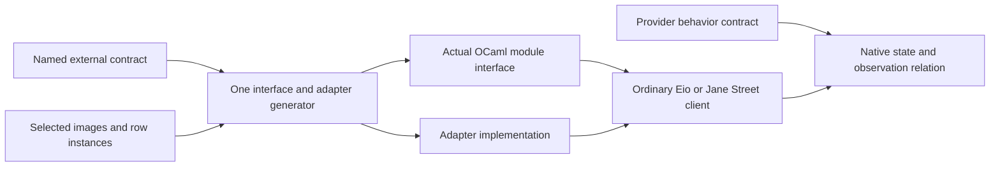

# A mathematical contract for a native OCaml module

Status: research proposal, not assigned proof work.
Decisions rows 391 and 392 remain in force.
Source review observes `69cbf348cee96f02bf2b2c932d1bb96f9cfbbd99` and preserves concurrent lowering edits.

The useful goal is a generated native module whose types and behavior implement a named external contract.
The contract must support ordinary clients of the selected OCaml library.
Generating familiar operations alone does not establish that connection.

## One external contract, four distinct claims

Let `D` name the external module contract.
It names native type paths, parameter kinds, sharing equations, value declarations and behavioral assumptions.
Serializable data components refer to existing `Ty`, `Modeled` and selected `Image` descriptions.
Native resources and mutable buffers instead carry state and ownership relations.
They need no invented serialization into `Store.Val`.

| Claim | Mathematical content | Existing basis and missing part |
| --- | --- | --- |
| Data exactness | `decode(encode a) = some a`; every accepted value belongs to the selected image | `Image` already carries both image laws. `Modeled.image` selects program-compatible frames on its checked fragment. Native conversion and scalar-profile relations remain required. |
| Target type-expression correctness | The emitted module interface realizes `D`'s arities, nominal identities, quantifiers and sharing equations | `Ml.Ty` handles ordinary applications, arrows and tuples. Signature items, sharing constraints, row polymorphism and existential provider forms are missing. |
| Provider behavior | Related native states and inputs produce only allowed results, exceptions, effects and successor states | `CallInstance` supplies instantiated columns. `RowProtocol` constrains requests and successful answers. Native effects, buffer ownership, cancellation and resource lifetime need additional provider contracts. |
| Client interoperability | The module can replace the declared provider in clients that respect its interface and behavioral premises | OCaml compilation checks actual client composition. A contextual refinement theorem needs a named client fragment, observation and native semantics. It is absent. |

An image equation does not establish native module typing.
A compiled module does not establish the provider contract.
A provider contract does not establish every possible client's behavior.
For a named client fragment, the intended conditional criterion is:

```text
ProviderSatisfies(P,D) and RelatedInputs and ClientRespects(C,D)
  imply projectedTraces(C[generatedAdapter(D,P)]) are included in allowedTraces(C[D]).
```

The observation includes public results, exceptions, external effects and ownership changes.
Ready calls must acquire no new stuck state.
Termination and fairness require separate premises.

## Generate an actual Eio interface

The installed Eio `flow.mli` already defines `Eio.Flow.Pi.SOURCE`.
Its abstract state has `single_read` and `read_methods` operations.
A generated adapter can expose this real interface:

```ocaml
module Attach (P : Eio.Flow.Pi.SOURCE) : sig
  type t = P.t
  val resource : t -> Eio.Flow.source_ty Eio.Resource.t
end
```

Its implementation can use Eio's existing `Pi.source` factory and `Resource.T` constructor.
This is an ordinary Eio resource, usable by `Eio.Flow.single_read` and existing Eio clients.
It is not a copied resource language.
The contract must retain the equation `Attach(P).t = P.t`.
It must bind the returned tag to the actual registered provider method.

The behavioral relation is stronger than that type equation.
Relate native state to an abstract byte stream and an ownership state for the destination buffer.
A successful read consumes the returned prefix, writes exactly that prefix and returns its length within the buffer's bound.
EOF, exceptions, cancellation and aliasing require explicit clauses.
`RowProtocol.post` cannot express all those clauses: it examines request and successful-answer values, not an arbitrary native heap.
The provider supplies this contract, either as an assumption or through separately retained proof evidence.
Generation cannot infer it from `P`'s OCaml type.

The same pattern applies to Jane Street interfaces.
A data module can retain `type t = Eff_types.service_key` and expose `Base.Comparator.S` with the same `t`.
That sharing supports ordinary maps without conversion through a shadow type.
Its comparison order, equality observation and relation to the selected value image remain separate contract choices.

## Minimal generation architecture

Use the external OCaml module interface as a distinct syntax sort beside implementation declarations in `OCaml5.Ml`.
Extend its existing type-expression data only for forms that a selected interface needs.
Keep `Ty` as program-value descriptions.
Do not turn native callbacks, module packages or Eio resources into new `Ty` constructors merely to render their interfaces.



`typeRows` supplies native spellings and declared scalar domains, not arbitrary module contracts.
`Types.kernelTy` drops value indices and proof fields.
It therefore cannot recover the external contract from an erased LCNF type.
The generator must consume `D` before that loss.

A possible verification scope concerns this small generator and its declared output fragment.
One property relates emitted type-expression data to `D`'s type interpretation.
Another relates the adapter's calls to the named provider operations under their contracts.
Proving those would require a target-fragment interpretation that the current estate lacks.
Structural fold agreement can remove duplicated traversals, but it does not supply that interpretation.
This scope neither proves the general LCNF translator nor restarts its paused proof plan.

## Reuse semantic precedents without importing their claims

[Osiris](https://cambium.inria.fr/~fpottier/publis/seassau-yoon-madiot-pottier-osiris-2025.pdf) supplies a concrete precedent for effectful provider specifications.
Its `find_first` example composes a client result contract from predicate and library-call specifications.
Its adequacy permits divergence.
OLang is sequential, has untyped dynamic semantics and excludes functors.
The OCaml-to-OLang translator is trusted.
It therefore does not supply the missing module-type generation theorem or a concurrent Eio theorem.

[Zoo](https://github.com/clef-men/zoo) is a positive precedent for concurrent OCaml 5 verification and includes Eio-related developments.
Its current library-build instructions require a custom generative-constructor compiler and `ocaml2zoo`.
Select a particular component, specification and revision before considering proof reuse.
The package's existence does not certify installed Eio `1.2` or Effect4's adapter.

## A decisive bounded first slice

Generate the `Attach` interface above and one provider implementation from the same named contract.
Compile a separate ordinary Eio client against both artifacts.
Retain controls for broken type sharing, an absent method, a wrong result type and an unsupported tag.
Run empty-stream, short-buffer, EOF, cancellation and escaped-resource cases under the declared observation.
Bind evidence to the source contract, exact generated files and installed library versions.
These checks establish their artifact and execution scope, not contextual refinement for every client.

**Placement.** `exact-codecs` and `store-typing` serve data conversion through R3.
`initial-algebras-folds` serves interface generation from one description.
`host-session-protocol` and `scope-lifetime-finalization` serve the provider relation through R6 and R11.
`translation-simulation` serves the native observation and client relation through R8.
**Consumer.** The named Eio provider adapter and its ordinary Eio client.
**Open.** The external-contract description, target-fragment interpretation, generated interface support and actual provider evidence.
These are optional design criteria, not new planned goals.
