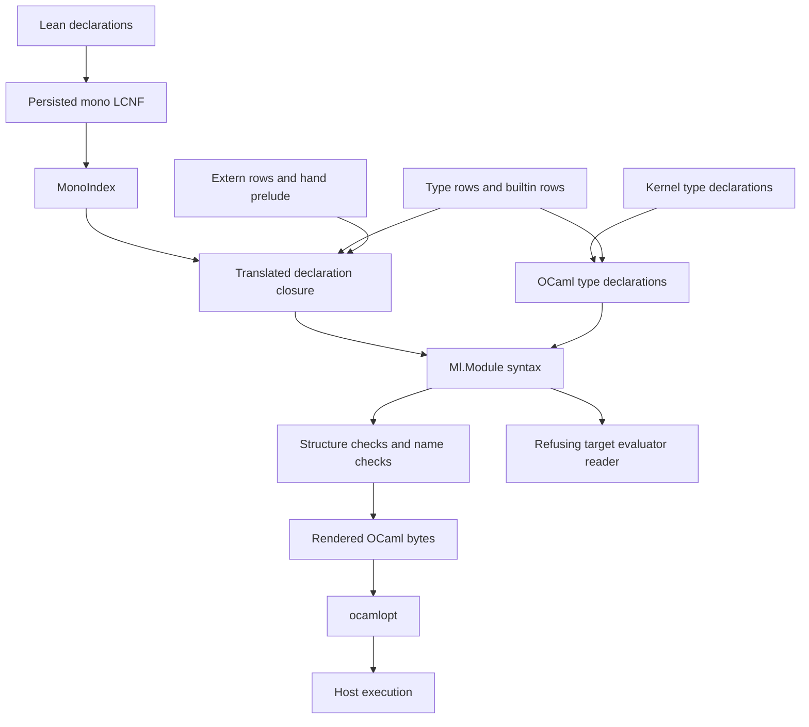

# The lowering and the public OCaml types

The route already separates generated machine code from host code.
Its public OCaml types expose more values than the Lean source types admit.
Abstract library types can close selected public construction paths without changing the machine's internal layout.
The finite controls in this directory demonstrate that option.

This note uses the vocabulary of `docs/core/controlled-english.md`.
The method follows the `lean-reification-target`, `lean-reification-audit` and `writing` skills.

## Scope and finishing criteria

This research finishes when it records the actual lowering path, retains decisive controls, and separates observations from proposed design criteria.
It changes no production source, authority, register, root or committed generated artifact.
It runs no Lake build or dune command.
The coordinator runs the Lean probe through the shared slot.
The OCaml controls compile isolated copies inside private temporary directories.

The review starts at `021b35c45e1a0a9b14c9354ffaa93b495c89e011`, on `refactor/phase1-phase3`.
The initial status includes another worker's edit of `src/OCaml5/Lcnf/ClockFlow.lean`.
During the review, HEAD advances to `57d352bbb0f14578de9e5302b41244e65ae19984`.
That commit changes the clock analysis.
This note makes no new claim about that analysis.
`pins.json` records the observed HEAD, source hashes, generated artifact hashes and compiled import hashes.

The Lean toolchain is `leanprover/lean4:v4.33.1`.
The OCaml controls use the existing `effect4` switch.
`pins.json` records `ocamlopt -config`, including version `5.1.1` and its architecture.
The compiler probe imports existing compiled modules.
It does not establish that every dependency rebuilds from the current sources.

Decisions rows 391 and 392 pause new lowering proof obligations.
Every mathematical property below is an optional design criterion.
This note adds no planned goal and resumes no paused proof work.

## The actual path



| Connection | Actual declaration and path | Evidence and boundary |
| --- | --- | --- |
| Persisted declarations to index | `persistedMonoIndex`, `MonoIndex.findIn?`, `src/OCaml5/Lcnf/Index.lean` | Source-reviewed. The index reads imported persisted entries and falls back to the environment lookup. It recompiles nothing. |
| Declaration closure to expression syntax | `translateClosureInferring`, `retranslate`, `code`, `letValueExpr`, `src/OCaml5/Lcnf/Translate.lean` | Source-reviewed. Missing rules record problems. The generator refuses those problems before writing. |
| Kernel types to type syntax | `kernelTy`, `typeInfo?`, `generate`, `src/OCaml5/Lcnf/Types.lean` | Source-reviewed. Inductives become variants. Structures become records or trivial aliases. Unknown fields become an abstract type and appear in the report. |
| Native scalar and container spellings | `typeRows`, `builtinTy?`, `src/OCaml5/Lcnf/TypeRows.lean` | Source-reviewed. Contract classes and domains are data. A class is not a theorem about its row. |
| Abstract storage substitutions | `Externs.parse`, `ExternFn.apply`, `carrierSignatures`, `src/OCaml5/Lcnf/Externs.lean` | Source-reviewed. The functor signature constrains types. Each substituted function's meaning remains assumed or tested. |
| Syntax checks and output | `Gen.run`, `src/OCaml5/Lcnf/Gen.lean` | Source-reviewed. The generator refuses closure failures, collisions, checker diagnostics, name captures and stale extern rows before writing. |
| Syntax to bytes | `render`, `src/OCaml5/Ml/Render.lean` | Source-reviewed. The renderer folds syntax into deterministic text. No printer-image theorem is checked here. |
| Syntax to evaluator | `ofExpr`, `assemble`, `tools/Conform/Effect4/LcnfMl.lean` | Source-reviewed. The reader refuses raw expressions and most labelled calls. It erases annotations. |
| Generated files to executable observations | `scripts/check-conform.py`, `ocaml/engine/test/test_diff.ml`, `ocaml/engine/tools/gen-check.sh` | Source-reviewed gate boundaries. This slice does not rerun those gates. |

The current recipe is `ocaml/gen/roots.json`.
Its program-type artifact is `ocaml/eff/eff_types.ml`.
The list machine and carrier machine open that artifact.
They declare no second program alphabet.
The older consolidation proposal K1 therefore already lands in the reviewed tree.

The recent history is `docs/research/2026-10-15-lowering-state/README.md`.
The cleanup receipt is `docs/research/2026-10-14-lowering-cleanup/receipt.md`.
The collation is `docs/research/2026-10-14-lowering-collation/README.md`.
Its proposed proof claims remain paused under row 391.

## What type translation keeps and loses

`isIrrelevantFieldType` removes proofs and type-former fields.
`trivialFieldIdx?` follows the compiler's trivial-structure verdict, with a recomputation fallback.
`typeParameterIndices` keeps sort parameters and the service-universe parameter.
It drops value parameters and instance parameters from OCaml type applications.
Computational dictionary arguments remain ordinary function arguments where the compiler keeps them.

`kernelTy` handles nondependent arrows and type applications from its admitted shapes.
It does not encode a dependent arrow as an indexed OCaml arrow.
A parameter such as `R : EffFam → Type` falls outside its current type-parameter rule.
The existing session investigation already reports this obstacle at `EffAlgebra`.
The LC-1 receipt also names missing primitive rows and a clock-ingress refusal on that session closure.
Those are historical probe results, not fresh session-generation results from this slice.

`monoTy` maps erased compiler types and `lcAny` to an anonymous OCaml annotation.
Some declarations omit their result annotation after carrier substitutions.
OCaml inference then supplies the type.
Neither operation reconstructs the erased Lean propositions or value indices.

The generated service identities illustrate a public consequence.
`ServiceName` and `ServiceTypeCode` are distinct structures in `src/Effect4/Machine/Key.lean`.
Both become transparent aliases of `int` in `ocaml/eff/eff_types.ml`.
`Lit_nat` also carries an unrestricted OCaml `int`.
The OCaml compiler therefore accepts domain mixing and negative values at construction.
This observation concerns public construction before the engine checks those values.
It does not establish that the engine executes those invalid values.

`TypeRows.typeRows` already records restricted scalar domains and approximate container representations.
`Nat` and `Int` share `int`.
`UInt64` and `USize` lack an exact full-range carrier there.
The translator refuses oversized `UInt64` literals.
It clamps oversized `Nat` literals to `max_int`.
`ClockMillis` instead uses `E4_clock.t`.
The profile arithmetic rows use the checked clock operations.
A public library must distinguish bit patterns, quantities, array indices and profile naturals before accepting richer external data.

## What the checker establishes

`Ml.Syntax` explicitly describes an untyped syntax.
Its type forms include variables, constructors, arrows, tuples and anonymous annotations.
Its declarations include ordinary types, bindings and parameterized modules.
They do not encode GADT result indices, private types, module signatures or effect handlers.
Adding those forms requires a real producer and corresponding fold consumers.
LCNF does not automatically produce every OCaml language feature.

`checkModule` checks selected structural properties.
It does not infer expression types.
It does not check record-field ownership or qualified names against external units.
`Expr.raw` and `Decl.rawD` are opaque.
`Expr.hole` checks only its filling.
A top-level `rawD` opens the module's value scope.
The current generated machine artifacts contain a raw `open Eff_types`.
Their value-name check therefore depends on later compilation for unknown names.
`hygieneProblems` separately checks capture against recorded dependencies.

This is an explicit division of work, not evidence that the generator emits every checker-accepted input.
`Gen.run` rejects the translator's recorded holes through its closure-problem check.

## Retained finite controls

The command results live in `checker-lean.log` and `ocaml-controls.json`.
The original probe syntax error lives in `checker-lean-initial.log`.
The corrected probe produces the retained files under `checker-generated/`.

| Input | Lean checker observation | OCaml compiler observation | Meaning |
| --- | --- | --- | --- |
| Integer addition | No diagnostic | Accepts | Positive control |
| Boolean plus integer | No diagnostic | Rejects the operand type | Structural acceptance does not establish typing |
| Missing unqualified name | Reports `unbound-value` | Rejects the missing value | The value-name control reaches its check |
| Same missing name after harmless `rawD` | No diagnostic | Rejects the missing value | Opaque declarations open value scope |
| Undeclared record label | No diagnostic | Rejects the label | Field ownership remains an OCaml check |
| A hole filled by `assert false` | No diagnostic | Accepts | Neither structural acceptance nor typing alone excludes a hole |

`flat_aliases.ml` compiles against an isolated copy of the current `eff_types.ml`.
It constructs a negative service name and a negative natural literal.
It passes a service name where a service type code stands.
Its executable checks those exact constructed values.

`scalar_boundary.ml` tests one alternative library interface.
It hides profile naturals and bit patterns behind distinct abstract modules.
Its checked constructors refuse a negative natural and an addition beyond the selected profile.
Its bit-pattern wrapper round-trips the retained `int64` edge cases.
The invalid control files fail compilation when they forge a natural or mix the modules' types.
The prototype assumes a nonnegative bound that fits the OCaml integer range.
Its callers instantiate that assumption explicitly.
It supplies finite evidence of the interface shape, not a generated implementation or a Lean theorem.

Reproduce the controls from the repository root:

```sh
bash scratch/lean-slot.sh env LEAN_NUM_THREADS=3 lake env lean --run \
  docs/research/2026-10-15-ocaml-seam-probes/lowering/CheckerProbe.lean \
  /private/tmp/effect4-lowering-checker-probe
python3 docs/research/2026-10-15-ocaml-seam-probes/lowering/run.py \
  --checker-dir /private/tmp/effect4-lowering-checker-probe
```

The retained compiler inputs also run without another Lean invocation:

```sh
python3 docs/research/2026-10-15-ocaml-seam-probes/lowering/run.py \
  --checker-dir docs/research/2026-10-15-ocaml-seam-probes/lowering/checker-generated
```

## Strongest directions

### Public abstract types around the generated representation

Keep the machine's generated representation internal.
Expose nominal service identities, checked profile naturals and checked programs through a small public signature.
The finite prototype shows the scalar part of this design.
The public constructor performs admission when erased source conditions matter.
A type alias alone supplies no such runtime check.

Optional design criterion: a public accepted value belongs to the image of the corresponding admitted Lean values.
The concept is `store-typing`, with `exact-codecs` for its conversion.
The question serves R3 and R8 as a boundary relation.
The reach includes selected data constructors and their checked domains.
It excludes arbitrary generated machine states and unsafe client operations.
Its consumer is the public OCaml library API.
This direction requires no new internal program representation.

### Distinct scalar profiles and exact bit patterns

Give quantities and bit patterns distinct carriers at the public boundary.
Reuse the existing profile refusal rather than turning overflow into a program error.
An exact `UInt64` bit-pattern carrier would also remove a known obstacle to richer values and codecs.
The current prototype checks only representation separation and selected round-trips.

Optional design criterion: the selected scalar operation returns the exact source answer inside its profile and refuses outside it.
The concept is `translation-simulation`, serving R8 and DI-56.
The question compares values and refusal classes under a stated scalar relation.
It excludes arithmetic cost and every unselected builtin row.
Its consumer is the public scalar layer and the relevant builtin rows.
This criterion does not resume the paused numeric proof work.

### Finish the session closure before broad library substitution

Use the existing session-root probe as the next compiler capability question.
Resolve its type-shape refusals and missing primitives as a bounded slice.
Keep higher-kinded and dependent types explicit in the declared fragment.
Do not silently flatten a new parameter shape merely because OCaml can infer something.
An Eio adapter can then consume the generated session's existing command and reply boundary.
It need not place an Eio object inside stored `Eff` syntax.

Optional design criterion: the selected session entry points generate without unknown fields, unresolved declarations or holes.
The concept is `host-session-protocol`, serving R6 and R8.
The question first asks for a positive generator and host run on exact roots.
Its scope includes the pinned session closure and its explicit primitive assumptions.
It excludes all Eio scheduling and resource-lifetime claims.
Its consumer is LC-7 and a library adapter above the generated session.

### Give external library entries explicit contracts

The existing builtin and extern tables supply the right location for foreign-library assumptions.
Keep the operation's stable identity, argument layout, result layout and domain together.
Keep state changes and cancellation observations with the host adapter's contract.
A function's OCaml type constrains its calls but does not establish its behavior.

Optional design criterion: each tested target observation belongs to the source operation's allowed observations under a named environment relation.
The concept is `translation-simulation`, with `host-session-protocol` for externally visible actions.
The question serves R6 and R8 as a simulation relation.
Its reach names the operation, state relation, results, refusals and relevant cancellation behavior.
It excludes fairness or progress unless the adapter states those premises.
Its consumer is the library adapter and its focused outside-implementation differential.
This remains a design question under row 391.

### Add only the target syntax that a public consumer needs

An abstract public API may need signature declarations or a separate interface artifact.
That need is narrower than rebuilding the archived general OCaml syntax.
Extend the canonical fold when a generator starts producing that form.
Keep opaque host implementation bodies visibly outside the executable fragment reader.
Row 29 still reserves the deeper common-target design for its stated customer.

Optional design criterion: the emitted public signature and implementation compile together from the same artifact recipe.
The concept is `translation-simulation`, serving R8's named connections.
The question concerns an exact artifact pair and its compiler acceptance.
It excludes a theorem about parsed bytes or the entire OCaml language.
Its consumer is the public OCaml package build.

## Evidence boundary

The route trace and limitations are source-reviewed.
The checker controls and standalone OCaml controls are finite tested evidence.
This slice contains no theorem with a fresh axiom receipt.
`let_return_outcome` in `tools/Conform/Lcnf/TargetLaws.lean` is an existing local evaluator theorem.
Its stated assumptions and fuel relation do not establish the whole lowering route.
The historical cleanup receipt records its tooling trust boundary.
This slice does not rerun that axiom gate.

Lean's compiler and erasure, the translator, extern implementations and `ocamlopt` remain named assumptions under row 391.
The current behavior gates remain the practical check of those boundaries.
The optional criteria above neither strengthen their evidence nor add mandatory proof work.
