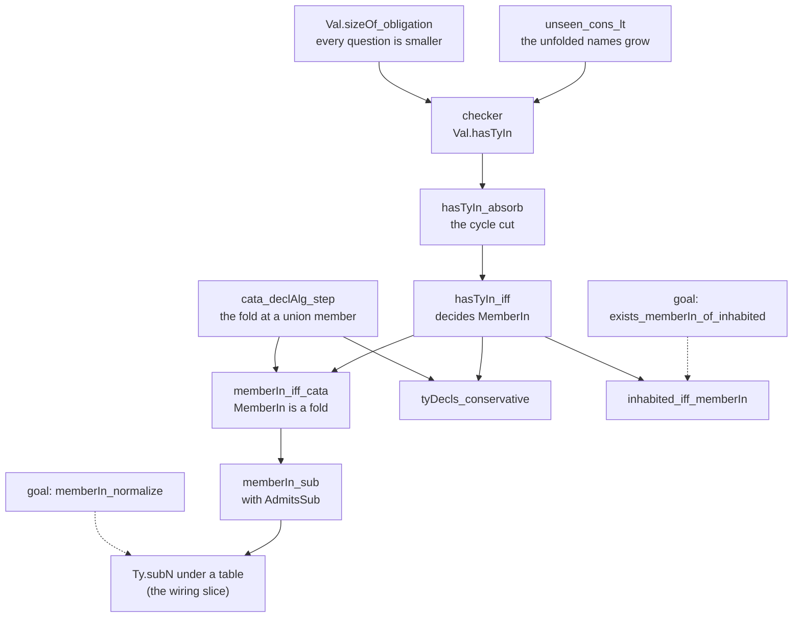

# 2026-10-15 Recursive types: the formal foundation

Status: research note (history, not authority). Base: `60f4d7f18` on `refactor/phase1-phase3`.
Seat RECTYPES wrote it at the owner's request of 2026-10-15. The request: a little formal work
first, so that the mathematics of recursive types is solid before they enter the core. The probe
that precedes it is `README.md` in this folder. The receipt is `receipt.md` in this folder.

## The one thing to know first

Membership under a declaration table is an inductive predicate, so it is the least fixed point.
A checker with a well-founded measure and no fuel decides it on every table, guarded or not.
The unchanged order `Ty.sub` keeps its members, and the empty table changes no existing answer.
All four statements are proved in `src/Effect4/Laws/Program/TyDecls.lean`. Three properties remain
planned goals. They are the completeness of inhabitance against `MemberIn`, normalization
invariance, and one fixed point on a guarded table.

## Question

What is the mathematics of recursive types in this tree, stated precisely, and which of its
statements hold in Lean before the core changes? The slice builds beside `Val.hasTy`, `Fits` and
`Ty.sub` and edits none of them.

## What was read or run

- Read: the probe (`README.md`, `probes/Recursive.lean`); decisions rows 124, 158, 398 (4) and
  400; `docs/core/semantics.md` §§1.4, 2.1, 2.5 and 2.6 (reading).
- The reuse pass read these owners (reading):
  - `Val.hasTy` and `namedHasTy` (`src/Effect4/Program/Typed.lean`);
  - `Fits` (`src/Effect4/Laws/Program/Typed/Membership.lean`);
  - `inhabitedAlg` (`src/Effect4/Program/Columns.lean`);
  - `Ty.sub` and `Ty.members` (`src/Effect4/Program/Ty.lean`);
  - the fold `Val.hasTy.alg` and its order condition `AdmitsSub`
    (`src/Effect4/Laws/Program/TyView.lean`, `src/Effect4/Laws/Program/Admits.lean`);
  - `ShapeDoc.acceptsAt` (`src/Effect4/Store/Domain/Shape.lean`);
  - `Document` (`src/Effect4/Schema/Document.lean`).
- Proved: the laws named below, built with `lake build` and audited with `#axiom_audit` at
  `[propext, Quot.sound]`; the receipt holds the commands and their output.
- Tested: the probe's tables in `Test/Program/TyDecls.lean` (finite evaluations and red
  controls); tsgo 7.0.0-dev.20260629.1 on `probes/oracle/guarded.ts` (output in
  `probes/oracle/guarded.log`).

## 1. The table: a system of type equations

A **declaration table** Δ is a list of entries `(nᵢ, Tᵢ)`, a name and a body (`TyDecls`,
`src/Effect4/Program/TyDecls.lean`). A body is an ordinary `Ty`. It refers to a declaration,
itself included, by a nominal reference: `app n args`, or its normal form `handle n`
(`Ty.normalize_app_nil`). No `Ty` constructor is added (rows 124 and 158).

The table is a system of equations `Xᵢ = Tᵢ(X₁, …, Xₖ)` with one unknown per name. The tree reads
it **iso-recursively** in the sense of TAPL §20.2. A name never equals its body in the order:
`Ty.sub` compares names, never bodies. Membership unfolds a name where it asks about it, and
nowhere else. A value needs no marker for this unfolding, since the value tree is the same under
both readings.

A name a table does not declare keeps today's meaning, an opaque host reference read by the
handle arm. A declared name shadows the handle arm at both spellings. So an external handle
allocated at the spelling `Tree` is no member of a declared `Tree` (a control in
`Test/Program/TyDecls.lean`).

**Monomorphic first.** A declaration takes no parameter, and a declared reference ignores its
arguments. Formation refuses a declared name at a non-empty argument list (the wiring slice).

**Parameters next: regular recursion.** An entry becomes `(n, [α₁ … αₘ], T)`, and
`app n [A₁ … Aₘ]` unfolds to `T[A/α]`. The recursion is regular when every recursive occurrence
in `T` is `app n [α₁ … αₘ]` with the parameters unchanged. Then unfolding one reference reaches
finitely many types, so a finite iteration can still decide guardedness and inhabitance (a
proposal, not proved). Nested recursion, such as `N<T> = T | N<T[]>`, is out of reach. Each parameter's variance is its
polarity in `T`, which fills the variance table by name (`Ty.argVariance`, row 158).

## 2. Membership: the least fixed point

`MemberIn Δ al v t` (`src/Effect4/Laws/Program/TyDecls.lean`) is an inductive predicate over the
allocation table `al` of the shape check. It has four rules:

```text
  v ∈ l                    v ∈ r                    Δ.unfold? t = (n, B)    v ∈ B
───────────── left      ───────────── right       ──────────────────────────────── unfold
 v ∈ l ∪ r               v ∈ l ∪ r                             v ∈ t

 Δ.unfold? t = none    obligations v t al = qs    ∀ (x, u) ∈ qs, x ∈ u
──────────────────────────────────────────────────────────────────────── step
                                v ∈ t
```

`Val.obligations v t al` is one step of `Val.hasTy`, read one level. It matches the value's
shape against the type's head and returns the questions left: each child value with the type it
must fit. A leaf answers `some []` when it fits, and a union has no step. Every question is about
a strictly smaller value (`Val.sizeOf_obligation`, proved).

**Why the least fixed point.** Values are finite trees, so a member should have a finite reason.
An inductive predicate holds exactly where a finite derivation exists: it is the intersection of
the relations closed under the rules (Aczel, 1977). The greatest fixed point would accept
circular reasons. For `A = A` it admits every value, and no finite value of `A` exists. On a
guarded table the two fixed points agree (§3), so there the choice is forced, not taken.

**The fold reading.** `memberIn_iff_cata` (proved) states `MemberIn` as the admission fold
`Val.hasTy.alg` with each declared name read from an oracle (`declAlg`). The oracle is the
checker at the name's body (`checkerOracle`). This is the Knaster–Tarski reading. By
`hasTyIn_absorb` and `memberIn_iff_cata`, the checker's oracle is a fixed point of the map
`o ↦ (n ↦ fold_o(body n))`. The planned goal of §3 states that on a guarded table it is the only
one.

## 3. Guardedness (contractivity)

A table's head graph links a declared name `n` to each declared name among the union members
of `n`'s body. A table is **guarded** when its head graph has no cycle (`TyDecls.guarded`). Every
cycle of the table then passes a value constructor. `TyDecls.unguardedAt?` names the first name
on a cycle, for a located refusal of the table.

Guardedness buys three things:

1. One fixed point. On a guarded table every fixed point of the fold admits exactly the members
   of each body (the planned goal `guarded_fixedPoint_unique`). `A = A` shows the premise is
   needed. The constant oracle `true` is a fixed point there, and `MemberIn` has no member (a
   red control, proved in `Test/Program/TyDecls.lean`).
2. The TypeScript face. tsgo 7 refuses the probe's three unguarded tables with TS2456. It
   accepts a guarded list and a guarded, empty stream (tested, `probes/oracle/guarded.log`).
3. The Schema face. The bridge can write each recursive reference of a guarded table under
   rc.112's `Suspend`, a delay, never at a document's head (§8).

It does not buy two things:

- Decidability. The checker decides `MemberIn` on every table (§4).
- Inhabitance. `Stream = {head: nat, next: Stream}` is guarded and has no finite value
  (`TyDecls.inhabited`, §5). This is the distinction `Schema/Document.lean` keeps as `SC-DOC-06`.

## 4. The decision procedure, without fuel

`Val.hasTyIn Δ S v t al` reads `t` by its union members (`Ty.members`). A member that references a
declared name `n ∉ S` unfolds to `n`'s body with `n` added to `S`. A member that references a name
in `S` answers `false`. Every other member answers its step's questions, each with `S` empty. The
public form passes `S = []`.

The measure is lexicographic in two numbers. The first is the value's size (`sizeOf`). The second
counts the entries whose names `S` lacks (`TyDecls.unseen`). An unfolding keeps the value and
lowers the second number (`unseen_cons_lt`, proved). A step lowers the first
(`Val.sizeOf_obligation`, proved). The type's size, which the probe's note proposed as a third
number, is not needed. A union is read by all its members in one call.

**Agreement** (`hasTyIn_iff`, proved): the checker answers `true` with `S = []` exactly when
`MemberIn` holds, on every table. The checker is sound against `MemberIn` by its own induction
(`memberIn_of_hasTyIn`). It is complete against `MemberIn` by rule induction with one more
lemma, the cycle cut (`hasTyIn_absorb`). A success that meets a name again also succeeds from that
name's first unfolding. So the names in `S` never refuse a member, and an unguarded table needs no
special case.

The checker is a hand traversal with a well-founded measure, as `Ty.sub` is. It is not a fold,
because an unfolding is no structural step. `Val.obligations` is a one-level case analysis, and
its leaf arms call `Val.hasTy` itself.

## 5. Inhabitance: the least fixed point over the table

Let `K₀` be empty, and add to `K_{j+1}` every declared name whose body `inhabitedAlg` calls
inhabited when the names in `K_j` count as inhabited. Stop when a round adds no name
(`TyDecls.inhabitedFrom`, well founded on the names not yet known: no fuel). The answer is the
least fixed point of this round, and `TyDecls.inhabited` reads a type under it.

- Inhabitance is sound against membership: a type with a member is inhabited
  (`inhabited_of_memberIn`, proved). So a column refused as empty has no member.
- Inhabitance is complete against membership: an inhabited type has a member at some
  allocation table (the planned goal `exists_memberIn_of_inhabited`). Two routes are written on the
  goal. One builds a witness arm by arm, with fresh external indices, as
  `fits_of_inhabited_fresh` does. The other unrolls each known name into a type with no declared
  name, then reuses `inhabited_iff_fits`.

## 6. Subtyping stays nominal

`Ty.sub` does not change. A declared reference is below itself by name, below `unknown` and
inside a union, and `never` is below it. No rule compares a name with its body, or two bodies.

**Sound for membership under every table** (`memberIn_sub`, proved). The proof is no new
induction over the order. `MemberIn` is a fold (`memberIn_iff_cata`), and the fold condition of
the order, `AdmitsSub`, holds for it (`declAlg_admitsSub`). The one new arm, a declared reference,
reads one oracle answer at both ends of the order. Then `cata_admits_sub` applies as it does for
`Val.hasTy`.

**Not adopted: structural recursive subtyping.** Amadio and Cardelli (1993) and Gapeyev, Levin
and Pierce (2002) compare recursive types by their infinite unfoldings. That order is a greatest
fixed point, and TAPL §21.11 gives its iso-recursive form. Three reasons keep it out:

- Row 158 rules subtyping by name with declared variances.
- A coinductive order needs an algorithm with a set of assumptions. That algorithm is no fold,
  so the fold condition `AdmitsSub` would not carry its soundness.
- tsgo compares aliases structurally, and the nominal order is narrower. Its one new step at a
  declared name is reflexive, which a structural order also takes (reading).

`Ty.subN` reads normal forms, and normalization spells `app n []` as `handle n`. The checker
reads a declared name at both spellings, so membership should be invariant under normalization.
That is the planned goal `memberIn_normalize`, which `fits_subN` under a table will need.

## 7. Conservativity

`tyDecls_conservative` (proved) has three parts. On the empty table the checker is `Val.hasTy`,
from any set of unfolded names. `MemberIn` is `Val.hasTy`'s answer. `TyDecls.inhabited` is
`inhabited`. So every statement over these three reads the empty table unchanged.

This is the shape M7 needs from the wiring slice. That slice gives `Fits` and `Val.hasTy` the
table. Every existing statement then becomes the empty-table instance of a statement over the
table. `Fits` takes no table in this slice, so nothing here is yet a statement about `Fits`.

## 8. The faces, as exact embeddings

Each face owes an exact embedding (`docs/core/semantics.md` §2.5): totality on its domain, a
retraction, and exactness modulo a named normaliser. None is built in this slice. Each is
stated here for the slice that builds it.

| Face | Write | Read | Laws owed | Evidence today |
| --- | --- | --- | --- | --- |
| Schema (rc.112) | `{representation: Reference n, references: {n: schema(body)}}`, each recursive reference under `Suspend` | the references table back to Δ | retraction; exactness modulo `normS` and row 8 (C)'s table policy | rc.112 decodes the probe's tree and refuses the bad one (tested, `probes/oracle/schema.log`); the bridge refuses a recursive reference today (row 398 (4)) |
| Lean data | `toVal` of a recursive inductive, by structural recursion | `ofVal`, by structural recursion | `Image` (both laws), and `MemberIn Δ al (toVal a) (app n [])` for every `a`: the recursive `modeled-membership` | the probe's `Tree.image` with both laws, checked by Lean in the probe's run (tested; not built, not audited) |
| TypeScript | `export type N = …` per declaration | a declared name back to `app n []` | the module round trip at the table | tsgo accepts the probe's aliases after two repairs (tested, `probes/oracle/tsgo.log`), and refuses the unguarded ones (tested, `probes/oracle/guarded.log`) |

## 9. The literature: what is adopted and what is cut

| Work | Locator | Adopted | Cut |
| --- | --- | --- | --- |
| Pierce, *Types and Programming Languages* (2002) | §20.2 "Formalities", p. 275 (audit T110) | the iso-recursive reading: a name never equals its body | the equi-recursive reading |
| Pierce (2002) | §§21.1–21.2, pp. 282–284 (audit T110) | membership of finite values as the least fixed point | infinite types and their greatest fixed point |
| Pierce (2002) | §21.8 "µ-Types", p. 299 (audit T55) | contractivity, as guardedness of a table | µ-binders: a table names its fixed points |
| Pierce (2002) | §21.11 "Subtyping Iso-Recursive Types", p. 311 (audit T55) | none | the structural order on recursive types |
| Pierce (2002) | §19.3 "Nominal and Structural Type Systems", p. 251 (audit T107) | the nominal order | the structural one |
| Aczel, "An introduction to inductive definitions" (1977), by name | none | an inductive definition as the least set closed under its rules | none |
| Amadio and Cardelli, "Subtyping recursive types" (1993), by name | none | none | the structural, equi-recursive order |
| Gapeyev, Levin and Pierce, "Recursive subtyping revealed" (2002), by name | none | none | the coinductive subtyping algorithm |

## 10. Placement of each obligation

Every row below has one concept and one property: `store-typing` (concept 1 of
`docs/core/semantics.md`). The property is that membership is a judgment with a decision
procedure, closed under the order, invariant under normalization, with inhabitance as its
emptiness test. Every row serves R3, whose open part on recursive types it narrows.

| Obligation | Question: claim, role, pointer | Reach | Does not establish | Unlocks |
| --- | --- | --- | --- | --- |
| The checker decides membership | `recursive-types-decided`, decidability, `hasTyIn_iff` (proved) | every table, value, type and allocation table | anything of `Fits`, a world or a store; a host validator's answer | the wiring slice's checker |
| Iso-recursive unfolding | `recursive-types-unfold`, inversion, `memberIn_unfold_iff` (proved) | a reference at either spelling, every table | formation of the table | the inversion lemmas of `Fits` under a table |
| Conservativity | `recursive-types-conservative`, compatibility, `tyDecls_conservative` (proved) | the empty table | anything of `Fits` | M7's statements as empty-table instances |
| The order is sound for membership | `recursive-types-sub`, preservation, `memberIn_sub` (proved) | `Ty.sub`, every table | `Ty.subN` (waits on the normalization goal) | `fits_sub` under a table |
| Inhabitance agrees with membership | `recursive-types-inhabited`, decidability, `inhabited_iff_memberIn` (modulo `exists_memberIn_of_inhabited`) | every table and type | anything of a world | the table's column admission (rows 127 and 149) |
| Normalization invariance | `recursive-types-normalize`, compatibility, the goal `memberIn_normalize` | every table | anything of `Fits` | `fits_normalize` and `fits_subN` under a table |
| One fixed point on a guarded table | `guarded-fixed-point-unique`, compatibility, the goal `guarded_fixedPoint_unique` | guarded tables; the red control bounds it | anything at an unguarded table | the argument that guardedness fixes the meaning, which the table's admission reads |

The order of the proofs, and what rests on what:



The diagram shows proof dependencies only. It claims no status beyond the labels, and the
plan (`#plan_status`) measures each node's status.

## Proposals (not rulings)

1. A table's admission as a located refusal. It asks distinct names, no internal handle
   spelling as a name, closed bodies, no argument at a declared name, and guardedness. It
   refuses an unguarded table at the name on its cycle. The receipt proposes it as a decisions
   row.
2. The wiring slice: the table in the world, beside the allocation table. `Val.hasTy` becomes
   `Val.hasTyIn` at the world's table, and `Fits` gains the same unfold rule. The laws of this
   note are the statements it must keep.
3. Parameters by regular recursion, with each variance read off its parameter's polarity.

## What this does not establish

- Nothing of `Fits`, a world, a store or a run: `MemberIn` is the declarative form of the shape
  check `Val.hasTy` at an allocation table.
- No formation of a table: guardedness is a function, and no admission reads it yet.
- No face: the Schema, Lean and TypeScript embeddings are stated, not built.
- Three properties are planned goals, not proved: inhabitance complete against membership,
  normalization invariance, and one fixed point on a guarded table.
- No bound on the checker's cost. A union of declared names explores every member.
- The tsgo and rc.112 results are finite runs on hand-written files.
