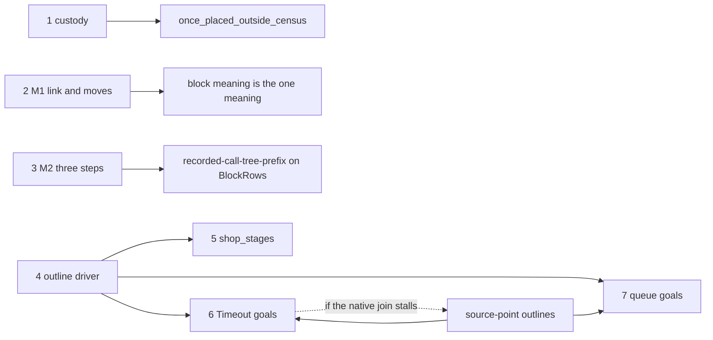

# 2026-10-15 The remaining meanings work: routes, one schema, and the plan

Status: a research note of the probe seat (history, not authority). Base: the main branch
`refactor/phase1-phase3` after the integration commit `9c36aff48`, which builds `Effect4`,
`Effect4.Laws` and `Test` with the three gates. The probes ran against that build's oleans. The
counts were taken at `212295674`, whose `src/Effect4/Laws` and `Test` differ from `9c36aff48` in
one file outside Codex's. The brief is the coordinator's launch message of 2026-10-15. No tracked
source was edited.

Evidence words follow `docs/core/controlled-english.md` §3.8. **Proved** means kernel-checked and
audited by `#axiom_audit` at `[propext, Quot.sound]`. **Reading** means established by reading the
named source. **Measured** means the output of a named command. Every probe lives in
`docs/research/2026-10-15-remaining-work/probes/`, and its audit output is `probes/audit.log`.

The probes ran through the shared slot, from the main tree, with the commands below. `<out>` is a
scratch directory. `M2Prefix` and `M2FundedControl` compile from the overwatch's directory the same
way.

```sh
scratch/lean-slot.sh lake env lean -DwarningAsError=true probes/Status.lean
scratch/lean-slot.sh lake env lean -DwarningAsError=true --root=probes -o <out>/X.olean probes/X.lean
scratch/lean-slot.sh bash -c 'LEAN_PATH=<out>:$(lake env printenv LEAN_PATH) lean probes/Audit.lean'
```

Three new words. A **driver** is a decision lift (`Lift.DecisionLift`,
`src/Effect4/Laws/Machine/Lift.lean`) that carries a program's invariant with its command-queue
and snapshot assertions. The snapshot is the task list that a `fire` drains. A **proof world** is an
external ghost state ordered by a future relation (`Effects.WorldOrder`), as Codex's
`StageWorld.World` is. An **outline** is a program's per-fiber assertions at a proof world, with
the classes of codes and exits that the fiber's parks and exits admit.

## 1. The one thing to know first

The six goals need no paused theory. Five need one generic driver, and the sixth needs one release
balance.

- **The finalizer goal is one release balance away (proved assembly).** The probe
  `probes/FinalizerAssembly.lean` derives `FinalizerRun.once_placed_outside_census`
  (`src/Effect4/Laws/Program/FinalizerRun.lean`) from Codex's proved source ledger and one planned
  goal, `release_custody`. That goal is the per-path release balance, which `ReleaseCustody`
  already proves on the direct fragment. The assembly needs no census premise. Its audit: 70
  declarations within `[propext, Quot.sound]`, two of them modulo that one goal (measured).
- **The other five goals each lack the same piece: their driver.** Codex built four drivers, each
  with its own command and snapshot assertions: the allocation phase, the crews, the shop and the
  fetch. Their transport files total 8,216 lines (measured, §4). Each open goal's last open list
  includes its driver's unfinished part, and the shop's list holds nothing else (reading, §2).
- **The schema is a driver with derived assertions (proved from local obligations).**
  `outline_driver` (`probes/OutlineDriver.lean`) reads the command and snapshot assertions off
  three classes, so no program writes its own. It is proved from seven local obligations, which a
  program supplies. `shop_stages_of_lift` (proved, same file) reduces `Atomic.Store.shop_stages`
  (`Test/Dogfood/Scenario/Atomic/Store.lean`) to one decision lift whose assertion reads to the
  stage observation.
- **The diagnosis holds for five goals and fails for one.** The five are whole-history invariants
  of concrete multi-fiber programs, threaded through every command. The finalizer goal is a
  linearity law over every program, and its weight ledger is generic.
- **The paused theory would not shorten them.** CONC-1's claim is equal observations at rest. The
  goals hold at every cut of a run, and they read the trace, the race records and the fork ledger,
  which `obs` excludes.

## 2. Per goal: the open obligations and whether they converge

`#plan_status` reports all six as planned goals, and their scenario claims modulo them
(measured, `probes/status.log`). The crew log goals report proved. The table's "remaining" column
quotes each line's last open list. A `grep` finds no decision lift and no history lift yet for the
shop or for the fetch's numeric configuration (measured).

| Goal | Proved toward it | Remaining (the line's last open list) | Converging | Statement |
| --- | --- | --- | --- | --- |
| `Timeout.cleanup_keeps` (`Test/Dogfood/Scenario/Timeout.lean`) | the numeric phase and its readers (`HostTimeoutNumberPhase.Phase.cleanup_observation`, `Test/Dogfood/Proofs/HostTimeoutNumberPhase.lean`), per-role native facts, the controls `CommandCut`, `FinishCut`, `SourceCut` | "the full native case join, root race births, active command producer, and both endpoint histories" (`timeout-checkpoint.md`, section 53; section 54 restates both goals open) | no | unchanged; no counterexample known |
| `Timeout.retries_declared` | the same phase, `Phase.retry_observation`; the reply-based form is refuted (`TimeoutCounterexample.replyBasedRetry_refuted`, `Test/Dogfood/Proofs/TimeoutCounterexample.lean`) | the same list, with "the declared failure origin" | no | already corrected to completed forms |
| `QueueWorkers.Assertions.jobs_step` (`Test/Dogfood/Scenario/QueueWorkers/Assertions.lean`) | the ledger algebra (`Accounting.heldWithin_of_ledger`, `Test/Dogfood/Scenario/QueueWorkers/Ledger.lean`), the request stages and site facts (58 files, `Test/Dogfood/Proofs/QueueWorkers*.lean`), the counter history (`QueueWorkersCountCell.history`, `Test/Dogfood/Proofs/QueueWorkersCountHistory.lean`) | "the remaining producer must join actual source control, job custody and the physical queue table" (`seat-queue-callbacks-receipt.md`, last section) | not yet: its coupled history is not started | corrected in main: `fedOf` reads the offer-entry trace, `RefReplyControl` is reached from `Test/All.lean` |
| `QueueWorkers.Assertions.rest_step` | `Accounting.accounted_of_ledger`, `quiet_nil`, `spent_one` | committed delivery custody, interrupted withdrawal, wake-to-wait correspondence (its docstring) | not started | unchanged |
| `Atomic.Store.shop_stages` (`Test/Dogfood/Scenario/Atomic/Store.lean`) | the stage world, the configuration and its reading `StageWorld.observation_fit` (`Test/Dogfood/Scenario/Atomic/StageObservation.lean`), every write site, every role's frame outline | "the complete pending-suffix transport, detached-snapshot join and command-history instance" (`docs/research/2026-10-14-seat-atomic-native-receipt.md`, last section) | yes | unchanged; no counterexample known |
| `FinalizerRun.once_placed_outside_census` (`src/Effect4/Laws/Program/FinalizerRun.lean`) | `FinalizerSource.source_funded_reachable` (`src/Effect4/Laws/Program/FinalizerSourceHistory.lean`): the full source ledger on every raw history | `release_custody` (`probes/FinalizerAssembly.lean`): the per-path release balance on every program and raw history; `ReleaseCustody.Execution.history` (`src/Effect4/Laws/Program/ReleaseCustody/Execution.lean`) proves it on the direct fragment, over admitted histories | yes | unchanged |

**Convergence, measured on the Timeout line.** The checkpoint
(`docs/research/2026-10-14-meanings/timeout-checkpoint.md`) has 54 sections (measured:
`grep -c '^## '`). Sections 10 and 12 to 54, all but section 43, state what remains open
(measured: `awk` over "remain open" and "remains open"). Section 10 names the initialized source-control
family and the numeric command producer. Section 53 names the native case join, the race births,
the command producer and both endpoint histories. Each section between them refines one internal
certificate (reading). The Atomic list narrowed to the driver, and the finalizer list to custody.

**Statements under row 390.** No goal is shown false (reading). The queue clause was false as
written and is already corrected in main. `fedAt` (`Test/Dogfood/Scenario/QueueWorkers/Model.lean`)
reads the job that reaches the feeder's offer continuation, so delayed reads count. Two premises
of truth are worth naming, from Codex's checked controls:

- the fetch's cleanup log relies on the race awaiting its loser before the form returns;
- a forced yield lands at an entry, before the attempt installs its finalizer. `CommandCut.lean`
  shows the log entry `[0, true]` when an internal queue is reused, a path outside the scripts.

## 3. The schema, with its probe

### 3.1 The diagnosis, tested

The coordinator's reading is confirmed for five goals, with two corrections.

| Part of the reading | Verdict | Evidence |
| --- | --- | --- |
| each goal is a whole-history invariant of a concrete multi-fiber program | five of six; the finalizer goal quantifies over every program (`once_placed_outside_census` takes `p : NativeEff`) | reading |
| Codex threads each invariant through every native command, bottom-up | yes: four drivers, each with its own command assertion: `Initialized.CommandDemand` (`src/Effect4/Laws/Program/AnswerSlots/InitializedQueue.lean`), `AllocationAdapter.PendingCommand` (`src/Effect4/Laws/Program/AnswerSlots/AllocationQueue.lean`), `StageConfiguration.CommandAt` (`Test/Dogfood/Scenario/Atomic/StageQueue.lean`), `HostTimeoutNumberCountQueue.Targets` (`Test/Dogfood/Proofs/HostTimeoutNumberCountQueue.lean`) | reading; line counts in §4 |
| the paused scope and many-fiber theory would make them short | no | below |

CONC-1 (`docs/research/2026-10-14-many-fibers-scout.md`) aims at `H9Fibers`: a reached, funded run
at rest has the handled meaning's exits and stores. The goals differ in three ways (reading):

- they hold at every cut of a run, including budget frontiers at any command budget
  (`ControlHistory` takes a fuel per decision);
- they read the trace (`fedAt`, `FinalizerRun.registeredAt`), the race records and the fork ledger
  (`completedForms`), which `obs` excludes;
- an outline over trees would state positions through function continuations, where the frame
  machine names them as source points.

SCOPE-1's stage 5 brings host interruption into the meaning. It serves M2's widening (§6), not
these goals.

### 3.2 The candidates, weighed

| Candidate | In the tree | What it leaves |
| --- | --- | --- |
| Owicki–Gries over fibers | yes: `AnswerFlow.Model`, `SavedAt`, `StackAt` (`src/Effect4/Laws/Machine/AnswerFlow.lean`) are per-fiber outlines with a future relation; `StageWorld.order` (`Test/Dogfood/Scenario/Atomic/StageWorld.lean`) and `StageRoles.request_other` (`Test/Dogfood/Scenario/Atomic/StageRoles.lean`) are the shop's interference freedom | the driver |
| a fiber-local residual law (G2) | as `AnswerFlow.Flows` with the command facts `AnswerFlow.Commands` (`src/Effect4/Laws/Machine/AnswerFlowRun.lean`) | the driver; a separate G2 law is not needed |
| an interference-free product over `withCoupledFact` | yes: `AnswerFlow.Local.decision_lift` is the product `base.withMachineFact (Flows G)` | its base's `Ready` carries no program classes, so each program writes its own base |
| SCOPE-1 stage 5 | no | serves M2, not these goals |

The four candidates meet at one gap. `Local.decision_lift` asks each command's fact `Ready` from a
base driver. The generic bases record only world-free facts: `CodeClosure.Configuration.CommandAt`
(`src/Effect4/Laws/Program/CodeClosure/Configuration.lean`) keeps a resume's code in `model.code`
and `TerminalReply`. A program needs more: its reply classes at the proof world, and structural
facts about queued commands. So each program wrote a base: the allocation phase, the crews, the
shop and the fetch. Their command assertions share a program-independent part and a class part:

- program-independent: a queued finish names a fiber with an empty stack
  (`Initialized.FinishEmpty`, `src/Effect4/Laws/Program/AnswerSlots/InitializedAdmin.lean`;
  `StageConfiguration.FinishAt`). A queued local command's host runs a fiber action
  (`Initialized.AdminHead`, the same file);
- the class part: a queued resume installs a code its parked fiber admits
  (`StageConfiguration.ReplyPermission`; `AllocationAdapter.ReplyTask`,
  `src/Effect4/Laws/Program/AnswerSlots/AllocationTasks.lean`).

### 3.3 The schema in Lean

`probes/OutlineDriver.lean` states it and proves its outer layer against the integrated tree.

```lean
structure Classes (World : Type) where
  reply : World → FiberId → Nat → NCode → Prop
  final : World → FiberId → ExitV → Prop
  live : World → SourceScope.SourceFiber → Prop

def CmdAt (C : Classes World) (w : World) (m : NativeMachine) : SourceScope.SourceCommand → Prop
  | .loop owner _ => ∀ f, m.fiber? owner = some f → C.live w f
  | .deliver owner _ => ∀ f, m.fiber? owner = some f → C.live w f
  | .resume owner token code => ∀ f, m.fiber? owner = some f → f.parked = .withGuard token →
      C.reply w owner token code
  | .finish owner exit => C.final w owner exit ∧ ∀ f, m.fiber? owner = some f → f.frame.stack = []
  | _ => True

theorem outline_driver (root : NativeEff) (table : RowTable) {World : Type} (O : Outline World)
    (obligations : Obligations root table O) :
    letI := evaluatorFor root table
    Lift.DecisionLift O.order (interpOf root table) O.J
      (fun w m commands => ∀ c ∈ commands, CmdAt O.classes w m c)
      (fun w m tasks => ∀ t ∈ tasks, TaskAt O.classes w m t) O.admits
```

The finish clause's empty stack is the first program-independent clause; the queued local
command's fiber action (`Initialized.AdminHead`) is the next to add. `Obligations` lists what a
program supplies, each local:

| Field | What the program proves | Where Codex has it |
| --- | --- | --- |
| `load` | the load meets `J` | the allocation adapter's entry (`RootGraph.initializer_entry`, `Test/Dogfood/Scenario/Atomic/RootFrame.lean`) |
| `command` | one command with its own derived entry keeps `J` and classes the commands it emits; `driveStep … []` reads the emitted commands only | the native producers (`StageNative*`, `Root*`, `Daemon*`, `HostTimeoutNumber*Native`) |
| `stable` | a queued entry keeps its class after another command, at the later proof world | the role transports (`StageRoles.request_other`; `StageWorld.final_exit_future`, `Test/Dogfood/Scenario/Atomic/StageObservation.lean`) |
| `drain`, `edits` | the snapshot's classes; yield, interrupt, middleware and clock keep `J` | `StageRoles.interruption_frame_with` (`Test/Dogfood/Scenario/Atomic/StageRoles.lean`), the clock replies |
| `answer` | an admitted host answer installs a classed code | the reply classes (`Test/Dogfood/Proofs/HostTimeoutAnswers.lean`, the queue's take replies) |

The frame law `Lift.driveStep_append` carries the pending suffix, so no obligation names a suffix or
a snapshot transport. The driver's proof is that transport, written once (`step_of`,
`outline_driver`; proved). The obligations add `taskStable` and the `ranTask` edit beside the five
rows above.

One generic layer remains unproved. `stable` and `taskStable` split into a program part and a
runtime part (reading):

- the program part: the three classes are monotone along the proof world's order, and `live`
  survives an interrupt delta from another fiber;
- the runtime part: a resumed fiber parks again under a fresh token. A command changes another
  fiber's record only by an interrupt delta or an observer.

The runtime part holds for every program, and its evaluation half exists. `Moves.Interferes` and
`Moves.iteration_interferes` (`src/Effect4/Laws/Program/Interference.lean`) state that an evaluation
changes another fiber only by observer and interrupt edits, or spawns it. That module names the
missing command half, the proposed claim `command-moves`. Token freshness comes from the guard
(`Guard.DriverQueue`, `src/Effect4/Laws/Program/Guard/Lift.lean`).

### 3.4 The probe on `Atomic.Store.shop_stages`

The schema shortens this goal most: its whole remaining list is the driver. The probe proves the
driver's outer layer and the reduction.

| Declaration (`probes/OutlineDriver.lean`) | Status | What it states |
| --- | --- | --- |
| `step_of`, `outline_driver` | proved | the obligations give the decision lift with the derived assertions |
| `history_of_lift` | proved | any decision lift with the control admission carries `J` along every control history |
| `outline_history` | proved | an outline's obligations give its `J` on every control history |
| `shop_stages_of_lift` | proved | one decision lift at `StageWorld.order` whose `J` reads to `StagesFit` gives the goal |
| `configured_reads` | proved | Codex's configured phase reads to `StagesFit`, through `StageWorld.observation_fit` |
| `same_statement` | proved | `shop_stages_of_lift`'s conclusion is the planned goal's statement |

`#axiom_audit OutlineDriver`: 63 declarations within `[propext, Quot.sound]`, none modulo planned
goals (measured). The probe proves no obligation of the shop. With the shop's obligations,
`outline_history` and `shop_stages_of_lift` give the goal; `configured_reads` is the reading.

The fetch and the queue crew run over session histories, not control histories. Their instances
set `admits` to the session's acceptance and lift with `Run.history_keeps`
(`src/Effect4/Laws/Run/Frame.lean`) in place of `history_of_lift`.

**What the schema removes, against the open lists.**

| Line | Its last open list | Removed by the driver | Left |
| --- | --- | --- | --- |
| Atomic | pending-suffix transport, detached-snapshot join, command-history instance | all three | the obligations' restatement over Codex's facts |
| Timeout | native case join, root race births, active command producer, endpoint histories, declared failure origin | the command producer and the endpoint histories | the native join, the race births and the failure origin, as `command` and `answer` fields |
| Queue crew | one producer joining source control, job custody and the queue table | the producer's history part | custody and the queue table, as `J` and `command` fields |
| Allocation and crew drivers | none: the crews' goals are proved | their transport files, when their callers move | nothing |

### 3.5 The second stage, if needed

Each program's `command` obligation is still a per-frame-shape walk: by name, 28 of the shop's
files are role outlines (reading). A source-level outline would remove that walk: assertions at source points, lifted to
compiled code by one closure theorem. Its base is the compile contract
(`CodeClosure.compile_closure`, `src/Effect4/Laws/Program/CodeClosure/Compile.lean`) made relational
in the proof world. Recommended only if the fetch's native join does not close on the driver (§7,
slice 6).

## 4. Codex's infrastructure, classified

The count covers the files that Codex's three merges added under `src/Effect4/Laws` and `Test`:
424 files, 56,025 lines (measured by `probes/classify.py`: `git diff --name-status 94bec12aa HEAD`, then line counts). The 59
modified files add 3,237 lines and remove 2,471 (measured: `git diff --numstat`). A file's class follows its family and, inside the four drivers, its
name (reading). The script `probes/classify.py` assigns the classes and prints the file lists.

| Family | Lines | Class | Why |
| --- | --- | --- | --- |
| `CodeClosure` (35 files) | 4,571 | base | the generic code-location closure, its census and funding |
| `Finalizer*` (32 files) | 4,277 | base | the full-source ledger over every program; the finalizer goal's base |
| `Laws/Machine`: `AnswerFlow*`, `LiftCoupledFact`, weights (25 files) | 3,569 | base | per-fiber outlines with proof worlds; the coupled lifts |
| `Native*`, `Primitive*`, `Parked*` | 2,573 | base | transports of native evaluation for every program |
| `AnswerSlots` `Allocation*`, not transport | 2,433 | base | the root allocation phase; the schema's `load` field |
| `AnswerSlots` `Initialized*`, not transport | 2,299 | base | the crews' outline; carries both proved log goals |
| `ReleaseWriter`, `CrewLogs`, `Guard`, `PlaceFunding`, `Contracts` | 2,664 | base | the writer and weight ledgers, the guard's lifts |
| `AnswerSlots` `Typed*` and the rest | 2,524 | base | the crew certificate, prefixes, stable flow |
| **base, total** | **24,910** | | |
| Atomic driver transport (17 files: `StageQueue`, `StageTasks`, `StageMessages`, …) | 2,180 | superseded | replaced by the derived assertions |
| Timeout driver transport (14 files: `CountQueue`, `QueueInterrupt`, `Retirement`, …) | 2,595 | superseded | replaced by the derived assertions |
| crews' driver transport (15 files: `InitializedQueue*`, `InitializedAdmin*`, …) | 2,079 | superseded | proved goals use it; it goes when they move |
| allocation driver transport (14 files: `AllocationQueue`, `AllocationTasks`, …) | 1,362 | superseded | the same |
| **superseded, total** | **8,216** | | |
| Atomic scenario, outline and native facts | 7,972 | per-program casing | the shop's instance content |
| Timeout proofs, outline and native facts | 6,698 | per-program casing | the fetch's instance content |
| queue crew proofs and scenario | 7,354 | per-program casing | the queue crew's instance content |
| Workers proofs and others | 875 | per-program casing | proved instances and controls |
| **per-program casing, total** | **22,899** | | |

"Superseded" holds once slice 4 proves the driver's runtime layer (§3.3); until then each
program still proves `stable` itself. It never means delete now. The callers move by connectors
first, then the copies go (`AGENTS.md`, Working). The per-program casing stays as each instance's content under the driver.
Under the second stage it would shrink, since its frame-shape outlines become source-point
outlines.

## 5. The Atomic line

`codex/meanings-atomic` holds nothing in `src` or `Test` that the main line lacks (measured).

| Check (`git` over the 191 files the line changed since `5f07927c8`) | Count |
| --- | --- |
| byte-identical in main | 161 |
| changed in main, and main's history holds the Atomic version | 28 |
| `src/Effect4/Laws.lean`: every import of the Atomic version is in main's | 1 |
| `src/Effect4/Laws/Program/NativeFrameRows.lean`: main's version holds Atomic's theorems and four more | 1 |
| files only on the Atomic line | 0 |

Of its 94 commits, 66 have patches already in main (`git cherry`). The other 28 are receipts,
dependency syncs, or commits whose files main later changed. The one artifact missing from main is
`docs/research/2026-10-14-meanings/atomic-finalizer-receipt.md` (274 lines).

The cheapest way in: no merge and no cherry-pick. Copy that receipt into main and force-add it,
then archive the branch. A merge conflicts in about 35 files (the brief's count) and brings in
nothing.

The four older branches (`codex/timeout-m3`, `codex/timeout-m3-control`, `codex/meanings-queue`,
`codex/meanings-queue-current`) are carried too (measured the same way). Their only own content is
a root import list and three older queue files. Main generalized those three: its
`Initialized.CodeAt` has the delayed-read `reading` constructor that theirs lacks.

## 6. M1 and M2

### 6.1 M2: the overwatch's route holds on the integrated tree

The overwatch's probes compile against main's oleans and pass the audit (measured, `probes/audit.log`):

- `M2Prefix` (`docs/research/2026-10-14-meanings/overwatch-probes/M2Prefix.lean`): 7 declarations
  within `[propext, Quot.sound]`, no planned goal; it proves `block_awaits_at_every_cut`;
- `M2FundedControl`: 417 declarations, no planned goal; it proves the control
  `host_driven_conclusion_refuted`, which shows why the widened claim takes `funded`.

The three remaining steps are the overwatch's §5.2, unchanged: the admitted tape, the request form,
the binding form. Each is one theorem over existing laws: `answer_decision`, private in
`src/Effect4/Laws/Run/CallTree.lean`; `requestOf_Mcall` (`src/Effect4/Laws/Program/Agreement/Hosted.lean`);
`bound_request_prefix` (`src/Effect4/Laws/Run/JournalPrefix.lean`).

### 6.2 M1: the missing link is proved

The overwatch's §5.1 route needs `denoteCtl_inl`: the control algebra commutes with the left
injection `Effects.Program.inl`. It is proved, with its store instance (`probes/DenoteCtlInl.lean`;
24 declarations within `[propext, Quot.sound]`, no planned goal, measured).

| Declaration | What it proves |
| --- | --- |
| `denoteCtl_inl` | for every control parameter carried along the injection (`CtlInl`), every program and environment |
| `iter_inl`, `inl_thenOpt`, `inl_map`, `iterateStep_inl` | the injection commutes with the loop, sequencing and the loop round |
| `denoteB_inl` | the stores' budgeted meaning, injected, is `denoteCtl` at the injected straight leaf |

Each older meaning's chain to the block meaning, checked against the integrated tree (reading of
the connectors' statements; the probe's links are proved):

| Meaning | Chain to `denoteBlockB` (`src/Effect4/Laws/Program/BlockMeaning.lean`) | Missing link |
| --- | --- | --- |
| `denoteRowsB` | `denoteBlockB_loopedDataRows` | none |
| `denoteRows` | `denoteBlockB_straight` | none |
| `denoteB` | `denoteB_eq_ctl`, `denoteB_inl` (probe), the congruence, `denoteRowsB_eq_ctl`, `denoteBlockB_loopedDataRows` | the congruence |
| `denote` | `denoteB_straight`, then `denoteB`'s chain | the congruence |
| `denoteBWith`, `denoteWith` | `denoteBWith_eq_ctl`, `denoteWith_eq_ctl`, a `CtlInl` instance each, the congruence | two `CtlInl` instances; the congruence |

The congruence equates `denoteCtl (storeCtlInl _ k)` and `denoteCtl (rowsCtl table k)` on the store
fragment. It holds by the overwatch's reading: such a program has no `catchIf` and no host row, so
the two leaves agree on it. Then the caller moves follow. Row 389 (1) deletes `DenoteCtl.lean`,
while the overwatch's row B keeps `Ctl` as the chains' carrier. `denoteCtl_inl` needs `Ctl`; §8
asks for that ruling.

## 7. The plan

The cheapest closures come first. Each slice lands on its own (row 388 (4)), as commits by
explicit paths, after a narrow build and `#axiom_audit` over its modules. No slice changes the machine, `Eff`,
`Ty` or `Store.Val`; none reaches a behaviour gate, since all are proof-only.



| Slice | Files | Gates | Stop when | Effect |
| --- | --- | --- | --- | --- |
| 1. Custody | Codex's archived custody work first (`docs/research/2026-10-15-codex-integration/uncommitted/meanings/`: `ReleaseCustody/Executable*.lean`, `NativeRaceDebit.lean`, a patch to four `Native*Debit` modules): it carries `ReleaseCustody.Control.Funded` beyond the direct fragment; prove `release_custody` over raw histories (`Guard.Reachable`); `FinalizerRun.lean`: the probe's `custody_of_paths` and assembly replace the planned goal | `lake build Effect4.Laws.Program.FinalizerRun`; `#axiom_audit` on both modules; `#plan_status FinalizerRun.once_placed_pushes_once` | a release start without its registration, in any construct: keep it as the control, correct the statement | `once_placed_outside_census` proved; the claim `once-placed-finalizer` (`once_placed_pushes_once`) rests on no goal |
| 2. M1 | `src/Effect4/Laws/Program/DenoteCtl.lean`: the probe's laws, two more `CtlInl` instances, the congruence, the chain theorems, the caller moves | `lake build` of `DenoteCtl` and its dependents; `#axiom_audit` | a caller needs a case split | each older meaning's chain to `denoteBlockB` is listed and proved |
| 3. M2 | `src/Effect4/Laws/Run/CallTree.lean` or a new `CallTreeBlocks.lean`; the overwatch's three steps; the cached to-do's call clauses | `lake build` of the module and `Test/Dogfood/Scenario/Todo/Claims.lean`; `#axiom_audit` | a step needs a history premise beyond `funded` and `hostDriven` | `recorded-call-tree-prefix` on `BlockRows` at every cut of a funded, host-driven run |
| 4. The driver | new `src/Effect4/Laws/Machine/OutlineDriver.lean`: the probe's proved layer; then `command-moves`, the command half of `Moves.Interferes`; then `stable` and `taskStable` from it, the classes' monotonicity and the guard's tokens | `lake build` of the module; `#axiom_audit` | a derived clause needs a program fact: add a class, never a per-program queue | a program owes only its classes' monotonicity, `command`, `drain`, `edits`, `answer` and `load` |
| 5. The shop | an Atomic outline module; the obligations from Codex's producers | `lake build Test.Dogfood.Scenario.Atomic`; `#axiom_audit`; `#scenario_gate` | an obligation needs a fact no producer has | `shop_stages` proved; the 17 Atomic transport files go |
| 6. The fetch | a Timeout outline; native join, race births, failure origin as obligations | `lake build Test.Dogfood.Scenario.Timeout`; `#axiom_audit` | the native join needs a third certificate refinement: open the source-point stage | both Timeout goals proved |
| 7. The queue crew | the crews' driver as the outline's base; job custody and the queue table as `J`, Codex's site facts as `command` fields; `rest_step` at rest | `lake build Test.Dogfood.Scenario.QueueWorkers`; `#axiom_audit` | the same rule as slice 6 | both queue goals proved |

Soon: slice 1 closes the finalizer goal, and slices 2 and 3 close M1 and M2. After the driver:
slice 5 closes the shop. The fetch and the queue goals need the driver first, and possibly the
source-point stage.

## 8. Proposed decisions rows

Proposals for the coordinator. No register was edited.

- **Row R (the outline driver).** Under row 390 (3). The remaining whole-history goals on concrete
  programs land as instances of one driver whose command and snapshot assertions are derived from
  the outline's classes (`probes/OutlineDriver.lean`). Its runtime layer is the claim
  `command-moves`, the command half of `Moves.Interferes`. No program writes its own queue
  assertion again. The four existing drivers' transport files go once their callers move.
- **Row S (the finalizer route).** `once_placed_outside_census` lands as the source ledger plus the
  per-path release balance on every program (`probes/FinalizerAssembly.lean`). The census split of
  `once_placed_pushes_once` then becomes an instance of the same assembly.
- **Row T (M1's carrier).** Amends row 389 (1), as the overwatch's row B proposes. `Ctl` and
  `denoteCtl` stay as the carrier of the store meanings' chains through `denoteCtl_inl`. The rest
  of `DenoteCtl.lean` goes when its last use goes.
- **Row U (M2's premise).** The overwatch's row A, confirmed on the integrated tree: the widened
  claim takes `funded` and needs no source widening.
- **Row V (the queue clause).** Records the correction already in main: `held_within_fed` reads the
  jobs that reach the feeder's offer continuation, with `RefReplyControl` as its control. It
  answers the overwatch's row C.

## What this note does not establish

- The per-path release balance beyond the direct fragment, the driver's runtime layer and each
  program's obligations are planned goals or slices, not proved.
- The classes of §4 come from file names and headers (reading), not from a dependency census.
- No goal is shown true. The goals' truth rests on Codex's controls and finite probes, and on
  reading.
- No progress, fairness or host agreement follows from any probe here.
