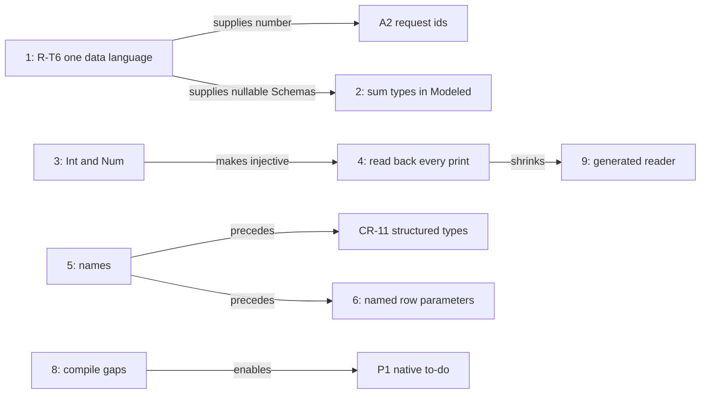

# Types across the faces: what writes, what reads back, and what is missing

Status: research note (history, not authority). Base: `5729f839b` on `refactor/phase1-phase3`.
Role: the coordinator's quick audit, at the owner's request of 2026-10-15. The probe is
`probes/RoundTrip.lean`. Its output is `probes/round-trip.log`.

## 1. The one thing to know first

Every type former except `app` and `var` prints as TypeScript.
The round trips stop at three places.

- **The Schema bridge** lowers no `number`, `null`, `undefined`, `bytes` or nominal application.
  So `string | null` has no Schema, and rc.112's `NullOr` documents are refused.
- **Lean modeling** ties a Lean type to `Ty` only for unit, naturals, strings, Booleans, options,
  lists, pairs and records with required fields. A sum type, an `Int` or an optional field has no tie.
- **The TypeScript reader** reads back neither `int` nor `unknown`, a handle, `Exit`, `Cause`,
  `Fiber` or `Deferred`. Yet the printer writes each of them.

Rows 380 (6) and 309 (5) already rule most of the repairs. Three are new proposals: sum types in
modeling, reading back the effect types, and rows with named parameters.

## 2. Question and evidence

The question: which reading and writing back of types is missing, for the lowering, the modeling
and the type system?

The evidence:
- one finite probe (tested): one sample type per former, through each image;
- reading of the code at the base;
- reading of the type interface note (`docs/research/2026-10-11-type-interface/README.md`) and the
  codegen review (`docs/research/2026-10-15-codegen-review/README.md`);
- reading of the lowering state note, the interop notes and the ergonomics probe
  (`docs/research/2026-10-13-agent-ergonomics-probe/README.md`).

## 3. The measured table

The probe runs `lake env lean docs/research/2026-10-15-type-roundtrip-audit/probes/RoundTrip.lean`.
Its columns are:
- `ts`: `Effect4.Codegen.Types.ofTy` prints a TypeScript type (`src/Effect4/Codegen/Types.lean`);
- `ts⁻¹`: `Effect4.Codegen.Classes.ReadableTy` (`src/Effect4/Codegen/Classes.lean`) reads the
  print back to the same type, at a definition header and at an expression's type arguments;
- `schema⁻¹`: `Ty.ofSchema (Ty.schema t) = some t.normalize` (`src/Effect4/Schema/Bridge.lean`);
- `lean`: `Effect4.Schema.Model.refusal` answers `none` (`src/Effect4/Schema/Modeled.lean`), or
  it gives the refusal.

| type | ts | ts⁻¹ header / expr | schema⁻¹ | lean |
| --- | --- | --- | --- | --- |
| never | yes | yes / yes | yes | never |
| unknown | yes | - / - | yes | unknown |
| unit | yes | yes / yes | yes | yes |
| nat | yes | yes / yes | yes | yes |
| int | yes | - / - | yes | int |
| number | yes | - / - | - | number |
| string | yes | yes / yes | yes | yes |
| bool | yes | yes / yes | yes | yes |
| lit | yes | yes / yes | yes | lit |
| null | yes | yes / yes | - | null |
| undefined | yes | yes / yes | - | undefined |
| bytes | yes | yes / yes | - | bytes |
| handle | yes | - / - | yes | handle: an identity needs its table |
| app | - | - / - | - | app |
| var | - | - / - | - | var |
| option | yes | yes / yes | yes | yes |
| list | yes | yes / yes | yes | yes |
| prod | yes | yes / yes | yes | yes |
| tuple3 | yes | yes / yes | yes | tuple |
| map string | yes | yes / yes | yes | map |
| map nat | - | - / - | - | map |
| record | yes | yes / yes | yes | yes |
| record optional | yes | yes / yes | yes | optional field b |
| union of literals | yes | yes / yes | yes | union |
| union nat\|string | yes | yes / yes | yes | union |
| nullable | yes | yes / yes | - | union |
| except | yes | yes / yes | yes | except |
| exitOf | yes | - / - | yes | exitOf |
| causeOf | yes | - / - | yes | causeOf |
| fiberOf | yes | - / - | yes | fiberOf: an identity needs its table |
| refOf | yes | yes / - | yes | refOf: an identity needs its table |
| deferredOf | yes | - / - | yes | deferredOf: an identity needs its table |

Two images need no column:
- The JSON codec is a fold over every former, exact modulo `normJ` (the type interface note, §1.2).
- The OCaml engine carries a program's types as data (`OCaml5.Eff.tyO`, `src/OCaml5/Eff/Emit.lean`).
  It carries values as `Store.Val`, checked at its ingress, so every former runs there.

## 4. The gaps, by face

### 4.1 Writing TypeScript

- `nat`, `int` and `number` all print as `number`. R-T4's aliases `Int` and `Num` repair it.
  Row 380 (6) rules them, and they have not landed.
- A nominal application at arguments has no print. It needs the module's table of declarations.
- A map whose key is not a string has no print, since rc.112's `Record` takes string keys.
- `Ty.handle` and `Row.typeArgs` hold TypeScript text, which `parseLegacy` parses at print time.
  CR-11 starts with a design note (DI-47).
- A printed module spells a record type in full at each use. The to-do has 23 such uses (codegen
  review §6.1). No module declares a named type, except a payload class (row 120).
- A failure with one message prints as a tagged tuple, `readonly ["SqlError", string]`. A failure
  with fields prints as a `Data.TaggedError` class. One module shows both.
- `E4-PRINT-CE-001` stays SEEDED: repair A of `Ty.normalize`, with tsgo's bound of 25 (R-T3,
  row 346), has not landed.

### 4.2 Reading TypeScript back

- `Classes.readNamed` reads no `unknown`, `Exit.Exit`, `Cause.Cause`, `Fiber.Fiber`,
  `Deferred.Deferred` or handle. The printer writes each, and `readTyChecked`'s re-print check
  would keep a reading exact.
- `Ref.Ref<A>` reads only at a definition header, by row 378 (8).
- `int` reads as `nat` until R-T4 lands.
- A list fold's stated accumulator type prints and does not read (`Classes.lean`, the checked
  reader's section). CR-1 leaves typed eliminator annotations to a reader slice.
- The readers accept only the binder names `a0`, `a1`, …. This was the ergonomics probe's largest
  friction (E10). CR-5 repairs it.
- TypeScript holds a second, hand-written type algebra and reader: `ts/eff/target-types.ts`
  (472 lines) and `ts/eff/read.ts` (3,008 lines). R-T7 and DI-88 generate them from Lean.

### 4.3 The Schema data plane

- `Bridge.schemaAlg` writes the marker `unlowered` for `number`, `null`, `undefined`, `bytes`,
  `app` and `contextOf`. `Bridge.ofSchema` refuses the marker.
- So a nullable, float, byte or nominal field has no Schema.
- The codec gate keeps one hand Schema, `Schema.Number` (`harness/truth/schema-codec/check.ts`).
- A1's bridge refuses `Schema.Null` and `Schema.NullOr` in rc.112's RPC documents
  (`docs/research/2026-10-15-a1-wip/receipt.md`).
- `Store.Shape` (`src/Effect4/Store/Domain/Shape.lean`, 500 lines) is a second data language with
  no law to `Ty`. R-T6 makes it a fold of `Ty` (row 380 (6)).

### 4.4 Lean modeling

- The checked domain of `Modeled` is small (§3, column `lean`). It refuses `int`, `number`,
  `bytes`, a literal, a union, a map, a tuple, an optional field, `null` and `except`.
- `derive_modeled` (`src/Effect4/Schema/Modeled/Derive.lean`) takes only a structure with no
  parameters. An inductive with several constructors has no deriving. So a Lean enum or sum type
  cannot become a tagged union.
- `eff_record` and `eff_failure` (`src/Effect4/Program/Authoring/Declare.lean`) declare a `Ty` and
  term constructors, never a Lean structure. A host written in Lean works on `Store.Val`.
- Only library cells use `Modeled` today: PubSub and the step modules.

### 4.5 Terms over the types

- The atom `eq` types only at `int` and `string`, and `lt` only at `int`
  (`src/Effect4/Program/NativeAtom.lean`).
- So the to-do writes Boolean equality by hand (`sameFlag`, `Test/Dogfood/Scenario/Todo/Data.lean`).
- Row 309 (1) rules out multiplication and division of integers, and every float operation.
  These absences are rulings, not gaps.
- A row's protocol is a raw `Term` tree (`insertProtocol`, the same file). No authoring syntax
  writes one.

### 4.6 Host rows

- An `eff_rows` entry takes one request type and answers one type. Two arguments travel as a pair.
- So `setDone(.prod .nat .bool)` prints as a method that takes `readonly [number, boolean]`.
- The error column belongs to the block, not to each row.
- The OCaml interop probe refuses labelled and optional arguments
  (`docs/research/2026-10-15-ocaml-interop-explore/README.md`, §4.4).

### 4.7 Lowering to OCaml

- The lowered Lean host stops at three compile gaps (S3's receipt,
  `git:435f599d4:docs/research/2026-10-15-seat-cleanup-receipt.md`, a finite probe):
  - `UInt32` is built as a record, where the type rows spell `int`;
  - `String` is built as a record, where the type rows spell `string`;
  - one shared polymorphic closure fails OCaml's value restriction.
- The carriers are hand OCaml until LC-8.
- `Ty`, `Val.hasTy` and the host guard are not lowered yet, so the interop probe keeps its own row
  types (interop exploration, proposal 1).
- `OCaml5.Eff.tyO` and `tyV` are hand recursions over `Ty`, not folds (S3's receipt,
  obligations 4 and 5).

## 5. What we want, ranked

The rank weighs what an author or an agent gains against the size. Sizes are estimates.

| Rank | Feature | What it unlocks | Existing item | Ruling | Size |
| --- | --- | --- | --- | --- | --- |
| 1 | One data language: `number`, `null`, `undefined`, `bytes` and `app` lowered into the Schema; `Shape` a fold of `Ty` | nullable, float and byte fields; number services; A2's request ids; rc.112 documents with `NullOr` | R-T6, CR-10 | row 380 (6) | L |
| 2 | Sum types, `Int`, literals and optional fields in `Modeled`, with one declaration for both faces | Lean data written once; enums as tagged unions; hosts over Lean values | none | proposed (§6) | M |
| 3 | The aliases `Int` and `Num` | an injective print on the number tower; `int` reads back | R-T4 | row 380 (6) | S to M, with a truth re-cut |
| 4 | Read back every effect type the printer writes | annotated programs read back whole | none | proposed (§6) | S |
| 5 | Names: binders, then a module type table and named records | readable modules; TypeScript that an agent writes reads | CR-5, then CR-11 | row 378 (17); CR-11 needs its design note | M to L |
| 6 | Rows with named parameters | `setDone(id, done)` in place of a pair | none | proposed (§6) | M |
| 7 | Equality at `bool` and at records | branches and protocols without hand encodings | the atom table | needs a reading of row 309 (1) | S to M |
| 8 | The lowered host's three compile gaps, then one row language | the native to-do (P1) | P1, LC-6; interop proposal 1 | rows 391, 393 | L |
| 9 | The TypeScript type algebra and reader generated from Lean | the hand ports go | R-T7, DI-88 | DI-88 ruled | L |

The ranks depend on one another as below.

The diagram records dependencies only. It is not proof evidence.

## 6. Proposed decisions rows

- **Modeling.** Widen `Modeled` to `Int`, literals, optional fields and sum types. `deriving
  Modeled` on an inductive writes a union of tagged records. One Lean declaration then gives the
  Lean type, its `Ty` and its terms, in place of a separate `eff_record`.
- **Reading back.** `Classes.readNamed` reads every type that `Types.ofTy` prints: `unknown`,
  `Exit`, `Cause`, `Fiber`, `Deferred` and the handles. `readTyChecked`'s re-print check keeps each
  reading exact.
- **Rows.** An `eff_rows` entry takes named parameters as one record request. The printed service
  method takes them as named arguments.
- **Equality.** Row 309 (1) admits what control flow needs. The proposal reads that as `eq` at
  `bool` and at records.

## 7. What this does not establish

- The probe samples one type per former, at simple arguments. It measures no nesting, no
  normalization and no payload class.
- `ts⁻¹` measures the Lean reader. `check-ts-reader` compares `ts/eff/read.ts` with it; this note
  does not.
- A `yes` in the table is a finite evaluation, not a theorem. The theorems are the type interface
  note's: `decode_iff`, `ofSchema_exact` and `readTyChecked_exact`.
- No implementation follows from this note. Each proposal needs its decisions row first.
