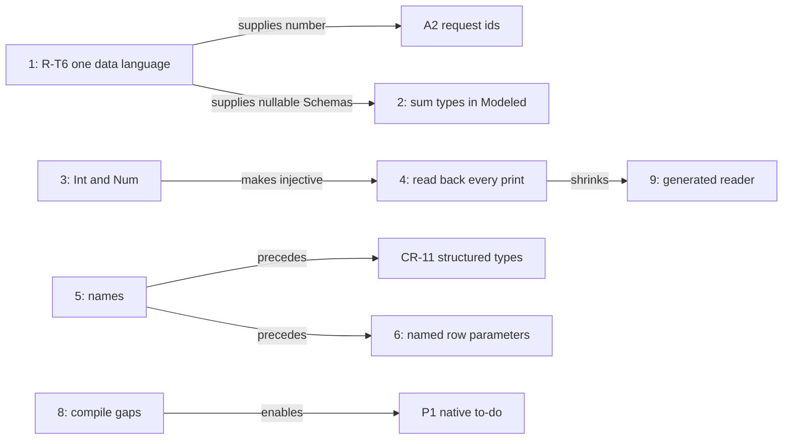
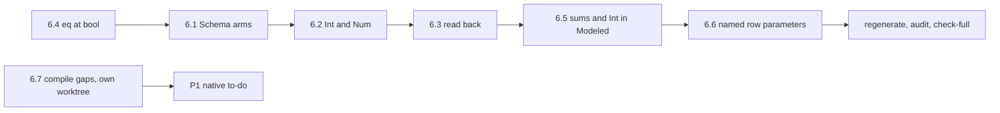
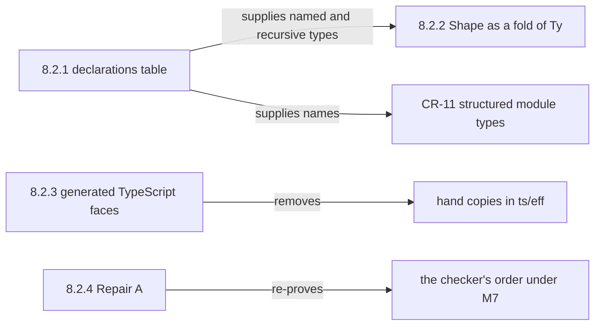

# Types across the faces: what writes, what reads back, and what is missing

Status: research note (history, not authority). Base: `5729f839b` on `refactor/phase1-phase3`.
Role: the coordinator's quick audit, at the owner's request of 2026-10-15. The probe is
`probes/RoundTrip.lean`. Its output is `probes/round-trip.log`.

## 1. The one thing to know first

Every type former except `app` and `var` prints as TypeScript.
The round trips stop at three places.

- **The Schema bridge** lowers no `number`, `null`, `undefined`, `bytes` or nominal application.
  So `string | null` has no Schema, and rc.112's `NullOr` documents are refused.
- **Lean modeling** ties a Lean type to `Ty` only for unit, naturals, strings, Booleans, options,
  lists, pairs and records with required fields. A sum type, an `Int` or an optional field has no tie.
- **The TypeScript reader** reads back neither `int` nor `unknown`, a handle, `Exit`, `Cause`,
  `Fiber` or `Deferred`. Yet the printer writes each of them.

Rows 380 (6) and 309 (5) already rule most of the repairs. Three are new proposals: sum types in
modeling, reading back the effect types, and rows with named parameters.

A survey of the earlier probes (§6) finds most answers recorded. Probe S designed and proved the
Schema arms on 2026-10-01, and their seat never ran. DI-35 already admits `eq` at `bool`. §6A
lands six fixes in one worktree with one rebuild. The OCaml compile gaps run beside it.

## 2. Question and evidence

The question: which reading and writing back of types is missing, for the lowering, the modeling
and the type system?

The evidence:
- one finite probe (tested): one sample type per former, through each image;
- reading of the code at the base;
- reading of the type interface note (`docs/research/2026-10-11-type-interface/README.md`) and the
  codegen review (`docs/research/2026-10-15-codegen-review/README.md`);
- reading of the lowering state note, the interop notes and the ergonomics probe
  (`docs/research/2026-10-13-agent-ergonomics-probe/README.md`).

## 3. The measured table

The probe runs `lake env lean docs/research/2026-10-15-type-roundtrip-audit/probes/RoundTrip.lean`.
Its columns are:
- `ts`: `Effect4.Codegen.Types.ofTy` prints a TypeScript type (`src/Effect4/Codegen/Types.lean`);
- `ts⁻¹`: `Effect4.Codegen.Classes.ReadableTy` (`src/Effect4/Codegen/Classes.lean`) reads the
  print back to the same type, at a definition header and at an expression's type arguments;
- `schema⁻¹`: `Ty.ofSchema (Ty.schema t) = some t.normalize` (`src/Effect4/Schema/Bridge.lean`);
- `lean`: `Effect4.Schema.Model.refusal` answers `none` (`src/Effect4/Schema/Modeled.lean`), or
  it gives the refusal.

| type | ts | ts⁻¹ header / expr | schema⁻¹ | lean |
| --- | --- | --- | --- | --- |
| never | yes | yes / yes | yes | never |
| unknown | yes | - / - | yes | unknown |
| unit | yes | yes / yes | yes | yes |
| nat | yes | yes / yes | yes | yes |
| int | yes | - / - | yes | int |
| number | yes | - / - | - | number |
| string | yes | yes / yes | yes | yes |
| bool | yes | yes / yes | yes | yes |
| lit | yes | yes / yes | yes | lit |
| null | yes | yes / yes | - | null |
| undefined | yes | yes / yes | - | undefined |
| bytes | yes | yes / yes | - | bytes |
| handle | yes | - / - | yes | handle: an identity needs its table |
| app | - | - / - | - | app |
| var | - | - / - | - | var |
| option | yes | yes / yes | yes | yes |
| list | yes | yes / yes | yes | yes |
| prod | yes | yes / yes | yes | yes |
| tuple3 | yes | yes / yes | yes | tuple |
| map string | yes | yes / yes | yes | map |
| map nat | - | - / - | - | map |
| record | yes | yes / yes | yes | yes |
| record optional | yes | yes / yes | yes | optional field b |
| union of literals | yes | yes / yes | yes | union |
| union nat\|string | yes | yes / yes | yes | union |
| nullable | yes | yes / yes | - | union |
| except | yes | yes / yes | yes | except |
| exitOf | yes | - / - | yes | exitOf |
| causeOf | yes | - / - | yes | causeOf |
| fiberOf | yes | - / - | yes | fiberOf: an identity needs its table |
| refOf | yes | yes / - | yes | refOf: an identity needs its table |
| deferredOf | yes | - / - | yes | deferredOf: an identity needs its table |

Two images need no column:
- The JSON codec is a fold over every former, exact modulo `normJ` (the type interface note, §1.2).
- The OCaml engine carries a program's types as data (`OCaml5.Eff.tyO`, `src/OCaml5/Eff/Emit.lean`).
  It carries values as `Store.Val`, checked at its ingress, so every former runs there.

## 4. The gaps, by face

### 4.1 Writing TypeScript

- `nat`, `int` and `number` all print as `number`. R-T4's aliases `Int` and `Num` repair it.
  Row 380 (6) rules them, and they have not landed.
- A nominal application at arguments has no print. It needs the module's table of declarations.
- A map whose key is not a string has no print, since rc.112's `Record` takes string keys.
- `Ty.handle` and `Row.typeArgs` hold TypeScript text, which `parseLegacy` parses at print time.
  CR-11 starts with a design note (DI-47).
- A printed module spells a record type in full at each use. The to-do has 23 such uses (codegen
  review §6.1). No module declares a named type, except a payload class (row 120).
- A failure with one message prints as a tagged tuple, `readonly ["SqlError", string]`. A failure
  with fields prints as a `Data.TaggedError` class. One module shows both.
- `E4-PRINT-CE-001` stays SEEDED: repair A of `Ty.normalize`, with tsgo's bound of 25 (R-T3,
  row 346), has not landed.

### 4.2 Reading TypeScript back

- `Classes.readNamed` reads no `unknown`, `Exit.Exit`, `Cause.Cause`, `Fiber.Fiber`,
  `Deferred.Deferred` or handle. The printer writes each, and `readTyChecked`'s re-print check
  would keep a reading exact.
- `Ref.Ref<A>` reads only at a definition header, by row 378 (8).
- `int` reads as `nat` until R-T4 lands.
- A list fold's stated accumulator type prints and does not read (`Classes.lean`, the checked
  reader's section). CR-1 leaves typed eliminator annotations to a reader slice.
- The readers accept only the binder names `a0`, `a1`, …. This was the ergonomics probe's largest
  friction (E10). CR-5 repairs it.
- TypeScript holds a second, hand-written type algebra and reader: `ts/eff/target-types.ts`
  (472 lines) and `ts/eff/read.ts` (3,008 lines). R-T7 and DI-88 generate them from Lean.

### 4.3 The Schema data plane

- `Bridge.schemaAlg` writes the marker `unlowered` for `number`, `null`, `undefined`, `bytes`,
  `app` and `contextOf`. `Bridge.ofSchema` refuses the marker.
- So a nullable, float, byte or nominal field has no Schema.
- The codec gate keeps one hand Schema, `Schema.Number` (`harness/truth/schema-codec/check.ts`).
- A1's bridge refuses `Schema.Null` and `Schema.NullOr` in rc.112's RPC documents
  (`docs/research/2026-10-15-a1-wip/receipt.md`).
- `Store.Shape` (`src/Effect4/Store/Domain/Shape.lean`, 500 lines) is a second data language with
  no law to `Ty`. R-T6 makes it a fold of `Ty` (row 380 (6)).

### 4.4 Lean modeling

- The checked domain of `Modeled` is small (§3, column `lean`). It refuses `int`, `number`,
  `bytes`, a literal, a union, a map, a tuple, an optional field, `null` and `except`.
- `derive_modeled` (`src/Effect4/Schema/Modeled/Derive.lean`) takes only a structure with no
  parameters. An inductive with several constructors has no deriving. So a Lean enum or sum type
  cannot become a tagged union.
- `eff_record` and `eff_failure` (`src/Effect4/Program/Authoring/Declare.lean`) declare a `Ty` and
  term constructors, never a Lean structure. A host written in Lean works on `Store.Val`.
- Only library cells use `Modeled` today: PubSub and the step modules.

### 4.5 Terms over the types

- The atom `eq` types only at `int` and `string`, and `lt` only at `int`
  (`src/Effect4/Program/NativeAtom.lean`).
- So the to-do writes Boolean equality by hand (`sameFlag`, `Test/Dogfood/Scenario/Todo/Data.lean`).
- Row 309 (1) rules out multiplication and division of integers, and every float operation.
  These absences are rulings, not gaps.
- A row's protocol is a raw `Term` tree (`insertProtocol`, the same file). No authoring syntax
  writes one.

### 4.6 Host rows

- An `eff_rows` entry takes one request type and answers one type. Two arguments travel as a pair.
- So `setDone(.prod .nat .bool)` prints as a method that takes `readonly [number, boolean]`.
- The error column belongs to the block, not to each row.
- The OCaml interop probe refuses labelled and optional arguments
  (`docs/research/2026-10-15-ocaml-interop-explore/README.md`, §4.4).

### 4.7 Lowering to OCaml

- The lowered Lean host stops at three compile gaps (S3's receipt,
  `git:435f599d4:docs/research/2026-10-15-seat-cleanup-receipt.md`, a finite probe):
  - `UInt32` is built as a record, where the type rows spell `int`;
  - `String` is built as a record, where the type rows spell `string`;
  - one shared polymorphic closure fails OCaml's value restriction.
- The carriers are hand OCaml until LC-8.
- `Ty`, `Val.hasTy` and the host guard are not lowered yet, so the interop probe keeps its own row
  types (interop exploration, proposal 1).
- `OCaml5.Eff.tyO` and `tyV` are hand recursions over `Ty`, not folds (S3's receipt,
  obligations 4 and 5).

## 5. What we want, ranked

The rank weighs what an author or an agent gains against the size. Sizes are estimates.

| Rank | Feature | What it unlocks | Existing item | Ruling | Size |
| --- | --- | --- | --- | --- | --- |
| 1 | One data language: `number`, `null`, `undefined`, `bytes` and `app` lowered into the Schema; `Shape` a fold of `Ty` | nullable, float and byte fields; number services; A2's request ids; rc.112 documents with `NullOr` | R-T6, CR-10 | row 380 (6) | L |
| 2 | Sum types, `Int`, literals and optional fields in `Modeled`, with one declaration for both faces | Lean data written once; enums as tagged unions; hosts over Lean values | none | proposed (§6) | M |
| 3 | The aliases `Int` and `Num` | an injective print on the number tower; `int` reads back | R-T4 | row 380 (6) | S to M, with a truth re-cut |
| 4 | Read back every effect type the printer writes | annotated programs read back whole | none | proposed (§6) | S |
| 5 | Names: binders, then a module type table and named records | readable modules; TypeScript that an agent writes reads | CR-5, then CR-11 | row 378 (17); CR-11 needs its design note | M to L |
| 6 | Rows with named parameters | `setDone(id, done)` in place of a pair | none | proposed (§6) | M |
| 7 | Equality at `bool` and at records | branches and protocols without hand encodings | the atom table | needs a reading of row 309 (1) | S to M |
| 8 | The lowered host's three compile gaps, then one row language | the native to-do (P1) | P1, LC-6; interop proposal 1 | rows 391, 393 | L |
| 9 | The TypeScript type algebra and reader generated from Lean | the hand ports go | R-T7, DI-88 | DI-88 ruled | L |

The ranks depend on one another as below.

The diagram records dependencies only. It is not proof evidence.

## 6. Informed recommendations, after the survey

Four read-only searches of `docs/research/`, the register and the code answered one question each.
The earlier probes settle most choices. Each item gives the record, the recommendation and its
status. `probes/fanout.txt` counts the modules each edit rebuilds
(`docs/research/2026-10-15-codegen-review/probes/fanout.py`).

### 6.1 The Schema arms of `number`, `null`, `undefined` and `bytes` (R-T6, first part)

- **The record.** Probe S designed and proved these arms on a copy
  (`git:f7ccf52e0^:docs/research/2026-10-01-type-language-probe/S/note.md`, §1.1). Its patches are
  in the same commit, under `S/patches/`. Seat W5 was to land them and never ran: no W5 receipt
  exists. Row 162 refuses each appended constructor by name until its own commit.
- **The JSON codec.** `Codec.lean` already carries `number` (`numberWire`). It refuses `null`,
  `undefined`, `bytes` and `app`. The Schema arms are type-level and need no value image.
- **Recommendation.** Land four arms in `Bridge.schemaAlg` and their readings in `Bridge.ofSchema`:
  - `number` as `.number none []`, rc.112's `Number`; the value codec keeps refusing a NaN and an
    infinity (row 309 (6));
  - `null` and `undefined` as rc.112's keywords;
  - `bytes` as the declaration `effect/schema/Uint8Array` with a `null` payload, a reserved id that
    reads back as `.bytes`.
- **Same commit.** Extend `ofSchema_exact` and the `closed ∧ reservedFree` premise, and change
  `Schema/TyFaces.lean`, which `schema_eq_face` ties to the bridge. Add one red and one green
  control per arm.
- **What it unlocks.** The guard in `Test/Codegen/SurfaceContract.lean` flips: a service that
  answers a number gets Schemas. The hand `Schema.Number` in `harness/truth/schema-codec/check.ts`
  goes. A1's `NullOr` payloads read. A nullable field bridges.
- **Left out.** `app` needs a variance table and a reviver per name (row 158). `contextOf` has no
  plan. The value images of `null`, `undefined` and `bytes` wait on row 160's constraint and row 161
  (a)'s base64 codec. `Shape` as a fold of `Ty` moves the store's pinned digests
  (`Test/Store/NodeContract.lean`), so it is a slice of its own.
- **Status.** Ruled by row 380 (6). Cost: `Effect4.Schema.Bridge` rebuilds 660 modules.

### 6.2 The aliases `Int` and `Num` (R-T4)

- **The record.** Rows 309 (5) and 380 (6) rule the aliases. The integers packet's slice SPELL
  (`docs/research/2026-10-07-packet-integers.md`, §4.10) keeps `nat` as `number`, so no golden of
  today moves. No truth module prints an `int` or a `number` (`grep`, at the base).
- **Recommendation.** `Types.ofNormalized` prints `int` as `Int` and `number` as `Num`, and
  `readNamed` reads both. The prelude declares `export type Int = number` and `Num` beside
  `MaskRestore`, and both join `preludeNames` (`src/Effect4/Codegen/Checked.lean`). CR-1 found that
  a helper missing there is never imported.
- **One risk.** A payload class tagged `Int` or `Num` would collide with an alias. The alias arms
  come before the class lookup, and `ClassTable` refuses the two tags.
- **Twin.** `ts/eff/target-types.ts` and `ts/eff/read.ts` follow.
- **Status.** Ruled. Cost: `Effect4.Codegen.Types` rebuilds 103 modules.

### 6.3 Reading back what the printer writes

- **The record.** The state plan's T5, part B (`docs/research/2026-10-05-seat-T5-receipt.md`, §9)
  left these types without a reading. It was a choice of scope, not a law. Its open item 3 asks a
  wider reader to keep the checked form. `readTyChecked_exact` holds by the re-print check alone,
  so a new arm cannot break exactness. `f6dc2ec5a` added `Ref` at headers this way.
- **Recommendation.** `readNamed` reads `unknown`, `Exit.Exit`, `Cause.Cause`, `Fiber.Fiber` and
  `Deferred.Deferred` wherever the checked reader reads. `Ref` stays at headers (row 378 (8)), and
  handles wait for CR-11. The twin `readNamedType` in `ts/eff/read.ts` follows.
- **A known collision.** Test fixtures spell `.handle "Deferred.Deferred<number, never>"`, which
  prints as `deferredOf` does. The reader answers `deferredOf`. CR-11's design note retires these
  texts, as it retires `refT`.
- **Left out.** The fold accumulator's type moves a claim's statement (T5, step (c)). CR-1's
  eliminator annotations are a reader slice of their own.
- **Status.** A coordinator decision: it widens an exact reader's domain, with no change of meaning
  or representation. Cost: `Effect4.Codegen.Classes` rebuilds 93 modules.

### 6.4 `eq` at `bool`

- **The record.** DI-35 (`docs/DESIGN-ISSUES.md`, ruled 2026-09-09) widens `eq` one type at a time,
  wherever `===` compares faithfully. `===` is faithful on Booleans. Past that, records need
  `Equal.equals`, its own slice, and row 126 is open.
- **Recommendation.** Add `([.bool, .bool], .bool)` to `eq`'s scheme and one `eval` arm in
  `src/Effect4/Machine/Term.lean`. The prelude's type gains `boolean`, and the truth lane gains one
  fixture, as DI-35 asks. No constructor is added, so the inventory and the OCaml alphabet stay.
  The to-do's control (`Test/Dogfood/Scenario/Todo.lean`, `eq` at two Booleans) flips.
- **Status.** Inside DI-35's ruling. Cost: the machine's term module sits low, about 1,000 modules.

### 6.5 Sum types and `Int` in Lean modeling

- **The record.**
  - Probe T (`git:f7ccf52e0^:docs/research/2026-10-01-type-language-probe/T/note.md`, rows 12, 13
    and 39): a union of `_tag` records needs no new constructor. It is mutual with rc.112's
    `Data.TaggedEnum` and `Schema.Union` of tagged structs (tsgo d1 to d3). A TypeScript enum maps
    to a union of literals.
  - The MODULES review (`docs/research/2026-10-08-modules-r2-review.md`, R2-F5) asks for a
    representation policy before a tagged sum serves `Ty.union`.
  - `docs/research/2026-10-15-ocaml-seam-probes/ModelProbe.lean`: Lean's generic `Int` encoding
    is not the program's `int`, which `intImage` encodes (`src/Effect4/Program/Typed.lean`).
  - `E4-SCHEMA-CE-062`: distinct required `_tag` literals separate branches; optional fields do not.
- **Recommendation.**
  - `deriving Modeled` on an inductive writes a union of `_tag` records: the tag is the
    constructor's name, and the fields are its named arguments.
  - An inductive whose constructors all take no argument writes a union of string literals.
  - `Int` gets a carrier through `intImage`.
  - The deriving also writes `eff_record`'s declarations, so one Lean structure serves both faces.
    The interop plan's P1, step 1, already writes the to-do's record as a structure deriving
    `Modeled`.
- **Left out.** Optional keys wait for the absent column's carrier and `E4-SCHEMA-CE-062`. `number`
  and `bytes` carriers wait for their value codecs.
- **Status.** A coordinator decision, since it follows rc.112's own idiom and Probe T. The owner may
  undo it. Cost: `Effect4.Schema.Modeled` rebuilds 97 modules.

### 6.6 Rows with named parameters

- **The record.** No row rules the single request. It dates from the host-rows slice
  (`docs/research/2026-09-08-host-rows-slice.md`, §1). Codex's interop review reads a row's position
  as a whole request (`docs/research/2026-10-15-ocaml-interop-explore/codex-review.md`). A record
  request stays one value, so that theory stands. `Row` already has its own error column.
- **Recommendation.** `eff_rows` accepts `setDone(id : .nat, done : .bool) : …` as a record request.
  The printed method takes one object, `setDone({ id, done })`, which needs no names work. An
  optional `error E` clause per row overrides the block's. Positional named arguments wait for CR-5.
  The to-do moves with P1 and V3, not here, so the host-protocol lane is not re-cut twice.
- **Status.** A coordinator decision: new syntax, opt-in, with no change to an existing row. Cost:
  `Effect4.Program.Authoring.Declare` rebuilds 19 modules.

### 6.7 The lowered host's three compile gaps

- **The record.** S3's receipt measures three gaps and leaves later errors unmeasured. No note
  proposes the repairs. No gate compiles the host closure with `ocamlopt`. `Ml.checkModule` has no
  check for an unbound type constructor, so the generator passed.
- **Recommendation (inferred from the code).**
  - `UInt32`: value rows for `UInt32.ofBitVec` and `BitVec.ofFin` as the identity on `int`, as
    `ctorApp`'s `Array.mk` case does (`src/OCaml5/Lcnf/Translate.lean`).
  - `String`: a row for `String.ofByteArray` with a UTF-8 decoding primitive, the inverse of F4's
    encoder (lowering state §6.8).
  - The value restriction: eta-expand an application whose arguments are all erased.
  - An `unbound-type` diagnostic in `Ml.checkModule`, and an `ocamlopt` compile of the host closure
    as a gate step.
- **Status.** P1's first step (rows 391, 393). It touches `OCaml5` only, so it runs in its own
  worktree beside the type slice.

### 6.8 Not in this landing

- `Shape` as a fold of `Ty`, `app` in the Schema, and the value images of `null`, `undefined` and
  `bytes` (§6.1).
- Repair A of R-T3. The order stands under M7, and `Ty` rebuilds 992 modules. It is a slice of its
  own, with its stop rule.
- CR-5's names (L), CR-11 (a design note first), and R-T7 with DI-88 (L).
- Equality at records (`Equal.equals`, row 126).
- Message failures as classes. Row 120 (c) keeps the pair `[tag, message]`, so one rc.112 class
  never has two spellings.
- An authoring syntax for row protocols. It is small, and its consumer is the to-do's P1 move.

## 6A. The landing in one go

One worktree runs one rebuild. Its commits follow the items, one per item, so each is reviewed
alone. The machine's term module is the lowest edit, so the slice pays about 1,000 modules once.

The order:
1. Make the six edits, then build once.
2. Regenerate the reached groups: `derived`, `lcnf`, `ts`, and the truth lane where its prelude moves.
3. Run `#axiom_audit` over the touched modules.
4. Run `make check-full` and `make check-gen`.

The gates each item reaches:
- 6.1: `check-schema-codec`, `check-schema-ts`;
- 6.2 and 6.3: `check-target`, `check-ts-reader`, `check-corpus`, `check-tsdiag`;
- 6.4: `check-truth`, `check-ocaml`;
- 6.5 and 6.6: the narrow builds and their batteries.

The decisions rows to record: one coordinator row each for §6.3, §6.5 and §6.6, and one row for
§6.4 under DI-35. Row 380 (6) already covers §6.1 and §6.2.

## 7. What this does not establish

- The probe samples one type per former, at simple arguments. It measures no nesting, no
  normalization and no payload class.
- `ts⁻¹` measures the Lean reader. `check-ts-reader` compares `ts/eff/read.ts` with it; this note
  does not.
- A `yes` in the table is a finite evaluation, not a theorem. The theorems are the type interface
  note's: `decode_iff`, `ofSchema_exact` and `readTyChecked_exact`.
- No implementation follows from this note. Each proposal needs its decisions row first.
- §6.7's repairs are inferred from the code. No probe has compiled past the three measured gaps.
- The fan-out counts read import lines, not Lake's traces.

## 8. The next slices, after the landing

The owner asked on 2026-10-15 for the next step toward a solid type language. This section
recommends four slices. Each slice needs its own ruling or design note.

### 8.1 What the landing showed

- Three writers spell a type as TypeScript by hand: `Codegen.Types.ofTy`, `Ty.renderRaw` and
  `ts/eff/target-types.ts`. Two readers read it back: `Classes.readNamed` and `ts/eff/read.ts`.
- The aliases `Int` and `Num` changed all five. The edit missed `Ty.renderRaw` at first. The
  agreement guard in `Test/Codegen/ExprContract.lean` found it.
- The store's `Shape` is a second type language. Its named structs, named sums and named
  references have no counterpart in `Ty`.
- So a document with a recursive reference is refused (decisions row 398 (4), `E4-SCHEMA-CE-025`).
  rc.112 admits it through `Schema.suspend`.
- rc.112's `SchemaAST` has `Declaration` and `Suspend`. TypeScript has named and recursive
  aliases. OCaml and Lean have named type declarations. `Ty` has `app`, but no table of bodies.
- The variances of rc.112's own generic types are a generated table already
  (`src/Effect4/Program/TyVariance.lean`). `sub` reads it at `app`.

### 8.2 The slices, in order

1. **The application's table of type declarations.** Row 158 rules that names, brands, dates,
   class identity and recursion enter through `Ty.app`. Row 124 sketches recursion: `Fits` by
   recursion on the value, `sub` by name, inhabitance as a least fixed point. The table of
   bodies is missing. Each face then prints and reads the table: TypeScript aliases, Schema
   `Declaration` and `suspend`, OCaml type declarations, and `deriving Modeled` on a recursive
   inductive. It starts as a design note. CR-11 asks for that note, and this is its scope.
2. **`Shape` as a fold of `Ty`** (R-T6, row 380 (6)). It needs slice 1, since `Shape`'s named
   structs, sums and references are declarations. The store's second type language then goes.
3. **The TypeScript printer and reader generated from Lean** (R-T7, DI-88). The hand copies in
   `ts/eff` go.
4. **Repair A** (row 346). The checker's union normal form matches tsgo's. It changes the order
   on which M7 stands, so it lands alone, with its stop rule.

The diagram records dependencies only. It is not proof evidence.

### 8.3 What waits on the owner

Row 307 (10) parks recursive types (owner, 2026-10-07). Slice 1 brings them in, so it waits on
the owner's word.

### 8.4 What this section does not establish

- No slice here is designed. The sizes in §5 are estimates.
- The parity claims compare constructor lists only: rc.112's `SchemaAST` classes against `Ty`'s
  constructors. No behaviour was compared.
