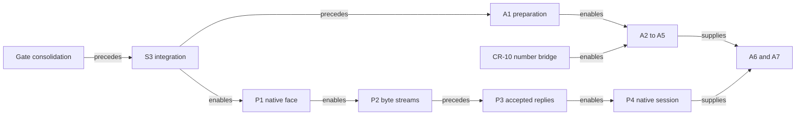

# Work streams after the seats pause

**Change the order first:** put gate consolidation before the remaining proofs, then integrate S3, finish A1, and finish the application faces.

Status: research note and landing plan, not authority. Brief base: `6f88298eb`. Reviewed head: `d7f99c991`.
The owner authorizes development after this review, with cleanup and minimalism as the defaults.
No new work stream is needed.

## Question and evidence

Where does each paused item belong, and what must precede it?
Evidence: reading of the linked plans, handoffs, decisions rows 387 and 391–397, and branch contents.
No build or probe supplies this inventory.
Sizes are estimates: S is a local edit, M is one coordinated slice, and L spans several modules or slices.

The [codegen receipt](../2026-10-15-codegen-review/receipt.md) is C below.
H is `git:435f599d4:docs/research/2026-10-15-seat-cleanup-receipt.md`.
The local remote reference `origin/claude/cleanup` names that commit.
A1's handoff is `git:fd3369827:docs/research/2026-10-15-a1-wip/README.md`.
The [PC prompt](../2026-10-15-gate-consolidation/pc-prompt.md) adds the order gates, S3, A1 after the brief's base.

## Existing streams

| Stream | Owner of the worklist | Consumer |
| --- | --- | --- |
| Application faces | [Vertical slice](../2026-10-13-lowering-vertical-slice/README.md), [faces brief](../2026-10-14-faces/prompt.md) | One to-do application, with each recorded run checked |
| LCNF lowering and OCaml | [Cleanup brief](../2026-10-14-lowering-cleanup/prompt.md), updated by [lowering state §6](../2026-10-15-lowering-state/README.md) | Native application and session |
| Build and gates, within lowering cleanup | [Gate plan](../2026-10-15-gate-consolidation/README.md) | Incremental checks shared by worktrees |
| Codegen | [Codegen review §7](../2026-10-15-codegen-review/README.md) | Shipped TypeScript and its readers |
| Interop | [Interop plan P0–P6](../2026-10-15-interop-plan/README.md), [exploration A1–A7](../2026-10-15-ocaml-interop-explore/README.md) | Native hosts, byte streams and RPC |
| Proof goals and meanings | [Remaining-work plan §7](../2026-10-15-remaining-work/README.md), `docs/core/semantics.md` | Existing claims and concrete scenario goals |
| Authoring and agent tools | [STATE](../../STATE.md), authoring line | Checked bank entries, editing and host sessions |
| View, studio and documents | [STATE](../../STATE.md), studio and view lists | Program views and documentation |
| Modules, streams and runtime differences | [STATE](../../STATE.md), remaining backlog | Concrete library consumers and runtime alignment |

The register owns rulings. These worklists own proposed work, not independent rulings.

## Items and their dependencies

| Item | Stream; consumer | Waits on; size | Disposition and source |
| --- | --- | --- | --- |
| S4: content keys, shared results, narrow closures, shallow fixture writers, seven targets and repairs | Gates; every landing | Baseline measurements; L | Gate plan replaces S4. The PC prompt carries its cuts. K7's earlier rejection is superseded by the extraction plan. |
| S3 / K3 / P0.4 | Lowering; native module generation | Gate consolidation, regenerated outputs and OCaml route checks; M | One unmerged commit, `435f599d4`. H records narrow builds and finite parse-tree comparisons only. |
| S1 / F3 / P0.2; S2 / P0.3; F4 | Lowering; host loop | None | Landed in lowering state §6.8–§6.10. The clock cause was builtin arity, not the reactor call. |
| UInt32 construction, String construction, shared closure value restriction | Lowering; P1 / LC-6 | S3, native compilation of the host closure; L | H, S2 probe. Scratch repairs are evidence only. Later errors remain unmeasured. |
| `tyO`, `tyV` as folds; duplicate generated headers | Lowering; one OCaml writer | S3; M and S | H, open obligations 4–5. Join the emitter cleanup. |
| Hand prelude and open functor scope; hand carriers and their tests | Lowering; LC-8 | LC-7, carrier design note and ruling; L | H, obligation 3; lowering state K5. Keep the tests until their carriers retire. |
| `TyCore.lean` stale docstring / P0.5 | Codegen; accurate type documentation | Next CR-10 type edit; S | Duplicate of lowering state §6.4's deferred repair. |
| CR-4 step 4 / V3 / faces F3 | Faces; generated surface consumers | Gate changes serialized first; M | C, wind-down edit list. Row 397 selects linked `ts/prelude/` and mirrored copies. No install decision remains. |
| CR-1 `MaskRestore` import | Codegen; annotations naming it | Prelude slice; S | C, CR-1 obligations. Exporting the helper alone does not repair import discovery. |
| P-CR1-2, diagnostics over shipped modules | Gates; actual emitted modules | Gate consolidation; M | Ruled by row 395(2). Keep a known-difference register. |
| CR-1 typed eliminator annotations in the TS reader | Codegen; reading shipped modules | Scoped reader slice; M | C, CR-1 obligations. The keyed plain fixtures retain their recording-pinned `build` template meanwhile. |
| CR-5 names, scope resolution, external type metadata | Codegen; authored TypeScript | Landed CR-1; L | Names first, then docstrings, aliases and J8 positions in the same decoration. No change to the program digest. |
| CR-10 R-T4, repair A, R-T6, R-T7 | Codegen/data; types, codecs and RPC ids | Landed CR-3; L | One owned type rebuild. R-T6 includes the `Shape` fold and full `number` lowering. |
| CR-4 `number` codec cases and number-returning services | Faces/interop; Schema consumers | R-T6; M | Same dependency as A2's request ids, not another implementation. Rows 395(10), 396(7). |
| CR-4 Ref argument branding | Faces; first data service taking a Ref | That consumer; M | Row 397(1). Data-service surface repair is already registered. |
| CR-6 step 3 and P-CR6-2 | Codegen; four remaining traversals | `fold_of` support for pair-list siblings and child-list cases; M | Approved, unwritten. Existing `mapCalls_*` consumers keep their lemmas. |
| P-CR6-1, lean4-typescript v0.8.0 | Codegen; smaller target syntax | Owner's package release and pin move; M | Row 395(8). Keep this external action separate from local fold conversion. |
| CR-7 fusion, its row cases, connectors and rule bank | Codegen proofs; existing erasure/read claims | Fusion design; L | Row 395(1) selects B within fusion. C stays now. The tracked failed patch is not merge-ready. |
| CR-7 checker option A | Typing; shared-layer target types | Checker plan; L | Approved end state, separate from fusion. Keep claim statements and their consumers. |
| CR-8 refusal mismatches and DI-88 reader | Codegen/ingest; consistent refusals | Canonical generated-reader route; L | Includes foreign cursor `shape` versus Lean's annotation refusal. The alphabet alone does not finish DI-88. |
| CR-8 remaining `internalAction` strings | Codegen; diagnostics | A consumer needing the split; S–M | C identifies template refusal data and internal typed sites. Avoid another alphabet without that consumer. |
| CR-9 unused `Target` import | Codegen; import closure | None; S | C, CR-9 obligations. |
| P-CR9-1, moved `StyleSyntax` input | Gates; ingest cache validity | Input-closure repair; S | Absorb into gate consolidation. |
| P-CR9-2, ingest pins and missing block fixture | Gates/ingest; foreign coverage | Fresh census and a block fixture; M | Prefer an actual block over declaring `defs` and `invoke` unconstructed. Do not copy the receipt's old count. |
| CR-11 structured type names | Codegen; removal of legacy TS text | CR-10, design note, DI-47 ruling; L | Design-first route approved. The representation choice still needs its recorded ruling. |
| CR-12 generator style, native syntax, decision forms | Codegen; idiomatic modules | CR-1 and CR-5; L | Three slices, each with its normaliser and both readers. |
| Review P6 / P-CR2-1(b) / compiled LC-4 generator | Codegen/tooling; emit, check, run, session | Coordinator's executable design and lakefile entry; M | One shared work item. Native loading already landed. This P6 differs from interop breadth P6. |
| P-CR8-1 and P-CR4-1 bookkeeping | Codegen; reliable registers | None; S | Row 395 rules both. DI-88 lacks its landed first step, and row 11 still says open. |
| A1 document JSON and preparation | Interop/data; vendored documents | Gate consolidation, S3 integration, A1 build; M | Unbuilt on `wip/a1-document-json`. Exactness stays at the prepared representation. |
| A2 call-selected alphabet; A3 row error conversion | Interop; wire admission | A1, R-T6, declared unary profile; L | Rows 396(3–5,7). Keep tagged pairs. Retire ids after their own reply. |
| A4 RpcGroup; A5 platform and serialization data | Interop; generated client and deployment | A2/A3, CR-4 Schema code; L | Rows own types. Separate field encoding, envelope encoding, framing and capabilities. |
| A6 correlation; A7 generated OCaml layers | Interop; socket transport | A2–A5 and P2 byte framing; L | Completed unary exchange first, with delivery and correlation premises. Cancellation is separate. |
| P1 / LC-6 / V5 / faces F4 | Faces/lowering; native to-do | S3 and host-closure repairs; L | One typed host route. Check lowered repository, forgetful control and native provider records. |
| P2 byte streams; P3 stateful typings | Interop; native framing and accepted replies | P1, then working P2 before general P3; L | Reuse `effects`. Owner releases its package before the pin moves. Native mutation is not certified by reply admission. |
| P4 / LC-7 / V6 / DM7 / HC-7 | Lowering/interop; native session | P2/P3; L | Byte entries, runner codecs, keyed Eio completion, abstract interface and separate deriver adapter. |
| P5 lifecycle; P6 breadth; LC-9 C face | Interop/lowering; resource and foreign consumers | P4; consumer and package decisions; L | HTTP first after byte streams. Ctypes descriptions serve C. Picos, comparators, sexp and binary transport wait for consumers. |
| Earlier interop proposals: `.cmi`, native type views, exception tables, HTTP edge, negotiation | Interop; selected external library or deployment | P1/P4 and named consumer; L | Exploration §5 and §6.6. Derive from rows. Reuse A6 transport, A7 generation and P5 capabilities. No second message inductive. |
| Faces F0/F1/F2/F5 | Authoring/faces; agent tools, bank, handle rule and one report | Inventory landed small fixes; V3/V5 for report; M–L | Faces brief. Do not recreate its F3 or F4 under another seat. |
| Custody, M1, M2, outline driver, Atomic, Timeout and queue goals | Proofs; existing claims | Remaining-work §7 order; L | Rows 394(2–7) settle R–V. No new lowering proofs. General composition stays paused. |
| SCOPE-1 then CONC-1; remaining authoring, view and library work | Existing backlog; named consumers | Faces and direct scenario claims; L | STATE keeps HO-4, DM6, CO-7, HC-6, simulation S1–S4, studio DS1–5, J1–9, D1–5, R-V1–5, toolkit G1/G3/G2, stream contracts, G10/G4 and catalogue work. |

CR-0, CR-2, CR-3 and their input/import proposals already landed.
CR-9 repaired CR-0's README obligation.
CR-7 part 1 repaired the slot-depth defect.
Row 397 withdraws prelude option C and rejects B.
The ergonomics probe's handwritten rows remain dated evidence.

## Gate plan against S4

| S4 finding | Disposition in the existing gate stream |
| --- | --- |
| Native marker omits route imports | PC step 4 covers it. Share the closure reader and narrow the runner's build, including build pins. |
| Shallow fixture writers | Already explicit. Extract common data rather than importing batteries. |
| Append controls and forced generation | Give conservativity and Ty-rule controls an explicit sweep home. Retain an explicit full-generation mode. |
| Mirror census loses its incidental build | Build its driver explicitly when requested. Keep baseline promotion deliberate, separate from cache repair. |
| Four uncalled scripts | Cut generator-bootstrap, derived-plan's orphan runner and conform-runner after checking their surviving consumers. Retain the import-reader controls with the cache tests. |
| `Probe2Neg` and schema-census `reference.ts` | Cut the dead control and fixture, updating the named historical references. |
| `RulesNeg` and `ProgramStructureCheck` | Keep meaningful controls at named battery anchors, after checking their actual failure. |
| Service identity check | Compare its red controls with target coverage. Wire any unique outside-oracle observation into the TS lane. |
| Snapshot and visual probes | Keep the owner's probes. Keep Snapshot with its live-graph consumer pending that plan. |
| Five release harness packets | Add an explicit release-sweep path under the named release install. |
| Hand-carrier tests and generated files | Keep until LC-8 replaces their subjects. No census count alone justifies deletion. |
| Slot timeout loses lock | Check child lifetime before changing locking. Do not infer termination from the parent tool's timeout. |
| Automatic root wiring | Respect `slowLane` and `Test/fixtures/` exclusions in `Test/Audit/AxiomGate.lean`. Keep the core/Laws separation. |

The [PC prompt](../2026-10-15-gate-consolidation/pc-prompt.md) covers the cuts generally, but leaves these individual dispositions to measurement.

## Ordered landing and branch conditions

1. Measure existing gates, then land content keys, shared results, narrow inputs, fixture extraction, target consolidation and selected S4 cuts.
2. Integrate S3 against that head, regenerate its affected groups, and run the consolidated OCaml lane before merging it.
3. Finish A1's build, annotation policy, fixture controls, root wiring and semantics registry placement, then run its audit and codec comparisons.
4. Finish V3's prelude and shipped-module diagnostics, the checked bank entry and the host-handle rule.
5. Repair the native host closure, land P1/LC-6/V5, and produce the faces report.
6. Land CR-5 and CR-10, including the number bridge that A2 needs.
7. Finish the local CR-6 folds and CR-7 fusion, keeping the checker option A as its own planned slice.
8. At the package boundary, obtain the owner's lean4-typescript release before changing that pin.
9. Land A2–A5 and P2, then P3's accepted-reply theory and its owner-released `effects` pin.
10. Land P4/LC-7, then A6/A7 against the declared exchange observation and framing profile.
11. Record the carrier and structured-type designs before LC-8 and CR-11 implementation; finish CR-12 after the naming work.
12. Add LC-9, P5 and P6 only with their consumers; finish the compiled generator and application command as one tooling slice.
13. Resume the existing concrete proof order, then SCOPE-1, CONC-1 and the retained application backlog.

This diagram records dependencies, not proof evidence or separate seats.

S3's receipt and code share `435f599d4`; there is no second receipt commit to merge.
A1's code starts at `f459e261c`, and `fd3369827` merges the brief base into its branch.
Neither branch is an ancestor of the reviewed head.
For A1, retain `admit_image` as a declared goal if it remains open, and report `admit_complete` as modulo that goal.
Its existential fuel statement does not establish codec admission at the public reader's fixed depth.
The A1 handoff requires exactness pointers, the annotation-policy change, fixture observations and `#axiom_audit` before landing.

## Proposed decisions rows

- Adopt the ordered landing above within the existing streams, with one implementation seat and commits per checked slice.
- Keep import-reader controls because content-key validity depends on that reader; decide the remaining S4 cuts by their distinct faults.
- Repair ingest coverage with a definition-block fixture and measured pins; absorb its missing input into the shared closure mechanism.
- Approve one compiled codegen command with thin verbs after the compiled-generator design, not an additional orchestration framework.
- Apply the already-ruled row 11 and DI-88 bookkeeping without reopening their choices.

## Proposed replacement for STATE's “Next, in order”

First consolidate the gates: content keys, shared results, narrow input closures, fixture writers independent of batteries, and seven public targets.
Keep every outside-oracle comparison and the three trust gates.
Integrate cleanup S3 after its OCaml lane passes.
Then finish and check A1's document reader and preparation.

Finish the to-do's faces through V3's generated surface and prelude, the checked bank entry, and P1/LC-6's lowered host.
Repair the native host closure before claiming the OCaml face runs.
Produce one report of the recorded runs and their premises.

Continue codegen with names, the ruled type repairs, the remaining folds and fusion.
R-T6 supplies the number bridge for service Schemas and RPC ids.
The target-package release remains an owner action.
Keep structured types design-first and idiomatic TypeScript printing after names.

Build A2–A5 from the rows, and P2's byte streams before generalizing P3's accepted-reply theory.
The `effects` release precedes its pin move.
Then build P4's native session and A6/A7's unary transport.
Carriers, lifecycle resources, the C face and broader libraries follow their declared consumers.

Keep concrete proofs on their existing path: custody, M1/M2, the outline driver, Atomic, Timeout and the queue crew.
Then resume SCOPE-1 and CONC-1.
General composition remains paused.
The existing authoring, studio, printer, library and runtime backlogs retain their documents.

## What this does not establish

This inventory supplies no new passing gate, timing, theorem or native-library guarantee.
Rows 391 and 393 retain the lowering and native-library assumptions.
The landing receipt records fresh results as implementation proceeds.
