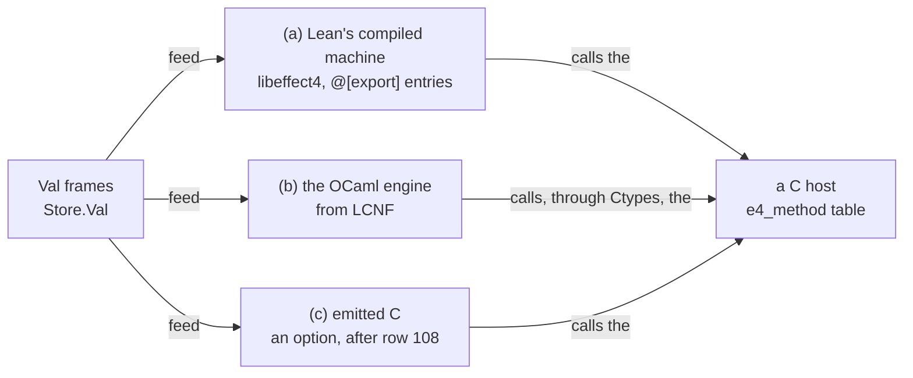

# 2026-10-16 The C face: routes to C, C types as codes, and a C host over the wire frames

Status: research note with a tested prototype, not authority.
Base: `81f9a4354` on `refactor/phase1-phase3`.
Role: the C interop seat's survey and design, from the coordinator's brief of 2026-10-16. The owner
asked for the C face: the FFI, C types modeled as codes, and C hosts.

## The one thing to know first

The wire frames are the C interface. A C reader and writer of `Store.Val` frames is C11 with no
dependency (`wc -l proto/e4val.[ch]`: 919 lines). It agrees with Lean's own compiled decoder and
encoder on every input run. A C host over those frames answers the to-do rows with Lean's bytes. So
the C face needs no new representation. It needs the byte entries that LC-9 plans on Lean's compiled
machine (row 391 (3), P10 (a)), and one reply entry (§5.3). It also needs the frame codec in C, and a
printer of each type's codec for the C target.

## 1. Question

1. Which route to C fits "Eff runs anywhere" (row 381 (6)) best, and why?
2. How do C types map to and from `Ty` codes: where exactly, where by widening, where by refusal?
3. What is a C host, mirroring the typed host of row 405?
4. Does a C reader and writer of the frames agree with Lean's bytes?

## 2. What was read or run

| Item | Evidence | Result |
| --- | --- | --- |
| `AGENTS.md`; `Store.Val` (`src/Effect4/Store/Carrier/Val.lean`), `utf8Chars` (`src/Effect4/Store/Carrier/Utf8.lean`), `natBytes` (`src/Effect4/Store/Carrier/Digits.lean`) | reading | the frame grammar and each refusal, transcribed in §6 |
| `Ty` (`src/Effect4/Program/TyCore.lean`) | reading | the codes of §4 |
| The `Modeled` universe note and the audit's §4 (`docs/research/2026-10-16-modeled-universe/README.md`, `docs/research/2026-10-16-soundness-audit/README.md`) | reading | a codec is the fold staged at a code; §4 and §5 follow it |
| Decisions rows 29, 108, 381, 391, 393, 405 | reading | the rulings §3 stands on |
| The lowering collation's §6 and LO-10, the cleanup prompt's LC-9 (`docs/research/2026-10-14-lowering-collation/README.md`, `docs/research/2026-10-14-lowering-cleanup/prompt.md`) | reading | the planned C face: `@[export]` byte entries over a `Live` handle |
| `Reactor` (`src/Effect4/Run/Basic.lean`), `Reactor.method`, `Reactor.fallible`, `Reactor.first` (`src/Effect4/Run/Method.lean`), `Typed.Host` (`Test/Dogfood/Scenario/Todo/Typed.lean`) | reading | the host of §5 |
| `ocaml/README.md`, `ocaml/engine/test/todo/test_todo.ml`, `ocaml/engine/test/modeled/test_modeled.ml` | reading | the OCaml typed host that §5 mirrors |
| The axiom gate's refusals (`Test/Audit/AxiomGate.lean`) | reading | it refuses `@[extern]` and `@[implemented_by]`; it has no rule for `@[export]` |
| `nm -gU` over the core's shared library `libeffect4_Effect4.dylib` | tested | it exports `Live.start`, `Live.feed`, `Live.view`, `Runner.stepBytes`, `Store.Val.decode` and `Store.Val.encode` under mangled names; no `@[export]` name exists yet |
| Ctypes 0.24.0: `Ctypes_types` (`~/.opam/effect4/lib/ctypes/ctypes_types.mli`), `Ctypes_structs_computed`, and `Cstubs_structs` (`~/.opam/effect4/lib/ctypes/stubs/cstubs_structs.ml`) | reading | the C type descriptions of row 393 (6), and Ctypes' two ways to a layout (§4.1) |
| fpath 0.7.3, `fpath.mli` and `fpath.ml` (`~/.opam/effect4/lib/fpath/`) | reading | §4.6 |
| rc.112's `Path` service (`vendor/effect-4.0.0-rc.112/src/Path.ts:84-98`) | reading | paths cross Effect as `string` |
| The prototype (`proto/`, §6): `make test`, `make test-san`, `make lean-diff` | tested | all pass; §6.2 |

## 3. The routes to C

### 3.1 Three routes

| Route | What runs `Eff` | What C does | Runtime it carries | Ruled |
| --- | --- | --- | --- | --- |
| (a) Lean's compiled machine, byte entries | the machine itself, compiled by Lean's compiler to C | links the core's library, calls three entries over bytes, answers host calls | Lean's runtime (`libleanrt.a`, about 1 MB as an archive), `Init`, the machine's modules | row 391 (3), P10 (a); LO-10, LC-9 |
| (b) OCaml from LCNF, with Ctypes | the OCaml engine made from the machine by the LCNF route | a C provider the OCaml engine calls through Ctypes or `Cstubs` | the OCaml runtime, and libffi for `ctypes-foreign` | row 393 (6); interop plan P6, after P4 |
| (c) C emitted from LCNF | C printed by a new emitter from LCNF | the whole machine is C | an RC runtime of the emitter's own | not ruled; the collation's §6.3 (c), after row 108 |

Route (c) re-derives what Lean's compiler already does after LCNF. Before it writes C, Lean's compiler
inserts reference counts, boxes scalars and reuses cells. An emitter of ours would redo that. Row 29 and
`docs/core/lcnf-route.md` §7 prefer the pinned compiler's route. It stays an option for a target with no
Lean runtime, or for a CompCert build.

### 3.2 The recommendation: route (a) runs `Eff`, and one host interface serves all three

Route (a) fits "Eff runs anywhere" best, for four reasons.

1. It runs the reference machine, not a translation of it. The run that the batteries test is the run C gets.
2. A C interface is the one interface that almost every language binds: Python, Rust, Go, Swift, Zig, Java.
   Three byte entries and a frame codec reach the machine from each of them.
3. Lean exports and C imports, so the library keeps its trust ceiling. The gate refuses `@[extern]`,
   which replaces a checked body with host code. `@[export]` replaces no body: it names the C symbol
   of a checked definition.
4. The frames carry no layout. Lengths are big-endian, naturals are digit strings, and text is UTF-8.
   The same bytes cross a 32-bit, a 64-bit, a little-endian and a big-endian host.

Route (a) has two limits. Where Lean's runtime does not build, the browser takes route (b) through
`js_of_ocaml` or `wasm_of_ocaml`, and bare metal waits on route (c). The core's library today binds the
whole compiler. It references `initialize_Lean` and links `libLake_shared`. It also binds two packages'
symbols at load. So the C face needs a library cut to the session's module closure (§7, proposal 2).

The host interface does not depend on the route. A C host reads requests and writes answers as frames
(§5). Under route (a) the C driver calls it. Under route (b) an OCaml method adapter calls it through
Ctypes. Under route (c) the emitted machine calls it. So a C provider is written once.



### 3.3 Where `@[extern]` is acceptable

The library never takes `@[extern]`. The gate audits every `Effect4.*` and `Test.*` declaration, and it
refuses each `@[extern]` one. Three places stay open, none of them in the library:

- Lean's own core, whose `@[extern]` constants are the compiler's trusted base. The LCNF route replaces
  each one it reaches with a builtin row (`docs/core/lcnf-route.md` §9).
- A driver executable outside both namespaces, which binds a C provider and feeds a session. The provider
  is host code, and its answers enter only through reply admission.
- A probe under `docs/research/`, which no root imports.

Route (a) needs none of them, because the host loop is C's: C calls Lean, and Lean never calls C.

## 4. C types as codes

### 4.1 Two parts: a code and a layout

A C type has two parts that the model keeps apart.

- **The code.** What values the type holds, and how they map to `Ty` codes. It is the same on every target.
- **The layout.** The size and alignment of each scalar, the offset of each field and each padding byte.
  It is target data, as LLVM's `DataLayout` is (`docs/core/lcnf-route.md` §7).

The frames never depend on the layout. Only the C carrier, the struct that host code holds, does. So the
layout belongs to a target profile, and the code belongs to the type.

The code follows Ctypes, as row 393 (6) rules. A code is one of these forms. Most are Ctypes
descriptions; `slice` pairs a pointer with a length, and `handle` is an index (§5.4).

```text
CTy ::= scalar k                       k ∈ bool, int8..int64, uint8..uint64, size_t, intptr_t, float, double
      | ptr t own                      own ∈ borrowed, nullable, owned (named deallocator)
      | array n t                      a fixed length
      | slice t                        a pointer and a length: (const T *, size_t)
      | struct name [(field, t)]       declaration order
      | union name [(member, t)]       untagged
      | enum name k [(constant, n)]    integer constants, by name
      | view name t                    a named pair of conversions, as Ctypes' `view`
      | handle kind                    a host resource, held in the host's table
      | funptr                         refused (§4.4)
```

Ctypes has two ways to a layout, and the model takes the measured one. `Cstubs_structs` writes C that
prints `sizeof` and `offsetof` for each description. It measures an alignment as the offset of a field
after one `char`. The target's C compiler builds and runs that program. `Ctypes_structs_computed` computes
a layout instead: each field at the next offset its alignment allows, the struct padded to its largest
alignment. The computed layout is the measured one's finite cross-check.

### 4.2 The three behaviours of a map

Each pair of a `Ty` code and a C carrier gets one of three behaviours. The words are the dictionary's
(`docs/core/controlled-english.md` §3.5).

- **Exact embedding.** A writer `C → Val` and a reader `Val → Option C` with retraction and exactness.
  The reader may refuse: it then refuses with a located refusal, a path and a reason.
- **Widening.** A read without exactness: the value reads, and writes back as another value. A widening
  is never the default codec. It is a conversion, one of the four boundary behaviours
  (`docs/core/controlled-english.md` §4), so a program chooses it by name.
- **Located refusal.** No map: the boundary refuses the type, by its path, with a reason.

An exact embedding whose reader refuses some values is a profile limit. Row 108 rules that a face equals
the reference inside its profile and refuses outside it. The C host shows one (§5.4).

### 4.3 The map, code by code

| `Ty` code | C carrier | Behaviour | What the reader refuses |
| --- | --- | --- | --- |
| `bool` | `bool` | exact embedding, both total | — |
| `nat` | `uint64_t`; `uint32_t`, `size_t` per profile | exact embedding of the C type into `nat` | a natural of 2^64 or more (2^32), at its path |
| `nat` | a digit slice: big-endian bytes, no leading zero | exact, both total | — |
| `int` | `int64_t`: a negative `x` writes `negInt (~x)` | exact embedding of the C type into `int` | an integer outside [-2^63, 2^63) |
| `number` | `double`, on bit patterns | exact embedding: an integral double writes its integer image, any other its eight bytes | an integer that no binary64 holds exactly |
| `number` | `float`, widened to binary64 by bit operations | exact embedding | a value that binary32 does not hold exactly |
| `string` | a UTF-8 slice `(const char *, size_t)` | exact embedding; the writer checks | the writer refuses bytes outside strict UTF-8, at the first one |
| `string` | `char *`, ending at NUL | exact embedding on strings with no U+0000 | the reader refuses U+0000; the writer refuses bytes outside strict UTF-8 |
| `bytes` | `(const uint8_t *, size_t)` | exact, both total | — |
| `unit`, `null`, `undefined` | no carrier | exact: one value each | — |
| `option t` | a nullable pointer to `t`'s carrier | exact when `t`'s map is | as `t` |
| `list t` | `slice t` | exact when `t`'s map is | as `t`, at the item's position |
| `tuple`, `prod` | a struct with positional fields | exact when each field's map is | at the position |
| `record` | a struct, fields paired by name; an optional key pairs with a presence flag | exact when each field's map is | at the field's name |
| a union of `lit`s (a derived enum) | a C `enum`, constants paired by name | exact on the declared constants | the reader: an unknown name; the writer: an undeclared integer |
| a union of records (a derived inductive) | a tagged struct: `{ tag; union { … } }` | exact when each arm's map is | an unknown tag |
| `map string v` | a slice of key and value pairs | exact when `v`'s map is; keys strictly ascending by UTF-8 bytes | the reader: keys out of order or repeated |
| `app n args` | the C type that the table's declaration of `n` maps to | the body's behaviour | as the body |
| `handle n` | an index into the host's table of resources | exact on the handles the session minted | an address never crosses |
| `unknown` | the value tree itself (`e4_val`) | exact: the identity on frames | — |
| `never`, `var`, `exitOf`, `causeOf`, `fiberOf`, `refOf`, `deferredOf`, `contextOf` | — | located refusal: internal handles and runtime kinds cross no host row (row 97's interim rule) | always |

Three entries need care.

- A natural's digit slice is the C carrier with no profile limit. The prototype's value tree holds every
  natural this way, and converts to `uint64_t` only at a typed field (`e4_nat_u64`).
- A `float` widens to a double by bit operations, never by a floating-point conversion. IEEE 754 quiets a
  signalling NaN on conversion, so two distinct `float` NaNs would write one double: no exactness.
- A record's names are in canonical order, and a C struct's fields are in declaration order. The codec
  pairs them by name, so neither order constrains the other.

### 4.4 What C has that `Ty` refuses

| C form | Behaviour | Why |
| --- | --- | --- |
| an untagged `union` | located refusal | the value does not say which member is active |
| a function pointer | located refusal | a closure never crosses the host boundary (row 381 (3)) |
| `void *` as data | located refusal | it is an address; as the referent of a host handle it stays in the host |
| a struct's memory, copied as bytes | located refusal | padding bytes have unspecified values in C, so the bytes are no canonical image |
| `long double`, `_Complex`, bit-fields | located refusal, for now | no `Ty` code; a bit-field's layout is the compiler's choice |
| an owned pointer | the pointee crosses; the ownership does not | allocation and release are the host's protocol, not a value |

### 4.5 Strings and their encodings

`Ty.string` is strict UTF-8: shortest forms, no surrogates, at most U+10FFFF, and U+0000 allowed
(`utf8Chars`). C has no string type, only conventions, and each convention gets its own map.

| C convention | Map to `Ty.string` | Map to `Ty.bytes` |
| --- | --- | --- |
| a UTF-8 slice | exact embedding; the writer refuses non-UTF-8 | exact |
| `char *` ending at NUL | exact embedding on NUL-free strings | exact on NUL-free bytes |
| `char *` in a locale encoding (Latin-1, Shift-JIS) | no embedding: a named conversion | exact |
| `wchar_t *` as UTF-32 (Linux, macOS) | exact embedding; the writer refuses a surrogate or a value past U+10FFFF | — |
| `wchar_t *` as UTF-16 (Windows) | exact embedding on well-formed UTF-16; the writer refuses an unpaired surrogate | exact through WTF-8 |
| a replacement of bad bytes by U+FFFD | widening | — |

WTF-8 (Simon Sapin, by name) encodes ill-formed UTF-16 one-to-one as bytes. So a Windows name with an
unpaired surrogate maps exactly to `bytes`, never to `string`.

### 4.6 Paths: the owner's fpath

The name matches one installed library. fpath 0.7.3, Daniel Bünzli's OCaml library of file-system paths,
sits in the `effect4` opam switch beside Ctypes. This section reads the owner's mention as that library.

What fpath models (reading, `fpath.mli` and `fpath.ml`):

- `Fpath.t` is an OCaml string: bytes with no encoding. A path is never empty and has no NUL byte.
- `Fpath.of_string` collapses repeated separators: `"a//b"` becomes `"a/b"`. A leading `//` stays, as
  POSIX allows. On Windows it first rewrites `/` to `\` and parses a volume (`C:`, `\\server\share`).
- `dir_sep` is `/` on POSIX and `\` on Windows, so a path's image depends on the platform.

How a path maps to codes (proposal):

1. **A declared type.** `Path` is a name in the application's table (`SigApp.types`), and its body is
   `bytes`. A POSIX path holds any byte but NUL, so `string` cannot hold every path.
2. **A refinement, then an exact embedding.** The reader admits a value only when its bytes are non-empty,
   NUL-free and in normal form. It refuses a non-normal path, as the frame reader refuses a natural's
   leading zero. So the codec stays exact, with no normaliser.
3. **Normalization is a row, not a codec.** rc.112's `Path` service has `normalize`, `join` and `resolve`
   as methods. So collapsing `a//b` is a host call (a conversion), never a silent read. A normalizing read
   would be a widening.
4. **The carriers.** In C, a NUL-free slice, or `char *`, exact both ways. In OCaml, `Fpath.t`, exact on
   normal forms. In TypeScript, `string`: rc.112's paths are `string`, so a path crosses to the TypeScript
   face only when its bytes are UTF-8. The face refuses any other path, located at the first bad byte.
5. **A path is per platform.** A POSIX path is not a Windows path. Moving one between them is a conversion
   row, as fpath's `of_string` rewriting shows.

If the owner meant another thing by "fpath", this section is the place to change.

## 5. A C host

### 5.1 The method layer

A host is `Reactor σ := Row → Val → σ → Option (Answer × σ)` (`src/Effect4/Run/Basic.lean`). Its C
reading is a table of methods (`proto/e4host.h`):

```c
typedef enum { E4_DECLINED, E4_SUCCESS, E4_FAILURE } e4_status;
typedef struct { e4_status status; e4_val *value; e4_refusal why; } e4_answer;
typedef struct {
  const char *spelling;                                          /* the row it answers */
  e4_answer (*answer)(void *host, const e4_val *request, e4_arena *arena);
} e4_method;

e4_answer e4_serve(const e4_method *, size_t, void *host, e4_slice row, const e4_val *, e4_arena *);
e4_status e4_serve_bytes(const e4_method *, size_t, void *host, e4_slice row,
                         const uint8_t *request, size_t len, e4_buf *answer, e4_refusal *why);
```

- `e4_serve` is `Reactor.first`. The first method whose spelling is the row's spelling answers. When no
  method matches, the call is declined.
- A method answers a success value, a failure's error value, or a decline. A request that does not read
  is declined with its refusal, as `Reactor.method` declines it: the session sees a declined call, never
  a guessed value.
- The C host builds no completion. `Reactor.fallible` wraps a success as `.ofExit (.success v)` and a
  failure as `.ofExit (.failure (Cause.fail (errOf v)))`. At the byte boundary that wrapping stays on
  Lean's side: the reply entry takes a status byte and the value's frames (§5.3). So C never writes the
  cause alphabet.
- A C host keeps its state in place, where Lean's reactor threads `σ`. Its test compares the state after
  each request with Lean's next state, by the state's codec.

### 5.2 The typed layer

A typed host is a structure of functions over native C types, one per row: the C reading of `Typed.Host`.
Each type's codec is what a C printer of `Modeled` would write from the type's staged image. The prototype
writes the to-do's by hand:

```c
typedef struct { uint64_t id; e4_slice title; bool done; } todo_t;   /* Todo: { done, id, title } */
typedef struct {
  todo_result (*insert)(void *self, e4_slice title, todo_t *ok, sql_error_t *err);
  todo_result (*all)(void *self, e4_arena *, todo_t **items, size_t *count, sql_error_t *err);
  todo_result (*set_done)(void *self, uint64_t id, bool done, bool *found, todo_t *ok, sql_error_t *);
  todo_result (*remove)(void *self, uint64_t id, bool *existed, sql_error_t *err);
} todo_host;
```

The adapter (`todo_methods`) reads each request by its codec, calls the function, and writes the answer
by its codec. A failure writes the rows' error `SqlTag × String` as the two-string list that `errOf`
reads as `Err.tagged` (`src/Effect4/Machine/Term.lean`).

### 5.3 The driver loop under route (a)

With LC-9's entries, a C driver plays a session. The shape below is a proposal; no entry has its
`@[export]` name yet. LC-9 already puts a status byte before each payload. So a refusal needs no Lean
`Except` in C. This note adds a reply entry of the same kind.

```c
live = effect4_start(program, table, header);            /* bytes in; a Live handle out */
for (;;) {
  view = effect4_view(live);                              /* the outstanding calls, as frames */
  if (no outstanding call) break;
  for (each call) {
    status = e4_serve_bytes(methods, n, host, call.row, call.request, len, &answer, &why);
    live = effect4_reply(live, call.key, status, answer, &verdict);
    /* Lean builds the completion as Reactor.fallible does, then submits and applies the reply */
  }
}
```

Without a reply entry, the driver would write `Runner.Command`'s canonical bytes itself
(`src/Effect4/Api/RunnerBytes.lean`). A value inside a command is written there as its description, the
generated sum `Val`, and the completion carries the cause alphabet. The reply entry keeps both on Lean's
side. The driver still reads the view's outstanding calls, which are generated `Canonical` shapes. So it
needs a C reader of those shapes, printed from their declarations, as `eff/` is for OCaml (§8).

### 5.4 Ownership and lifetimes

| Value | Who owns it | For how long |
| --- | --- | --- |
| a request read from frames | the call's arena; strings and digits borrow the input bytes | the call |
| an answer written to frames | the host, until `e4_encode` returns | the call |
| a value the host keeps | the host, by a copy | the host's choice (`repo_push` copies each title) |
| a resource (a file, a socket, a database) | the host's table, by index | open to close, as rows |
| a `Live` handle | the driver; Lean counts its references | start to the last feed |

A resource crosses as a host handle that the session mints when it applies the reply. The C host keeps
the index and the pointer. The address never crosses. The open and close phases are the host
boundary's lifecycle declarations (`docs/core/host-boundary.md` §4.2), the interop plan's P5.

The prototype shows one profile limit. A to-do id is `uint64_t` in C and `Nat` in Lean. For a request
`setDone [2^64, true]`, Lean's model answers `none`, and the C host declines, located at field 0. That is
row 108's rule: inside its profile the face equals the reference, and outside it the face refuses.

## 6. The prototype

### 6.1 Files

| File | What it is |
| --- | --- |
| `proto/e4val.h`, `proto/e4val.c` | the value tree, its exact reader with located refusals, its checked writer, equality, rendering as `Val.render` writes it |
| `proto/e4host.h`, `proto/e4host.c` | the method layer, the typed to-do host, its codecs, a repository in C and its broken twin |
| `proto/fixture.h`, `proto/fixture.c` | the scanner of the committed fixtures' hexadecimal frames |
| `proto/test_val.c` | R1 to R7: round trips, prefixes, byte flips, the guards' values and refusals, the checked writer |
| `proto/test_host.c` | C1 to C6: the C host against Lean's to-do host run |
| `proto/lean_diff.c` | D1 to D3: the C codec against Lean's compiled `Val.decode` and `Val.encode`, called from C |
| `proto/Makefile` | `make test`, `make test-san` (AddressSanitizer and UBSan), `make lean-diff` |

Each C file opens with its property list, as `ocaml/STANDARDS.md` asks of a component. The reader
transcribes `readFrame`, `decodeSeq`, `decodeBody` and `decodeOne`, and names each Lean declaration it
follows.

### 6.2 Results

The fixtures are the bytes the repository commits. They are `ocaml/engine/test/modeled/modeled.txt`,
`ocaml/engine/test/todo/todo-host.txt` and the eight `.hex` files of `ocaml/goldens/eff/`.

| Command | Output (verbatim) | Evidence |
| --- | --- | --- |
| `make test` (`test_val`) | `PASS R1 111 of 111 fixture frames read and write back to their bytes` | tested |
| | `PASS R4 111 of 111 frames exact under mutation: 128199 mutants, 10431 read and wrote back` | tested |
| | `598 checks, 0 failures` | tested |
| `make test` (`test_host`) | `35 checks, 0 failures` | tested |
| `make test-san` | `598 checks, 0 failures` and `35 checks, 0 failures` | tested |
| `make lean-diff LEAN_LIBDIR=<main checkout>/.lake/build/lib` | `PASS D1 D2 144978 inputs (124978 from the fixtures, 20000 random): both read 15781, both refuse 129197, disagree 0` | tested |
| | `PASS D3 both sides read some inputs and refuse others: of the fixtures' inputs 7885 read, of the random 7896 read` | tested |
| the same, with the C reader's boolean rule removed (a red control, not committed) | `FAIL D1 D2 … disagree 496` | tested |

What the tests show:

- Every committed frame reads and writes back to its own bytes, and every proper prefix is refused.
- Of 128,199 byte-flipped inputs, the 10,431 that read each write back to the flipped bytes. So the
  reader accepts nothing outside the writer's image, on these inputs.
- On 144,978 inputs, the C reader accepts exactly when Lean's compiled decoder answers `some`. The C
  writer gives Lean's encoder's bytes on every accepted input. The red control shows the differential
  detects one changed rule.
- The C host answers every call that Lean's run recorded, over the seven requests of the to-do script,
  with Lean's bytes. Its state after each request is Lean's, and so is its broken twin's.

## 7. Proposals (not rulings)

1. **Take route (a) for the C face, with this note's host interface.** Land LC-9's `@[export]` entries
   and the reply entry of §5.3. Name the C ABI after the prototype: `e4_val` frames, `e4_method` tables,
   located refusals.
2. **A library for the C face, cut to the session's closure.** The core's library binds `initialize_Lean`,
   links `libLake_shared` and binds two packages' symbols at load. A library target over the session's
   byte entries alone would link `libleanrt.a` and `libInit.a` statically. That is a `lakefile.toml`
   change, the coordinator's.
3. **A C printer of `Modeled` codecs, as an algebra of the type fold.** From a type's staged image, print
   the C struct, its reader and its writer, as the LCNF route lowers the image to OCaml. One table of C
   type rows gives each code's carrier and behaviour per profile, as LC-1's type rows do for OCaml. The
   same table prints Ctypes descriptions for route (b).
4. **The layout as measured target data.** A generated C program prints each description's size,
   alignment and field offsets, as `Cstubs_structs` does. `Ctypes_structs_computed` is its finite
   cross-check.
5. **Profile support for C carriers.** A C profile marks `nat` at a `uint64_t` carrier as bounded. Then
   table admission refuses a row whose values can pass 2^64, and the call never needs a decline.
6. **Paths as in §4.6.** A declared `Path` over `bytes`, a reader that refuses a non-normal form, and
   normalization as a row of rc.112's `Path` service.
7. **Keep the prototype's tests as the C face's lane.** `test_val` and `lean_diff` hold the codec to
   Lean's bytes. `test_host` holds a C host to Lean's recorded calls, as `test_todo.ml` does for OCaml.

## 8. What this does not establish

- The tests are finite runs over the inputs named in §6.2. No theorem relates the C code to Lean's.
- No C program runs `Eff`. The machine in every test is Lean's. `test_host` answers the calls that Lean's
  run recorded, in order, and the differential calls Lean's decoder, not the machine.
- No `@[export]` entry exists. The differential calls the compiler's mangled names, which move with a
  namespace.
- The reply entry of §5.3 and the C reader of the view's shapes do not exist.
- The C codecs of the to-do types are written by hand, not printed from `Modeled`.
- The layout of §4.1 is a design. No profile measures one yet.
- The map of §4.3 is a design. The prototype's codecs test only part of it: `bool`, `nat` at
  `uint64_t`, `string` as a slice, records, lists, options and the error pair.
- The reader refuses nesting deeper than `E4_MAX_DEPTH`, where Lean's decoder has no limit.
- The literature is named, not read here: Ctypes (Yallop, Sheets and Madhavapeddy, 2018, "A modular
  foreign function interface"), IEEE 754-2019, ISO/IEC 9899:2018, and WTF-8.
- The differential ran against the library that a Lake build left in the main checkout. Its file time,
  15:46 on 2026-10-16, is before the base commit. The decoder's three sources last changed in `d8bb17a40`
  (2026-10-04), so the decoder it holds is the base's (reading). This seat ran no Lake.
