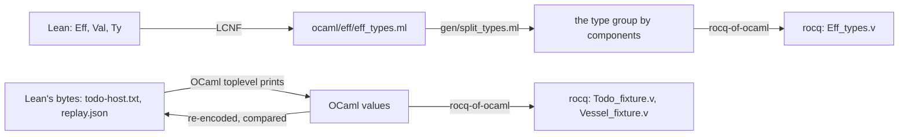

# 2026-10-16 Interaction trees in Rocq: a checked meaning of Eff, typed vessel hosts, and an extracted fast path

Status: research note (history, not authority). Base: `d3bca195a` on `seat/ocaml-interop`, itself on
`81f9a4354` (`refactor/phase1-phase3`). Branch: `seat/itrees`. Role: the OCaml and Rocq seat, second
task of 2026-10-16. The receipt is `docs/research/2026-10-16-seat-itrees-receipt.md`.

## The one thing to know first

An interaction-tree meaning of `Eff`, in Rocq, now agrees with the Lean machine on 23 recorded runs.
It reads program syntax that a generator chain made from the LCNF route, so no type is copied by hand.
Extracted to OCaml, the same tree runs under the engine's own host providers and gives Lean's
results byte for byte. It costs 2.2 to 2.7 times less CPU per to-do request than the engine (§3).

Three findings matter beyond the measurement:

- The interaction-tree theory proves, for every host, facts that a replay checks only of recorded
  runs. In the vessel model, every accepted verdict holds up its duty, and the study checks never
  fire under a typed host (§2).
- A choice tree states a host's specification as nondeterminism. A mock FMI host then refines it
  for every program. That one theorem rests on ctrees modules that load only with universe checking
  off (§2.3).
- The meaning covers definitions, cells and loops, which Lean's `denoteRows` does not. The math
  seat's call chains are the Lean side of the same three outcomes (§4).

## Words

- **interaction tree** (itree): a coinductive tree of results (`Ret`), silent steps (`Tau`) and
  events with one continuation per answer (`Vis`). Xia et al. (2020), *Interaction Trees*, read
  for this note at the library's source, coq-itree 5.2.1.
- **`eutt`**, written `≈`: two trees agree up to finitely many silent steps.
- **`interp`**: a tree's events answered by a handler, which is how a host meets a program.
- **`mrec`** and **`iter`**: the library's recursion and loop operators, with no budget.
- **choice tree** (ctree): an interaction tree with internal branching (`Br`). Chappe et al.
  (2023), *Choice Trees*, read at coq-ctree 2.0's source.
- **`ssim`**, written `≲`: strong simulation of choice trees, which includes the traces of one in
  the other's.
- **frontier**: the dictionary's (`docs/core/controlled-english.md` §3.6). Here it is a node
  `Vis (Waits i v) k` whose answer type is empty.
- **meaning**: `Denote.meaning`, the tree this note defines for a program.

## Questions

1. Can the vessel workflow be a tree over typed events, one family per host service? Can its
   types carry units, datums, revisions and study-bound evidence? What does the theory then prove
   that replay and tape readings do not?
2. Can an `Eff` fragment become trees, from generated program syntax? Can it carry DB-03's trace,
   divergence and equivalence judgments, each under a named observation? Does it agree with the
   Lean machine on fixtures?
3. Can an extracted tree run under our driver, with `E4_host` providers and `REPO` hosts as its
   handlers? How fast is it beside the machine that LCNF lowered?
4. Which tree concepts does the `Effects` coalgebra lack, and what would they unlock in Lean?

## What was read or run

| Item | Evidence | Result |
| --- | --- | --- |
| `docs/DESIGN-BASIS.md` DB-03; `docs/core/semantics.md`, the Interaction Trees row | reading | the frame: a relation needs trace, divergence and equivalence judgments |
| `Effects/Coalgebra/{Step,System,Bisim,Comodel,Protocol,Run,Sat,Indexed}.lean` | reading | §4 |
| `denoteRows` (`src/Effect4/Laws/Program/DenoteRows.lean`), `denoteRowsB` (`src/Effect4/Laws/Program/DenoteRowsB.lean`), `HostRuns.lean`, `SessionMeaning*.lean`, `CallTree.lean`, `Residual.lean` | reading | the arms the Rocq meaning transcribes |
| `suspendBodyAt` (`src/Effect4/Program/Compile.lean`), `evalTerm` (`src/Effect4/Machine/Term.lean`), `Machine.Record`, `Decision.decide` | reading | definitions, terms, records and decisions |
| The vessel on `codex/vessel-dogfood`: its domain, workflow, rows, hosts and six saved runs | reading, through a survey agent and `git show` | §2 |
| The math seat's note, `docs/research/2026-10-16-math-graphs/README.md` on `claude/math-d3` | reading | §4 |
| coq-itree 5.2.1, paco, ExtLib in the switch `rocq`; coq-ctree 2.0 in a new switch `ctree` | tested, installed | §5 |
| `iter` (`src/Effect4/Laws/Program/Iter.lean`), `loopStep`, `thenOpt`, `denoteRowsB_approx`; `Effects.Program.Approx`, `Effects.Comodel.run`; `Chain` in `CallChain.lean` on `claude/math-d3` | reading | §6: the definitions `Budget.v` transcribes |
| `reproduce.sh` beside this note, which rebuilds every artifact and log below | tested | `logs/` |

## Findings

### 1. The relation: generated syntax, a meaning, and three judgments (question 2)

**The syntax is generated.** Every `Eff` type crosses with no hand copy:

The split is needed because Rocq refuses one mutual inductive whose types differ in their
parameters, as `'op eff` and `ty` do. The OCaml toplevel writes any value of a known type as
OCaml source, so no value writer is made by hand. Each printed program and result re-encodes to Lean's
bytes (`logs/3-fixtures.log`).

**The meaning** (`rocq/Denote.v`) transcribes `denoteRows` arm by arm and widens it:

| Construct | Lean's `denoteRows` | The Rocq meaning |
| --- | --- | --- |
| `succeed`, `fail`, `sync`, `bind`, `select`, host rows | an arm each | the same arm |
| the cell rows `refMake`, `refGet`, `refSet` | through the store signature | events `StoreE`, answered by a state |
| definitions: `defs`, `call`, `invoke`, `param` | no arm | an event `Run`, answered by `mrec`; recursion allowed |
| the context: `provideContext`, `withFiber (context _)` | no arm | a value the meaning carries |
| loops: `iterate` | `denoteRowsB k`, cut at a budget | `ITree.iter`, with no budget |
| forks, races, scopes, interruption | no arm | a marked exit, `outside` |

**The judgments** (`rocq/Judgments.v`):

| Judgment | Definition | Theorem |
| --- | --- | --- |
| equivalence | `eutt eq` | — |
| trace | ITree's `is_trace` | `traces_iff_equivalent`: equal trace sets exactly when `eutt` |
| divergence | `≈ ITree.spin` | `loop_diverges`: an `iterate` whose test is `true` diverges, at no budget |
| frontier | a `Waits` node | `frontier_not_divergence`, `exit_not_divergence` |
| replay | a tape is a stateful handler | `tape_respects_equivalence`: a tape cannot tell `eutt` trees apart |

**The check against the machine.** Each check runs the meaning under a run's own reply tape. It is
the reading of H8 (`denoteRows_eq_session`) at these programs. The meaning must make the recorded
calls in order, use the whole tape and end with the recorded exit.

| Fixture | Runs | Result |
| --- | --- | --- |
| to-do, Lean's `Run.runWith` under the reference host (`todo-host.txt`) | 7 | each agrees (`TodoCheck.v`) |
| the same programs under the broken host | 7 | each agrees |
| the vessel's saved runs against OCCT and the FMI unit, which Lean's `check_replay.lean` passed | 6: three accepted, two refused by the workflow, one failed by FMI | each agrees (`VesselCheck.v`) |
| red controls: another host's tape; an empty tape; the meaning with the option decision's branches swapped | 3 | each tells the difference, or waits at the first call (`logs/`) |

The checks are closed computations that the kernel checks by `vm_compute`: 8.6 s for the to-do
file and 6.8 s for the vessel file (`logs/4-rocq.log`). They are finite checks, not a theorem over programs. The vessel found a transcription fault that
the to-do fixture missed. The meaning wrote a record's fields in declaration order, and Lean sorts
them by their bytes. The cause was the translation library's `fold_right`, which takes
OCaml's argument order (§5).

### 2. The vessel in Rocq: typed services (question 1)

**Deep typing** (`rocq/VesselTypes.v`). The vessel's Lean domain types its data, but its workflow
passes untyped records, so each reply is checked at run time against the request's study. Here the
domain indexes the services themselves:

| Concept | Type | What the type rules out |
| --- | --- | --- |
| a quantity | `qty d`, indexed by its dimension | a flow where a duration stands; `inventory` is flow by duration, a volume |
| a level | `level z`, indexed by its datum | a level from another datum |
| a revision | `positive` | revision zero, which `DesignRef` never admits |
| evidence | `evidence s k`, indexed by study and kind | evidence for another study or kind; evidence of a failed check |
| a service | `Exchange s r : GeometryE (tool_result (geometry_reply s))` | a reply for another study: its type depends on the request |

**What the theory proves here** (`rocq/Vessel.v`):

| Theorem | Statement | For |
| --- | --- | --- |
| `assess_sound_every_host` | every verdict the run can end with, under any host, satisfies `sound_verdict`: `required = flow × hold-up`, `required ≤ usable`, sampled maximum `≤` the working limit | every host |
| `assess_sound_every_stateful_host` | the same for a host with a state: a mock, a cache, a recording host | every stateful host |
| `study_checks_never_fire` | the untyped workflow, with `Workflow.lean`'s study checks, under the erasure of any typed host, is `eutt` the typed run with its verdict erased | every typed host |
| `raw_refuses` | a foreign host's reply for another study is still refused | every host |

A replay checks one recorded run against one host. These theorems quantify over hosts, and the
first two over every run too. They are about the model, not the `Eff` program. The link between the
two is finite: `VesselCheck.v` runs the program's meaning on the six saved runs.

**A mock refines a specification** (`rocq/VesselCtreeHost.v`, `rocq/VesselCtree.v`). The FMI host
is real code that no proof reaches. A specification host branches over every reply its protocol
admits: the sampled extremes bracket the initial level. A mock host answers by a mass balance.

- `mock_meets` and `mock_answers_within_spec` hold event by event, with universe checking on.
- `mock_refines_spec`: for every program over the two services, the run under the mock is `≲` the
  run under the specification.

So a test against the mock shows only runs the specification allows. A real host that meets the
protocol, an assumption, has its runs there too. The last theorem needs ctrees'
`Interp.FoldStateT`, which ctrees builds with universe checking off. Loading it with checking on is
refused as a universe inconsistency (`logs/6-ctree.log`). So it holds only modulo universe
consistency, and Rocq's own report says "relies on an unsafe hierarchy".

### 3. Practical use: the extracted tree runs under our driver (question 3)

`rocq/Extract.v` extracts `run_n`, the meaning with its cells as a state and each host row answered
by a host function. `gen/extract_map.ml` generates the extraction directives from `eff_types.ml`,
so the extracted code speaks `Eff_types` itself. `gen/itree_lane.ml` turns each `E4_host`
provider into such a function.

| Host behind the extracted tree | Requests | Result |
| --- | --- | --- |
| the lowered reference repository | 7 | Lean's result, byte for byte |
| `Native_todo.record`, the typed host written in OCaml | 7 | Lean's result |
| `Native_todo.Core`, the pure module behind `REPO` | 7 | Lean's result |
| `Native_todo.broken`, whose insert fails | 7 | Lean's broken result |

Per request, with the typed record host, CPU time: the extracted tree 8.02 µs, the engine under
`E4_host` 17.51 µs (`logs/7-extracted.log`, load 14). Two earlier runs gave 4.03 against 10.48 µs
(load 6) and 9.59 against 26.10 µs, so the ratio stayed between 2.2 and 2.7.

- **Hosts stack by `interp`.** The cells are one stateful handler and the host rows another, and
  `run_with` interprets one tree by both in turn. A `REPO` host is a handler as it stands.
- **It is a faster tier on a fragment.** The tree has no fibers, no scheduler, no decision tape and
  no reply admission. So it is no replacement of the machine. It suits single-fiber programs, after
  a reply-admission check is added at each answer.
- **It does not fit the estate's rules.** The extracted code uses `Obj.t` for an event's answer
  type, which `ocaml/STANDARDS.md` forbids. It stays in this research folder.

### 4. What the Effects coalgebra lacks, beside the math seat's chains (question 4)

| Tree concept | In `Effects` and the tree today (reading) | What it would unlock |
| --- | --- | --- |
| a silent step, `Tau` | none: `Program` is inductive, a `System` is read by unfoldings | divergence as an object; the math seat's `Chain.Diverges` reaches it by budgets |
| `eutt` | `Chain.Equiv` (math seat), observational under every host | the same rewrites; `eutt` is congruent by construction, `Chain.Equiv` by proof |
| `iter` and its laws | `Effects.Program.iter` at a budget, `denoteRowsB` | loops with no budget; the unfolding and fixpoint laws |
| `mrec` | none: no definition arm in `denoteRows` | calls, invocations and parameters in the call tree; recursion |
| `interp` of a handler into trees | `Comodel.through`, `Handler.Typed` | already there: host stacking with a law each |
| internal choice, `Br` | a protocol (`Comodel.Meets`) states a host's admissible answers | trace inclusion of a mock in a specification, for every program |
| an answer type that depends on the request | `ISignature` (indexed by worlds) | the vessel's study-indexed services; the math seat's V1 |

## Proposals (not rulings)

Each item names its owner. This seat ran no Lean build.

1. **Definitions in Lean's call tree** (math seat). Give `denoteRows` and `denoteRowsB` arms for
   `call`, `invoke` and `param`, by budgeted unfolding, monotone as loops are. The math seat's note
   names this as its next item. `rocq/Denote.v` is a specification of the arms, and the 14 to-do
   lines of `TodoCheck.v` become `#guard`s of the Lean meaning. §6.3 gives the budgeted arms and
   their theorems in Rocq.
2. **A generator of Rocq** (coordinator). Emit the Rocq syntax and the fixtures from Lean, as
   `EffGen` emits OCaml. It would replace four translators in the chain: `split_types`,
   `rocq-of-ocaml`, the toplevel printer and the record shim. Only the extraction map would stay.
3. **Study-indexed services in Lean** (math seat). The math seat's proposal 5, a request-indexed
   protocol, has `study_checks_never_fire` as its target statement. Its Lean form is `Sat.sound`
   at that protocol, or an `ISignature` whose worlds are studies.
4. **A refinement of hosts** (math seat). `Comodel.Meets` and `Sat.sound` give postconditions.
   An `IsSim` between two hosts' runs would give `mock_refines_spec` in Lean, under the axiom gate.
5. **A fast path made from Lean** (coordinator). Lower `denoteRows` with proposal 1's arms through
   LCNF, as a single-fiber tier beside the engine. H8 and H9 then relate it to the session, in
   Lean, where the Rocq tier has only finite agreement. Measure it as §3 measured the Rocq tier.
6. **The budget relation in Rocq** (this seat, next). Transcribe `denoteRowsB k` into Rocq. Prove
   that it is the `k`-truncation of `meaning`, so `Chain.Diverges` and `loop_diverges` meet in one
   statement. Done in §6.
7. **A decisions row for the trust of such work** (coordinator). A Rocq result names its
   translators, its axioms (§5) and its fragment. It joins no gate of the tree.
8. **R12 by the route of `adequacy`** (math seat). The planned goal `rows_divergence_adequate`
   needs the converse of a finish at some budget. §6's `adequacy_loop` gives its shape: a strong
   induction on the silent steps before an end, one loop round at a time.

## 5. The tools: what each assumes and where it bit

| Finding | Evidence |
| --- | --- |
| ITree's library assumes classical logic, choice, functional extensionality and `eq_rect_eq` (`ITree/Axioms.v`); a theorem uses them only where it reaches them | `logs/5-assumptions.log`: `eq_rect_eq` for the two every-host theorems and `traces_iff_equivalent`; every other result closed |
| rocq-of-ocaml writes OCaml 5.4's `Stdlib.Ok` with no Rocq definition | the first worked example's configuration (`docs/research/2026-10-16-ocaml-interop/rocq/`) |
| rocq-of-ocaml's library shadows `map`, `filter`, `length` and `fold_right`, the last with OCaml's argument order | the vessel's field-order fault above |
| a translated `int` extracts as `type int = int`, a cycle; and `String.ltb` computes from an opaque lemma | `rocq/Extract.v`'s directives; the extraction's warning |
| an event family's index universe falls to `Set` unless `Universe Minimization ToSet` is off | `rocq/VesselTypes.v` |
| ctrees 2.0 needs Coq 8.20, not Rocq 9, and its interpretation lemmas load only with universe checking off | `logs/6-ctree.log` |

## 6. The budget relation: Lean's call tree is the meaning, truncated

Added later on 2026-10-16, on branch `claude/interesting-volhard-6ceb2e` over `5e2c01d99`. The
receipt is `docs/research/2026-10-16-seat-itrees-budget-receipt.md`.

**The one thing to know.** Lean's divergence of a program and the Rocq divergence are now one
statement. A cut at every budget is `≈ ITree.spin` of the run, under every host
(`Budget.meaning_diverges_under_iff`). With definitions unfolded by budget, it holds for every
program (§6.3, `BudgetDefs.divergesD_iff`). Rocq prints no assumption for either.

### 6.1 What `rocq/Budget.v` transcribes

| Lean definition | Rocq transcription |
| --- | --- |
| `Effects.Program`, a finite tree | `program`, with `pbind` and `embed` into interaction trees |
| `Effects.Comodel.run`, a host's run | `crun`, over `host E S`: an answer and a state, or `None` |
| `Effects.Program.Approx` | `approx` |
| `iter` (`src/Effect4/Laws/Program/Iter.lean`) | `iterB` |
| `thenOpt`, `loopStep`, `denoteRowsB` (`DenoteRowsB.lean`) | `then_opt`, `loop_stepB`, `denoteB` |
| `Chain.Finishes`, `Chain.Waits`, `Chain.Diverges` (`CallChain.lean`, branch `claude/math-d3`) | `Finishes`, `Waits`, `ChainDiverges` |

The brief named `Effects.Program.iter`. The effects package has no such operator; Lean's budgeted
loop is `iter` in `Iter.lean`, and `denoteRowsB` uses it.

**The fragment** is what both meanings give an arm (`in_fragment`). It holds `succeed`, `fail`,
`sync`, `suspend`, `bind`, `select`, the host rows, the three cell rows and `iterate`.

| Outside the fragment | Why |
| --- | --- |
| `exit`, `catchCause`, `catchIf`, `matchCause`, `onExit` | an arm in `denoteRowsB`, none in `Denote.v` |
| `defs`, `call`, `invoke`, `param`, the context | an arm in `Denote.v`, none in `denoteRowsB` |
| every other constructor | no arm on either side |

Two differences remain. The leaves are `Denote.v`'s, which transcribe `denoteRows`'s leaves.
And a host row's position is not checked against a row table, since the Rocq meaning has none.

### 6.2 The theorems

| Theorem | Statement | Reach |
| --- | --- | --- |
| `denoteB_approx` | the tree at budget `k` is below the tree at every larger budget (`denoteRowsB_approx`) | every program, environment and pair of budgets |
| `meaning_fragment` | `Denote.meaning` is `denoteF`, the meaning over the cell and host events alone, up to `eutt` | the fragment |
| `truncation_is_denoteB` | the meaning with each loop cut after `k` tests (`denoteT k`) is `denoteRowsB k`, up to `eutt` | the fragment, every budget |
| `denoteB_below_meaning` | `denoteRowsB k` is below the meaning: node for node up to silent steps, wherever it is not cut | the fragment, every budget |
| `adequacy` | each finish and each wait of the meaning's run is reached at some budget | the fragment, every host and start |
| `meaning_finishes_iff`, `meaning_waits_iff` | `Chain.Finishes` is the run's `≈ Ret`; `Chain.Waits` is a frontier node of the run | the fragment, every host and start |
| `meaning_diverges_under_iff` | `Chain.Diverges` is `Judgments.Diverges` of the run | the fragment, every host and start |
| `meaning_diverges_iff` | `Judgments.Diverges (meaning e)` holds exactly when `denoteRowsB k e` is the cut at every `k` | the fragment, no host |

The truncation is an operator on the meaning's loops, `iter_upto k`, applied at each loop. In the
meaning a loop's test is a silent step like any other, so a cut that counts tests must see the loop.

The proof never takes a budget as the witness of divergence, as DB-03 asks. A cut at every budget
means no end of the run is reached at any budget. By `adequacy` the run then has no end, and a tree
with no end is `≈ ITree.spin` by coinduction (`no_ends_spin`). Conversely, a finish or a wait at
some budget is one of the run (`below_run`), and neither is `≈ ITree.spin`.

`adequacy` is the hard direction. Its loop case is a strong induction on the silent steps before
the run's end, one loop round at a time (`adequacy_loop`). Two budgets combine by their maximum,
since a finish and a wait persist upward (`crun_approx`).

**The red control** (`logs/12-budget-mutant.log`). Lean's tree is given one more test per loop and
the truncation is left as it was. Monotonicity still holds, and `truncation_is_denoteB` then fails.
So that theorem pins the budget count as Lean counts it: the tests of each loop invocation.
The order and `adequacy` say where Lean's tree agrees with the meaning, not at which budget.

### 6.3 Definitions by budgeted unfolding (`rocq/BudgetDefs.v`)

Lean's tree has no arm for `defs`, `call`, `invoke`, `param` or the context. `BudgetDefs.v` gives
the budgeted tree every arm of `Denote.denote`. A call, an invocation and a parameter's run each
unfold one level, and a call nested deeper than the budget is cut. So no fragment condition remains.

| Definition | What it is |
| --- | --- |
| `denoteW k call` | `Denote.denote`'s arms as a finite tree, with Lean's sequence and loop at budget `k`; each run of a definition or a parameter goes to `call` |
| `denoteD k d` | calls unfolded to depth `d`; at depth zero a call is cut |
| `denoteBD k` | the tree at budget `k`: loops at `k` tests, calls `k` deep |
| `M` | the meaning under the definitions, `interp_mrec` of `Denote.denote`; `Denote.meaning` is `M` at the root, by definition |

| Theorem | Statement | Reach |
| --- | --- | --- |
| `denoteD_approx` | monotone in the loop budget and in the call depth | every program |
| `denoteD_below` | below the meaning at every budget and depth | every program |
| `adequacyD` | each finish and each wait of the meaning's run is reached at some budget | every program, host and start |
| `finishesD_iff`, `waitsD_iff`, `divergesD_iff` | the three chain outcomes are the run's `≈ Ret`, frontier node and `≈ ITree.spin` | every program, host and start |
| `meaning_divergesD_iff` | `Judgments.Diverges (meaning e)` holds exactly when the tree is the cut at every budget | every program, no host |
| `denoteBD_same` | where `denoteRowsB` has an arm, the tree is Lean's transcription, node for node | `Budget.v`'s fragment |

A call's body is no subterm of the program. So `adequacyD` is a strong induction on the silent
steps before the run's end, and each call adds one (`mrec_call`). Inside it, an induction on the
program uses `adequacy_loop_upto`, the loop lemma for a body whose ends are reached up to a bound.
`Budget.v`'s `adequacy_loop` is now its corollary.

The call depth is this file's count. Lean has no definition arm whose count it could follow, so the
count is a proposal for Lean's arms (proposal 1).

**The red control** (`logs/13-defs-mutant.log`). A call's body is run at the caller's environment
instead of its request alone. `BudgetDefs.v` then fails at `denoteW_below`, so the call arms follow
`Denote.v`.

**The to-do fixture at a budget** (`rocq/TodoBudgetCheck.v`). Each of the seven requests, under
each of its two recorded tapes, settles at budget 2 or 3. The run then makes Lean's recorded calls,
reads the whole tape and ends with Lean's exit. These are 14 finite checks and two controls.

### 6.4 A surface to write, run, view and edit (`rocq/Api.v`)

| Face | Definitions | Theorems |
| --- | --- | --- |
| write | `Author`: `loop`, `seq`, `when`, `on_option`, `row`, `cell_new`, `cell_get`, `cell_set`, `define`, `call`, `invoke`, `param`, `with_context`, `context`, terms; `scoped`, `ready` | a check, no theorem |
| run | hosts as data: `cells_host`, `tape`, `fn_host`, `route`; `run_at k`, the run of `denoteBD k`; `settle limit`, the least budget whose run is not cut | `run_at_finished`, `run_at_waits`, `settle_finished`, `settle_complete`, `diverges_iff_never_settles`; `run_at_lean`: Lean's tree's run where it has an arm |
| view | `trace`, a run with each answered event; `frames n`, the runs at budgets `0 .. n` | `run_at_grows`, `frames_grow`: a frame takes back no step, and a frame that is not cut is final |
| edit | `hole`, one-hole contexts as data; `plug`; `at_hole`; `EffEq`, equal meanings at every environment | `edit_congruence`, `edit_keeps_outcomes`; the laws `suspend_law`, `when_true_law`, `when_false_law`, `seq_fail_law` |

Every theorem of the table holds for every program, since the runner runs `denoteBD`.
`settle_complete`: where the meaning finishes under a host, some limit settles on that finish. A
limit that has not settled is a finite probe, never a divergence. Divergence is the statement that
no limit settles (`diverges_iff_never_settles`).

**The examples** (`rocq/Examples.v`, `rocq/BudgetCheck.v`), each written with `Author`:

| Program | Host | Result | Evidence |
| --- | --- | --- | --- |
| `doubling`: a loop from 1 while below 16, one host call a round | a tape of 4 replies | settles at budget 5, finished with 16 | finite check `doubling_settles`, then the theorem `doubling_finishes` |
| `doubling` | a tape of 3 replies | settles at budget 4, waiting on row 0 with 8 | finite check, then the theorem `doubling_waits` |
| `forever`, the silent loop | any host | cut at every budget; no limit settles | theorems `forever_cut_everywhere`, `forever_cut_everywhereD`, `forever_never_settles`, from `Judgments.loop_diverges` |
| `ping`, a loop of host calls | every call answered | cut at every budget up to 30, one more call a budget | finite probe only |
| `cell_counter` | the cells | settles at budget 4, the cell holds 4 | finite check |
| `before_edit` and `after_edit` | any host | equal programs with the same three outcomes; the same 8 frames on a tape | theorems `edit_equal`, `edit_outcomes`; finite check `edit_frames` |
| `doubling_rec`: the doubling loop as a definition that calls itself | a tape of 4 replies | settles at budget 5, five calls deep, finished with 16 | finite check `doubling_rec_settles`, then the theorem `doubling_rec_finishes` |
| `self_call`: a definition that calls itself at once | any host | cut at every budget, so its meaning diverges | theorems `self_call_cut_everywhere`, then `self_call_diverges` by `meaning_divergesD_iff` |
| `twice`: an invocation that runs its passed program twice | a tape of 2 replies | settles at budget 2, two calls at 7 | finite check `twice_settles` |

**The fast runner and the view.** `rocq/BudgetExtract.v` extracts `run_at`, `settle` and `frames`
over the estate's `Eff_types`, with two to-do requests. `gen/budget_view.ml` writes each example's
frames as JSON, with the estate's `Eff_json` for the programs. `generated/budget-view.html` plays
the frames: one tube a frame, a circle a step, an end cap for the stop. A second panel draws every
budget as a row.

| Run (`logs/11-view.log`, `logs/9-budget.log`) | Extracted runner, CPU | Rocq `vm_compute` |
| --- | --- | --- |
| frames 0 to 1000 of `ping`, 500,500 steps in all | 0.182 s, 363 ns a step | 0.948 s |
| one frame of `ping` at budget 100,000 | 0.073 s, 730 ns a step | 0.273 s |

The timing is one machine's, under a load average of 10 to 14. An earlier run under a load of 5 to
10 took 0.059 s against 0.494 s, and 0.027 s against 0.161 s.

### 6.5 What §6 does not establish

- `denoteB` is a hand transcription of `denoteRowsB`, arm by arm and cited. No theorem relates
  the two provers.
- The leaves are `Denote.v`'s. They agree with Lean's on the 20 recorded runs of §1, a finite check.
- The call depth of §6.3 is this folder's count. Its red control checks the call arms against
  `Denote.v`, not against Lean, which has no such arm.
- A Rocq `host` is any function. Lean's `rowsHost` is the instance `route cells_host`, read by
  sight and not proved.
- The extracted runner assumes Rocq's extraction and OCaml's `int` and `string`. It passes an
  answer as `Obj.t`, so it stays in this folder.
- No Lean build ran. The Lean side of `adequacy` is the planned goal `rows_divergence_adequate`
  (R12).

## What this does not establish

- The Rocq meaning is a hand transcription. Its agreement with Lean is 23 finite runs and one
  mutant; no theorem relates the two provers.
- Four translators are assumed: the LCNF route, `split_types`, rocq-of-ocaml and Rocq's extraction.
  The toplevel printer is checked by re-encoding, not assumed.
- The vessel's typed model is not the `Eff` program; the link is the six finite runs.
- `mock_refines_spec` holds modulo universe consistency. No real FMI host is shown to meet the
  protocol.
- The extracted tier has no reply admission, no fibers and no scheduler, and its timing is one
  machine's, under load.
- Interoperability with Effect TypeScript is not touched.
