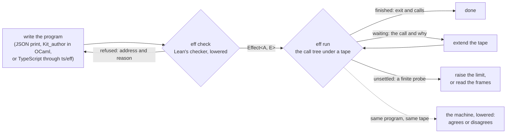
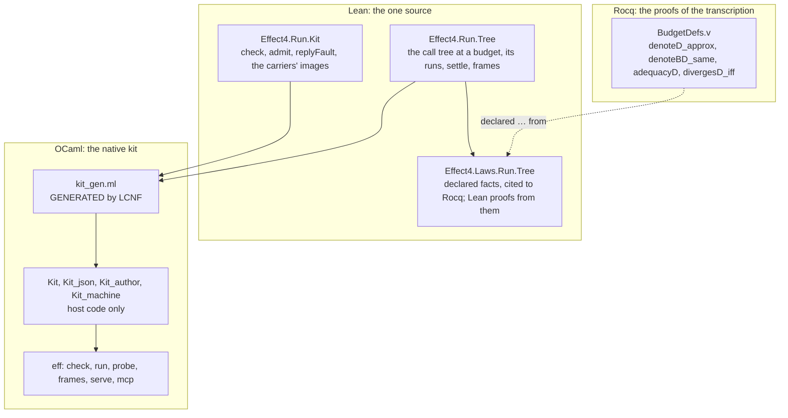

# The native kit: Lean's checker and the call tree at a budget, compiled for agents

Status: research note (history, not authority), 2026-10-16. Branch `claude/eff-kit` on
`refactor/phase1-phase3` at `719e039bf`. The owner asked for the interaction-tree work to become
fast, practical tooling. Compile it, and keep the proofs where they are. Give agents
production-level APIs to write, type, run and watch programs.

## The one thing to know

An agent now checks an Eff program with Lean's own checker in 3 milliseconds. It runs the program
under a reply tape in 3 to 10 milliseconds. Every run stops in one of three named ways. A cut is never reported as a
failure or as a divergence. All of it is Lean code compiled by LCNF, with no second checker and no
second meaning written by hand.

## What an agent does

Each box ran in this note's session; the commands are in §5.

| Command | What it answers |
| --- | --- |
| `eff check P --rows R` | the program's `Effect<A, E>` type, or the refusing node's address and reason; then program admission of the rows |
| `eff run P --rows R --tape T` | `finished` with the exit, `waiting` on a call with why, or `unsettled`; each call with its request and reply; `"machine": "agrees"` |
| `eff probe P --budget K` | the run at one budget |
| `eff frames P --limit N` | the run at every budget up to `N`, each frame extending the one before |
| `eff explore P --rows R` | every path of the call tree, each reply drawn from its row's types; each path's calls, stop and tape, and the machine's replay of that tape |
| `eff outside P` | the address of the first node the call tree has no arm for |
| `eff serve` | the same requests as JSON lines |
| `eff mcp` | a Model Context Protocol server over stdio with the six tools |

A waiting run says why it waits: the host has no reply, or its reply does not fit the row
(`"fault": "answerType", "expected": "void"`). A program outside the tree's fragment, such as a
fork, runs on the machine, and the answer says so (`"via": "machine"`).

## How it is built

The owner's direction was to compile the proved semantics, and to declare in Lean what Rocq
proves. The kit takes the shortest route that keeps one source for each behaviour.

| Piece | Where | What it holds |
| --- | --- | --- |
| The call tree | `src/Effect4/Run/Tree.lean` | `Tree` (`done`, `cut`, `call`, `cell`), `Tree.ofProgram table k`, `Tree.run`, `Tree.probe`, `Tree.settle`, `Tree.frames`, `Tree.paths`, `Tree.outsideAt`, hosts (`Host.tape`, `Host.ofReactor`) |
| The kit's Lean face | `src/Effect4/Run/Kit.lean` | `Kit.check` (`Api.check`), `Kit.admit` (`admitSig`, empty columns), `Kit.replyFault` (reply admission), `Kit.samples`, `Kit.replies` and `Kit.explore`, each carrier's shape, value tree and reading |
| The laws | `src/Effect4/Laws/Run/Tree.lean` | `Tree.Approx`; three declared facts; `runFrom_approx`, `probe_stable` and `settle_sound` |
| Declared facts | `tools/ProofGraph/Declared.lean` | the `declared G : P from "where"` command: a planned goal with a citation that `#plan_status` prints |
| The generated kit | `ocaml/kit/kit_gen.ml` | 1290 declarations lowered from `Effect4.Run.Kit` (`make gen-lcnf`) |
| The face | `ocaml/kit/kit.mli` | programs, applications, `check`, `admit`, hosts as closures, `Host.guarded`, `probe`, `settle`, `frames`, `wait_reason`, `explore`, `tape_of`, JSON |
| JSON | `ocaml/kit/kit_json.ml` | one JSON text parser; one printer and one reader for every carrier, driven by the carrier's shape |
| Authoring | `ocaml/kit/kit_author.mli` | programs with named binders (`let*`), rows and definitions by name, `build_checked` |
| The machine | `ocaml/kit/kit_machine.mli` | any program on the lowered machine (`E4_host.serve`), and `agree` with a tree run |
| The requests | `ocaml/kit/kit_serve.ml` | one request type for every command, its answer, the JSON-lines protocol and the MCP protocol, each a function of one line |
| The command line | `ocaml/kit/bin/eff.ml` | a loop over `Kit_serve`: `check`, `run`, `probe`, `frames`, `explore`, `outside`, `serve`, `mcp` |
| The lane | `ocaml/kit/test/` | `test_kit.ml` (T1 to T11), `verdicts.txt` written by `write.lean` (`make gen-fixtures`) |

### The semantics in one paragraph each

**The tree.** A program means a tree of the calls it makes. A host row's call and a cell
operation are nodes, and an answer selects the rest. At a budget `k`, every loop invocation
tests its condition at most `k` times, and definition calls nest at most `k` deep. Where the
budget ends, the tree has a `cut`. The arms are `denoteRowsB`'s, with the definition arms of
`rocq/BudgetDefs.v` and a generator's statements (`Tree.statements`, after `Compile.runStmts`; a
`while` runs at most `k` rounds). The context is the machine's `Ctx`: the root's `emptyCtx`, read by
`Val.context`, merged by `provideContext`.

**The stops.** A run of a tree under a host stops `finished` with an exit, `waiting` on a call the
host does not answer, or `cut`. `Tree.settle` answers the least budget whose run is not cut. It
doubles the budget, then bisects, about `2 log limit` probes. The answer is re-probed at the budget
it names, so `settle_sound` needs no fact about the search.

**The guarantees.** `ofProgram_approx` says a larger budget only grows cuts into more tree (Rocq
`denoteD_approx`). From it Lean proves `probe_stable`: a run not cut at `k` is the run at every
larger budget. `settles_of_ends` is adequacy in budget form (Rocq `adequacyD`). Divergence is a cut
at every budget, which Rocq proves is the meaning's `≈ ITree.spin` (`divergesD_iff`).

**Reply admission.** `Host.guarded` applies a reply only when it fits its row
(`Kit.replyFault`, the session's `Program.admitAnswer` at no allocated handle). A refused reply is
no answer, so the call waits (decisions row 408). `wait_reason` asks the host again at the waiting
call: a host is a function of its state, so that is the reply it gave.

**Every path.** `Kit.samples` draws a few small members of a type. They are zero to two, the
empty and a one-letter string, short lists and each union member's. Each candidate is kept only
where `Val.memberIn` holds. `Kit.explore` walks the tree under every drawn reply, depth first, up
to a width. A path's replies are a tape, so `eff explore` replays each path on the machine.

**Two runners.** `Kit_machine.run` runs a program on the lowered machine under the same host.
`eff run` runs both on a program in the fragment and reports whether they agree: the per-run check
of the session theorems (`denoteRowsB_eq_session_host`).

### Why JSON is read in OCaml

Every carrier has a `Canonical` instance: a shape document, a value tree and an exact reading.
The kit lowers those three and interprets the shape in OCaml (`Kit_json`, the twin of
`ShapeDoc.print`, `ShapeDoc.order`, `ShapeDoc.arrays` and `ShapeDoc.read`). Lean's own JSON keeps a
number as a binary64 bit pattern, and the lowered `UInt64` holds a pattern only below 2^62
(`src/OCaml5/Lcnf/Builtins.lean`). So a number crosses as a natural here. T3 holds the twin to
Lean's prints of all 408 corpus programs.

## Measurements

Each number has its command. The machine is this Mac, shared with other seats' builds.

| Measure | Value | Command |
| --- | --- | --- |
| `eff check` on the doubling loop | median 2.8 ms of 20 runs | the timing script below, case `check doubling` |
| `eff run`, doubling under 4 replies, both runners | median 2.9 ms | case `run doubling (4 replies)` |
| `eff run`, a 1000-round loop under 1000 replies | median 6.5 ms | case `run 1000-round loop` |
| `eff run`, a silent loop to the limit 100000 | median 10.1 ms | case `run silent loop` |
| one check through the Lean session tool | 1.43 to 1.47 s | `docs/research/2026-10-13-agent-ergonomics-probe/README.md`, the tally |
| the lane | 48 checks, 0 failures | `cd ocaml && opam exec --switch=effect4 -- dune test kit` |
| the lowered checker against Lean | 408 of 408 verdicts, spellings, reasons and addresses equal | the lane, T5 |
| the tree against the machine | 95 of 95 corpus programs in the fragment agree, typed or not, generators among them | the lane, T8 |
| the axiom gate's walk | 311 declarations within `[propext, Quot.sound]`, 3 planned goals (the declared facts) | `#axiom_audit Effect4.Run.Tree Effect4.Run.Kit Effect4.Laws.Run.Tree` |

The timing script runs each command 20 times with `subprocess.run` and prints the median and the
minimum. The inputs were written by `Kit_author` and `Kit.Json`, in the session's scratch folder.

## Findings

1. **The committed corpus verdicts are stale.** `generated/corpus-index.tsv` disagrees with Lean
   at this tip on 9 of 408 programs (`g25`, `g27`, `g70`, `g133`, `g196`, `g207`, `g302`, `g341`,
   `g354`). Lean's `Api.check` at this tip gives the lowered checker's verdicts on all nine. So the
   checker moved after the index was cut; `make corpus` writes it again. The lane reads its own
   fixture, which `write.lean` cuts from Lean.
2. **A host row must be asynchronous and externally registered.** The kit's first row builder
   copied the `Row` record's default, `registration := .deferred`. The tree ran such rows, and the
   machine refused every reply (`notExternal`). The differential found it on its first run.
   `Kit_author.row` now writes `Row.host`'s columns. `Api.check` types a program at a deferred
   row, and program admission refuses it (`admitSig`); so `eff check` answers admission too.
3. **The context was opaque in the transcription.** `rocq/Denote.v` keeps the context as a value
   that starts at `unit`. On four corpus programs (`Effect.context()`), the tree answered `unit`
   where the machine answers the root's context. The tree now carries the machine's `Ctx`.
4. **Two route limits.** `UInt64.ofNat` had no row in the primitive table; it now has one, the
   identity below 2^62, as `UInt64.toNat`'s. The view of a program (`Eff.view`) has a field whose
   type depends on another (`ArgF.child`'s `R fam`), which the route does not spell. So raw
   formation (`Formation.checkInput`) is the one part of program admission the kit does not decide.
5. **A new name in `Effect4.Run` shadowed an opened one.** A top-level `Effect4.Run.settle`
   shadowed `Machine.settle` inside `namespace Effect4.Run.CallTree`, and that module stopped
   building. Every name of the tree now lives under `Tree`.

## What this does not establish

- The Lean tree's correspondence to `rocq/BudgetDefs.v` is a hand transcription. The declared facts
  trust it, as the owner ruled. The arms beyond `Budget.v`'s fragment (`exit`, the cause handlers,
  `onExit`) are `denoteRowsB`'s arms written with `Tree.bind`, which no Rocq proof reads. So is
  the generator's walk (`Tree.statements`); the differential T8 checks it against the machine.
- Fibers, scopes, services and layers have no tree arm. The kit runs them on the
  machine, whose fuel bound is a finite probe with no divergence theorem (R12-c).
- Raw formation is not decided natively (finding 4).
- A JSON natural above 2^53 prints exactly here and inexactly in Lean's printer.
- The MCP server is in no client's configuration. Adding it to `.mcp.json` is the owner's call.
- The timings are wall times on a shared machine.
- No `make check-full` ran. The narrow builds, the lane, `dune build` of the whole estate and
  `dune test eff gen clock kit` ran.

## Next, ranked by value to an agent

| Rank | Change | Why |
| --- | --- | --- |
| 1 | Exploration at rc.112: replay each explored path's tape through the keyed recorder | every path checked against the outside implementation, not only the machine |
| 3 | The TypeScript front end: `eff check prog.ts` through `ts/eff`'s reader | the agent's preferred surface (the ergonomics probe) |
| 4 | The Lean session tool's `settle` and `frames` | the tool already holds the edit session and the run |
| 5 | Dependent fields in the LCNF route | raw formation natively, and the generic views |
| 6 | Edit laws as checked rewrites | `EffEq` from `rocq/Api.v`: a simplifier whose rules keep every outcome |

## Proposed decisions rows (for the coordinator; this note edits no register)

- **Declared facts** (proof gates, the owner's exception of 2026-10-16): `declared G : P from
  "where"` is a planned goal whose proof lives outside Lean. The gates read it as a goal, and the
  plan status prints the citation.
- **The kit is a product face.** `ocaml/kit` joins `make check-ocaml` (`dune test kit`), and its
  artifact and fixture join `gen-lcnf`, `gen-fixtures` and the drift check.
- **Row 408 (3), amended.** Rocq stays out of every gate. Its proofs back declared facts of Lean
  definitions, and the Lean definitions are what LCNF compiles.
