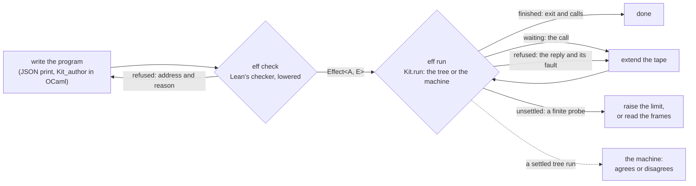
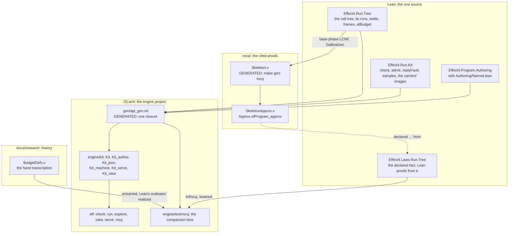
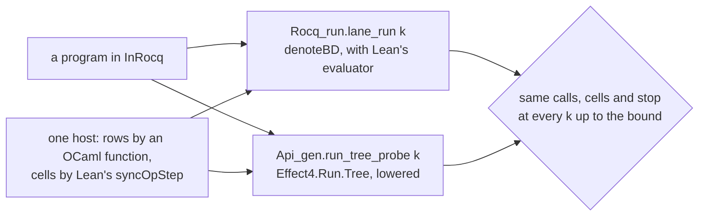

# The native kit: Lean's checker and the call tree at a budget, compiled for agents

Status: research note (history, not authority), 2026-10-16. Branch `claude/eff-kit` on
`refactor/phase1-phase3` at `719e039bf`. The owner asked for the interaction-tree work to become
fast, practical tooling. Compile it, and keep the proofs where they are. Give agents
production-level APIs to write, type, run and watch programs.

## The one thing to know

An agent checks an Eff program with Lean's own checker in milliseconds, and runs it with one call.
The run answers from the call tree where the tree covers the program, and from the machine
elsewhere. Every run stops one of five named ways. A cut is never reported as a failure or as a
divergence. All of it is Lean code compiled by LCNF into one closure. The budget's one law,
`Tree.ofProgram_approx`, is proved in Rocq of Lean's own tree, printed from Lean's compiler IR
into the tracked workspace `rocq/`.

## What an agent does



| Command | What it answers |
| --- | --- |
| `eff check P --rows R` | the program's `Effect<A, E>` type, or the refusing node's address and reason; then program admission of the rows |
| `eff run P --rows R --tape T` | `finished` with the exit, `waiting` on a call, `refused` with the reply and its fault, `unsettled`, or `stopped`; each call with its request and reply; which runner answered; `"machine": "agrees"` |
| `eff run P --frames` | the same run, with the tree's runs at every budget up to the one it settles at |
| `eff explore P --rows R` | every path of the call tree, each reply drawn from its row's types; each path's calls, stop and tape, and the machine's replay of that tape |
| `eff view P --rows R --tape T` | one self-contained HTML page: the frames played as a growing run, every budget as a row, every explored path |
| `eff serve` | the same requests as JSON lines |
| `eff mcp` | a Model Context Protocol server over stdio with three tools: `check`, `run`, `explore` |

A request never names a runner, and an answer never asks the caller to. A program outside the
tree's fragment, such as a fork, runs on the machine, and the answer says so (`"via": "machine"`).
`explore` walks the tree alone, so for such a program it answers the first node outside it.

## How it is built



| Piece | Where | What it holds |
| --- | --- | --- |
| The call tree | `src/Effect4/Run/Tree.lean` | `Tree`, `Tree.ofProgram`, `Tree.run`, `Tree.probe`, `Tree.settle`, `Tree.frames`, `Tree.paths`, `Tree.outsideAt`, `Tree.Host.ofReactor`; `Run.atBudget`, the one run in Lean |
| The kit's Lean face | `src/Effect4/Run/Kit.lean` | `Kit.check`, `Kit.admit`, `Kit.replyFault`, `Kit.samples`, `Kit.replies`, `Kit.explore`, each carrier's shape, value tree and reading |
| Authoring for an author outside Lean | `src/Effect4/Program/Authoring/Named.lean` | `Row.callNamed`, `catchWith`, `loopWith`, `elaborateAt`: each one application of an existing operation |
| The laws | `src/Effect4/Laws/Run/Tree.lean` | `Tree.Approx`, `Plain`, `InRocq`; the declared fact `ofProgram_approx`; the planned goal `ofProgram_eq_denoteRowsB`; `runFrom_approx`, `probe_stable`, `settles_of_ends` and `settle_sound` |
| The cited proof | `rocq/` (`rocq/README.md`) | `Skeleton.v` and `Eff_types.v` (generated, `make gen-rocq`); `SkeletonApprox.v`; `Assumptions.v` |
| The closure | `ocaml/gen/api_gen.ml` | the api roots and the kit's roots, 1959 declarations (`make gen-lcnf`, recipe `ocaml/gen/roots.json`) |
| The face | `ocaml/engine/kit/kit.mli` | carriers, `check`, `admit`, reactors (`Reactor.silent`, `tape`, `by_name`, `first`, `counted`), `run`, traces, `explore`, `replays`, JSON |
| Authoring | `ocaml/engine/kit/kit_author.mli` | Lean's authoring functions under OCaml spellings; binders are OCaml functions; `build` is `elaborateAt` |
| The machine | `ocaml/engine/kit/kit_machine.mli` | any program on the engine under a reactor (`E4_host.serve`) |
| The requests | `ocaml/engine/kit/kit_serve.ml` | one request type, its answer, the JSON-lines protocol and the MCP protocol, each a function of one line |
| The view | `ocaml/engine/kit/kit_view.ml` | one HTML page of a report's frames and a program's paths |
| The kit's lane | `ocaml/engine/test/kit/` | `test_kit.ml` (T1 to T12), `verdicts.txt` written by `write.lean` (`make gen-fixtures`) |
| The comparison lane | `ocaml/engine/test/rocq/` | `test_rocq.ml` (R1 to R5), `rocq_run.ml` (Rocq's extraction), `lane_eval.ml`, `rocq_gen.ml` (`InRocq`, lowered) |

### The one run

`Kit.run app reactor state program` is the kit's entry point, and `Run.atBudget` is Lean's.
`Tree.outsideAt` decides the runner, inside the call, so no caller tests the fragment.

- **On the tree.** `Tree.settle` finds the least budget up to the limit whose run is not cut. It
  doubles the budget, then bisects, and re-probes the budget it names, so `settle_sound` needs
  no fact about the search. With `frames`, the report holds the runs at every budget up to it.
  With `check`, the machine runs the program too, and the report says whether the two agree.
- **On the machine.** `Kit_machine.run` drives the engine (`E4_host.serve`, Lean's `driveFrom`)
  with the limit as its rounds. The fuel or the rounds ending is `Unsettled`, a finite probe.
- **The host.** A host is the machine's reactor: a function of a call's row, its request and the
  host's state. `None` leaves the call waiting (decisions row 408 (1)). The tree reads a reactor
  through Lean's own adapter, `Tree.Host.ofReactor`.
- **Reply admission.** Both runners get one guarded reactor. A reply that does not fit its row
  (`Kit.replyFault`, `Program.admitAnswer`'s judgment) is no answer, so the call stops. The kit
  asks the reactor again and reports the stop `Refused` with the reply and the fault. A refused
  reply leaves the state as it was, so the second answer is the first.

### Authoring through Lean

The coordinator's point 5 forbids a third authoring surface. So `Kit_author` holds no rule of its
own: each builder is one function of `Program.Authoring`, lowered.

```ocaml
let doubling =
  A.loop ~init:(A.nat 1) ~test:(fun c -> A.(c < nat 16)) ~step:(fun c _ -> A.(c * nat 2))
    ~result:(fun c -> c) (fun c -> A.perform "echo" c)

let program = A.build ~app doubling
```

`A.loop` is `loopWith` and `A.perform` is `Row.callNamed`. `A.build` is `elaborateAt`, which
declares the application's rows in table order and runs `elaborateModule`. A binder is an OCaml
function over a name that `minting` makes for its scope. A refusal is Lean's `Authoring.Refusal`,
with the node's address and the reason: `unboundRow`, `unboundDef`, `duplicateRow`. LCNF lowers
a literal (`nat`, `str`, `bool`) at its reduced arity, since it reads no scope. The face takes
the scope back (`Kit_author.nat`).

### The comparison lane

The lane checks that the hand Rocq tree, `BudgetDefs.denoteBD`, is the tree Lean runs, on finite
inputs, budget by budget. It was the floor while the declared facts cited the hand tree. Now the
declared fact cites a proof of the generated tree, and the lane measures the hand tree.



- `rocq/LaneExtract.v` extracts `Api.run_at` under two host functions. `Extract Constant`
  realizes `Denote.v`'s evaluator (`eval_term`, `decide`, `fail_exit` and the two marked exits)
  by Lean's lowered ones (`lane_eval.ml`). So the lane compares trees, not evaluators.
- The program set is the hand tree's fragment, `InRocq`, lowered into `rocq_gen.ml`.
- Step 13 of `docs/research/2026-10-16-itrees/reproduce.sh` extracts the file again. It refuses a
  difference from the committed `rocq_run.ml`.

## Measurements

Each number has its command. The machine is this Mac, shared with other seats' builds.

| Measure | Value | Command |
| --- | --- | --- |
| `eff check` on the doubling loop | median 3.9 ms of 20 runs | the timing script below, case `check doubling` |
| `eff run`, doubling under 4 replies, the tree and the machine | median 3.5 ms; settles at budget 5; the machine agrees | case `run doubling (4 replies)` |
| `eff run`, a 1000-round loop under 1000 replies | median 8.3 ms; settles at budget 1001 | case `run 1000-round loop`, `--limit 4096` |
| `eff run`, a silent loop to the limit 100000 | median 11.6 ms; unsettled | case `run silent loop` |
| the kit's lane | 55 checks, 0 failures | `cd ocaml && opam exec --switch=effect4 -- dune test engine/test/kit --force` |
| the lowered checker against Lean | 408 of 408 verdicts, spellings, reasons and addresses equal | the kit's lane, T5 |
| the tree against the machine | 95 of 95 corpus programs in the tree's fragment agree | the kit's lane, T8 |
| the comparison lane | 13 checks, 0 failures | `cd ocaml && opam exec --switch=effect4 -- dune test engine/test/rocq --force` |
| Rocq's tree against Lean's | the 7 kit examples at budgets 0 to 12, the 7 to-do requests at 0 to 8, and 36 typed corpus programs in `InRocq` at 0 to 8 under two hosts: all equal | the comparison lane, R2 to R4 |
| the research reproduction | exit 0 in 56 s, step 13 included | `bash docs/research/2026-10-16-itrees/reproduce.sh OUTDIR` |
| the closure | 1959 declarations of the cap 2400 | `python3 scripts/generate.py --only lcnf` |
| the axiom walk | 415 declarations within `[propext, Quot.sound]`, 3 of them modulo planned goals; 2 planned goals | `#axiom_audit Effect4.Run.Tree Effect4.Run.Kit Effect4.Laws.Run.Tree Effect4.Program.Authoring.Named` |

The timing script runs each command 20 times with `subprocess.run` and prints the median and the
minimum. Its inputs are the first landing's examples, written by `Kit.Json`, in the session's
scratch folder.

## Findings

1. **`InRocq` claimed two arms that Rocq's tree does not match.** Rocq's context is a value
   that `provideContext` replaces, from `Val.unit` at the root. Lean's tree carries the machine's
   context, merged by `Eval.provide` from `Eval.root`. The lane found it on four corpus programs
   that read the context. `InRocq` now leaves out `provideContext` and the context read.
2. **Rocq's cell events take any value.** On `Ref.get 3`, which the checker refuses, Rocq's tree
   emits a cell event, and Lean's is a bad shape (`Eval.cellOp`). The lane measures this case
   and does not check it, and `InRocq`'s docstring names it.
3. **Rocq's cell host answers a write with `unit`.** The machine answers it with the cell
   (`SyncOp.refSet`, `src/Effect4/Machine/Stores.lean`). The lane gives both trees Lean's cell
   step, because the declared facts are about the trees.
4. **Rocq's evaluator lacks parts of Lean's.** Before the realization, 20 of 55 corpus programs
   differed, on error images, bad shapes and missing atoms. None of these is a difference of the
   trees.
5. **A root at reduced arity changes its OCaml type.** LCNF lowers a root whose parameters it
   never reads at its `_redArg`. `Tree.Host.tape` lowers to a function of the tape alone, and
   the literals of the authoring surface to values with no scope. Kit's reactors are written in
   OCaml, and `Kit_author` takes the scope back.
6. **The LCNF printer wrote an empty `type` item.** An artifact whose closure declares no type of
   its own printed `type` with no declaration. `OCaml5.Lcnf.Gen` now leaves the group out. The
   other artifacts are byte-identical.
7. **`iterateWith` has no compiled declaration to lower.** `loopWith` is the monomorphic form
   with the parts as arguments.
8. **The Rocq printer used to approximate.** A constant outside the spec became a Section
   variable, an unknown type printed as `unknown`, and an unknown constructor as `_`. Each is now
   refused by name. The skeleton of `Effect4.Run.Tree` needs none of them: it prints as before.
9. **A section's variables do not reach a second file.** Rocq abstracts each definition over the
   variables it uses, so a proof file could not name the skeleton's evaluator. The skeleton is
   now a functor over the module type `Eval`, and the proof is a functor over the same `Eval`.

Three findings of the first landing still hold:

- the committed `generated/corpus-index.tsv` disagrees with Lean on 9 programs;
- a host row must be asynchronous and externally registered;
- raw formation is not lowered (`ArgF.child`'s dependent field).

## What this does not establish

- The lane is a finite check, not a proof. It holds on the programs and budgets it tries.
- `rocq/Skeleton.v` is Lean's code by the printer's rules, not by a theorem: one printing rule
  per constant, naturals checked.
- `Tree.ofProgram_eq_denoteRowsB` is a planned goal: no proof over Lean's code states it.
- Adequacy is proved only of the hand transcription.
- On a program the checker refuses, the hand tree and Lean's differ at a cell request that is no
  cell (finding 2). This bounds the comparison lane, not the declared fact.
- The MCP server is in no client's configuration. Adding it to `.mcp.json` is the owner's call.

## Next, ranked by value to an agent

| Rank | Change | Why |
| --- | --- | --- |
| 1 | Print `denoteRowsB` beside the skeleton, and prove `ofProgram_eq_denoteRowsB` over both | the session theorems then speak of the tree the kit runs |
| 2 | Exploration at rc.112: replay each explored path's tape through the keyed recorder | every path checked against the outside implementation |
| 3 | The TypeScript front end: `eff check prog.ts` through `ts/eff`'s reader | the agent's preferred surface |
| 4 | Dependent fields in the LCNF route | raw formation natively |

## Proposed rows and claims (for the coordinator; this note edits no register)

- **Decisions row 411, declared facts.** `declared G : P from "where"` is a planned goal whose
  proof lives outside Lean, the owner's exception of 2026-10-16. The gates read it as a goal.
  `#plan_status` prints the citation. It cites a theorem in `rocq/`, over definitions generated
  from Lean (`make gen-rocq`).
- **The kit is a product face of the engine project.** `ocaml/engine/kit` reads the api closure.
  Its lanes run in `make check-ocaml` (`dune test engine`).
- **Claim `call-chain-outcome`** (concept `translation-simulation`, R12). A settled tree run is
  the chain's outcome: `Tree.settle_sound` with `Tree.probe_stable`, in `src/Effect4/Laws/Run/Tree.lean`.
- **Claim `call-chain-equivalence`** (concept `translation-simulation`, R6). On `Plain`, the tree
  is `denoteRowsB`'s, node for node: `Tree.ofProgram_eq_denoteRowsB`, a planned goal.
