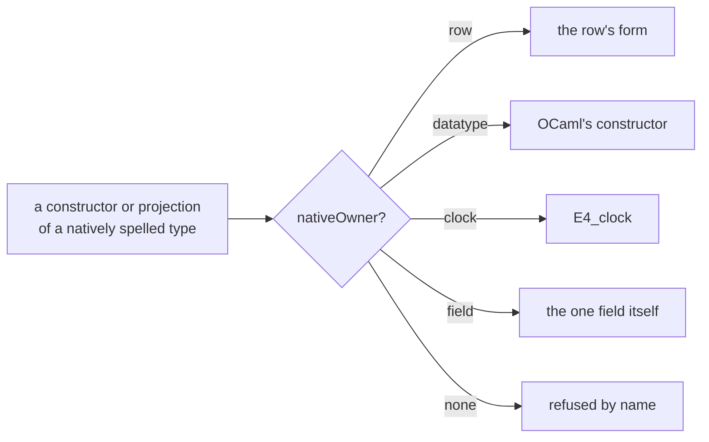

# 2026-10-16 The constructors of natively spelled types on the LCNF route: a probe and its landing

Status: a probe with its landing, not authority.
Base: `97acd72dd` on `refactor/phase1-phase3`.
Role: the owner's request to look at the OCaml lowering, then to probe first and land the
cleanup comprehensively (decisions rows 391 and 403).

## The one thing to know first

A type with a row of the type table has no declared record or variant in OCaml. Before this
landing, nothing checked that each of its constructors and projections had a lowering. Six had
none that worked: `ByteArray.mk` became a record of no declared type, and the five words'
`toBitVec` were holes.
Now one function names each one's owner (`nativeOwner?`), the translator dispatches on it, a census
pins it, and a compiled lane runs every one.

## 1. Question

How does the route lower a constructor, a projection and a `cases` of a type it spells natively?
Is each decided once, and does each lowering compile and agree with Lean?

## 2. What was read or run

| Item | Evidence | Result |
| --- | --- | --- |
| The route's code: `Translate.lean`, `Native.lean`, `Clock.lean`, `TypeRows.lean`, `Builtins.lean` | reading | eight decision sites in five files |
| 36 functions that build, match and project each constructor, lowered | tested (`LcnfGen`) | two holes: `UInt8.toBitVec`, `UInt64.toBitVec` |
| The same without those two, under `ocamlopt` 5.1.1 | tested | refused: `{ data = a } : byte_array`, a type no module declares |
| The same without `ByteArray.mk` | tested | compiles; 40 calls agree with Lean, line for line |
| A census of every constructor and projection of the 22 row types | a Lean walk over the environment | 42 constants; 8 with no owner (below) |

The eight decision sites, before the landing:

| Site | Decides |
| --- | --- |
| `Native.rules` | the constructors of list, option, bool, tuple, result and unit, and `Nat`'s two |
| `Clock.constructor?` | the clock's two constructors |
| builtin rows | `Int.ofNat` and `Int.negSucc` |
| `ctorApp`'s three cases | `Array.mk`, `String.ofByteArray`, and the transparent structures |
| `letValueExpr`'s `.proj` cases | `Prod` by `fst` and `snd`, `String` by its bytes, the transparent structures |
| `code`'s `cases` cases | `Bool` as `if`, the clock refused, the annotation policy |
| `altPat` | OCaml's own patterns, the transparent structures |
| `transparentStructures` | `Fin`, `BitVec`, the words and `Char` as their one field |

## 3. Findings

1. **Lean's compiler takes `Int` and `Nat` apart by comparison.** A `match` on `Int.ofNat` and
   `Int.negSucc` reaches the route as `Int.decLt` and `Int.natAbs`, never as a `cases`. So no
   `Int` pattern was missing.
2. **Every function the route accepted lowered correctly.** The 40 calls agree with Lean,
   including a negative integer, a surrogate code point and non-ASCII bytes.
3. **Eight constants had no owner.** The words' `toBitVec` (five) were holes at generation.
   `ByteArray.mk` built a record that only `ocamlopt` refused. `Float`'s model has no owner and
   stays refused: no `Float` operation lowers.
4. **The route's own check passed what `ocamlopt` refused.** `Ml.checkModule` checks syntax, not
   types, so only a compiled lane catches a record of an undeclared type.
5. **Two facts had two owners.** `.proj` on `Prod` and on `String` repeated the rows `Prod.fst`,
   `Prod.snd` and `String.toByteArray`.
6. **`Array.mk` and `String.ofByteArray` were externs without rows,** decided by hand in
   `ctorApp`, beside the rows `Int.ofNat` and `Int.negSucc`.
7. **Lean's own compiler refuses a match on `USize`** ("unexpected IR type 'usize'"). The lane
   leaves it out; the census still covers its rows.

## 4. What landed

| File | Change |
| --- | --- |
| `src/OCaml5/Lcnf/Builtins.lean` | 13 rows: the words' `ofBitVec` and `toBitVec` (10), `ByteArray.mk`, `String.ofByteArray`, `Array.mk`, each with Lean's symbol and contract |
| `src/OCaml5/Lcnf/Translate.lean` | `nativeOwner?`; a constructor, a projection and a `cases` of a natively spelled type dispatch on their owner or are refused by name; `ctorApp`'s and `.proj`'s hand cases removed |
| `src/OCaml5/Lcnf/Native.lean` | `matchable`: the types OCaml matches on |
| `Test/Audit/ConstructorOwners.lean` | the census, pinned: 42 constants, each with its owner; the residue `Float.ofModel`, `Float.toModel` |
| `Test/Codegen/ConstructorLane.lean`, `ocaml/engine/test/ctors/` | the lane: 42 functions lowered, 49 calls compared with Lean's answers under dune |

The four committed artifacts are byte for byte unchanged (`make gen-lcnf`).

## 5. What this does not establish

- No theorem relates a row to its Lean constant. A row is a reading, and the lane is finite.
- The census covers the types of the type table. A carrier row of `externs.txt` is the
  engine's seam, outside it.
- `Float` stays unsupported. Its model is refused, and so is each of its operations.
- The lane runs one or two inputs per function. `UInt64` and `USize` stay unsound above 2^62,
  as their type rows say.
