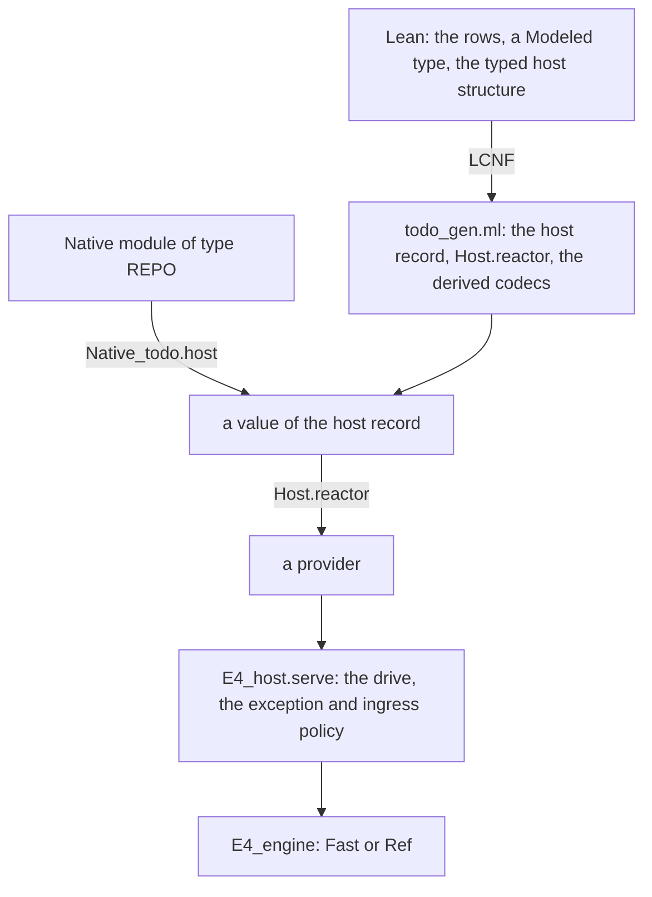

# 2026-10-16 OCaml interop: native hosts, where the time goes, and what Rocq adds

Status: research note (history, not authority). Base: `81f9a4354` on `refactor/phase1-phase3`.
Branch: `seat/ocaml-interop`. The receipt is `docs/research/2026-10-16-seat-ocaml-receipt.md`.

## The one thing to know first

A host written in OCaml already reaches the lowered machine through the lowered `host` record
(decisions row 405). This seat adds what it lacked: an OCaml module type for it, an exception
policy in the driver, and runs on the engine. Rocq proves facts about pure OCaml handlers only.
The handlers worth proving here are written in Lean and lowered, so Rocq stays out of the estate.

## Words

- **native host**: a host (the dictionary's, `docs/core/controlled-english.md` §3.7) written by
  hand in OCaml, not lowered from Lean.
- **lowered**: made by the LCNF route (`docs/core/lcnf-route.md`), as `todo_gen.ml` is.
- **derived codec**: the lowered `Modeled` image of a type, the record `'a image` of `to_val` and
  `of_val` in a generated module.
- **provider**: the driver's name for a host, `E4_host.Make(E).provider`
  (`ocaml/engine/e4_host.mli`), Lean's `Run.Reactor` in OCaml.

## Question

1. Where does the time go in the OCaml estate: the builds, the tests, and one host call?
2. How does a native OCaml module answer a row table's methods through the derived codecs, with a
   failure crossing as the row's typed failure?
3. Can Rocq, through rocq-of-ocaml or Iris, state and prove properties of OCaml handlers that the
   Lean side does not already give?

## What was read or run

| Item | Evidence | Result |
| --- | --- | --- |
| `ocaml/README.md`, `ocaml/STANDARDS.md`, `docs/core/lcnf-route.md`, the interop plan, rows 391, 393 and 403 to 406 | reading | the frame of this note |
| `Run.Reactor.method`, `Reactor.fallible` (`src/Effect4/Run/Method.lean`); `Typed.Host` (`Test/Dogfood/Scenario/Todo/Typed.lean`) | reading | the typed host and its lowering in `todo_gen.ml` |
| The earlier survey of verification tools (`docs/research/2026-10-15-ocaml-seam-probes/lowering/verified-ecosystem.md`) | reading | its conclusions stand; this note runs what it left unrun |
| Cold builds, incremental rebuilds and every lane, at base and at head | tested; `measurements.log` §1 to §5 | §1 below |
| `bench_todo` (`ocaml/engine/test/todo/bench_todo.ml`), before and after the writer change | tested; `measurements.log` §6 and §7 | §1 below |
| The writers of `Eff_frame`, old against new in one process | tested; `framebench/bench.log` | §1 below |
| The to-do lane with T14 to T17 | tested; 199 checks, 0 failures | §2 below |
| Rocq 9.0.1 and rocq-of-ocaml at `1ac69a7`, in the opam switch `rocq` | tested; `rocq/check.log`, `rocq/mutant.log`, `rocq/imperative.log` | §3 below |

## Findings

### 1. Where the time goes

All figures are CPU time, read from dune's trace by `dune_trace.py` beside this note. Other seats
were building, so wall time moved with the load and CPU time is the figure to compare.

**The build.** A cold build costs 83 s of CPU (`measurements.log` §1).

| Cost | Figure | Evidence |
| --- | --- | --- |
| The three generated files, `api_engine.ml`, `todo_gen.ml` and `api_gen.ml` | 29 s of the 83 s | tested, §1 |
| Their bytecode passes alone | 11.7 s | tested, §1 |
| A comment added to a hand module, `e4_host.ml` | 0.2 s; `-opaque` stops the dependents | tested, §3 |
| A re-cut of `todo_gen.ml` | 7.7 s, of which the bytecode pass is 3.5 s | tested, §3 |
| Declarations of `todo_gen.ml` that `api_gen.ml` already lowers | 795 of 1,420 | tested, §8 |

Dune compiles a module with no `.mli` twice: `ocamlc` makes its `.cmi`, then `ocamlopt` compiles it
again. A scratch probe showed the same for an executable built in native mode only. So each
generated file is type-checked twice, and only a generated `.mli` removes the first pass.

**The tests.** Every lane cost 47.1 s of CPU at base (`measurements.log` §4).
`prop_fibers_view` alone took 19.4 s. Its check FV6 rendered both whole fiber tables to strings
after each of its 12,000 operations. It now compares the values and renders them only for a
failure: 4.7 s, and 30.7 s for every lane (§5).

**One host call.** `bench_todo` drives the engine's `Fast` instance under `E4_host` for each
request of the to-do fixture (`measurements.log` §7, load 9 to 11).

| Stage of a request's first host call | CPU time |
| --- | --- |
| Load the program and evaluate the root | 9.51 µs |
| The step to the next host call or the end (`E4_engine.step`) | 4.15 µs |
| The admission (`E4_engine.admits`) | 0.80 µs |
| The ingress check and the decision (`E4_engine.answer_async`) | 0.18 µs |
| The typed reactor's answer: decode, dispatch, encode | 0.13 µs |
| The same answer with frames built by hand | 0.03 µs |

The host's own answer is about 1 % of a call. The six hosts of the bench cost 12 to 16 µs per
call. That spread is wider than any host's answer, so this run cannot rank the hosts. A faster
host call needs a faster machine step, not faster codecs.

**The canonical bytes.** `Eff_val.to_bytes` of 100 to-dos took 128 µs at base, 12 times the
derived decode of the same value (`measurements.log` §6). The writer allocated a fresh buffer for
each nested payload. It wrote a length as eight single bytes and each natural through a fresh
string. `Eff_val.string_of_codes` was quadratic in its length. The landed writer is 1.6 to 1.8
times faster on the same values, in one process (`framebench/bench.log`). A per-domain pool of
payload buffers reaches 1.9 to 2.2 times. It is not landed (§Proposals, item 6).

### 2. The native host provider

The design has four layers. Two are generated, and two are hand OCaml.

1. **The interface is a module type.** `REPO` (`ocaml/engine/test/todo/native_todo.ml`) is the
   lowered `host` record read as a signature, with the host's state abstract. `Native_todo.host`
   turns a module of that type into the record. The compiler refuses a module that lacks a method.
2. **The lowered reactor does the crossing.** `Typed.Host.reactor`, lowered, reads each request by
   its derived codec, dispatches on the row's spelling and writes the answer. A native host builds
   no wire value. This is row 405's path, run now on the engine through `E4_host`.
3. **Each outcome of a native method has one meaning.**

| The native method | Crosses as | Owner | Evidence |
| --- | --- | --- | --- |
| answers `Ok a` | a success, `a` written by the derived codec | the lowered `Reactor.fallible` | tested, T14 |
| answers `Error e` | the row's typed failure, `Program.errOf` of `e`'s value | the lowered `Reactor.fallible` | tested, T12, T13, T16 |
| raises an exception that `catching` names | `Error e`, as the row above | `Native_todo.catching` | tested, T16 |
| raises any other exception | no answer: the call stays outstanding, a live frontier; the drive stops with `Raised` | `E4_host`, H5 | tested, T15, T16 |
| answers a natural outside the profile | not applied; the drive stops with `Outside_profile` | `E4_host`, H6 | tested, T17 |

4. **An exception is no answer.** `AGENTS.md` keeps an unanswered choice a live frontier, never a
   typed failure or a cause. An OCaml exception is no value of the row's error type. A host that
   means a failure answers it, or names the exception through `catching`.
5. **This default differs from Effect's.** In rc.112 `Effect.try` without `catch` fails with
   `Cause.UnknownError` (`try_`, `vendor/effect-4.0.0-rc.112/src/Effect.ts` line 2254). A throw
   inside `Effect.sync` is a defect, as the docstring of `sync` (line 1607) states. The proposed decisions row (item 5) asks the owner
   to confirm the frontier default.
6. **The state is the host's.** A pure module threads a value (`Native_todo.Core`). An imperative
   module threads its handle (`Native_todo.Table`, over a hash table). An imperative host owns its
   atomicity: a write made before a raise stays made.
7. **The driver had two exits by exception.** At base, a provider's exception and an
   out-of-profile answer escaped `E4_host.serve` (reading of `e4_host.ml` at `81f9a4354`). Both now
   end the drive with their own report, the engine and the state as before the call.

### 3. Rocq

**The worked example.** `todo_core.ml` (`ocaml/engine/test/todo/`) is the to-do repository as a
pure OCaml module, and `Native_todo.Core` runs it in the lane. Rocq-of-ocaml translates it to
`rocq/Todo_core.v`, and `rocq/TodoCoreProofs.v` proves these statements.

| Theorem | The property of `todo_core.ml` | Statement |
| --- | --- | --- |
| every `Fixpoint` of `Todo_core.v` | C1, totality | Rocq accepts each recursion as structural |
| `insert_id` | C2 | insert answers the id `next`, and `next` grows by one |
| `step_keeps_ordered` | C3 | each method keeps the ids strictly ascending and below `next` |
| `ordered_ids_unique` | C3's reading | an ordered state stores each id once |
| `absent_set_done`, `absent_delete` | C4 | at an absent id, the state is unchanged and the answer is `None` or `false` |
| `delete_then_set_done` | C4 | after `delete id`, `set_done` at `id` answers `None` |

Each theorem is closed under the global context: no axiom (`rocq/check.log`). The red control
leaves `next` unchanged in `insert`, and the proof of `insert_id` fails (`rocq/mutant.log`).
Checking the three files takes 1.4 s of CPU. C3 is the fact that licenses `Native_todo.Table`:
ordering by id is the stored order.

**What the tool showed.**

| Finding | Evidence |
| --- | --- |
| Rocq-of-ocaml needs OCaml 5.4 to 5.6 and Rocq 9.0, so it needs its own switch. The switch `rocq` holds 1.0 GiB and took 16 minutes to install. | tested, the receipt's commands |
| It names OCaml 5.4's `Stdlib.Ok` and `Stdlib.Error` with no Rocq definition. A configuration file renames them (`rocq/rocq-of-ocaml.json`). | tested, `rocq/check.log` |
| Its library shadows `map` and `filter` with its own definitions. The proofs name the standard ones. | tested, `rocq/TodoCoreProofs.v` |
| It refuses a record write, and it translates `Hashtbl.replace` as a pure call whose result is dropped. A proof about that translation is about another program. | tested, `rocq/imperative.log` |
| It reads the OCaml source. The translator is an assumption, and `ocamlopt` stays one, as row 391 names it. | reading |

**The three properties the brief names.**

- **Handler totality.** Rocq gives it for a pure handler, as the worked example shows. An
  imperative or an I/O handler is outside rocq-of-ocaml's fragment.
- **Codec round trips.** The codecs are lowered from `Modeled`, whose laws Lean owns. A Rocq copy
  restates them. The hand kernel (`Eff_frame`, `Eff_val`) writes through `Buffer` and raises, so
  it is outside rocq-of-ocaml's fragment too.
- **No leaked handles.** It needs a resource logic over a client and a host together. In Rocq that
  is Iris, through Zoo or Osiris, with a proof per component. The plan's P5 states lifecycles as
  indexed typings in `effects` instead.

**Recommendation.**

1. Do not adopt Rocq in the estate. A handler whose laws matter is written in Lean and lowered
   (row 405). Lean's laws then reach it, and the trust boundary stays row 391's.
2. Allow an optional rocq-of-ocaml check for a pure handler that must stay OCaml. Keep it in a
   research folder with its own switch, as this note does.
3. Consider Iris only for the concurrent host code that stays OCaml (row 391 (3), P6 (a)).
   `e4_mailbox` and `e4_sched` use `Atomic` and `Mutex`, and `e4_inbox` uses `Mutex` (reading).
   Neither Lean nor a finite test reaches their interleavings. Start that probe only with a consumer: the native host
   that serves many sessions.

## Proposals (not rulings)

Each item names the Lean-side change it needs. This seat ran no Lean build.

1. **A generated `.mli` beside each generated module.** The generator knows each root's type.
   With an `.mli`, dune type-checks each module once. It saves 3.5 s per re-cut of `todo_gen.ml`
   and 11.7 s per cold build. The `.ml` then needs `[@@@warning "-32"]`.
2. **One lowered machine for the lanes.** `todo_gen.ml` lowers 795 declarations that `api_gen.ml`
   already lowers. A lane could open the shared machine as `--open Eff_types` opens the types.
3. **Generate `REPO` and stable codec names.** From a `Host` structure, emit the module type and
   `Native_todo.host`'s adapter through the module language of the interop plan's P0.4. Emit one
   named image per method's types, such as `Typed.todoImage`, so native code needs no mangled name.
4. **Build a record's name frame once.** `Store.Image.record` maps the names to `Val.str` on every
   write and every read. Low priority: a derived to-do costs 0.03 µs to write.
5. **A decisions row for the exception policy.** "A native host's exception is no answer: the call
   stays outstanding and the driver reports it. A host that means a failure answers it, or names
   the exception through `catching`." The owner may prefer Effect's `UnknownError` default.
6. **The payload pool.** It adds 25 % to the writer's gain. It needs an argument that two
   systhreads of one domain never share a buffer, so it waits for a consumer that needs the speed.

## What this does not establish

- Every lane check is a finite probe over the to-do fixture's seven requests and named inputs.
- The benchmarks ran on a loaded machine: each figure is a median of five CPU-time samples.
- The Rocq theorems are about rocq-of-ocaml's translation of `todo_core.ml`, not about the code
  `ocamlopt` emits. Their relation to Lean's `Comodel.Meets` is a reading.
- `REPO` is written by hand for one lane. No generator emits it yet.
- No theorem relates `E4_host` to Lean's `Run.driveFrom`. Test T8 compares the two on the fixture.
