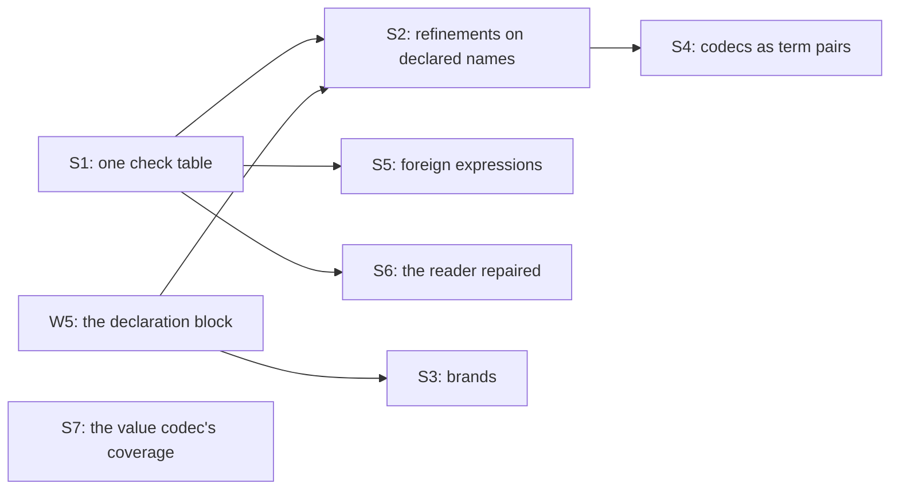

# 2026-10-16 Schema interop: what Effect Schema expresses, and how our expressions cross it

Status: research note (history, not authority). Base: `7bde6f0cf` on branch `seat/schema-interop`.
Role: the TypeScript seat, retasked by the coordinator on 2026-10-16. The owner's words came from
a voice transcript:

> for the TypeScript seat, let's retask it on some of the schema interop and improving the
> semantics of our expressions there

The coordinator read them two ways, and this note covers both. Reading (a) is what Effect Schema expresses at rc.112. Reading (b) is how our
`Term` and `Ty` cross into Schema and back.

## The one thing to know first

Effect Schema's expressions are host closures. A persisted document keeps a check only by its id,
and it keeps a transformation not at all. So an expression crosses the document boundary as a
name or not at all. Our terms can be that name's meaning. The probe shows the pieces at rc.112:

- A check whose id is `effect4/term` carries Lean's own `Term` as its payload. Its reviver
  decodes the vessel's inputs with the paths and reasons of the vessel's `inputRefusal`.
- That reviver's check prints as TypeScript Schema code, and tsgo accepts the code.
- A codec declared as a pair of terms round-trips through its document and decodes at rc.112.

## 1. Question

1. What does each Schema construct of rc.112 do at the document boundary, and what is its
   behaviour against our representation?
2. When is a check, or a transformation, an exact embedding, and when only a widening? Which can
   be our terms, and which stay foreign?
3. Where does our side lose meaning, refuse too much, or keep a second hand copy?
4. What does a probe on tsgo 7 and rc.112 show, with the vessel dogfood's types as samples?
5. Which Lean slices would carry expressions into Schema, with which laws?

## 2. What was read or run

| Item | Evidence | Result |
| --- | --- | --- |
| `vendor/effect-4.0.0-rc.112/src/Schema.ts`, `SchemaAST.ts`, `SchemaTransformation.ts`, `SchemaGetter.ts`, `SchemaRepresentation.ts`, `SchemaIssue.ts`, and `internal/schema/toRepresentation.ts`, `fromRepresentation.ts`, `toCodeDocument.ts` | reading | the census of §3, each row with its line |
| `src/Effect4/Schema/Bridge.lean`, `Codec.lean`, `Document.lean`, `DocumentJson.lean`, `Representation.lean`, `OfShape.lean`, `TyFaces.lean`, `Annotations.lean`, `Modeled.lean`, `Authoring.lean`; `src/Effect4/Codegen/SchemaCode.lean`; `Term` and `NativeAtom` (`src/Effect4/Machine/Term.lean`) | reading | §5 |
| `harness/truth/schema-codec/check.ts` and `Emit.lean`; `harness/schema-generation/`; `harness/schema-host/package.json`; `scripts/check-schema-typescript-generation.sh` | reading | §5 |
| `git show refs/heads/codex/vessel-dogfood:Test/Dogfood/Scenario/Vessel/Domain.lean`, `apps/vessel/domain/BASIS.md`, `apps/vessel/domain/CONTEXT.md` | reading | the samples of §6 |
| `cd ts/eff && bun probe/schema-interop/run.ts` | tested | `PASS schema-interop compiler: 5 case files, 4 expected diagnostics, tsgo Version 7.0.0-dev.20260629.1`; `PASS schema-interop census: 136 observations`; `PASS schema-interop terms: 22 observations` |

The probe lives in `ts/eff/probe/schema-interop/`, in the form of the named-types probe.

- `census.run.ts` builds each construct at rc.112, then writes its document through rc.112's
  JSON codec. It revives the document with rc.112's 75 revivers (46 checks, 29 declarations),
  asks rc.112 for its code, and decodes samples with both Schemas.
- `terms.run.ts` holds the term checks and the term codec, and writes
  `cases/g01-term-code.generated.ts`.
- `run.ts` runs tsgo over `cases/`, then runs both halves.

No Lean process ran. The term evaluator of the probe is TypeScript. Its agreement with Lean's
evaluation is a proposed law (§7), not an observation.

## 3. The census at rc.112

Each row gives one behaviour against our representation, in the dictionary's words:

- **exact**: an exact embedding, modulo the normaliser the row names;
- **widening**: a read without exactness, offered as a named conversion;
- **refusal**: a located refusal;
- **foreign**: a name with a type signature, refused by any operation that needs its meaning.

"Today" is the behaviour of `Bridge.schema` and `Bridge.ofSchema` at the base. "Proposed" is
§7's. The probe column names the census row of `census.run.ts`. A line without a path is in
`vendor/effect-4.0.0-rc.112/src/Schema.ts`.

| Row | Construct | rc.112 source | Document and revival at rc.112 (probe) | Today | Proposed |
| --- | --- | --- | --- | --- | --- |
| C1 | A built-in filter with an id: `isInt`, `isGreaterThan` | `isGreaterThan` :7969, its reviver :7993; `isInt` :8298 | kept by id and payload; revived; code written (C1) | exact at `[isInt, ≥ 0]` (`nat`) and `[isInt]` (`int`) only; any other check: none, with no path | exact, as a term (§4.3) |
| C2 | A filter with a payload: `isNonEmpty`, `isBetween` | `isNonEmpty` :8942 writes `isMinLength` :8880; `isBetween` :8172 | kept; `isMinLength` carries the annotation `~structural`; revived (C2) | refused by check and by annotation | exact, as a term; `isMinLength` on a string only by `isNonEmpty`'s form (§4.3) |
| C2b | A filter group: `isMinLength(1).and(isMaxLength(64))` | `FilterGroup` (`SchemaAST.ts:3255`) | kept as a group; revived (C2b) | refused | exact, a conjunction of terms |
| C3 | A host closure filter with no id | `makeFilter` :6659 (`SchemaAST.ts:3293`); the codec requires the id (`SchemaRepresentation.ts:958`) where the interface does not (`:446`) | no document: rc.112's JSON codec refuses it, "Missing key" at `representation` (C3) | no document to read | foreign; our writer emits no check without an id |
| C4 | An aborting filter | `Filter.aborted` (`SchemaAST.ts:3207`) | kept as `aborted: true` (C4) | refused | exact; the order of clauses gives the first refusal (§6.2) |
| C5 | A refinement by a guard | `refine` :5184 by `makeFilterByGuard` (`SchemaAST.ts:3306`) | no document (C5); the target type narrows (case `k03`) | none | refusal: a guard is host code |
| C6 | A pattern filter | `isPattern` :6820, its reviver :6857 | kept; revived (C6) | `Check.pattern` writes it and `checkCode` prints it; the reader refuses it | foreign: no atom reads a regular expression |
| B1 | A brand | `brand` :5242; the annotation `brands` (`SchemaAST.ts:3564`); code by `internal/schema/toCodeDocument.ts:313` | kept in the last check's annotations; revived; code `.pipe(Schema.brand("FlowRate"))` (B1) | refused: `N_S` keeps `brands`, and the reader admits no such bag | exact: a declared name's nominality on the target (§7, S3; case `k01`) |
| T1 | `NumberFromString` | :13252, by `numberFromString` (`SchemaTransformation.ts:821`) and the getter `Number` (`SchemaGetter.ts:728`) | the document keeps the encoded side, `String`, alone (`internal/schema/toRepresentation.ts:113`); the revived Schema reads strings (T1) | read as `string` | widening, as a named conversion; foreign |
| T2 | `Trim` | :13369, by `trim` (`SchemaTransformation.ts:431`) | the document keeps `String` alone (T2) | read as `string` | widening, as a named conversion; foreign |
| T3 | A host closure transformation | `decodeTo` :5593; `Link` (`SchemaAST.ts:401`); `Transformation` (`SchemaTransformation.ts:143`) | the document keeps the encoded side; the revived Schema decodes 6 to 6, the original to 100000 (T3) | read as the encoded side | foreign; exact as a term pair where its maps are atoms (§6.4) |
| T4 | A data declaration with its own JSON codec: `Date` | `Date` :12218 with `toCodecJson`; its reviver :12255 by `makeFixedDeclarationReviver` :6732 | kept by id; revived; the JSON codec decodes an ISO string to a `Date` (T4) | read as the host handle `effect/schema/Date` | refusal by id, until a carrier exists (§5, L1) |
| D1 | A constructor default | `withConstructorDefault` (`SchemaAST.ts:3633`), a `Context` field (`SchemaAST.ts:576`) | not in the document (D1) | nothing to read | exact: a default is no part of the type |
| D2 | A decoding default at a key | `withDecodingDefaultKey` :5899 | the document keeps the optional encoded key, not the default; the revived Schema decodes `{}` to `{}` (D2) | read as an optional field | exact modulo filling the default, with the default a literal term |
| O1 | An optional key | `optionalKey` (`SchemaAST.ts:3604`); written at `internal/schema/toRepresentation.ts:270`, revived at `internal/schema/fromRepresentation.ts:295` | kept; revived (O1) | exact (`readProperty`, `ofSchema_exact`) | exact |
| O2 | An optional key that admits `undefined` | `optional` (`SchemaAST.ts:3616`) | kept; revived (O2) | exact, as a union with `undefined` | exact |
| O3 | A mutable key | `mutableKey` (`SchemaAST.ts:3621`) | kept; revived (O3) | refused: a field is read only | refusal, by name |
| O4 | `OptionFromNullOr` | :9791, by `optionFromNullOr` (`SchemaTransformation.ts:1188`) | the document keeps `String \| Null`; the revived Schema decodes `null` to `null` (O4) | read as `union string null` | widening today; exact as a wire choice of `option` when the inner type excludes `null` |
| K1 | A class | `Class` :14660, a declaration decoded from its struct at :14580 | the document is a reference named `DesignRefEncoded` (`internal/schema/toRepresentation.ts:120`); revival gives a plain object (K1); the type side has no document | read as the record | widening: the class identity is dropped; the target compares it by structure (case `k02`) |
| U1 | `Literals` of eight members (the vessel's `Unit`) | `Literals` :4969 | one flat union (U1) | refused: the reader takes a binary union only | exact modulo flattening the union |
| U2 | `Literals` of two members (`LevelDatum`) | :4969 | a binary union (U2) | exact | exact |
| U3 | `TaggedUnion` of three cases (`Evidence`) | `TaggedUnion` :6470 over `TaggedStruct` :6196 | one flat union of three objects (U3) | refused; our derived sums write nested binary unions | exact modulo flattening the union |
| U4 | A `oneOf` union | `Union` :4923, its `mode`; written at `internal/schema/toRepresentation.ts:286` | kept as `oneOf` (U4) | refused | refusal: `Ty.union` reads `anyOf` |
| U5 | A number literal and a Boolean literal | `Literal` :2785; `LiteralValue` (`SchemaAST.ts:1289`) | kept (U5) | refused: `Ty.lit` holds a string | refusal, by name |
| E | `Enum`, `TemplateLiteral`, `BigInt`, `Symbol` | `Enum` :3032; `TemplateLiteral` :2915 | not probed | refused (`ofSchema`'s last arm) | refusal, by name |

## 4. The semantics of Schema's expressions as first-order data

### 4.1 What a Schema denotes

- A Schema has two sides: a type side `T` and an encoded side `E`. A Schema with no
  transformation has `T = E`.
- **A check** is a predicate on its side's values. A Schema with checks denotes the values of
  its node that pass every check. Decoding and encoding both run them: the probe's codec refuses
  to write 1500 mm at its type side's `isMultipleOf(1000)` (§6.4).
- **A transformation** is a pair of partial maps: `read : E ⇀ T` and `write : T ⇀ E`. Each map is
  a getter (`SchemaGetter.ts`), from an optional input to an optional output, which may fail with
  an issue and may need services. The first-order fragment is the pure getters with present
  inputs.
- **Absence** is part of a getter's domain. A decoding default reads an absent key, and the `omit`
  strategy writes one.

### 4.2 When a pair is an exact embedding

The pair is an exact embedding on a domain `D ⊆ T`, modulo a normaliser `norm` on `E`, when three
laws hold:

1. **Totality**: `write` answers on every element of `D`.
2. **Retraction**: `read (write t) = t` for each `t ∈ D`.
3. **Exactness**: `read e = t` implies `norm e = write t`.

The normaliser is fixed before the pair and is idempotent. A normaliser defined as
`write ∘ read` makes the third law hold by construction and states nothing. A pair whose only
normaliser is that one is a widening.

| Pair | Domain | Normaliser | Behaviour |
| --- | --- | --- | --- |
| Metres on the wire, millimetres in the type (`read = mul x 1000`, `write = div x 1000`) | the multiples of 1000, the type side's `isMultipleOf` | identity | exact (§6.4) |
| `OptionFromNullOr` over an inner type that excludes `null` | every option | identity | exact |
| The same over an inner type that admits `null` | — | — | no retraction: `some null` writes `null`, which reads `none` |
| A decoding default `d` with the `passthrough` write | every value | fill an absent key with `d` | exact |
| `NumberFromString` | every number but negative zero | only `write ∘ read`: `" 1"`, `"1e0"` and `"1"` read as 1, `""` as 0, `"abc"` as `NaN` (T1) | widening; no retraction at negative zero, which writes `"0"` |
| `Trim` | the trimmed strings | only `trim`, which is `read` | widening |

The metres pair, `NumberFromString` and `Trim` are probed (§6.4, T1, T2). The option and default
rows are read from their getters, not probed.

### 4.3 Which checks and transformations can be our terms

A term is first-order data over the native atoms (`NativeAtom`, `src/Effect4/Machine/Term.lean`).
Each atom has one prelude body on the target (`AtomRow.prelude`) and one case in the OCaml
engine's table. So a check written as a term is one expression with three readings. It prints as
a Schema check, it runs in Lean, and it lowers to OCaml.

| rc.112 check or transformation | On our type | As a term | Status |
| --- | --- | --- | --- |
| `isGreaterThan` :7969, `isGreaterThanOrEqualTo` :8019, `isLessThan` :8069, `isLessThanOrEqualTo` :8119, `isBetween` :8172 | `nat`, `int` | `lt` and `not`; the `lt` atom compares two integers (decisions row 121) | a term |
| `isMultipleOf` :8246 | `nat` | `mod` and `eq` | a term |
| `isInt` :8298 | `number` | no atom tests whether a binary64 is integral | the types `int` and `nat` carry it (exact) |
| `isFinite` :7704 | `number` | no atom | foreign; the value codec keeps a non-finite number outside (decisions row 309 (6)) |
| `isMinLength` :8880, `isMaxLength` :8966, `isLengthBetween` :9029 on a list | `list` | `length` and `lt` | a term |
| The same on a string | `string` | `isNonEmpty` as `not (eq x "")`; no atom counts the UTF-16 code units that `input.length` counts (:8883) | `isNonEmpty` a term; the rest foreign |
| `isMinSize` :9101, `isMaxSize` :9164, `isMinProperties` :9296 | `map` | `length (mapKeys x)` | a term |
| `isUnique` :9554 | `list` of scalars | a `fold` with `eq` | a term |
| A cross-field check: the vessel's working levels, nozzle profile and numeric bounds | `record` | `field`, `lt`, `mul`, `not`, `isZero` | a term (§6.2) |
| A check against outside values: evidence relevance against the expected study | `record` | a term over `var 1` and up, the parameters in the payload | a term (§6.3) |
| `isTrimmed` :6763, `isPattern` :6820, `isStartsWith` :7300, `isUUID` :7032, `isLowercased` :7520, and the other string checks | `string` | the string atoms are `concat` and `eq` only | foreign |
| Date, BigInt and BigDecimal checks | none | no carrier | foreign |
| A unit scaling, such as the vessel's litres per minute | `nat` | `mul` and `div`, with the domain as a `mod` check | a term pair (§6.4) |
| A decoding default with a literal (`withDecodingDefaultKey` :5899) | any | the literal as a term | a term |
| `optionFromNullOr`, `optionFromUndefinedOr`, `optionFromOptionalKey` (`SchemaTransformation.ts:1188`, `:1230`, `:1324`) | `option` | none needed: a wire layout of `option` that the value codec writes | a named conversion |
| `numberFromString`, `trim`, the case transformations, `parseJson`, base64, hexadecimal, dates, durations, URLs | — | no atom parses or transforms text | foreign |

### 4.4 A foreign expression

A foreign check or transformation is a name with a type signature: its rc.112 id, its payload's
type, and the type it reads. Our side knows the name and the types, and nothing of the meaning.

- The checker types through it: its input and output types are data.
- The machine never runs it: it is no term.
- The value codec refuses to decode a value at a type that carries one. The refusal names the id.
- The TypeScript face prints rc.112's own code for it, from the shared check table (§7, S1).
- The OCaml face refuses it by name.

## 5. Our side

### 5.1 Where a document or a print loses meaning

- **L1. A fixed declaration reads as a host handle.**
  - `Bridge.ofSchema` reads every declaration with a `null` payload and no type parameter as
    `handle id`. Two ids are exempt: the template parameter and `Uint8Array`.
  - Effect's rc.112 revives 29 declarations. Its fixed ones (`Date`, `URL`, `Duration`,
    `BigDecimal`, `RegExp`, the time zones) are data with a JSON codec (T4).
  - A host handle is an identity that the machine mints at the boundary (decisions row 406 (1)).
    So a `Date` column read from an rc.112 document becomes an identity column.
- **L2. A declared name writes the unlowered marker.** `schemaAlg.ty_app` writes
  `effect4/unlowered/app`; the named-types note (§4.5 there) designs the reference.
- **L3. A check has no meaning on our side.** `Check.named` (`Schema/Authoring.lean`) says it
  "does not itself execute a Lean predicate". Only `nat` and `int` carry a check with a meaning,
  the type's own.

### 5.2 Where our side refuses too much

- **R1. The reader refuses every check but two.** `ofSchema` reads a number's checks only when
  they are `[isInt, ≥ 0]` or `[isInt]`. Our own writers emit nine more check ids
  (`Schema.Authoring`'s `Check.*`), and `SchemaCode.checkCode` prints ten. So our reader
  refuses documents that our writer writes.
- **R2. The reader takes binary `anyOf` unions only.** rc.112 writes `Literals` and
  `TaggedUnion` as one flat union (U1, U3). Our writer nests binary unions (`schemaAlg.ty_union`).
  The vessel's `Unit` (eight literals) and `Evidence` (three cases) are refused.
- **R3. The reader refuses rc.112's own annotations.** `isNonEmpty` writes `~structural` (C2), and
  a brand writes `brands` (B1). `N_S` erases neither, so the reader refuses both documents.
- **R4. A refusal of the reader names no place.** `ofSchema` answers `Option Ty`. A located
  refusal names a path and a reason; the JSON layer has one (`DocumentRefusal`), the bridge has
  none.
- **R5. The code printer refuses every annotation.** `SchemaCode`'s `noAnnotations` refuses the
  `identifier` that a reference needs (the named-types note, F6) and the `brands` of B1.
- **R6. The code printer knows ten checks of rc.112's 46.** `checkCode` refuses, for example,
  `isGreaterThan`, `isLessThanOrEqualTo`, `isBetween`, `isMinLength` and `isMultipleOf`, which
  the vessel's bounds use.
- **R7. The value codec refuses types that the document writes.** `Codec.wireAlgebra` refuses
  `null`, `undefined`, `bytes` and `app`. `schemaAlg` writes the first three.

### 5.3 Where a second hand copy stands

- **H1. Check ids stand in three places.** They stand in `Schema.Authoring` (nine), in
  `SchemaCode.checkCode` (ten), and in `Bridge.isIntCheck` with `Bridge.nonNegativeCheck`. No
  table joins an id to its payload type, its code and its meaning.
- **H2. Each sample value stands twice.** `harness/truth/schema-codec/check.ts` writes each case's
  host value by hand beside the Lean value of `Emit.lean`.
- **H3. `N_S`'s erased keys stand three times.** They stand in `Bridge.erasedKeys` and in the two
  probes. A generated export in `ts/eff` would remove both probe copies.
- **H4. The vessel's predicate stands twice.** `InputValid` states its clauses as a proposition,
  and `inputRefusal` restates them as a chain with paths. One list of clauses (term, path, reason)
  would give both, and the Schema checks as a third reading (§6.2).

## 6. The probe

### 6.1 The census half

Every row of §3 that names a probe row is an observation of `census.run.ts`. The facts that
change a design:

- rc.112's document JSON codec refuses a filter with no id (C3, C5), so a host closure cannot be
  persisted.
- A transformation's document is its encoded side (T1 to T3). Its type side is a second document
  (`T1 type side`), and nothing persists the map between the two.
- A class's type side has no document: its JSON codec refuses the class declaration ("Missing
  key").
- A brand travels in the annotations of the node's last check (B1).

### 6.2 The vessel's checks as terms

`terms.run.ts` writes the vessel's geometry clauses as one Lean-shaped document. These are the
clauses of `inputRefusal` on the six dimension and level fields, in their order. Each is one
aborting filter with id `effect4/term`, whose payload holds the term, the path and the reason.

- The document holds eight of `inputRefusal`'s clauses on these fields and one numeric bound, in
  `inputRefusal`'s order. Each of seven samples decodes, or is refused at the path and reason of
  the first of them that fails.
- A sample that breaks two clauses is refused at the earlier one. The aborting filter gives
  `inputRefusal`'s first-failure order.
- rc.112 writes the revived checks back unchanged modulo `N_S`: the reviver attaches the
  representation.
- rc.112's code generator writes the checks through their `toCode` annotation, as calls of the
  prelude's atoms. The written code type-checks under tsgo (case `g01`), and evaluated, it
  decodes every sample as the document does.
- The code generator gives a check's `toCode` no type of the checked node: it passes the
  check's Schemas only (`internal/schema/toCodeDocument.ts:341`). Contextual typing does not
  reach the filter's parameter either: without an annotation tsgo reports TS18046. So the printer
  that writes the check must write the parameter's type; Lean's printer knows it.

### 6.3 A parameterized check

The relevance of evidence reads the expected study and kind as parameters: `var 1` and `var 2`,
carried in the payload. Relevant evidence decodes. Evidence of another study is refused at the
path `evidence` with the reason `irrelevantEvidence`, and evidence of another kind is refused.

### 6.4 A codec as a pair of terms

A declaration with id `effect4/codec` has the wire side and the type side as its type parameters
and the two terms as its payload. It follows `Option`'s pattern (:9700 to :9770): a declaration
whose JSON codec is a link from the wire side.

- rc.112 writes the revived declaration back unchanged modulo `N_S`.
- Through its JSON codec, metres 0, 3 and 12 decode to millimetres 0, 3000 and 12000.
- Writing 3000 mm answers 3. Writing 1500 mm is refused by the type side's `isMultipleOf(1000)`:
  the domain of §4.2 is a check of the type side.
- Reading the written 3 answers 3000: the retraction on the domain.

### 6.5 The compiler half

| Case | Expected | What it shows |
| --- | --- | --- |
| `g01-term-code.generated.ts` | none | the code rc.112 writes for the term checks type-checks over the generated prelude |
| `k01-brand-nominal.ts` | TS2322 twice | a branded flow is no hold-up, and a bare number is no flow; the brand erases to `number` on the way out |
| `k02-class-structural.ts` | none | a plain record is assignable to a Schema class's type |
| `k03-refine-narrows.ts` | TS2322 | a guard narrows the target type, and a filter does not |
| `k04-transformation-sides.ts` | TS2322 | a transformation has two types, `number` decoded and `string` encoded |

## 7. Design: expressions in Schema

Each slice is a proposal for the coordinator. The placement table gives the points of the wiring
plan's placement (concept, claim and role, reach, what it does not establish, what it unlocks).

### 7.1 The slices

- **S1. One check table.** A row is a check id, its payload's type, the type it reads, its code,
  and its meaning: a term, or foreign. `Schema.Authoring`, `SchemaCode.checkCode` and the bridge's
  reader read this one table, and a generated copy in `ts/eff` serves the probes and the lanes.
  It removes H1 and R6.
- **S2. Refinements on declared names.** A declared name gains a list of checks, each a term
  with its path and reason (`CheckTerm`). Membership under the table at a refined name is the
  body's membership and every check answering `true`. No `Ty` constructor is added; the
  vessel's `BASIS.md` records that its own slice adds none. The document writes each check as a filter with id
  `effect4/term`, and the code printer writes it through the term printer (§6.2).
- **S3. Brands on the TypeScript face.** A declared name prints as a branded alias, and its
  Schema as `.pipe(Schema.brand("N"))`. Then tsgo compares declared names by name, as `Ty.sub`
  does (case `k01`). The cost is at the fold sites, which the printer knows (the iso-recursive
  reading of decisions row 406 (2)). A value introduced there needs the Schema's constructor.
- **S4. Codecs as term pairs.** A declared name may carry a wire choice: a wire type and two
  terms. The document writes it as the declaration `effect4/codec` (§6.4). Its laws are per
  instance: the three laws of §4.2 at its domain.
- **S5. Foreign checks and transformations.** A name with a type signature, from S1's table with
  no meaning. The value codec refuses at it by the id, the TypeScript face prints rc.112's code,
  and the OCaml face refuses it.
- **S6. The bridge's reader repaired.** It reads flat unions as nested ones, modulo flattening
  (R2), and reads checks through S1 (R1). It erases `~structural`, which decides nothing (R3), and
  answers a located refusal (R4). It refuses a fixed declaration by id instead of reading a
  handle (L1).
- **S7. The value codec's coverage.** `null` and `undefined` as rc.112's keywords, `bytes` as
  rc.112's `Uint8Array` codec, and `app` under the table (R7).

### 7.2 Placement and laws

| Slice | Concept and property | Claim and role | Reach | Does not establish | Unlocks |
| --- | --- | --- | --- | --- | --- |
| S1 | the persisted check as data; one owner per id | `check-table-one-owner`: the three readers are the table's projections, by `rfl`; compatibility | the ids the table holds | any check's meaning | S2, S5, S6 |
| S2 | `store-typing`: membership at a refined name | `refined-member`: membership is decided, and at a name with no check it is today's, by `rfl`; preservation | guarded tables; checks whose terms evaluate with no fold fuel | progress; `Fits` under a refined table (D3 of the soundness audit) | the vessel's `InputValid` as data |
| S2 | the term check's three readings | `check-term-agrees`: the target's evaluation of a printed check equals Lean's `evalTerm` on values in the codec's image; equivalence of observations, finite at first | the atoms whose prelude body has a law (`NativeAtom.spec`) | rc.112's decoder; host values outside the codec | the TypeScript and OCaml readings of one clause list |
| S2 | the bridge at a refined name | `ofSchema_exact` and `ofSchema_schema` extended to `effect4/term` filters, the term read back by its wire codec; exactness modulo `N_S` | `reservedFree` types and S1's term rows | revival by rc.112 | documents of refined names |
| S3 | nominality on the target | `print-nominal`: two declared names with one body print as two incomparable target types; a finite check, as `k01` | declared names with no arguments | the cost at fold sites | tsgo agreeing with `Ty.sub` at names |
| S4 | the exact embedding of a wire choice | per instance: totality, retraction and exactness of §4.2; preservation | pairs over `mul`, `div`, `add`, `sub` with their domain checks | unit algebra in general | unit-bearing fields as one quantity with two wires |
| S5 | the host boundary at a foreign expression | `foreign-refused`: the codec refuses exactly at a type with a foreign check; safety | S1's foreign rows | the host's meaning | rc.112's 46 checks named, not dropped |
| S6 | the bridge's exact embedding | `ofSchema_exact` modulo `N_S` extended by flattening and the erased `~structural`; `explainSchema_none_iff` for the located reader | rc.112's own documents of our types | revival | reading rc.112's documents of the vessel |
| S7 | the value codec's exact embedding | `decode_iff` extended to `null`, `undefined`, `bytes`; at `app` under a guarded table | those types | `Fits` | host rows with those columns |

### 7.3 The order

S6 and S7 stand alone and can land first. S2 and S3 wait on the declaration block (W5), which the
named-types note designs.

## 8. Decisions rows to propose

1. Effect Schema's expressions cross the document boundary as names. A check or transformation
   whose meaning is a term carries the term. Every other one is foreign: a name with a type
   signature, refused by any operation that needs its meaning (§4.4).
2. A refinement is a declared name with checks, not a `Ty` constructor (S2).
3. A declared name prints branded on the TypeScript face (S3).
4. The bridge's reader reads flat unions, erases `~structural`, refuses a fixed declaration by
   id, and names the place of each refusal (S6).

## 9. What this does not establish

- The probe is a finite observation of one pinned tsgo build and of rc.112.
- The probe's term evaluator and term printer are TypeScript stand-ins for Lean's. No Lean
  process ran, so no observation compares the target's reading of a term with Lean's.
- The census's rows E (`Enum`, `TemplateLiteral`, `BigInt`, `Symbol`) were read, not probed.
- The laws of §7.2 are proposals. None is stated in Lean.
- The vessel's samples transcribe `inputRefusal`'s clause order by reading `Domain.lean` on
  Codex's branch; the probe does not run that function.
