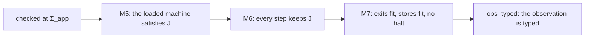
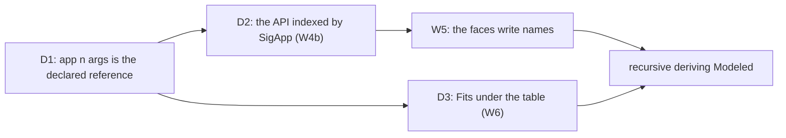

# 2026-10-16 Audit of the typing: what it guarantees, where it stops, and what to close next

Status: research note (history, not authority). Base: `a3170f2de` on `refactor/phase1-phase3`.
Role: the owner's request of 2026-10-16, after the wiring slice. The owner asked how robust the system is,
and what each guarantee is relative to. The owner also asked for the typing's design, and for the
concrete effect of the empty-table premise. The owner then set the focus: close the gaps that deliver expressiveness and
generation, and surface the theorems that link each generator to the mathematics.

## The one thing to know first

Nothing that exists today lost a guarantee. The new named types are checked, and they lack two
things. One spelling, `handle n`, carries two meanings. The runtime typing (`Fits`) reads no
declaration table. Decision D1 below removes the first, and D3 removes the second.

## 1. Question

1. Which guarantees hold at HEAD, and on which programs?
2. What is broken, and what only stops at a fragment?
3. Which theorem links each generator to the mathematics?
4. In what order do the gaps close, given the owner's focus on expressiveness and generation?

## 2. What was read or run

| Item | Evidence | Result |
| --- | --- | --- |
| `python3 scripts/status.py` | measured | 236 claims proved, 2 modulo, 3 absent, 1 refuted, 1 assumed; 2 open planned goals in the library |
| `generated/semantics.md` | reading | the open goals and the absent claims (F5) |
| `lake build Effect4 Effect4.Laws Test` at `a3170f2de` | tested | `Build completed successfully (2651 jobs)`, in 30 min 39 s; every battery passes |
| The gates of `Test/All.lean` at `a3170f2de` | tested | 141911 declarations within `[propext, Quot.sound]`, with the exact implementation boundary of 48 declarations; 24 planned goals, 27 declarations resting on them |
| `m7_proved`, `reachable_typed`, `obs_typed` (`src/Effect4/Laws/Program/Typed/Commands/Clauses/All.lean`) | reading | M7's fragment (F1) |
| `AdmittedTape` (`src/Effect4/Laws/Program/Typed/Assembly.lean`), `replayR` (`src/Effect4/Laws/Program/RuntimeR.lean`) | reading | the ghost admission and the empty row table (F1) |
| `Fits`, `HandleFits` (`src/Effect4/Laws/Program/Typed/Membership.lean`) | reading | a declared name reads as a host handle (F2) |
| `externalValue`, `prepareExternalAnswer` (`src/Effect4/Program/Compile.lean`) | reading | the machine mints a handle for a natural at `handle n` (F3) |
| `normApp`, `normalize` (`src/Effect4/Program/Ty.lean`); rows 158, 401, 402 | reading | `app n []` and `handle n` are one canonical form (F3) |
| `Program/AdmitIn.lean`, `Program/TyHead.lean`, `Api/AuthorIn.lean` | reading | W2 to W4a as landed |
| [The wiring plan](../2026-10-16-usability-scope/wiring-plan.md) and [its receipt](../2026-10-16-usability-scope/wiring-receipt.md) | reading | W4b, W5 and W6 open; six lessons |
| [The `Modeled` universe note](../2026-10-16-modeled-universe/README.md) | reading | the generation thesis (§4) |
| `~/wiring-w4a-ts.log` in the PC's WSL clone | reading | `make check-ts` at W4a was cut by a hangup at `check-truth`; it is no result |
| `Test/Codegen/TargetOrder.lean` and `#axiom_audit` over it, at `a3170f2de` | tested | the battery passes; 103 declarations within `[propext, Quot.sound]` |

## 3. The typing, explained

This section explains the design decisions that the guarantees rest on. Each decision names its
decisions row.

### 3.1 A program is data, and the machine is its meaning

- A program is an `Eff` tree (`src/Effect4/Program/Eff.lean`): first-order data, with no Lean
  function inside it.
- The machine runs a program step by step. Its run is the reference meaning.
- The faces, printed TypeScript and the OCaml engine, are compared with the machine.
- So every guarantee is a statement about the machine's runs of a checked program.

### 3.2 One type language, with a constructor per runtime kind

`Ty` (`src/Effect4/Program/TyCore.lean`) spells every type that a host row or an
`Effect<A, E, R>` mentions.

- **Data is structural**: records, tuples, unions, lists, options, literals, maps and the number
  tower `nat ⊑ int ⊑ number`.
- **Each runtime object kind has its own constructor**: `refOf`, `deferredOf`, `fiberOf`,
  `exitOf`, `causeOf` and `contextOf`.
- **A host object is `handle n`**: an opaque name, whose values the machine mints at the boundary.
- **A nominal reference is `app n args`** (row 158). Today `app n []` normalizes to `handle n`.

The type itself tells the machine what a value is. A value of `refOf t` is a cell, and a value of
`handle n` is a host object. F3 is the one place where this rule breaks.

### 3.3 Membership: three forms of one judgment

Membership is one of the seven judgments (`docs/core/controlled-english.md` §4). It has three
forms, each for a different reader.

| Form | Defined in | What it reads | Who reads it |
| --- | --- | --- | --- |
| `Val.hasTy v t allocated` | `src/Effect4/Program/Typed.lean` | the value's shape and the external allocations | the host boundary; it is a decision procedure |
| `MemberIn decls allocated v t` | `src/Effect4/Program/TyDecls.lean` | the same, with each declared name read as its body | membership under a declaration table, decided by `Val.hasTyIn` (`hasTyIn_iff`) |
| `Fits w v t` | `src/Effect4/Laws/Program/Typed/Membership.lean` | the world: live handles, cells, promises and services | the typed state (M5 to M7) |

- At the empty table, `MemberIn` is `Val.hasTy` (`tyDecls_conservative`).
- `Fits` reads data shapes as `Val.hasTy` does, arm for arm. At a handle it reads the world.
- `MemberIn` is a least fixed point. So a recursive type, such as a tree, needs no fuel.
- A guarded table has no cycle among the names at a body's head. The admission of the language
  signature Σ_app refuses an unguarded table (row 401 (2)).

### 3.4 The order: nominal at names, structural elsewhere

`Ty.sub` (`src/Effect4/Program/Ty.lean`) is the checker's order.

- It is sound for membership under every table (`memberIn_sub`,
  `src/Effect4/Laws/Program/TyDecls.lean`).
- A record compares its field names exactly, then each field type. No width rule exists.
- A union distributes on the left and chooses on the right.
- A cell and a promise are invariant. A write through a widened handle would break membership
  at the other alias (row 55).
- A name compares by name, then each argument at its declared variance (`argVariance`).
- A declared name is not below its body, and its body is not below it (rows 158, 401 (1)).

The order is nominal at names because brands and identities need a name. `UserId` and `OrderId`
over `number` stay distinct types. TypeScript compares aliases by structure, so tsgo accepts every
program that this order accepts.

### 3.5 The checker, and why a refusal is never spurious

- The checker decides the typing relation `HasTy`. It is sound and complete for it: `check_sound`
  and `check_complete` (`src/Effect4/Laws/Program/Typing/CheckSound.lean`).
- So a program's admission is a derivation, and a refusal means that no derivation exists.
- Each refusal names a path and a reason. `explain_none_iff` (`src/Effect4/Api.lean`) proves that
  `explain` answers no refusal exactly when the program types.

### 3.6 Declared names, read iso-recursively

The declaration table is `TyDecls := List (String × Ty)` (row 401 (1)). The wiring slice made the
checker read it.

- **Elimination unfolds.** A rule that reads a type by shape reads a declared name as its body.
  The rules are a field read, an update, a list fold and a tag dispatch (`Ty.headMembers`,
  `src/Effect4/Program/TyHead.lean`).
- **Introduction folds.** A record field written at a name takes a member of the name's body
  (`Record.fieldAdmitsIn`).
- **The author writes neither.** The Lean surface writes both, and a refusal names the record's
  path.
- **Each reader is its original at the empty table, by definition.** So no earlier proof changed.

This is the iso-recursive reading of the literature: a name and its unfolding are two types, with
an explicit unfold and fold between them.

### 3.7 The host boundary

- A host row has a request, an answer and an error column.
- The session checks a reply against the row: reply admission.
- The machine then prepares the reply. At a `handle n` column it mints a host handle for a
  natural. It passes any other value through as data.
- `preflight_success_prepared_fits` (`src/Effect4/Laws/Api/HostSession.lean`) proves that an
  admitted success is prepared and typed.

### 3.8 The guarantees and their fragment

- `J` is the typed-state invariant. M7 is `m7_proved`, and `obs_typed` lifts its answer-free
  premise.
- Their fragment is a lawful source, a checked and closed program, the empty row table, and a
  tape whose host answers are ghost-admitted (`AdmittedTape`).
- A halt is a malformed state. A frontier is no halt: fuel exhaustion and an unanswered choice
  are frontiers.
- `run_eq_meaning` (straight programs) and `loopAgreement` (looped programs) tie the machine to
  the meaning function.
- M7 is safety. It establishes no progress and no liveness.

## 4. The generation thesis, and the theorems that link each generator

A `Ty` is a code, and `Model.Carrier` decodes it to a Lean type. So `Ty` is a universe of codes,
and every judgment is a fold over it. A generator is a fold staged at a known code. Its output
inherits the fold's laws, so the generator owes no new law per type. This table surfaces the link.

| Generator | What it writes | The linking theorem | Status |
| --- | --- | --- | --- |
| The fold generator | each algebra, its fold, the eliminators | `hom_eq_cata_eff`: two folds agree when their algebras agree | proved |
| `deriving Modeled` | a type's code, its carrier maps, its staged codec | `modeled_staged_eq`: the staged codec is the fold's codec | proved per type, by `rfl` or by its fields |
| The staged codec's reader | the reader of an exact embedding | `Image.ofVal_eq_of_toVal_eq`: one writer has one reader | proved |
| `deriving Modeled`, named | the type's declaration and its reference | `Modeled.memberIn_ref` (`src/Effect4/Laws/Schema/Modeled.lean`): a named type's reference means its code, on a guarded table | proved |
| The checker | admission, or a located refusal | `check_sound`, `check_complete`, `explain_none_iff` | proved |
| The checker under a table | admission at declared names | `wiring_readers_conservative`, `UnionRule.liftIn_transfer`, `Record.fieldAdmitsIn_sound` (`src/Effect4/Laws/Program/TyHead.lean`) | proved; the claims are proposed, not registered |
| The TypeScript printer | the printed program | `read_print`, `read_exact`: the reader inverts the printer | proved on the readable domain |
| The machine | the run | `run_eq_meaning`, `loopAgreement`, `run_eq_ref` | proved on their fragments |
| The LCNF route to OCaml | native types, codecs and the engine | none, by row 391; the lanes compare bytes | tested |
| The Schema bridge | an rc.112 Schema | the TypeScript lane | tested |
| The typed host (row 405) | a record of methods over derived types | none of its own: a method reads and writes by the derived codecs | by construction |

Three links are missing for named types:

1. The printer writes no `export type N = …` block. It needs a type-alias declaration in the
   pinned TypeScript package.
2. The Schema bridge writes a handle for a name, and it has no reference arm.
3. Recursive `deriving Modeled` does not exist. A recursive table is written by hand.

## 5. Findings

### F1. The typed guarantee stops at the empty row table

- `obs_typed`'s docstring says "the frame machine at its empty row table only".
- `replayR`'s row table defaults to `[]`. `AdmittedTape` reads a ghost admission at `Θ`, which no
  host sees.
- So a program that calls a host row has no proved typed-state guarantee.
- Its boundary checks are proved to check what they state (§3.7). No theorem ties them to `J`.
- R6 holds this part. The owner parked R6 on 2026-09-30, and row 99 stays open.
- The owner's focus of 2026-10-16 keeps it parked. It closes when it closes cleanly.

### F2. The typed guarantee stops at the empty declaration table

- `Fits` reads `handle n` as a host handle. So a `Todo` record never fits `Todo`.
- So 40 premises in 12 law files take `sig.types = []` (a name search).
- Every program that `Api.Author.build` builds meets the premise by `rfl`: `SigApp.signature`
  declares no type.
- A program that `Api.Author.buildIn` builds has the checker's admission, the readers' laws under
  the table and a run with no host. It has no M5, M6 or M7.
- The register holds no counterexample. The gap is a missing proof, not a known step outside `J`.

### F3. One spelling carries two meanings

- `handle n` is a host handle, or a declared name when the table declares `n`.
- `normApp` makes `app n []` into `handle n`. So no reader without the table can tell the two
  apart.
- The machine reads no table. At a declared name whose body admits a natural, it would mint a
  host handle (`externalValue`).
- The plan's repair refuses such a column at the signature. That removes `type UserId = number`
  from every host row.
- Row 158 already sends declarations through `app`: "brands, recursion and class identity then
  enter as Σ_app declarations through it".

### F4. Every datum beside the row table needs a twin

- `Built`, `Session program table`, `Api.Typed table` and `HostSession.instanceAt` are indexed by
  a `RowTable`.
- So W4a wrote `buildIn`, `BuiltIn` and `admitProgramIn` beside `build`, `Built` and
  `admitProgram`.
- `SigApp` already carries the rows, the services and the types. One index removes the twins.

### F5. What is absent by design, refuted, or a planned goal

- Absent: `store-safety` progress (row 139), `scheduler-progress` and `fair-scheduling` (R12).
  Safety here is an invariant, not progress.
- Refuted: `bind-closed`. `TypedProg` is not closed under an unrestricted bind
  (`typedProg_not_bind_closed`, `Test/Program/TypedProgBindRed.lean`). It is a known boundary.
- Planned goals in the library: `once_placed_outside_census` (R11) and `ofJson_image` (R3).
- Five more planned goals belong to scenarios under `Test/Dogfood`.
- The OCaml lowering owes no proof (row 391). The TypeScript face has finite checks only (R8).

### F6. What was broken, and what still is

- `Test/Codegen/TargetOrder.lean` failed after the `Int` alias landed. `a3170f2de` repairs it.
- The keyed emitter broke at `97acd72dd`, and no build caught it. The library roots reach no file
  under `harness/` or `tools/`. `a4dc3506c` repaired the file; the cause stands.
- `scripts/check-host-protocol.py` hides Lean's error when a fixture fails to elaborate.
- `make check-ts` at W4a has no result.
- At `a3170f2de` the whole tree builds, every battery passes, and the axiom gate admits every
  declaration (§2).

## 6. Decisions

Each is the coordinator's, under the owner's delegation. The owner may undo each.

### D1. A declared name is `app n args`, and `handle n` is a host handle only

- `normalize` keeps `app n []`. `normApp` and `normalize_app_nil` go.
- The signature's admission refuses `handle n` at a declared `n`. One spelling keeps one meaning.
- So the machine needs no table. It mints only at `handle`, and a declared column crosses as data.
- So `type UserId = number` crosses a host row, and the plan's refusal is not needed.
- `allocatesIn` and `externalValueIn`'s declared arm go: a `handle` column is never declared.
- Parameterized declarations (row 401 (4)) are `app n args` already. No second change of spelling.
- It reverses one clause of row 158, which the owner ratified: `app t []` and `handle t` stop
  being one form.
- `Fits` and `Val.hasTy` keep reading `app` as opaque by name. `MemberIn` and `Fits` under a table
  read it as its body.

### D2. The API is indexed by `SigApp`

- `Built`, the session, `Api.Typed` and the instance check take a `SigApp`.
- `SigApp.ofTable` is the agreement point, so each existing law holds as its instance.
- `buildIn`, `BuiltIn` and `admitProgramIn` merge into their originals.
- The typed state's laws take `app.types = []` until D3 lands.

### D3. `Fits` reads the world's declaration table

- The typed world gains `types : TyDecls := []`. The world order fixes it, as it fixes
  `serviceTy`.
- `Fits` at a declared reference reads the body. At the empty table it is `Fits` as today.
- Then the premises of F2 go, and M5 to M7 hold at every declaration table.

## 7. The order

Beside the order:

- a build target over `harness/` and `tools/`, so a structure field cannot break them unseen;
- the host-protocol gate prints Lean's output when a fixture fails.

## 8. What this does not establish

- The findings read statements and docstrings, and one build. This note proves no theorem.
- F2's "no counterexample" reports the register, not a proof.
- The sizes of D1 to D3 are estimates from name searches.
- F1 stays open by the owner's focus. A program that calls a host row has no M7.
