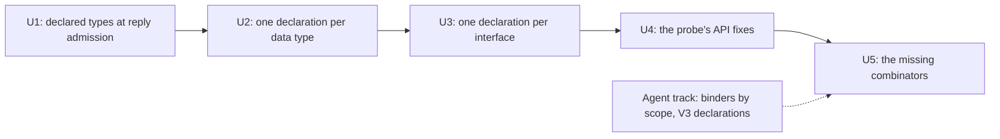

# 2026-10-16 Usability: write each thing once, in Lean types

Status: a scoping note, not authority.
Base: `43fefea0d` on `refactor/phase1-phase3`.
Role: the owner's direction of 2026-10-16: take care of the usability issues, so that the
language is as expressive as it can be. The owner agreed this scope in session.

## The one thing to know first

An author of the to-do states most things two or three times today. The scope is one theme: an
author states each thing once, in Lean types. The language carries it to the program, the host,
OCaml and TypeScript. Slices U1 to U3 make that true for the to-do.

## 1. Question

Where does an author of an application repeat a statement, and where does the language refuse a
thing the author means? Which slices remove each case, and in what order?

## 2. What was read

| Item | Evidence | Result |
| --- | --- | --- |
| `Test/Dogfood/Scenario/Todo/Data.lean`, `Test/Dogfood/Scenario/Todo/Typed.lean` | reading | four statements made twice (§3.1) |
| `src/Effect4/Program/Authoring/Declare.lean` | reading | `eff_record` writes program terms only; `deriving Modeled` writes the Lean side only |
| `src/Effect4/Program/Admit.lean`, `src/Effect4/Program/Compile.lean` | reading | reply admission reads no declaration table (§3.2) |
| [The usability probe](../2026-10-12-probe-api-usability.md) | its fixes searched by name in `src/` and `tools/` | the documentation fixes landed; the API fixes did not (§3.3) |
| [The agent ergonomics probe](../2026-10-13-agent-ergonomics-probe/README.md) | `ts/eff/read.ts` read | binders are still read by depth only |

## 3. Findings

### 3.1 The to-do states four things twice

1. **The data type.** `eff_record Todo where id : .nat, …` (`Data.lean`) writes the program's
   view: `Todo.ty`, `Todo.mk` and one projection per field over `TermSrc`.
   `structure Todo … deriving Modeled` (`Typed.lean`) writes the host's view. A battery guard checks that the two
   codes agree.
2. **The failure.** `eff_failure SqlError message` writes the program's view. The host's view is
   a one-constructor enum paired with a string, `abbrev SqlError := SqlTag × String`.
3. **The interface.** `eff_rows TodoRepo … insert(.string) : Todo.ty, …` writes the rows.
   `structure Host σ` repeats each row as a field, and `Host.reactor` repeats each row's
   spelling as a string, such as `"TodoRepo.insert"`.
4. **The service key.** `todoRepoKey := ⟨⟨30⟩, ⟨6⟩⟩` takes a free name chosen by hand and the
   type code 6, which spells `unit` (`nativeServiceTypes`, `src/Effect4/Program/Native.lean`).

### 3.2 A declared type cannot cross the host boundary

`Ty.handle name` is a declared type's reference (`Ty.refName?`, `src/Effect4/Program/TyExpand.lean`).
Reply admission reads the same constructor as a host handle (`externalValue`,
`src/Effect4/Program/Compile.lean`; `admitAnswer`, `src/Effect4/Program/Admit.lean`). So a row
whose answer names a declared type refuses every record answer. A recursive type, such as a tree,
cannot cross at all. The OCaml engine is generated from `Effect4.Program.admit`, so it refuses the
same answers.

### 3.3 The usability probe's open API fixes

The probe of 2026-10-12 listed ten API fixes. These stay open at the base:

- No function renders an exit, a typing refusal or a build refusal as text.
- A run that stops early is reported three ways, and no runner answers why it stopped.
- A program that needs a service with no layer builds, and its run dies with `missingService`.
- A refused atom answers `term` at a path and names no atom.
- No authoring form exists for Effect's `retry`, `timeout`, `catchAll` or `mapError`.

## 4. The slices

| Slice | What lands | Size |
| --- | --- | --- |
| U1 | The session holds `SigApp.types` from its open. Reply admission reads an answer under the table. The OCaml engine takes it by regeneration. | M |
| U2 | `deriving Modeled` also writes the program's view: `Todo.ty`, `Todo.mk` and the field projections. `eff_record` becomes that derivation. A failure is a Lean structure whose code is the tagged pair. | M |
| U3 | `eff_rows` takes Lean types, as in `insert(String) : Todo`. It writes the rows, the typed host record and its reactor. A service is keyed by its name, with no hand code. | M |
| U4 | Render functions for exits and refusals; one run to the end that answers its stop reason; a refusal to run a program that is not closed; a located atom refusal. | S to M each |
| U5 | Forms for `retry`, `timeout`, `catchAll` and `mapError`, each pinned to its rc.112 expansion and run on the TypeScript lane. | L |

The agent track runs beside the slices. The TypeScript reader reads any binder name, resolved by
scope (the ergonomics probe's rank 3). V3 generates the declarations that let tsgo check an
agent's text (rank 4).

Each slice lands with its narrow builds, `#axiom_audit` over its modules and the behaviour gates
that it reaches. U1 reaches `check-ocaml` through the regenerated engine.

## 5. Left out on purpose

- **Typed program terms.** A program is written in untyped terms, such as `str ""` and
  `pair id (bool true)`. A type error appears as a checker refusal at a path, not as a Lean
  error where the author types. This is likely the largest usability lever. It is a design
  question, and a research note comes before any code.
- **The `scoped` window** (the alignment plan's item 5a) changes the machine, not the authoring
  surface. It needs the owner's ruling on a signed divergence from rc.112.

## 6. What this does not establish

- The duplications are read from one application, the to-do. Other scenarios may repeat other
  statements.
- The sizes are estimates, not measurements.
- The probe's open fixes were searched by declaration name. A fix landed under another name would
  be missed.
