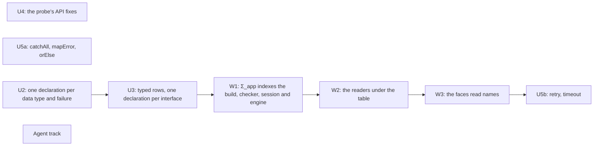

# 2026-10-16 Review of the usability scope and the PC prompt

Status: research note (history, not authority). Base: `895f6633c` on `refactor/phase1-phase3`.
Role: the owner asked, before landing, whether the scope's structure is right and whether better
abstractions exist. It reviews [the scope](README.md) and [the PC prompt](pc-prompt.md).

## The one thing to know first

U1 as written lands a reader that no program can use, and the to-do does not need it. Land U2
and U3 first: neither reaches the machine. Then land U1 as recursive types' wiring slice, with
every reader that decisions row 402 (4) lists.

## Question

Is the order U1 to U5 right? Is there a better abstraction for each slice?

## What was read or run (each with its evidence word)

| Item | Evidence | Result |
| --- | --- | --- |
| [The scope](README.md) and [the PC prompt](pc-prompt.md) | reading | F1, F5 |
| `Test/Dogfood/Scenario/Todo/Data.lean`, `Test/Dogfood/Scenario/Todo/Typed.lean` | reading | the four duplications hold, and four more stand (F6) |
| `src/Effect4/Program/SigApp.lean`, `src/Effect4/Program/Admission.lean`, `src/Effect4/Api.lean`, `src/Effect4/Api/HostSession.lean` | reading; a name search for `.types` in `src/` | only formation reads the table (F2) |
| `src/Effect4/Program/Record.lean`, `src/Effect4/Program/UnionRule.lean` | reading | the checker reads no declared name (F3) |
| `src/Effect4/Program/Compile.lean`, `src/Effect4/Program/Admit.lean`, `src/Effect4/Program/Typed.lean`, `src/Effect4/Laws/Program/FragmentRowAdmission.lean` | reading | eight readers of a row's column (F4) |
| `src/Effect4/Program/TyExpand.lean`, `src/Effect4/Laws/Program/TyDecls.lean` | reading | the judgment at a recursive table (F5) |
| `docs/research/2026-10-15-recursive-types/` (README, receipt), `docs/research/2026-10-16-modeled-universe/README.md`, decisions rows 399 to 405 | reading | U1 is the wiring slice those notes leave open |
| Name searches over `src/Effect4/Laws/`, `src/` and `Test/` | reading | the counts of F4 and P5 |
| `git remote -v` and `git log -1` in both clones | reading | the publish route of the prompt holds |

## Findings (each with its evidence)

### F1. The structure

The theme is right, and the scope's four duplications hold (reading). The order is not right.

- U1 is the costliest slice. It reaches the machine and about seventy law files (F4).
- U1 as scoped gives an author nothing: the checker cannot read the answer it admits (F3).
- U2 and U3 do not need U1. `Modeled.ty` stays the structural code (row 402 (1)).
- The to-do's lanes, T10 to T13 among them, run on that structural code today.
- So a U2 and a U3 that write the code reach no machine code and move no lane's bytes.
- U4 needs no other slice. U5 holds two slices of different sizes (F7).

### F2. Nothing outside formation reads the table

- In `src/`, only `sigRefusal?` and law modules read `SigApp.types` (a name search).
- `SigApp.signature` copies the rows and the services into the checker's signature, not the types.
- The API builds at `SigApp.ofTable table`, with no types and no services (`Api/Author.lean`, `Api/Built.lean`).
- The API is indexed by a row table: `Api.Typed (table : RowTable)` certifies at `nativeSignature table`.
- The session is `Session program table`, and `HostSession.instanceAt` checks at `SigApp.ofTable table`.
- `Application` and `Module` have no field for types.
- `admitProgram` already takes a whole `SigApp` (`Program/Admission.lean`). Its API callers pass `ofTable`.

So "the session holds `SigApp.types` from its open" changes the API's index from `RowTable` to
`SigApp`. It is no local edit.

### F3. The checker reads no declared name

- A field read types through `Record.fieldType`, which is `UnionRule.lift` of `Record.fieldOf`.
- `Record.fieldOf` reads a `record` only. `UnionRule.lift` reads the members of the normal form and unfolds no name.
- So a program that reads `title` from an answer at `handle "Todo"` is refused when it builds.
- Construction meets the order. `Ty.sub` stays nominal (row 401 (1)).
- So a record that a program builds is not below `handle "Todo"`, and a row request at `Todo` refuses it.
- A rule is owed, and no decisions row holds one. `memberIn_unfold_iff` makes a rule at the head admissible for `MemberIn`.

### F4. The machine reads the same column, in eight places

| Reader | File | What it does at `handle n` |
| --- | --- | --- |
| `externalValue` | `Program/Compile.lean` | mints a host handle for a natural; refuses a record by `Val.hasTy` |
| `prepareExternalAnswer` | `Program/Compile.lean` | the machine's preparation, through `externalValue` |
| `externalAdmits` | `Program/Compile.lean` | the row protocol's check, through `externalValue` |
| `admitAnswer` | `Program/Admit.lean` | a success through `externalValue`; a cell read by `Val.hasTy` |
| `admitInstance` | `Program/Admit.lean` | `Val.hasTy` at the call's instance |
| `allocates` | `Program/Admit.lean` | true, so `acceptAtInstance` refuses the row |
| `errAdmits` | `Program/Typed.lean` | `Val.hasTy` at the error column |
| `dataRow` | `Laws/Program/FragmentRowAdmission.lean` | false, so the row leaves row 373 (3)'s typed fragment |

Row 401 (3) refuses an external allocation at a declared name's spelling. Reply admission alone
cannot keep that rule: the machine's preparation mints the handle.

The reach, by a name search over `src/Effect4/Laws/`:
- 31 files name `admit`, `admitAnswer`, `admitInstance`, `acceptReply` or `acceptAtInstance`;
- 48 files name `prepareExternalAnswer`, `externalValue`, `allocates`, `dataRow` or `externalAdmits`;
- 70 files name one of the ten.

The prompt says twelve. A search counts a file that names a definition only in prose, so 70 is
an upper bound. An edit in place breaks each proof that unfolds a changed definition.

### F5. Errors in the prompt's slice U1

- **Step 3's lemma.** `memberIn_iff_expand` needs a solution of the table (`TyDecls.Expands`).
  A recursive table has none (`Program/TyExpand.lean`), and step 1 probes a recursive list.
  The judgment there is `MemberIn`, decided by `Val.hasTyIn` (`hasTyIn_iff`). At the empty
  table it is `Val.hasTy` (`tyDecls_conservative`).
- **Step 2's concept.** Reply admission is one of the seven judgments, not one of the ten
  concepts. Its concept is `host-session-protocol`. Membership under a table is `store-typing`.
- **Step 4's engine.** `E4_engine.load ?table` has no channel for the table. `step` runs the
  generated preparation. Both move if preparation reads the table, not `admits` alone.
- **The PC table.** The WSL clone is at `895f6633c`, not at the base. Its `origin` is the
  Windows clone, so the publish route holds (reading).

### F6. Duplications the scope does not list

From `Data.lean` and `Typed.lean` (reading):

- The reference model is stated twice: `repository` over `Val`, and `Typed.model` over `Todo`.
- An entry states each parameter three times: the binder of `add`, `params := [("title", .string)]`, and `var "title"`.
- The row protocols are raw `Term`s, with de Bruijn levels and field names as strings (`insertProtocol`, `setDoneProtocol`).
- `noTodo` writes a record by hand. `todo` builds a value from field-name strings; it is the writer of `Modeled.image Todo`.

### F7. U4 and U5

- U4's four parts depend on no slice, and they touch disjoint files.
- The scope's list omits three of the probe's API fixes: `Typed.emitText`, `Schema.Codec.decodeAt`, and `Built.emit` with `Forms.matchCauseWith`. A name search finds none in `src/`.
- `catchAll`, `mapError` and `orElse` are forms over `catchCause`. `retry` and `timeout` need a schedule and the clock.

## Proposals (not rulings)

### P1. The order

| Slice | Reaches the machine | Gates | Waits on |
| --- | --- | --- | --- |
| U4 | no | narrow builds; `check-ts` if a fixture moves | nothing |
| U5a | no | `check-ts` (each form against its rc.112 expansion) | nothing |
| U2 | no | narrow builds; the to-do lane's bytes unchanged | a ruling on failures (P4) |
| U3 | no | `check-ocaml` (the to-do lane) | U2 |
| W1 | no: an index change | narrow builds of the API and its laws | U3, which declares the services |
| W2 | yes | `check-ocaml`, `check-ts` | W1; a ruling on the order at a name (F3) |
| W3 | no | `check-ts` | W2 |
| U5b | no | `check-ts` | the clock's forms |

W1 to W3 are U1, re-scoped as the wiring slice. U4, U5a, U2 and the agent track touch disjoint
files, so they can land in any order. The PC still runs one `lake` at a time.

### P2. U1 as the wiring slice: one carrier, one classifier, one head, one membership

- **One carrier.** `SigApp` indexes the build, the checker, the session and the engine, in place of `RowTable`.
  `SigApp.ofTable` is the agreement point, so every existing law holds as its instance.
  The same carrier brings the application's service declarations, which the build drops today.
- **One column classifier.** `allocatesIn decls t` holds only at a handle whose name the table does not declare.
  The four syntactic readers of F4 read it: `externalValue`, `allocates`, `dataRow` and `externalAdmits`.
- **One head reader.** The checker reads a type's union members with each declared name unfolded at the head.
  The unfolding ends on a guarded table, by the rank `TyDecls.rankedNames`.
  `UnionRule.lift` reads it, so every rule that reads by shape reads a declared type.
- **One membership.** `Val.hasTyIn` replaces `Val.hasTy` in preparation, admission, the instance check and `errAdmits`.
- **Build beside, then move.** Write `externalValueIn` and `admitIn` beside the old definitions.
  Prove `externalValueIn [] = externalValue` and its siblings from `tyDecls_conservative`.
  Move the session and the engine; the seventy law files keep the old names until they are restated.
- **`Fits` and the faces.** `Fits` gains the unfold rule (the RECTYPES receipt, open obligation 2).
  The Schema bridge writes `Reference` and `Suspend`. The printer writes `export type N = …`.

An alternative to measure in the probe: give a declared reference its own spelling.
`Ty.normalize_app_nil` makes `app n []` into `handle n`, so one spelling carries two meanings.
If a declared reference stayed `app n []`, the four syntactic readers would read it as data unchanged.
The normal form and its readers would move instead, and row 401 (1)'s "the table reads both" would be reversed.
The probe should count both reaches before the plan picks one.

Either way, make an undeclared name a located refusal. Today `externalHandleTarget` holds at every
name outside `internalHandleTargets`. So a misspelt declared name becomes a host handle, with no refusal.

### P3. U3: a typed row

The abstraction U3 lacks is a row indexed by its Lean types. It carries `Modeled` request, answer
and error types, and its columns are their codes by construction.

- A call and a method are made from one value, so their types cannot disagree.
- `Reactor.method` takes the typed row, not a spelling string (`Run/Method.lean`).
- The battery guard `Modeled.ty (α := Todo) == Ty.normalize Todo.ty` then has nothing to check.
- A later layer of typed program terms reads the same indices.

This is the move `Modeled` made for carriers: an instance cannot supply a wrong image. The
interface is then a list of typed rows. `eff_rows TodoRepo … insert(String) : Todo` is syntax for
that list, and the host record over σ is generated from it.

A second surface reads the Lean structure of functions instead (`Host σ`, `Typed.lean`). Its
binder names give a row's named parameters. Row 405 (3) already classifies that shape as host
ingress. Choose the surface after the typed row lands; both write the same rows.

### P4. U2: the program view by Lean elaboration, and the failures

- **The clash.** `structure Todo` declares `Todo.mk` and `Todo.title`. `eff_record Todo` writes the same names over `TermSrc` (row 399 (5)).
- **Elaborate, do not generate.** Read the Lean declaration at Lean elaboration, as `field_ref%` does (`Schema/FieldRef/Elab.lean`).
  A record form takes `Todo`'s fields by name, and a field read takes the projection `Todo.title`.
  A misspelt field is then a Lean error where the author types. A typed term layer keeps both forms.
- **The code, not the reference.** U2 and U3 write `Modeled.ty`. W2 switches that one definition to `Modeled.ref`.
- **The failures.** `deriving Modeled` on a structure writes a record, not the tagged pair that the scope names.
  Option (a): a failure is any derived type, and a tagged failure is a derived inductive, one `_tag` record per constructor (row 399 (5)).
  `eff_failure Name where …` already writes that code. Users of the message form move from `Err.tagged` to the payload.
  Option (b): a named derivation writes the pair. Option (a) is one rule; (b) keeps the machine's tagged failure.
  Before ruling, list what reads `Err.tagged` apart from a payload: the printer, the lanes, `Test.Dogfood.Scenario.failed`.

### P5. Service keys

A search for the pattern `⟨⟨n⟩, ⟨c⟩⟩` matches 179 times in 65 files under `src/` and `Test/`.
Not every match is a service key, but the hand-written key is common.
Derive the name code when the application is assembled, from its service list. Take the
carrier from the service's declaration. Keep `ServiceKey`: the machine selects a carrier by its
code (`carrier_def`, `Machine/Key.lean`).

### P6. The PC prompt's first slice

- Replace §2's slice U1 with U2, or with U4.
- If U1 stays first, amend its steps by F5, and add four questions to the probe of step 1:
  1. does the checker type a program that reads `title` from the answer;
  2. what `prepareExternalAnswer` does with a natural at a declared column;
  3. whether `acceptAtInstance` admits the row;
  4. whether `dataRow` holds at it.

### Decisions rows to propose

Each is the coordinator's register; a receipt proposes it.

1. The order at a declared name: a rule at the head, or an explicit fold form (F3).
2. The representation of an authored failure (P4).
3. The spelling of a declared reference, after the probe counts both reaches (P2).

## What this does not establish

- The evidence is reading and name searches. No build ran, and no probe ran.
- The counts are files that name a definition; a file may name it only in prose.
- The reach of the alternative spelling is not counted.
- The sizes and the gates of P1 are estimates.
- The duplications are read from the to-do alone, as the scope's own §6 notes.
