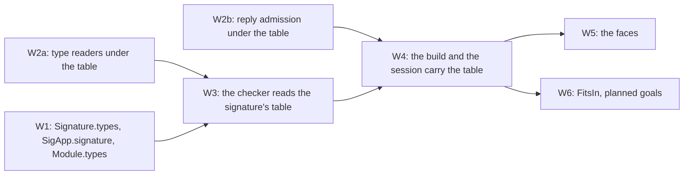

# 2026-10-16 The wiring slice: declared types read by the checker and at the host boundary

Status: research note (history, not authority). Base: `895f6633c` on `refactor/phase1-phase3`.
Role: the owner's direction of 2026-10-16, after [the review](review.md).
The owner's words: "start working on the unified wiring slice ... make decisions in that light".
The light is the language constructs that an agent would want to author verified software in.
The owner is away. The decisions below are proposals for the coordinator's register.

## The one thing to know first

A declared name stays nominal. The checker unfolds it where it reads a type by shape, and a
record field written at the name folds a value into it. Every reader under the table is written
beside its table-free original and is that original at the empty table by `rfl`.

## Question

How does a declared type, recursive or not, reach the checker, reply admission and the faces,
with every existing law unchanged at the empty table?

## What was read or run (each with its evidence word)

| Item | Evidence | Result |
| --- | --- | --- |
| [The review](review.md), decisions rows 124, 158, 400 to 405 | reading | the rulings this plan keeps |
| `docs/research/2026-10-15-recursive-types/formal.md` §6, §7, §10 | reading | the nominal order; the planned wiring |
| Four read-only scouts: the checker, the carrier, the proof side, the faces | reading, by the scouts; their key claims spot-checked | F1 to F4 |
| `src/Effect4/Program/Record.lean`, `src/Effect4/Program/Typing/Rules.lean`, `src/Effect4/Api/HostSession.lean` | reading | the term typer's arms; the session's reply check |
| `lake build Effect4.Program.Admit Effect4.Program.TyDecls Effect4.Program.SigApp` | tested | the Windows clone builds at the base |

## Findings (each with its evidence)

### F1. The checker

- The term typer (`argTy`, `Typing/Rules.lean`) reads a type by shape in five arms: record, field, record update, tuple index, list fold.
- Field, update and the list fold go through `UnionRule.lift` or `extendAll`, which read `Ty.normalize`'s members.
- Tag dispatch (`Record.tagArms`) and the decision arms read `Ty.members` directly.
- `Ty.members` cannot take a table: `Ty.normalize` calls it, and normalization takes none.
- The order is nominal (rows 158, 401 (1)). Relating a name to its body in `Ty.sub` would reverse an owner's ruling.
- About twelve law files invert the term typer against `Fits`. `Fits` takes no table, so those laws fail at a table with a name.

### F2. The carrier

- `SigApp.types` exists. `SigApp.signature` drops it, and `Signature` has no field for it.
- The API is indexed by `RowTable`: about 75 declarations in 11 files, and the certificate `AdmittedProgram program (.ofTable table)`.
- `Module` and `Application` have no field for types.
- The OCaml engine takes the row table as `?table` and has no channel for a declaration table.

### F3. The machine and reply admission

- Eight readers of a row's column read no table (the review's F4).
- At a data column, preparation passes a reply through unchanged (`prepareExternalAnswer_data`).
- At a column `handle n` it mints a host handle for a natural, whether or not `n` is declared.
- No theorem takes `admit … = none` to `AnswerOk`. The guarantee stops at `Val.hasTy` and at `Fits` on the shape-decided fragment.

### F4. The faces

- The TypeScript printer already prints `handle n` as the name `n` (`Codegen/Types.lean`).
- A declaration block (`export type N = …`) needs a type-alias `Decl` in lean4-typescript, an upstream package pinned in `lakefile.toml`.
- The Schema bridge writes a handle as a declaration and has no `Reference` arm.

## Proposals (not rulings)

### Decisions, in the agent's light

An agent declares a type once in Lean, gets a located refusal where it writes something wrong,
and reads one theorem per guarantee. The decisions follow from that.

1. **A declared name is nominal, read iso-recursively** (keeps rows 124, 158 and 401 (1)).
   - Elimination unfolds: a rule that reads a type by shape reads a declared name at the head as its body.
   - Introduction folds: a record field written at a declared name takes a member of the name's body.
   - `Ty.sub` does not change. Two names compare by name.
   - Why: brands and identities need a name (row 158). The fold sits in a written type, so a refusal names the record's path.
   - An agent never writes the fold: the Lean surface (U2's record form, `ascribe`) writes it.
   - The printed TypeScript compares aliases structurally, so tsgo accepts every program this nominal checker accepts.
2. **One table, in the typing signature.** `Signature.types : TyDecls := []`, filled from `SigApp.types` by `SigApp.signature`.
3. **Beside, by `rfl`.** Each reader under the table is `match decls with | [] => original | _ => …`.
   So the empty table is the original by definition, and no existing proof changes.
4. **The allocation rule** (row 401 (3)). A natural at a column whose head is a declared name is no allocation request.
   One classifier, `allocatesIn`, decides it for admission. Preparation keeps its own test until the session moves (W4).
5. **The typed-state guarantee stays at the empty table.** The laws that invert the typer against `Fits` take `sig.types = []`.
   `FitsIn`, membership's world-level form, enters as planned goals (W6).
6. **The faces read the table** where they can inside the repository (W5). The declaration block waits on lean4-typescript.

### The increments

| Increment | Files | Existing definitions changed | Gates |
| --- | --- | --- | --- |
| W2a | `Program/TyExpand.lean` (helpers moved from `TyDecls.lean`), new `Program/TyHead.lean`, new laws | none | narrow builds |
| W2b | new `Program/AdmitIn.lean`, new laws | none | narrow builds |
| W1 | `Typing/Rules.lean`, `SigApp.lean`, `Authoring.lean`, `Authoring/Application.lean` | a field with a default | narrow builds of the dependents |
| W3 | `Typing/Rules.lean` (`argTy`), `Checker.lean` (tag dispatch), the twelve laws of F1 | the typer's arms, by `rfl` at `[]` | the whole build; `check-ts` |
| W4 | `Api/Author.lean`, `Api/Built.lean`, `Api/HostSession.lean`, the engine | the build's signature; the session's reply check | `check-ocaml`, `check-ts` |
| W5 | `Schema/Bridge.lean`, the readers | none at the empty table | `check-ts` |
| W6 | new laws | none | narrow builds |

### Placement of each obligation

Each row gives the five points of `AGENTS.md`. Every claim is proposed for the registry in the
receipt; the registry is the coordinator's.

| Obligation | Concept and property | Question: claim, role | Reach | Does not establish | Unlocks |
| --- | --- | --- | --- | --- | --- |
| `Ty.membersIn` keeps membership: `MemberIn` at a type holds exactly at one of its head members | `store-typing`: membership decided, closed under the order | `wiring-head-members`, inversion | every table, guarded or not; values at any allocation table | anything of `Fits` or the checker | the soundness of every lifted rule under a table |
| `membersIn`, `liftIn` and the record rules are their originals at `[]` | `subtyping-algebra`: the union rule's laws | `wiring-readers-conservative`, compatibility | the empty table, by `rfl` | any statement at a non-empty table | W3 with no law edited at the empty table |
| The fold is sound: a field written at a name, given a member of the body, holds a member of the name | `store-typing` | `wiring-fold-sound`, preservation | `Ty.sub`'s members (`memberIn_sub`) and `memberIn_unfold_iff` | the checker's soundness against `Fits` | W3's record arm |
| A lifted field read under the table answers a type that holds the field of every member | `residual-program-typing`: the typer's rules sound for membership | `wiring-field-sound`, preservation | values at `MemberIn`; the field rule | progress; `Fits`; the Eff-level rules | W3's field arm |
| Admission under the table is admission at `[]` | `host-session-protocol`: reply admission | `wiring-admission-conservative`, compatibility | the empty table, by `rfl` | any session law | W4 with the session's laws unchanged at `[]` |
| An admitted success is a member of the row's answer column under the table | `host-session-protocol`, with `store-typing`'s judgment | `wiring-admission-sound`, preservation | `admitIn`'s success arm; the prepared allocation table | `AnswerOk`; `Fits`; preparation at a declared column | W4's session, W6 |
| No allocation at a declared name | `host-session-protocol` | `wiring-no-allocation-at-name`, safety | `externalValueIn` at every table | preparation, until W4 moves it | row 401 (3) at admission |
| `FitsIn` at `[]` is `Fits`; `FitsIn` implies `MemberIn` | `store-typing` | planned goals, compatibility and soundness | the world's allocation table | the M5 to M7 statements under a table | W6, then the typed guarantee under a table |

Each serves R3's open part on recursive types and R6's host lane (`docs/core/system-map.md`).

### Decisions rows to propose

1. The iso-recursive reading of a declared name in the checker: unfold at elimination, fold at a written field type, the order unchanged (decision 1).
2. The table in the signature, and the beside-by-`rfl` rule for its readers (decisions 2 and 3).
3. The typed-state guarantee at the empty table until `FitsIn` (decision 5).

## What this does not establish

- No code is written yet. The reaches and file counts come from the scouts' searches.
- The Eff-level readers beyond tag dispatch (`Decision.arms`, the option and exit eliminators, `Tuple.typeAt`) are not planned in W3.
- Recursive `deriving Modeled` is not planned here. A recursive table is written by hand until it lands.
- No gate has run.
