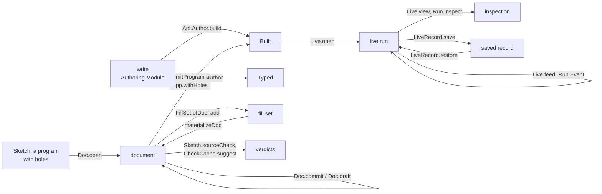
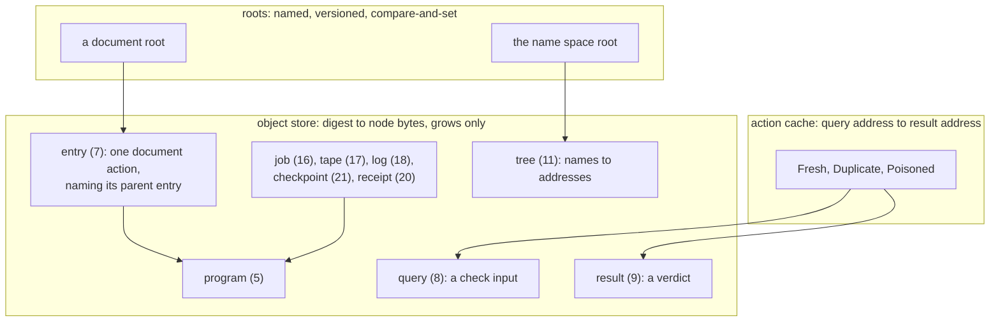
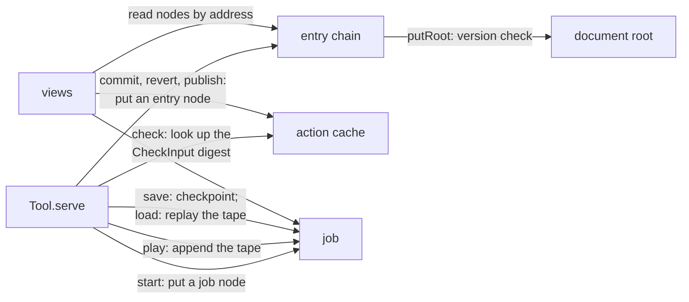

# The authoring interface and the store: where they stand, and where they go

Status: research note (history, not authority). Base: `9b8f2248a` on `refactor/phase1-phase3`. The
authoring branch `gemini/authoring` is at `8984bd15e`, with an uncommitted repair. Inputs: two
read-only surveys run on 2026-10-17 (the authoring interface; the store), the composition plan
version 2 (`docs/research/2026-10-17-session-composition/plan.md`), and the store review
(`docs/research/2026-10-17-ocaml-estate-review/cas/README.md`). This note changes no code and no
ruling. It is the layout the views of the authoring loop will draw.

## The one thing to know first

Every stage of authoring has an owner in Lean, from writing a module to inspecting a run. The
stages meet through the tool's hand code, not through library declarations. No declaration turns
a document into a `Built`, admission runs in five places, and `fill` means three things. The target
is one protocol module over three certified values, the document, the fill set and the live runs.
The store gives each value it hands around a content address.

## 1. The loop

The diagram records the data flow only. It is not proof evidence. The arrow from the document to
`Built` has no library owner today: the tool assembles the `Built` by hand.

## 2. The interface to date

Status: **M** on main; **B** committed on the authoring branch; **R** only in its uncommitted
repair; **P** planned in a note, with no code.

| Stage | Owner declarations | Status | Laws |
| --- | --- | --- | --- |
| write | `Authoring.Module`, `Src`, `Row.host`, `Row.call`, `Layer.ref`, `Def.invoke`; the service builders `use`, `give`, `layer`, `provide`, `fork`, `join`, `install`; the macros `eff_module`, `eff_rows`, `eff_record`, `eff_failure`; entry module `src/Effect4/Author.lean` | M | `build_lawful`, `build_runnable`, `build_table` (`src/Effect4/Laws/Program/Author.lean`) |
| build | `Api.Author.build` to `Built` {app, program, admitted, rowNames}; `Built.rebuild`; `BuildRefusal` (`src/Effect4/Api/Author.lean`, `src/Effect4/Api/Built.lean`) | M | `Api.Author.build_retains`, `rebuild_spec`, `rebuild_admitted`, `rebuild_self` |
| check | `Api.check` to `Typed`, `Api.explain`, `Api.blame`, `Api.checkLayer`; `Run.Kit.check` | M | `Api.explain_none_iff`, `Api.blame_none_iff` |
| sketch | `Sketch`, `Row.hole`, `SigApp.withHoles`, `Sketch.check`, `fillAt`, `omitAt`, `focusAt`; `Sketch.expand`, `sourceCheck` (`src/Effect4/Program/Typing/Source.lean`) | M | `check_fill`, `check_omit`, `Sketch.check_more_holes`, `refusals_nil_iff`, `sourceRefusals_nil_iff` |
| edit | `EditSession` (`src/Effect4/Program/Edit.lean`); `SourceSession.open`, `feed`, `run`, `view` (`src/Effect4/Program/Typing/SourceSession.lean`) | M | `reached_coherent`, `reached_view`, `feed_undo` (`src/Effect4/Laws/Program/SourceTable.lean`) |
| document | `Doc`, `DocId`, `EditTarget`, `Doc.open`, `target`, `inspect`, `commit`, `draft`, `undo`, `fork` (`SourceDocument.lean`) | B | `Doc.commit_sound`, `edit_exists` |
| verdict cache | `CheckCache.lookup`, `insert`, `suggest`, `evaluateCandidate` (`CheckCache.lean`) | B | `CheckCache.lookup_sound`, `insert_valid`, `evaluateCandidate_valid_and_sound` |
| fill set | `FillSet.ofDoc`, `add`, `view`, `materializeDoc`; `materialize`, `ordered`, `certifiedB` (`FillSet.lean`) | B; the base guard and `foreignBase` R | D1 to D9 (`materialize_congr` is D6), `FillSet.add_wf` |
| admit | `admitProgram` to `AdmittedProgram` (`src/Effect4/Program/Admission.lean`); `Run.Kit.admit`, which skips formation by design; `Run.Preview.admit` | M; `Preview` B | `admitProgram_signature`; `Sketch.sourceCheck_of_admitted` (B) |
| start | `Run.open`, which cannot refuse; `Live.open`, `Live.start`; `LiveRecord.save`, `restore` (`LiveRecord.lean`) | M; `LiveRecord` B | `open_total`, `Live.reached`, `start_ok`; `restore_save` (B) |
| run | `Run.step`, `play`, `driveFrom` (`src/Effect4/Run/Basic.lean`); `Run.Event`, `Run.feed` (`src/Effect4/Run/Event.lean`); `Api.Runner.Command`, `replay` | M | `journal_replays`, `Live.opened_feed`, `step_refused`, `replay_append` |
| inspect | `Api.Inspection`; `Run.inspect`, `Run.view`, `Live.view` (`src/Effect4/Run/View.lean`) | M | `Live.view_awaits`, `view_checked`, `view_classifies` |

The tool (`tools/Tools/Session.lean`) dispatches 12 operations on main over a 21-field request. The
branch dispatches 26 over 41 fields:

- document: `open`, `catalogue`, `view`, `inspect`, `replace`, `omit`, `draft`, `undo`, `fork`,
  `journal`, `sketch`, `suggest`;
- fill set: `fills.add`, `fills.view`, `fills.materialize`, `fills.reset`;
- run: `run`, `start`, `receive`, `apply`, `liveView`, `save`, `load`;
- preview: `settle`, `frames`, `explore`.

`Tools.Query` answers eight stateless requests. No TypeScript or
OCaml client calls the tool; the OCaml kit lowers `Run.Kit.check`, `admit`, `explore` and the
authoring builders (`ocaml/gen/roots.json`).

## 3. What is written twice

| Fact | Owners today | The one owner | Slice |
| --- | --- | --- | --- |
| program admission | `admitProgram`; `Run.Kit.admit` (partial); `Run.Preview.admit`; reruns in `HostSession.start`, `Live.start`, `LiveRecord.restore`; the tool's `start` and `run` arms | `admitProgram`, with the kit's and the preview's profiles as named restrictions of it | S4 |
| a document to a `Built` | the tool, by hand, twice; only `start` sets `rowNames` | one declaration beside `Built` | S4 |
| checking | `Api.check`, `Sketch.check`, `Sketch.sourceCheck`, `Run.Kit.check`, `Tools.Query`'s `check` | `Sketch.sourceCheck` for documents, `Api.check` for built programs; the others call one of them | S3a |
| the edit state | `EditSession`, `SourceSession`, `Doc`, and the tool's own `source`, `docId`, `revision`, `journal` fields | `Doc` over `SourceSession`; `EditSession` stays the expanded program's engine | S1, S3a |
| a commit's journal step | `Doc.commit`, then `feedStep` again in the tool | the step `Doc.step` returns | S1 |
| `fill` | a decided premise (`Tools.Query`), a draft (main's tool), a checked commit (the branch's tool) | `commit` with a target, and `draft`, as two constructors | S3a |
| run entry points | `Run.open`, `Live.open`, `Live.start`, `Runner.load`, `HostSession.start`, `Typed.replay`, `runPure`, and the raw `Api.run`, `replay`, `runSync` | `Live.open` from a `Built`; the raw entries stay test uses | S4 |
| a carrier on the wire | hex or JSON, with hex winning when both arrive | one generated encoding per field | S3b |

## 4. The target interface

The protocol module of the composition plan's §6: `serve : State → Request → State × Except
Refusal Answer`, with one flat `Request` and one flat `Answer`.

| Group | Requests | Answer, and its laws |
| --- | --- | --- |
| document | `open`, `inspect`, `view`, `commit` (a target, no default), `draft`, `revert` (a named entry), `fork`, `history` | the new snapshot and its revision; `Doc.commit_sound`, the replay law, the revert law |
| fill set | `fills.add` (a batch), `fills.view`, `fills.publish`, `fills.reset` | per-item outcomes inside a successful answer; one history action per publication; D1 to D9 |
| check | `catalogue`, `suggest`, and the stateless queries of `Tools.Query` | a verdict or located refusals; `CheckCache.lookup_sound` |
| run | `start` (a snapshot), `play` (`Api.Runner.Command` or `Run.Event`), `liveView`, `save`, `load` | a live run with its origin; a "played" answer with its phases; `journal_replays` |
| preview | `settle`, `frames`, `explore` | the call tree under the preview profile; `checkedTape_admits` |
| meta | `discover` | the method and codec versions |

The state holds the document, its fill set, the live runs by identifier, and the counters that
allocate document generations and run identifiers. A refused request leaves it unchanged.

## 5. The store to date

The store is a finished library with no consumer. Lean owns its meaning, OCaml its disk, and
Rocq proves its laws over code printed from Lean. Nothing outside the tests calls the OCaml store,
and only tests, the golden cutter and the Rocq printer call Lean's `putNode`.

| Layer | Lean owner | OCaml owner | Proved (Rocq unless named) | Consumers |
| --- | --- | --- | --- | --- |
| hash | `Store.sha256`, `Digest` | `E4_sha256` | a `Prim` parameter; collision resistance only | all below |
| value bytes | `Val.encode`, `Val.decode`, tags 1 to 14 (`src/Effect4/Store/Carrier/Val.lean`) | `E4_node.walk`, `scan_payload` | `encode_prefix_free`, `encode_injective`; Lean `Val.decode_exact` | every `Canonical` instance |
| kinds | `Kind`, bytes 1 to 23, `sentinel` 127 (`src/Effect4/Store/Carrier/Kind.lean`) | `E4_kind` | `kind_separation`; Lean `byte_ne_sentinel` | all |
| node and address | `Node.encode`, `address`, `specOf` (`src/Effect4/Store/Domain/Node.lean`) | `E4_node`, `E4_addr` | `node_encode_injective`, `domain_separation`, `address_inj_resident` | tests, goldens, the Rocq printer |
| object store | `Store`, `putNode`, `Store.Sound`; `Word`, `Store.closure`, `Store.verify` | `E4_cas` over `E4_pack`, `E4_index`, `E4_crc` | `put_grows`, `put_get`, `put_bytes_never_change`, `put_conflict_collision`, `built_ranked`, `built_closure_premises`, `verify_sound` | none outside tests |
| roots | `RootKind` (five kinds), `putRoot` | `E4_control` (seven kinds), `advance_root`, `pin` | none | none |
| checkpoints | none | `E4_checkpoint` (kind 21), `E4_chunk` (kinds 10, 12) | none | none |
| write-ahead log | none | `E4_wal` | none | `E4_checkpoint.ephemeral` only |
| action caches | none | none | none | `scripts/lib/gate_cache.py` for the gates; `CheckCache` on the authoring branch, in memory |

| On disk | Owner | Durability |
| --- | --- | --- |
| `control` | `E4_control` | written to a temporary file, synced, renamed, then the directory synced; a nonzero `scheme_version` refuses |
| `pack/%06d.pack` | `E4_pack` | records of length, digest, node bytes and CRC; one sync per segment per commit; sealed segments 0444 |
| `index/000000.idx` | `E4_index` | saved at close, rebuilt when stale; 0444 |
| `log/<job>/<n>.seg` | `E4_wal` | group commit with sync |
| `.lake/check/`, `<git-common-dir>-checks/` | `gate_cache.py` | a pass record per key, published by `os.replace` |

**Missing:**

- checkpoint restore: `machine_of_image` returns rendered rows, not a machine;
- the write-ahead log feeding `E4_log`, which `e4_wal.mli` states;
- a writer killed mid-commit (C8), the hash assumption's row (C5), the action cache (C6) and
  deterministic keys (C7).

**One fact, two owners:**

| Fact | Owners | The one owner |
| --- | --- | --- |
| root kinds | Lean's five; OCaml's seven, with `Registry` and `Pin` | one Lean table, with the two kinds added when a consumer needs them |
| put outcomes and refusals | Lean `Admission`, `Outcome`; OCaml adds `Unknown_tag`, `Host_limit`, `Handle_in_content`, `Corrupt` | Lean's, with M2 added; OCaml's decode, capacity and disk-damage cases named as such |
| a decode refusal's admission | `check_pure`, `put_bytes`, `readmit_tail` in `ocaml/engine/cas/e4_cas.ml`; recovery still reports `Unknown_tag` as `Oversize` | one function |
| a program's identity | `Store.address` of its node; `sha256 (Api.bytesOf p)` in `tools/Tools/Code/Module.lean`, the payload's digest; `sha256` of the rows and services in the tool | the node address, with the payload digest named apart |
| the zero-spec schema node | Lean `genesisNode`; `E4_checkpoint.schema_node` | Lean's |
| two tiers | `Word.Layered`, `LocalFirst`; `Cascade.CascadingStore` | one, when a consumer needs two tiers |
| "checkpoint" | the `E4_checkpoint` node; `E4_query.checkpoints`; the log's `Checkpoint_mark` row | the node keeps the word |
| the shape pin | Lean `specOf`; `test_shapes.ml`'s text digest | blocked on `render` writing wire tags (C4) |

## 6. The store's target

The store keeps its three layers and gains its consumers. Each kind enters with the consumer that
references it, as the kind table's rule says (`docs/research/2026-09-04-cas-trait-plan.md` §3).

The diagram records the data flow only. It is not proof evidence.

| Layer | Target | Item |
| --- | --- | --- |
| hash | SHA-256 under a named scheme, `effect4.cas.v0[SHA-256]`, in the control file and printed addresses; one DESIGN-BASIS row naming collision resistance as the only assumption | C5 |
| object store | Lean's `putNode` refuses a handle in content (M2); one refusal vocabulary; Lean cites the Rocq laws through `declared … from` | M2, C1's proposals |
| roots | one root-kind table; a document's root moves by `putRoot`'s version check, which is publication against the authoritative store | after S3b |
| action cache | key node of kind `query` to result node of kind `result`; a second, different result for one key is reported as poisoned, never overwritten; the key is the digest of one `CheckInput` | C6, phase 4 |
| runs | a job node names its program, inputs, host binding and engine identity; restore replays the job's tape and compares | after S4 |
| disk | crash tests that kill a writer between write, sync and rename | C8 |
| keys | a double regeneration compared byte for byte; never Lean's 64-bit `hash` as an address | C7 |

## 7. Where the two meet

The diagram records the data flow only. It is not proof evidence.

- **A snapshot's name is an address.** Codex's control R3 shows identity and revision name no
  history. The entry chain's last address names the origin and the whole history, as a Git commit
  does. Lean's proofs compare the origin and history themselves; the wire and the store compare
  addresses, under C5's collision assumption.
- **Publication is a root move.** A document root advances by `putRoot`'s version check, so two
  writers against one store cannot both publish at one revision.
- **The verdict cache is the action cache.** `CheckCache` keys by the program, its `SigData` and
  its type environment. As a store entry, the key becomes the digest of one canonical `CheckInput`,
  so a lookup cannot read what the key omits.
- **A run is a job and its tape.** `LiveRecord.save` becomes a job node and its tape;
  `LiveRecord.restore` already re-admits and replays, which is the check C6's determinism mode needs.
- **Views read addresses.** A view of a document, a verdict or a run reads nodes by address, so a
  picture names exactly the content it draws.

The order: the composition plan's S1 to S3b first, since they fix the values the store will name.
Then M2 and C5, then the action cache with phase 4's verdict graph, then the entry chain and run
nodes. The store needs no change of format for any of this: every kind used here is in the table.

## 8. Decided

The owner's steer of 2026-10-17: technical questions are settled by evidence, not held.

| Question | Decision | Evidence |
| --- | --- | --- |
| wire the store now, or park it | wire it: the verdict cache, the document history and the run nodes are its consumers | C1 to C3 made its contract true; the owner wants the tooling and the store landed up to Incremental |
| amendment M2, a handle in content | Lean's `putNode` refuses it as `handleInContent`, after `malformedRef`; G2 is re-cut and the named exception deleted | OCaml already refuses in `put` and `verify`; the Rocq seat's receipt proposes the same row; a handle is a run's name, never content |
| the vacuous Lean theorems | `address_inj` is replaced by the Lean theorem `address_inj_resident`; `Pin.holds_of_injective` is deleted | its premise, an injective SHA-256, has no model; `rocq/StoreLaws.v` proves the resident form, and Lean proves it in a few lines (decisions row 411 (1)) |
| recovery inside a sealed segment | it refuses, and the refusal becomes a value of the recovery result | a sealed segment is published content; cutting it would drop committed nodes; rule 6 |
| an empty `Store.Tree` | Lean's acceptance decides, and OCaml's `refs_of_checked` follows it | Lean owns the byte language (C2) |
| a snapshot's store name | the address of its entry chain's last node | Codex's control R3; a chain address names the origin and the whole history |

## What this note does not establish

- The tables come from two read-only surveys and the coordinator's checks of their key claims.
- The target interface and the store's target are proposals; no slice has run.
- The store survey read the seat's branch before its merge at `9b8f2248a`.
- The coordinator rechecked the root kinds and the recovery path's `Oversize` report at the head.
