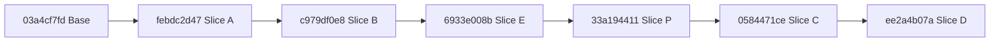

# Authoring slices A, B, E, P, C and D — implementation receipt

## 1. What the coordinator must know before merging

All six assigned authoring slices (A, B, E, P, C and D) land on `gemini/authoring` as six commits.
A review on 2026-10-17 found six requirement defects and two evidence defects. The coordinator's
repair commit closes them (§3.7).

Every declaration of the new and touched core, law and battery modules audits within
`[propext, Quot.sound]` with 0 planned goals. The three edited tool modules (`Tools.Query`,
`Tools.Session.Snapshot`, `Tools.Session`) are outside that audit. They reach `Classical.choice`
through the toolchain's `Lean.Json` and `String` functions, as they did at the base (§4).
No gate input changes (`src/Effect4/Api/**`, `src/Effect4/Run/Kit.lean`, `src/Effect4/Program/Compile.lean`),
and `tools/ProofGraph/Registry.lean` and `docs/core/decisions.md` stay untouched for the coordinator.

## 2. Base and head commits

- Base commit: `03a4cf7fd` (`Authoring plan: slice A's status and measured costs; the Gemini brief`).
- Head commit: `ee2a4b07a` (`Authoring slice D: fixed-base parallel fills and deterministic materialization`).

## 3. Slices

### 3.1 Slice A — the tool part (`febdc2d47`)

**Changed files** (`7 files changed, 307 insertions(+), 74 deletions(-)`):

- `src/Effect4/Laws/Program/SketchAdmission.lean` (new, 54 lines): `Sketch.sourceCheck_of_admitted`.
- `tools/Tools/Query.lean`: `fillPremises`, `omitPremises`, `fillPremises_sound` and `omitPremises_sound` take `app : SigApp`.
- `tools/Tools/Session/Snapshot.lean`: `Cache` holds `app : SigApp`; `fresh`, `Cache.Valid` and `resolve_agrees` thread `app`.
- `tools/Tools/Session.lean`: `Request` reads `types` and `typesJson`; `open` builds `⟨rows, services, types⟩`; `appName` hashes the triple; `sketch` emits `types`; `run` admits at `l.app.withHoles l.sketch.holes`.
- `Test/Program/SketchAdmissionControls.lean` (new, 107 lines): controls 1 to 4 of plan §7.1.
- `src/Effect4/Laws.lean`, `Test/All.lean`: root imports.

**Commands and results**:

- `lean-slot.sh lake build Tools.Query Tools.Session.Snapshot Tools.Session Effect4.Laws.Program.SketchAdmission Test.Program.SketchAdmissionControls`: exit 0 (`1104 jobs`).
- `lean-slot.sh make batteries-touched BASE=03a4cf7fd`: exit 0 (`2 batteries`, `1108 jobs`).
- `#axiom_audit Effect4.Laws.Program.SketchAdmission Test.Program.SketchAdmissionControls`: `41 declarations within [propext, Quot.sound], 0 of them modulo planned goals; 0 planned goals`.
- `#closure_audit Effect4.Laws.Program.SketchAdmission Tools.Query Tools.Session.Snapshot Tools.Session Test.Program.SketchAdmissionControls`: `286 declarations; none binds a table before a returned closure`.

**Red controls flipped**:

- Control C10 (`serviceState` run) flips from `refused` to `ok` (`Test/Program/SketchAdmissionControls.lean`).
- The `appName` collision between applications that differ in named types flips (`Test/Program/SketchAdmissionControls.lean`).

**Proposed decisions rows**: none (waits on row 5 for Slice A′).

### 3.2 Slice B — document identity, inspection and atomic checked edits (`c979df0e8`)

**Changed files** (`7 files changed, 710 insertions(+), 26 deletions(-)`):

- `src/Effect4/Program/Typing/SourceDocument.lean` (new, 172 lines): `DocId`, `Doc`, `EditTarget`, `Change`, `Policy`, `Refusal`, `Inspection`, `Doc.open`, `Doc.fork`, `Doc.target`, `Doc.inspect`, `Doc.editOf`, `Doc.commit`, `Doc.draft` and `Doc.undo`.
- `src/Effect4/Laws/Program/SourceDocument.lean` (new, 130 lines): `edit_exists` and `Doc.commit_sound`.
- `tools/Tools/Session.lean`: operations `inspect`, `replace`, `commit`, `draft` and `fork`, plus target-gated `fill` and `omit`. The review found the untargeted forms still drafting, against plan §7.2; §3.7 makes both checked only.
- `Test/Program/SourceDocumentControls.lean` (new, 193 lines): controls 1 to 9 of plan §7.2.
- `src/Effect4.lean`, `src/Effect4/Laws.lean`, `Test/All.lean`: root imports.

**Commands and results**:

- `lean-slot.sh lake build Effect4.Program.Typing.SourceDocument Effect4.Laws.Program.SourceDocument Tools.Session Test.Program.SourceDocumentControls`: exit 0 (`1110 jobs`).
- `lean-slot.sh make batteries-touched BASE=febdc2d47`: exit 0 (`3 batteries`, `1115 jobs`).
- `#axiom_audit Effect4.Program.Typing.SourceDocument Effect4.Laws.Program.SourceDocument Test.Program.SourceDocumentControls`: `301 declarations within [propext, Quot.sound], 0 of them modulo planned goals; 0 planned goals`.
- `#closure_audit Effect4.Program.Typing.SourceDocument Effect4.Laws.Program.SourceDocument Tools.Session Test.Program.SourceDocumentControls`: `458 declarations; none binds a table before a returned closure`.

**Red controls flipped**:

- A refused edit under `Doc.commit` leaves the document and revision unchanged (`Test/Program/SourceDocumentControls.lean`).
- A foreign target (`DocId` mismatch) is refused with `Refusal.foreign` (`Test/Program/SourceDocumentControls.lean`).

**Proposed decisions rows**: propose recording the `DocId` and `EditTarget` contract for atomic source edits under R14.

### 3.3 Slice E — persistent keyed live sessions and `LiveRecord` (`6933e008b`)

**Changed files** (`7 files changed, 503 insertions(+), 3 deletions(-)`):

- `src/Effect4/Run/LiveRecord.lean` (new, 102 lines): `LiveRecord`, `LiveRecord.currentVersion`, `RestoreRefusal`, `LiveRecord.save`, `LiveRecord.restore`, `LiveRecord.encode` and `LiveRecord.decode`.
- `src/Effect4/Laws/Api/LiveRecord.lean` (new, 88 lines): `LiveRecord.restore_save`, `LiveRecord.restore_unsupportedVersion`, `LiveRecord.ofTuple_toTuple` and `LiveRecord.decode_encode`. The last holds only for a record whose canonical value tree is well formed (`(toVal r.toTuple).WF`). No theorem states that a decoded byte string is its record's encoding. An earlier line named such a theorem, which does not exist.
- `tools/Tools/Session.lean`: `State.live` and operations `start`, `receive`, `apply`, `liveView`, `save` and `load`.
- `Test/Program/LiveRecordControls.lean` (new, 113 lines): controls 1 to 6 of plan §7.5.
- `src/Effect4.lean`, `src/Effect4/Laws.lean`, `Test/All.lean`: root imports.

**Commands and results**:

- `lean-slot.sh lake build Effect4.Run.LiveRecord Effect4.Laws.Api.LiveRecord Tools.Session Test.Program.LiveRecordControls`: exit 0 (`1114 jobs`).
- `lean-slot.sh make batteries-touched BASE=c979df0e8`: exit 0 (`4 batteries`, `1119 jobs`).
- `#axiom_audit Effect4.Run.LiveRecord Effect4.Laws.Api.LiveRecord Test.Program.LiveRecordControls`: `85 declarations within [propext, Quot.sound], 0 of them modulo planned goals; 0 planned goals`.
- `#closure_audit Effect4.Run.LiveRecord Effect4.Laws.Api.LiveRecord Tools.Session Test.Program.LiveRecordControls`: `291 declarations; none binds a table before a returned closure`.

**Red controls flipped**:

- Two concurrent waiting calls on one row are answered out of order by call key (`fiber`, `token`) through `receive` and `apply` (`Test/Program/LiveRecordControls.lean`).

**Proposed decisions rows**: propose recording `LiveRecord.currentVersion = 1` and the `LiveRecord.Tuple` canonical wire layout under R13.

### 3.4 Slice P — the preview profile (`33a194411`)

**Changed files** (`7 files changed, 568 insertions(+), 29 deletions(-)`):

- `src/Effect4/Run/Preview.lean` (new, 113 lines): `Preview.Refusal`, `Preview.rowIsGeneric`, `Preview.hasHandle`, `Preview.rowFaultAt`, `Preview.outsideProfileAt`, `Preview.admit`, `Preview.checkedTape`, `Preview.Rejected` and `Preview.rejected`.
- `src/Effect4/Laws/Api/Preview.lean` (new, 212 lines): `Preview.checkedTape_admits`, `Preview.not_handle_of_hasHandle_false`, `Preview.externalValue_of_not_handle`, `Preview.externalValue_of_hasHandle_false`, `Preview.externalValue_unchanged_of_hasHandle_false`, `Preview.checkedTape_success_externalValue`, `Preview.rejected_empty` and `Preview.rejected_iff`.
- `tools/Tools/Session.lean`: `settle`, `frames` and `explore` gate programs with `Preview.admit`, run `Preview.checkedTape` and report `Preview.rejected`.
- `Test/Program/PreviewControls.lean` (new, 161 lines): controls 1 to 6 of plan §7.6.
- `src/Effect4.lean`, `src/Effect4/Laws.lean`, `Test/All.lean`: root imports.

**Commands and results**:

- `lean-slot.sh lake build Effect4.Run.Preview Effect4.Laws.Api.Preview Tools.Session Test.Program.PreviewControls`: exit 0 (`1117 jobs`).
- `lean-slot.sh make batteries-touched BASE=6933e008b`: exit 0 (`5 batteries`, `1123 jobs`).
- `#axiom_audit Effect4.Run.Preview Effect4.Laws.Api.Preview Test.Program.PreviewControls`: `185 declarations within [propext, Quot.sound], 0 of them modulo planned goals; 0 planned goals`.
- `#closure_audit Effect4.Run.Preview Effect4.Laws.Api.Preview Tools.Session Test.Program.PreviewControls`: `398 declarations; none binds a table before a returned closure`.

**Red controls flipped**:

- Preview tools (`settle`, `frames`, `explore`) refuse generic rows (`genericRow`), handle-bearing rows (`handleRow`) and forms outside `inPreviewProfile` (`outsideProfile`) with located refusals (`Test/Program/PreviewControls.lean`).
- Ill-typed tape entries are dropped by `Preview.checkedTape` and reported by index in `Preview.rejected` (`Test/Program/PreviewControls.lean`).

**Proposed decisions rows**: propose recording the preview profile (`Preview.admit`) and checked-tape value agreement (`Preview.checkedTape_success_externalValue`) under R12.

### 3.5 Slice C — contextual signature data, verdict cache and `suggest` (`0584471ce`)

**Changed files** (`7 files changed, 794 insertions(+), 4 deletions(-)`):

- `src/Effect4/Program/Typing/CheckCache.lean` (new, 257 lines): `PartSig`, `SigData`, `SigData.signature`, `bodyIndex`, `partSigAt`, `sketchSigData`, `CheckCache.CheckKey`, `CheckCache.Entry`, `SigData.extendsB`, `CheckCache.lookup`, `CheckCache.insert`, `CheckCache.Evidence`, `CheckCache.Suggestion`, `CheckCache.SuggestResult` and `CheckCache.suggest`.
- `src/Effect4/Laws/Program/Typing/CheckCache.lean` (new, 296 lines): `bodyAt_sig_index`, `sketchSigData_signature`, `SigData.extends_of_extendsB`, `CheckCache.Entry.compute_valid`, `CheckCache.lookup_sound`, `CheckCache.insert_valid` and `CheckCache.evaluateCandidate_valid_and_sound` (corrected: an earlier line named `partAt_sig_eq`, which does not exist).
- `tools/Tools/Session.lean`: `State.cache`, `inspect` context as `SigData`, and operation `suggest`.
- `Test/Program/CheckCacheControls.lean` (new, 147 lines): controls 1 to 4 of plan §7.3.
- `src/Effect4.lean`, `src/Effect4/Laws.lean`, `Test/All.lean`: root imports.

**Commands and results**:

- `lean-slot.sh lake build Effect4.Program.Typing.CheckCache Effect4.Laws.Program.Typing.CheckCache Tools.Session Test.Program.CheckCacheControls`: exit 0 (`1121 jobs`).
- `lean-slot.sh make batteries-touched BASE=33a194411`: exit 0 (`6 batteries`, `1127 jobs`).
- `#axiom_audit Effect4.Program.Typing.CheckCache Effect4.Laws.Program.Typing.CheckCache Test.Program.CheckCacheControls`: `355 declarations within [propext, Quot.sound], 0 of them modulo planned goals; 0 planned goals`.
- `#closure_audit Effect4.Program.Typing.CheckCache Effect4.Laws.Program.Typing.CheckCache Tools.Session Test.Program.CheckCacheControls`: `587 declarations; none binds a table before a returned closure`.

**Red controls flipped**:

- Cache lookup reuses a positive verdict across a row-table prefix extension and misses on a cached refusal across an extension (`Test/Program/CheckCacheControls.lean`).

**Proposed decisions rows**: propose recording `CheckCache.CheckKey` (program, `SigData`, `TyEnv`) and `partSigAt` root-only reading (decisions row 143) under R14 and R2.

### 3.6 Slice D — fixed-base parallel fills (`ee2a4b07a`)

**Changed files** (`7 files changed, 1222 insertions(+), 3 deletions(-)`):

- `src/Effect4/Program/Typing/FillSet.lean` (new, 195 lines): `Incomparable`, `incomparableB`, `certifiedB`, `applyFills`, `lookup`, `uniq`, `ordered`, `MaterializeRefusal`, `conflictAt`, `materialize`, `AddRefusal`, `AddOutcome`, `FillSet`, `FillSet.empty`, `FillSet.ofDoc`, `FillSet.view`, `FillSet.addOne`, `FillSet.add`, `FillSet.materializeSketch` and `FillSet.materializeDoc`.
- `src/Effect4/Laws/Program/FillSet.lean` (new, 753 lines): D1 to D9 (`fills_compose`, `materialize_congr`, `ordered_compose`, `materialize_refFree`) and the construction invariant (`FillSet.WellFormed`, `FillSet.add_wf`, `FillSet.materializeSketch_refFree`).
- `tools/Tools/Session.lean`: `State.fills` and operations `fills.add`, `fills.view` and `fills.materialize`.
- `Test/Program/FillSetControls.lean` (new, 154 lines): controls 1 to 8 of plan §7.4.
- `src/Effect4.lean`, `src/Effect4/Laws.lean`, `Test/All.lean`: root imports.

**Commands and results**:

- `lean-slot.sh lake build Effect4.Program.Typing.FillSet Effect4.Laws.Program.FillSet Tools.Session Test.Program.FillSetControls`: exit 0 (`1124 jobs`).
- `lean-slot.sh make batteries-touched BASE=0584471ce`: exit 0 (`7 batteries`, `1131 jobs`).
- `#axiom_audit Effect4.Program.Typing.FillSet Effect4.Laws.Program.FillSet Test.Program.FillSetControls`: `425 declarations within [propext, Quot.sound], 0 of them modulo planned goals; 0 planned goals`.
- `#closure_audit Effect4.Program.Typing.FillSet Effect4.Laws.Program.FillSet Tools.Session Test.Program.FillSetControls`: `677 declarations; none binds a table before a returned closure`.

**Red controls flipped**:

- `FillSet.add` refuses `[]` as `root`, `[99]` as `unknownAddress`, and nested addresses as `overlap` (`Test/Program/FillSetControls.lean`).
- `FillSet.add` refuses a second fill at one address as `conflict` and a type-changing fill as `notCertified` (`Test/Program/FillSetControls.lean`).

**Proposed decisions rows**: propose recording the private-constructor `FillSet` admission invariant (`FillSet.WellFormed`, `FillSet.add_wf`) under R14.

### 3.7 The coordinator's repair after the review of 2026-10-17

The review is Codex's, of `03a4cf7fd` to `8984bd15e`. Its record is
`scratch/authoring-review-8984bd15e/run-record.json` in the main checkout (not tracked). The
coordinator read each finding against the plan and the code, and each holds.

| Finding | Repair | Control |
| --- | --- | --- |
| 1. `fill` and `omit` without a target made unchecked edits | both are checked edits only; `draft` is the one unchecked edit (plan §7.2) | `Test/Program/SourceDocumentControls.lean`, controls 13 and 16 |
| 2. A missing document name, generation, revision or expected sub-program came from the current document | `commitAnswer` (`tools/Tools/Session.lean`) refuses a request without its whole target | control 14 |
| 3. `Program.materialize` dropped an unknown address and applied a root fill | it refuses both, with `MaterializeRefusal.unknownAddress` and `root`, from the fills' members only | `Test/Program/FillSetControls.lean`, control 9 |
| 4. After an ordinary edit, new fills joined a set at the opening revision and could not publish | an empty set follows the document; a set that holds a fill refuses new fills once the document moves; `fills.view` reports `stale`; `fills.reset` opens a new set | control 11 |
| 5. A published set had no journal entry, so `undo` failed or took back an older edit | `fills.materialize` journals the publication as one edit at the root | control 12 |
| 6. `{"op":"replace"}` with no replacement declared a hole | `replace`, `commit` and `fill` refuse a request with no replacement | control 15 |

The coordinator found one more gap of the same kind. `FillSet.materializeDoc` published at the
document's sketch, not at the base the fills were certified at. It now materializes the set at its
own base, and refuses a document whose sketch or application differs (`MaterializeRefusal.foreignBase`,
control 10).

The laws change in step. `Effect4.Laws.Program.FillSet` gains `any_eq_of_mem_iff`,
`holdsProgram_of_certified` and `certified_passes_checks`. `materialize_congr` (D6) and
`materialize_refFree` (D9) keep their statements, and their proofs read the two new checks. The
plan said the session battery and its fixture move to `draft`. They now do
(`Test/Program/SessionToolControls.lean` reads `Test/fixtures/session/requests.jsonl`), and so does
`Test/Program/SketchAdmissionControls.lean`.

**Changed files**: `src/Effect4/Program/Typing/FillSet.lean`, `src/Effect4/Laws/Program/FillSet.lean`,
`tools/Tools/Session.lean`, `Test/Program/FillSetControls.lean`,
`Test/Program/SourceDocumentControls.lean`, `Test/Program/SketchAdmissionControls.lean`,
`Test/fixtures/session/requests.jsonl` and this receipt.

**Commands and results** (each through `scratch/lean-slot.sh`):

- `lake env lean -DwarningAsError=true` on each of the two fill-set modules, `Tools.Session` and the
  four changed batteries: exit 0, no message.
- `lake build Effect4.Program.Typing.FillSet`, `Effect4.Laws.Program.FillSet`, `Tools.Session`:
  exit 0 (83, 321 and 653 jobs).
- `lake build Effect4 Effect4.Laws`: exit 0, `1387 jobs`. Its first run refused a duplicate name
  (`Effect4.Program.any_congr_mem` exists in `Effect4.Laws.Program.TyExpand`), which no narrow
  build imports together; the new lemma is `any_eq_of_mem_iff`.
- `make batteries-touched BASE=8984bd15e`: exit 0, `7 batteries`, `1131 jobs`.
- `#axiom_audit` of the two fill-set modules and the four changed batteries:
  `501 declarations within [propext, Quot.sound], 0 of them modulo planned goals; 0 planned goals`.
- `#axiom_audit Tools.Query Tools.Session.Snapshot Tools.Session`: `184 of 404 declarations reach
  axioms outside [propext, Quot.sound]`, each `Classical.choice` through the toolchain. Codex's runs
  give 137 of 271 at the base and 185 of 405 at `8984bd15e`.

## 4. Aggregate audit, open obligations and what was not run

- Aggregate `#axiom_audit` across all 17 new and edited proof and test modules:
  `#axiom_audit: 1353 declarations within [propext, Quot.sound], 0 of them modulo planned goals; 0 planned goals`.
  It covers no tool module. `Tools.Query`, `Tools.Session.Snapshot` and `Tools.Session` reach
  `Classical.choice` through `Lean.Json` and `String` functions, at the base as at the head. The
  axiom gate audits `Effect4.*` and `Test.*` modules only.
- Aggregate `#closure_audit` across all 20 new and edited modules:
  `#closure_audit: 1760 declarations; none binds a table before a returned closure`.
- Open obligations:
  - Slice A′ (`sketch-admission` split) waits on the owner's ruling on row 5.
  - Slices F, G and H remain outside this brief.
  - Registration of the new theorems in `tools/ProofGraph/Registry.lean` and `docs/core/decisions.md` belongs to the coordinator at wave merge.
- Not run (by rule of the brief §5): `make build`, `make check*`, `lake build Test`, `Test.All`.
