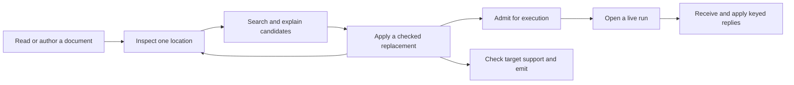
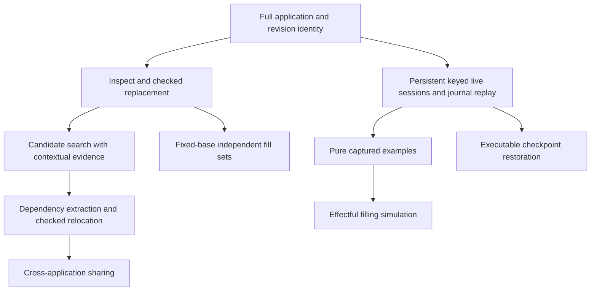

# A contextual authoring surface over the existing program model

Build the first slice around checked replacement at a versioned program location.
Keep immutable content, its contextual evidence, and live execution as distinct objects with explicit connections.
This supports fragment search, collaborative editing, and reproducible runs without changing the canonical `Eff` representation.

This report refines the [supplied proposal](evidence/original-proposal.txt).
It recommends a design. It changes no authority ruling or production definition.
The review uses HEAD `22a46c6aa0c419de1c3b047516418e48bfc201a5`, on `refactor/phase1-phase3`.
The [verification record](evidence/manifest.json) records commands, results, file hashes, and reviewer scopes.
The owner handles the Opus pass separately.
The [additional-points assessment](additional-points.md) corrects this report's original treatment of references, signature restriction in `check_restrict`, diagnostic paths, and unfinished execution.
Its [new receipt](evidence/additional/manifest.json) records the added controls and proof-status checks.
The original receipt's report digest refers to the retained [previous review bytes](evidence/additional/prior-review.txt).
The [final scout review](final-review.md) confirms the proposed local proofs and adds checked counterexamples at the public input boundaries.
It qualifies the completion claim for fills, document targets, preview replies, and sketch admission.

## 1. What changes the design

The central opportunity is reusable program content with evidence that explains where it fits.
The central correction is that a fragment's local type does not describe everything its use depends on.

| Finding | Consequence for the design | Evidence |
| --- | --- | --- |
| Moving closed bytes under a binder can change which variable they read. | Transport variable positions when instantiating a fragment. Keep its ordered capture map. | Finite controls C3 in [probes](evidence/probes.lean). |
| Equal focuses can exist under different operation signatures. | Include signature dependencies, declaration scope, and checker version in certificate identity. | C2; `Sketch.sigAt` and `Sketch.check_fill_focusAt`. |
| A parent can supply a service that its child requires. | Use requirement inclusion for service availability. Do not infer unrestricted requirement growth along grafts. | C1; `Checker.check`'s provision arms. |
| An edit session can retain an invalid replacement. | Separate editable drafts from atomic checked replacement and execution admission. | C5; `SourceSession.feed`. |
| A path can name different content after another edit. | Validate document revision and expected content before applying an edit. | C6. |
| A hole can typecheck while its row cannot be admitted for hosting. | Report checking and execution readiness separately. | C9; signature admission of a reference-valued answer. |
| Current session tooling drops application information. | Carry rows, services, and named types through editing, running, identity, and emission. | C10 and source inspection of `Tools.Session.answer`. |
| Recorded images and executable checkpoints have different contracts. | Resume through the existing journal first. Add executable checkpoint restoration as its own later feature. | Existing replay laws; `E4_checkpoint.machine_of_image` returns rendered state data. |

These findings correct implications in the proposal. They do not refute typed holes, content addressing, contextual reuse, or recorded execution.

## 2. The ten proposed relations, reassessed

Here D1–D10 mean the proposal's R1–R10.
Project requirements R1–R14 retain their meanings in `docs/core/system-map.md`.

| Relation | Checked conclusion | Refinement |
| --- | --- | --- |
| D1: holes are rows | Existing checking laws use ordinary program syntax for rows. A static focus and a live call have different data and obligations. | Share inspection conventions. Keep static replacement and dynamic completion as distinct operations. |
| D2: portable certificates | Exact replacement uses the address signature, ordered environment, and exact `EffTy`. Signature-extension restriction already exists. | Reuse `check_restrict` where its support premises hold. Dependency extraction and named-type restriction remain separate work. |
| D3: strengthening | The proposed unchanged-byte reading is false for positional variables. Signature dependencies remain even when ordinary variables are absent. | Restrict and reindex together. Include operation terms, definitions, parameters, types, services, and references in dependency analysis. |
| D4: operadic grafting | Nested replacement and address laws already exist. Their current names differ from the historical scratch names. | Extend the current generated node operations with the missing commutation result. Add typed context transport separately. |
| D5: requirements grow | Unrestricted child-to-parent inclusion is false through provision. | Model union and discharge. Inclusion is one candidate filter, never the entire fit judgment. |
| D6: folds imply a global cache | Uniqueness applies to one fixed algebra. Evaluated answers may depend on inherited inputs. Diagnostic path rebasing is already proved. | Keep contextual inputs. Cache relative verdicts and rebase refusals with `check_rebase`. |
| D7: fill equals answer | Type agreement alone does not imply equal stores, requests, cleanup, or scheduling observations. | Begin with a named pure fragment and observation. Effectful filling requires a simulation of the filling's behavior. |
| D8: runs form shared plays | Journal replay and suffix laws exist, with their frontier conditions. Serialized restoration remains separate. | Retain history identity. Share state only under an adequate equality or future-observation relation. |
| D9: facts respect relations | Useful reuse needs each fact's own invariant and fixed dependencies. | Store evidence-bearing views beside byte identity. Do not require decidable general behavioral equality. |
| D10: renaming | Row indices, service keys, type names, binders, and root-relative references are different namespaces. | Transport the namespace actually changed. Start with checked row relocation before runtime renaming. |

The old algebra note remains useful history: `docs/research/2026-09-08-cas-repository-algebra.md`.
Its scratch results do not establish current full-family laws.
The proposal also understates the address work already present in the source tree.

## 3. A mathematical model that matches the implementation

### 3.1 Separate content, context, and execution identity

A document manifest means immutable data identifying a program, its application, its hole table, and the relevant format versions.
This is proposed metadata over existing carriers. It is not another program language.

| Object | Identity or judgment | Existing owner and proposed connection |
| --- | --- | --- |
| Program content | Canonical bytes of the existing `Eff` family | `src/Effect4/Program/Eff.lean`; existing program codecs. |
| Stored node | Version, kind, specification reference, and payload | `Node.encode`, `src/Effect4/Store/Domain/Node.lean`. A stored-node address differs from a bare payload digest. |
| Document manifest | Program content plus full application, holes, and versions | Proposed composition of `Sketch`, `SigApp`, and existing store references. |
| Static occurrence | Document identity and structural path | `Node.at_`, `src/Effect4/Program/Refs.lean`. Repeated bytes can have different occurrences. |
| Contextual certificate | A named judgment about content under specific dependencies | Existing checker and replacement laws. Proposed first-order evidence record with a checked reader. |
| Live call | Session identity and checked call key in current runtime state | `HostSession`, `src/Effect4/Api/HostSession.lean`. One static occurrence may produce many calls. |
| Runtime resource | Allocation identity and owning world or session | `src/Effect4/Machine/Stores.lean`; `docs/core/host-boundary.md`. |

`Focus` holds program, environment, and inferred type (`src/Effect4/Program/Typing/Focus.lean`).
`CallInstance` holds operation, request type, answer, error, and type bindings (`src/Effect4/Program/Typing/Call.lean`).
Neither record contains everything required to admit an actual host reply.
Their useful connection is a projection at a checked call site, described by `callAt_rowTy` in `src/Effect4/Laws/Program/Typing/Call.lean`.

Equal immutable content does not merge allocations.
`refMake_twice_distinct` (`src/Effect4/Machine/Stores.lean`) and `Point.layerKey` (`src/Effect4/Program/Compile.lean`) protect that distinction.
The latter uses both the layer's path and its invocation context.

### 3.2 Contextual substitution is the primary authoring operation

A contextual fragment means existing program data with the dependencies needed to judge its use.
The dependency record includes its ordered variable environment, application data, enclosing definitions, parameters, and reference scope.
An implementation derives `Signature` from that data. It does not serialize the function-valued `Signature` record.

The initial contract uses the existing exact replacement judgment.
The following notation describes its premises; it introduces no new Lean theorem.

```text
checked(D) = T
focus(D, address) = (oldProgram, environment, localType)
check(signatureAt(D, address), environment, replacement) = localType
------------------------------------------------------------------
checked(replace(D, address, replacement)) = T
```

`Sketch.check_fill_focusAt` supplies this connection within its stated sketch and reference conditions.
Its owner is `src/Effect4/Laws/Program/Sketch.lean`.
Reference-bearing source edits also need source reference validation.
Use `Sketch.sourceCheck` and `SourceSession` for that route (`src/Effect4/Program/Typing/Source.lean`, `SourceSession.lean`).
Do not treat the local replacement theorem as whole-program admission.

The focus's type is the current subtree's inferred type.
It is not a principal expected type describing every acceptable replacement.
Expected-type analysis remains an open part of project R14.

Two useful replacement policies follow:

- Keep the existing type exactly, using the local law where its premises apply.
- Check the whole candidate source and accept its changed type, without implying execution readiness.

Neither policy promises unchanged behavior.
An explicitly retained draft may contain refusals, as the current editing session already permits.

### 3.3 Binding needs transport, even for closed fragments

Variables in this language use positions counted from the start of the environment.
Consider the existing program represented by `bind (succeed 7) (succeed variable0)`.
At the empty environment, it returns the newly bound number.
At an environment beginning with a string, the unchanged continuation reads that string.
Control C3 checks both types and checks the corrected weakening.

The mathematical object is therefore a family of fragments indexed by scope and signature.
Its substitution operations must commute with the chosen scope transport.
This motivates a context multicategory: contexts accept several typed fragments and compose by substitution.
That is a proposed organization of the laws, not a proved classification of the current checked language.

Use `Eff.weaken` and its existing typing law before designing general extraction or strengthening.
Their owners are `src/Effect4/Program/Fold.lean` and `src/Effect4/Program/Typing.lean`.
An ordered support map identifies which original variable each compacted capture represents.
A set of variable types cannot recover that information.

The first support optimization should remove one unused slot with explicit reindexing.
Signature-extension restriction already exists as `check_restrict` and `effTy_restrict` in `src/Effect4/Laws/Program/Signature.lean`.
`checkModule_restrict` extends it to definition blocks (`src/Effect4/Laws/Program/Sketch.lean`).
Reuse these laws where the smaller signature supports the program's reads.
Named types and the other fixed fields of `SigExtends` remain dependencies.
Missing-lookup refusals need separate negative evidence before reuse across extensions.
Whole-signature keys remain a conservative implementation baseline, not a missing general extension theorem.
Root-relative layer references require their own relocation through `src/Effect4/Laws/Program/AddressMove.lean`.

Fiore, Plotkin, and Turi combine binding syntax with a compatible substitution structure.
That is the relevant modeling pattern, rather than untyped tree substitution alone.
See [Abstract Syntax and Variable Binding](https://www.dcs.ed.ac.uk/home/dt/abstractsyn.html).

### 3.4 Requirements are an input to fitting, not its definition

Requirement rows contain service keys. They do not enumerate external operation positions.
Two external operations can require no services and still have incompatible request or answer types.
Control C2 exhibits this distinction.

The checker combines requirements by union and by discharge.
For a fixed service key, the transfer `r ↦ r \ {key}` respects inclusion but can shrink the input.
For provision by a fixed layer, the transfer is `r ↦ layer.requires ∪ (r \ layer.out)`.
These equations come from `Checker.check` in `src/Effect4/Program/Checker.lean`.

They do not establish monotonicity of the entire checker under arbitrary type changes.
The system map records counterexamples to that stronger claim under R14.
Answer subtyping, error subtyping, and requirement inclusion can prune candidates before contextual checking.
They cannot certify every replacement by themselves.

### 3.5 Hole handling needs an observation contract

A returned value does not summarize all effects of the program that produced it.
The existing `MeaningEqContract` demonstrates equal exits with different reference stores (`Test/Program/MeaningEqContract.lean`).
The focused build rechecks that control.

A filling can also make another request, yield, allocate, fail, or register cleanup.
An immediate host answer does not reproduce those actions.
Moreover, one row can occur at several static locations or execute repeatedly at one location.
An answer must name the dynamic call, while a fill must name the static occurrence.

Keep `Row.hole`'s unit request in the first slice.
Its current module explicitly assigns environment ownership to the focus computation (`src/Effect4/Program/Sketch.lean`).
Unfinished execution already exists through `Tools.Session`'s `run`, `settle`, `frames`, and `explore` operations (`tools/Tools/Session.lean`).
An admitted natural-number hole can wait through `run`.
The tree preview operations wait or sample replies on their supported fragment.
Their raw tape route bypasses reply admission, and unsupported forms can produce `Tree.Eval.outside`.
Expose those boundaries explicitly. Sampled runs do not exhaust the possible replies.
The [additional assessment](additional-points.md) records the tree laws' declared and open proof dependencies.
For exploration, derive a separate capture view from the paused call's execution context.
Give that view an ordered capture layout, call identity, and reply admission result.
Start with handle-free data when examples must travel between processes.

An example is then a declared constraint on a candidate, not a general specification of it.
For a pure candidate, record the capture values and expected exit.
For an effectful candidate, also name initial state, admitted decisions, and the observation being compared.
Finite agreement on recorded examples does not establish behavior on unseen inputs.

Hazelnut Live tracks hole closures and their environments to support filling during evaluation.
It supplies a useful design pattern, not an Eff host-answer theorem.
See [Omar et al., Live Functional Programming with Typed Holes](https://arxiv.org/abs/1805.00155).
Myth synthesizes pure recursive functions from types and examples.
Its published scope does not cover arbitrary host effects or resource lifetimes.
See [Osera and Zdancewic, Type-and-Example-Directed Program Synthesis](https://www.cis.upenn.edu/~stevez/papers/OZ15.pdf).

### 3.6 Diamonds have separate independence premises

The tree already has `Node.replaceAt_append`, `Node.at_append`, and `Node.at_replaceAt_below`.
They live in `src/Effect4/Laws/Program/Address.lean`.
Overwrite and disjoint-read laws live in `src/Effect4/Laws/Program/References.lean`.
Reuse these generated traversal owners before importing historical `TreeSig` machinery.

A missing disjoint-replacement law would describe structural independence.
Typed independence also needs unchanged contextual judgments and compatible tables.
Control C4 shows why incomparable bind children can still have dependent typing environments.
The additional controls show two individually root-type-retaining edits whose merge fails typing.
Exact local fills have stronger support from `Sketch.table_fill` (`src/Effect4/Laws/Program/Typing/PartsTable.lean`).
Its unchanged outside entries support composition at incomparable raw-sketch locations under fixed tables and signatures.
This review does not land a named merged-edit theorem.
Source references need additional conditions: one separately accepted edit can delete the target that another introduces.
Two source-session splice reports therefore do not certify their merge.

`reply_commute` concerns accepted receipts at different keys (`src/Effect4/Laws/Api/HostSession.lean`).
It does not cover applying replies or running their continuations.
A generic diamond construction can package established commuting squares.
Each operation family still owes its own enabling, state, and observation conditions.

## 4. A small interface with useful depth

Keep the established entry modules and the separation of editing from running.
Decisions row 373 gives that separation. The same inspection conventions can make both sessions feel consistent.
Names remain authoring conveniences through the Lean builders and TypeScript reader.
Decisions row 378 keeps JSON positional and rules out a second named JSON language.

The proposed caller workflow is:



The following is proposed interface notation, not a new public module or wire format.

```text
EditTarget = {
  documentRevision, applicationId, path, expectedSubtreeId, contextId
}

inspect(editSession, path)
  -> context | unavailable(reason)

suggest(editSession, target, query, limit, cursor)
  -> candidates with evidence, required bindings, and index revision

checkReplacement(editSession, target, candidate, policy)
  -> fitReport | mismatch

replace(editSession, target, candidate, policy)
  -> accepted(newSession, newRevision, changedView, resultingType)
   | refused(reason, freshContext)

policy = keepExactType | recheckSource

start(editSession, budgets, hostBinding)
  -> liveRun | executionAdmissionRefusal

receive(liveRun, callKey, completion) -> (nextLiveRun, receiptVerdict)
apply(liveRun, callKey, budget) -> (nextLiveRun, applicationVerdict)

emit(admittedProgram, targetProfile) -> artifact | targetRefusal
```

`replace` validates and commits atomically against its target revision.
A previous `checkReplacement` report remains advisory if the revision changes.
Check the revision even when the subtree bytes still match: an earlier binder can change the same subtree's context.
Use existing root compare-and-set for published document roots (`Store.putRoot`, `src/Effect4/Store/Domain/Store.lean`).
The host adapter must implement that update atomically too.

`recheckSource` runs `Sketch.sourceCheck` with the full application and the retained holes, then reports the candidate's source type.
It does not require every hole declaration to pass host-row admission.
`start` separately runs program admission at `app.withHoles holes` before opening a live session.
The caller therefore sees source typing and execution readiness as separate results.
`receive` retains pending-reply state. `apply` reports refusals and frontiers as well as progress.

The first version rejects unsupported transport with a located explanation.
It never guesses that two variables of the same type represent the same captured value.
Reuse `SourceSession.feed`'s comparison between the new expansion and a local edit of the old expansion.
An unrelated edit can splice even when the source contains references.
An edit that changes referenced copies reopens the expanded session.
Validate the candidate session's source view, including reference faults, before committing an accepted edit.
`SourceSession.view_type` supplies its connection to `Sketch.sourceCheck` (`src/Effect4/Laws/Program/SourceTable.lean`).
Under `keepExactType`, retain the local type and the old whole-program type.
Return all affected views or report a recheck according to the session's actual delta.
The delta alone does not establish source acceptance.
Even exact local typing does not establish reference closure, formation, profile support, or execution readiness.

Candidate evidence has separate states:

- Checked at this context and policy.
- Retrieved by a heuristic or type filter, awaiting contextual checking.
- Refused here, with the mismatch and its location.

The search response carries its bounds and index revision.
No returned candidate means no result within those bounds, not a proof that no program fits.
Usage ranking does not change fit evidence.
Diagnostics distinguish candidate refusal, type change, missing service, signature mismatch, stale target, and unsupported relocation.

A single `interpret` dispatcher remains possible as a convenience.
It must retain separate tagged requests for a static replacement, a live completion, and a host binding.
Those tags carry different identifiers and checks, so counting one verb supplies no mathematical simplification.

### Module ownership and the first repairs

| Existing owner | Recommended work | Why the caller benefits |
| --- | --- | --- |
| `Program.Typing.SourceSession` | Add or wrap context inspection and atomic checked replacement. Retain draft editing explicitly. | One source-aware owner computes types, tracks references, and explains edits. |
| `Tools.Session`, `Tools.Query` | Carry the full application and revision. Stop reconstructing partial application data. | Checking, search, and running use the same declarations. |
| `Store.Domain.Store`, `Store.Domain.Word` | Store immutable manifests and evidence records. Reuse collision refusal, closure transfer, and root version checks. | Clients avoid composing low-level content operations themselves. |
| `Run.Live`, `Api.HostSession` | Retain live sessions and expose keyed replies through the tools. | Paused runs continue without ambiguous row-name selection. |
| `Program.TyCache` and generated folds | Add narrowly keyed derived facts only where reuse is measured. | One cache contract replaces bespoke memoization in callers. |
| `Api.Codegen` | Preserve or explicitly refuse application dependencies at the target boundary. | A checked source never silently loses declarations during emission. |

The current tool request carries rows and services, but no named-type table.
Its `appName` also omits that table (`tools/Tools/Session.lean`).
The run arm reconstructs `SigApp.ofTable`, losing service declarations too.
Control C10 confirms that this loss changes program admission.
The same run arm creates a fresh `Live` and returns the old tool state.
It is not yet a persistent pause-and-reply tool.

`Typed.emit` passes rows into the current emission route (`src/Effect4/Api/Codegen.lean`).
Custom application declarations therefore require explicit end-to-end testing there.
Until that route carries them, report the target limitation rather than promising universal emission from any admitted source.

## 5. Collaborative assembly without overclaiming convergence

The first assembly object can be a fixed base document with a collection of proposed fills.
It remains metadata over `Sketch`, not a replacement for the canonical program.
Each entry names a base occurrence, contextual candidate, and evidence.

Restrict the first slice to existing, pairwise incomparable hole occurrences under one frozen application and hole table.
Each candidate satisfies the exact contextual contract.
Apply those fills to produce the ordinary materialized sketch.
Check the materialized source before publishing it.
Begin automatic typed composition with reference-free exact fills and fixed tables.
With source references, retain target dependencies and validate the merged source.
Independent splice reports can miss a newly introduced reference whose target another fill removes.

Store a finite set of candidates at each occurrence.
Union then retains competing edits instead of overwriting one silently.
A single selected candidate permits materialization. Several distinct candidates produce a located conflict.
A raw map from occurrence to one digest cannot itself retain both conflicting values.

Disjoint map keys alone do not suffice outside this slice:

- An ancestor edit can delete or redirect a descendant edit.
- A fill can introduce a hole whose address depends on that fill.
- Two agents can append incompatible hole declarations at the same new ordinal.
- Moving a fragment can change variable positions or reference targets.

Start a new base generation after materializing newly introduced holes.
Later support can use explicit parent dependencies and checked relocation.
Deletion and conflict resolution need their own causal or generation rules.
Grow-only union does not implement those operations.

Positive immutable certificates can merge by union under fixed dependencies.
Selecting the current winner or asserting the absence of conflicts involves additional information.
CALM applies to monotone computations under its model, not every operation around a union-shaped store.
See [Hellerstein and Alvaro, Keeping CALM](https://arxiv.org/abs/1901.01930).

## 6. Derived facts and performance

Use three kinds of derived answer, with separate keys.

| Answer | Initial key | Reuse condition |
| --- | --- | --- |
| Context-free structural fact | Content kind, canonical content, algebra/version, output schema | The fold reads no inherited input. |
| Contextual fact | Those inputs plus application, ordered environment, declaration/reference scope, and the cached operation's inherited inputs | All read dependencies agree, or a restriction/transport law applies. `Eff` checking takes no loop mode. |
| Dynamic result or receipt | Pinned run inputs, journal position, live identity and relevant world | The replay or session contract applies. A type match is insufficient. |

Store operation versions as immutable identities with defined meaning.
A declaration name alone can refer to different code after a revision.
Keep proof provenance and trust assumptions in the evidence record, separately from program identity.
For `Checker.check`, cache the verdict at `[]` and rebase refusals at the caller's location.
`Checker.check_rebase` and `tableAt_rebase` justify this reuse (`src/Effect4/Laws/Program/Typing/Rebase.lean`).
A diagnostic base path need not enter this key.
Focus selection, reference resolution, and edit identity still retain their source paths.
Statement caches retain their loop flag and any other inherited inputs.
`check_restrict` supports extension-aware reuse for `SigProgram`, including supported refusals.
It does not justify reusing a missing-row refusal after that row appears.

`hom_eq_cata_eff` proves uniqueness for a fixed algebra (`src/Effect4/Program/Fold.lean`).
It does not prove a serialization, lookup algorithm, dependency key, or cost bound.
Some fold carriers return functions. Persist evaluated first-order answers at explicit inputs, not host closures.

Reuse `TyCache.check_agreement` and its local-equation approach (`src/Effect4/Laws/Program/Folds/TyCache.lean`).
The current `TyCache` computes the fold, keeps duplicates, and uses linear lookup (`src/Effect4/Program/TyCache.lean`).
Its law establishes answer agreement, not speed or cross-edit reuse.

The source review identifies concrete costs to measure:

| Current operation | Cost mechanism | Proposed investigation |
| --- | --- | --- |
| `E4_subterm.build`, `ocaml/engine/cas/e4_subterm.ml` | Hashes each overlapping subtree interval. Deep chains can repeat hashing over much of the same input. | Measure total bytes hashed. Add lazy slice hashing or a derived Merkle index without changing canonical payload identity. |
| `E4_subterm.at_prog_path` | Scans the entry array. | Compare a path trie or ordered index at realistic query volumes. |
| `SourceSession.feed` | Re-expands references and compares expansions even when local checking splices. | Measure reference fan-out and traversal work before promising local edit cost. |
| `Table.splice` and annotation tables | Rebuild or scan list structure. | Separate changed-subtree checking cost from whole-table maintenance. |
| `Run.step` | Appends immutable journal data. | Measure long sessions before choosing a persistent sequence or chunked journal. |
| Checkpoint chunking | Metadata and chunk sizes can outweigh sharing. | Test small images alongside long runs. |

Exact SHA-256 slice digests cannot generally be combined from child digests to obtain a parent's digest.
A Merkle side index therefore has its own identity. It does not silently replace the ruled byte identity.
Retain byte comparison and conflict refusal where hashes meet untrusted input.
`Word.apply` already refuses a conflicting resident (`src/Effect4/Store/Domain/Word.lean`).
Its closure theorem's rank hypothesis also remains explicit.

Use balanced and deep programs, repeated and unique fragments, small and large environments, and low and high reference fan-out.
Measure cold and warm candidate searches, conflicting edits, and long journals.
Record latency distributions, bytes hashed, bytes copied, allocations, memory, cache hits, and equality with uncached results.
Choose latency targets after establishing the current baseline. This review reports no measured speedup.

The interface offers bounded results and explicit budgets from the first slice.
Cancellation and pagination should affect work performed, not change the meaning of an accepted edit.

The caller receives an opaque context handle from inspection.
The implementation assembles its dependency keys and checks them on replacement.
Display variable names and mismatch explanations to the author, while retaining the checked positional mapping underneath.
An imported polymorphic candidate needs explicit instantiation through existing template rules before its exact fit check.
Do not add an unrelated type solver to the catalogue.

## 7. Runs, checkpoints, and the graph of plays

`replayEval_append` already decomposes a tape through `ReplayResult.thenReplay`.
Its owner is `src/Effect4/Laws/Machine/Approximation.lean`.
The fuel-frontier case absorbs the suffix. Dropping the frontier wrapper gives a false general law.
`Test/Machine/Runtime/TapeAction.lean` supplies the existing counterexample and finite controls.

`Run.journal_replays` and the tape-position laws establish additional replay connections.
Their owners are `src/Effect4/Laws/Run.lean` and `src/Effect4/Laws/Run/Tape.lean`.
Retain reached-run, budget, and funding premises wherever their statements require them.

`Live.journal_replays` reconstructs the same live run, including its ledger (`src/Effect4/Laws/Api/Live.lean`).
The typed connection `Live.replay_recorded` additionally requires a nonempty session ID and a matching program typing certificate.
Its result drops `Built.rowNames`, because the replay header carries the row table alone.
Persist display spellings separately when the restored interface must show them.
Do not claim exact equality of that metadata from the typed replay theorem.

The first durable run record should retain the following data:

- Program and full application identity, format and semantics versions.
- Session ID, open parameters, binding identity, compilation budget, and command budgets.
- The exact journal, call keys, and position being resumed.
- Required external-resource assumptions and the selected observation.

Reconstruct the modeled session by journal replay under those inputs.
Replaying recorded answers does not recreate external resources or repeat real side effects safely by itself.
Reconnect, reacquire, and exactly-once effects remain host contracts.

An executable checkpoint later needs the continuations, queues, stores, counters, pending work, scopes, and session ledgers required to continue.
Its decoder must establish the resume invariant before execution.
The present `E4_checkpoint` image records rendered rows and observations (`ocaml/engine/cas/e4_checkpoint.ml`, `.mli`).
Its image round trip does not restore an executable engine session.

Checkpoint provenance currently includes job, position, tape prefix, predecessor, and image representation.
Different histories can therefore produce different checkpoint bytes even when displayed machine observations agree.
LOG-REL excludes host storage-layout choices. It does not erase history.

A future graph can share state payloads while retaining separate provenance nodes.
Sharing executable states needs all future-relevant data and dependencies to agree.
If a quotient hides data, prove its future-observation relation before reusing execution across that quotient.
Edges must identify commands or keyed completions, not only row names and answers.

## 8. Prior art: what to take and what to avoid claiming

| Source | Useful design lesson | Limit of the analogy |
| --- | --- | --- |
| [Interaction Trees](https://arxiv.org/abs/1906.00046), Xia et al. | Events, handlers, and a named behavioral relation support compositional semantics. | A common event shape does not identify static substitution with runtime completion. Its theorems do not automatically instantiate to `Eff`. |
| [Unison hashes](https://www.unison-lang.org/docs/language-reference/hashes/) | Immutable references and name-independent structural identity support durable reuse. | The cited reference does not justify the proposal's blanket statement that every term digest includes its inferred type. Remove that comparison. |
| [Dhall's binary standard](https://github.com/dhall-lang/dhall-lang/blob/master/standard/binary.md) | A semantic hash can deliberately choose normal-form identity. | Effect4 has a different identity ruling. A separate proved view can borrow the technique. |
| [Nix derivation outputs](https://nix.dev/manual/nix/2.29/store/derivation/outputs/index.html) | Distinguish input-addressed computations from content-addressed outputs and retain declared dependencies. | Pinning dependencies is required for durable replay facts. It does not imply equal histories or recreated external capabilities. |

These references inform the model. Current source, compiled controls, and named local laws supply the repository evidence.

## 9. Landing order and completion criteria

The first vertical slice is contextual checked replacement through the real application.
It gives an author an immediately useful workflow without waiting for general synthesis or distributed assembly.



| Slice | Deliverable | Done when |
| --- | --- | --- |
| A | One application identity through edit tools and execution admission | Rows, services, named types, and hole tables survive save/load and run startup. No partial-application fallback occurs. |
| B | Context inspection and atomic checked replacement | Exact fills work, stale edits refuse, and mismatches explain themselves. Reuse expansion-local splicing and validate the candidate source view. Source checking remains separate from execution admission. |
| C | A bounded local candidate catalogue | Each result states its evidence and context. Use relative diagnostic verdicts and supported signature extensions. Index-only matches cannot bypass replacement checking. |
| D | Fixed-base parallel hole fills | Reference-free exact fills materialize identically under the declared independence conditions. Duplicate fills are idempotent. Conflicts remain visible. Tables stay fixed. Source-reference merges receive validation. |
| E | Persistent keyed execution through existing `Live` | A saved journal reconstructs the modeled session under pinned inputs. Repeated same-row calls cannot receive each other's replies. |
| F | Scope and namespace relocation | Each supported move transports its variables, references, and declarations. Unsupported moves return located refusals. |
| G | Capture-aware examples on a pure fragment | Inputs and expected exits identify dynamic calls. Candidate checks retain the captured inputs and distinguish finite examples from universal claims. |
| H | Executable checkpoint optimization | Decoding restores a valid resumable session, and suffix execution agrees with the journal route on the named observation. |

Use the existing to-do application as the integration consumer where its current features reach these contracts.
Keep the first candidate catalogue small and local. Distributed indexing follows demonstrated reuse and a defined publication protocol.
Retain the current byte identity, unit hole requests, and separate session kinds through slices A–E.

### Placed obligations before proof work

These are proposed claims or proposed extensions of existing claims.
They are not new registered goals and do not reopen the paused LCNF lowering proof program.
Each row names the concept, question, scope, exclusions, and consuming requirement before a theorem is added.

| Concept and required property | Claim and proof role | Reach and hypotheses | Does not establish | Requirement and consumer |
| --- | --- | --- | --- | --- |
| `initial-algebras-folds`: typed replacement | Reuse `typed-replacement`, `focus-function`, `edit-session-coherent`, `source-session-coherent`, and `source-annotation-agrees`; contextual certificate agreement as a proposed compatibility claim | Fixed document, full signature, ordered environment, exact type, existing reference premises | Behavior equality, general subtyping, execution admission | R1/R14; slices A–C. |
| `initial-algebras-folds`: address composition | Extend `address-composes`; disjoint replacement as compatibility | Current generated node sorts, successful replacements, incomparable paths | Typed independence, namespace transport, runtime commutation | R14; slice D. |
| `initial-algebras-folds`: contextual checking | Reuse `check_restrict`, `checkModule_restrict`, and `checker-base-natural`; propose finite ordered-support extraction, compatibility | Existing extension/support premises, fixed named types, explicit scope reindexing, and retained checker dependencies | Same-byte insertion at a new depth, missing-lookup reuse without evidence, general expected types | R2/R14; slices C/F and certificate minimization. |
| `context-requirements`: provision | Proposed fixed-context requirement transfer, compatibility | Other typing premises fixed; explicit union and discharge arms | Extensive requirement growth or global checker monotonicity | R5/R14; search filters in slice C. |
| `initial-algebras-folds`: fold agreement | Reuse `fold-cache-local-agreement`; extend only for an actual contextual consumer | Fixed operation, source, inherited data, validated dependencies | Performance bounds, behavioral equivalence | R14; candidate and fact caches. |
| `host-session-protocol`: session journal replay | Reuse `Run.journal_replays`, `Live.journal_replays`, and `Live.replay_recorded`; proposed persistence connector, compatibility | Same session ID, program, application, journal, budgets, binding, and each theorem's premises. Typed replay requires a nonempty ID and drops row spellings. | Host reconnection, progress, external exactly-once behavior | R6/R13; slice E. |
| `translation-simulation`: machine replay | Reuse `run-tape-replay`, role simulation, through `Run.tape_replays` | Its pinned run inputs and exact replay scope; funding where the consumer requires it | Restoration of the session ledger | R13; machine observation inside slice E. |
| `translation-simulation`: substitution observation | Proposed pure-hole interpretation, simulation | Pure terminating handle-free fills, captured inputs, fixed signature, explicit exit observation | Arbitrary effects, trace equality, allocation sharing | R6/R14; slice G. |
| `translation-simulation`: replay observation | Proposed checkpoint-resume, compatibility through exact state decoding | Decoded valid session, pinned dependencies and budgets, valid suffix, frontier treatment | External capability restoration or budget-invariant frontiers | R8/R13; slice H. |
| `translation-simulation`: coherent namespace transport | Proposed row-relocation checking, then observation transport | Explicit injective row map and transformed program/table, unchanged native operations | Arbitrary service/type renaming or unchanged-byte invariance | R1/R2/R14; slice F. |

Effectful filling needs a later claim with an explicit state and trace relation.
Each index of a named relation needs its own fact-specific invariant.
Neither belongs on the first slice's critical path.

### Acceptance cases across the workflow

Cases 1, 2, 4–8, and 13 exercise slices A–B.

Candidate retrieval in case 3 needs slice C.

Persistent live execution and journal reload in cases 9–11 need slice E.

Case 12 checks the target route when that route is changed.

1. Open a sketch using a declared service and a named type.
2. Inspect a hole beneath a binder and show its actual variable environment.
3. Retrieve a same-context fragment and explain a signature-mismatched candidate.
4. Apply an exact fill and compare the shown table with fresh source checking.
5. Reject a stale target after an ancestor or preceding-binder edit.
6. Retain an invalid draft only through the explicit draft operation.
7. Reject a changed type under the exact policy and accept it under whole-source checking when valid.
8. Validate reference targets after replacing a referenced layer or moving a candidate.
9. Start execution with the same full application used for checking.
10. Address concurrent calls by their keys, including two calls of the same row.
11. Save and reload the document and journal without dropping their dependencies.
12. Emit a supported program or report the target limitation at its location.
13. Edit a checker-admitted sketch with a reference-valued hole while execution admission still refuses it.

Run narrow affected builds and module axiom audits at each implementation landing.
Run the existing TypeScript or OCaml behavior gates when the changed path reaches them.
The TypeScript oracle remains the repository's pinned tsgo 7.
No new whole-tree ratchet follows from this review.

## 10. Verification and retained evidence

The [manifest](evidence/manifest.json) measures 28 finite guards in 10 control groups.
The final probe run exits zero with no diagnostic output.
The focused builds also check the existing tape-frontier, store-observation, and layer-identity controls.
Their logs are [build](evidence/build.log) and [law build](evidence/laws-build.log).

The [module audit](evidence/audit.log) reports 953 declarations within `[propext, Quot.sound]`.
It reports no planned goals and no declarations resting on planned goals among the audited modules.
Its exact imports and command are retained in [audit.lean](evidence/audit.lean).
This is a bounded module audit, not a fresh whole-repository audit.

The independent source reviews are [mathematics](reviews/math.md), [authoring](reviews/api.md), and [execution](reviews/execution.md).
The consolidated conclusions above supersede their initial suggestions where later checks refine them.
The execution review also records a small abstract merge experiment.
That experiment is illustrative and does not count as evidence about the Lean implementation.
The [additional assessment](additional-points.md) supersedes the earlier suggestions about blanket reference rechecks, missing signature laws, and absolute diagnostic-path keys.
Its new controls also exercise current unfinished execution and source-reference merge failures.
Its scoped audit keeps the tree interpreter's declared external fact and open denotation connection explicit.

No TypeScript or OCaml runtime comparison runs in this review.
No performance benchmark runs, and no speed improvement is claimed.
Production sources, authority documents, and the existing untracked owner file remain unchanged.
This local research packet is not a committed implementation landing.

For a later landing, correct the historical proof citation in `ocaml/engine/cas/e4_subterm.mli`.
It cites scratch `slice_atPath` evidence as a Lean proof without a current declaration in the law graph.
Retain its concrete slice tests while recording that distinction.
