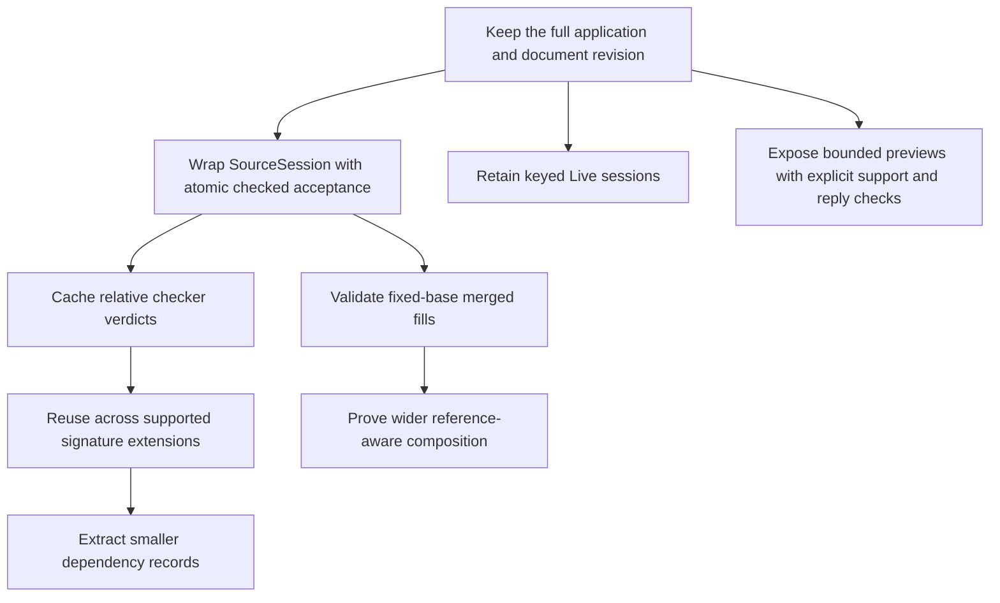

# Evaluation of the additional authoring points

The additional points correct omissions in the first review and shorten the proposed implementation path.
They also contain claims that need narrower conditions.
The first slice should reuse more existing laws and session behavior.
It still needs atomic acceptance, revision checks, and full application identity.

This assessment evaluates the [submitted points](evidence/additional/submitted-points.txt) against HEAD `22a46c6aa0c419de1c3b047516418e48bfc201a5`.
The attachment describes executed probes but supplies no full probe file or logs.
The [new finite controls](evidence/additional/probes.lean) reconstruct its cases and add counterexamples.
The [receipt](evidence/additional/manifest.json) records their commands and measured results.
Production sources and authority rulings remain unchanged.

## 1. Verdicts

| Point | Verdict | Consequence |
| --- | --- | --- |
| A: edits around layer references | Accept. My blanket reference gate discards an existing optimization. | Reuse `SourceSession.feed` and validate its source view. Do not infer acceptance from its delta alone. |
| B: signature restriction | Accept the existing theorem. Narrow the claim about exact dependencies. | Use existing extension laws now. Dependency extraction, missing-lookup dependencies, and named-type restriction remain separate work. |
| C: diagnostic paths | Accept for the checker verdict at a fixed signature and environment. | Cache a relative verdict and rebase its refusal. Keep source locations in edit identities and reference dependencies. |
| D: disjoint edits | Confirm the stronger counterexample. Qualify the sufficient condition. | Exact local fills compose under fixed raw-sketch contexts. Source references and table-growing omissions need additional conditions. |
| E: unfinished execution | Confirm existing preview operations. Refute the blanket claim that `run` rejects every unfilled hole. | Reuse current execution and preview routes. Add persistent keyed sessions and explicit preview boundaries. |

## 2. A: keep the existing source-session optimization

`SourceSession.feed` already compares the new expansion with a local edit of the old expansion.
Its owner is `src/Effect4/Program/Typing/SourceSession.lean`.
Equality lets `EditSession.feed` decide whether the table splices.
Inequality reopens the expansion's edit session.
The test is more precise than asking whether either source contains any reference.

The reconstructed controls confirm both cases from the attachment:

- Filling `[1, 0]` splices while a reference at `[1, 1, 0]` remains.
- Changing the referenced layer's body at `[0, 0]` requires a recheck because its expanded copy also changes.

The first review's blanket gate is too conservative.
Remove that gate from the proposed API.
Reuse the existing comparison rather than introducing another reference-dependency mechanism for the first slice.

There is an important acceptance condition.
The delta describes table maintenance, not whether the new source is valid.
A new forward reference can expand to a well-typed layer and still violate source reference rules.
The new A control produces `.spliced` and a typed expanded view, while the source view refuses the program.

`SourceSession.view_type` already connects a coherent session's source view to `Sketch.sourceCheck`.
Its owner is `src/Effect4/Laws/Program/SourceTable.lean`.
`Sketch.sourceCheck` checks `firstRefFault` before checking the expansion (`src/Effect4/Program/Typing/Source.lean`).
Therefore the acceptance wrapper should inspect the candidate session's source view.
It need not recreate the source checker or trust the expanded view alone.

For exact replacement, retain the old local type and require the resulting source root type to remain unchanged.
Commit only after these checks and the revision check pass.
The existing draft operation can still retain refused source for editing.

This improves checking reuse, not yet its measured cost.
Expansion, equality comparison, and reference validation still traverse data.
The implementation has no established constant-time local-edit bound.

## 3. B: restriction exists, but it is not a minimal cache-key extractor

The attachment correctly identifies `check_restrict` and `effTy_restrict` in `src/Effect4/Laws/Program/Signature.lean`.
It also correctly identifies `checkModule_restrict` in `src/Effect4/Laws/Program/Sketch.lean`.
My earlier account should have credited these laws explicitly.

The exact checker connection is:

```text
SigExtends S S'
SigProgram S e
------------------------------------------------------
check S' env path e = check S env path e
```

The result includes refusals, under the displayed premises.
It does not cover every refusal under an arbitrary signature extension.
`SigProgram` requires every visited operation, service key, and invoked definition to be available in the smaller signature.

The B controls show why that premise matters.
A bad request to an existing row retains its refusal when another row is appended.
A call to the appended row changes from refusal to acceptance.
A cache that forgets missing lookups can therefore retain a stale refusal.

`readsAlg` is a proposition-valued fold over supplied predicates.
It is not a computed minimal list of every checker dependency.
Its checker instance relies on additional fields of `SigExtends`:

- Equal atom typing, constant-atom classification, and scope key.
- Equal operation-term, definition-call, and parameter interpretations.
- Equal named-type declaration tables.
- Retained admitted rows, service carriers, and definition declarations.

Thus the attachment's two remaining gaps are not an exhaustive cache contract.
The producer must also construct finite dependency data and justify its connection to the relevant checker reads.
Restricted failure caching must retain negative dependencies or refuse reuse where `SigProgram` does not apply.
Signature-admission results need separate keys because admission inspects tables beyond the program's selected reads.

A symmetric checker theorem is useful, but it need not block the first reuse case.
Existing restriction applies twice when both contexts extend one supported base signature.

```text
SigProgram S0 e
SigExtends S0 S1
SigExtends S0 S2

check S1 env [] e = check S0 env [] e = check S2 env [] e
```

These equalities are applications of the existing theorem, not a new implementation or a dependency extractor.
They support extension-aware cache reuse now, with named types and the other fixed fields retained.
The producer still owes evidence that its chosen base and both extensions satisfy the premises.
General row relocation and compacted variable environments remain separate transport problems.

## 4. C: remove diagnostic location from the checker-result key

`Checker.check_rebase` and `tableAt_rebase` establish the claimed connection.
Their owner is `src/Effect4/Laws/Program/Typing/Rebase.lean`.
For `Checker.check`, the location changes refusal paths and does not change successful types.

A cache can store the checker verdict at `[]`.
At location `p`, it maps `TypeRefusal.rebase p` over a cached refusal.
An annotation cache similarly rebases both entry paths and refusal paths.
The C controls exercise both operations and confirm that unrebased refusals differ.

The phrase "a typing cache key never needs path" needs a boundary.
It applies to this verdict cache with the signature and ordered environment already fixed.
It does not remove source paths from these operations:

- Selecting a focus whose environment depends on earlier siblings.
- Resolving root-relative layer references.
- Identifying the document occurrence an edit replaces.
- Rejecting a stale edit against its expected revision.

The added point about mode flags is also correct for the `Eff` checker carrier.
My generic wording conflated it with the other node sorts.
`Checker.check` takes no loop flag.
Statement checking still takes one, and the new controls accept `breakLoop` only inside a loop.
Retain the inherited inputs of the actual cached operation.

The resulting checker-result key can be smaller without weakening the edit identity:

```text
checkerResultKey =
  (checkerVersion, programContent, signatureEvidence, orderedEnvironment)

cachedResult = check(signature, orderedEnvironment, [], programContent)
locatedResult(p) = cachedResult.mapError(rebase(p))

editTarget =
  (documentRevision, sourcePath, expectedSubtree, contextualEvidence)
```

## 5. D: the stronger counterexample is useful, and source references add another one

The attachment's disjoint-edit counterexample is correct.
The new D controls reconstruct it through `EditSession.feed` in `src/Effect4/Program/Edit.lean`.

Both edits separately retain the root's natural-number type.
The left edit changes the value bound for the right child from a number to a string.
The right edit starts using that value as a numeric service.
Their replacements commute as syntax in this case, yet the merged program refuses typing.
Root-type equality is therefore insufficient for independent edit certificates.

The sufficient condition has a strong existing basis.
`Sketch.table_fill` keeps entries outside the replaced subtree unchanged under its exact-type premises.
Its owner is `src/Effect4/Laws/Program/Typing/PartsTable.lean`.
For incomparable raw-sketch fills, that locality supplies the other focus's unchanged environment and type.
`Sketch.check_fill_focusAt` supplies each replacement's typing result.
Fixed application data and definition scope remain premises.
The positive D controls exercise such a pair in both orders.

This is a derived composition argument over existing laws.
This review does not land a general merged-edit theorem.
The report should distinguish that argument from the executed finite witness and a named theorem in the tree.

Two further qualifications matter:

- Restrict this argument to fills with fixed tables. Two omissions can independently append incompatible rows at the same hole index.
- `.rechecked` does not mean the local type changed. Replacing the root by itself already produces that delta.

Do not generalize the raw-sketch argument to arbitrary source edits with references.
The new source-reference control gives this counterexample:

```text
base:
  [0] = provideLayer (effect serviceA ...) (succeed 1)
  [1] = succeed 2

left edit:
  replace [0] by succeed 7

right edit:
  replace [1] by provideLayer (ref [0,0]) (succeed 2)
```

Each edit separately produces `.spliced` through `SourceSession.feed`.
Each resulting source has the same root type as the base.
Together, the left edit deletes the layer that the right edit references.
The combined source has a reference fault and no accepted source type.
This does not refute the raw-sketch theorem, whose checker premises differ.
It refutes using two source-session splice reports as sufficient merge evidence.

The practical rule is to check reference dependencies as well as the two edited paths.
Keep merged-source validation in the first materializer.
Begin the automatic composition guarantee with fixed-table, reference-free exact fills.
Widen that guarantee only when a reference-dependency condition has a consumer and a proof.

## 6. E: unfinished execution already exists on more than one route

The attachment correctly identifies `settle`, `frames`, and `explore` in `tools/Tools/Session.lean`.
They extend the application with the sketch's hole rows.
My earlier report omitted these useful entry points.

The new controls confirm a waiting call at an unfilled natural-number hole.
They also confirm the three sampled successful answers from `Kit.explore`.
Its owner is `src/Effect4/Run/Kit.lean`.
These are three selected examples, not every natural-number answer or every possible execution.
The depth and width bounds also limit exploration.

The attachment's final sentence about `run` is false as written.
`run` also takes its row table from `l.app.withHoles l.sketch.holes`.
A valid unfilled natural-number hole passes admission and reaches a waiting call through the actual `Tools.Session.answer` operation.
The E controls check its `status` and waiting-call count.

The remaining execution gaps are narrower:

- `run` reconstructs a row-only application, losing service and named-type declarations.
- Programs that need those lost declarations can refuse.
- Some hole rows typecheck but fail execution admission, including the earlier reference-valued example.
- `run` recreates the live session for each request and does not retain its pending-call state.
- Its answer script selects by row name rather than exposing persistent call-key addressing.

The preview operations have their own boundaries.
They directly call the tree interpreter without first requiring `Tree.covers`.
Unsupported forms can therefore finish with `Eval.outside` instead of returning a located preview refusal.
The new control demonstrates this with `scoped`.
The `withFiber (.context ...)` form is supported, so the attachment's blanket reference to fiber actions also needs narrowing.
`Tree.armOf` in `src/Effect4/Run/Tree.lean` is the exact current classifier.

Raw `settle` and `frames` tapes also bypass typed reply admission.
The new control supplies a string to a natural-number hole and observes that string as the raw tree's successful result.
`Kit.replyFault` rejects the same reply, while `Kit.explore` filters its generated samples through that check.
This separates a raw interpreter probe from execution under admitted host replies.
It is not evidence of a defect in the machine's admitted reply path.

For the authoring API, label finite previews explicitly.
Validate supplied tapes when the interface promises typed examples.
Refuse unsupported preview forms at `Tree.outsideAt`, or route an admitted built program through existing `Run.atBudget`.
Keep captured examples, persistent live state, and static filling as separate additions.

### Evidence boundary of the tree laws

The implementation runs, but its proof connection is not finished in Lean.
The [audit and plan output](evidence/additional/audit.log) distinguishes these statuses:

| Declaration | Checked status | Scope |
| --- | --- | --- |
| `SourceSession.feed_coherent`, `SourceSession.view_type` | Proved without planned goals | Session coherence and the source checker's view. |
| `check_restrict`, `Checker.check_rebase`, `Sketch.table_fill` | Proved without planned goals | Their stated signature, path, and exact replacement premises. |
| `Tree.ofProgram_approx` | Declared external fact, represented as a planned goal in Lean | The declaration cites `rocq/SkeletonApprox.v`. This review does not rerun Rocq. |
| `Tree.ofProgram_eq_denoteRowsB` | Planned goal | The connection to the named denotation on `Plain`. |
| `Tree.probe_stable`, `Tree.settle_sound` | Proved modulo `Tree.ofProgram_approx` | Budget stability, including the stronger stability conclusion of `settle_sound`. |

These statuses do not invalidate the finite execution controls.
They prevent describing all preview guarantees as finished Lean proofs.

## 7. Revised focus for implementation

The revised work uses existing machinery sooner:



The first review's recommendation for checked replacement still stands.
The new evidence reduces the amount of new semantic machinery that slice needs.
General support extraction, reference-aware merge composition, and executable checkpoint restoration remain later obligations.

Any new proof work needs placement before implementation:

| Consumer | Concept and role | Existing basis | Proposed remaining obligation | Exclusions |
| --- | --- | --- | --- | --- |
| R14 checked replacement | `initial-algebras-folds`, compatibility | `source-session-coherent`, `typed-replacement` | Atomic wrapper agrees with the source checker at the retained revision. | Behavior equality and execution admission. |
| R2/R14 cache reuse | `initial-algebras-folds`, compatibility | `check_restrict`, `checker-base-natural` | Finite dependency records justify the chosen extension or agreement premises. | Missing-lookup reuse without negative evidence; automatic named-type minimization. |
| R14 materialization | `initial-algebras-folds`, compatibility | `module-table-splices`, `typed-replacement`, address laws | Fixed-table exact-fill composition, then an explicit source-reference condition. | Arbitrary omissions, table changes, and runtime commutation. |
| R6/R12 preview interface | `translation-simulation`, compatibility | Existing tree definitions and the displayed proof statuses | The preview adapter reports support and typed replies according to its declared contract. | Exhaustive exploration and unproved agreement with the full machine. |

These are proposed obligations, not new registered goals.
This evaluation changes no frozen statement or representation ruling.

## 8. Verification

The receipt records 56 finite guards, all passing with warnings treated as errors.
The focused build passes for the session tool and the reviewed law modules.
The A–D module audit checks 743 declarations within `[propext, Quot.sound]`, with no planned goals.
The tree module audit checks 52 declarations, with three depending on planned goals and two planned goals present.
The exact statuses and declared external citation appear in the retained audit output.

The first build encounters a sandbox denial while writing Lean's artifact cache.
The authorized retry passes. Both logs remain in the receipt directory.
No production source changes, full-repository gate, outside-runtime comparison, or performance benchmark belongs to this evaluation's evidence.

The original conclusions about scope transport, requirement discharge, application loss, and checkpoint images still stand.
Several supplied source locators need correction:

| Cited operation | Current owner |
| --- | --- |
| `argTy` | `src/Effect4/Program/Typing/Rules.lean` |
| `Checker.check` and its provision rules | `src/Effect4/Program/Checker.lean` |
| `Checker.check.alg` and its family of carriers | Generated by `fold_of` in `src/Effect4/Laws/Program/Folds/Checker.lean`. The cited `TyAlgCarrier` is not a current declaration. |
| `Eff.weaken` | `src/Effect4/Program/Fold.lean` |
| `effTy_weaken` | `src/Effect4/Program/Typing.lean`, under `Signature.WeakenNatural`. |

State hashing cost as the sum of visited subtree byte lengths.
That sum can grow quadratically in program size for a chain of bounded-size nodes.
Do not state a universal quadratic bound in depth alone.
Checkpoint history fields prevent automatic identification by final displayed state.
They do not establish the stronger claim that every pair of commuting histories has distinct digests.

The [updated main review](README.md) incorporates these corrections.
The [previous review bytes](evidence/additional/prior-review.txt) remain available under the original receipt's digest.
