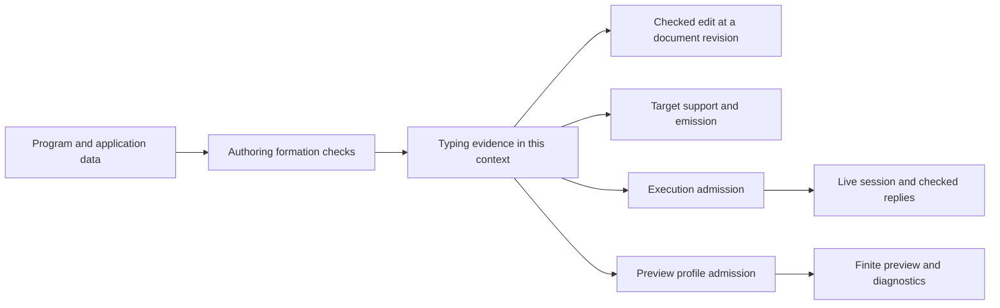

# Final review of the proof scout

The scout's proved statements stand. Its claim that every acceptance criterion is settled needs correction.
The remaining work concerns public inputs, document identity, preview replies, and the meaning of sketch admission.
Keep the proposed architecture and its proofs. Amend these contracts before implementation.

Status: research review, not an authority ruling.
Base: `22a46c6aa0c419de1c3b047516418e48bfc201a5`, branch `refactor/phase1-phase3`.
The reviewed packet is [the proof scout](../2026-10-17-proof-scout/README.md).
The [run record](evidence/final/runs.json) and [input manifest](evidence/final/manifest.json) retain the verification evidence.

## Checked evidence

The dependency build passes. Every scout probe compiles with warnings treated as errors.
The [scout audit](evidence/final/Audit.log) reports 743 declarations within `[propext, Quot.sound]`, with no planned goals.
The [status report](evidence/final/Status.log) retains the existing dependency on `Tree.ofProgram_approx` for the two preview laws.
That dependency remains separate from the scout's audit of its new declarations.
The report measures 65 existing nodes as proved and two as proved modulo that dependency.

The new [entry-point controls](evidence/final/probes.lean) test the scout's definitions unchanged.
The [allocation controls](evidence/final/handles.lean) compare preview results with the existing live session.
All 42 new controls pass.
These are finite evaluations, not general equal-observation theorems.
The [review audit](evidence/final/review-audit.log) checks their declarations against the same axiom ceiling.
It reports 43 declarations and no planned goals.

No production source, authority document, or scout file changes in this review.
No TypeScript, OCaml, external-host, or performance result is claimed.

## Findings

### F4. Preview reply admission needs a narrower domain

Priority: P1. Owner: slice E, `Run.Preview`.
Evidence: finite controls, plus the definition of `checkedTape` in [probe E](../2026-10-17-proof-scout/probes/E.lean).

Two witnesses distinguish the preview from the live session.

| Input | Proposed preview | Existing live session |
| --- | --- | --- |
| `List<A> → Option<A>`, called with a natural-number list, answered with `some 1` | Remains waiting | Accepts the reply and finishes |
| A row returning an external `Resource` handle, answered with allocation request `0` | Finishes with the number `0` | Finishes with the allocated handle |

The first witness needs the call's checked type instance.
`checkedTape` checks the generic row instead, and ignores the supplied request.
The existing instance path appears in `acceptAtInstance` in [Program/Admit.lean](../../../src/Effect4/Program/Admit.lean).
The checked request value alone cannot recover every instance, because an empty list inhabits different list types.

The second witness exposes a different boundary.
`externalValue` in [Program/Compile.lean](../../../src/Effect4/Program/Compile.lean) interprets the number as an allocation request and returns a handle.
`Run.Kit.replyFault` in [Run/Kit.lean](../../../src/Effect4/Run/Kit.lean) checks whether that interpretation succeeds.
The proposed tape then gives the original number to the program.
It discards both the converted value and the allocation state.
`Tree.outsideAt` accepts this program, so the syntax gate does not cover this case.

The theorem `checkedTape_admits` remains true: each returned reply passes `replyFault`.
It establishes neither membership of the returned program value nor agreement with live reply application.

**Required change.** Give the first preview release an explicit supported profile.
Refuse calls requiring type instantiation or allocation until their instance and state transitions are represented by the existing execution route.
Check the whole supplied application and program before previewing.
Reuse the live session when those calls need execution support.

An explicitly rejected tape entry also needs a diagnostic.
The present tape returns `none` for both absent input and rejected input.
Keep the call waiting, but report the rejected entry and its reason alongside that frontier.

### F1. The fill-set entry point does not enforce its theorem premises

Priority: P1. Owner: slice D, `FillSet.add` and `materialize`.
Evidence: finite controls against [probe D](../2026-10-17-proof-scout/probes/D.lean).

The proposed `materialize` takes an unrestricted list of address/program pairs.
Its `ordered` function enumerates the base's addresses and selects matching entries.
An entry at `[99]` disappears, and materialization returns the unchanged source as a success.
A valid entry alongside that unknown address still applies, without reporting the discarded entry.

The same entry point accepts a replacement that changes the focus's type while leaving the source well typed.
It also accepts a root replacement and overlapping ancestor/descendant replacements.
These inputs lie outside the premises of `Certified`, `ordered_compose`, or `materialize_refFree`.
No counterexample here refutes those conditional theorems.

The scout already proposes certification in `fills.add`.
That is the right place, but its construction invariant and connection to materialization are absent from the probes.
Individual certification alone also leaves overlapping addresses possible.

**Required change.** Make `FillSet` private to a checked constructor, or validate every input before materialization.
Bind the collection to its base and full application.
Require an existing program address, the declared local typing policy, and the intended restriction on overlapping addresses.
Retain the final reference-aware source check.
Every submitted entry must either apply, collapse as an identical duplicate, or receive a located refusal.

Keep root replacement in ordinary document editing unless slice D deliberately widens its proved domain.
Add acceptance controls for the unknown address, the type-changing fill, and the overlapping pair.

### F3. An edit target needs a document identity

Priority: P1. Owner: slice B, `SourceDocument`, and the session tool.
Evidence: finite controls against `Doc.open`, `Doc.target`, and `Doc.commit` in [probe B](../2026-10-17-proof-scout/probes/B.lean).

Both independently opened documents have revision zero.
Their target holes have identical bytes, but one follows a natural-number binder and the other follows a string binder.
The second document accepts the first document's target.
Under `recheckSource`, filling it with the preceding variable gives a string result.
Under `keepExactType`, a natural-number literal also succeeds with that foreign target.

The within-document stale-target control still refuses correctly after a committed edit.
`Doc.commit_sound` establishes properties of the receiving document, not the origin of the submitted target.
The scout's stated restriction to one document needs enforcement in the exposed API.

**Required change.** Include document identity, opening generation, and revision in the target.
Another design can bind the target to an immutable full document state.
A digest locates that state, while equality checks the actual data.
Opening another document must invalidate old targets.
Undo creates a new revision, rather than restoring an old revision number.
A fork receives a distinct identity or a branch-aware version.

The pure `commit` function does not itself serialize concurrent publication.
The session owner must compare the expected revision when it publishes the new document.
Intentional rebasing remains a separate operation with its contextual and reference premises.

### F6. A2 connects execution admission to typing, but does not close the named sketch contract

Priority: P2. Owner: slice A and the semantics registry coordinator.
Evidence: statement inspection of `Sketch.sourceCheck_of_admitted` in [probe A](../2026-10-17-proof-scout/probes/A.lean).

Its direction is:

```text
Program admission at app.withHoles(s.holes)
  implies sourceCheck(s, app) returns the admitted type.
```

This is a useful compatibility fact for `start`.
The current `sketch-admission` entry in [Registry.lean](../../../tools/ProofGraph/Registry.lean) asks for a located admission boundary at sketch storage.
It names typing signature admission, raw formation of hole rows, and closed columns.
The theorem does not state the acceptance/refusal contract of that entry point.

The existing `admitProgram` already combines signature admission, raw formation, typing, and a column check.
Its definition is in [Program/Admission.lean](../../../src/Effect4/Program/Admission.lean).
Using it can implement the executable subset, but does not settle the proposed broader editable-sketch boundary.
The reference-valued hole remains editable and typed while program admission for execution refuses it.
The current registry wording includes `admitSig`, which refuses that hole.
Any broader storage-admission ruling must change the named contract explicitly.

**Required change.** Keep A2 as the startup compatibility fact.
State what the storage entry point admits before assigning it the `sketch-admission` claim.
Reuse the existing formation checks.
Separate service-declaration consistency from restrictions imposed by host registration and target support.

`Api.check` currently supplies typing evidence under the given signature.
Adding application validation there changes its public contract, rather than merely repairing a proof.
A validated authoring entry point can compose those checks without obscuring their different refusals.

## Claims that need narrower wording

| Scout claim | Supported statement | Consequence |
| --- | --- | --- |
| `signature_nil` makes the emission guard exact | Empty declaration tables suffice for signature equality | Describe the guard as a conservative target restriction |
| Materialization depends only on the set | `materialize_congr` assumes no conflicts | Canonicalize conflict selection too, or scope the claim to conflict-free inputs |
| A failed sorting proof prevents canonical fill bytes | The attempted ordering instance reaches a forbidden axiom | A constructive path order remains possible |
| The shift repairs closed-fragment portability | `effTy_shift` establishes equality of computed types after shifting | Behavioural transport remains a separate obligation |
| Live sessions persist | `restore_save` reconstructs the same `Run` from a saved `Live` | Version the wire format and define restoration ownership before external persistence |
| New modules probe in a few seconds | The named probes elaborate in Lean in those measured times | This measures neither runtime performance nor future rebuild cost |

The emission defect itself is confirmed by the scout's rerun control.
`Typed.emit` can return a certificate at a different service carrier from `Typed`'s input certificate.
The proposed guard addresses that mismatch conservatively.
The new `unusedDeclarations` control shows a declared but unused service beside a program whose emitted type already agrees.
Thus the guard deliberately rejects some currently harmless programs.

Audit `Typed.print` and `Built.print` at the same boundary.
They also route through rows alone in [Api/Codegen.lean](../../../src/Effect4/Api/Codegen.lean).
The certified authoring surface should expose one consistent target-support decision.

The conflict diagnostic has its own finite witness.
Two conflicting addresses yield `[0]` in one input order and `[1]` after reversing the list.
Successful conflict-free materialization remains independent of input order and duplicates.

## Mathematical model and API focus

Keep the existing program data and make each admission boundary explicit.



This is a proposed interface organization, not a new stored program representation.
Each public operation consumes the evidence its guarantee needs.
No operation silently promotes typing evidence into execution, target, or preview support.

| Boundary | Required contract | Existing consumer and placement | Exclusion |
| --- | --- | --- | --- |
| Checked edits | Target belongs to the current document generation and revision | `checked-edit-atomic`, `initial-algebras-folds`, R14; session replacement | No automatic rebase or host concurrency theorem |
| Fill insertion | Every retained entry satisfies the fixed-base domain, including address and overlap rules | `workspace-fill-agreement`, `initial-algebras-folds`, R14; materialization | Reference-aware checking still decides the merged source |
| Preview | Every accepted reply has the meaning required by the admitted preview profile | Reply admission and `translation-simulation`, R12; `settle`, `frames`, `explore` | No general machine agreement from the present tape theorem |
| Sketch storage | Located refusal matches an explicitly chosen editable or executable domain | `sketch-admission`, `residual-program-typing`, R14; storage entry point | A2 alone states no storage-admission contract |
| Restoration | Versioned data reconstructs the saved run, under one ownership policy | `live-session-persists`, `host-session-protocol`, R13 serving R6; `restore` | No reconnection, duplicated external effects, or independent fork identity guarantee |

For restoration, decide whether loading replaces the original session or creates an independent branch.
Exact replay keeps the same session identity and outstanding call keys.
A separate live branch therefore needs explicit ownership and reply routing.
The current replay theorem remains useful whichever policy the owner chooses.

## Performance corrections

`uniq` in probe D checks every address against its remaining list.
For `N` distinct addresses, that definition performs `N(N−1)/2` address-equality tests.
This cost exists even when the fill list is empty.
Path lengths add comparison work.
The subsequent lookups add up to `N × M` fill-address comparisons for `M` fills.
`conflictAt` adds pairwise fill comparisons.
These are source-level work bounds, not timing measurements.

Avoid redundant deduplication once address uniqueness is established for the generated enumeration.
Index fills by path, or use a constructive order with its required laws.
Do not present the probe's elaboration time as evidence of an ergonomic editing latency.

In `Doc.commit`, bind the candidate session once and reuse its view.
The source repeats `d.after e` across validation and result construction.
Whether compilation shares those calls is unmeasured.
Explicit sharing makes the intended work clear without relying on that optimization.

## Landing recommendation

Keep the scout's A-to-E order, with these acceptance changes.

1. Land full application identity and the conservative emission restriction in slice A.
2. Add document identity and publication rules to slice B.
3. Keep slice C's process-local cache and whole-key equality checks.
4. Enforce the certified fill domain in slice D, including unknown and overlapping addresses.
5. Split slice E into live-session persistence and an explicitly restricted preview profile.
6. Keep the broader sketch-admission claim open until its storage contract is stated and checked.

The justified headline is: the scout proves its stated local laws without new planned goals.
The proposed public API still needs the boundary corrections above.

## Reproduction

Run the following command from the repository root:

```sh
LEAN_NUM_THREADS=3 lake env python3 docs/research/2026-10-17-authoring-model-review/evidence/final/run.py
```

The runner builds imports, compiles scout modules into a temporary directory, and retains the audits and controls beside this report.
The first review attempt used a row name where the selector requires its spelling.
The retained initial failure records that fixture error.
The corrected control uses `L.first` and passes.
That correction changes no reviewed definition.
