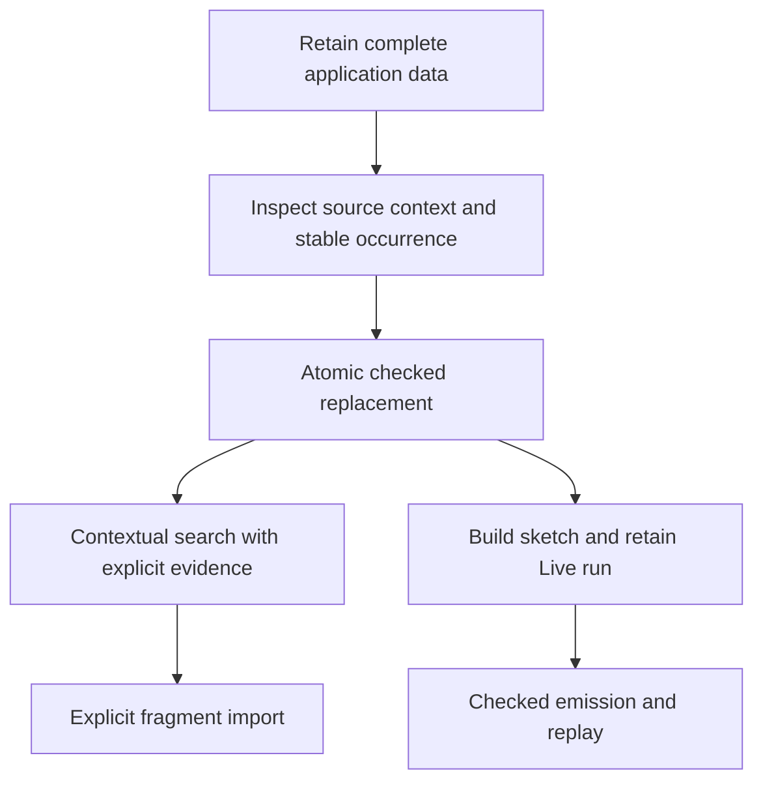

# Authoring interface review

Deepen the checked edit session first. Keep editing and hosting as separate sessions with shared inspection conventions.
The six verbs are a useful discovery list. They do not yet specify enough admission, identity or failure behavior for implementation.

Evidence scope: source review at `22a46c6aa0c419de1c3b047516418e48bfc201a5`, branch `refactor/phase1-phase3`.
No production file changes, builds, Lean runs or benchmarks occur in this review.
The root reviewer owns executable probes.
The only untracked repository file observed is `tools/view/make_videos.py`.

## Priority findings

| Priority | Checked source finding | Consequence | Source anchor |
| --- | --- | --- | --- |
| P1 | `Focus` holds `program`, `env`, `ty`. It holds no signature. | A certificate keyed only by fragment, environment and result type omits application rows, service carriers, named types and block declarations. | `Focus`, `src/Effect4/Program/Typing/Focus.lean`; `Sketch.sigAt`, `src/Effect4/Program/Sketch.lean`; `SigApp.signature`, `src/Effect4/Program/SigApp.lean` |
| P1 | A focus reports the current subtree's synthesized type. | It does not report every type a replacement may have. Name it `currentType`, and reserve `expectedType` for the open context analysis. | `focusAt`, `src/Effect4/Program/Typing/Focus.lean`; R14 open part `expected-type-slice`, `docs/core/system-map.md` |
| P1 | `EditSession.feed` commits structural replacements even when checking refuses. | A checked atomic fill needs another result contract. Table coherence does not imply admitted content. | `EditSession.feed`, `src/Effect4/Program/Edit.lean`; `SourceSession.feed`, `src/Effect4/Program/Typing/SourceSession.lean` |
| P1 | The replacement law requires the same `EffTy`, including requirements. | Answer/error subtyping and requirement inclusion are candidate filters. They do not establish the current replacement theorem's premises. | `Sketch.check_fill_focusAt`, `src/Effect4/Laws/Program/Sketch.lean`; `fillPremises`, `tools/Tools/Query.lean` |
| P1 | `EffTy.requires` contains `ServiceKey`, not external-operation positions. | Two host rows with empty requirements can differ in availability, request and completion types. A requirement subset cannot decide fit. | `EffTy`, `checkRow`, `src/Effect4/Program/Typing/Rules.lean` |
| P1 | `Tools.Session.open` constructs `SigApp` with an empty named-type table. Its request has no named-type field. | Programs using application type declarations cannot follow this tool workflow faithfully. | `Request`, `answer`, `tools/Tools/Session.lean` |
| P1 | The tool's `run` reconstructs `.ofTable rows`, discarding service declarations. | A sketch can type in the editor and refuse at run admission. Preserve the whole `SigApp.withHoles` application. | `answer` arm `run`, `tools/Tools/Session.lean` |
| P1 | An edit addresses the current tree by `List Nat`. There is no revision or preimage check. | A stale path can name another subtree after an ancestor edit. A digest alone cannot identify an occurrence repeated twice. | `Edit`, `src/Effect4/Program/Edit.lean`; `Node.replaceAt`, `src/Effect4/Program/Refs.lean` |
| P1 | A static address and a live call key identify different things. | A loop or recursive call can revisit one source address. Replies need session, call ID, fiber/token and retirement checks. | `Call`, `Reply`, `bindCall`, `preflight`, `src/Effect4/Api/HostSession.lean`; `Run.Sel`, `src/Effect4/Run/Event.lean` |
| P2 | `SourceSession` already checks through layer references and displays source addresses. | Reuse it. The older surface table still describes the earlier layer-reference refusal. | `SourceSession.open`, `SourceSession.view`, `src/Effect4/Program/Typing/SourceSession.lean`; `docs/core/api-surface.md` |
| P2 | `Tools.Session.run` starts a fresh `Live` and returns the unchanged tool state. | This command demonstrates execution but supplies no persistent pause/reply/extend workflow. | `answer` arm `run`, `tools/Tools/Session.lean` |
| P2 | `Api.Typed.emit` passes `app.rows` to emission, which checks at `nativeSignature table`. | Admission at custom service/type declarations does not automatically imply current emission acceptance. | `Typed.emit`, `src/Effect4/Api/Codegen.lean`; `emitModule`, `src/Effect4/Codegen/Checked.lean` |

The unit request is an explicit ownership choice in `Program/Sketch.lean`, not an incidental omission.
The module says that storing the environment in the row introduces a second owner.
An environment-valued request needs capture syntax, request construction, runtime membership and a migration contract.
Handles in that environment can belong to one world or session.
Their bytes alone do not authorize reuse elsewhere.

`docs/STATE.md` explicitly keeps editing and running as two sessions under decisions row 373 (5).
It joins them through a build-sketch/open-host operation.
Keep that ruling unless the owner changes it.

## The six-verb proposal

| Proposed verb | Contract still required |
| --- | --- |
| `put` / `get(digest,path)` | Name content kind, program-node sort and application metadata. Distinguish absent content, invalid path, wrong kind and failed decoding. |
| `open(digest)` | Distinguish content inspection from opening an editing session or a live run. A checkpoint's world and call keys differ from a sketch's context. |
| `interpret(base,occurrence,by)` | A static fill replaces syntax. A live reply submits a completion. A host binding supplies behavior and lifetime ownership. Use separate request variants and separate admission results. |
| `search(focus)` | Include part signature, source revision and binder mapping. Distinguish exact evidence from a heuristic candidate. Return pagination, bounds and structured non-fit. |
| `run` / `extend` | Retain program, application, binding, compile budget, command budgets and complete journal. Distinguish journal replay from checkpoint resume. The latter needs its own connection. |
| `fact(fold,digest)` | Identify the fold implementation, version and inherited inputs. Typing needs its context. Emission needs its target configuration. Fold uniqueness alone supplies neither a cache nor a valid cache key. |

Wrapping a runtime value as `succeed` is not universally available.
`Term.lit` holds the literal alphabet, while `Val` includes handles and richer runtime values.
A proposed value-fill operation needs a checked quotation or import operation and a refusal for unsupported values.
`HostSession` already owns completion admission and preparation.
Reuse it for live answers instead of treating every `Val` as portable program syntax.

The public dispatcher may retain the spelling `interpret` as a discovery convenience.
Its variants must still expose edit revisions, live call keys or host-binding identities.
One name does not remove those caller obligations.

## Workflows today

| Workflow | Actual route | Remaining caller work |
| --- | --- | --- |
| Create a program | `Authoring.Module` → `Api.Author.build` → `Api.Built` | Import `Effect4.Author`; supply rows and named types; inspect `closed` before choosing execution. |
| Ingest TypeScript | `recognizeCompilerSource` / `recognizeOxcSource`, `ts/eff/ingest/index.ts` | Retain `Lift.keys`, `layers`, `wireHex` and the foreign-reader contract. Printed-image reading is a different contract. |
| Create an unfinished program | `Sketch { program, holes }`, `Row.hole`, `Sketch.hole` | Supply the application separately. The hole's external position depends on its application's row count. |
| Inspect a hole | `SourceSession.focusAt`, `Sketch.sigAt`, table entry | Combine the source subtree, environment, current type, part signature and occurrence identity. Show unavailable environments separately from refusals. |
| Search a candidate | No integrated certified fit-search owner appears in the inspected Store or session modules. | Assemble stored content, application compatibility and contextual checking yourself. Existing CAS indexes do not supply this judgment. |
| Explain non-fit | `Checker.check`, `Api.explain`, `TypeRefusal` | A well-typed candidate with a different `EffTy` needs a contextual mismatch report. It has no intrinsic typing refusal. |
| Fill or edit | `SourceSession.feed` / `EditSession.feed`; alternatively `Built.rebuild` | Decide whether to retain refused drafts, require unchanged type or accept a newly admitted type. Protect against stale addresses. |
| Run and pause | Build against `app.withHoles holes`, then `Live.open`, `Live.feed`, `Live.view` | Retain the live value. A waiting call exposes its checked instance and key through the live view. |
| Reply and replay | `Run.Event.receive`, `apply`, `Sel.key`; `Api.Typed.replay` | Keep receipt separate from application. Preserve header, journal, budgets and binding identity. |
| Share content | `Store.closure` → `Word.apply` | This transfers exact content and resolves its stored edges. It does not rebase variable levels, row positions or application declarations. |
| Move a fragment | `Eff.rebaseRefs`, `Node.rebaseRefs`; `Eff.weaken` inserts levels | `rebaseRefs` covers internal layer targets under its stated conditions. General extraction, compaction and row renaming remain missing. |
| Emit code | `Typed.emit` → `ModuleEmission.file` → target renderer | Emit can refuse separately. Preserve its target configuration and remaining host bindings. Run tsgo 7 and target behavior gates when reached. |

`Store.put` proves content admission and retrieval at its kind.
It does not prove program typing.
`Word.apply` merges children-first content without replacing residents.
It is not a workspace merge protocol.
`Store.putRoot` already supplies a useful version check for named roots.

## Design A: checked contextual editing, then hosting

This proposal deepens `SourceSession` and `Live` at their existing owners.
It retains one canonical `Eff` tree.
The following shapes are pseudocode, not existing APIs.

```text
Target = {
  revision, applicationId, path, oldSubtreeId,
  partSignatureId, contextId
}

ContextView = {
  target : Target,
  currentType : EffTy,
  environment : List (level, Ty),
  slot : ProgramSlot | TermSlot,
  definitionScope,
  referenceDependencies,
  executionAdmission : Unchecked | Admitted | Refused(reason)
}

FitEvidence = ExactContextCheck | WholeCandidateAdmission
FitFailure =
  StaleTarget | MissingPath | WrongSort |
  ScopeMismatch | SignatureMismatch |
  CandidateRefusal(TypeRefusal) |
  TypeMismatch { answer, error, missingServices } |
  WholeCandidateRefusal(reason) | UnsupportedTransport(reason)

inspect(editSession, path) -> ContextView | InspectFailure
suggest(editSession, Target, query, limit, cursor) -> CandidatePage
checkReplacement(editSession, Target, candidate) -> FitReport
replace(editSession, Target, candidate, policy) ->
  Accepted { session, revision, delta, newType } | Rejected(FitFailure)

policy = KeepExactType | AdmitChangedType
startSketch(editSession, budget, binding) -> Live | AdmissionFailure
receive(live, callKey, completion) -> ReceiptVerdict
apply(live, callKey, budget) -> RunVerdict
```

`replace` performs validation and commit together.
An earlier `checkReplacement` is advisory because the document may change before commit.
A rejected replacement leaves the authoritative document unchanged.
The caller may retain its proposed content separately for repair.
`KeepExactType` uses the existing replacement law where its premises hold.
`AdmitChangedType` checks the entire resulting program and returns its new type.
It makes no unchanged-behavior claim.

The context token includes a revision and a subtree preimage.
Do not accept a stale token because the subtree bytes still match.
A preceding binder can change the environment while preserving those bytes.
The first landing rejects stale revisions and returns a fresh context.
Automatic rebasing needs a later checked operation.

Names for environment levels are display metadata.
The stored `Eff` uses levels, and its checking uses `TyEnv`.
Moving an open fragment requires a supplied binder map or a refusal.
The interface must not guess that equal carrier types identify the same variable.

Candidate retrieval returns three explicit categories:

- `certifiedHere`: exact evidence for this document/context and the stated policy;
- `needsCheck`: heuristic or subtype-filtered candidates;
- `rejectedHere`: selected candidates with structured mismatch explanations.

A result page reports its search limit and index revision.
An empty page means no returned candidate at those bounds.
It does not establish that no fitting program exists.
Ranking by usage is metadata, separate from fit evidence.

An initial local certificate key includes exact fragment bytes, the part signature, ordered `TyEnv` and the checked result.
The application portion includes rows, services and named declarations.
Reference-bearing fragments additionally depend on target content and scope.
Use exact decoded values to validate cache hits.
A digest is a locator with collision handling, not a proof of equality.
Strengthening can shrink this key only after its exact support law exists.

## Design B: immutable edit plans and materialization

This proposal gives clients immutable documents and explicit plans.
It does not retain an editor session.
It can later support offline assembly, subject to the merge contract.
The plan is edit data over `Eff`, not another program language.

```text
Document = { programId, holesId, applicationId }
Location = { base : Document, path, expectedSubtreeId }
Patch = Replace(Location, fragmentId, binderMap, rowMap)
Plan = { base : Document, patches : List Patch }

describe(Document, path) -> ContextView
prepare(Plan, policy) ->
  Prepared { materialized : Document, diagnostics, receiptId } | Conflict
commit(rootName, expectedVersion, Prepared) -> NewRoot | StaleRoot
execute(Document, runInputs) -> RunRecord
```

The client retains the base, composes patches and explicitly requests materialization.
`prepare` rejects overlapping or stale paths in the first landing.
It checks the materialized candidate as one document.
The stored program remains the resulting `Eff`.
`commit` uses the Store root's existing version discipline.

Do not replace the patch list with an unordered fill map yet.
Two incomparable paths can still share contextual dependencies.
A replacement in a `bind` head changes the continuation's environment.
An edit of a layer target changes every reference's expansion.
Union of maps neither checks those dependencies nor decides competing ancestor/descendant edits.
Byte-level graft commutation alone does not establish contextual admission.

| Caller task | Design A | Design B |
| --- | --- | --- |
| One hole fill | Inspect, choose, replace. The session owns the current revision and table. | Describe, create a patch, prepare, commit. The caller retains base and patch state. |
| Two local edits | Feed both edits through one session. | Prepare both patches against a declared base and conflict policy. |
| Repair a mismatch | Read the contextual report and resubmit. | Revise the plan, prepare again, commit again. |
| Offline collaboration | Explicit server/session synchronization is required. | Plans travel naturally, but dependency and conflict rules remain required. |
| Pause and reply | Hold a separate `Live`, keyed to the built snapshot. | Hold a run record/checkpoint, keyed to the executed document and run inputs. |
| Implementation reuse | `SourceSession`, `EditSession`, `Live`, existing tools. | Store roots, exact content, structural edits and whole-candidate admission. |

These request counts describe the proposals, not measured performance.
Design A has less caller bookkeeping for the existing authoring tools.
Design B makes the offline revision protocol explicit and pays for that in every edit.
Land A first and retain B as a distinct future collaboration interface.

## Staged landing and ownership



| Stage | Reuse and deepen | Missing owner or contract |
| --- | --- | --- |
| A | `SigApp`, `Tools.JsonBridge`, `Tools.Session` | Serialize and retain all `SigApp` fields. Include named declarations in application identity. Preserve services/types at run. |
| B | `SourceSession`, `Table.Entry`, `Sketch.sigAt`, `Parts`, `NodeEnv`, `ExtSlot` | A contextual inspection record with a revision and preimage. Term slots need their own selector because program paths do not descend into `Term`. |
| C | `SourceSession.feed`, `Api.Author.Internal.finishBuild`, `Built.rebuild` | A checked transaction owner, proposed `Program/Editing/Checked.lean`, with explicit exact-type and changed-type policies. Keep existing raw draft editing available. |
| D | `Store.Annotation`, `Store.Word`, `Program.TyCache`, checker | A contextual candidate index and fit report, proposed `Store/Domain/ProgramSearch.lean`. Indexes nominate; checks certify. |
| E | `SigApp.withHoles`, `AdmittedProgram`, `Live`, `Run.Event`, live call view | One build-sketch/open-host adapter and persistent tool run IDs. Keep program snapshot and run identity separate. |
| F | `Eff.rebaseRefs`, `Eff.weaken`, `Word.apply` | Explicit variable-support maps, row renaming, declaration compatibility and signature transport. Refuse unsupported imports first. |
| G | `ModuleEmission`, `Typed.emit`, `Typed.replay` | Preserve full application typing through emission or return a specific profile refusal. Do not hide this gap with a cast. |

Do not add another Forms table or another checker.
`Codegen.Forms` already owns derived authoring forms over `Eff`.
Do not store `Authoring.Src` in the CAS.
It is a builder function, while elaborated `Eff` is program content.

## Acceptance workflows and finite probes

1. Open a sketch using a declared service carrier at a fresh code.
   Inspect a hole, fill it, run it, and confirm every step retains the same service declaration.
   Add a named recursive type and repeat.
2. Open a definition block with a hole inside its body.
   Check a candidate invoking a sibling definition.
   Confirm that its part signature, rather than the root signature alone, decides fit.
3. Inspect a hole below `bind` and under a cause handler.
   Display levels and their types.
   Inspect an operation binder term and an `iterate` step through the slot selector.
4. Submit an ill-typed candidate and confirm the authoritative revision remains unchanged.
   Submit a well-typed candidate with a different error or requirement column.
   Confirm the diagnostic reports the differing column, even though the candidate checks alone.
5. Declare a hole at `unknown`, with a nonempty error column.
   Offer `succeed (nat 8)`.
   Confirm it passes a broad subtype filter but fails the exact-current-type condition.
   Whole-candidate admission may accept a changed result under the explicit changed-type policy.
6. Inspect `[1]`, replace its ancestor, then submit the old token.
   Require `StaleTarget`, even if `[1]` still exists.
   Repeat after changing a preceding binder while retaining the target subtree bytes.
7. Declare two external rows with equal answer/error/requirements and different requests.
   Confirm a requirement subset filter cannot admit a call against the wrong row.
8. Run a sketch that calls the same hole row on two fibers.
   Confirm row selection is unresolved and exact call keys admit separate receipts.
   Apply one receipt and confirm it does not authorize applying a retired or consumed key.
9. Run until a hole, retain the run, answer, and replay its journal.
   Compare the existing checked replay observation at the same budgets.
   Leave a fuel cut as a frontier.
10. Export an open fragment with application declarations and a binder map.
    Import into a reordered row table.
    Refuse until an explicit row map passes compatibility checks.
    A same-numbered host row must never silently change meaning.
11. Emit an admitted custom-type/service program.
    Retain any current emission refusal as evidence of the missing signature connection.
    Compare a supported emitted program under pinned tsgo 7 and rc.112.

Suggested benchmark tasks are proposals, with no measured results in this review.
Use 100, 1,000 and 10,000-node generated programs with narrow and wide binder environments.
Measure cold open, repeated focus queries, exact-type fills, changed-type fills and reference-target fills separately.
Measure index lookup plus validation at 100, 1,000 and 10,000 candidates.
Record elapsed time, allocations, bytes retained, candidates checked and whether a full table rebuild occurs.
Compare `SourceSession` against fresh `sourceAnnotate`, using identical resulting tables as the correctness oracle.
Include a shared layer with many references, since one source edit can change many expansion copies.
No latency threshold is implied until these commands establish a baseline.

## Proposed proof placement

Every name below is proposed, not a landed theorem.
Register each accepted claim and planned goal before proving it.
The existing exact-type law remains unchanged.

| Proposed obligation | Concept and property | Claim, role and consumer | Exact reach and boundaries | Exclusions | Requirement/spine |
| --- | --- | --- | --- | --- | --- |
| `checked_edit_atomic` | `initial-algebras-folds`; contextual replacement and session coherence | Proposed claim `checked-edit-atomic`, role API composition; checked replacement consumes it | Current revision, exact application, valid source address, same-type evidence or successful complete candidate check; rows 288, 292, 294, 334, 373 | No behavior equality, search completeness, progress or target execution | R14; successful execution admission feeds M5 |
| `cached_context_check_agrees` | `initial-algebras-folds`; checked fold cache agreement | Proposed claim `context-check-cache-agrees`, role cache connector; `suggest` and `replace` consume it | Exact fragment, part signature, ordered environment, reference dependencies and checker version; validated cache entries | No hash injectivity, strengthening, world-independent handles or performance conclusion | R14; reuses checker evidence before M5 |
| `support_restrict_check` | `initial-algebras-folds`; weakening/support transport, serving `operation-data-scoped` and focus | Proposed claim `fragment-support-transport`, role structural transport; compact certificate keys and imports consume it | Explicit support map over every term and operation binder, original/compact environments, natural signature; rows 43, 288, 292 | No arbitrary renaming, semantic equality, service/row transport or unchecked variable compaction | R14; later contextual admission feeds M5 |
| `import_rows_check` | `translation-simulation`; signature transport, serving R14 open `sketch-renumbering` | Proposed claim `fragment-row-transport`, role translation; fragment import consumes it | Explicit row map preserving domain, requests, instantiated columns, services, type declarations and definitions on used operations | Typing alone establishes no host equivalence or target execution | R14 and R13; rebuild under destination signature before M5 |
| `start_sketch_admitted` | `host-session-protocol`; checked session start, with sketch admission | Proposed claim `sketch-start-admitted`, role admission connector; build-sketch/open-host consumes it | Actual `admitProgram` success at full `app.withHoles`, headers and budgets retained; row 373 | No claim that every typed sketch runs, no liveness, and no hole-fill/run equality | R14, R12, R13; connects admitted source to existing M5-M7 route |
| `fill_run_observation` | `translation-simulation`; explicit handler-to-program simulation | Proposed claim `hole-fill-observation`, role equal-observation theorem; recorded-example validation consumes it | First choose a fragment and observation: exits plus stores, explicit compatible decisions and sufficient budgets; preserve unit requests initially | Finite examples do not synthesize a program or establish all-input behavior; host/world boundary remains | R14 and R13; a separate behavior connector, not a consequence of typing |

The stronger normalized/subtype replacement law remains a separate proposal.
R14 records false checker monotonicity at equality tests and unannotated loops.
Do not weaken that record to make search hits appear certified.
Use complete candidate checking while a suitable fragment law remains open.

## Model record

| Carrier | Role and retained data | Admission owner | Limits |
| --- | --- | --- | --- |
| Foreign source or named builder | Raw source, keys, bindings and refusal locations | Foreign contract or authoring elaborator | A builder function is not stored syntax. |
| `Eff` plus `Sketch.holes` | One program syntax and its declared unfinished parts | Checker at the full application | Hole typing does not establish behavior. |
| `SigApp` and part signature | Rows, service carriers, named declarations and lexical definitions | Signature and program admission | Row numbers are application-relative. |
| Context view and candidate index | Derived environment, current type and evidence metadata | Existing checker, with checked cache connection | Views do not own program meaning or expected-type inference. |
| `Live` and journal | Checked host session, keys, decisions, budgets and machine | Existing host/session checks | Receiving and applying remain separate. |
| Store content and annotations | Exact bytes, kinds, edges and metadata outside identity | Store admission and exact codecs | Content transfer does not establish contextual fit. |
| Emission | Target syntax, declarations and configured imports | Existing codegen admission | Target execution remains a separate behavior gate. |

Editing retains the program as written and derives its expanded typing view.
Execution retains its program snapshot and follows explicit host and scheduler decisions.
Finished exits, typed failures, defects, interruption, input refusal and live frontiers remain distinct.
No quotient changes content identity in this proposal.
No new logic or program representation is needed for the recommended first landing.

Memory assisted the initial owner lookup.
The Forms owner and emission evidence limits were rechecked in current source.

