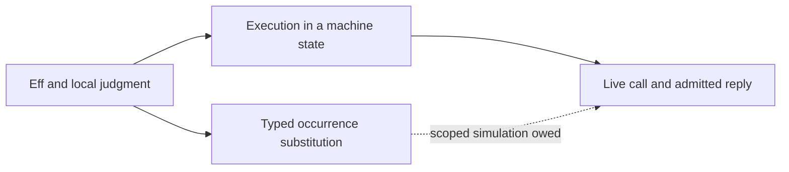

# The authoring algebra needs separate substitution and execution contracts

The design supports a useful store interface, but several claimed implications do not follow from the cited laws.
Typed replacement exists. Its portable certificate needs the address signature and positional scope, alongside the program and its type.
Raw grafting and host replies need separate contracts. Their operations can share a user interface without sharing a mathematical judgment.

Evidence scope: source inspection at the coordinator's base `22a46c6aa0c419de1c3b047516418e48bfc201a5`.
I run no Lean process, modify no tracked file, and claim no newly checked Lean theorem.
The coordinator receives exact finite probes separately. Results from those probes belong in the consolidated receipt.

## Five findings that change the design

### 1. A closed fragment does not keep its meaning at another positional depth

Status: established from the checker definition. Proposed finite probes await the coordinator's run.

`Checker.check` (`src/Effect4/Program/Checker.lean`) types a continuation in `env ++ [first.answer]`.
The variables are levels. Moving unchanged bytes under another binder can change which value a variable reads.

```lean
-- At [] the answer is nat. At [.string] the answer is string.
def p : NativeEff :=
  .bind (.succeed (.lit (.nat 0))) (.succeed (.var 0))
```

At the empty environment, variable zero is the result of the bind.
At the larger environment, variable zero is the existing string.
Thus R3's globally reusable closed fragment needs scope transport, even with a fixed signature.

`Eff.weaken` (`src/Effect4/Program/Fold.lean`) changes syntax when it inserts an environment slot.
`effTy_weaken` (`src/Effect4/Program/Typing.lean`) proves the corresponding typing equation under `Signature.WeakenNatural`.
It also shifts terms inside operations through `ScopedOp.mapTerm` (`src/Effect4/Program/ScopedOp.lean`).
The transported fragment has different bytes and may have a different digest.

For an open fragment, removing unused entries also requires reindexing.
For example, `.succeed (.var 1)` reads `nat` in `[string, nat]` and refuses in `[nat]`.
A set of used types loses the positional correspondence.

Repair: store a scope-indexed fragment, its ordered support, and an explicit scope map.
Keep the canonical fragment and its instantiated program as distinct content where scope transport changes bytes.
Do not add another program representation. These records describe the existing `Eff` and its transport.

### 2. Focus alone does not key a portable certificate

Status: established from the actual replacement theorem and signature definition.

`Focus` (`src/Effect4/Program/Typing/Focus.lean`) holds the program, environment, and `EffTy`.
`Sketch.check_fill_focusAt` (`src/Effect4/Laws/Program/Sketch.lean`) additionally checks the filling at `Sketch.sigAt`.
That signature can include the enclosing definition block and its parameters.
The theorem requires the exact answer `.ok f.ty`.
`fillPremises` and `fillPremises_sound` (`tools/Tools/Query.lean`) retain that requirement and the address signature.
Their current application argument is the empty `SigApp`, rather than an arbitrary application.
It does not replace that premise with answer equality, an error subtype, and a requirement subset.

The omitted dependency is visible even on closed syntax:

```lean
-- The same bytes have answer nat or string under different row tables.
def p : NativeEff := .perform (.external 0) (.lit .unit)
-- Compare SigApp rows [Row.hole "h" .nat] and [Row.hole "h" .string].
```

`Signature` (`src/Effect4/Program/Typing/Rules.lean`) also owns atoms, services, named types, definitions, and parameters.
A fragment can read any of these without reading an ordinary variable.
Therefore ordinary free-variable support alone cannot make a closed certificate global.

Repair: begin with a certificate keyed by program, whole relevant signature, environment, exact type, and checker version.
Then prove dependency restriction before replacing the signature and environment with smaller support records.
A digest of the focus's environment is useful, but it does not close this missing signature dependency.

### 3. Requirements are not extensive along every graft

Status: the unrestricted claim is refuted by the checker equation. A finite instance is supplied to the coordinator.

`Checker.check` subtracts a supplied service in its `provideService` arm (`src/Effect4/Program/Checker.lean`).
`provide_discharges` (`src/Effect4/Program/Provision.lean`) states that discharge explicitly.

```lean
-- Declare key's carrier as nat, using a free service name.
def p : NativeEff :=
  .provideService key (.lit (.nat 0)) (.service key)
```

The child requires `{key}`. The whole requires the empty row.
Thus a plug's requirements need not be a subset of the enclosing program's requirements.
The historical `requires_graft_mono` cannot be imported with that unrestricted statement into today's syntax.

Two different orders matter:

- More available services make the satisfaction judgment easier.
- A fixed context can transfer a plug's requirements by union and discharge.

The map `r ↦ r \ {key}` is monotone in `r`, but it is not extensive.
This distinction repairs the proposed requirement algebra.

A hole already declares its requirement row. An exact typed fill keeps the whole type, rather than growing its row.
A smaller requirement row may change the computed type. Its acceptance needs a separate monotonicity or contextual acceptance result.
The system map keeps `checker-monotone` open and identifies existing counterexamples (`docs/core/system-map.md`, requirement R14).

Repair: use inclusion for requirement satisfaction only.
Model each fixed typed context's requirement transfer separately, with discharge visible.
Use full checking for `search(focus)` until the relaxed fitting judgment has its own proved connection.

### 4. Program replacement and host completion observe different behavior

Status: the asserted identification is unsupported, and unrestricted run equality fails at a visible operation.

`Sketch.fillAt` (`src/Effect4/Program/Sketch.lean`) replaces one static address.
A row can occur at several addresses. Replacing one address leaves the other occurrence untouched.
A handler selected solely by row name ordinarily affects every use of that row.
A loop can also execute one static address many times.

`CallInstance` (`src/Effect4/Program/Typing/Call.lean`) holds operation, request type, answer, error, and type bindings.
It is not `Focus`. It holds no environment, required row, call token, world, or ownership declaration.
The checked host route additionally requires the current call and admission state (`docs/core/host-boundary.md`, sections 2 and 4.5).

Consider a filling that performs another external request, then returns zero.
A host that directly answers zero at the original hole emits no corresponding inner request.
The runs differ on their public request observation, even if their final answers agree.
A filling that allocates, yields, fails, or registers a finalizer introduces other observable differences.
A generic `run_through` from another calculus cannot establish the missing Eff relation.

Repair: first state a pure, terminating, handle-free filling fragment and a final-answer observation.
Relate each request to the captured environment of that dynamic occurrence.
For effectful fillings, require a state-and-trace simulation of the actual filling, including its decisions and resource effects.
Such a result is substantially larger than output equality at the hole.

Changing a hole's request to its environment is consequently not a one-line type change.
`Sketch.hole` emits a unit literal (`src/Effect4/Program/Sketch.lean`).
`Sketch.hole_hasTy` uses that unit to prove the rule at every environment (`src/Effect4/Laws/Program/Sketch.lean`).
An environment request needs a derived capture type, a value projection, scope transport, and a boundary profile.
Handles inside captures require the host boundary's membership and ownership checks.
The current source deliberately leaves the environment to the focus function, preventing a second independent owner.

### 5. Syntax independence does not establish certificate independence or execution independence

Status: raw tree substitution is plausible and historically checked on a smaller family.
The current universal typed and runtime conclusions remain open.

The historical note distinguishes scratch proofs from landed source (`docs/research/2026-09-08-cas-repository-algebra.md`).
Its `TreeSig` instance covers direct Eff children, not every syntax family.
A search of `src`, `Test`, and `tools` finds no landed declarations named `graftE_comm` or `requires_graft_mono`.
The OCaml interface cites `slice_atPath` (`ocaml/engine/cas/e4_subterm.mli`).
That citation is not a current Lean proof.

In a bind, the left and right child addresses are incomparable.
Changing the left child's answer type changes the right child's environment.
Raw replacements still commute, while a certificate for the old right focus can become invalid.
Exact typed replacement prevents that type change, under its stated hypotheses.

Repair: a fill map can compose edits certified against one base, with pairwise incomparable addresses and exact focus types.
It must also retain signature compatibility and transport any fragments containing new hole indices.
Two agents independently appending a hole at the same next row position do not produce compatible tables merely by union.
Nested edits need a declared ownership and rebasing rule.
They do not fall under the incomparable-address law.

A generic diamond theorem may package an already proved independence relation.
It cannot derive independence for fills, host replies, and scheduler actions from their shared diamond shape.
Each action family owes its own state relation, enabling conditions, residual addresses, and local commuting square.

## A coherent mathematical model

A contextual fragment is the existing `Eff`, indexed by its signature, ambient scope, and exact judgment.
An interface record carries those dependencies. It is metadata rather than a second program representation.
A context contains named, pairwise incomparable hole occurrences with their local judgments.
A fill supplies a program and any scope or signature transport required at that occurrence.

These contexts form a candidate many-sorted context multicategory.
Its colors must include local scope and signature dependencies, alongside the answer, error, and requirement columns.
Composition substitutes programs at interfaces and transports positional binders.
The free-operad claim needs that construction and its equations before it describes the checked language.
The raw `TreeSig` replacement equations supply only the untyped structural part.

Fiore, Plotkin, and Turi's binding model explicitly combines syntax operations with compatible substitution structure.
Their initiality result does not treat binding as an ordinary untyped tree operation.
Source: [Abstract Syntax and Variable Binding](https://www.dcs.ed.ac.uk/home/dt/abstractsyn.html).

The runtime has a different interface: a live call identified in a reachable machine state.
A reply supplies a completion admitted at that state.
A program interpretation supplies transitions, decisions, and resource behavior.
A simulation connects these interfaces only on a named observation and fragment.



This model supports one `interpret` user verb with distinct checked argument forms.
It does not require the underlying judgments to be identical.

## Corrected R1–R10 claims

| Draft relation | Established or proposed replacement | Evidence and limit |
| --- | --- | --- |
| R1 | A hole uses the ordinary host-row syntax, and checking extends conservatively. | `holes_conservative` and `sketch_weakening`, `src/Effect4/Laws/Program/Sketch.lean`. Neither states a run or an identity of interfaces. |
| R2 | An exact typed filling at the computed environment and address signature keeps the whole type. | `Sketch.check_fill_focusAt`, `src/Effect4/Laws/Program/Sketch.lean`. Certificate portability additionally needs signature and scope transport. |
| R3 | Typing should depend on a finite ordered support, including signature reads. | Proposed. Existing `effTy_weaken`, `src/Effect4/Program/Typing.lean`, supplies insertion with syntax transport, not unrestricted strengthening. |
| R4 | Raw replacements at incomparable valid addresses should commute. Typed fills need their common-base judgment and compatible metadata. | Historical scratch evidence only. A sort-respecting current instance and typed lifting remain owed. |
| R5 | Requirement satisfaction uses subset inclusion. Contexts can discharge a plug's requirements. | `satisfies_iff_subset_keysRow` and `provide_discharges`, `src/Effect4/Program/Provision.lean`. Unrestricted extensivity is false. |
| R6 | A homomorphism equals the catamorphism for one fixed algebra and carrier. | `hom_eq_cata_eff`, `src/Effect4/Program/Fold.lean`. It supplies no table, cost theorem, serialized output, or global cache identity. |
| R7 | A filling and a host strategy may agree under a separately stated simulation. | Proposed. Pure final-answer scope is the smallest starting point. Effectful trace agreement needs more state and decisions. |
| R9 | A cached fact can reuse evidence across a named relation only when its own invariance law applies. | Proposed per fact. Identity equality is a trivial relation and supplies no additional reuse. |
| R10 | A coherent transport of all referenced tables, keys, syntax, and runtime data should preserve a named judgment or observation. | Open. Row reindexing, service-key renaming, type-name renaming, and binder transport are separate operations. |

### R6 needs a separate cache theorem

A structural fold can be memoized over shared syntax after its algebra and parameters are fixed.
A checker carrier can return a function of signature and environment.
Caching that function differs from caching its evaluated result.
The latter requires those arguments, or a proved dependency support, in its key.
Persisting the result also requires a data encoding, a schema version, and a connection to the computed result.
Fold uniqueness proves none of those implementation properties.

A practical key starts with `(fold version, input digest, external parameter digests)`.
Cache reuse then needs a checked-key collision policy and a result correctness invariant.
The pure, signature-independent syntax-size fold is a suitable first witness.

### R9 needs a useful observation and a computable key

Equality of final answers can identify programs with different requests, failures, finalizers, and scheduling behavior.
Such an index cannot justify reuse of a trace-sensitive fact.
An invariant fact must name its observation and premises.
If an equivalence relation is undecidable, a partial proof-producing index can still expose certified members.
The store must not promise a total canonical quotient merely because the relation is mathematically an equivalence.

### R10 needs coherent transport

Reordering a row table while keeping `.external i` fixed changes the selected operation.
Reindex the syntax together with the table.
Retain the application's service declarations and named-type table where the program reads them.
Preserve built-in and reserved names when renaming service keys.
Transport requirement rows, context values, worlds, decisions, and observations when the intended claim reaches runtime.
An injective map of names alone does not discharge these obligations.

## Staged obligations and their placement

These are proposed obligations, not new Lean statements or registry entries.
Each row gives the concept, claim role, reach, exclusions, and consumer before proof work.
The authoring claims serve frame requirement R14 unless another requirement is named.

| Stage | Concept and required property | Proposed claim and role | Reach and premises | Exclusions | Consumer and smallest decisive evidence |
| --- | --- | --- | --- | --- | --- |
| A | `initial-algebras-folds`: typed replacement | Certificate transport, compatibility | Existing `Eff`, fixed checker, exact types, explicitly related address signatures and positional environments | No behavior, semantic subtyping, or omitted signature dependency | R14 certificate store. First retain exact `Sketch.check_fill_focusAt` applications and reject the table-change and depth-change controls. |
| B | `initial-algebras-folds`: context composition | Sort-respecting replacement composition, compatibility | Current generated node families, valid paths, same-sort plugs, prefix-free hole set | No host or runtime commutation | R14 assembly. Reproduce raw nested and incomparable-path equations for current syntax, then lift exact typed fills. |
| C | `context-requirements`: provision | Context requirement transfer, algebra | Fixed typed context, union and discharge arms, stated variance | No unrestricted child-to-whole inclusion or fit-by-subset claim | Frame R5 services and R14 search. Retain the discharge control and prove the transfer property actually consumed by the index. |
| D | `initial-algebras-folds`: scope and checker dependence | Ordered support restriction, compatibility | Free captures plus signature reads, scope map, hidden operation terms, definition and parameter dependencies | No unchanged-byte strengthening | R14 portable cache. First prove one unused-slot removal with syntax reindexing, then extend over the binding signature. |
| E | `translation-simulation`: contextual substitution | Pure hole interpretation, simulation | Terminating handle-free fills, compatible capture values, fixed signature, explicit final-answer observation | No effects, scheduler traces, resource allocation, progress, or arbitrary host replies | R14 running sketches and frame R6 host. First compare a literal fill and a captured-variable fill with admitted replies. |
| F | `translation-simulation` and `host-session-protocol`: observation and boundary | Effectful interpretation refinement, simulation | Reachable state, admitted live call, compatible worlds and decisions, trace relation, scope and resource hypotheses | No inferred all-runs progress or external host correctness | Frame R6 host and R14 authoring. Start with an inner external request control that output-only answering must reject. |
| G | `initial-algebras-folds`: fold correctness | Memoized fold agreement, compatibility | Fixed algebra identity, complete parameter key, canonical encoding, cache invariant | No cost bound or semantic quotient | `fact(fold,digest)`. Use one parameter-free fold and a signature-sensitive negative control. |
| H | `translation-simulation`: signature transport | Row reindexing and then observation transport, compatibility or simulation | Injective supported-row map, coherently transported table and program, fixed native operations | No arbitrary reserved-key renaming or unchanged-byte invariance | Frame R1 signature, R2 extension, and sharing across applications. First swap two external rows with and without syntax transport. |

The first landing should close stage A and the current structural part of B.
Those stages make `search` and common-base fill maps reviewable without claiming execution agreement.
R7 follows only after the observation and capture profile are fixed.

## Literature boundary

Omar, Voysey, Chugh, and Hammer's paper tracks environments in hole closures and supports filling those closures during evaluation.
It does not identify an arbitrary effectful program with an externally supplied result.
Source: [Live Functional Programming with Typed Holes](https://arxiv.org/abs/1805.00155).
The relation is useful guidance for a capture-aware design, rather than a theorem about the current Eff machine.

## Verification record

I read the attached assertions and the full repository `AGENTS.md`.
I checked the historical algebra note, current semantic authorities, current checker, replacement law, focus, call instance, and signature definitions.
I searched the current source roots for the historical graft declarations and the cited `run_through` name.
No matching landed declarations appear in those roots.
I send the coordinator concrete finite probes and keep their unrun status explicit here.
I run no build, preserving the repository's one-Lake-process rule.
I modify only this review file in `/private/tmp`.
