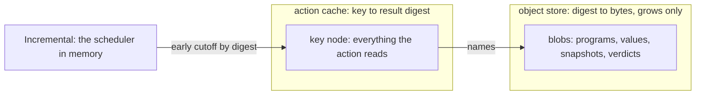

# The content-addressed store: review and plan (2026-10-17)

Status: research note (history, not authority). Base: `6689f0833` on `refactor/phase1-phase3`. It
synthesizes three read-only inputs beside it: `audit.md` (our CAS), `jane-street-and-ocaml.md`
(Jane Street, dune's cache, Irmin, git), and `compilation-caching.md` (LLVM's CAS, Apple's
compilation caching, Bazel, Nix, Unison, Build Systems à la Carte). The coordinator rechecked the
two findings marked "rechecked" in `audit.md`.

## The one thing to know first

The store's identity is sound where it matters: SHA-256 over an exact, prefix-free encoding whose
exactness Lean proves, with a put that refuses a conflicting occupant by comparing bytes, which is
stronger than LLVM or dune. Four things are wrong around it. Two Lean theorems rest on a false
premise and say nothing. Lean and OCaml accept different byte languages, and tests hide it. The
September amendments landed in OCaml only. And nothing outside its own tests uses the OCaml store.

## 1. Five threads, one model

1. **Two kinds of address.** A blob digest names bytes; an action digest names a computation by
   all its inputs. LLVM splits object store from action cache; dune splits rule digests from file
   digests. Ours: `E4_cas` is an object store; `scripts/gate-cache.py` is an action cache with no
   object store; the planned verdict cache needs the action-cache shape.
2. **Keys complete by construction.** Apple's clang reads only inputs already in the CAS, so its
   key cannot miss one. Our keys are audited lists, and R2-C-7 is exactly the miss that design
   rules out. A verdict function that takes one argument, `CheckInput`, keyed by the hash of its
   canonical bytes, cannot read what its key omits.
3. **Early cutoff at two timescales.** Incremental cuts off in memory (graph rule 5); an action
   cache cuts off on disk when an output's digest is unchanged. The tool server is a build system
   over definitions: tasks are definitions, outputs are verdicts, Incremental schedules, and the
   store persists. Build Systems à la Carte names the choice per cache: verifying or constructive
   traces keep early cutoff; deep traces lose it.
4. **The math is short.** The object store means a map from digest to bytes that only grows. A
   get after a put returns the bytes. A digest names at most one byte string among a store's
   residents. An action cache's hit equals running the action when the action is deterministic and
   its key covers every input it reads. A second, different result for one key is a defect ("cache
   poisoned"), never an overwrite.
5. **Disk invariants as rule 8.** Content never changes once published; publication is atomic;
   reads re-hash or declare their trust; the log covers metadata only. Ours already fsyncs every
   commit and writes the control file atomically, where dune and irmin-pack do not fsync by default.

## 2. What is proved, tested, stated or missing

| Property | Status | Where |
| --- | --- | --- |
| `Val` and node encodings exact and injective | proved | `Val.decode_encode`, `Val.decode_exact`, `Node.decode_exact`, `Node.encode_injective` |
| collision, global form | proved, honest | `address_eq_or_collision`, `Pin.holds_or_collision` |
| collision, "level 1" | vacuous (rechecked) | `address_inj` (`Store/Domain/Node.lean`) and `holds_of_injective` (`Store/Domain/Pin.lean`) assume `Function.Injective sha256`, which no hash satisfies |
| Merkle soundness | proved, with a premise | `Store.Sound`, `putNode_sound`, `verify_sound`; `closure_closed` needs `Store.Ranked`, never proved for stores built by `putNode` |
| domain separation (node against `Val` bytes) | missing | the designed lemmas have no hit in the tree |
| one byte language | broken (rechecked) | Lean's tags 13 and 14 refused by `E4_node.walk`; kinds 16 to 23 admitted by OCaml, refused by Lean |
| crash recovery | tested by cut bytes only | no writer killed mid-commit |
| checkpoint replay | missing | nothing rebuilds a machine from a checkpoint |
| shape digests | duplicated | `test_shapes.ml` hashes OCaml text; Lean's `specOf` is the definition |
| the hash assumption | undeclared | no DESIGN-BASIS or host-boundary row |

## 3. The plan

| Item | Change | Owner | Done when |
| --- | --- | --- | --- |
| C1 | Collision freedom as a property of sound stores; separation; `Ranked` from `putNode`; the store's map laws; the one byte grammar stated; all over definitions generated from Lean (`make gen-rocq`), the hash abstract | Rocq seat (briefed 2026-10-17) | the Rocq theorems compile over generated definitions; the Lean `declared … from` statements and the replacements for the two vacuous theorems are proposed |
| C2 | One byte language: `E4_node.walk` learns tags 13 and 14; DI-25's kinds 16 to 23 land in Lean `Kind.lean`, or OCaml treats only Lean's kinds as edges; the G2 tolerance goes; goldens for `negInt`, `float` and a kind-16 node | code seat, from C1's grammar | Lean and OCaml decode one corpus of bytes alike, and the G2 check has no pending rows |
| C3 | Conflict handling: every `Conflict` re-hashes the occupant (corruption against collision); `E4_checkpoint` stops dropping the outcome; a nonzero `scheme_version` refuses; an `Unknown_tag` refusal replaces `Oversize`; `verify` checks handles as `put` does; `E4_shape.r_checkpoint` matches the payload; sealed segments read-only | code seat | each with its red control |
| C4 | The shape pins computed by Lean: `test_shapes.ml` pins `specOf`, lowered, once `ShapeDoc.document` is shown injective | code seat, with C1 | the OCaml text digest goes |
| C5 | The hash assumption declared: one DESIGN-BASIS row (SHA-256, collision resistance as the only assumption, never injectivity); the store names its schema (`effect4.cas.v0[SHA-256]`) in its control file and printed addresses | coordinator, at the owner's word | the row lands |
| C6 | The action cache: a key node to result node table beside `E4_cas`, with Fresh, Duplicate and Conflict; the verdict function over one `CheckInput`; a recompute-and-put determinism mode | phase 4 | a refused revision then a valid one; a poisoned put reported |
| C7 | Lowering determinism and keys: a double regeneration (other worktree, other thread count) compared byte for byte; one key per LCNF artifact; never Lean's 64-bit `hash` as an address | generator seat, after phase 1 | the double run is a test |
| C8 | Crash tests that kill a forked writer between write, fsync and rename; crash-defined create and upgrade | code seat, after C3 | the kills leave a store that opens to a committed prefix |

## 3a. What landed

| Item | Landing | Result |
| --- | --- | --- |
| C1 | `ec39923a7` | proved in Rocq over 43 store declarations printed from Lean (`rocq/StoreCode.v`): `address_inj_resident` replaces the vacuous `address_inj`; domain separation; `built_ranked` and `built_closure_premises` (closure with no hash assumption); the growing-map laws; `encode_prefix_free`. Assumptions: the `Prim` parameters and three equality laws, no classical axiom (`rocq/StoreAssumptions.v`). Receipt: `docs/research/2026-10-17-seat-rocq-cas-receipt.md` |
| C2 | `9b8f2248a` | one byte language: `E4_node` reads tags 13 and 14 and refuses an unknown tag as `Unknown_tag`; Lean's `Kind` takes DI-25's kinds 16 to 23 and the sentinel 127; goldens cut from Lean for `negInt`, `float`, the eight kinds and twelve decode edges, each judged by `Val.decode`. One G2 row stays apart by name, `g2-handle-in-content` (below) |
| C3 | `9b8f2248a` | a `Conflict` re-hashes its occupant, `Corrupt` otherwise; checkpoints read their outcomes; a nonzero `scheme_version` refuses; `verify` refuses a handle in content; the checkpoint shape row has seven fields; sealed segments and index snapshots are 0444. Each fix went red alone under mutation (13 mutants) |
| C4 | blocked | `ShapeDoc.document` is not injective: `render` drops a sum case's wire tag, so `specOf` does too. The pin moves to `specOf` only after `render` writes the tag (the receipt's proposed decisions row 3). Codex's composition review confirms it (its control R11) |

Open after C2 and C3, for the owner after landing review 1:

- **Amendment M2, a handle in content.** OCaml's `put` and `verify` refuse a handle frame in a
  content kind; Lean's `Store.putNode` admits it. The recommendation is to add M2 to `putNode` as a
  `handleInContent` refusal after `malformedRef`, then re-cut G2 and delete the named exception.
  The Rocq seat's receipt proposes the same decisions row.
- **Recovery inside a sealed segment.** Recovery now refuses with `Bad_pack` where it once cut the
  segment and every later one. The refusal travels as an exception, against rule 6.
- **An empty `Store.Tree`.** `refs_of_checked` refuses it, since an `Each` that reaches no frame
  counts as a refusal.
- **One decode mapping, written three times.** `check_pure`, `put_bytes` and `readmit_tail` in
  `ocaml/engine/cas/e4_cas.ml` each map a decode refusal to an admission. Recovery still reports
  `Unknown_tag` as `Oversize`.
- **Two owners of one fact** (the store survey, `docs/research/2026-10-17-authoring-and-store/README.md`
  §5): root kinds (Lean five, OCaml seven), the zero-spec schema node, a program's identity, the
  two-tier stores, and three meanings of "checkpoint".

The Rocq seat's Lean proposals (replace `address_inj`, delete `Pin.holds_of_injective`, four short
theorems, two declared facts, four decisions rows) wait for landing review 1 and the owner.

## 4. For the owner

The OCaml store has no consumer outside its tests. Checkpoint restore does not exist. The
write-ahead log does not feed `E4_log`, though `e4_wal.mli` says it does. C1 to C5 make the
existing contract true. One product decision remains: wire the store in now (the kit's programs,
runs and verdicts as blobs; checkpoints restored), or park it until phase 4 needs the action cache.
The recommendation: harden now (C1 to C5), wire it in through phase 4's verdict cache, where it
first earns its keep.

## What this note does not establish

- No item has run; each "done when" is a check to run.
- The inputs read upstream sources and our tree at `6689f0833`; Irmin was read on GitHub, since the
  local Tezos clone is blobless.
- No hash speed was measured; SHA-256 stays.
