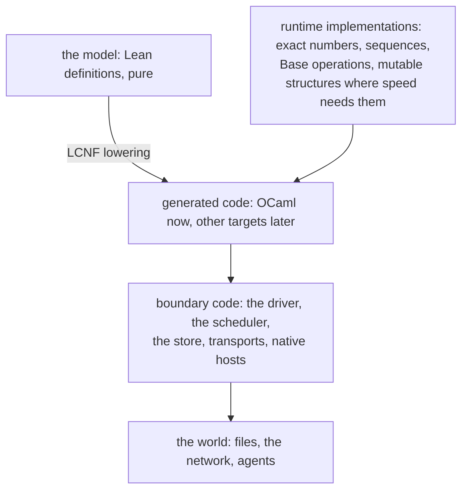
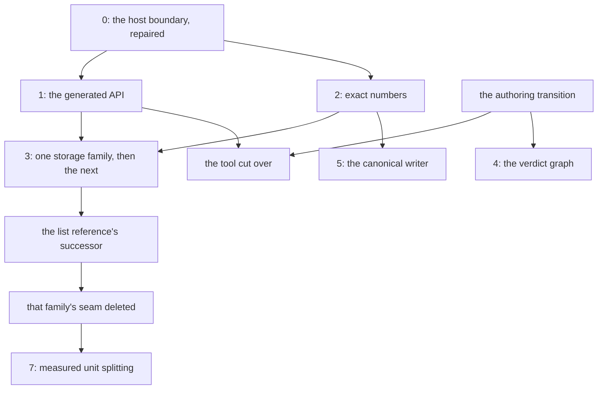

# The OCaml estate refactor: one plan (version 3)

Status: plan (history, not authority). Base: `03a4cf7fd` on `refactor/phase1-phase3`. Version 3,
2026-10-17. It absorbs Codex's round 3 (`reviews/round-3-codex.md`) into version 2. Version 2
absorbed round 2, the owner's four directions, Yaron Minsky's talk on Incremental and the probes in
`probes/incr/`. `ledger.md` holds every verdict. `plan-v1.md` and `plan-v2.md` keep the versions
the reviews cite. The review loop has stopped (§6); the seats build.

## The one thing to know first

The outcome is an architecture, and the build order serves it. Lean holds every meaning. Generated
code implements it, using Base and mutable structures where speed needs them, behind interfaces whose
meaning stays the model. Hand code lives only at the real boundaries. Phase 0 is building in three
seats (`briefs/`). Round 3 turned into acceptance checks, not a new design. A checked package is
sealed whole. The run facade is `Effect4.Run`'s own operations. An Incremental callback never
raises.

## 1. The inputs

Round 1 holds version 1's seven inputs (`ledger.md`). Round 2 adds Codex's review, the owner's
directions O-1 to O-4, Minsky's talk "Seven Implementations of Incremental", and probes Q1 to Q4.

## 2. The target architecture

### 2.1 Three kinds of code, one direction



The diagram records ownership, not proof evidence. Arrows point one way: the model never depends on
generated or boundary code, and generated code never depends on boundary code. Today the extern seam
inverts this: hand OCaml enters the machine through functor parameters and the prelude.

**Mutation (O-1).** Mutable state is a choice of implementation, never of meaning. An implementation
may mutate where speed needs it, under three conditions:

1. Its interface's meaning is a pure function in the model.
2. One owner holds the mutable state at a time. An abstract type alone does not enforce this: a
   caller can keep an old `Run.t` and step it twice. So the mutation lives inside an owned
   builder, and every published value keeps its observations (R3-C-5).
3. To share or to snapshot, the owner freezes it to a value, deeply: no nested alias stays
   writable. EN5 then reads: a snapshot is a value. Each storage family's test observes every
   retained snapshot and sibling after later updates.

Incremental is the pattern's best example. Its meaning is the program with every incremental
operator removed (the talk). Its implementation is a mutable graph.

### 2.2 The module tree

A Lean name has exactly one OCaml path, by rule:

```ocaml
Effect4.Program.Eff.Succeed          (* today: Eff_types.Eff_succeed *)
Effect4.Program.Authoring.loop_with  (* today: Api_gen.program_authoring_loop_with *)
Effect4.Run.Tree.of_program
Effect4.Store.Val.t
```

- **One type per module, named `t`.** Lean keeps a type's functions in its namespace (`Ty.text`,
  `Tree.run`); the module holds the type and those functions.
- **Names at their one owner.** OCaml cannot rename constructors in a re-export (R2-C-3). So the
  generator writes `Succeed` where the type is declared, and each public module re-exports it under
  its own name, with a type equality. A mutually recursive group keeps one declaration owner.
  Its public modules get mutually recursive signatures (`module rec … : sig … end`): a
  sequential signature cannot name the `Eff`–`Stmt`–`Stmts` cycle (R3-C-2). The program types keep
  their owner, `eff/eff_types.ml`, across every artifact. `Ml.SigItem` gains the module-type and
  sharing forms this needs.
- **Roots only.** The public interface holds the roots; specializations and helpers stay hidden.
  Today the API module exports 1,972 values and the kit uses 70.

### 2.3 One modeling rule per construct

The generator classifies each public type and root once, from the source declaration, before
LCNF lowering erases what it needs. The rules apply in this order; the first that matches wins.
It emits the classification as data, so an omitted or doubly matched construct fails the slice
(R3-C-3). It reuses the existing analyses: `typeRows` (`TypeRows.lean`), the parameter, trivial-
structure and wrapper analyses (`Types.lean`, `Translate.lean`).

| Order | Lean | OCaml |
| --- | --- | --- |
| 1 | a structure with a proof field, a value index, a private constructor, or a field whose type depends on an earlier field (`Api.Built`) | the whole package abstract: no record update, no reconstruction through any public alias; made only by its checked producer (R3-C-1) |
| 2 | an identifier: a one-field structure declared as an id (`FiberId`) | `type t = private <the field's spelling>`, whatever the numeric choice makes it (R2-C-6) |
| 3 | a function-valued abbreviation (`Authoring.TermSrc`) | a type abbreviation of the OCaml function type, its parameters kept |
| 4 | any other inductive or structure | concrete `type t`, matchable, its type parameters kept (`Eff Op`) |
| — | namespace `A.B` | module `A.B` |
| — | `DecidableEq`, `Ord`, `Hashable` instances | `equal`, `compare`, `hash` |
| — | a `Canonical` or `Modeled` codec | `to_val`, `of_val`, `to_bytes`, `of_bytes` |
| — | `Except ε α` | `(α, ε) result`, with typed errors |
| — | docstring and parameter names | doc comment and labelled arguments |
| — | a typeclass-generic function | specialized and internal |

Generated wrappers supply every argument the compiler kept and the public signature erased, as
`Kit_author`'s `nat` and `if_` do by hand today.

### 2.4 The run as a deep module

The public facade is `Effect4.Run`'s own operations, lowered, not a smaller invented machine
(R3-C-4). Its OCaml spelling:

```ocaml
module Effect4.Run : sig
  type t                                (* a value; a snapshot is the value *)
  val open_   : Api.Built.t -> id:string -> ?budget:Api.Budget.t -> ?binding:string -> unit -> t
  val step    : t -> Api.Runner.Command.t -> t      (* the command and its phase are journaled *)
  val play    : t -> Api.Runner.Command.t list -> t
  val answer  : t -> Key.t -> Answer.t -> t         (* the checked session's rows *)
  val control : t -> Api.Decision.t -> t
  val inspect : t -> Api.Inspection.t               (* outcome, machine, live reasons *)
  val exit    : t -> Exit.t option
  val outstanding : t -> Await.t list
  val journal : t -> Api.Runner.Command.t list
  val phases  : t -> Phase.t list
end
```

`open_` takes `Api.Built.t`, which packages the application's identity and program admission
(R2-C-4), and so cannot refuse. A refused command is a recorded phase, never an exception, and the
journal keeps it (R2-C-1). The budget keeps separate execution and compile fuel. Three things stay
distinct: a semantic refusal (a phase), a live frontier (an outcome), and a target-capacity
refusal (the OCaml numeric profile, EN9). Any smaller convenience facade declares its defaults and
projections in its interface.

### 2.5 Hosts as module types

```ocaml
module type TODOS = sig
  type state
  val add : state -> title:string -> (Todo_id.t, Todo_error.t) result * state
end
val todos : (module TODOS with type state = 's) -> 's -> Host.t
```

The generator writes the module type from the typed host structure, and the adapter from
`Reactor.fallible`. The state comes back on both branches (R2-C-5). A raised exception is no answer,
so the call stays a live frontier. The adapter is mechanical, as `Native_todo.host` shows by hand:
it reorders and labels the arguments. Composing hosts states two policies in its interface, the
exception policy and `Reactor.first`'s first-answer policy, and says how the hosts' states combine
(R3-C-4). Functor application alone decides none of the three.

### 2.6 Where Incremental runs, and where its pattern takes the LCNF lowering

| Place | Implementation | Why |
| --- | --- | --- |
| the machine's derived views, such as completed exits | the diff-and-patch pattern, written in Lean and lowered | the same cost as `Incr_map` (T-6), and the machine stays a value |
| the tool server's verdicts | Incremental, with `Incr_map` over the definitions | one edit rechecks one body (Q4) |
| the live view | Incremental's observers, one per client subscription | a view stops when its client leaves (T-9) |

The rules for every graph, from the talk and the probes:

1. **Coarse nodes.** A firing costs 15 to 18 ns here (T-3). One node per definition or per fiber,
   never per node of a program's syntax tree.
2. **Wide and shallow.** The default height cap is 128 (T-5), and a program's syntax can be deeper.
   Use `Incr_map` over keyed collections.
3. **`map` for fixed structure.** `bind` costs about 7.5 times as much and allocates 50 words per
   firing (T-4). Use it only where the shape changes, such as a hole's fill.
4. **Exact dependencies.** A verdict depends on its body, its own declaration with its parameters,
   the declarations it calls, the checking environment and the resolved layers (R2-C-7, T-8). A
   dependency on the whole declaration block reruns every verdict on any edit.
5. **Cutoffs by value.** The default is physical equality (T-7). Compare by content digest, with
   the digest's collision assumption declared, or by content equality.
6. **Explicit observers.** End a view by unobserving it, not by waiting for the collector (T-9).
7. **The meaning checked.** Every graph has an all-at-once differential: the same answers without
   the incremental operators (T-1).
8. **Callbacks never raise.** A raising callback disables the whole Incremental instance: later
   `Var.set` and `stabilize` raise too (R3-C-6). A callback returns an expected refusal as a typed
   value and does no host input or output. An unexpected failure replaces the instance from the
   authoritative inputs and publishes nothing of the failed revision. The test is a refused
   revision followed by a valid one. Lean totality does not make an OCaml callback non-raising:
   the builtin table still holds raising operations (`panic`, the clock conversions) until
   phase 2.

Q4 measured string lengths, not the checker. Phase 4 compares the real cached and uncached
verdicts, diagnostic paths included.

### 2.7 Base and numbers

- Base enters generated code through the route's target-library catalogue, one operation at a time,
  each with its contract and consumer (O-2, R2-C-2). No blanket `open Base`.
- Domain errors stay typed `result`s; `Or_error` serves only where a caller needs diagnostic text
  (R2-C-9).
- Naturals and integers are exact (Zarith), never Base's `Int` (D-2). `String.length` counts
  scalars, never Base's bytes.

### 2.8 Interop in `Eff` itself (O-4, an exploration)

The architecture above spells interop in OCaml. The owner asks for its spelling in `Eff`, the
language, so that one program carries to OCaml, TypeScript, C and later WebAssembly. The first
questions:

1. Is an interface a row service read as an OCaml module type, with its typed methods and its state?
2. Is a platform a layer that provides those services, as Effect provides services by layers?
3. How does each target print it: an OCaml module type, an Effect `Context.Tag` with its interface,
   a C table of functions, WebAssembly imports?

Phase 1 gives the OCaml spelling first. The design note for `Eff` follows it (D-10).

## 3. The decisions

| ID | Decision | Now | Status |
| --- | --- | --- | --- |
| D-1 | Base's place | generated and hand code alike, through the catalogue, by contract and consumer | replaced by O-2 |
| D-2 | `Nat` and `Int` | exact Zarith; a bounded path only with a measured need and a stated domain | recommended; phase 2 measures real steps |
| D-3 | `Array` | the chunked persistent vector of `E4_log.Vec`, 256-element chunks, one owner in `ocaml/lcnf/`; every version a value | settled by slice 3.1 (`7eaaf9257`, `bench_array`) |
| D-4 | A brand per application | optional; `Api.Built` already carries the identity | deferred |
| D-5 | Flambda | an optional measured experiment | open |
| D-6 | Test libraries | one trial lane each | phase 6 |
| D-7 | A typed authoring face | separate from generating native interfaces | open |
| D-8 | Incremental | the tool server and the live view (§2.6) | restated by O-1 |
| D-9 | The review loop's stop | the design loop stops after round 3; landings are reviewed by slice | §6 |
| D-10 | `Eff`'s interop construct | a design note after phase 1 | new, O-4 |
| D-11 | 1.1's export model | every exported name is a root: a Lean root `stepChecked` beside `replayCheckedFrom` replaces the compiler-made `stepDecisionState._at_…spec_1` that both instances call; other names hand code calls become linkage roots; the `.mli` is inferred by OCaml from the typed tree (mono LCNF erases type variables); prelude values are exported until phase 3 deletes them | coordinator's ruling on seat GEN's option (b), open to landing review 1 |

## 4. The build order



The diagram records dependencies. Base enters each phase through the catalogue, not as a phase of
its own.

### Building: phase 0

| Slice | Seat | Change | Done when |
| --- | --- | --- | --- |
| 0.1 | HOST | `E4_host.Make.serve`: loading has its own result; every step's answer is read; a refused reply stops the drive | both engines, on the assessment's programs and Codex's reply control: refusal reported; one provider call; the earlier state returned; no applied-call entry; the call still outstanding; the control answers `42` |
| 0.2 | GEN | `[@local always]` on each join point | warning 55 fatal; the escaping control fails |
| 0.3 | ENGINE | one adapter for every engine instance | `test_diff` passes; the checkpoint adapter keeps its type equalities |
| 0.4 | ENGINE | `E4_log.Vec.to_list` by its fold | the boundary and sibling probe agrees |
| 0.5 | ENGINE | `E4_engine`'s two signatures in one `_intf.ml` | both files include it; `make check-ocaml` passes |
| 0.6 | coordinator | `ocaml/STANDARDS.md`, second edition | the text lands, with §2.7's rules |

Phase 0 landed on 2026-10-17 at `8884d9ace`; `make check-ocaml` passes there, drift included.

### Next: phase 1, the generated API

| Slice | Change | Done when |
| --- | --- | --- |
| 1.1 | Export classes in `roots.json`: public, linkage, coverage, internal | a real client compiles through them (1.2, 1.4); a client that names an internal or coverage-only name fails to compile |
| 1.2 | The module tree (§2.2): names at their owner, facades with type equalities, recursive signatures for the program cycle, roots only; the run facade of §2.4 | a client using the public paths compiles and traverses `Eff`–`Stmt`–`Stmts` with its type parameter kept; the program types are shared across artifacts, never duplicated |
| 1.3 | Abstract and private types by §2.3's ordered rule; ids by the numeric choice | a forged value, a mixed id and the enclosing-package forgery of R3-C-1 fail to compile through every public alias; a valid construction compiles; the classification lists every public type once |
| 1.4 | `Kit_author`'s adapters generated, erased arguments supplied | the hand wrappers go; every client uses the generated ones; the kit lane passes |
| 1.5 | Host module types and adapters (§2.5) | the to-do lane passes, with a typed failure that changes state, and keeps its exception, missing-method and wrong-answer controls |
| 1.6 | One tool request lowered and called | it answers in OCaml; the dependent-answer and erasure controls stay red |
| 1.7 | The production tool cut over to the lowered transition (R2-C-10), after the authoring transition | `Kit_serve` keeps only parsing, framing and input/output; the required request transcripts, refusals and live frontiers included, agree through both transports before the old dispatcher goes (R3-C-7) |

### Then

| Phase | The outcome | The contracts round 2 added |
| --- | --- | --- |
| 2 | exact numbers at every crossing, one runtime library | a row-by-row exact-or-refuse receipt, `panic` included (R2-C-11); real machine steps measured |
| 3 | storage families as Lean data, mutable implementations only under §2.1 | the list reference's successor before any deletion (R2-C-12); every retained snapshot and sibling unchanged after later updates (R3-C-5) |
| 4 | the verdict graph (§2.6) | dependencies by rule 4; transcripts with changed parameters, environments, profiles and checker builds; a refused revision, then a valid one (rule 8) |
| 5 | one-pass canonical writing | size overflow and failure before publication |
| 6 | Base in the surviving hand code | split 6.1 by consumers (R2-C-8); typed errors kept |
| 7 | generated units by module | measured first; public paths need not wait |

## 5. What goes, and when

| Deleted | Only after |
| --- | --- |
| the duplicate engine signatures and adapters | the checkpoint adapter keeps its type equalities |
| `Kit_author`'s hand wrappers | the generated adapters serve every client |
| the hand `REPO` | the generated module type carries state on failure |
| `E4_nat`, the printed numeric support, `ClockFlow` | every call and conversion uses the exact runtime |
| extern rows and `api_engine_prelude.ml` (`sh_spawn`, `sh_ref_step`, …) | the machine operations they replace are lowered from Lean |
| the seven list twins and the list oracle's role | the lowered list reference serves `test_diff` |
| `Kit_serve`'s request execution | the tool runs on the lowered transition |

## 6. The review loop

Round 3 changed contracts only: no order and no decision (D-9). So the design loop stops here.
Each landing is reviewed against its slice's "done when"; a finding that changes the order or a
decision reopens this plan. Version 2 abbreviates the later phases. Their detailed checks are
version 1's, as the ledger and the three rounds amend them. The superseded Base exclusion and
mutation restriction do not return.

## 6a. What the landings found

| Landing | Finding | Next |
| --- | --- | --- |
| 0.1 (`7d4619bd7`) | Lean's `driveFrom`, after a refused reply, keeps the reactor's next state and stops one round later; it also plays on past a stuck machine. The OCaml drive now stops at once with the state before the call (`E4_host` H11). | a decisions row, and a Lean slice that aligns `driveFrom`, after phase 1 |
| 3.1 (`7eaaf9257`) | The chunked vector answers as the list shim everywhere: push 0.163 ms against 390.7 ms at 10^4, reads O(log(n/256)), 1.0 word per element retained against 3.0. The rerooting array breaks EN5 on a sibling read and costs 38 s for alternating reads at 10^6. | slice 3.2 spells `Array` on it, after slice 2.1 |
| 3.1 | Nine `Array.foldrMUnsafe.fold` loops read `List.nth` with a descending index, so they are quadratic today. | 3.2 makes them O(n log n); a direct list row would avoid the array |
| 2.2a (`619ddffe4`) | All 126 builtin rows carry a receipt: 114 exact, and 12 refusing by a named crossing (arithmetic, index, clock, panic). The runtime still raises "clockNow" at every crossing (D9). | 2.2b or 2.3: one refusal value that carries its crossing |
| 2.2a | `E4_engine.check_answer` reads no string, so a host answer can carry invalid UTF-8; the String rows are exact only on valid input. | 2.2b: the reply crossing refuses invalid UTF-8 |
| 2.2a | The type rows (`TypeRows.lean`) keep `UInt64` and `USize` unsound and `Array` and `ByteArray` approximate. | 2.2b and 3.2: the same receipt on the type rows |
| 2.2b part 1 (`749daaa77`) | Each refusal names its crossing, and a reply refuses invalid UTF-8; two transcript answers moved on purpose. The switch to `Z.t` cannot land in parts: 23 natural fields of the program types share the `Nat` row with the generated code, so the row change, about 45 builtin rows, the translator's literals and every hand consumer move in one commit. CPU time moved up to 2× between runs of one binary on this Mac; allocated words are deterministic. | 2.2b part 2 as one commit; the D-2 measurement interleaves base and after binaries and reports words; `crossing` and `refusal` move from `E4_clock` to `ocaml/lcnf` in 2.3 |
| 1.1 (stopped) | Hand code calls 16 closure declarations of `api_gen`, a coverage root, and the compiler-made `stepDecisionState._at_…spec_1`; a root has no call site for the clock analysis, so that name cannot simply become a root. | D-11 |
| 3.2 (`caef41d88`) | `Array` and `ByteArray` are `Lcnf_array.t`: the 17 quadratic pushes and 8 `List.nth` reads of `api_gen.ml` are vector calls, and a Lean hash map lowers with siblings kept. `USize` stays the target's `int` index, refusing beyond its capacity. | 2.2b keeps the index crossing |
| transcripts (`d81bf40b1`) | A `.txt` in a fixture lane must come from its Lean writer, so the tool's OCaml-pinned golden is `serve.transcript`. The kit lane alone did not catch this; the full gate did. | the coordinator runs `make check-ocaml` after every merge |
| 5.1 (`7386325d5`) | The generated `encode_<t>` functions keep their `string` type and raise on an oversize encoding. | a `result` type changes every caller: decide with phase 1's interfaces |
| 0.1 | No program in the language reaches a stuck machine: four candidates finish with `die(badName)` instead. `test_serve` S5 tests `Stuck` through a stand-in engine. | a real stuck witness, if one exists, comes through the engine |

## 7. Changelog

| Version | Date | Change |
| --- | --- | --- |
| 1 | 2026-10-17 | seven inputs consolidated; the sentinel, rerooting by default and the `.mli` build claim withdrawn |
| 2 | 2026-10-17 | the architecture as the outcome (O-3); mutation behind pure interfaces (O-1); Base through the catalogue (O-2); Codex's twelve findings; Incremental's place and rules from the talk and Q1 to Q4; the `Eff` interop exploration (O-4) |
| 3 | 2026-10-17 | Codex's round 3: the ordered classification and the sealed package (R3-C-1, R3-C-3); recursive signatures (R3-C-2); the run facade from `Effect4.Run` (R3-C-4); deep freezing (R3-C-5); graph rule 8 (R3-C-6); 1.7's transcripts (R3-C-7); the design loop stops; phase 0's seats |

## What this plan does not establish

- Phase 0 is building; no later phase has run. Each "done when" is a check to run.
- Codex's round 2 controls ran in its scratch directory and were not rerun here.
- The talk is cited through its published transcript page, and its figures are its own.
- The probes measure Incremental v0.16.1 on this Mac, not the machine or the tool server.
- The plan assigns no lowering theorem (row 391). Storage instances keep their local laws.
