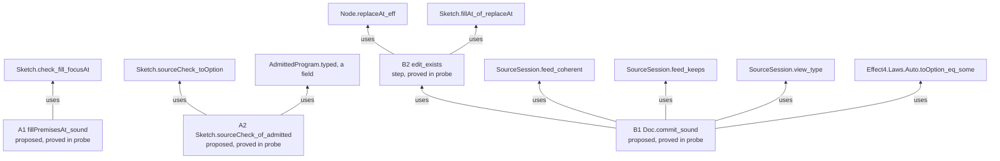
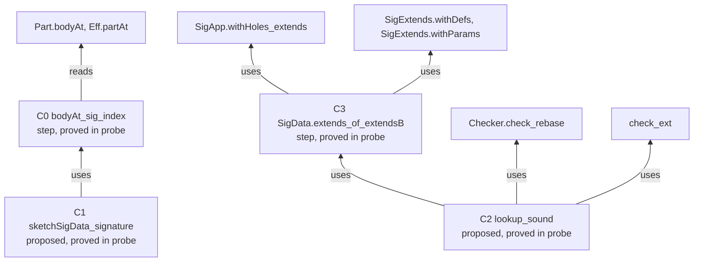
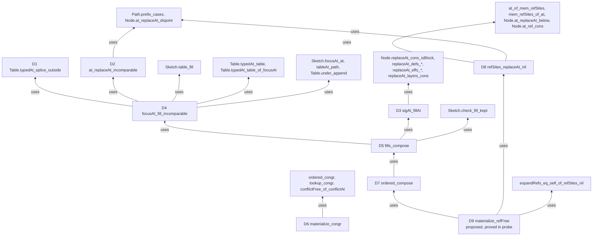
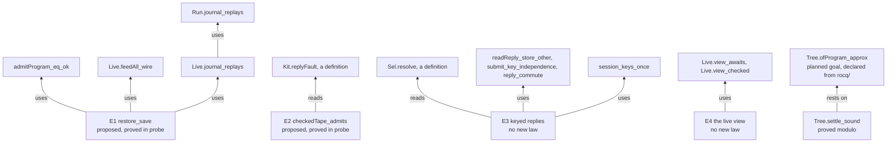
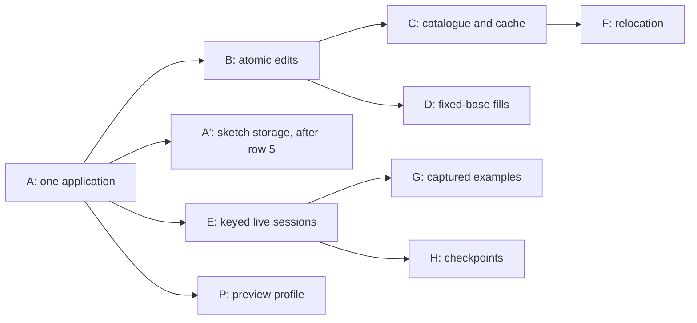

# 2026-10-17 proof scout: the contextual authoring model

Status: research note (history, not authority). Base: `22a46c6aa`, branch `refactor/phase1-phase3`.
Nothing here is committed, and no tracked file changed. Amended 2026-10-17 after the final review
(§12).

**The one thing to know first.** The scout proves its stated local laws with no new planned goal and
no new Rocq fact, within `[propext, Quot.sound]`. The final review
(`docs/research/2026-10-17-authoring-model-review/final-review.md`) found four boundary defects in the
proposed public interface. Each is now an acceptance criterion of its slice (§12). Slice E splits into
E, persistence, and P, a preview with a declared profile. Slices D and P each owe one small new lemma, not yet probed. The
previews keep resting on the declared fact `Tree.ofProgram_approx`, as they do today. One defect in
the tree is new: `Api.Typed.emit` prints a program at another service carrier than its typing
certificate states (probe A, red control).

## 1. Question

The authoring review (`docs/research/2026-10-17-authoring-model-review/`) recommends slices A to H.
This scout asks which laws those slices consume, which exist, and which are new. It probes each new
law in Lean until it is proved or narrowed, and it hands back implementation slices.

The review is the input. Its findings are checked here, not trusted. Its slice table (§9 of its
`README.md`) is authoritative where it differs from the tooling design's relations R1 to R10.

## 2. What was read or run

| Input | Evidence word |
| --- | --- |
| The review's `README.md`, `additional-points.md`, `reviews/*.md` | reading |
| The review's two probe files, 84 guards | tested (rerun at this base) |
| The tooling design `docs/research/2026-10-16-tooling-design/README.md`, §3.2, §3.9, §3.10 | reading |
| The historical note `docs/research/2026-09-08-cas-repository-algebra.md` | reading |
| `docs/core/semantics.md`, `docs/core/system-map.md` (R1 to R14), decisions rows 373, 378, 387, 391, 393, 396, 405, 407 and 411 | reading |
| `tools/ProofGraph/Registry.lean`, `Plan.lean`, `Declared.lean`, `AxiomAudit.lean` | reading |
| The source of every law and definition the DAG names, cited by path below | reading |
| Nine probe files in `probes/` | tested and proved (§10) |

## 3. The proof DAG

### 3.1 How to read it

Each node is one law that a slice consumes. Its status is one of the brief's labels:

- **proved in tree**: a declaration of the tree, its standing measured by `#plan_status`;
- **proved modulo**: proved in the tree, resting on the named planned goals;
- **proposed, proved in probe**: a new statement, proved in a probe file, its axioms measured by
  `#axiom_audit`;
- **proposed, statement only**: a new statement that typechecks as a `Prop`, with no proof;
- **refuted**: a claim that a red control refutes, with the control named.

A new node is placed by the five facts of `AGENTS.md` (§3.7). An existing node keeps its placement
in the tree, and §3.6 names its claim where the semantics registry has one.

The diagrams below show which law each new node uses. They show dependencies, not proofs.

### 3.2 Slices A and B: one application, and atomic checked edits

### 3.3 Slice C: the context as data, and the verdict cache

### 3.4 Slice D: certified fills at incomparable addresses

The claim's pointer is the conjunction of D6 and D9 (§3.7). Every D node, and every step in the
diagram, is proposed and proved in probe `D.lean`.

### 3.5 Slice E: persistent keyed live sessions, and the preview boundary

### 3.6 Existing nodes, measured

`probes/Status.lean` runs `#plan_status` on every existing node below. Each one answers `proved`,
except two that answer `modulo [Effect4.Run.Tree.ofProgram_approx]`.

| Node | File | Claim or placement | Status |
| --- | --- | --- | --- |
| `Sketch.check_fill_focusAt` | `src/Effect4/Laws/Program/Sketch.lean` | consumer of `focus-function` | proved in tree |
| `Sketch.check_omit_focusAt` | `src/Effect4/Laws/Program/Sketch.lean` | consumer of `focus-function` | proved in tree |
| `Sketch.fillAt_of_replaceAt`, `Node.replaceAt_eff` | `src/Effect4/Laws/Program/Sketch.lean`, `src/Effect4/Laws/Program/Address.lean` | steps of `typed-replacement` | proved in tree |
| `SourceSession.feed_coherent`, `feed_keeps`, `view_type`, `reached_view`, `focusAt_typed` | `src/Effect4/Laws/Program/SourceTable.lean` | `source-session-coherent` and its steps | proved in tree |
| `SourceSession.feed_undo` | `src/Effect4/Laws/Program/SourceTable.lean` | `source-session-undo` | proved in tree |
| `Sketch.sourceCheck_toOption`, `Sketch.sourceRefusals_head` | `src/Effect4/Laws/Program/SourceTable.lean` | steps of `source-annotation-agrees` | proved in tree |
| `Tools.Query.fillPremises_sound` | `tools/Tools/Query.lean` | the query tool's decider, at the empty application | proved in tree |
| `admitProgram_eq_ok` | `src/Effect4/Laws/Program/CheckedTyping.lean` | admission's certificate is its answer | proved in tree |
| `Sketch.decode_exact` | `src/Effect4/Laws/Program/SketchWire.lean` | `sketch-wire` | proved in tree |
| `Checker.check_rebase`, `tableAt_rebase` | `src/Effect4/Laws/Program/Typing/Rebase.lean` | `checker-base-natural` | proved in tree |
| `check_ext`, `check_restrict` | `src/Effect4/Laws/Program/Signature.lean` | R2 top nodes | proved in tree |
| `SigApp.withHoles_extends` | `src/Effect4/Laws/Program/Sketch.lean` | placed at R14 | proved in tree |
| `SigExtends.withDefs`, `SigExtends.withParams` | `src/Effect4/Laws/Program/Definitions.lean` | in the module of `module-check` and `defs-conservative` | proved in tree |
| `TyCache.check_agreement` | `src/Effect4/Laws/Program/Folds/TyCache.lean` | `fold-cache-local-agreement`; no slice A to E consumes it | proved in tree |
| `Sketch.table_fill` | `src/Effect4/Laws/Program/Typing/PartsTable.lean` | `module-table-splices` | proved in tree |
| `Sketch.check_fill_kept`, `Sketch.fillAt_some` | `src/Effect4/Laws/Program/Typing/PartsTable.lean` | steps of `module-table-splices` | proved in tree |
| `Table.typedAt_table`, `Table.typedAt_table_of_focusAt`, `Sketch.focusAt_at` | `src/Effect4/Laws/Program/Edit.lean` | steps of `edit-session-coherent` and `omit-splices-table` | proved in tree |
| `tableAt_path`, `Table.under_append` | `src/Effect4/Laws/Program/Typing/Splice.lean`, `src/Effect4/Laws/Program/Address.lean` | steps of `edit-splices-table` | proved in tree |
| `Path.prefix_cases` | `src/Effect4/Laws/Program/AddressMove.lean` | step of `references-move` | proved in tree |
| `Node.at_replaceAt_disjoint` | `src/Effect4/Laws/Program/References.lean` | beside `addressed-replacement` | proved in tree |
| `Node.replaceAt_cons_isBlock`, `Node.replaceAt_defs_main`, `Node.replaceAt_defs_body`, `Node.replaceAt_effs_head`, `Node.replaceAt_effs_tail`, `Node.replaceAt_layers_cons`, `defs_replaceAt_layers`, `Eff.partAt_plain`, `Eff.eq_defs_of_isBlock` | `src/Effect4/Laws/Program/Typing/PartsTable.lean`, `src/Effect4/Laws/Program/Address.lean`, `src/Effect4/Laws/Program/Typing/Parts.lean` | steps of `module-table-splices` | proved in tree |
| `Live.journal_replays` | `src/Effect4/Laws/Api/Live.lean` | placed at R13 | proved in tree |
| `Live.feedAll_wire`, `Live.start_ok`, `Live.start_error`, `Live.reached` | `src/Effect4/Laws/Api/Live.lean` | steps of the typed replay | proved in tree |
| `Live.replay_recorded` | `src/Effect4/Laws/Api/Live.lean` | placed at R6, property `typed-replay-session` | proved in tree |
| `Run.journal_replays`, `Run.admitted_unique` | `src/Effect4/Laws/Run.lean` | the first is an R13 top node; the second makes a certificate of program admission unique | proved in tree |
| `readReply_store_other`, `submit_key_independence` | `src/Effect4/Laws/Api/HostSession.lean` | beside `reply-commute`; the first is its step | proved in tree |
| `reply_commute` | `src/Effect4/Laws/Api/HostSession.lean` | `reply-commute` | proved in tree |
| `session_keys_once` | `src/Effect4/Laws/Run/Journal.lean` | `keys-once` | proved in tree |
| `Live.view_awaits`, `Live.view_checked` | `src/Effect4/Laws/Api/Live.lean` | the live view's laws (slice DM3) | proved in tree |
| `Tree.settle_sound`, `Tree.probe_stable` | `src/Effect4/Laws/Run/Tree.lean` | the proposed claim `call-chain-outcome` (row 411 (6)) | proved modulo `Tree.ofProgram_approx` |
| `Tree.ofProgram_approx` | `src/Effect4/Laws/Run/Tree.lean` | declared from `rocq/SkeletonApprox.v` (row 411) | planned goal |
| `check_weaken`, `effTy_weaken` | `src/Effect4/Program/Typing.lean` | the weakening law that `operation-data-scoped` names | proved in tree |
| `references_move` | `src/Effect4/Laws/Program/AddressMove.lean` | `references-move` | proved in tree |
| `Run.tape_replays`, `Run.funded_replays`, `Run.tapeFrom_position_replays` | `src/Effect4/Laws/Run/Tape.lean` | `run-tape-replay`, `funded-run-replay`, `journal-position-replay` | proved in tree |
| `replayEval_append` | `src/Effect4/Laws/Machine/Approximation.lean` | the tape's split law | proved in tree |
| `callAt_rowTy`, `hom_eq_cata_eff` | `src/Effect4/Laws/Program/Typing/Call.lean`, `src/Effect4/Program/Fold.lean` | `call-instance-address`, `hom-eq-cata-eff`; no slice A to E consumes them | proved in tree |

The review also lists `Node.at_append`, `Node.replaceAt_append`, `Node.at_replaceAt_below`,
`refMake_twice_distinct` and `Point.layerKey`. Slice D's reference step uses
`Node.at_append` and `Node.at_replaceAt_below`. The others guard allocation identity and nested
fills. No slice A to E consumes them.

### 3.7 New nodes and their placement

Each new node below names its probe, its proposed home and its five placement facts. Requirement
R14 is the frame row of the sketch work, and R13 the row of a run's inputs.

**A1 `fillPremisesAt_sound`** (`probes/A.lean`; lands as `Tools.Query.fillPremises_sound`, generalized).

- Concept: `initial-algebras-folds`; property: the focus function.
- Question: claim `focus-function` (role inversion); consumer: the query tool's `fill` answer at
  the full application.
- Reach: one sketch, any application, a focus that `Sketch.focusAt` answers.
- Does not establish: the source check through layer references, program admission, behaviour.
- Unlocks: R14; the query tool stops fixing the empty application.

Status: proposed, proved in probe. The proof is the tree's `fillPremises_sound` with the application
left free.

**A2 `Sketch.sourceCheck_of_admitted`** (`probes/A.lean`; lands in a new
`src/Effect4/Laws/Program/SketchAdmission.lean`).

- Concept: `residual-program-typing`; property: program admission.
- Question: the R14 open part `sketch-admission` (proposed claim, role compatibility), whose
  pointer this would be; consumer: the session tool's `start`.
- Reach: every sketch, application and certificate of program admission at the application
  extended by the hole table.
- Does not establish: the converse, which control C9 refutes; anything of a run.
- Unlocks: R14 and R1; it closes `sketch-admission` with the existing decider `admitProgram`.

Status: proposed, proved in probe.

**B1 `Doc.commit_sound`, with its step B2 `edit_exists`** (`probes/B.lean`; lands in new
`src/Effect4/Program/Typing/SourceDocument.lean` and `src/Effect4/Laws/Program/SourceDocument.lean`).

- Concept: `initial-algebras-folds`; property: `source-session-coherent`.
- Question: the proposed claim `checked-edit-atomic` (role compatibility); consumer: the session
  tool's `replace` and its checked omission.
- Reach: one coherent session, any target, change (fill or omission) and policy.
- Does not establish: program admission (acceptance case 13), behaviour, or that every exact fill
  is accepted. The accepted direction is tested on the review's cases, not proved.
- Unlocks: R14.

Status: proposed, proved in probe. An accepted edit is the session's own edit at the target. The
revision moves by one, and the session stays coherent. The source check types the new sketch. Under
`keepExactType` the root type and the focus's environment and type stay too.

**C1 `sketchSigData_signature`, with its step C0 `bodyAt_sig_index`** (`probes/C.lean`; lands in new
`src/Effect4/Program/Typing/CheckCache.lean` and `src/Effect4/Laws/Program/Typing/CheckCache.lean`).

- Concept: `initial-algebras-folds`; property: the focus function, the signature half.
- Question: a step of the proposed claim `context-check-cache-agrees`; consumer: the cache key, and
  `inspect`'s context as data.
- Reach: every sketch, application and address inside a part, as at every typed focus.
- Does not establish: that two different data spell two different signatures.
- Unlocks: R14.

Status: proposed, proved in probe. The data is read off the root and the path. It adds no
traversal of a program (decisions row 143).

**C2 `lookup_sound`, with its step C3 `SigData.extends_of_extendsB`** (`probes/C.lean`).

- Concept: `initial-algebras-folds`; property: `checker-base-natural`, and the checker's extension
  half.
- Question: the proposed claim `context-check-cache-agrees` (role compatibility); consumer: the
  candidate catalogue and `replace`.
- Reach: a cache whose entries the checker computed. An exact hit moves its refusal below the asked
  path. A positive verdict also answers at a prefix extension of the rows.
- Does not establish: digest injectivity (entries compare whole keys), speed, or reuse of a refusal
  across an extension.
- Unlocks: R14, serving R2.

Status: proposed, proved in probe.

**D1 to D9** (`probes/D.lean`; land in new `src/Effect4/Program/Typing/FillSet.lean` and
`src/Effect4/Laws/Program/FillSet.lean`).

- Concept: `initial-algebras-folds`; property: `typed-replacement`.
- Question: the proposed claim `workspace-fill-agreement` (role compatibility). Its pointer is the
  conjunction of D6 (the materializer reads a set) and D9 (it accepts and keeps the type). Consumer:
  slice D's materializer.
- Reach: one base sketch, one application and one hole table. Each fill stands below the root and
  is certified at the base's focus with its exact type. Distinct addresses are incomparable, and no
  address has two fillings.
- Does not establish: fills that change a type (control D), omissions (control omissions), nested
  addresses (control nested), or merges through layer references (control refMerge). The
  materializer checks a merge through references before it accepts it.
- Unlocks: R14.

Status: proposed, proved in probe. The steps:

| Step | Statement in words |
| --- | --- |
| D1 `Table.typedAt_splice_outside` | a splice keeps the typed entry of an address outside the spliced subtree |
| D2 `at_replaceAt_incomparable` | a replacement keeps the node at an incomparable address |
| D3 `sigAt_fillAt` | a fill below the root keeps the signature of every address |
| D4 `focusAt_fill_incomparable` | an exact fill keeps the focus at an incomparable address |
| D5 `fills_compose` | certified fills at pairwise incomparable addresses all apply, and the base's type stays |
| D6 `materialize_congr` | two lists with the same members and no located conflict materialize alike; its steps are `ordered_congr`, `lookup_congr` and `conflictFree_of_conflictAt` |
| D7 `ordered_compose` | the materializer's order satisfies D5's premises |
| D8 `refSites_replaceAt_nil` | a fill free of references keeps a program free of references |
| D9 `materialize_refFree` | the materializer accepts such a set through the source check, at the base's type |

**E1 `restore_save`** (`probes/E.lean`; lands in new `src/Effect4/Run/LiveRecord.lean` and
`src/Effect4/Laws/Api/LiveRecord.lean`).

- Concept: `host-session-protocol`; property: `typed-replay-session`.
- Question: the proposed claim `live-session-persists` (role compatibility); consumer: the session
  tool's `save` and `load`.
- Reach: every live session. The record holds the application, program, name, binding, budgets,
  journal and row spellings. Restoration reruns program admission.
- Does not establish: that another host's journal replays, host reconnection, external resources,
  or external effects at most once. Nor does it fix a wire format, or who owns a restored session.
- Unlocks: R13, serving R6.

Status: proposed, proved in probe. It composes `admitProgram_eq_ok`, `Live.feedAll_wire` and
`Live.journal_replays`, with no new step.

**E2 `checkedTape_admits`** (`probes/E.lean`; lands in new `src/Effect4/Run/Preview.lean`).

- Concept: `host-session-protocol`; property: reply admission at the row's columns.
- Question: the review's proposed preview obligation (role compatibility); consumer: the tool's
  `settle` and `frames` with a supplied tape.
- Reach: the call tree's runs under the checked tape.
- Does not establish: agreement with the machine (`Tree.ofProgram_eq_denoteRowsB` is a planned
  goal), or reply admission at a call's checked instance. Nor does it establish that the program
  receives the value that live reply application gives it. At a handle answer the live session
  allocates, and the tape passes the request number (final review, F4).
- Unlocks: R12.

Status: proposed, proved in probe. Slice P confines it to a profile where those gaps close (§7.6).

### 3.8 Slices F to H, at the level of the DAG

| Node | What it is | Status |
| --- | --- | --- |
| `effTy_shift` (`probes/FGH.lean`) | a closed fragment shifted under an environment types as at the empty one | proposed, proved in probe |
| `SigApp.signature_weakenNatural` (`probes/FGH.lean`) | every application's typing signature is natural in weakening, the premise of `effTy_weaken` | proposed, proved in probe |
| `check_relabel_stmt` (`probes/FGH.lean`) | the checker reads a relabelled program at the relabelled row table as the original | proposed, statement only; one finite control |
| `fill_by_term_tree_stmt` (`probes/FGH.lean`) | a host answering a hole's row with a literal observes the stop and stores of the filled program | proposed, statement only; tested on three programs at budgets 0 to 4 |
| an exact codec of a run's state, and its agreement with journal replay | slice H's base | absent: no definition holds the state's codec |

Placement of the F nodes: concept `initial-algebras-folds`, property `operation-data-scoped`, and
the proposed claim `fragment-support-transport`. Their consumer is slice F, then slice C once it
offers candidates from another depth. Placement of `check_relabel_stmt`: the R14 open part
`sketch-renumbering`. Placement of `fill_by_term_tree_stmt`: the R14 open part `fill-by-term`,
restricted to literal fillings, concept `translation-simulation` (row 373 (6)).

## 4. Refuted or narrowed

| Claim | Verdict | Evidence |
| --- | --- | --- |
| The coordinator's: an exact edit rebases past another accepted edit by `Sketch.check_fill_focusAt` alone, when the focus, the address's signature and the base check stay, and no reference dependency was touched | narrowed. On the raw `Sketch.check` it is that law with its premises read at the new revision. On `Sketch.sourceCheck` the reference condition becomes two decided premises: the new source has no reference fault, and its expansion is the old expansion's own fill. | `rebase_source` proved in probe `R.lean`. Two red controls, one per direction of the merge counterexample. In the second, the rebased candidate holds no reference and still deletes a target. |
| The review's slice D: fills materialize identically | narrowed. A canonical row of encoded fills reaches `Classical.choice` through Lean's list order (`List.instLawfulOrderLTOfAsymmLt`). The base's address order replaces it, and D6 proves the result depends on the set only. | the gate's walk refused the first probe; `materialize_congr` proved in probe |
| The reviews' missing law: replacements at incomparable addresses commute | not needed by slice D, and not cheap. A brute-force proof of `setChild` commutation took 50 s and 105 s in two forms, both with failing goals. | scratch runs (§10); the base's address order removes the consumer |
| The review's slice C: reuse a verdict at supported signature extensions | narrowed to positive verdicts at prefix extensions of the rows. A refusal is reused at equal data only. | `lookup_sound` proved in probe; control B (a missing row appears) |
| The proposal's relation D3: a closed fragment keeps its meaning at another depth | refuted, as the review's control C3 shows. Narrowed further: a fragment that reads no outside variable (`Eff.scopedAt 0`) still reads its own binders by level. | control `closedAtRoot` in `C.lean`; `effTy_shift` repairs it by a shift |
| The review: emission reports a target limitation | narrowed and made stronger. `Api.check` runs no signature admission, so an application can rebind a built-in service code. `Typed.emit` then prints the service at the built-in carrier, silently. | red control in `A.lean` (`rebound`); program admission refuses that application |

The review's findings C1 to C10 and A to E hold at this base. Their controls pass.

The final review narrowed six of this note's own claims. Its 42 controls pass at this base (§10).

| This note's claim | What holds | Consequence in the slices |
| --- | --- | --- |
| `SigApp.signature_nil` makes the emission guard exact | empty declaration tables suffice for signature equality; they are not necessary (control `unusedDeclarations`) | slice A's guard is a conservative target restriction |
| A fill set's result depends on the set only | `materialize_congr` assumes no conflict; the located conflict is `[0]` in one order and `[1]` in the reverse | slice D refuses a conflict when the fill is added |
| A failed sorting proof blocks canonical fill bytes | that one ordering instance reaches `Classical.choice` | a constructive order on paths stays open (§8) |
| The shift repairs a closed fragment's portability | `effTy_shift` gives equal computed types after a shift | behavioural transport is slice F's own obligation |
| Live sessions persist | `restore_save` rebuilds the same `Run` from a saved `Live` | slice E versions the record and fixes one restoration policy |
| New modules probe in a few seconds | the probes' Lean elaboration takes those times | the times measure no editing latency and no rebuild cost |

## 5. Representation check

Every new datum is a record over existing first-order types. None holds a function, and none
stores a `Signature`. A signature is computed from data (`SigApp.signature`, `SigData.signature`).

| Datum | Sort and carrier | Codec route | Traversal owner | LCNF route, by reading F1 and F3 |
| --- | --- | --- | --- | --- |
| Application manifest and identity | `SigApp` (rows, services, named types) with the hole table; identity is `sha256` of the canonical bytes | the tuple's existing `Canonical` instance today (tested in `A.lean`); a generated instance in a new `Tool` group of `tools/Effect4Gen/manifest.json` | the codec's generated traversal | first-order, no index |
| Document identity and revision | `DocId` (a name and an opening generation) and a `Nat` revision in `Doc`; a published document is a root: its name is the identity and `Store.putRoot`'s version the revision | `String` and `Nat` | none | first-order, no index |
| Edit target | `EditTarget`: document identity, revision, source address, expected sub-program as written | generated; the fields have instances | `DecidableEq NativeEff`, derived | first-order, no index |
| Context key and contextual evidence | `SigData` (application, hole table, `PartSig`), `CheckKey` (program, `SigData`, ordered `TyEnv`) | generated; `DefDecl` and `ParamDecl` have instances | `partSigAt`, a one-level classifier of the root (row 143), and `bodyIndex`, path arithmetic | first-order, no index |
| Verdict cache entry | `Entry`: a key and a verdict at the empty path; its negative dependency is the whole key | needs a generated sum for the verdict: `Except TypeRefusal EffTy` has no instance | `lookup`, a list scan | first-order, no index |
| Candidate evidence states | an inductive: checked here with its key and policy, retrieved and not checked, refused here with its refusal | generated | none | first-order, no index |
| Fixed-base fill set | a structure with a private constructor: its base target, its application, and fillings at pairwise incomparable addresses, read as a set (D6); only `FillSet.add` extends it | the list's existing instance; a canonical set needs a constructive order (§8) | `lookup`, `ordered` over lists, and `Node.addresses`, a generated fold | first-order, no index |
| Persistent live-session record | `LiveRecord`: a format version, `SigApp`, program, name, binding, budgets, `List Command`, row spellings | the tuple's existing instance (tested in `E.lean`); `Api.Budget` needs a generated instance | none | first-order, no index. The in-memory `Live` holds `Built` and `Session program app`, which need DM7's rule F1 |

Two keys differ from the review's proposal on purpose:

- `CheckKey` has no checker version while the cache lives in one process, where the checker is
  fixed. A cache that persists adds one.
- `EditTarget` carries no contextual evidence: inside one document the revision subsumes it, as
  the binder control of case 5 shows. The document identity enforces "inside one document". Without
  it, a second document accepts the first one's target at another binder type (final review, F3).

The last column is reading, not a run of the translator. The tool's serve function lowers only after
slice DM7 (findings F1 and F3 of `docs/research/2026-10-03-session-from-lean.md`). That holds for every
slice here: program admission's closure reaches the generated algebras (F3).

## 6. Module plan

Editing and running stay two sessions (row 373 (5)). `start` joins them: it builds the sketch with
its hole table and opens a host session. The program stays one canonical `Eff`, identified by its
bytes. A hole keeps its unit request, and variables stay levels.

| Slice | Existing owner | New deep module and its small interface | What it hides | Seam |
| --- | --- | --- | --- | --- |
| A | `Tools.Session`, `Tools.Query`, `Api.Codegen` | none: the tool carries `SigApp` whole; `Api.Codegen` gains one target-support decision that `print`, `emit` and `Built.print` share | codecs of the three tables | the tool's request and answer |
| B | `Program.Typing.SourceSession` | `Program.Typing.SourceDocument`: `Doc.open`, `Doc.target`, `Doc.inspect`, `Doc.commit`, `Doc.draft`, `Doc.undo` | expansion, splicing, the identity and revision test, the source view's validation | `Doc` holds one `SourceSession`; the session owner publishes by compare-and-set |
| C | `Program.TyCache` (a sibling) | `Program.Typing.CheckCache`: `CheckKey`, `SigData`, `Cache.lookup`, `Cache.insert`, `suggest` | rebasing refusals, prefix extensions, evidence states | the checker, called on a miss |
| D | `Program.Edit`, `Program.Sketch` | `Program.Typing.FillSet`: `FillSet.empty`, `FillSet.add`, `FillSet.view`, `materialize` | the domain check of each fill, the base's address order, the source check of the merge | `Doc.commit` publishes the materialized sketch |
| E | `Run.Live`, `Api.HostSession` | `Run.LiveRecord`: `save`, `restore` | the format version, journal replay, admission on restore | `Live.feed` with `Sel.key` |
| P | `Run.Tree`, `Run.Kit` | `Run.Preview`: `admit` (the profile), `checkedTape` | program admission, the profile's refusals, reply checks, rejected-entry reports | `settle`, `frames` and `explore` take an admitted preview |
| later | `Store.Domain.Store`, `Store.Domain.Word` | none in slices A to E: a published document root moves by `Store.putRoot`, and content travels by `Word.apply`, with the existing kinds `program`, `annotation` and `entry` | collision refusal, closure, root versions | the store's `put`, `get` and `putRoot` |

Each new module imports a module that does not open with `module`: `Program.Sketch`,
`Program.Typing.SourceSession`, `Run.Tree` or `Run.Live`. So none can open with `module` (row 200):
their imports reach a specialization site of row 202.

## 7. The slices

The order: A, then B, E and P in parallel, then C and D in parallel. A′ follows A once row 5 is
ruled. D needs no cache from C: it
calls the checker. P needs nothing from E: a preview runs no live session.

Cost figures come from two measurements. The first is the Lean elaboration time of a touched
module, rerun alone. The second is the count of a module's dependents in `src/`, `tools/` and `Test/`, read
from import headers (`probes/revdeps.py`).

### 7.0 Landing cadence: what each step rebuilds and which gates it owes

Measured 2026-10-17 at `22a46c6aa`. Dependent counts come from `probes/revdeps.py`. A gate's inputs
come from its `.lake/check/<name>.inputs.json`, and its time from its last pass in `.git-checks/`.

**The rule of the wave.** A slice edits new modules and `Tools.Session` only. Everything else it
needs lands in a new module that imports the old one.

| Module | Dependents | Touched by |
| --- | --- | --- |
| `Effect4.Program.SigApp` | 1038 | nothing: `DecidableEq SigApp` is derived in `CheckCache` |
| `Effect4.Program.Compile` | 961 | nothing: slice P's `externalValue` lemma lands in its own law module |
| `Effect4.Program.Admission` | 959 | nothing: slice A′'s formation check is a new module beside it |
| `Effect4.Program.Sketch` | 463 | nothing |
| `Effect4.Run.Live`, `Effect4.Run.Tree` | 276, 275 | nothing: `LiveRecord` and `Preview` are new |
| `Effect4.Api.Codegen` | 140 | slice A's guard, once, in its own commit |
| `Effect4.Program.Typing.SourceSession` | 94 | nothing: `SourceDocument` wraps it |
| `ProofGraph.Registry` | 25 | the claims of §8, once, at the wave's end |
| `src/Effect4.lean` (the `Effect4` root) | 15 | each slice, at the coordinator's anchor; no gate reads it (below) |
| `Tools.Query`, `Tools.Session` | 11, 8 | slice A; `Tools.Session` in every slice |
| `src/Effect4/Laws.lean`, `Test/All.lean` | 2, 0 | every slice, at the coordinator's anchors |

A slice that finds it must edit a module with more than about 20 dependents stops. It records the
edit, and the coordinator lands all such edits together in one build (§8).

**Where the gates read.** No gate's inputs name `Tools.Session`, `Tools.Query` or `src/Effect4/Laws.lean`.
`Api.Codegen` is in the inputs of five `check-ts` lanes: truth, corpus, host-protocol, schema-codec and
service-identity. It is in `gen-lcnf`'s inputs too, and the ocaml lane reads its effect through the
LCNF group's outputs.

Until the gate-key change (`docs/research/2026-10-17-gate-ref-keys-receipt.md`), `src/Effect4.lean`
was in the inputs of truth, corpus, compiler and ocaml. Then a new module in the root reran about
5 minutes of lanes. After it, no `check-full` lane reads the root, and a slice wires its modules into
the root as it lands.

**What each step owes.**

| Step | Rebuilds | Gates owed | Cost, measured or read |
| --- | --- | --- | --- |
| inner loop: edit a new module or a probe | nothing: `lake env lean <file>` against the built tree | none | 1 s to 15 s per file (the probes' times) |
| a slice's landing, B to P and A′ | the new modules, `Tools.Session` and its 8 dependents | none | `Tools.Session` 13 s; `#axiom_audit` seconds; `make batteries-touched BASE=<rev>` picks the batteries that name a changed declaration |
| slice A, the tool part | `Tools.Session`, `Tools.Query`, `Tools.Session.Snapshot` and their 19 dependents | none | under a minute |
| slice A, the emission guard | `Api.Codegen` and the dependents on the way to the gates and the batteries | `make gen-lcnf`, then `check-ts` and `check-ocaml` | lanes, last pass: truth 214 s, host-protocol 208 s, corpus 69 s, schema-codec 15 s, compiler 9 s, ocaml 6 s, service-identity 3 s; with the closure builds, about 15 min once |
| the wave's end: the registry claims, the decisions rows | the registry's 25 dependents | `make gen-semantics` | one generation run |

**The batteries.** The guard changes `Typed.emit`, `Typed.print` and `Built.print`. By their `.ilean`
references, four batteries name them: `Test.Api.MapAuthoring`, `Test.Api.RecordAuthoring`,
`Test.Api.TupleAuthoring` (`Typed.print`) and `Test.Program.AuthorContract` (`TypedLayer.print`).
`batteries-touched` builds those. The other 85 importers of `Api.Codegen` go stale, and the next sweep
rebuilds them once. No step builds `Test`, `Test.All` or the whole tree.

**Order inside the wave.**

1. Slice A's guard lands first, alone. Its gates run in the background, once their closure build
   ends.
2. While they run, slice A's tool part and slice B's inner loop use `lake env lean` only. No second
   `lake build` starts in the tree.
3. B, E and P touch no gate input, so they need no gate run, merged or not. A gate keyed on unchanged
   content answers from `.git-checks/`.
4. Seats in worktrees restore the built tree from Lake's artifact cache, kept for this. Each edits
   `Tools.Session`; the coordinator merges and builds it once.
5. The gate-key change lands with slice A's guard, so one `make check-full` covers both. It edits
   the `Makefile`, which every lane's key reads.
6. The wave ends with one edit of the semantics registry.

**What still reruns a lane needlessly** (the receipt's open obligations). Any `Makefile` edit reruns
every lane, because every key reads the whole file. A docstring or comment edit inside a lane's closure
reruns the lane, because keys hash source text.

### 7.1 Slice A: one application identity

**Goal.** The session tool keeps the full application through `open`, `sketch`, checking and run
startup. Emission refuses declarations it cannot carry.

**Files and functions.**

- `tools/Tools/Session.lean`: `Request` gains `types` and `typesJson`; `answer`'s `open` builds
  `⟨rows, services, types⟩`; `appName` hashes the three tables; `sketch` answers the types.
- `tools/Tools/Session.lean`, `answer`'s `run`: program admission at `l.app.withHoles
  l.sketch.holes`, and `Built.app` from it, never `SigApp.ofTable`.
- `tools/Tools/Query.lean`: `fillPremises`, `omitPremises` and their soundness theorems take an
  application (A1).
- `tools/Tools/Session/Snapshot.lean`: the cache key holds the application's bytes, and
  `EditSession.open` takes the application.
- `src/Effect4/Api/Codegen.lean`: one target-support decision, refusing at the root path when the
  application declares a service or a named type. `Typed.print`, `Typed.emit` and `Built.print` all
  call it; each prints at `app.rows` alone today. The guard is a conservative target restriction:
  empty tables suffice for `SigApp.signature_nil`, and harmless declarations are refused too.
- `TypedLayer.print` in the same file: read whether it prints at its whole signature, and record the
  answer in the receipt.
- New `src/Effect4/Laws/Program/SketchAdmission.lean`: A2, placed as the startup compatibility fact
  of `start`. It is a helper of `residual-program-typing` and not the pointer of `sketch-admission`
  (§12, F6).

**Lemmas.** A1 and A2, both proved in probe.

**Acceptance controls.**

1. Case 1: a sketch with a declared service and a named type opens, checks and starts. The probe's
   `todoHole` is refused without the type table and admitted with it.
2. C10 flips: the probe's `serviceState` run answers `refused` today and must answer `ok`.
3. The probe's `appName` collision flips: two applications that differ in named types get two names.
4. Case 9: `start` reports the source check's type and program admission separately. They agree
   where both succeed (A2), and C9 shows they can differ.
5. Case 12: `Typed.emit`, `Typed.print` and `Built.print` refuse the probe's `rebound` application at
   its root path.
6. The final review's `unusedDeclarations` application is refused too. The receipt records it as the
   guard's known cost, until emission checks at the full signature (R1).

**Narrow build.** `LEAN_NUM_THREADS=3 lake build Tools.Session Tools.Query Tools.Session.Snapshot
Effect4.Laws.Program.SketchAdmission Effect4.Api.Codegen`, then the direct dependents.

**Cost.** `Tools.Session` elaborates in 13 s and has 8 dependents. `Tools.Query` elaborates in 1 s
and has 11. `Api.Codegen` elaborates in 1 s and has 140 dependents, 89 of them batteries. Land the
emission guard as its own commit.

**Risks.** The new `appName` changes every application's name in answers; no battery pins one. A
battery that runs `run` by row name keeps passing at a row-only application. Program admission at the
full application refuses hole rows that C9 shows refused, which is the intended split.

**What the probe retired.** The full application changes program admission (C10, `todoHole`). The
emission gap is a silent type change, not only a refusal (`rebound`), so the guard is owed now.

### 7.1.1 Slice A′: the sketch-storage contract, after row 5

**Goal.** The entry point that stores a sketch refuses exactly outside the domain that row 5 chooses
(§9). Until the ruling, the tool's `sketch` keeps `Sketch.check`, and `sketch-admission` stays open.

**What the split reads off the tree** (by reading `src/Effect4/Program/SigApp.lean`):

- `rowChecks` holds formation reasons: `builtinCollision`, `valueRowTrailing`, `emptyColumn`,
  `templateNotAdmissible`, `notWellScoped`.
- It also holds restrictions of the runner and the host: `notExternal`, `notAsync` and
  `internalHandle`. The last refuses the reference-valued hole of C9.
- `serviceChecks` holds declaration consistency (`conflictsBuiltin`, `reservedName`) and a carrier
  profile (`nonFlatCarrier`, decisions row 244).

**Files and functions,** for the editable domain.

- A new module beside `Program.Admission`: a formation check that runs `sigRefusal?`'s order with
  the restriction reasons left out, then typing. `SigApp.lean` stays untouched: it has 1038
  dependents.
- One law: `admitSig` accepting implies the formation check accepts. The formation check filters
  the same lists, so the law is by construction.
- The tool's `sketch` calls it; `start` keeps `admitProgram`; emission keeps slice A's decision.
- The claim `sketch-admission` is reworded to this contract and takes the formation check's
  soundness as its pointer.

**Acceptance controls.** The probe's `rebound` is refused at storage as `conflictsBuiltin`. The
reference-valued hole of C9 is stored, edits and checks, and `start` refuses it. A hole row with an
empty answer column is refused at storage as `emptyColumn`.

**Risks.** The partition of reasons is a reading. The slice confirms each reason's side with a
control before the claim is reworded.

### 7.2 Slice B: inspection and atomic checked edits

**Goal.** An author inspects an address, and replaces or omits it atomically against a revision.
Drafts stay available, but only through `draft`.

**Files and functions.**

- New `src/Effect4/Program/Typing/SourceDocument.lean`: `DocId`, `Doc`, `EditTarget`, `Change` (fill,
  omit), `Policy` (`keepExactType`, `recheckSource`), `Refusal`, `Doc.target`, `Doc.editOf`,
  `Doc.commit`.
- Document identity (final review, F3):
  - `Doc.open` takes a `DocId`, a name and an opening generation, which the session owner allocates.
  - A target carries the identity and the revision. `Doc.commit` refuses another document's target
    with `Refusal.foreign`.
  - Opening a document gives a new generation, so every older target refuses.
  - `Doc.undo` restores the program at a new revision; revisions only grow.
  - A fork gets a new identity.
- `Doc.commit` binds the candidate session once and reads its view from that binding. The probe
  computes `d.after e` at validation and again at the result.
- Publication is the session owner's: it compares the expected revision when it stores the new
  document. In the store, a document is a root, and `Store.putRoot` is that compare-and-set, refusing
  with `staleRoot`. `commit` itself is pure and serializes nothing.
- `Doc.inspect`: the target, the focus from `SourceSession.focusAt`, and the refusal where no focus is
  typed.
- New `src/Effect4/Laws/Program/SourceDocument.lean`: B1 and B2.
- `tools/Tools/Session.lean`: `State` holds a `Doc`; operations `inspect`, `replace`, `omit` (checked)
  and `draft` (the old `fill` and `omit`); `undo` restores through `SourceSession.feed_undo`.
- The roots `src/Effect4.lean` and `src/Effect4/Laws.lean` import the new modules, at the
  coordinator's anchors.

**Lemmas.** B1 and B2, proved in probe. B1 reuses `Effect4.Laws.Auto.toOption_eq_some`.

**Acceptance controls** (all in `probes/B.lean`).

1. Case 2: the hole under `bind` shows `[nat]`.
2. Case 4: the exact fill is accepted at revision 1, with the type `nat`.
3. Case 5: a stale target refuses after an ancestor edit, and after a binder edit that keeps the
   target's bytes. The control shows the environment moving from `[nat]` to `[string]`.
4. Case 6: the ill-typed fill returns no document; `SourceSession.feed` keeps it as a draft.
5. Case 7: a root type change refuses under `keepExactType` and passes under `recheckSource`.
6. Control C4: a local change that keeps the root type refuses under `keepExactType`.
7. Case 8: the forward reference refuses with its refusals; an edit inside a referenced layer is
   accepted under `keepExactType` although the session checks again.
8. Case 13: a reference-valued hole edits and checks, and program admission refuses it.
9. A checked omission declares one hole row and keeps the type.
10. The final review's F3 controls flip. `docText` refuses `docNat`'s target with `foreign`, under
    `recheckSource` (the string result) and under `keepExactType` (the literal `7`).
11. Two documents opened from equal sketches get distinct identities, and each refuses the other's
    target.
12. After `undo`, a target taken before the undone edit refuses as stale: the revision has moved on.

**Narrow build.** `LEAN_NUM_THREADS=3 lake build Effect4.Program.Typing.SourceDocument
Effect4.Laws.Program.SourceDocument Tools.Session`.

**Cost.** Two new modules with no dependents, each about the size of probe B, which elaborates in
1.8 s. `Tools.Session` elaborates in 13 s.

**Risks.** The tool's `fill` changes meaning: it now needs a target and refuses rather than keeping a
draft. `Test/Program/SessionToolControls.lean` and `Test/fixtures/session/requests.jsonl` move to
`draft` or to targets. B1 and B2 restate with the identity test as one more premise of `commit`'s
success. `Doc.commit_sound` speaks of the receiving document only; the identity test is what ties the
target to it.

**What the probe retired.** The wrapper needs no new reference mechanism: `SourceSession.feed` and
the source view decide every reference case. The exact policy needs no splice: an edit inside a
referenced layer is accepted although the session checks again.

### 7.3 Slice C: a bounded local candidate catalogue

**Goal.** `suggest` returns candidates with their evidence and context. A cached verdict answers at
the empty path and moves its refusal to the asked one.

**Files and functions.**

- New `src/Effect4/Program/Typing/CheckCache.lean`: `PartSig`, `SigData`, `SigData.signature`,
  `bodyIndex`, `partSigAt`, `sketchSigData`, `CheckKey`, `Entry`, `SigData.extendsB`, `lookup`,
  `insert`, `Evidence`, `suggest`.
- New `src/Effect4/Laws/Program/Typing/CheckCache.lean`: C0 to C3.
- `tools/Tools/Session.lean`: operation `suggest` with a limit and a cursor; its answer states the
  bounds and the index revision.

**Lemmas.** C1 and C2 with steps C0 and C3, proved in probe.

**Acceptance controls** (in `probes/C.lean`).

1. Case 3: the same bytes check differently at two row tables (C2's control), so their keys differ.
2. Finding C: an exact hit moves its refusal to `[8, 4]`.
3. Finding B: a positive verdict answers at the larger row table; the refusal of a missing row is not
   reused there.
4. Control C3: a fragment that reads no outside variable misses at another environment.

**Narrow build.** `LEAN_NUM_THREADS=3 lake build Effect4.Program.Typing.CheckCache
Effect4.Laws.Program.Typing.CheckCache Tools.Session`.

**Cost.** Two new modules; probe C elaborates in 1.9 s.

**Risks.** A candidate from another depth needs slice F's shift. Until then `suggest` offers
candidates at the target's own environment only, and it labels them. A digest is a locator, and a hit
compares the whole key. The key's equality needs `DecidableEq SigApp`. Derive it in `CheckCache.lean`,
as the probe does: a `deriving` clause in `src/Effect4/Program/SigApp.lean` rebuilds 1038 dependents.

**What the probe retired.** The key omits the path (`Checker.check_rebase`). A refusal is not reused
at an extension (finding B). The context's data needs no traversal of the program (C0).

### 7.4 Slice D: fixed-base parallel fills

**Goal.** Agents add fills to one base. Each fill is checked against the proved domain when it is
added. The materializer applies the fills in the base's address order and checks the result through
its references.

**Files and functions.**

- New `src/Effect4/Program/Typing/FillSet.lean`: `FillSet` with a private constructor, `FillSet.empty`
  (a base target and its application), `FillSet.add`, `FillSet.view`, `lookup`, `ordered`,
  `materialize`, `AddRefusal`, `MaterializeRefusal`.
- `FillSet.add` is the only way in (final review, F1). It gives each submitted fill one of three
  outcomes:
  - applied: its address exists in the base, it is not the root, and the fill is certified at the
    base under `keepExactType`;
  - collapsed: it repeats a fill already in the set, byte for byte;
  - refused, at the fill's address, with one of five reasons:
    - `unknownAddress`, `root` or `notCertified`;
    - `conflict`: another filling at that address;
    - `overlap`: an ancestor or a descendant of a fill in the set.
- So a set is conflict-free and pairwise incomparable by construction. `materialize`'s premises are
  invariants of the constructor, and `conflictAt` leaves the materializer.
- Root replacement stays an ordinary `Doc.commit`.
- New `src/Effect4/Laws/Program/FillSet.lean`: `Incomparable`, `Certified`, `ConflictFree`, D1 to D9,
  and one construction invariant (below).
- `tools/Tools/Session.lean`: operations `fills.add` (the outcome of each submitted fill), `fills.view`
  and `fills.materialize` (a new revision through `Doc.commit`).
- The base's addresses are distinct by construction of the generated fold. Prove that
  (`Node.addresses` has no duplicate) and drop `uniq`, or keep `uniq` and its quadratic cost. Index
  the fills by path.

**Lemmas.** D1 to D9, proved in probe. One construction invariant is new and not yet probed: every set
built from `FillSet.empty` by `add` is `ConflictFree`, pairwise `Incomparable`, and `Certified` at its
base. Its proof is an induction over `add`, whose checks are those premises.

**Acceptance controls** (in `probes/D.lean`, and the final review's F1 controls flipped).

1. Two certified fills materialize to one program in either order and with a repeat.
2. A second filling at an address in the set is refused as `conflict` at that address. The refusal
   depends on which fill came first, and the session owner fixes that order.
3. Red: a fill that changes its focus's type is refused as `notCertified` at `add`.
4. Red: two exact fills merge through references into a reference fault, so the materializer
   refuses them.
5. Red: two omissions append rows at one ordinal; a merge reads the wrong row.
6. Red: an ancestor's fill and a descendant's fill do not commute; the second is refused as
   `overlap`.
7. A fill at `[99]` is refused as `unknownAddress`, alone and beside a valid fill. Today's prototype
   drops it silently.
8. A fill at `[]` is refused as `root`.

**Narrow build.** `LEAN_NUM_THREADS=3 lake build Effect4.Program.Typing.FillSet
Effect4.Laws.Program.FillSet Tools.Session`.

**Cost.** Two new modules; probe D elaborates in 4.0 s. In the probe, `uniq` makes `N(N−1)/2`
address comparisons for `N` base addresses, even with no fill. The lookups make up to `N × M` for `M`
fills. These are bounds read from the source, not timings. An index by path removes the
second, and the uniqueness law removes the first.

**Risks.** None of the probed premises is open; the construction invariant is new. The set has no
canonical bytes yet (§8), so a fill set is the session's, not a stored artifact.

**What the probe retired.** Certified fills compose with no commutation law (D5, D7). A canonical
row of encoded fills would reach `Classical.choice`; the base's address order does not. On a
conflict-free set the result depends on the set only (D6).

### 7.5 Slice E: persistent keyed live sessions

**Goal.** The tool keeps a `Live` between requests, and addresses replies by call key. It saves a
session as a versioned record and restores it by journal replay, under one ownership policy.

**Files and functions.**

- New `src/Effect4/Run/LiveRecord.lean`: `LiveRecord` with a format version, `save`, `restore`.
  `restore` refuses a record whose version it does not read.
- New `src/Effect4/Laws/Api/LiveRecord.lean`: E1.
- `tools/Tools/Session.lean`: `State` gains `live`, with the operations `start`, `receive` (key,
  completion), `apply` (key), `liveView`, `save` and `load`.
- `liveView` answers the waiting calls with their keys and checked instances.
- Ownership (the final review's model section): `load` replaces the tool's live session. Exact replay
  keeps the session's identity and its outstanding call keys, so one owner answers them. A branch with
  its own identity and reply routing is a later operation, not `load`.

**Lemmas.** E1, proved in probe. Keyed replies rest on `Sel.resolve`, `readReply_store_other`,
`submit_key_independence` and `session_keys_once`, all in the tree.

**Acceptance controls** (in `probes/E.lean`).

1. Case 10: two calls of one hole row; the row selector is unresolved, and the exact key answers one
   call while the other waits.
2. Case 11: the half-answered session saves and restores to the same journal, phases and waiting
   calls; its record round-trips through canonical bytes.
3. A record with an unknown format version is refused by `restore`.
4. `load` replaces the tool's live session: `liveView` then shows the restored session's waiting
   calls only.

**Narrow build.** `LEAN_NUM_THREADS=3 lake build Effect4.Run.LiveRecord Effect4.Laws.Api.LiveRecord
Tools.Session`.

**Cost.** Two new modules; probe E elaborates in 1.8 s.

**Risks.** `Test/Program/SessionToolControls.lean` runs `run` with a script by row name; it moves to
`start`, `receive` and `apply`. The restoration policy is the owner's ruling (§9, row 4).

**What the probe retired.** Persistence needs no new replay law: E1 composes three proved laws.
Replies to two calls of one row stay apart by their keys (case 10).

### 7.6 Slice P: a preview with a declared profile

**Goal.** `settle`, `frames` and `explore` run only on an admitted preview. On the profile, every
reply the tape passes is the value that live reply application would give the program.

**The profile, version 1** (final review, F4). A preview admits a program and its application when:

- program admission accepts them at `app.withHoles`, so the whole application and program are
  checked and every row reached has its columns;
- `Tree.outsideAt` finds no unsupported form;
- every row the program reaches has closed columns: no type variable in its request, answer or
  error. A generic row needs the call's checked instance, which the tree does not carry;
- no such row's answer holds a handle. A handle answer allocates, and the tree holds no allocation
  state.

A refused program gets a located refusal that names its row and the clause. It runs in the live
session instead (slice E), which has the instance and the allocation state.

**Files and functions.**

- New `src/Effect4/Run/Preview.lean`: `Profile` refusals, `Preview.admit`, `checkedTape`, and
  `Preview.rejected`.
- `Preview.rejected` reads a stopped run: a call that waits with a tape entry left gets that entry and
  its `ReplyFault`. The call keeps waiting. Today an absent reply and a rejected one look the same.
  `Run.Tree.Host` stays as it is.
- New `src/Effect4/Laws/Api/Preview.lean`: E2, and the profile lemma below.
- `tools/Tools/Session.lean`: `settle`, `frames` and `explore` call `Preview.admit` first, and answer
  the rejected entries beside the frontier.
- `Run.Kit` stays unchanged: it has 24 dependents and is a root of the lowered closure.

**Lemmas.** E2, proved in probe. One new lemma is not yet probed. At an answer type that is not a
handle, a successful `externalValue` returns the reply and the allocation list unchanged. It reads
off the definition's second arm (`src/Effect4/Program/Compile.lean`). With E2 it gives: on the profile,
the value the tape passes is the value live reply application passes.

**Acceptance controls** (the final review's F4 controls, and `probes/E.lean`).

1. The final review's `programFirst` (`L.first`, a generic row) is refused by `Preview.admit` at its
   row. Live accepts `some 1` there and finishes.
2. The final review's handle program is refused by `Preview.admit` at its row. Live allocates
   `Value.external 0`; the tape passes `0`.
3. The raw tape gives a string to a natural-number hole and finishes; `checkedTape` leaves the call
   waiting. `Preview.rejected` reports that entry with `answerType`. A fitting reply passes.
4. With no tape entry, the call waits and `Preview.rejected` reports nothing.
5. `Tree.outsideAt` locates the unsupported `scoped` form at its root, and `Preview.admit` refuses it.
6. A finite agreement control: on one profile program, the preview's finished value equals the live
   session's under the same replies.

**Narrow build.** `LEAN_NUM_THREADS=3 lake build Effect4.Run.Preview Effect4.Laws.Api.Preview
Tools.Session`.

**Cost.** Two new modules; probe E elaborates in 1.8 s.

**Risks.** `settle` and `frames` stay finite probes: `Tree.settle_sound` rests on the declared fact
`Tree.ofProgram_approx`. Programs that call generic rows or handle rows lose the preview until the
tree carries instances and allocation. The agreement in control 6 is a finite evaluation, not an
equal-observation theorem.

**What the review retired.** `checkedTape_admits` alone does not make a preview faithful. The profile
names where it is, and the live session covers the rest.

### 7.7 Slices F to H, scoped

No node of slices F to H is forced into an earlier slice. Slice C waits on F only for candidates from
another depth, and it refuses those until F lands.

- **F, relocation.** First the shift (`effTy_shift`, `SigApp.signature_weakenNatural`, both proved in
  probe), which lets slice C offer closed candidates at any depth. Then one-slot removal, as an exact
  embedding with `Eff.weaken`. Then row relocation (`check_relabel_stmt`), by the algebra-agreement
  method of `check_restrict`. Layer references move by `references_move`.
- **G, captured examples.** `fill_by_term_tree_stmt` holds on the finite controls. Its proof is an
  induction over `Tree.ofProgram`'s arms. It is a candidate for a declared fact over
  `rocq/Skeleton.v`, where `Tree.ofProgram_approx` is proved (row 411).
- **H, checkpoints.** It needs an exact codec of a run's state, and its agreement with
  `Live.journal_replays`. `Session program app` is indexed by values, so the lowered form waits on
  DM7.

## 8. Open obligations

1. Land each new lemma with its slice, in the modules of §6. Each is proved in a probe at this base,
   except two small ones: slice D's construction invariant and slice P's `externalValue` lemma.
2. Enter the proposed claims in the semantics registry: `checked-edit-atomic`,
   `context-check-cache-agrees`, `workspace-fill-agreement` and `live-session-persists`. The semantics
   registry is the coordinator's.
3. Keep `sketch-admission` open, and give it no pointer yet. A2 is the startup fact of `start`, not
   that claim (final review, F6). The claim needs its storage contract stated first: which domain the
   sketch-storing entry point accepts, with which located refusals (§9, row 5).
4. Give the fill set canonical bytes before it is stored. `Field.canonBy` (`src/Effect4/Data/FieldOrder.lean`)
   is constructive and has a permutation law, but it is keyed by `String`. A path-keyed form needs
   either a copy or a generalization, and the generalization rebuilds 1381 dependents.
5. Emission at the application's full typing signature stays R1's open part. Slice A only refuses.
6. `Tree.ofProgram_eq_denoteRowsB` stays a planned goal, and `Tree.ofProgram_approx` a declared fact.
   Previews stay finite probes.
7. Slice F owes `check_relabel_stmt`'s proof and the one-slot removal. Slice G owes
   `fill_by_term_tree_stmt`'s proof. Slice H owes a codec of a run's state.
8. `expected-type-slice` and `checker-monotone` stay open. No slice A to P needs them: the exact policy
   uses the exact type, and the other policy checks the whole source.
9. Audit `TypedLayer.print` at the target-support boundary of slice A.
10. Before a live record leaves the process, fix its wire format's versioning and the branch
    operation's identity and reply routing (slice E).
11. Before a preview covers generic rows or handle rows, carry the call's checked instance and the
    allocation state in the tree (slice P).
12. Index fills by path, and prove that `Node.addresses` has no duplicate or keep `uniq` (slice D).

## 9. Proposed decisions rows (proposals only)

1. The session tool's `fill` and `omit` take a target and commit atomically; the old behaviour moves
   to `draft` (acceptance case 6). A target names its document and revision; opening, undo and fork
   each give targets a new identity or revision. The session owner publishes by compare-and-set.
2. `Typed.print`, `Typed.emit` and `Built.print` share one target-support decision. It refuses an
   application that declares a service or a named type, until emission checks at the application's
   typing signature (R1). It is conservative: it refuses some harmless applications too.
3. A fixed-base fill set is built only by `FillSet.add`, which applies, collapses or refuses each
   fill at its address. It materializes in the base's address order. Root replacement stays a
   document edit. Its canonical bytes wait for a constructive order on paths.
4. A live session persists as a versioned `LiveRecord` and restores through program admission. The
   record keeps the row spellings. `load` replaces the session and keeps its identity and call keys;
   a branch is a separate, later operation.
5. Sketch storage accepts the editable domain: formation and typing (slice A′). Formation is
   `admitSig`'s checks without the runner's and the host's restrictions. Execution admission stays at
   `start`, and target support at emission. Each of the three refuses with its own located reason.
   The registry's `sketch-admission` wording names `admitSig`, which refuses a reference-valued hole,
   so this row rewords the claim. The alternative is the executable domain, `admitProgram` at
   storage, which forbids editing that hole.
6. A preview runs only on profile 1 (slice P): program admission, no unsupported form, closed rows,
   no handle answers. Everything else runs live. A rejected tape entry is reported beside the
   frontier.

## 10. Receipt

**Base and head.** Base `22a46c6aa0c419de1c3b047516418e48bfc201a5` on `refactor/phase1-phase3`. No
commit; the head is the base. The files below are untracked.

**Files written.**

| File | Holds |
| --- | --- |
| `README.md` | this note |
| `probes/A.lean` | A1, A2; 15 guards |
| `probes/B.lean` | B1, B2; 25 guards |
| `probes/C.lean` | C0 to C3; 20 guards |
| `probes/D.lean` | D1 to D9 and their steps, 20 theorems; 20 guards |
| `probes/E.lean` | E1, E2; 12 guards |
| `probes/R.lean` | `rebase_source`, one `example`; 11 guards |
| `probes/FGH.lean` | `effTy_shift`, `SigApp.signature_weakenNatural`, two statements; 8 guards |
| `probes/Status.lean` | `#plan_status` of every existing node |
| `probes/Audit.lean` | `#axiom_audit` of every probe module |
| `probes/revdeps.py` | the dependent counts of §7 |

**Commands and results.** Each Lean command ran alone, with `LEAN_NUM_THREADS=3`. `SCR` is the
session's scratch directory.

| Command | Result |
| --- | --- |
| `lake env lean -DwarningAsError=true docs/research/2026-10-17-authoring-model-review/evidence/probes.lean` | exit 0; 28 guards |
| `lake env lean -DwarningAsError=true docs/research/2026-10-17-authoring-model-review/evidence/additional/probes.lean` | exit 0; 56 guards |
| `lake env lean -DwarningAsError=true docs/research/2026-10-17-proof-scout/probes/P.lean`, for P in A, B, C, D, E, R, FGH | exit 0, no message; 1.7 s, 1.8 s, 1.9 s, 4.0 s, 1.8 s, 1.6 s, 1.7 s |
| `lake env lean -DwarningAsError=true docs/research/2026-10-17-proof-scout/probes/Status.lean` | exit 0; 65 nodes `proved`; `Tree.settle_sound` and `Tree.probe_stable` `modulo [Effect4.Run.Tree.ofProgram_approx]` |
| `lake env lean -DwarningAsError=true -R docs/research/2026-10-17-proof-scout -o $SCR/olean/probes/P.olean docs/research/2026-10-17-proof-scout/probes/P.lean`, for each P | exit 0 |
| `lake env sh -c "LEAN_PATH=\$LEAN_PATH:$SCR/olean lean -DwarningAsError=true docs/research/2026-10-17-proof-scout/probes/Audit.lean"` | `#axiom_audit: 743 declarations within [propext, Quot.sound], 0 of them modulo planned goals; 0 planned goals` |
| `lake env lean F`, alone, for the touched modules, timed in whole seconds | `tools/Tools/Session.lean` 13 s; `tools/Tools/Query.lean`, `src/Effect4/Program/Typing/SourceSession.lean`, `src/Effect4/Laws/Program/SourceTable.lean`, `src/Effect4/Run/Kit.lean`, `src/Effect4/Api/Codegen.lean` 1 s each |
| `python3 docs/research/2026-10-17-proof-scout/probes/revdeps.py M` | the dependent counts quoted in §7 and §8 |
| a scratch proof of `setChild` commutation by case splits, two forms | 50 s and 105 s, each with unsolved goals |
| `python3 scripts/check-language.py --show docs/research/2026-10-17-proof-scout/README.md` | no finding |
| the final review's controls, rerun by the coordinator: `lean -DwarningAsError=true -R` over probes A, B, D and E into a scratch directory, then the review's `probes.lean` and `handles.lean` | exit 0, no message; 15 s, 2 s, 5 s, 2 s, 2 s, 2 s; 42 guards |
| the final review's `audit.lean`, over that scratch directory | `#axiom_audit: 43 declarations within [propext, Quot.sound], 0 of them modulo planned goals; 0 planned goals` |

**Axiom output.** The gate's walk over the seven probe modules: 743 declarations within
`[propext, Quot.sound]`, none resting on a planned goal. Two earlier drafts reached
`Classical.choice`, through `List.instLawfulOrderLTOfAsymmLt` and `List.filter_eq_nil_iff`. The probes
now avoid both, and `refSites_replaceAt_nil` avoids `List.eq_nil_iff_forall_not_mem`.

**Evidence.** Every theorem of the probes is proved, at this base, in a probe file and not in the
tree. Every `#guard` is a finite probe on named inputs: tested. The statements of §3.8 are
statements only. The preview laws rest on the declared fact `Tree.ofProgram_approx`, which cites
`rocq/SkeletonApprox.v`; Rocq did not run here. No TypeScript or OCaml behaviour gate ran, and no
battery ran.

## 11. What this does not establish

- No law here states behaviour. Each is a law of the checker, the address table, the source session
  or the session's journal, on its stated fragment.
- An accepted edit is not admitted for execution: program admission is a separate check (A2 relates
  them one way only).
- A materialized fill set is checked; it is not merged by any commutation law.
- A restored live session replays its journal. It does not reconnect a host, recreate an external
  resource or repeat an external effect safely.
- A preview is a finite probe at its budgets, and it explores the sampled replies only. Off profile 1
  it is refused, not approximated.
- A target ties an edit to one document's revision. It says nothing of concurrent publication, which
  the session owner serializes.
- The host boundary stays where `docs/core/host-boundary.md` puts it.

## 12. Amendments after the final review

The final review (`docs/research/2026-10-17-authoring-model-review/final-review.md`) reran every probe
here and added 42 controls at the proposed entry points. The coordinator reran them (§10). No proved
statement of this note falls. Four boundary defects and six narrowed claims enter the slices.

| Finding | Defect | Where the plan now answers it |
| --- | --- | --- |
| F1 | `materialize` drops an unknown address silently. It accepts a type-changing fill, a root fill and overlapping fills, all outside the proofs' premises. | slice D: `FillSet.add` is the only way in, and refuses each at its address; one construction invariant |
| F3 | two newly opened documents share revision zero, so one accepts the other's target at another binder type | slice B: the target carries a document identity; opening, undo and fork move identity or revision; publication by compare-and-set |
| F4 | the preview leaves a valid reply to a generic row waiting. It passes an allocation number where live passes a handle. | slice P: profile 1 refuses generic rows and handle answers; rejected tape entries are reported; one `externalValue` lemma |
| F6 | A2 relates execution admission to typing and states no storage contract | slice A′ and row 5: a formation check without the runner's restrictions; `sketch-admission` stays open until then |
| F5 | the emission guard refuses harmless applications; `Typed.print` and `Built.print` share the gap | slice A: one conservative target-support decision for all three |
| performance | quadratic `uniq`; `d.after e` computed twice in `Doc.commit` | slices D and B |

The slice order holds: A, then B, E and P, then C and D. A′ waits on the owner's row 5.
