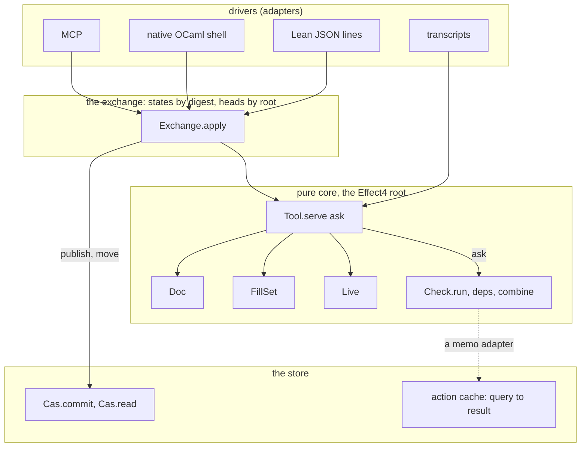
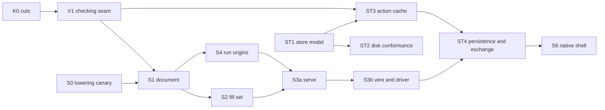

# The authoring system's seams: interfaces, data structures and calculations

Status: design proposal for review (history, not authority). Base: `774ddc3d7` on
`refactor/phase1-phase3`, where the authoring branch is merged. Inputs: nine parallel designs in
`designs/`, three seams under three constraints each, from the common brief `brief-common.md`. The
other inputs are the composition plan (`docs/research/2026-10-17-session-composition/plan.md`, version 2), the layout note
(`docs/research/2026-10-17-authoring-and-store/README.md`) and the store review
(`docs/research/2026-10-17-ocaml-estate-review/cas/README.md`). Incremental is out of scope; §5 fixes
the place it plugs in. Codex reviews this note before the full Lean type signatures are written.

## The one thing to know first

Every value the authoring system hands around is one shape: first-order data, a private
constructor, and an erased proof that a replay produced it. `Live` already has that shape. The
document, the fill set, the tool's state, the store and the verdict memo take it too. So one rule
covers persistence, transfer and the native side: a value travels as its data, and the receiver
rebuilds the proof by replaying. Three seams carry the system: the protocol (`serve`), checking
(`run` over one complete key), and the store (`commit` and `read`). Each has two adapters today.

## 1. The seam map



The diagram records the data flow only. It is not proof evidence.

| Seam | Interface | Adapters today | Adapters next | Category |
| --- | --- | --- | --- | --- |
| protocol | `Tool.serve` | Lean JSON driver; transcripts; the view tool | the native shell; MCP | in-process |
| checking | `Check.run`, with `ask` | pure `run`; the list memo | the store's action cache; Incremental | in-process; local-substitutable |
| store | `Cas.commit`, `Cas.read` | Lean `Store` (the model); `E4_cas` (the disk) | a far tier | in-process; local-substitutable |
| exchange | `Exchange.apply` | the Lean driver with a resident table | the native shell over `E4_cas` | local-substitutable |

## 2. The certified-value pattern

| Value | Data | Erased witness | Rebuilt by |
| --- | --- | --- | --- |
| `Live` (exists, `src/Effect4/Run/Live.lean`) | a `Run` | `opened`: an open and commands reach it | `LiveRecord.restore` |
| `Doc` | origin, history of accepted actions, cached session | `replayed : replayDoc origin history = .ok session` | `replayDoc` |
| `FillSet` | anchor snapshot, entries | `constructed`: an `add` fold reached the entries | the `add` fold at the anchor |
| `Tool.State` | the raw state | `reached`: a transcript of requests reaches it | `Tool.load`, a replay of the image's transcript |
| `Cas` | nodes, roots | `reached`: a list of transactions reaches them | `Disk.open_`, a replay of the pack in write order |
| `Check.Memo` | entries of keys and verdicts | `valid`: each verdict is `run` of its key | recomputation in verify mode |

- **Why a reachability witness, not an invariant field.** The invariants' proofs need law-module
  lemmas (`FillSet.add_wf`, `CheckCache.insert_valid`), and the core never imports `Effect4.Laws`.
  A witness states only core computations. `Effect4.Laws` derives each invariant from it by
  induction (design A1). This amends the composition plan's §6 `StateInvariant` field.
- **Erasure.** Every witness is a `Prop`, so it erases under the OCaml lowering. A checked package is
  abstract in OCaml as a whole (the estate plan's rule 1).
- **One law shape.** Each value owes its replay law (`journal_replays` for `Live`): replaying its
  data from the start gives it back. Persistence, transfer and Lean/native agreement are that law.

## 3. The protocol seam

### 3.1 Interface

The core is A1's two-constructor request with A2's caller rules; the exchange layer is A3's.

```lean
namespace Effect4.Tool

structure Snap where          -- a snapshot's name inside one state; copied from a reply, never built
  doc : DocId
  revision : Nat

inductive Place               -- where an edit lands, read at the request's snapshot
  | hole (index : Nat)                          -- the one address holding `Sketch.hole app index`
  | at (path : List Nat) (expected : NativeEff)

inductive DocEdit             -- the document's client alphabet, also its history alphabet
  | commit (items : List (Place × Change)) (policy : Policy)   -- ordered; atomic
  | draft (e : Edit)
  | revert (entry : Nat)

inductive Action
  | open (name : String) (app : SigApp) (sketch : Sketch)
  | edit (at : Snap) (e : DocEdit)
  | fill (at : Snap) (batch : List (List Nat × NativeEff))     -- the pending fill set; per-item outcomes
  | publish (at : Snap) | reset
  | start (at : Snap) (budget : Api.Budget) | restore (record : LiveRecord)
  | play (run : RunId) (events : List Run.Event)

inductive Query
  | doc (at : Option (List Nat)) | history | fills | suggest (at : Snap) (place : Place)
  | run (id : RunId) (form : RunForm) | preview (q : PreviewQuery)
  | dry (a : Action)          -- the action's answer, never applied
  | discover                  -- method and codec versions, the catalogue

inductive Request | act (a : Action) | ask (q : Query)

structure Reply where
  result : Except Refusal Answer
  now : Option Snap           -- the document's snapshot after the request

structure State where
  private mk ::
  raw : Raw                   -- document, pending fill set, runs with origins, counters
  reached : ∃ rs : List Request, Raw.replay Raw.empty rs = raw

def serve (ask : Check.CheckInput → Check.Verdict) (s : State) (r : Request) : State × Reply
```

- **Callers copy `now`.** Every reply names the current snapshot, and every edit sends one back.
  The stale check stays exact (`Doc.commit` compares revisions), and a caller never builds a target.
- **`fill` is sugar.** `fill` of one item at a hole is `edit at (commit [(.hole k, .fill q)]
  .keepExactType)`, by definition. The word keeps one meaning.
- **A batch commit resolves in order.** Item `i` resolves at the snapshot after items `0` to `i-1`.
  The first refused item refuses the whole request, and the state is unchanged.
- **`dry` previews any action.** It answers the action's result and applies nothing. It retires
  `Tools.Query`'s `fillPremises` and `omitPremises`.
- **`ask` is a parameter.** Consumers check through `ask`. For any `ask` equal to `Check.run`
  pointwise, `serve ask = serve Check.run` by function extensionality. So a memo, the store's
  action cache or Incremental changes cost, never an answer (§4.3).

| Outcome | Where | State |
| --- | --- | --- |
| a refused request: no document, stale, unresolved selector, a refused batch item, failed admission | `Reply.result = .error` | unchanged; proved once for the wrapper |
| a refused item of a pending fill set | an `AddOutcome` inside a successful answer | accepted items kept |
| a run command whose phase refuses | a successful `played` answer with its phases | the journal grows |

### 3.2 The exchange

```lean
inductive Base
  | state (at : Digest)                    -- an exact state, never stale
  | head (name : RootName) (at : Digest)   -- the session head, by compare-and-set
def Exchange.apply (v : HostView) (b : Base) (ask : …) (r : Request) : Reply × Publish
```

- A state is stored as a `Tree` node (kind 11). Its binding `doc` names the entry chain's head,
  `fills` a tree of pending fillings, and `run/<n>` each run's tape head. The counters derive from
  those bindings. No new
  kind is appended (design A3 asked for kind 24; a `Tree` serves).
- **Two stalenesses stay apart.** A `head` base behind the current head refuses `staleBase`. An edit
  target behind the document refuses `stale`.
- **A host's transaction, in order.** Resolve the base, read the head and call `apply`. On a refusal
  it writes nothing. Otherwise one `Cas.commit` writes the published nodes and moves the head.
- **Load is replay.** `Tool.load` reads the image, derives the transcript (open, the history's
  actions, starts, plays) and replays it. The witness `reached` is that transcript.

### 3.3 Worked calculation

The application `A` has one host row `ask : unit → nat`. Let `h0 := Row.hole "h0" .nat` and
`hole0 := Sketch.hole A 0`. The sketch is `s0 := ⟨.bind (.perform (.external 0) (.lit .unit))
hole0, [h0]⟩`. The state starts at `State.empty`.

| # | Request | Reply | State after | Law |
| --- | --- | --- | --- | --- |
| 1 | `act (open "demo" A s0)` | `opened`: type `nat!never`, holes `[⟨0, h0, [1], ([nat], nat!never)⟩]`; now `n0 = ⟨⟨"demo",0⟩,0⟩` | document at revision 0 | `SourceSession.reached_view` |
| 2 | `act (edit n0 (commit [(.hole 0, .fill (.succeed (.var 1)))] .keepExactType))` | refused: item 0 `notKept`, located at `[1]`: level 1 is unbound in `[nat]`; now `n0` | unchanged | the wrapper's refusal law |
| 3 | the same with `.var 0` | `edited`: revision 1, delta `spliced [[1]]`, holes `[]`; now `n1` | revision 1 | `Doc.commit_sound`, `Sketch.table_fill` |
| 3′ | step 3 again, at `n0` | refused `stale n1` | unchanged | the stale check is exact |
| 4 | `act (start n1 {})` | `started 0`, origin `n1`; awaiting one call on `ask` | run 0, origin `n1` | `Built.ofSketch`, `Sketch.sourceCheck_of_admitted` |
| 5 | `act (play 0 [apply (row "h0")])` | `played 0 [[refused noCall]]` | the journal grows by one | `Api.Runner.step_refused`, `Run.feed_fst` |
| 6 | `act (play 0 (Run.Event.answer k (.success 7)))` | `played 0 …`: outcome finished, exit `success 7` | the journal grows by four | `Live.journal_replays` |
| 7 | `act (fill n1 [([], q), ([9], q)])` | `filled [refused [] root, refused [9] unknownAddress]` | the pending set holds nothing | `FillSet.add_wf` |

Steps 2, 5 and 7 show the three outcome kinds apart. Step 4 admits with `admitProgram` at
`A.withHoles [h0]` and records the origin `n1`.

### 3.4 What goes

`tools/Tools/Session.lean`'s 41-field request, its string dispatch, its nine state fields and its
second `feedStep` go in slice S3b. The tool's two hand-built `Built`s become `Api.Built.ofSketch`.
`fork`, `catalogue`, `sketch`, `view` and `journal` fold into `open`, `discover`, `doc` and `history`.

## 4. The checking seam

### 4.1 Interface

C1's two-constructor key, C3's "kept" rule, C2's located explanations.

```lean
namespace Effect4.Program.Check

inductive CheckInput where                 -- everything one check reads: its bytes are a complete key
  | module (app : SigApp) (holes : RowTable) (program : NativeEff)   -- through layer references
  | part (sig : SigData) (env : TyEnv) (program : NativeEff)        -- a part, or a filling, in context

structure Verdict where                    -- rooted at the empty path
  result : Except TypeRefusal EffTy
  table  : List Table.Entry

def run : CheckInput → Verdict
def deps : CheckInput → List (List Nat × CheckInput)    -- a module's parts at their bases; [] for a part
def combine : CheckInput → List Verdict → Verdict       -- length, formed, admits, layers, atSource
def Verdict.placed (a : List Nat) : Verdict → Verdict
def kept (whole : Verdict) (a : List Nat) (local : Verdict) : Bool   -- the filling has the table's exact type

structure Explanation where                -- a refusal and replayable evidence
  refusal : TypeRefusal
  site : Site                              -- address | inCopy site path | column | application
  part : Option CheckInput                 -- recomputing it reproduces the refusal
```

- **Two questions only.** A module verdict serves the whole-sketch verdict, the entry at an
  address and the type a hole expects. A part verdict serves a filling's certification, the splice
  check and a suggestion.
- **Profiles stay restrictions.** `Run.Kit.check app p` is `(run (.module app [] p)).result`.
  `Api.check` is the module verdict with no holes. Admission (`admitProgram`, `Run.Preview.admit`)
  is not checking: it rebuilds its certificate and reads no memo.
- **"Kept" is the common case.** A `keepExactType` commit at a typed, non-root address asks one part
  verdict. Kept, the table splices with it. Not kept, the commit refuses `notKept focus verdict`
  without building a candidate. Other cases take today's full path.
- **One reading.** `certifiedB` reads the program as written; publication reads through layer
  references. Both move to the part key of the expansion, with a control at a filling beside a
  layer reference (designs C1, C2).

### 4.2 Worked calculation

The application is `{}`, with hole rows `h` and `g` of type `nat`, and `N = EffTy.pure .nat`. The
sketch is `s0 = ⟨.bind (.succeed (.lit (.nat 1))) (.perform (.external 0) (.lit .unit)), [h]⟩`,
and `σ0 = ⟨{}, [h], .root⟩` is its signature data.

| # | Request | Asks | Checked nodes | Answer | Law |
| --- | --- | --- | --- | --- | --- |
| R1 | commit `[1] ← .succeed (.var 0)` | `part σ0 [nat] (succeed (var 0))`: miss | 1 | kept; revision 1, `spliced [[1]]` | `run_placed`, `Sketch.table_fill` |
| R2 | commit `[0] ← .succeed (.lit (.str "a"))` | `part σ0 [] …`: miss | 1 | `notKept ([], N) (ok string)`; state unchanged | the wrapper's refusal law |
| R3 | omit `[0]` as hole `g` | none | 0 | revision 2, holes `[h, g]` | `Sketch.table_omit` |
| R4 | suggest at `[0]`, supplied `succeed (lit (nat 2))` | `part σ1 [] …`: miss | 1 | `exactFit` | `evaluateCandidate_valid_and_sound` |
| R5 | commit `[0] ← succeed (lit (nat 2))` | the same key: hit | 0 | kept; revision 3 | memo validity |

Today's tool checks a filling twice per commit, since it runs `Doc.commit` and then `feedStep`.

### 4.3 Memos and the store

```lean
structure Memo where
  private mk ::
  entries : List (CheckInput × Verdict)
  valid : ∀ e ∈ entries, e.2 = run e.1
def Memo.ask (m : Memo) (i : CheckInput) : Verdict      -- a hit, or run
```

- The memo lives outside the replayed state, as `serve`'s `ask` argument. The native shell's `ask` is
  a closure over a hash table or the store: mutation behind a pure interface (rule 8).
- The store adapter keys by `Query ⟨"check", engine⟩ input` (§5.4). The engine digest names the
  lowered checker (C7). A verify mode recomputes each hit and reports a disagreement as poisoned.

| Law | Statement | Reuses |
| --- | --- | --- |
| `run_module`, `run_part` | the arms are `sourceCheck` with `sourceAnnotate`, and `Annotate.check` at `[]` | `Sketch.sourceAnnotate_eq_sourceTable`, `Annotate.check_eq` |
| `run_placed` | a part verdict placed at `a` is the check at base `a` | `Checker.check_rebase`, `tableAt_rebase` |
| `combine_deps` | `combine i ((deps i).map (run ·.2)) = run i`; depth one | new, from `checkModule` and `annotateModule` |
| `serve_ask` | `(∀ i, ask i = run i) → serve ask = serve run` | function extensionality |
| `commit_kept` | an accepted keep-exact commit had a kept focus; a kept focus with no reference above it splices | `Sketch.check_fill_focusAt`, `SourceSession.feed_coherent` |
| `explain_replays` | recomputing an explanation's part reproduces its refusal, placed | `Checker.check_rebase` |

## 5. The store seam

### 5.1 Interface

B1's two entry points over B3's durable model, B2's derived action plane and root policies.

```lean
namespace Effect4.Store

inductive Move
  | advance (name : RootName) (expected : Option Digest) (target : AnyRef)
  | record (query result : Digest)
structure Txn where
  nodes : List Node              -- children first
  moves : List Move              -- after every node, in order
inductive Read | node (d : Digest) | name (n : RootName) | results (query : Digest) | closure (r : AnyRef)

structure Cas where
  private mk ::
  store : Store
  durable : Nat                  -- the committed prefix
  reached : ∃ es : List Event, Cas.replay es = (store, durable)

def Cas.commit (s : Cas) (t : Txn) : Except Admission (Receipt × Cas)   -- atomic; the first refusal wins
def Cas.read (s : Cas) (q : Read) : Answer
def Cas.crash (s : Cas) (keep : Nat) : Cas                              -- the model of a killed writer
```

- **One refusal vocabulary.** Lean's `Admission`, extended with `handleInContent` (M2),
  `undecodable` (`Node.read`'s reason), `badName` (M8), `staleRoot name resident expected`, `fork`
  and `poisoned`. OCaml wraps it: `Model of Admission | Capacity of string | Fault of fault`.
  Disk damage and the host's integer width stay outside the model, so the Rocq laws stay as proved.
- **A transaction's nodes are checked in order.** Each node is checked against the store grown by the items before it.
  The refusal order: `Node.read`'s, then `oversize`, `badVersion`, `malformedRef`,
  `handleInContent`, then the edges, spec first.
- **Roots move by compare-and-set on the resident digest.** A root's kind sets its policy:
  `journal` roots must fast-forward (the new target references the old head, else `fork`), a `pin`
  never moves, others swap. A head digest names its whole history, so a root that returns to an old
  value cannot fool the check. The version stays as a derived count: the revision counter that
  cancels stale work.
- **The action cache is derived.** A result node names its query by an edge. `record` refuses
  `poisoned` when a different result for the query is resident, and writes nothing. No new file:
  the disk's dependents index answers `results`.

### 5.2 Refinement between the two adapters

| Clause | Meaning |
| --- | --- |
| the relation | the disk's image (roots, records in write order, durable count) equals the model's, byte for byte |
| capacity | the disk refuses a frame past its integer width, and the model takes no step |
| fault | a record that does not hash to its digest, or does not decode; no command produces one |
| otherwise | both answer alike, and the images stay equal |

The facts both sides duplicate today are generated from Lean: the kind table, `RootKind.byte`,
`Kind.runRelative`, `Admission.ofRead` (one decode mapping in place of three), `genesisAddress`. A
qcheck-stm differential runs event tapes, crashes at every cut included, through both adapters.

### 5.3 Worked calculation

The values are the golden nodes: `S` (`probeSchema`), `E` (`probeEntry`), a forged occupant `O`,
`T` (`treeNode`) and `U = ⟨0, tree, s, ref 11 t⟩`. Lowercase letters are addresses.

| # | Event | Answer | Model after | Law |
| --- | --- | --- | --- | --- |
| 1 | `commit ⟨[S, E], []⟩` | fresh `s`, fresh `e` | `[s, e]`, durable 2 | `putNode_fresh` |
| 2 | `commit ⟨[E], []⟩` | duplicate `e` | unchanged | `putNode_duplicate`; Rocq `put_get` |
| 3 | `commit ⟨[], [advance "docs/a" none ⟨export, e⟩]⟩` | moved, version 1 | root `docs/a ↦ e` | `putRoot_root?` |
| 4 | the same move again | duplicate | unchanged | a retry is idempotent |
| 5 | `advance "docs/a" none ⟨export, s⟩` | refused `staleRoot "docs/a" (some e) none` | unchanged | the wrapper's refusal law |
| 6 | the harness forges `(r, O)` below the watermark, then `commit ⟨[R], []⟩` | disk: `Fault (Corrupt r)`; model: conflict | unchanged | Rocq `put_conflict_collision` |
| 7 | `commit ⟨[T, U], []⟩`, then `crash 1` inside the write | recovered: `t` kept, `u` cut | `[s, e, t]`, durable 3 | `crash_prefix`, `crash_closed` |
| 8 | `commit ⟨[q, r1], [record q r1]⟩`, then the same query with `r2` | recorded; then refused `poisoned q r1 r2` | one result for `q` | `record_poisoned` |

### 5.4 What the store holds

| Value | Carrier (kind) | Root | Rebuilt by |
| --- | --- | --- | --- |
| a program | `Eff NativeOp` (5) | none | exact decode |
| a document | `Entry := origin id app holes (program : Ref NativeEff) \| action (parent : Ref Entry) (act : DocAction) (after : Ref NativeEff)` (7) | `doc/<id>`, journal | `replayDoc`; each `after` is checked against the replayed program |
| a tool state | `Tree` (11): `doc`, `fills`, `run/<n>` | `session/<name>`, journal | `Tool.load` |
| a verdict | `Query κ := ⟨action : ActionId, input : κ⟩` (8), `Answered := ⟨query : Ref (Query κ), output⟩` (9), with `ActionId := ⟨name, engine : Digest⟩` | none | recomputation in verify mode |
| a run | `Job` (16): program, application, binding, budget, row names, engine, `origin : Option (Ref Entry)`; `Tape` (17): job, parent tape, commands; `Receipt` (20) | `runs/<job>`, journal | `LiveRecord.restore` |
| a gate pass | `Query GateInput` with the command in the key; timing as an annotation | none | the gate's rerun |

- A snapshot's store name is its entry chain's last address. Exact equality of snapshots is
  equality of addresses, under collision resistance (C5).
- `after` lets a view draw any revision's program without replay; load checks it, so a false
  `after` refuses (Codex's control R2).
- The gate cache gains its key's missing input: the command. A changed command with unchanged inputs
  reuses an old pass today (`scripts/lib/gate_cache.py`).

## 6. The Jane Street pedigree, and what we took

| Precedent | What it does | What we take | Where |
| --- | --- | --- | --- |
| `Core.Validated` | a private type built only by a validating function | the certified-value pattern; our witness is a replay, so loading is validation | §2 |
| `Base.Result`, `Or_error` | expected failure as a typed value | refusals as values; three outcome kinds; disk faults as values, not exceptions | §3.1, §5.1 |
| `Base.Comparator` | a type witnesses its comparison | typed keys: `RootName` as a subtype, `ActionId`, `CheckInput` | §4, §5 |
| `Core.Stable`, `Stable_unit_test` | versioned types, saved value and byte fixtures | method and codec versions in `discover`; value, JSON and byte fixtures | §3.1 |
| `ppx_expect` | pinned transcripts as tests | the protocol's transcripts through both drivers (`serve.transcript`'s pattern) | §3.2 |
| Jenga and dune's cache | rule digests to outputs; `cache-check-probability`; read-only files | the derived action cache; engine identity in the key; verify mode; sealed segments 0444 | §4.3, §5 |
| Merlin's pipeline | phases keyed by their input's digest | the exchange's states by digest; the memo by key | §3.2 |
| dune-rpc | version negotiation | `discover` | §3.1 |
| ocaml-lsp's `Io.Make` | framing as a functor over a channel | the drivers as adapters of one `serve` | §1 |
| Incremental | stabilization, cutoffs, observers | the place it plugs in: `ask`, and `deps` with `combine` at depth one (graph rule 1) | §4.3 |
| Bin_prot | fast binary codec | not taken: the canonical value bytes are proved exact | — |

Two precedents from outside Jane Street join them: Git's fast-forward for journal roots, and
qcheck-stm's model-based differential for the store.

## 7. Decided in this round

| Question | Decision | Evidence |
| --- | --- | --- |
| request shape | `act`/`ask`, one `serve`, `dry` | one refusal law and one pairing; read-only is a constructor fact (A1) |
| targets | callers copy `now`; `Place.hole` | the view build sends no stale target; the stale check unchanged (A2) |
| state invariant | a reachability witness | invariant proofs need law lemmas the core cannot import (A1) |
| the memo | an `ask` parameter, outside the state | `serve_ask` holds by function extensionality; no doubled surface (amends C3) |
| checking key | `module` and `part` only | five checkers reduce to two questions (C1) |
| state image | a `Tree` node | no consumer needs a new kind byte (B2's rule) |
| root check | compare-and-set on the resident digest, with kind policies | a digest names a history; fast-forward refuses forks (B1, B2) |
| action cache | derived from result nodes; `record` refuses a poisoned write | no new file; at most one result per query (B2, B1) |
| refusal vocabulary | Lean's `Admission` plus OCaml's capacity and fault wrapper | keeps disk facts out of the proved model (B3) |
| agreement | generated facts plus an image differential | duplicates become compile errors (B3) |
| tiers | one tiered store replaces `Word.Layered`, `LocalFirst` and `Cascade.CascadingStore` | three two-tier designs, one consumer each; the gate cache's shared store is the first real consumer (B2) |

## 8. For Codex to weigh

1. `ask` as a function parameter of `serve`: does the native lowering keep it a closure, and does
   any consumer need the learned entries back?
2. A `Tree` node as the state image, against a dedicated kind.
3. Compare-and-set on the digest with fast-forward, against the version check `putRoot` has.
4. The action cache derived from result nodes, against B1's separate binding table.
5. `Entry.action`'s `after` field: worth its bytes, given replay recomputes it?
6. Batch commits that refuse whole, beside fill sets that keep accepted items.
7. One document per state: `Snap.doc` already names a document; is the selector enough later?

## 9. The slices, up to Incremental



The diagram records implementation dependencies, not proof evidence.

| Slice | Deliverable | Acceptance at its own boundary |
| --- | --- | --- |
| K0 | the cut list's "now" rows | narrow builds green; nothing outside the cuts changes |
| S0 | the lowering canary over the real start and load closure | no unknown type; R9 and R13 reproduced |
| V1 | `Check.CheckInput`, `Verdict`, `run`, `deps`, `combine`, `Memo`; consumers over `ask`; `certifiedB` on the expansion | `combine_deps`; `serve_ask`; the layer-reference control; the five-request trace |
| S1 | `Doc` with its history and witness; `DocEdit`; `Place`; `notKept` | the §3.3 trace; false metadata refused (R2); revert selection |
| S2 | the constructed fill set; publication as a history action | the repaired controls; empty follow; stale refusal; reset |
| S4 | `Api.Built.ofSketch`; run origins | a source-typed but unadmitted program refused (R13) |
| S3a | `Tool.serve` with the witness; `dry`; `now` | the three outcome kinds; the refusal law; pairing |
| S3b | the `Tool` and `Check` codec groups; the thin driver; fixtures | missing fields and unknown tags refused; transcripts; old dispatch deleted |
| ST1 | `Admission` extended; `Node.read`; `Cas` with `commit`, `read`, `crash`; root policies; `RootName` | the §5.3 trace; `crash_prefix`; M2's G2 row re-cut |
| ST2 | generated store facts in OCaml; `Disk` conforms; the differential | images equal on every tape; three decode mappings become one |
| ST3 | `Query`, `Answered`, `record`; the store memo adapter; the gate cache's command key | `record_poisoned`; a refused revision then a valid one |
| ST4 | entry chains, `Tree` images, jobs and tapes; `Exchange.apply`; `Tool.load` | `load_nodes`: a state reloads from its own nodes; two stalenesses apart |
| S6 | the native shell over the lowered `serve` and exchange | the native transcript equals Lean's; hostile records refused |

Three seats can run at once: K0 with S0, V1, and ST1. S5a (evidence tooling) runs beside any of them.

## What this note does not establish

- No slice has run. The designs' worked calculations are hand traces. No Lean file checks these declarations yet;
  a probe follows Codex's pass.
- The laws marked new are unproved; the laws cited by name exist in the tree.
- The cut list (`cuts.md`, beside this note) comes from a survey verified against `774ddc3d7`.
