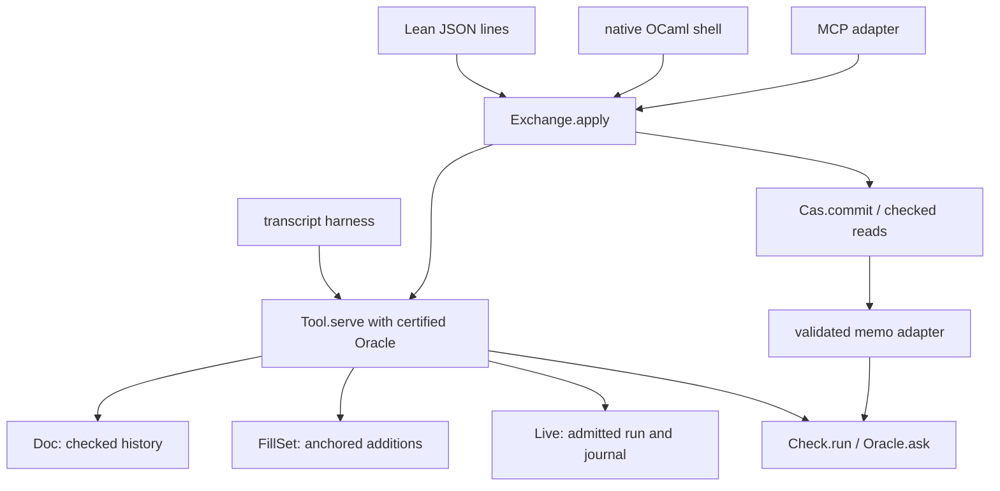
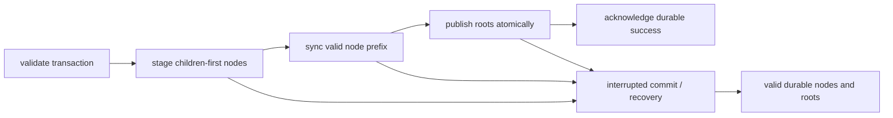
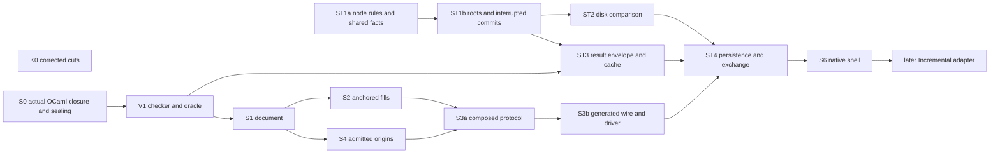

# The authoring system's seams: amended implementation proposal

Superseded by [interfaces.md](interfaces.md) version 2, which folds in this version's contracts.

Version 2 incorporates the [Codex review](codex-review.md) before full Lean type signatures and implementation.
The first work checks the real OCaml boundary and certifies the checker parameter.
Persistent use waits for root generations, interrupted-write semantics, and disk comparison tests.

Status: implementation proposal, not authority or a report of landed code.
Base: `774ddc3d784c0e0a04bd0d1e0bf6556c630074b2` on `refactor/phase1-phase3`.
The owner authorizes these planning amendments for Claude to finalize.
A concurrent [interface draft](interfaces.md) supplies the simpler accepted-action persistence design.
This amendment adopts that design with the executable-history correction below.
The interface draft and its separate probe remain untouched.
[README-v1.md](README-v1.md) and [cuts-v1.md](cuts-v1.md) retain the reviewed drafts without changes.
[ledger.md](ledger.md) maps every review finding to an amendment and its implementation acceptance check.

The inputs remain the nine [designs](designs/), their [common brief](brief-common.md), and these earlier plans:

- [Composition plan, version 2](../2026-10-17-session-composition/plan.md).
- [Authoring and store layout](../2026-10-17-authoring-and-store/README.md).
- [Store review](../2026-10-17-ocaml-estate-review/cas/README.md).
- [OCaml estate plan](../2026-10-17-ocaml-estate-review/plan.md).

This proposal resolves conflicts between those designs for the seams implementation.
It does not amend core authorities, frozen laws, or the coordinator's registers.
Each landing records its required authority changes before proof work.

## 1. One composition and its boundaries

The core composes existing document, pending-fill, and run operations through one `Tool.serve`.
`Eff` remains the program syntax.
Requests describe operations on programs and sessions, not another program representation.
The checking seam answers two existing checking questions.
The store persists first-order data and validates it when rebuilding checked packages.



The diagram names intended consumers and data flow.
It does not claim these proposed interfaces already exist.

| Boundary | Pure owner | Adapter responsibility | Existing reuse |
| --- | --- | --- | --- |
| Protocol | `Tool.serve` | Decode, frame, and render generated requests and replies | `Doc`, `FillSet`, `Live`, and the current tool's callers |
| Checking | `Check.run`, certified `Oracle` | Retain validated memo entries and separate diagnostics | `CheckCache.lookup`, `insert_valid`, suggestion evaluation |
| Store | `Cas.commit`, checked reads | Own physical writes, recovery, capacity, and faults | `Store.putNode`, `Store.putRoot`, `E4_cas` |
| Exchange | `Exchange.apply`, `Tool.load` | Resolve resident states, compare heads, and acknowledge durable publication | Accepted-action replay, entry chains, `LiveRecord.restore` |

The generated OCaml libraries may use Base where its operation fits the declared target contract.
Qualify library operations through the generator's target catalogue.
Keep exact `Nat` and `Int` representations through Zarith where the source requires them.
Generate codecs, adapters, comparison functions, and abstract package interfaces from their owners.
Hand code owns IO, scheduling, and physical storage operations.
It does not reimplement document checks, dispatch, or replay.
These choices follow `ocaml/STANDARDS.md`.

## 2. Checked data and erased evidence

Share the pattern of data plus erased evidence.
Use the predicate each consumer needs, without a generic replay framework.

| Value | Data | Evidence in `Prop` | Validating producer |
| --- | --- | --- | --- |
| `Live` | `Run` | Existing `opened` reachability witness | `Live.open`, checked feeds, `LiveRecord.restore` |
| `Doc` | Origin, accepted history, cached session | Validating document replay returns that session | `replayDoc`, including policy and receipt checks |
| `FillSet` | Exact anchor and ordered entries | Checked additions at that anchor construct those entries | The existing addition fold |
| `Tool.State` | Accepted-action transcript plus cached document, fills, runs, and allocation state | Validating transcript replay returns that raw state | `serve` or checked transcript loading |
| `Cas` | Nodes, roots, durability state | The selected store event language reaches that state | Checked transactions and recovery |
| `Check.Memo` | Keys and verdicts | Every entry equals `Check.run` of its key | Compute, validate, then insert |

`Live.opened` already exists in `src/Effect4/Run/Live.lean`.
Its Lean constructor is public and requires evidence.
Private constructors for new packages are an interface choice, not an existing property of every carrier.
The generated OCaml interface seals the whole checked package, including aliases.
Imported data enters through a validating producer after proof erasure.

The canonical transition uses `Check.run`.
A replacement checker carries its agreement premise:

```lean
-- Proposed contract sketch, not a compiled declaration.
structure Oracle where
  ask : CheckInput → Verdict
  agrees : ∀ i, ask i = Check.run i

def serve (oracle : Oracle) (s : State) (r : Request) : Checked (State × Reply)
```

The checker function is an execution parameter, never stored program content.
`serve_ask` compares semantic outputs under the pointwise agreement premise.
Function extensionality uses that premise.
It does not establish the premise for an arbitrary native closure.
`Checked` carries validated learning entries beside the semantic result, as specified in §4.3.

The representation probe checks erasure for a private carrier and a nondependent certified function.
S0 checks actual start/load dependencies and generated OCaml construction attempts.
A replay theorem does not establish correctness of OCaml compilation or physical storage.
Those boundaries retain separate contracts and tests.

Reuse `List.foldl_append`, `Live.opened_feed`, document transitions, and fill addition.
Core reachability refers only to core computations.
Laws derives the required cross-field properties without a core import of `Effect4.Laws`.

## 3. Protocol and exchange

### 3.1 Requests and observations

Keep `act` and `ask`, a flat answer type, and a separate request-answer pairing relation.
The following is a contract sketch for the full Lean type signatures.

```lean
structure Snap where
  doc : DocId
  revision : Nat

inductive Place
  | hole (index : Nat)
  | at (path : List Nat) (expected : NativeEff)

inductive DocEdit
  | commit (items : List (Place × Change)) (policy : Policy)
  | draft (edit : Edit)
  | revert (entry : Nat)

inductive Action
  | open (name : String) (app : SigApp) (sketch : Sketch)
  | edit (at : Snap) (edit : DocEdit)
  | fill (at : Snap) (batch : List (List Nat × NativeEff))
  | publish (at : Snap)
  | reset
  | start (at : Snap) (budget : Api.Budget)
  | restore (record : LiveRecord)
  | play (run : RunId) (events : List Run.Event)

inductive Query
  | doc (at : Option (List Nat)) | history | fills
  | suggest (at : Snap) (place : Place)
      (supplied : List NativeEff) (limit : Nat) (cursor : Nat)
  | run (id : RunId) (form : RunForm)
  | preview (query : PreviewQuery)
  | dry (action : Action)
  | discover

inductive Request | act (action : Action) | ask (query : Query)

structure Reply where
  result : Except Refusal Answer
  now : Option Snap

-- Answer includes .dry (Except Refusal ActionAnswer).
-- State retains its accepted-action transcript as data, with a replay equation.
```

Copy `Reply.now` into later edit requests.
A `Snap` identifies a revision inside the resolved base state.
It does not name a branch globally.
`Place.hole` requires an in-range row with exactly one source occurrence.
Zero occurrences and multiple occurrences produce distinct located refusals.
`Place.at` checks the expected source program at its path.

| Operation | Acceptance rule | Visible state change |
| --- | --- | --- |
| Checked batch | Reject an empty batch. Resolve items sequentially against a temporary document. A later refusal discards every temporary edit. | One accepted `DocEdit` appends one history action and advances the revision once. |
| Pending `fill` | Run checked additions at the exact anchor. Return every item outcome. | Retain accepted items, without creating document revisions. |
| `publish` | Check the anchor, materialize in the stored order, and validate the resulting document action. | One accepted history action. Refusal leaves both document and pending set unchanged. |
| `reset` | Discard pending additions. | Keep the document and live runs. |
| `play` | Fold events through `Except` over a temporary `Live`. An unresolved selector refuses the whole request. | Publish the temporary run only after all selectors resolve. Refused command phases remain recorded outcomes. |
| `dry` | Run the simulated action and return its `Except` inside a successful query answer. | Keep the original semantic state and outer `now`. |
| Other queries | Read the requested observation. | Keep the semantic state. The external memo may learn. |

Pending `fill` and immediate checked edits remain distinct operations.
There is no equation making one sugar for the other.
`Doc.commit` in `src/Effect4/Program/Typing/SourceDocument.lean` and `FillSet.add` in `src/Effect4/Program/Typing/FillSet.lean` supply their different behaviors.

`Live.feedAll` retains earlier progress after a later unresolved selector.
The request wrapper therefore uses its own temporary `Except` fold over existing single-event operations.
`Run.Event` in `src/Effect4/Run/Event.lean` remains the event owner.
No second runner transition is introduced.

| Outcome | Reply observation | Semantic state |
| --- | --- | --- |
| Whole request refusal | Outer `.error` with path and reason | Unchanged |
| Pending item refusal | Item outcome inside outer `.ok` | Other accepted additions remain |
| Refused run phase | Phase inside successful `played` | Journal includes the resolved command |

Keep omission undo's allocated hole rows and explicit revert selection.
Keep exact local environments and types for dependent bind replacements.
Use the named materializer's order, without claiming arbitrary raw edit orders commute.
These constraints retain controls R1–R10 from the [composition ledger](../2026-10-17-session-composition/ledger.md).

### 3.2 Accepted-action persistence and exchange

Persist the accepted actions instead of deriving them from a Tree image.
This adopts the concurrent interface draft's simplification after the review.
It removes synthetic opens, reconstructed allocation order, and independently authoritative component histories.
It retains superseded actions and documents, which increases retained data.

The transcript must remain executable data.
An existential witness in `Prop` erases and cannot supply a `List Action` for serialization.
Use this carrier instead of extracting the witness's list:

```lean
-- Proposed carrier contract, with the replay function supplied by the core.
structure State where
  private mk ::
  transcript : List Action
  raw : Raw
  replayed : replayAccepted Raw.empty transcript = .ok raw
```

`replayAccepted` returns `Except`, with the failed action's index and reason.
It refuses a whole-action failure instead of silently dropping that action.
Existential reachability follows from the retained transcript and its equation.
`TranscriptCarrierControl.lean` under `review-probes/` checks the erased-witness obstruction and the retained-data representation.
It does not implement this replay function.

| Session entry | Required stored fields | Validation |
| --- | --- | --- |
| Origin | Protocol version, action-codec version, and engine identity | Supported versions and engine semantics, with explicit migration or refusal |
| Action | Typed parent `Ref SessionEntry`, exact `Tool.Action`, optional `after : Ref NativeEff` | Parent chain, accepted replay at its exact prefix, and exact `after` projection |
| Optional receipt | A reference to recomputed receipt data | Compare with replay. It is not an independent execution authority. |

`SessionEntry` uses existing kind 7.
The action codec represents all payloads as first-order data.
It may factor repeated programs into typed references through the same generated exact codec.
No closure, proof term, or runtime object enters the stored action.
Use typed `Ref` fields for parent, query, program, job, and tape edges.
A raw `Digest` encodes bytes rather than a traversable reference frame.
The new finite control checks that distinction through `Canonical.toVal` and `Val.refs`.
Their owners are `src/Effect4/Store/Domain/Canonical.lean` and `src/Effect4/Store/Domain/Node.lean`.
The entry's optional `after` is `none` exactly when replay has no current document.
A present reference names replay's current document program.

| Request outcome | Session journal rule |
| --- | --- |
| Successful action | Append exactly one action, including mixed fill outcomes and refused run phases |
| Successful action that leaves `Raw` unchanged | Still append. Accepted history is the stored identity. |
| Whole-request refusal | Append nothing and retain the previous state |
| Query, including `dry` and version discovery | Append nothing and retain the previous state |

Keep cache learning, connection negotiation, telemetry, and root generations outside the semantic state.
A no-op reset can therefore change the session head while leaving `Raw` unchanged.
Equal raw states need not have equal accepted histories or addresses.
Equal session content has the named collision alternative, not an assumed injective hash.

Document history, pending anchors, run origins, counters, and run journals are replayed projections of this one accepted history.
Do not introduce a separately writable document entry chain as another session authority.
Standalone `Job` and `Tape` exports may remain for their consumers.
Validate their contents and optional session-origin reference against the corresponding replay prefix.

1. Read and re-hash the named session chain at the untrusted disk boundary.
2. Check kind, spec, format versions, parent order, cycles, and its unique supported origin.
3. Decode every action through the generated exact reader.
4. Replay actions from empty with the canonical checker, refusing the first whole-action failure.
5. Compare every retained `after` and receipt with the result at its exact prefix.
6. Return the retained transcript, its replayed raw state, and the replay equation.

This replay includes historical opens, pending additions, publication, starts, restores, and plays in their actual accepted order.
It therefore retains stale pending anchors and allocation history without deriving a synthetic transcript.
Snapshot starts replay their automatic start command once through the original start action.
Standalone restores reuse their full `LiveRecord`.
Loading computes model state and never repeats external host effects.

Reuse `LiveRecord.restore` in `src/Effect4/Run/LiveRecord.lean`.
Keep its format version, application, program, session name, binding, both budgets, row names, and journal order.
Check a projected run's document origin against its admitted program and application.
A standalone restored run has no invented document origin.
One current document and retained runs remain the supported raw-state shape.
Later multiple-document support also changes queries and action semantics.

```lean
-- Proposed exchange contract.
structure HeadStamp where
  digest : Digest
  generation : Nat

inductive Base
  | state (at : Digest)
  | head (name : RootName) (expected : Option HeadStamp)
```

An absent session head resolves to the designated empty history under checked creation rules.
A present head compares both fields of `HeadStamp`.
A `state` base names an immutable history and permits branching.

1. Decode the envelope with the generated reader and selected method version.
2. Resolve the base and validate its session chain.
3. Compare the requested head expectation before executing the request.
4. Apply `serve` with the certified checker adapter.
5. On whole-request refusal, publish no semantic state change.
6. On accepted action, commit its entry and the expected head move together.
7. Recheck the head inside that commit before acknowledging success.

Queries produce no session entry or head increment.
`staleBase` names a changed store head.
`stale` names a changed document revision inside the selected base.
A race after step 3 returns `staleBase` at step 7, including an A→B→A race.
Physical orphan nodes belong to recovery, not a successful state transition.

Session entries use journal roots with their designated parents.
Optional standalone run tapes use their own designated-parent journals.
Swap roots remain supported for consumers that replace immutable snapshots without a parent chain.

### 3.3 Corrected protocol calculation

Use application `A` with `ask : unit → nat` and hole row `h0 : nat`.
The sketch binds the host call and then uses `Sketch.hole A 0`.
The finite protocol probe checks the existing operations below.
New replies, identifiers, and atomic wrapper behavior remain implementation obligations.

| Row | Request or operation | Expected observation | Evidence scope |
| --- | --- | --- | --- |
| 1 | Open the sketch | `nat!never`, hole at `[1]`, environment `[nat]`, revision 0 | Existing source checking, finite P probe |
| 2 | Fill that hole with `succeed (var 1)` | Located refusal. Proposed reply uses `notKept`. | Existing commit refuses. The new refusal shape is proposed. |
| 3 | Fill with `succeed (var 0)` | Revision 1, no remaining hole occurrence, splice `[1]` | Existing commit, finite P probe |
| 3′ | Repeat at revision 0 | `stale`, no state change | Existing stale check |
| 4 | Start revision 1 | Full `admitProgram` at `A.withHoles [h0]`, then `Live.open`, then `.start`. The run awaits `ask`. | Existing operations, finite P probe |
| 5a | Play `apply (row "h0")` | Unresolved selector, whole-request refusal, no new command | Finite P probe |
| 5b | Play `apply (row "ask")` before a reply | Successful `played`, phase `noCall`, journal grows by one | Finite P probe |
| 6 | Receive the key's success value 7, apply that key, then flush | Exit `success 7`, four additional commands | Finite P probe. There is no `Run.Event.answer` declaration. |
| 7 | Add pending fills at `[]` and `[9]` | Root and unknown-address item refusals inside a successful reply | Existing additions, finite P probe |

S1 checks rows 1–3′.
S3a checks the full trace through the new dispatcher.
S3a also checks a resolved event followed by an unresolved event for atomic rollback.

### 3.4 Caller migration

Move both current hand-built `Built` callers to `Api.Built.ofSketch` in S4.
Require full `admitProgram`, not only `Run.Kit.admit`.
Move the JSON driver and view tool onto generated requests and replies in S3b.
Generate the MCP constructor catalogue from the same request owner.
Delete the old string dispatcher, parallel state fields, and duplicate `feedStep` after their callers pass the new transcripts.
Retire the old premise-only query paths when `dry` supplies their observations.

## 4. Checking and learned results

### 4.1 Keys and depth-one dependencies

Keep two first-order checking keys:

```lean
inductive CheckInput
  | module (app : SigApp) (holes : RowTable) (program : NativeEff)
  | part (sig : SigData) (env : TyEnv) (program : NativeEff)

structure Verdict where
  result : Except TypeRefusal EffTy
  table : List Table.Entry

-- Dependencies carry a role and a projection, not only an address prefix.
def run : CheckInput → Verdict
def deps : CheckInput → List Dependency
def combine : CheckInput → List Verdict → Verdict
```

Reuse `SigData`, `sketchSigData`, and candidate evaluation from `src/Effect4/Program/Typing/CheckCache.lean`.
A module key carries every input read by source checking.
A part key carries its application context, local environment, and contextually expanded program.
Program admission remains a separate validating computation and reads no verdict memo.

| Connector to the existing owner | Required equation or restriction |
| --- | --- |
| `run_module` | The result is `Sketch.sourceCheck ⟨program, holes⟩ app`, and the table is `Sketch.sourceAnnotate ⟨program, holes⟩ app`. Both owners live in `src/Effect4/Program/Typing/Source.lean`. |
| `run_part` | The verdict rearranges the result and table of `Annotate.check sig.signature env [] program`, from `src/Effect4/Program/Typing/Annotate.lean`. |
| Depth one | A part has no dependencies. Every module dependency is a part. |
| `run_placed` | Placing a part verdict agrees with checking at that base address, including refusals and table entries. |

Assemble the expansion's table before applying `Table.atSource` from `src/Effect4/Program/Typing/Source.lean`.
Use the original source's reference sites and `firstRefFault`.
Apply the layer projection before that source filtering and root replacement.
This removes copied addresses while retaining the source observation.
`combine_deps` alone would establish only internal consistency without these owner connectors.

`combine_deps` has observation `combine i ((deps i).map (run ∘ Dependency.input)) = run i`.
Freeze the dependency roles and address projections before stating that goal.

| Decomposition case | Required rule |
| --- | --- |
| Reference fault | Retain `firstRefFault` precedence before structural module checks |
| Definition and body | Retain length, formation, declared-column compatibility, and application checks |
| Non-program table entry | Construct the same entry as whole-module annotation |
| Nonempty layers | Reuse `Part.layersProgram` in `src/Effect4/Program/Typing/Parts.lean`. Project synthetic `[0,0] ++ p` to source `[2] ++ p` and remove wrapper entries. |
| Empty layers | Return the existing empty-spine check and table entry directly. Do not ask an empty `mergeAll` part. |
| Wrong dependency count | Fall back to `run i`. Roles come from `deps i`, not from caller-supplied labels. Never accept a partial table. |

The finite checking probe refutes a simple prefix-only layer projection.
It also distinguishes empty layer checking from empty `mergeAll` checking.

### 4.2 Contextual certification and the splice guard

Change `certifiedB` in `src/Effect4/Program/Typing/FillSet.lean` and its dependent laws together.
Form the relevant context from the whole candidate's source expansion.
Expanding the proposed filling alone can lose its reference targets.
Reading the unexpanded focus can lose the environment beside a reference.

For a typed non-root focus, `keepExactType` compares the local environment and exact result type.
A mismatch returns located `notKept` without accepting the candidate.
A kept focus permits a local table splice only under the existing whole-expansion comparison.
Editing a layer can alter reference copies outside the target.
Absence of a reference above the target does not discharge that check.

Reuse the comparison and full-check fallback in `SourceSession.feed`, `src/Effect4/Program/Typing/SourceSession.lean`.
Re-freeze `Certified`, `fills_compose`, `materialize_refFree`, and their consumers in `src/Effect4/Laws/Program/FillSet.lean`.
Retain each raw-base, reference-free, and signature-support premise until its replacement is proved.
The D4, D5, and D9 controls remain required.
No theorem migrates merely by renaming the checker.

### 4.3 Memo learning and semantic replies

Return learning entries beside each consumer's semantic value.
This adopts the concurrent draft's writer pattern for pure and native drivers alike.
The writer uses the existing list monoid, not another effectful program language.

```lean
-- Proposed contract sketch. The whole Checked package is abstract in OCaml.
structure Checked (α : Type) where
  private mk ::
  value : α
  trace : List (CheckInput × Verdict)
  valid : ∀ e ∈ trace, e.2 = run e.1

structure Memo where
  private mk ::
  entries : List (CheckInput × Verdict)
  valid : ∀ e ∈ entries, e.2 = run e.1

def Memo.oracle : Memo → Oracle
-- Memo.learn consumes a Checked package and uses its trace validity internally.
-- Memo.import recomputes untrusted entries before inserting them.
```

`Checked.ask` records the key and the certified answer once.
`pure` records nothing, and composition appends the ordered traces.
`Checked.valid` is erased, while the generated interface keeps the whole package abstract.
Only validated producers construct it.
`Memo.learn` accepts that package rather than an arbitrary native list with an erased proof argument.
A public pair of a value and an arbitrary list cannot cross this boundary.
Use the existing lookup and insertion laws when implementing `Memo.learn`.

An immutable `Memo.oracle m` alone does not retain new entries.
The driver consumes the validated trace after the request and retains the returned memo.
This supplies R4→R5 learning in the pure driver as well as the native driver.
A native owned table implements the same lookup-and-learning contract.
It need not mutate through an unrestricted checker callback to provide cross-request learning.
Generate the adapter from that model instead of writing a second cache semantics.

Keep learning outside `Tool.State` and its accepted transcript.
Keep `fromCache`, cache contents, timing, and counters outside semantic `Reply.result`.
Suggestion replies retain evidence about candidates, not the cache that computed them.
`serve_ask` compares next semantic state and semantic reply.
Diagnostic observations may differ between adapters.

Persistent results enter a memo only after validation against `Check.run`.
Recompute every imported checker result before certified insertion.
A later in-process hit may reuse that validated entry.
A cold stored cache therefore does not promise avoidance of recomputation in this plan.
Engine identity and unique storage do not prove that a result is correct.
Sampling verification, as in Dune, remains a host diagnostic rather than a constructor of `Memo.valid`.

### 4.4 Checking calculation and explanations

Use the reference-free sketch from the reviewed five-request calculation.
Keep the supplied candidate, limit, and cursor in the suggestion request.

| Row | Operation | Expected semantic observation | Cost claim |
| --- | --- | --- | --- |
| R1 | Replace `[1]` with `succeed (var 0)` | Revision 1, splice `[1]` | One part lookup is proposed. |
| R2 | Replace `[0]` with a string result | `notKept`, unchanged document | Proposed refusal shape. Current commit reports `typeChanged`. |
| R3 | Omit `[0]` as hole `g` | Revision 2, holes `[h,g]` | Existing reference-free splice applies. |
| R4 | Suggest supplied `succeed (lit (nat 2))` | `exactFit` | The driver learns the validated trace containing this miss. |
| R5 | Commit that candidate at `[0]` | Revision 3, splice `[0]` | A hit only when the driver retains R4's learned memo. |

The finite C probe checks these values through existing operations.
V1 checks the new memo's learning behavior.
S3a checks the composed calculation.
Measure checking, source expansion, table construction, hashing, and lookup separately.
Do not infer a cost theorem from these finite observations.

Explanations distinguish local failures from aggregate failures.
A local explanation may name a replayable part key and its address projection.
`explain_replays` applies only when that part produces the refusal.
A declared-column mismatch may follow a successful part check.
Such a refusal names the whole module key and its aggregate check.

## 5. Store, persistence, and physical execution

### 5.1 Transaction and read contracts

Keep `Store.putNode`, `Store.putRoot`, and `Store.get` as the existing owners in `src/Effect4/Store/Domain/Store.lean`.
The proposed `Cas` composes them with explicit result and root rules.

```lean
-- Proposed shapes. Full refusal types and receipt fields follow the frozen order below.
inductive Move
  | advance (name : RootName) (rootKind : RootKind)
      (expected : Option HeadStamp) (target : AnyRef)

structure Txn where
  nodes : List Node
  moves : List Move

def Cas.commit : Cas → Txn → Except Admission (Receipt × Cas)
-- Typed reads check format version, kind, spec, and exact payload decoding.
-- Raw reads remain explicitly raw and do not construct checked packages.
```

`RootKind` selects an immutable policy under checked creation.
Creation also fixes the target content kind, which later moves must retain.
Generate the agreed Lean/OCaml kind table, including the intended `Registry` and `Pin` consumers.
Do not infer the root policy from the target's content kind.

Raw bytes first pass `Node.read`.
A typed `Node` starts at node admission and cannot incur an invented byte-parser error.
Then check bounds, version, malformed references, M2's handle restriction, and edges in their declared order.
The spec edge comes first.
A resident address does not waive structural or edge checks.

Preflight nodes in order against the temporary store grown by earlier nodes.
Then preflight moves in order against the temporary roots grown by earlier moves.
Return the first semantic refusal without changing the published model state.
Keep disk `Capacity` and `Fault` observations outside `Admission`.
Physical failure may leave staged bytes, which the recovery contract handles.

Checked typed reads add version and spec checks to today's kind-and-payload read.
Use exact payload decoding and an explicit expected carrier schema.
Re-hash fetched bytes at the untrusted disk boundary.
Neither exact syntax decoding nor a matching spec performs program admission.

### 5.2 Root generations and retries

Compare the expected digest and generation before target validation.
This retains current stale-first behavior when the request also has a wrong-kind target.
An A→B→A sequence changes the generation and rejects an old expectation.

| Root operation | Rule |
| --- | --- |
| Create | Require expected absence, a valid name, an explicit root kind, and a checked target. Initial generation is 1. |
| Move to a different target | Require the current `HeadStamp` and the immutable root kind. Advance the generation once. |
| Retry with an old expectation | Refuse `staleRoot`, even when the target now equals the requested target. |
| Repeat with a fresh expectation and identical target | Return duplicate without changing the generation. |
| Pin | Allow checked creation and identical-target duplicate. Refuse a changed target. |
| Swap | Allow a checked target after the expectation check. No parent chain is claimed. |
| Journal | Require a valid designated-parent chain from the new target to the resident head. An incidental reference is insufficient. |

Journal validation checks the carrier, acyclic history, and parent relationship.
Session entries and standalone run tapes supply those parent fields.
A transaction may append several checked entries before moving the journal head.
Their designated parent chain must reach its expected head.
This proposal chooses strict generation checking over success for an obsolete retry token.
It adds no retry-receipt authority or independent idempotency table.

### 5.3 Derived action results and trust

Retain `Query` at kind 8 and results at kind 9.
Generate one common outer result envelope with its designated query reference and canonical output value.
Reserve one versioned wire grammar for all kind-9 nodes.
Keep output as a traversable value tree so its reference edges remain visible.
Typed action adapters decode that output at their declared carrier.
The envelope's format and common reader are prerequisites of result insertion.

Every result-node insertion path into a certified `Cas` enforces the same association rule.
A raw `Store` remains raw and cannot bypass the `Cas` constructor.
The native writer exposes no mutation path around those transaction checks.
That includes raw transaction nodes, import, and recovery.
Reject malformed envelopes and query references that fail their checked read.
For one query, accept only the same canonical result-node identity after the first insertion.
A distinct result refuses `poisoned` before publication.

Remove `Move.record` from the proposed interface.
Inserting an `Answered` node performs the association check and reports fresh or duplicate.
An empty move list cannot bypass the rule.
The dependents index supplies candidates, not accepted associations.
Filter candidates by envelope version, intended schema, and designated query field.
Unknown envelope versions refuse at insertion.
An unknown action-specific output may remain untrusted content and refuses at typed consumption.
Rebuild that index from accepted nodes.

This is a proposed reservation of the currently unused result kind for one envelope contract.
It does not claim arbitrary references at kind 9 already satisfy that contract.
The finite store probe demonstrates the existing raw insertion path only.
It does not execute the proposed envelope decoder.

A first wrong answer can satisfy this uniqueness rule.
The store records content, not proof of its execution.
A checker adapter recomputes before constructing `Memo.valid` and rejects disagreement.
Include action name, engine identity, output-format version, and all declared inputs in the query key.
A changed output format therefore names a different query.
A future trust shortcut requires a separate stated host assumption and cannot silently replace this rule.

### 5.4 Interrupted writes and refinement

Keep public `Cas.commit` atomic at its semantic observation.
Model physical interruption from a pre-state, transaction, and internal write cut.
Do not model it as `crash` called after a successful completed commit.



`InterruptedCommit` is the proposed relation over those stages.
Successful recovery retains every previously durable node.
It may also retain a closed durable prefix of this interrupted transaction's fresh records.
Duplicate insertions append no record and do not consume a record cut.
Published roots must name durable checked nodes.
Root publication recovers the entire old or entire prepared new root table.
It never exposes a per-root mixture or a reference into a discarded tail.
A sealed damaged segment produces `Fault` as a value.
It is not a certified `Cas`, a successful semantic commit, or a silently truncated active tail.
Damage inside committed content never permits recovery to discard that content as an uncommitted suffix.

| Refinement component | Required observation |
| --- | --- |
| Image abstraction | Define `Disk.image` as ordered accepted node bytes, checked roots with policies and generations, and the durable boundary. Exclude derived indexes and file offsets unless the claim names them. |
| Ownership | One writer owns mutable disk state. Retained semantic snapshots remain frozen by value or immutable reference. |
| Successful operation | Equal named answers and equal abstract images after the same accepted operation |
| Capacity | Host capacity refusal with no semantic transition |
| Fault | Explicit disk-fault observation and recovery result, outside the reached model carrier |
| Interrupted operation | A physical execution corresponds to a declared cut of `InterruptedCommit` |

Byte equality applies to the canonical node bytes selected by `Disk.image`.
It does not equate mutable handles with pure persistent stores.
Preflight semantic checks and representational capacity before staging bytes.
An unexpected host write failure enters the fault/recovery contract.
No capacity refusal publishes a new root.

Generate kind bytes, root-kind bytes, `Kind.runRelative`, `Admission.ofRead`, and `genesisAddress` from their Lean owners.
Use one generated decode-refusal mapping in ordinary reads, imports, and recovery.
A qcheck-stm harness compares finite command sequences against the pure model.
A separate kill harness interrupts actual writes, syncs, and root publication.
These tests do not establish a universal refinement theorem.

`rocq/StoreLaws.v` currently proves node laws over generated operations.
Its `Built` predicate permits arbitrary roots.
It supplies no root-policy, action-cache, transaction, or crash theorem.
After M2 changes `Store.putNode`, regenerate Rocq and prove the accepted-new-to-old connector needed by reused node results.
That connector retains the same outcome, digest, and node store as the old accepted operation.
Retained interrupted prefixes also need the connector to old `Built`.
Recompile their actual consumers.
Keep `address_inj_resident`'s two own-address lookup premises and equal addresses.
That theorem needs neither global `Addressed` nor a hash assumption.
Other node laws retain their individual premises.
`put_get` additionally excludes conflict, and `put_conflict_collision` requires addressed storage.
`put_ranked` requires the stated prior rank, while `verify_sound` requires `DecodeExact`.
A transferred closure also checks its requested kind, beyond the node-closure theorem.

### 5.5 Corrected store calculations

Define `S = probeSchema`, `E = probeEntry`, and lowercase letters as their computed addresses.
Use the existing golden nodes from the review probes.
These are separate executions, with the evidence boundary stated for each.

| Execution | Operation | Expected observation | Scope |
| --- | --- | --- | --- |
| Ordinary 1 | Commit `[S,E]` | Fresh nodes, then durable acknowledgement | Existing node results. Transaction durability is proposed. |
| Ordinary 2 | Insert `E` again into that checked store | Duplicate | Existing structural and edge premises remain required. |
| Ordinary 3 | Create swap root `docs/a` with expected absence and target `⟨export,e⟩` | Generation 1 | Proposed root contract |
| Ordinary 4 | Repeat the old expected-absence request | `staleRoot` | Strict expectation-first retry rule |
| Ordinary 4′ | Use current stamp and the same target | Duplicate, generation unchanged | Proposed duplicate rule |
| Ordinary 5 | Use expected absence and target `⟨export,s⟩` | `staleRoot` before the target's wrong-kind refusal | Existing stale-first control retained |
| Damaged store | Let `R = E`, `r = address R`. Forge different bytes `O` at disk location `r`, then read or insert `R`. | Disk `Fault` | The forged store is outside addressed/reached storage. No collision theorem applies to this construction. |
| Interrupted write | From a valid pre-state, begin `[T,U]`, with `U` referencing `T`. Interrupt after durable `T` and before durable `U`. | Recover `T`, discard incomplete `U`, retain only valid published roots | Proposed interrupted-write model and physical kill test |
| Action result | Insert `q,r1`, then distinct `r2` for `q`, including with no moves | Second insertion refuses `poisoned` | New universal envelope rule |
| Wrong first result | Insert a unique but incorrect checker output | Store uniqueness may pass. Memo validation rejects it. | Distinct storage and execution judgments |

### 5.6 Stored carriers

Kind bytes come from `Kind.byte` in `src/Effect4/Store/Carrier/Kind.lean`.
Sharing a byte does not identify a payload type.
The checked spec and exact reader make that distinction.

| Carrier | Kind | Root and validation |
| --- | --- | --- |
| `NativeEff` | 5 | Exact syntax decode. Full program admission occurs at its consumer. |
| `SessionEntry` | 7 | Versioned origin or accepted action with parent and optional `after : Ref NativeEff`. Session journal root. Replay validates the action and `after`. |
| `Query` | 8 | Action name, engine identity, and every declared input. No independent root required while retained by an owning object. |
| `Answered` | 9 | Common versioned envelope and designated query reference. Universal insertion checks. Typed output validation at the action adapter. |
| `Tree` | 11 | Remains the generic namespace carrier. No canonical session image is introduced. |
| `Job` | 16 | Saved-record version, application, program, session name, binding, both budgets, row names, engine, and optional session-prefix origin naming its exact document snapshot. |
| `Tape` | 17 | Job, designated parent, and ordered commands. Run journal root. `LiveRecord.restore` supplies full admitted replay. |
| `Receipt` | 20 | Define its observation and retention edge with the first consumer. It does not independently certify execution. |
| Gate query/result | 8/9 | Include command identity in the query key. Keep timing in diagnostics. |

Keep `SessionEntry.action.after` because program views can follow one reference without replaying every predecessor.
Loading still compares that program with replay.
A false `after` must refuse.
Equal addresses identify content only under the named collision alternative or required hash hypothesis.
Do not infer rendering injectivity from hashing.

The existing gate cache checks command equality before reusing a successful pass.
The host probe runs A, then B at the same input key, then B again.
Both different commands execute.
Adding the command to the key separates their cache locations and avoids overwriting one another.
It does not repair false pass reuse.
Keep the existing command check during migration.

C4 remains blocked on the separate shape-rendering repair.
`ShapeDoc.document` omits sum wire tags in the reviewed tree.
The OCaml pin also omits reference kind.
Keep explicit versions, tag checks, reference-kind checks, and canonical byte fixtures.
Adding tags alone does not establish rendering injectivity.

## 6. OCaml pedigree and chosen uses

These sources provide implementation patterns, not imported correctness evidence.
Some belong to the wider OCaml ecosystem.

| Source | Chosen use | Limit |
| --- | --- | --- |
| [Core.Validated](https://raw.githubusercontent.com/janestreet/core/master/core/src/validated_intf.ml) | Checked construction and validating deserialization for sealed packages | Replay is Effect4's validation. The library does not supply its theorem. |
| [Base.Result](https://github.com/janestreet/base/blob/master/src/result.mli) | Generated refusal variants as values. `Or_error` may add boundary context. | Keep machine-readable refusal cases distinct. |
| [Base.Comparator](https://raw.githubusercontent.com/janestreet/base/master/src/comparator_intf.ml) | Generated equality, comparison, and hashing for keys | Its witness identifies a comparison function. Root-name validation is a separate checked constructor. |
| [Stable_unit_test](https://github.com/janestreet/core/blob/master/core/src/stable_unit_test_intf.ml) | Versioned representations and saved value, JSON, and byte fixtures | Finite fixtures do not prove arbitrary version compatibility. Unsupported versions refuse or migrate explicitly. |
| [ppx_expect](https://github.com/janestreet/ppx_expect) | Readable protocol transcripts through both drivers | Changed expectations need review. |
| [Jenga](https://github.com/janestreet/jenga) and [Dune cache verification](https://dune.readthedocs.io/en/stable/reference/config/cache_check_probability.html) | Content-keyed action results and recomputation checks | Jenga is historical. Sampled checks do not establish `Memo.valid`. |
| [Merlin authors' report](https://arxiv.org/html/1807.06702) | Pure request observations and cache-disabled comparison | Do not claim every phase uses an input digest. |
| [Dune RPC](https://ocaml.org/p/dune-rpc/3.24.2/doc/dune-rpc/Dune_rpc/V1/index.html) | Select a supported method version and refuse an empty intersection | `discover` advertises versions. It does not perform negotiation. |
| [ocaml-lsp Io.Make](https://ocaml.org/p/lsp/1.24.0/doc/lsp/Lsp/Io/Make/index.html) | Channel framing outside request execution | The interface also exposes exceptions. The adapter maps its expected faults explicitly. |
| [Incremental](https://raw.githubusercontent.com/janestreet/incremental/master/src/incremental_intf.ml) | Later adapter with explicit stabilization, observer disposal, and chosen cutoff equality | Callback exceptions can invalidate an instance. Depth-one checking is this plan's decomposition. |
| [qcheck-stm](https://ocaml.org/p/qcheck-stm/latest/doc/index.html) | Finite command/model comparison and shrinking | Postconditions receive the pre-command state. Writer kills need an explicit harness. |

Keep the existing exact canonical bytes instead of adding Bin_prot as another persistence encoding.
Use Git's designated-parent fast-forward pattern for journal roots only.
Do not add another scheduler or general dependency graph library during these slices.
Before Incremental, compare semantic transcripts with caching disabled and enabled.
Retain the uncached checker as the test oracle.

## 7. Decisions carried into implementation

These recommendations replace the conflicting choices in version 1.
The coordinator records required authority changes during finalization or the owning landing.

| Decision | Selected contract | Acceptance owner |
| --- | --- | --- |
| Request shape | `act`/`ask`, one dispatcher, nested `dry`, flat pairing relation | S3a |
| Targets | Copied `now`, base-scoped snapshots, unique source hole occurrence | S1 |
| State evidence | Retained accepted-action transcript with a replay equation, and cross-field laws in Laws | S3a, ST4 |
| Memo | Certified oracle outside state, validated writer trace, pure and native learning adapters | V1, S6 |
| Checking key | Module and contextual part, with typed dependency roles | V1 |
| Session persistence | Versioned accepted-action chain, with document/run state as replayed projections | ST4 |
| Root check | Digest plus generation, immutable policy, strict stale-first retries | ST1b |
| Action cache | Common result envelope, universal insertion rule, validated consumption | ST3 |
| Refusals | Ordered semantic `Admission`, separate capacity and disk faults | ST1a, ST1b, ST2 |
| Adapter comparison | Generated shared facts, explicit image abstraction, finite differential and kill tests | ST2, S6 |
| Tiers | Delete unused Cascade. Keep `Word.Layered` and `LocalFirst` until a consumer and connector justify replacement. | K0, later tier slice |

## 8. Resolution of the seven earlier open points

| Earlier point | Resolution |
| --- | --- |
| Checker closure and learned entries | Keep the certified nondependent function boundary. Consumers return a validated writer trace. The driver learns and retains the resulting memo. |
| Tree or new kind | Adopt the later accepted-action chain at existing kind 7. It avoids a derived Tree image and a new kind byte. |
| Digest or version | Compare both. A digest alone accepts an obsolete A→B→A expectation. |
| Derived cache or separate table | Derive from universally checked envelopes. Keep the index rebuildable and imported results untrusted. |
| `after` | Keep the optional reference on session actions and verify it by replay. |
| Atomic batches or partial fills | Keep distinct operations. Empty checked batches refuse. Pending item outcomes remain partial. |
| One document or several | Keep one current document. Document selection alone does not implement multiple-document state or persistence. |

## 9. Phases, slices, and acceptance

The graph describes implementation dependencies, not proof evidence.
K0 runs alongside contract work.
It does not block V1 on cosmetic cleanup.



| Phase | Slice | Deliverable | Acceptance at that slice |
| --- | --- | --- | --- |
| Boundary first | S0 | Lower actual checked start/load dependencies, the certified checker argument, and the validated writer package. Generate sealed interfaces. | No unknown required type. Compile generated OCaml. Reject public-alias construction of checked packages. Retain R9/R13 controls. |
| Independent cleanup | K0 | Corrected rows in [cuts.md](cuts.md), at their stated owners | Narrow builds or host checks for each changed component. No unrelated model change. |
| Pure composition | V1 | Two keys, owner connectors, verdicts, dependency projections, contextual certification, oracle, validated writer trace, and memo learning | `run_module`, `run_part`, `run_placed`, `combine_deps`, source filtering, empty layers, reference-fault precedence, aggregate checks, D4/D5/D9 re-freezing, local explanations, and learned miss/hit behavior. |
| Pure composition | S1 | Replayed document, selectors, ordered atomic batches, receipts, and revert | Protocol rows 1–3′. Ambiguous/missing holes. False metadata. Empty-batch refusal. Late rollback. One revision per accepted history action. |
| Pure composition | S2 | Constructed anchored fills and publication as a document action | Stale nonempty anchor, empty-follow behavior, mixed outcomes, publication rollback, and reset. |
| Pure composition | S4 | `Api.Built.ofSketch`, full admitted starts, origins, and restoration | Source-typed but unadmitted program refuses. Historical origin, row spellings, both budgets, standalone restore, and session name checks. |
| Pure composition | S3a | One `serve`, retained accepted transcript and replay equation, nested `dry`, semantic replies | `serve_ask`, refusal inertness, query inertness, pairing, all three outcomes, full protocol/checking traces, and late unresolved-event rollback. |
| Generated boundary | S3b | Tool/Check codec groups, Lean driver, view caller, generated catalogue | Unknown tags, missing fields, explicit `Option Unit` profile, root diagnostic fallback, supported version selection, and migrated transcripts. Delete old dispatch after these pass. |
| Persistent model | ST1a | `Store.putNode` checks, M2, checked typed reads, generated shared facts | Double-fault controls, kind/spec/version/exact payload checks, untrusted rehash, and regenerated Rocq node results with their connector. |
| Persistent model | ST1b | Root kinds and policies, atomic transactions, staged durability model | ABA refusal, strict retries, designated-parent forks, atomic move rollback, interrupted cuts, and no root into a discarded tail. |
| Physical adapter | ST2 | Owned disk writer, frozen snapshots, `Disk.image`, recovery, differential and kill harnesses | Actual fault cases, sealed corruption as a value, expected capacity behavior, write/sync/publication cuts, and retained-snapshot observations. |
| Persistent results | ST3 | Common result envelope, universal insertion rule, checked action adapter, command-aware gate key | No-move bypass, malformed/imported envelopes, incorrect first result, conflicts, filtered index, engine changes, and repeated gate commands. |
| Persistent composition | ST4 | Session-entry chains, checked projected jobs/tapes, validating replay, exchange | `load_own` for exported transcripts. Historical origins, stale fills, standalone runs, refused stored actions, false `after`, exact versions, parent checks, and both stalenesses. Re-run ST2 with session/result carriers. |
| Native face | S6 | Native shell over generated core and exchange, owned validated cache | Compare native/Lean semantic transcripts, cached/uncached transcripts, imported data checks, and the learning adapter's retained state. |
| Evidence beside slices | S5a | Command receipts and reusable controls | Record exact command, version, result, and bounded evidence scope. |

S0 starts before expensive proof expansion.
V1 contract design can proceed beside S0, but V1 landing waits for its representation result.
ST1a starts independently of protocol work.
ST2 is a required predecessor of persistent use in ST4 and S6.
The ST4 carrier-specific rerun extends ST2's earlier store tests.

Before Incremental, fix observer lifetime, cutoff equality, stabilization points, and exception handling.
Keep depth-one decomposition until a real consumer requires more.
Do not remove key inputs without an equal-verdict theorem for that restriction.

### 9.1 Proof placement and gate discipline

All obligations below are proposed, not proved by this amendment.
Register their exact statements before proof work in the owning slice.
Use the placement in the [composition plan](../2026-10-17-session-composition/plan.md) as the starting point.

| Concept and required property | Question and role | Reach and hypotheses | What it does not establish | Consumer and requirement |
| --- | --- | --- | --- | --- |
| `initial-algebras-folds`: source checking and typed replacement | Extend `source-session-coherent` and `typed-replacement` with `combine_deps`, contextual certification, and guarded splice connectors | Exact module/part verdict, address projection, signature-support premises, whole-expansion guard | Program admission, arbitrary reference edits, or progress | V1, S1, S2; R14 |
| `host-session-protocol`: checker substitution and learning | Proposed oracle and writer-construction connectors consumed by memo validity | Pointwise checker agreement, sealed `Checked` package, valid ordered trace, driver retention | Correctness of an arbitrary native callback or forged unchecked package | V1, S3a, S6; R6, R14 |
| `host-session-protocol`: tool transition property | Proposed `serve_ask`, `serve_refuses`, `serve_answers`, and query inertness | Certified oracle, canonical raw replay, atomic wrappers, semantic reply projection | Native closure correctness or IO rollback | S3a; R6 |
| `host-session-protocol`: typed replay | Proposed start/origin compatibility and state reconstruction claims | Full program admission, record versions, exact origins, ordered commands, retained accepted-action transcript | Repeating external effects or host progress | S4, ST4; R6, R13 |
| `exact-codecs`: checked stored carriers | Proposed typed-read compatibility, envelope validity, and `load_own` | Version/kind/spec, exact decoding, accepted histories, equal replayed state and transcript | Execution truth, shape-rendering injectivity, or hash injectivity | ST1a, ST3, ST4; R13 |
| `translation-simulation`: adapter observations | Proposed store/tool equal-observation claims | Named image abstraction, owned writer, capacity/fault observations, interrupted-commit relation | Universal host correctness from finite tests | ST2, S6; R13 |

Existing registry claim names come from `tools/ProofGraph/Registry.lean`.
Propose missing properties in the receipt before adding their planned goals.
Keep core independent of Laws.
Run narrow builds, then `#axiom_audit` for landing modules and the behavior gates the change reaches.
The finite review probes do not replace those landing checks.

## 10. Evidence and handoff limits

The review's `review-probes/results.json` records successful Lean finite probes for protocol, checking, store, and mirror controls.
`review-probes/host-probes.log` records the gate-cache and allocation host tests.
The review names the exact commands and their bounded observations.
Those probes run existing operations and targeted representation examples.
They do not compile this proposed interface or prove its new laws.

This amendment changes planning documents only.
The [ledger](ledger.md) records its checks and remaining implementation obligations.
Claude's next step is to finalize the full Lean type signatures against these contracts and dispatch S0, V1 contract work, and ST1a.
Do not report a slice as landed from this document alone.
