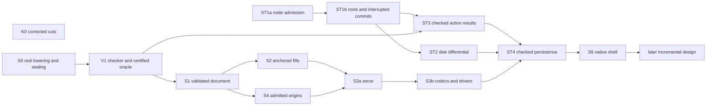

# 2026-10-17 seams review

The first implementation work is the certified checker boundary and its cache contract. The proposed arbitrary `ask` cannot justify the returned state's replay witness. A unique cached answer can also be wrong. Settle those contracts before moving checking behind the new interface.

The composition remains the right direction. Keep one program representation, the existing edit and run transitions, two checking keys, and generated boundary code. Amend the merged proposal before writing its full Lean type signatures. Several conflicts come from combining designs that make different choices.

Status: research review, not a ruling. Base and head: `774ddc3d784c0e0a04bd0d1e0bf6556c630074b2`, branch `refactor/phase1-phase3`. Three GPT-6.1 specialists inspect protocol, checking, and store concerns. The coordinator verifies their probes and the cleanup claims.

Finishing criteria: answer the ten questions, walk each calculation, rule on every decision and cut, retain executable controls, and leave production files unchanged. The evidence below meets those review criteria. It does not implement the proposed system.

## Verdict by proposal section

| Proposal section | Verdict | Required amendment |
| --- | --- | --- |
| Opening and §1, seam map | holds as an architecture | Call the listed faces intended consumers. `Tool.serve` and `Exchange.apply` do not yet have those adapters. |
| §2, certified values | amend | Share data plus erased evidence. Use replay where there is a transition history, and direct validity for a memo. Native agreement needs a separate boundary argument. |
| §3.1, protocol | amend | Certify `ask`. Separate pending additions from checked edits. Specify unique hole resolution, atomic event batches, `dry`, and batch revision growth. |
| §3.2, exchange | amend | Store the fill anchor and record versions. Specify reconstruction for standalone runs and historical origins. Retain a versioned head comparison. |
| §3.3, calculation | refuted as written | `h0` does not resolve to the remaining `ask` call. `Run.Event.answer` does not exist. The corrected calculation below passes. |
| §3.4, deletions | holds after replacement | Move both callers to the same checked producer. Delete the old dispatcher only after its consumers pass the new transcripts. |
| §4.1, checking | amend | Keep two keys. Add the layer projection and whole-expansion guard. Re-freeze the changed fill certification laws. |
| §4.2, calculation | amend | The reference-free values and revisions check. The proposed request omits supplied candidates. The reported checking costs describe future code. |
| §4.3, memo | amend | State how misses become learned entries. Remove cache provenance from semantic replies. Validate imported answers before constructing a certified memo. |
| §5.1, store | amend | Close result-insertion bypasses. Keep root generations and explicit policies. Separate byte decoding from typed node checks. |
| §5.2, refinement | amend | Specify interrupted writes, ownership, the image abstraction, and the fault observation. Existing Rocq laws do not establish these properties. |
| §5.3, calculation | refuted as one execution | Its forged store leaves the reached domain. Its completed commit cannot then be interrupted internally. Split those controls. |
| §5.4, data | amend | Keep the listed kind bytes and `after`. Restore checked typed reads, the fill anchor, and saved-session identity. Correct the gate-cache claim. |
| §6, pedigree | amend | Keep the patterns, with the narrower claims and direct sources below. Discovery alone is not version negotiation. |
| §7, decisions | amend | The individual verdicts appear below. Digest-only root checking and the claimed cache invariant fail. |
| §8, open points | settled technically below | No additional owner choice is needed for the identified counterexamples. |
| §9, slices | amend | Run S0 early. Split ST1. Make disk conformance a dependency of persistent native use. Move acceptance checks to their actual consumers. |
| `cuts.md` | amend | Most removals hold. Mirror parsing, closure-law citations, and the vector replacement require the corrections below. |

## Findings

Evidence labels name reproducible commands in the final section. `P`, `C`, `S`, and `M` are Lean finite probes. `H` is a host test. `reading X` names a source-search group in `readings.py`.

| ID | Place | Finding | Evidence | Severity | Smallest change |
| --- | --- | --- | --- | --- | --- |
| SM-C-1 | §2, §3.1, §4.3 | Unrestricted `ask` can disagree with the validating replay used by `State.reached`. Function extensionality does not supply its missing premise. | P; reading P, C; proposed signatures | before landing | Pass `ask` with erased pointwise agreement, through one certified oracle. |
| SM-C-2 | §3.1, `fill` | Pending addition and checked commit differ in revisions, root admissibility, history, and partial acceptance. The claimed defining equation is false. | P compares `FillSet.add` and `Doc.commit` | before landing | Keep `fill` as pending addition. Use `edit (commit …)` for immediate edits. Delete the sugar equation. |
| SM-C-3 | §3.1, `Place.hole` | One hole row can occur at two addresses in a source-typed sketch. An index does not select one occurrence. | P, `repeatedHole` | before landing | Require an in-range row and exactly one source occurrence. Refuse missing or ambiguous occurrences. |
| SM-C-4 | §3.1, batch and query rules | `Live.feedAll` retains earlier progress after a later unresolved selector. The merged note also loses A1's nested `dry` result. | reading P; A1 `serve_dry`; A2 `commit_appends` | before landing | Fold events through `Except` over a temporary run. Keep simulated refusals inside successful `dry` answers. Specify one revision per accepted `DocEdit`. |
| SM-C-5 | §3.3 | The selector and compound event do not produce the written trace. | P; reading P | before landing | Use the live `ask` selector. Spell reply handling with existing receive, apply, and flush events. |
| SM-C-6 | §3.2, state image | Current document plus pending entries loses the pending anchor. Two such images can differ in publication admissibility. | P, `oldFills` and `freshFills`; A3 `Image.fills` | before landing | Retain `Ref Entry` for the anchor and validate it during reconstruction. |
| SM-C-7 | §3.2, `Tool.load` | The listed transcript omits pending additions and standalone restoration. Retained runs can also originate before the current document. | reading P; `LiveRecord.restore`; A3 load algorithm | before landing | Derive and validate every component's history, then reconstruct allocation order. Include `restore`, anchored additions, and historical document openings. |
| SM-C-8 | §4.1, dependencies | Layer checks need projection through synthetic wrapper addresses. Empty layers also differ from an empty `mergeAll` check. | C; reading C, `Part.layersProgram` and `Checker.checkLayers` | before landing | Tag dependency roles. Project `[0,0] ++ p` to `[2] ++ p`, remove wrapper entries, and handle the empty spine directly. |
| SM-C-9 | §4.1, `certifiedB` | Raw focus and expanded source focus disagree beside references. Expanding a filling in isolation also loses its reference targets. | C; reading C, F | before landing | Build the contextual part from the candidate's whole expansion. Change the certification predicate and its dependent laws together. |
| SM-C-10 | §4.3, `commit_kept` | Absence of a reference above the target does not make a local splice sufficient. Editing a layer changes copies elsewhere. | C, external-reference-copy control; `SourceSession.feed` | before landing | Keep the existing comparison of the whole expanded edit. Recheck when that comparison fails. |
| SM-C-11 | §4.2–4.3, learning | Immutable `Memo.ask` returns no updated memo. R4 cannot cause R5's hit through that signature. `suggest` also omits candidates, limit, and cursor. | reading C; C's current suggestion trace | before landing | Restore a learning adapter and the caller's suggestion inputs. Retain the pure oracle as the consumer boundary. |
| SM-C-12 | §4.3, answer equality | Existing suggestion evidence exposes `fromCache`, and `SuggestResult` exposes the cache. Those observations distinguish cached and uncached answers. | reading C; `CheckCache.Evidence` | before landing | Adopt C2's semantic answer projection. Keep cache diagnostics outside `Reply.result`. |
| SM-C-13 | §4.3, explanations | A whole-module refusal need not come from a failing part. A successful body check can fail declared-column compatibility. | reading C; `Checker.checkModule` | before landing | Restrict `explain_replays` to local failures. Use the whole key or an aggregate witness for other refusals. |
| SM-C-14 | §5.1, derived action cache | Two result nodes naming one query enter through ordinary node insertion. An empty move list bypasses `record`. | S, `withBothResults` | before landing | Reserve result insertion to `record`, or enforce the same invariant at every result admission and import. |
| SM-C-15 | §4.3, §5.1, cache trust | Uniqueness cannot reject the first wrong answer. An engine digest names code but proves no execution result. | reading S, D; proposed `record` checks | before landing | Keep imported results untrusted. Recompute before certified insertion, or state the separate native trust assumption. |
| SM-C-16 | §5.1, root comparison | A swap root can move A→B→A. Digest equality then accepts an old expectation. `Move.advance` also lacks the policy needed at root creation. | S, `rootA1` through `rootA3`; `Store.putRoot` | before landing | Compare a generation with the digest. Carry an immutable root policy, or define it in checked root creation. |
| SM-C-17 | §5.4, session root | The proposed state tree names components but no previous state tree. It cannot satisfy the stated journal fast-forward rule. | S, state-image edges; reading S | before landing | Use a versioned swap root for session images. Keep journal roots for entry and tape parent chains. |
| SM-C-18 | §5.1–5.3, crashes | A function returning a fully committed `Cas` has no intermediate write for a later `crash` to interrupt. | merged signatures versus B3's staged `Durable` operations | before landing | Model an interrupted commit with internal write events or a relation over pre-state, transaction, and cut. |
| SM-C-19 | §5.2, refinement and Rocq | Byte equality needs a specified image abstraction. Mutable disk handles need ownership. Existing Rocq `Built` permits arbitrary roots. | reading S, D; `rocq/StoreLaws.v` | before landing | Separate node-law reuse from new root, transaction, and durability obligations. Regenerate Rocq after M2. |
| SM-C-20 | §5.3, rows 4–7 | Retry ordering is unstated. Row 5 has two defects. Row 6 uses undefined R/r and violates addressed storage. Row 7 changes the execution model. | S; B3's definitions; reading S | before landing | Specify retry precedence. Separate ordinary, damaged-store, and interrupted-write calculations. |
| SM-C-21 | §5.4, typed data | `Store.get` checks kind and payload, but not spec or version. The proposed `Job` also omits `LiveRecord.session` and its format version. | reading S, P; B2 `Store.read` | before landing | Restore the checked read from B2. Preserve saved-record identity and version in the job representation. |
| SM-C-22 | §5.4, gate cache | The command is absent from the digest but is checked before reuse. The claimed reuse after a command change is false. | H; reading G, `gate_cache.run` | soon | Describe command-in-key as avoiding collisions between cache locations, not repairing false pass reuse. |
| SM-C-23 | K0, mirrors | New keys alone still refuse standalone `function`. Qualified constructor names truncate to `Ty`. | M reads current generated files | before landing | Repair the reader grammar with the keys. Retain explicit census rows for temporarily unreadable type blocks. |
| SM-C-24 | K0, `wf_closed` | A test still references the theorem. Replacing its name with `wf_apply` does not justify the `.mli`'s arbitrary starting-store claim. | reading K, S, D | before landing | Move the test reader. Cite `wfFrom_apply` with its faithful-prefix premises, or narrow the `.mli` claim. |
| SM-C-25 | K0, vector conversion | The array body reduces integer allocation at scale, but not every carrier or size. It also introduces a flat-array capacity bound. | H; `Lcnf_array.to_list`, `E4_trace.to_list` | soon | Keep one owner with a capacity fallback. Report allocation evidence by carrier and size. |
| SM-C-26 | §9, ordering | V1 names `serve_ask` before `serve` exists. S1 names the run trace before run integration. ST2 does not precede persistent native use. | proposal dependency diagram and acceptance table | before landing | Move checks to their consumers and add ST2→ST4/S6. Split node admission from root transactions and durability. |
| SM-C-27 | §6, pedigree | Comparator witnesses, discovery, and Merlin caching support narrower claims than the proposal makes. | primary sources in the pedigree table | soon | Use each precedent at its documented observation. Add uncached-versus-cached transcript comparison. |

## 1. Certified values and OCaml lowering

The common pattern is data with erased evidence. It does not require one generic wrapper or one identical proof predicate.

| Value | Verdict on the witness | Existing owner and implementation consequence |
| --- | --- | --- |
| `Live` | holds for reachability | `Live.opened` in [Run/Live.lean](/Users/pooks/Dev/lean4-effect4/src/Effect4/Run/Live.lean) already describes an open followed by commands. Its Lean constructor is public, although construction requires evidence. |
| `Doc` | holds after S1 | Use validating replay over origin and accepted actions. A replay of edits alone does not validate policy or undo metadata. |
| `FillSet` | holds after S2 | Reuse the checked addition fold in [FillSet.lean](/Users/pooks/Dev/lean4-effect4/src/Effect4/Program/Typing/FillSet.lean). Keep its exact anchor and ordered entries. |
| `Tool.State` | holds with a certified checker | Reachability can derive cross-field invariants without importing Laws into core. Every raw transition must actually enforce those invariants. |
| `Cas` | amend | Reachability needs the selected transaction and crash event language. It does not follow from a node-list replay alone. |
| `Check.Memo` | holds as direct validity | Entry equality with `Check.run` is the useful predicate. There is no benefit in inventing a submission history for the memo. |

Use a proposed oracle containing `ask` and `agrees : ∀ i, ask i = Check.run i`. Keep the agreement field in `Prop`. Its pure consumer can then reuse the canonical transition's reachability proof. The conditional `serve_ask` equation holds by function extensionality. It does not certify arbitrary host closures.

P checks a private replay carrier and a checker function with an agreement field. The existing type translator emits `int` and `int -> bool`, with both evidence fields erased. This establishes the representation case only. S0 must still lower real start/load dependencies, compile generated OCaml, and reject construction through public aliases.

Keep `List.foldl_append` for replay composition. Reuse `Live.opened_feed`, the existing document transition, and the fill addition fold. Keep the coalgebra adapter in Laws if a consumer needs it. A new generic replay framework adds no necessary capability here.

## 2. Protocol and the earlier controls

Keep `act`/`ask`, flat answers, and one wrapper for whole-request refusal. Constructor separation helps expose the contract. A theorem must still establish that queries leave the semantic state unchanged.

Use `Answer.dry (Except Refusal ActionAnswer)` inside a successful query answer. The outer `now` describes the original state. A nested simulated answer may describe its proposed result. A cache may learn during this query, since it lives outside the semantic state.

Resolve a commit's items sequentially against a temporary document. Publish one accepted history action and advance the revision once. Refuse an empty checked batch. A later failure discards the temporary result. This follows the merged `DocEdit` history alphabet and avoids A2's incompatible per-item revision rule.

Apply the same temporary-state discipline to multi-event play. An unresolved selector refuses the request and discards earlier simulated events. A command with a refused phase remains a successful played outcome. `Run.feed` and `Live.feedAll` in [Run/Event.lean](/Users/pooks/Dev/lean4-effect4/src/Effect4/Run/Event.lean) and [Run/Live.lean](/Users/pooks/Dev/lean4-effect4/src/Effect4/Run/Live.lean) supply the existing operations.

`Snap` identifies a revision within the resolved state. It does not identify a branch globally. A copied `now` avoids guessed counters but cannot prevent another writer from advancing a head. Keep both staleness checks and the full fill-anchor guards.

### Calculation §3.3

| Row | Checked reading or evaluation |
| --- | --- |
| 1 | P confirms `nat!never` and the `[nat]` environment at `[1]`. Generation allocation and the new reply shape remain proposed. |
| 2 | P confirms refusal for `.var 1`. Today's `Doc.commit` returns `.refused`; the proposed located `notKept` is a new observation. |
| 3, 3′ | `.var 0` commits at revision 1. Reusing the old target refuses as stale. |
| 4 | Full `admitProgram` succeeds at the hole-extended application. Opening followed by `Run.Event.start` reaches the waiting `ask` call. Opening alone does not. |
| 5 as written | `row "h0"` is unresolved. It adds no command. It cannot demonstrate a recorded `noCall` phase. |
| 5 corrected | Applying the live `row "ask"` before binding an answer records `noCall` and adds one command. |
| 6 corrected | Receive the key's success value, apply that key, then flush. P confirms four additional commands and exit `success 7`. |
| 7 | Pending additions at `[]` and `[9]` produce the two stated item refusals. |

### R1–R13 disposition

These controls come from the prior [review and ledger](/Users/pooks/Dev/lean4-effect4/docs/research/2026-10-17-session-composition/ledger.md). This review checks their consequences against the merged proposal. It does not claim a fresh execution of every earlier probe.

| Control | Required disposition in the seams |
| --- | --- |
| R1, omission undo | Revert restores the program while retaining allocated hole rows. |
| R2, false history metadata | Replay validates each action's policy and receipt. Check every stored `after` against replay. |
| R3, equal identity and revision | Scope `Snap` to its base. Keep full anchor equality and the exchange's separate head expectation. |
| R4, accepted pending items | Keep per-item outcomes inside a successful answer. Do not use that operation as atomic commit sugar. |
| R5, refused run phase | Keep a successful played answer and the extended journal. Distinguish an unresolved selector. P repeats this distinction. |
| R6, dependent bind | Keep exact local type and environment certification. Root-type agreement does not substitute for it. |
| R7, canonical fill order | Keep the stored order and the named materializer. Do not claim raw edit orders commute. |
| R8, absent diagnostic location | Generated reading decides acceptance. Supply root path and reason when the diagnostic locator has none. |
| R9, dependent reply lowering | Keep flat `Request` and `Answer` with a separate pairing relation. P checks only nondependent checker functions. |
| R10, enlarged hole signature | Do not claim checker-answer restoration without the signature-support premise. |
| R11, shape digest loses tags | Keep explicit format versions, tag guards, and byte fixtures. C4 remains blocked on the shape rendering repair. |
| R12, `Option Unit` JSON | Choose an explicit field profile that distinguishes absence from a present unit. |
| R13, partial kit admission | Start and restored jobs use full `admitProgram`. Reuse `LiveRecord.restore`, not `Run.Kit.admit` alone. |

## 3. Exchange and reconstruction

Keep kind 11. A dedicated state kind provides no necessary operation. Give the state tree a checked, versioned grammar with unique bindings, canonical ordering, and explicit missing-field rules. The generic `Tree.bindings` field does not enforce unique names by itself.

Retain A3's pending anchor. Reject a fill image whose reconstructed additions produce refusals or different entries. Keep the order that reconstructs the stored fill set. Do not reanchor a stale nonempty set at the current document.

Preserve `LiveRecord`'s format version, session name, application, program, binding, both budgets, row names, and command order. Validate each tape's job and parent references. Validate a claimed document origin against the admitted program and application. A standalone restored run needs no invented document origin.

`Tool.load` can use replay, but its proposed transcript derivation is incomplete. It must reconstruct the origins needed by retained runs, pending additions at their historical anchor, and standalone restorations. Its allocation order must reproduce identifiers and counters. Replaying a plausible transcript is insufficient unless the resulting raw state equals the decoded image's intended state.

Use versioned swap roots for session images. Use journal roots for document entries and tapes with explicit parent edges. At publication, compare the expected head again within the same commit that moves it. A successful base lookup before computation does not close that race.

## 4. Checking and the five-request calculation

Two keys suffice for the proposed checking callers. A module key carries application, holes, and source program. A part key carries signature data, local environment, and the expanded program. Program admission remains a separate validating computation.

Reuse `SigData`, `sketchSigData`, and the suggestion machinery in [CheckCache.lean](/Users/pooks/Dev/lean4-effect4/src/Effect4/Program/Typing/CheckCache.lean). Reuse `Part.layersProgram` in [Parts.lean](/Users/pooks/Dev/lean4-effect4/src/Effect4/Program/Typing/Parts.lean). Reuse source expansion and its fallback in [SourceSession.lean](/Users/pooks/Dev/lean4-effect4/src/Effect4/Program/Typing/SourceSession.lean).

`combine_deps` is a plausible new theorem, with additional data. A dependency needs its role and address projection, not just a base path. Keep definition-column checks, declared-body compatibility, table entries outside programs, and refusal precedence. Keep reference-fault precedence before structural module checks. Handle empty layers without asking the synthetic empty `mergeAll` program.

C confirms the `certifiedB` mismatch. A continuation beside a layer reference has a source focus that raw lookup misses. A filling containing a reference can also fail expansion alone and succeed inside the candidate module. Form its key from that whole context. Keep the whole-expansion comparison before accepting a local splice.

This changes the certification predicate. Revisit `Certified`, `fills_compose`, and `materialize_refFree` in [Laws/Program/FillSet.lean](/Users/pooks/Dev/lean4-effect4/src/Effect4/Laws/Program/FillSet.lean). Their existing raw-base and reference-free premises do not migrate merely by renaming a checker.

| §4.2 row | Checked result | Cost qualification |
| --- | --- | --- |
| R1 | Revision 1, `spliced [[1]]` | Proposed one-part lookup. |
| R2 | String filling refuses without changing the document | Current reason is `typeChanged`. `notKept` is proposed. |
| R3 | Revision 2, holes `[h,g]` | The reference-free omission permits the stated splice. |
| R4 | Supplied natural candidate gives `exactFit` | The existing API accepts supplied candidates and returns a learned cache. The merged query must retain those inputs. |
| R5 | Revision 3, `spliced [[0]]` | A hit requires learning between requests. Today's commit does not consume the suggestion cache. |

The claimed checked-node counts need an instrumented implementation. They do not count table construction, hashing, source expansion, or memo lookup. No cost theorem follows from the finite value trace.

Keep the immutable memo's lookup and learning operation explicit. A native closure may retain the learned table behind a pure observational interface. Its model must still return the same verdict for every key. Remove hit/miss fields from semantic answers before comparing cached and uncached transcripts.

## 5. Store operations, calculations, and proof scope

### Node checks and action results

Reuse `Store.putNode`, `Store.putRoot`, and `Store.get` from [Store/Domain/Store.lean](/Users/pooks/Dev/lean4-effect4/src/Effect4/Store/Domain/Store.lean). Tighten the typed read as B2 proposes. Check version, kind, spec, and exact payload decoding. Re-hash at the untrusted disk boundary.

Freeze two refusal orders. Raw bytes first pass `Node.read`. A value already typed as `Node` starts at node admission. Then apply structural bounds, version, malformed references, M2, and checked edges in the declared order. The spec edge stays first. An existing occupant does not waive these checks: S confirms a duplicate-shaped node still refuses in an unclosed store.

Validate all nodes before moves. Validate moves against the temporary result of earlier moves. Semantic refusal discards the transaction's visible changes. Physical failure belongs to the disk fault and recovery contract, rather than the semantic refusal theorem.

A dependents index is a candidate index. `E4_index.Deps.add_node` in [e4_index.ml](/Users/pooks/Dev/lean4-effect4/ocaml/engine/cas/e4_index.ml) indexes reference occurrences. Decode candidates at the intended result schema and compare their designated query field. An arbitrary reference to the query is insufficient.

Enforce result uniqueness on every insertion path, including imported nodes. Recompute an imported checker result before giving it certified memo status. Keep engine identity in the key. Neither that identity nor collision resistance establishes execution truth.

S uses raw result payloads and `probeSchema` to test existing kind and edge checks. It does not execute proposed `Answered` decoding or `Cas.commit`. The unrestricted insertion path is a defect in the proposed contract.

### Roots and crashes

Retain a generation token for swap roots. S constructs an actual A→B→A sequence whose old generation still refuses. Pin roots require an immutable creation policy. Journal roots additionally require the designated parent relationship and a checked acyclic history. An arbitrary reference to the old head does not establish a valid document append.

Define idempotent retry explicitly. An identical target and policy can return duplicate before the stale-expectation branch. It must not overwrite a newer distinct head. A caller requiring evidence that no intervening mutation occurred must compare the generation even for an equal target.

Specify internal stages for writes, node durability, and root publication. A killed commit may leave a closed prefix of immutable nodes. It must not expose roots into an uncommitted tail. Returning a successful `commit` before introducing these stages cannot model that interruption.

The disk adapter needs one owned writer and frozen published observations. A pure `Cas` value can be retained and branched. A mutable disk handle does not acquire that behavior merely by becoming abstract.

### Calculation §5.3

| Row | Verdict |
| --- | --- |
| 1 | Fresh schema and entry nodes agree with existing `Store.putNode`. The durable count belongs to the new model. |
| 2 | Duplicate entry insertion holds under the resident node's structural and edge premises. |
| 3 | Target insertion and current root movement have existing owners. The proposed policy and expected-digest operation are new. |
| 4 | Duplicate retry needs the explicit ordering above. Current `putRoot` rejects the repeated version. |
| 5 | The expected absence is stale, and the schema target has the wrong kind. S confirms the current stale-first order. Freeze it for the replacement. |
| 6 | Define R and r. Move the forged occupant into a separate damaged-store test. It violates addressed storage, so a collision theorem requiring that premise cannot justify the row. |
| 7 | Use an interrupted-write execution from a valid pre-state. Define the cut as staged records or bytes. The written post-commit crash does not supply that execution. |
| 8 | Conflicting `record` calls are useful controls. Add raw insertion without moves and an incorrect first result. Otherwise the stated invariant remains open. |

### Rocq reuse

`rocq/StoreLaws.v` proves statements over the generated node operations. It does not prove the proposed `Cas.commit`, root policies, disk durability, or cache validity. Its `Built` constructors allow arbitrary roots.

| Existing evidence | Reuse after the change |
| --- | --- |
| `address_inj_resident` | Keep its two own-address lookup premises and equal addresses. It requires neither global `Addressed` nor a hash assumption. |
| Domain separation, kind separation, prefix-free encoding | Keep their stated encoding premises. A wire change needs renewed encoding evidence. |
| `put_get`, `put_grows`, `put_conflict`, `put_ranked`, `built_sound` | Reuse after regeneration and a connector from newly accepted node operations to the old admission result. M2 changes the generated operation. |
| `verify_sound` | Retain its decode and verification premises. Adding M2 does not establish a disk crash property. |
| New root, transaction, cache, and crash claims | Place new obligations before proving them. No current Rocq theorem supplies these conclusions. |

Do not describe a damaged occupant as a hash collision without the addressed-storage premise. Do not call a finite differential a general refinement theorem.

## 6. Stored carriers

The kind assignments match `Kind.byte` in [Carrier/Kind.lean](/Users/pooks/Dev/lean4-effect4/src/Effect4/Store/Carrier/Kind.lean). Sharing a kind requires the checked spec and payload reader.

| Carrier | Kind | Root and reconstruction decision |
| --- | --- | --- |
| `NativeEff` | 5 | No independent root needed. Exact decode supplies syntax, not program admission. |
| `Entry` | 7 | Document journal root. Validate origin, parent, action, and `after` by the document replay. |
| `Query κ` | 8 | No root needed while referenced. Include the action identity and every declared input. |
| `Answered` | 9 | Derived query association, with the universal insertion rule and cache trust distinction above. |
| State `Tree` | 11 | Versioned session swap root. Include image version, fill anchor, document, and run bindings. |
| `Job` | 16 | Preserve all saved-run fields, including session name and format version. Recheck its optional document origin. |
| `Tape` | 17 | Run journal root. Check job identity, parent chain, command order, and full admitted replay. |
| `Receipt` | 20 | Define its observation and retention edge when its first consumer lands. A receipt does not itself admit a run or prove a gate passed. |
| Gate query/result | 8/9 | Include the command to give each action a separate address. Keep command equality at reuse during migration. |

Keep `Entry.action.after`. It stores a reference, not another full program. It permits revision views without replaying every predecessor. Loading must compare it with the replayed program. The representation retains R2's check while providing a useful read path.

The current gate cache already checks the stored command, input key, and successful exit before reuse. H runs command A, changes only the command to B, then repeats B. A and B both execute. Only the repeated B reuses its result.

Keep C4 blocked. `ShapeDoc.document` losing sum tags is separate from node-byte exactness. Fixing one omitted field does not by itself prove rendering injectivity.

## 7. OCaml pedigree

These are implementation precedents, not imported proofs. Several belong to the wider OCaml ecosystem rather than Jane Street.

| Precedent | Verdict and practical use | Primary source |
| --- | --- | --- |
| `Core.Validated` | holds for checked construction. Its deserialization option shows why validation must run when trust or versions change. Replay is Effect4's chosen validation. | [Validated interface](https://raw.githubusercontent.com/janestreet/core/master/core/src/validated_intf.ml) |
| `Base.Result`, `Or_error` | holds for expected failure as values. Keep the generated refusal variant for machine decisions. Use `Or_error` for boundary context, without collapsing distinct refusals. | [Result interface](https://github.com/janestreet/base/blob/master/src/result.mli) |
| `Base.Comparator` | amend. The witness distinguishes comparison functions. It does not validate a root name or certify a subtype. Generate key equality, comparison, and hashing from their owners. | [Comparator interface](https://raw.githubusercontent.com/janestreet/base/master/src/comparator_intf.ml) |
| Stable versions and `Stable_unit_test` | holds for versioned representations and saved fixtures. Value/sexp/byte triples check examples, not arbitrary cross-version compatibility. Keep explicit migration or refusal. | [Stable unit test interface](https://github.com/janestreet/core/blob/master/core/src/stable_unit_test_intf.ml) |
| `ppx_expect` | holds for readable transcripts. Run the same requests through both drivers and compare semantic replies. Review changed expectations before accepting them. | [ppx_expect documentation](https://github.com/janestreet/ppx_expect) |
| Jenga and Dune | amend. Jenga is a historical reference. Dune's verification mode reruns selected cached rules and reports differing outputs. That is a useful host check, not certified memo construction. | [Jenga archive](https://github.com/janestreet/jenga), [Dune verification option](https://dune.readthedocs.io/en/stable/reference/config/cache_check_probability.html) |
| Merlin | amend. Use its pure request boundary and its cache-disabled comparison mode. The reviewed source does not justify “every phase keyed by an input digest.” | [Authors' report, caching sections](https://arxiv.org/html/1807.06702) |
| dune-rpc | amend the adoption. Negotiation selects supported method versions and rejects missing intersections. `discover` alone only advertises them. | [Dune RPC API](https://ocaml.org/p/dune-rpc/3.24.2/doc/dune-rpc/Dune_rpc/V1/index.html) |
| ocaml-lsp `Io.Make` | holds for separating channel framing from request execution. Its interface also exposes an exception. It supplies no typed-refusal guarantee. | [Io interface](https://ocaml.org/p/lsp/1.24.0/doc/lsp/Lsp/Io/index.html), [Make interface](https://ocaml.org/p/lsp/1.24.0/doc/lsp/Lsp/Io/Make/index.html) |
| Incremental | holds after the present seams. Use explicit stabilization, explicit observer disposal, and a deliberate cutoff. A callback exception can invalidate the instance. Depth-one decomposition is Effect4's choice. | [Incremental interface](https://raw.githubusercontent.com/janestreet/incremental/master/src/incremental_intf.ml) |
| Bin_prot | hold the decision not to replace canonical bytes. Another codec adds a compatibility obligation without solving these seam defects. Stable fixture discipline remains useful independently. | Existing `Val.decode_exact` and `Node.decode_exact` in the tree |
| Git fast-forward | hold the parent-chain pattern for actual history roots. It does not justify digest-only comparison for swap roots. | The required local parent relation, specified above |
| qcheck-stm | holds as finite model comparison. Generate hostile commands and shrink failures. Implement writer kills explicitly. Its postcondition receives the state before the command. | [qcheck-stm documentation](https://ocaml.org/p/qcheck-stm/latest/doc/index.html) |

There is no architectural reason here to ban Base from generated libraries. Use it where the generator's declared target contract calls for it. Generate the adapters mechanically. Keep hand code at IO, scheduling, and physical storage boundaries. A library choice cannot replace the erased proof's boundary contract.

The most useful additional pattern is Merlin's cache-disabled mode. Compare full semantic replies with caching enabled and disabled. Add stable byte fixtures and hostile decoder cases. These checks fit the existing architecture without introducing another program representation or scheduler now.

## 8. Decisions and open points

### Every §7 decision

| Decision | Verdict | Reason |
| --- | --- | --- |
| Request shape | holds with amendments | Keep one dispatcher, nested `dry`, explicit pairing, and a query-state theorem. |
| Targets | amend | Copy `now`, scope it to its base, and refuse ambiguous holes. |
| State invariant | holds | Canonical reachability is a useful core witness. Derive the cross-field properties in Laws. |
| Memo parameter | amend | The parameter needs agreement. The adapter needs a learning policy and a native trust contract. |
| Checking key | holds | Two checking questions suffice. Program admission remains separate. |
| State image | holds with grammar | Kind 11 works when the anchor, versions, ordering, and reconstruction rules are explicit. |
| Root check | refuted for swap roots | A→B→A defeats digest-only checking. Retain generations. |
| Derived action cache | amend | Derivation avoids another authority, but every insertion path must enforce association validity. |
| Refusal vocabulary | holds with boundary split | Keep semantic admission distinct from host capacity and disk faults. Keep ordering and locations. |
| Agreement | amend | Generated tables remove duplicate facts. Differential tests check selected executions. Neither supplies general host refinement. |
| Tiers | amend scope | Remove unused Cascade now. Replace `Word.Layered` and `LocalFirst` only with a concrete consumer and their connector laws. |

### Every §8 open point

| Point | Recommendation | Evidence or reason |
| --- | --- | --- |
| 1, function parameter and learned entries | Keep a nondependent certified oracle. Add explicit learning to the pure adapter. | P confirms the function representation and erased agreement. The five-request calculation needs learning. |
| 2, Tree versus new kind | Use Tree. | The required distinction belongs in its versioned schema and checked reader. |
| 3, digest versus version | Keep both digest and generation. Add fast-forward only for journal policies. | S's A→B→A control. |
| 4, derived cache versus table | Derive from checked result carriers. Keep indexes rebuildable. | S's insertion bypass requires a universal admission rule, not another independent table. |
| 5, `after` | Keep it and replay-check it. | Revision views gain direct access for one reference field. |
| 6, atomic commits versus pending fills | Keep both operations with distinct meanings. | P shows different revision and root behavior. Pending additions retain accepted items. |
| 7, one document | Keep one document now. Do not claim the selector alone makes later expansion trivial. | Multiple documents also change `Raw`, `doc`, `history`, `fills`, load order, and origin resolution. |

## 9. Implementation order and acceptance

This diagram shows proposed dependencies. It makes no proof claim.



K0 can run beside S0 and contract work. Cosmetic deletions need not block V1. Do not hide model changes inside the cleanup slice.

| Slice | Narrow acceptance that belongs there |
| --- | --- |
| S0 | Real checked start/load dependencies, certified function parameter, generated signatures, and hostile OCaml construction attempts. No unknown required type. |
| V1 | Both key arms, typed dependencies, layer projection, empty layers, refusal precedence, contextual certification, and learned memo behavior. |
| S1 | Edit rows 1–3′, metadata rejection, explicit revert, atomic batch rollback, and one revision per accepted history action. |
| S2 | Exact anchor checks, stale nonempty sets, empty-follow behavior, mixed addition outcomes, publication rollback, and reset. |
| S4 | Full admission, row names, historical origins, and standalone restoration. |
| S3a | `serve_ask`, request-answer pairing, all three outcomes, query inertness, nested `dry`, and late unresolved-event rollback. Run the full protocol trace here. |
| S3b | Generated fields, unknown tags, malformed option values, root diagnostic fallback, supported version selection, and both driver transcripts. |
| ST1a | One byte language, M2 ordering, double-fault controls, and regenerated Rocq node evidence. |
| ST1b | Root policy creation, generation checks, retry precedence, atomic moves, interrupted writes, and roots outside uncommitted tails. |
| ST2 | Physical fault cases, sealed corruption as a value, writer kills at actual publication stages, and retained-snapshot observations. |
| ST3 | Raw insertion bypass, first wrong result, conflicting results, checked index filtering, engine changes, and cache-enabled/disabled reply comparison. |
| ST4 | Own-image reload, hostile image rejection, fill anchors, run session names, historical origins, standalone runs, and both stalenesses. |
| S6 | Native and Lean semantic transcripts agree on the selected corpus. Imported data cannot reconstruct a checked package without validation. |

Before Incremental, retain the uncached oracle as an oracle for tests. Measure checking, expansion, table construction, and hashing separately. Specify cutoff equality and observer lifetime. Callbacks return refusal values rather than raising. Do not narrow keys before proving that omitted inputs cannot change the chosen verdict observation.

The existing placement in [composition plan §12](/Users/pooks/Dev/lean4-effect4/docs/research/2026-10-17-session-composition/plan.md) remains the starting point. No new theorem is proved in this review.

| Concept and property | Question and role | Reach and consumer | Does not establish | Unlocks |
| --- | --- | --- | --- | --- |
| `initial-algebras-folds`, source-session coherence and typed replacement | Extend `source-session-coherent` and `typed-replacement` with proposed dependency and oracle connectors | Expanded source tables and exact local checks. V1 and S1 consume them. R6 and reference controls bound the claim. | Admission, progress, or arbitrary reference edits | R14 |
| `host-session-protocol`, proposed tool transition property | Proposed preservation claims for reachability, refusal, and query inertness | Certified oracle, canonical replay, explicit three-outcome contract. S3a consumes them. | Native closure correctness or external IO rollback | R6 |
| `host-session-protocol`, typed replay | Compatibility claims for start and saved-state reconstruction | Full admission, exact origins, record versions, and ordered journals. S4 and ST4 consume them. | Repeating external effects or host progress | R6, R13 |
| `exact-codecs`, checked stored representations | Proposed compatibility claims for typed reads and state images | Exact payload, kind/spec/version, validated histories. ST3 and ST4 consume them. | Cache execution truth or hash injectivity | R13 |
| `translation-simulation`, model/host observations | Proposed equal-observation claims for store and tool adapters | Named capacity and fault cases, owned writer, explicit interrupted-commit relation. ST2 and S6 consume them. | Universal host correctness from a finite corpus | R13 |

Register the proposed properties and planned goals in their landing slices before proof work. Keep the coordinator-owned registers unchanged during this review.

## 10. Every cut-now row

Reading groups K, N, S, D, and M record the searches. H supplies the allocation comparison. Each row below corresponds to one row in `cuts.md`.

| Cut | Verdict | Smallest implementation correction |
| --- | --- | --- |
| `Store.putOr` | holds | No caller appears in the source search. Keep the used `putRootOr`. |
| `Cascade.CascadingStore` | holds with caller cleanup | Remove the `Api.lean` import as well as its export. Remove both relevant sections in `SchemaGenerationContract.lean`. Keep the proved tier owners. |
| `Module.types` citation | holds | Cite existing `Api.Author.build`. |
| `address_inj` | holds | Replace the global hash-injectivity premise with the resident-store theorem. Update `NodeContract`, `ProgramContent`, the module description, and `E4-CAS-CE-006`. |
| `Pin.holds_of_injective` | holds | Delete it and repair its module description. Keep `holds_or_collision`. |
| `putNode_fresh_closed` and `verify_sound'` | holds | Delete the unused aliases. Keep their stronger owners. |
| `wf_closed` | amend | Move the `WordContract` reader too. Use `wfFrom_apply` with its premises for a faithful closed prefix, or narrow G6 to an empty start. |
| Flat `Ty_` mirror rows | refuted as a configuration-only repair | M confirms two reader defects. Fix qualified names and split `function` headers. Keep unreadable type-block rows explicitly unresolved until a replacement reader owns them. |
| `E4_nat` and N tests | holds with bound replacement | Remaining big-endian tests also use `E4_nat.max_nat`. Replace those references with `max_int`, rather than deleting the tests. |
| `E4_log.Vec` | holds | Callers name `Lcnf_array`. Preserve the retained-value observations. |
| `E4_trace.to_list` duplicate | amend | Consolidate after checking carrier-specific allocation and flat-array capacity. Keep a fallback for lengths the temporary array cannot represent. |
| `bench_array.ml` | holds | Remove its executable entry from `bench/dune`. Keep `bench_frame` and its real-writer measurements. |
| Hand engine line citations | holds | Cite the actual declaration and path. Do not carry the survey's approximate count into a receipt. |
| Three decode mappings | holds | Generate or define one mapping and use it in check, put, and recovery. Recovery must retain `Unknown_tag`. |
| Sealed-segment `Bad_pack` | holds as a behavior repair | Return a typed recovery fault. Do not truncate the sealed segment or re-raise it as `Store_error`. Add the hostile recovery test. |
| `e4_wal.mli` header | holds | Fix its path and false `E4_log` feed claim. Retain the module for the proposed run-node consumer. |
| Old Store paths | holds with producer discipline | Repair hand sources. Regenerate generated text through its producer. Resolve each moved declaration rather than replacing path prefixes blindly. |
| `NOTES.md` Array/list gap | holds, but also repair nearby prose | The gap row is stale. The earlier sentence mapping `Array` to `list` is stale too. Both must name the current owner. |

The mirror rows should remain visible because their own census contract retains unreadable artifacts as explicit gaps. Removing a row is not the same observation as repairing its reader.

### Vector allocation test

H compiles byte-identical copies of the current vector, log, and trace modules in the probe directory. OCaml reports version 5.1.1 and a 64-bit word. The measurement uses GC word counters after a minor collection. It measures allocations, not elapsed speed.

| Carrier and length | Current vector body, words | Trace array body, words |
| --- | ---: | ---: |
| Integers, 1 | 32 | 38 |
| Integers, 257 | 1568 | 1064 |
| Integers, 6003 | 36044 | 24048 |
| Integers, 1000000 | 6000026 | 4000036 |
| Floats, 257 | 2080 | 2092 |
| Floats, 6003 | 47820 | 47832 |

All tested outputs agree with the input list. Retained vectors remain unchanged after sibling appends. The integer benefit supports consolidation for the trace workload. The float and small-value controls refute a universal allocation improvement. The capacity fallback remains an implementation obligation, since this review does not allocate beyond the host array limit.

## Commands, results, and limits

All paths below are relative to `/Users/pooks/Dev/lean4-effect4` unless the command states otherwise. All writes remain in this report and its `review-probes` directory.

| Label | Probe | Final result |
| --- | --- | --- |
| P | `SeamsProtocolControls.lean` | exit 0. Edit/run calculation, pending versus commit, repeated holes, lost anchor, erased replay evidence, and erased oracle agreement. |
| C | `SeamsCheckingControls.lean` | exit 0. Contextual references, empty layers, projections, external copies, and the five-request value calculation. |
| S | `SeamsStoreControls.lean` | exit 0. Result insertion bypass, A→B→A, refusal precedence, duplicate admission, and absent image-parent edge. |
| M | `SeamsMirrorControls.lean` | exit 0. Minimal controls and reads of current generated constructor, JSON, and wire files. |
| H | `run_host_probes.py` | exit 0. Changed commands execute. Repeated identical commands reuse. Both vector implementations agree on the tested values. |
| reading X | `readings.py X` | Each recorded `rg` search exits 0. `source-readings.json` retains exact arguments and output. |

The Lean runner serializes these commands through the required slot:

```sh
PYTHONDONTWRITEBYTECODE=1 python3 docs/research/2026-10-17-seams/review-probes/run.py
```

Each invocation has this form:

```sh
/Users/pooks/Dev/lean4-effect4/scratch/lean-slot.sh env LEAN_NUM_THREADS=3 lake env lean -DwarningAsError=true /Users/pooks/Dev/lean4-effect4/docs/research/2026-10-17-seams/review-probes/SeamsProtocolControls.lean
```

The host runner imports the real gate-cache implementation and gives it an isolated directory. Its OCaml build runs from `ocaml/` through the required switch:

```sh
PYTHONDONTWRITEBYTECODE=1 python3 docs/research/2026-10-17-seams/review-probes/run_host_probes.py
cd ocaml
opam exec --switch=effect4 -- dune exec --root /Users/pooks/Dev/lean4-effect4/docs/research/2026-10-17-seams/review-probes/array-case --build-dir /Users/pooks/Dev/lean4-effect4/docs/research/2026-10-17-seams/review-probes/array-case/_build --profile release ./array_probe.exe
```

The reading and final verification commands are:

```sh
PYTHONDONTWRITEBYTECODE=1 python3 docs/research/2026-10-17-seams/review-probes/readings.py
python3 scripts/check-language.py --strict docs/research/2026-10-17-seams/codex-review.md
PYTHONDONTWRITEBYTECODE=1 python3 docs/research/2026-10-17-seams/review-probes/run.py unchanged
```

[results.json](/Users/pooks/Dev/lean4-effect4/docs/research/2026-10-17-seams/review-probes/results.json) records final Lean commands, source hashes, log hashes, and exit codes.

[host-probes.log](/Users/pooks/Dev/lean4-effect4/docs/research/2026-10-17-seams/review-probes/host-probes.log) records host observations.

[source-readings.json](/Users/pooks/Dev/lean4-effect4/docs/research/2026-10-17-seams/review-probes/source-readings.json) records source searches.

[unchanged.json](/Users/pooks/Dev/lean4-effect4/docs/research/2026-10-17-seams/review-probes/unchanged.json) records the final source comparison.

The probe iterations repair a logging namespace and missing equality instances in test expressions. The final controls pass. They contain no new proved semantic theorem. No landing axiom gate is claimed.

The language check reports no findings. The final comparison keeps HEAD, branch, tracked bytes, reviewed inputs, and pre-existing Git status unchanged. The pre-existing untracked `tools/view/make_videos.py` remains untouched. Nothing is committed.

What remains unchecked: the proposed full signatures, real start/load code generation, native package sealing, new replay laws, and the physical disk transaction model. No writer-kill harness or Rocq rebuild runs here. No whole-tree gate runs. The external library review reads primary documentation; it does not execute those libraries. The allocation and reader controls are finite host observations, not general compiler or runtime claims.
