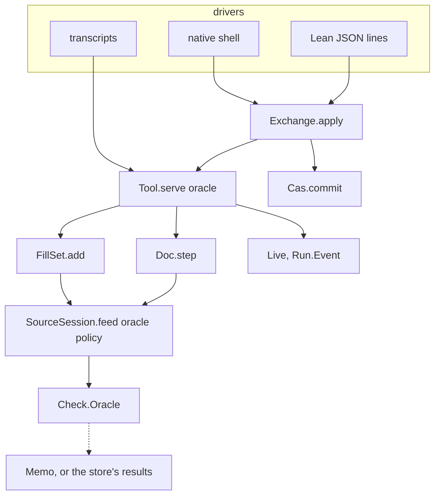
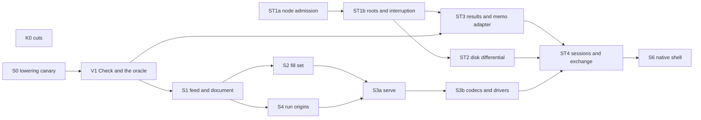

# The authoring system: final interfaces (version 1)

Status: design for implementation (history, not authority). Base: `774ddc3d7` on
`refactor/phase1-phase3`. It supersedes `README.md` beside it, the merged proposal, after Codex's
review (`codex-review.md`, findings SM-C-1 to SM-C-27). The declarations of §4 elaborate against the
tree in `interface-probe/SeamsInterfaces.lean`. The probe also proves the oracle and trace claims and
runs the place and root controls; its proofs rest on `[propext, Quot.sound]`.

## The one thing to know first

Codex's 27 findings come from four causes, and each cause is removed rather than patched.

1. **A cache could change an answer.** Now a checker is a value of a type with exactly one element up
   to equality (`Oracle.eq_uncached`, proved). No consumer can observe which cache answered.
2. **Checking ran through four paths that disagreed.** Now one feed with a policy decides a commit,
   a fill's certification and a suggestion, through the expansion.
3. **A derived state image was persisted.** Now a session persists as the log of its accepted
   actions, and loading is replay. The anchors, origins and counters come back by construction.
4. **A transaction hid its stages.** Now the store has an atomic commit, an explicit interrupted
   commit, generation-guarded roots with fixed policies, and one entry path for cached results.

## 1. The self-review: each finding, its cause, and what removes it

| Finding | Cause | Resolution | Why the cause is gone, not patched |
| --- | --- | --- | --- |
| SM-C-1 unrestricted `ask` | an oracle was any function | `Oracle := ask + agrees`; `serve` takes an `Oracle` | `Oracle.eq_uncached`: every oracle equals the uncached one, so `f o = f uncached` for every `f` (`Oracle.transparent`, proved) |
| SM-C-11 no learning | a pure oracle returns no entries | consumers run in `Checked`, a writer of `(key, verdict)` pairs; `Memo.learn` takes a trace | a trace built only by `Checked.ask` is valid by construction (`ask_valid`, `bind_valid`, proved); `Memo` holds valid entries only |
| SM-C-12 provenance in answers | suggestion results carried the cache and `fromCache` | the trace is beside the reply, never in it; `Candidate` carries its key and fit only | no answer type mentions a cache |
| SM-C-15 trusting cached results | uniqueness taken for truth | `Memo` admits an entry only by `learn` (computed) or `import` with recomputation | there is no constructor for an unchecked entry |
| SM-C-2 `fill` as sugar | two operations shared one name | `fill` adds to the pending set; `edit (commit …)` changes the document | the two never share a definition; both certify through one feed (cause 2) |
| SM-C-9 `certifiedB` beside references | certification read the program as written | certification is the `keepExact` feed at the anchor, through the expansion | one feed, one context; the raw focus is gone |
| SM-C-10 local splice beside a layer | splice decided without the whole expansion | the feed keeps `SourceSession.feed`'s comparison of the whole expanded edit; a mismatch rechecks | the comparison is inside the one feed |
| SM-C-3 ambiguous hole | an index named a row, not an occurrence | `Place.resolve` refuses an out-of-range row, an absent occurrence and a repeated one | control in the probe: `repeated 0 [[0],[1]]` |
| SM-C-4 batches, events, `dry` | per-item revisions; `feedAll` keeps a prefix; `dry` flattened | a batch is one history action on a temporary document; events fold through `Except` on a temporary run; `Answer.dry (Except Refusal ActionAnswer)` | atomicity and nesting are in the types |
| SM-C-5 the trace | a filled hole's row and a helper that does not exist | §5 uses the live `row "ask"` and receive, apply, flush | loop 1 is the corrected trace |
| SM-C-6 lost anchor | an image kept entries, not their anchor | no image: the session's transcript is persisted | replay re-runs the `fill` at its revision |
| SM-C-7 load misses components | a transcript derived from an image | the transcript itself is the persisted form | there is nothing to derive; replay reproduces allocation |
| SM-C-17 session fast-forward | an image named no parent | a session is a chain of `SessionEntry` with parents, on a journal root | fast-forward follows the parent edge |
| SM-C-8 layer projection | dependencies had a base, not a role | `Dep := role + base + input`; layers project `[0,0] ++ p` to `[2] ++ p`; an empty spine is checked directly | the role carries the projection |
| SM-C-13 explanation replay | a module refusal need not come from a part | `Explanation.part` is set only for a local failure; other refusals cite the whole key | the field's presence is the claim |
| SM-C-14 result bypass | result nodes entered like any node | a result node enters only with its `record` move; opening a disk derives each record from its node | one entry path, enforced at commit and at load |
| SM-C-16 A→B→A | a digest alone was the expectation | `Head := digest + generation`; a policy fixed at `create` | control in the probe: the old generation refuses |
| SM-C-18 crashes | a returned commit has no inner stage | `Event.interrupt t kept`: a closed prefix of `t`'s fresh nodes, no moves | interruption is an event of the store's replay |
| SM-C-19 refinement scope | byte equality without an abstraction | §4.5 defines the image, its abstraction, one owned writer, and which Rocq laws carry over | new obligations are placed, not assumed |
| SM-C-20 the store trace | three executions in one table | §4.6 has three calculations: ordinary, damaged, interrupted | each stays in its own domain |
| SM-C-21 typed reads | `Store.get` skipped spec and version | `Cas.get` checks version, kind, spec and exact payload; `Job` keeps session and version | the checked read is the only typed read |
| SM-C-22 gate cache | a false defect claim | the command enters the key for distinct addresses; today's reuse already checks it | claim corrected |
| SM-C-23 mirror rows | new keys, old grammar | K0 repairs qualified names and split `function` headers; unreadable rows stay listed | the reader owns the fix |
| SM-C-24 `wf_closed` | a test and a claim beyond the theorem | K0 moves the reader and cites `wfFrom_apply` with its premises | the citation states its premises |
| SM-C-25 vector conversion | one body judged on one carrier | one `Lcnf_array.to_list`: the array body up to a capacity, the fold beyond | measured by carrier and size |
| SM-C-26 slice order | checks placed before their consumers | §6 follows Codex's order: S0 first, ST1 split, ST2 before ST4 and S6 | each check sits at its consumer |
| SM-C-27 pedigree | claims wider than sources | §7 narrows each; `negotiate` replaces `discover` | the claim matches its source |

## 2. What stays, and what goes

### 2.1 The deep modules that stay

| Module | Interface | What it hides | Owner today |
| --- | --- | --- | --- |
| program and checker | `NativeEff`, `Sketch`, `Checker`, `Annotate`, `Table` | the typing rules | unchanged |
| `Check` (new, absorbing parts of `CheckCache`) | `CheckInput`, `Verdict`, `run`, `Oracle`, `Checked`, `Memo` | source expansion, part decomposition, layer projection, memo strategy | `Sketch.sourceCheck`, `Annotate.check`, `SigData`, `sketchSigData`, `localCandidates` |
| the edit engine | `SourceSession.open`, `feed o policy`, `view`, `focusAt` | expansion, splice against reopen, tables, the policy checks | `SourceSession`, `EditSession` |
| `Doc` | `open`, `step`, `snap`, `session` | history, validating replay, place resolution, revert, publication | `SourceDocument.lean`, reworked |
| `FillSet` | `open`, `add`, `view`, `reset` | certification, canonical order, materialization | `FillSet.lean`, reworked |
| admission and runs | `admitProgram`, `Api.Built.ofSketch`, `Live`, `LiveRecord`, `Run.Event`, `Api.Runner` | the machine | unchanged, plus `Built.ofSketch` |
| `Tool` | `serve`, `transcript` | dispatch, the refusal wrapper, allocation, origins, `dry`, negotiation | new; replaces the dispatcher |
| `Exchange` | `apply` | residency, load by replay, head comparison | new |
| `Cas` | `commit`, `interrupt`, `read`, `get` | node and root admission, policies, records | `Store`, `putNode`, `putRoot`, `Word` |
| the disk | `Disk : CAS` | packs, index, control file, recovery, durability | `E4_cas`, `E4_pack`, `E4_index`, `E4_control` |
| codecs | generated groups and the tag ledger | encodings | `tools/Effect4Gen`, `wire-tags.json`, `Effect4Gen.Check` |

### 2.2 What goes, and what replaces it

| Goes | Replaced by | Slice |
| --- | --- | --- |
| `tools/Tools/Session.lean`'s 41-field request, string dispatch, nine state fields, `commitAnswer`, `feedAnswer`, its second `feedStep`, the `run`, `fork`, `catalogue`, `sketch`, `view` and `journal` operations | `Tool.serve`; `open`, `negotiate`, `doc`, `history`; `start` then `play` | S3a, S3b |
| `Tools.Query` as a protocol source, `fillPremises`, `omitPremises` | `Query.doc` and `Query.dry` | S3a |
| `Tools.Session.Snapshot` | `Doc`'s replay-proved cache | S1 |
| `JsonBridge.valueFrom?`'s hex-over-JSON precedence | one generated encoding per field | S3b |
| `Doc`'s free `revision` field, `Doc.undo`, `Doc.fork`, `Doc.commit`'s own checks | `Doc.step` over the history; revert as an action | S1 |
| `FillSet.empty` and `FillSet.ofDoc` as open factories | `FillSet.open` from a document, with its construction witness | S2 |
| `certifiedB`, `CheckCache.evaluateCandidate`, `CheckKey`, `Entry`, `lookup`, `insert`, `Evidence.fromCache`, `SuggestResult.cache` | the `keepExact` feed; `Check` | V1, S1, S2 |
| the tools' calls of `Sketch.check`; `Run.Kit.check` as a second checker; `Api.check`'s double traversal | `Check.run`, with the kit as a named restriction | V1 |
| the tool's two hand-built `Built`s; admission reruns | `Api.Built.ofSketch`; named restrictions of `admitProgram` | S4 |
| `Store.putOr`, `Cascade.CascadingStore`, `address_inj`, `Pin.holds_of_injective`, `putNode_fresh_closed`, `verify_sound'`, `wf_closed` | the proved owners | K0 |
| `Root.version` alone; unchecked `Store.get` | `Head` with a fixed policy; `Cas.get` | ST1a, ST1b |
| OCaml's seven root kinds against Lean's five; three decode mappings; `Bad_pack` as an exception; `E4_checkpoint.schema_node` | one generated table; `Admission.ofRead`; a recovery value; `genesisNode` | K0, ST2, ST4 |
| `E4_nat`, `E4_log.Vec`, the duplicate `E4_trace.to_list`, `bench_array.ml`, line-number citations | `Lcnf_nat`, `Lcnf_array`, declaration citations | K0 |

Designs considered and not taken:

- a `Tree` state image, and a separate document entry chain;
- digest-only root checks;
- consumers threaded through a state monad with `…Via` twins;
- `fill` as commit sugar, and profiles inside the checking key;
- a new kind byte, and a separate action table or log file.

## 3. The interfaces at a glance



The diagram records the data flow only. It is not proof evidence.

## 4. The interfaces

The declarations below are abbreviated. `interface-probe/SeamsInterfaces.lean` holds each in full,
elaborated; names there sit under `SeamsProbe`.

### 4.1 Checking

```lean
inductive CheckInput
  | module (app : SigApp) (holes : RowTable) (program : NativeEff)   -- through layer references
  | part (sig : SigData) (env : TyEnv) (program : NativeEff)        -- in its expansion's context
structure Verdict where result : Except TypeRefusal EffTy; table : List Table.Entry
def run : CheckInput → Verdict                          -- sourceCheck/sourceAnnotate; Annotate.check
structure Oracle where ask : CheckInput → Verdict; agrees : ∀ i, ask i = run i
theorem Oracle.eq_uncached (o : Oracle) : o = Oracle.uncached          -- proved
structure Checked (α) where value : α; trace : List (CheckInput × Verdict)   -- a monad
structure Memo where private mk :: entries : …; valid : ∀ p ∈ entries, p.2 = run p.1
def Memo.learn (m) (t) (ht : ∀ p ∈ t, p.2 = run p.1) : Memo
def Memo.oracle : Memo → Oracle                          -- a hit, else run
def Memo.import : Memo → List (CheckInput × Verdict) → Memo × List CheckInput   -- recomputes
def deps : CheckInput → List Dep        -- Dep := role (body i | main | layers), base, input
def combine : CheckInput → List Verdict → Verdict
```

| Law | Statement | Status or reuse |
| --- | --- | --- |
| `Oracle.eq_uncached`, `Oracle.transparent` | every oracle equals `uncached`; every consumer agrees | proved in the probe |
| `Checked.ask_valid`, `pure_valid`, `bind_valid` | traces are valid by construction | proved in the probe |
| `run_module`, `run_part` | the arms are the existing owners | `Sketch.sourceAnnotate_eq_sourceTable`, `Annotate.check_eq` |
| `combine_deps` | `combine i ((deps i).map (run ·.input)) = run i`, layers projected | new (V1) |
| `explain_replays` | a local failure's part reproduces it, placed | `Checker.check_rebase` |

### 4.2 The edit engine, the document and the fill set

```lean
inductive FeedPolicy | draft | keepExact | recheck
def SourceSession.feed (o : Oracle) (p : FeedPolicy) (l : SourceSession) (e : Edit) :
    Checked (Except FeedRefusal (SourceSession × Edit.Step))
inductive Place | hole (index : Nat) | at_ (path : List Nat) (expected : NativeEff)
def Place.resolve : SigApp → Sketch → Place → Except PlaceRefusal (List Nat × NativeEff)   -- real
inductive DocAction
  | commit (items : List (Place × Change)) (policy : FeedPolicy)   -- one revision for the batch
  | draft (e : Edit) | revert (entry : Nat) | publish (fills : List (List Nat × NativeEff))
structure Doc where private mk :: origin; history : List DocAction; session : SourceSession
  replayed : replayDoc origin history = .ok session
def Doc.step : Oracle → Doc → DocAction → Checked (Except DocRefusal (Doc × Receipt))
structure FillSet where private mk :: anchor : Snap; base : Sketch; app : SigApp
  entries : List (List Nat × NativeEff); constructed : ∃ s, addRaw anchor base app s = entries
```

- **The feed.** `draft` is today's `SourceSession.feedStep`, with the splice's part check asked
  through the oracle. `keepExact` asks the part verdict of the filling inside the candidate's
  expansion. Kept and the whole expanded edit agreeing, it splices. Not kept, it refuses `notKept`
  with no whole recheck. When the whole expanded edit disagrees (a layer edit), it rechecks and then
  compares the root type and the local type. `recheck` applies, rechecks and refuses a sketch that
  does not check.
- **The commit's refusal order.** Each item runs against the temporary document left by the items
  before it. The place refuses first (`outOfRange`, `absent`, `repeated`, `moved`). Then the feed
  refuses (`noProgram`, `notKept`, `typeChanged`, `localChanged`, `refused`). The first refusal refuses the batch. An
  empty batch refuses `empty`.
- **Revert** names an entry. For each address it edited, the current sub-program must equal what
  it produced, or it refuses. It restores what the entry replaced; an omission's hole row stays (R1).
- **Publication** is a history action: the fills in the base's address order, one source check at the
  end. A fill set refuses after its document moves, until reset; publication refuses a different
  snapshot, base or application.
- **Certification** of a pending fill is the `keepExact` feed at the anchor, run and discarded. So a
  pending fill is certified exactly when the same commit would be accepted.

| Law | Statement | Status or reuse |
| --- | --- | --- |
| `feed_draft` | `draft` is today's `feedStep` | `SourceSession.reached_coherent`, `feed_undo` unchanged |
| `feed_keepExact` | an accepted `keepExact` feed equals the `draft` result, keeps the root and local types, and is spliced unless the expanded edit disagreed | `Sketch.check_fill_focusAt`, `SourceSession.feed_coherent` |
| `step_replay` | `replayDoc o (h ++ [a]) = replayDoc o h >>= step a` | `List.foldl_append` |
| `step_refuses` | a refused step changes nothing | the wrapper law |
| `revert_program` | a revert after its entry restores the program, keeping hole rows | `SourceSession.feed_undo` |
| `kept_eq_certified` | on a base with no layer reference, `keepExact` acceptance equals the old `certifiedB` | `CheckCache.evaluateCandidate_valid_and_sound`, `expandRefs_eq_self_of_refSites_nil` |
| D1 to D9, `FillSet.add_wf` | restated over the new certification, on the reference-free fragment; publication's final check guards the rest | S2 re-freezes them |

### 4.3 The protocol and the exchange

```lean
inductive Action | open_ … | edit (at_ : Snap) (a : DocAction) | fill (at_ : Snap) (batch : …)
  | publish (at_ : Snap) | reset | start (at_ : Snap) (budget) | restore (record : LiveRecord)
  | play (run : RunId) (events : List Run.Event)
inductive Query | doc (at_) | history | fills | suggest (at_) (place) (supplied) (cursor limit)
  | run (id) (form) | preview (q) | dry (a : Action) | negotiate (wanted : List Wanted)
inductive Request | act (a : Action) | ask (q : Query)
structure Reply where result : Except Refusal Answer; now : Option Snap
structure State where private mk :: raw : Raw; reached : ∃ as : List Action, replay empty as = raw
def serve : Oracle → State → Request → Checked (State × Reply)
def State.transcript : State → List Action        -- the persisted form; the witness's list
```

- **Order of refusals:** `noDocument`, then for a request that names a snapshot, `foreign` then
  `stale`, then the action's own refusals.
- **Three outcome kinds.** A refused request changes nothing. A pending fill's refused item is an
  `AddOutcome` inside `filled`. A run command's refused phase is inside `played`, and the journal
  grows.
- **A query changes nothing** (`serve_query`). `dry` answers its action's result, nested, from the
  original state.
- **`now`** names the current snapshot after every request. A caller copies it; it is scoped to
  the state it came from.
- **Persistence.** A session is a chain of `SessionEntry` nodes (kind 7). It starts with `origin`,
  naming the engine. One `action` follows per accepted action, naming its parent and the program
  after it. Its root
  `session/<name>` is a journal root. Loading replays the chain.
- **The exchange.** `Base.state (at : Digest)` names an exact chain head and is never stale;
  `Base.head name (expected : Head)` names the session head. A host resolves the base, calls
  `serve`, then commits the new entry and moves the head in one `Cas.commit`. A head that moved
  refuses `staleBase`; a snapshot behind the document refuses `stale`. The two stay apart.

| Law | Statement | Status or reuse |
| --- | --- | --- |
| `serve_refuses` | a refused request leaves the state unchanged | the probe's `refusal_inert` (`review-probes/CoreSketches.lean` of the composition review) |
| `serve_query` | a query leaves the state unchanged | new (S3a) |
| `serve_answers` | `RespondsTo r (serve o s r).value.2` | generated pairing (S3b) |
| `serve_transparent` | `serve o = serve uncached` | `Oracle.transparent` |
| `transcript_replays` | `replay empty s.transcript = s.raw` | the witness, made concrete |
| `load_own` | loading a session's own chain gives the state back | `transcript_replays`, `LiveRecord.restore_save` |

### 4.4 The store

```lean
inductive RootPolicy | swap | journal | pin
structure Head where digest : Digest; generation : Nat
inductive Move | create (name) (policy) (target : AnyRef) | advance (name) (expected : Head) (target)
  | record (query result : Digest)
structure Txn where nodes : List Node; moves : List Move          -- nodes children first
inductive Event | commit (t : Txn) | interrupt (t : Txn) (kept : Nat)
structure Cas where private mk :: store : Store; reached : ∃ es, replay es = store
def Cas.commit : Cas → Txn → Except Admission Cas                -- atomic
def Cas.interrupt : Cas → Txn → Nat → Cas                        -- a closed prefix, no moves
def Cas.read : Cas → Read → List (Digest × Node)
def Cas.get [Content α] : Cas → Ref α → Option α                 -- version, kind, spec, payload
structure Query (κ) where action : ActionId; input : κ           -- kind 8; ActionId := name, engine
structure Answered (ρ) where query : Digest; output : ρ          -- kind 9
```

- **The transaction's refusal order.** Nodes come first, each against the store grown by those
  before it. The order is `oversize`, `badVersion`, `malformedRef`, `handleInContent` (M2), then the
  edges, spec first. A result node needs its `record` move. Bytes entering from disk or a far store pass `Node.read` first. Then
  the moves, each against the result of those before it:
  - `create`: an existing root with the same policy and target is a duplicate; otherwise `rootExists`.
  - `advance`, in order:
    1. a missing root refuses;
    2. a resident target equal to the new one is a duplicate;
    3. a pin refuses;
    4. a resident head other than `expected` refuses `staleRoot`;
    5. the target must resolve at its kind;
    6. a journal root's target must name the resident head as its parent, or it refuses `fork`.
  - `record`: the query and the result must resolve at kinds 8 and 9. The result's query field must
    name the query. Another result for the query refuses `poisoned`.
- **Interruption.** `interrupt t k` keeps the first `k` of `t`'s fresh nodes, which are closed since
  `t` is children first, and moves no root. Roots never name an uncommitted node.
- **One refusal vocabulary.** Lean's `Admission`, extended as above. OCaml wraps it:
  `Model of Admission | Capacity of string | Fault of fault`. Disk damage and integer width stay
  outside the model.

| Law | Statement | Status or reuse |
| --- | --- | --- |
| `commit_grows`, `bytes_never_change`, `commit_reads` | nodes only grow, never change, and read back | Rocq `put_grows`, `put_bytes_never_change`, `put_get`, after regeneration for M2 |
| `advance_head` | a successful advance raises the generation by one; a stale head refuses | new (ST1b); the probe's control |
| `journal_parent` | a journal root moves only to a node naming its head as parent | new (ST1b) |
| `record_once` | at most one result per query, on every path | new (ST3) |
| `interrupt_closed`, `interrupt_no_roots` | an interrupted commit leaves a closed prefix and no moved root | new (ST1b) |
| `cas_resident_inj` | one node per address among residents | `address_inj_resident` (a Lean theorem, decisions row 411 (1)) |
| `get_exact` | a checked read answers only an exact payload at its kind and spec | new (ST1a), from `Node.decode_exact` |

### 4.5 The disk against the model

| Clause | Content |
| --- | --- |
| the image | the pack's records in write order, the roots with policy and generation; each result node implies its record |
| the abstraction | decode each record, replay them as one transaction from empty, then create and advance each root; a record that does not decode or hash is a fault |
| the writer | one owned writer per store (the `LOCK`); a disk handle is linear, a `Cas` value is persistent |
| the comparison | a qcheck-stm differential: equal images after every event, interruptions at every cut, hostile bytes |
| the proofs | the node laws carry over after regenerating `rocq/StoreCode.v`; root, transaction, record and interruption laws are new claims (§4.4) |

### 4.6 The store's calculations, one domain each

Ordinary execution, from empty, with the golden nodes `S` (`probeSchema`) and `E` (`probeEntry`):

| # | Transaction | Answer | Law |
| --- | --- | --- | --- |
| 1 | nodes `[S, E]` | fresh, fresh | `putNode_fresh` |
| 2 | nodes `[E]` | duplicate | `putNode_duplicate` |
| 3 | `create "docs/a" swap ⟨export, e⟩` | created, generation 0 | `putRoot_root?` |
| 4 | `advance "docs/a" ⟨e, 0⟩ ⟨export, e⟩` | duplicate | identical target first |
| 5 | `advance "docs/a" ⟨s, 0⟩ ⟨export, e2⟩` | `staleRoot` | `advance_head` |
| 6 | a query `q`, results `r1` then `r2` for `q` | recorded, then `poisoned` | `record_once` |
| 7 | a result node with no `record` move | `resultWithoutRecord` | `record_once` |

A damaged store: a record forged under the watermark at `r` with bytes hashing elsewhere. The disk
answers `Fault (Corrupt r)` on a put of the true node; the model has no such state, since every `Cas`
is addressed. An interrupted write: from state 2, `interrupt ⟨[T, U], [advance …]⟩ 1` keeps `T`,
drops `U`, and moves no root (`interrupt_closed`, `interrupt_no_roots`).

## 5. The editing loops

The application `A` has one host row `ask : unit → nat`. `h0 := Row.hole "h0" .nat`, and
`s0 := ⟨.bind (.perform (.external 0) (.lit .unit)) (Sketch.hole A 0), [h0]⟩`.

### Loop 1: an agent writes a program

| # | Request | Reply | Why |
| --- | --- | --- | --- |
| 1 | `act (open_ "demo" A s0)` | `opened`: type `nat!never`; holes `[⟨0, h0, [1], ([nat], nat!never)⟩]`; now `n0` | `SourceSession.reached_view` |
| 2 | `act (edit n0 (commit [(.hole 0, .fill (.succeed (.var 1)))] .keepExact))` | refused: `doc (feed 0 (notKept ([nat], nat!never) (error ⟨[], term (var 1)⟩)))`; now `n0` | one part check; nothing applied |
| 3 | the same with `.var 0` | `edited`: revision 1, `spliced [[1]]`, holes `[]`; now `n1` | `feed_keepExact` |
| 4 | step 3 again, at `n0` | refused `stale n1` | the snapshot check |
| 5 | `act (start n1 {})` | `started 0 (snapshot n1 A s1)`; awaiting one call on `ask` | `Built.ofSketch`, then `.start` |
| 6 | `act (play 0 [.apply (.row "ask")])` | `played 0 [played [refused noCall]]`; the journal grows by one | `Api.Runner.step_refused` |
| 7 | `act (play 0 [.receive (.key k) (.ofExit (.success 7)), .apply (.key k), .control .flush])` | `played 0 …`: finished, exit `success 7`; four commands more | `Live.journal_replays` |

### Loop 2: independent fills, published at once, then reverted

The sketch has three holes, at `[0]`, `[1,0]` and `[1,1]`, each of type `nat`.

| # | Request | Reply |
| --- | --- | --- |
| 1 | `act (fill n0 [([0], q1), ([1,0], qBad), ([1,1], q3)])` | `filled [applied [0], refused [1,0] notCertified, applied [1,1]]`; the pending set holds two |
| 2 | `ask fills` | the two pending fills, anchored at `n0` |
| 3 | `act (publish n0)` | `published`: revision 1, one history action; the set is empty again |
| 4 | `act (edit n1 (revert 0))` | `edited`: revision 2; the program before publication is back; hole rows kept |
| 5 | `act (fill n0 …)` | refused `stale n2` |

### Loop 3: suggest, then commit from the memo

| # | Request | Reply | Memo |
| --- | --- | --- | --- |
| 1 | `ask (suggest n1 (.hole 1) [succeed (lit (nat 2))] 0 8)` | `suggested [⟨succeed (lit (nat 2)), ok nat!never, part σ [] …⟩, …]` | the host learns the trace |
| 2 | `act (edit n1 (commit [(.hole 1, .fill (succeed (lit (nat 2))))] .keepExact))` | `edited`: revision 2 | the feed's part key is a hit: no check runs |

The reply in step 2 is the same with the memo empty (`serve_transparent`).

### Loop 4: the view builds a program as frames

`plan p` gives a sketch whose sub-programs are holes and one fill per hole, top down. The view folds
`edit now (commit [(.hole k, .fill q)] .keepExact)` over the plan, threading `now`. Each fill
splices; a refused fill draws its refusal, and `now` stays. Today's request list with guessed
revisions and expected holes goes.

### Loop 5: persist, stop, resume

| # | Host | Store | Result |
| --- | --- | --- | --- |
| 1 | serves loop 1 under `Base.head "demo" h` | each accepted action becomes a `SessionEntry`; one `Cas.commit` moves `session/demo` | the head names the chain |
| 2 | the process stops | nothing | the store holds the chain |
| 3 | a new process, `Base.head "demo" h7` | the chain is read and replayed | the same state: run 0 at its origin, pending fills at their anchor (`load_own`) |
| 4 | the native shell serves the same requests | | the same replies (S6's transcript) |

### Loop 6: two writers on one session

A and B both read head `⟨e5, 5⟩`. A publishes `e6`; the head becomes `⟨e6, 6⟩`. B's commit refuses
`staleRoot`, which its host returns as `staleBase`. B reloads at `e6`; B's next edit at its old
snapshot refuses `stale`, and B copies the new `now`.

### Loop 7: save a run, restore it elsewhere

`ask (run 0 .record)` answers a `LiveRecord`. A host may store it as a `Job` and its `Tape`s.
`act (restore record)` re-runs `admitProgram`, replays the journal, and starts a run with origin
`standalone`.

## 6. The slices



The diagram records implementation dependencies, not proof evidence.

| Slice | Deliverable | Acceptance at its own boundary |
| --- | --- | --- |
| K0 | `cuts.md`'s rows with Codex's corrections | narrow builds; the mirror reader repaired; nothing else changes |
| S0 | the real start and load closure, lowered to OCaml; the oracle as a function argument | no unknown type; a forged parent record refused; R9 and R13 |
| V1 | `Check`, `Oracle`, `Checked`, `Memo`, `deps`, `combine` | the probe's proofs moved in; `combine_deps`; layer projection; empty spine; the five-request trace |
| S1 | the one feed; `Doc` with its history; `Place`; revert | loop 1's rows 1 to 4; false metadata refused (R2); batch rollback; one revision per action |
| S2 | `FillSet` over its witness; publication as an action; D1 to D9 re-frozen | loop 2; the reference control; stale and reset |
| S4 | `Api.Built.ofSketch`; origins | loop 1's rows 5 to 7; an unadmitted program refused (R13) |
| S3a | `Tool.serve`, the witness, `dry`, `negotiate` | the three outcome kinds; `serve_query`; nested `dry`; event rollback |
| S3b | `Tool` and `Check` codec groups; the thin driver | missing fields, unknown tags and option profiles refused (R8, R12); both drivers' transcripts; the old dispatcher deleted |
| ST1a | `Admission` extended; `Node.read`; `Cas.get`; M2 | one byte language; M2's G2 row re-cut; Rocq regenerated |
| ST1b | roots with `Head` and policy; `Cas.commit`, `interrupt` | §4.6; retry precedence; interruption |
| ST2 | generated store facts in OCaml; the disk conforms | the differential; sealed damage as a value; writer kills at real stages |
| ST3 | `Query`, `Answered`, `record`; the store memo adapter | a result without a record refused; a wrong first result recomputed; cache on and off agree |
| ST4 | `SessionEntry` chains; `Exchange.apply` | loops 5 and 6 |
| S6 | the native shell over the lowered `serve` | the native transcript equals Lean's; hostile records refused |

Three seats can start at once: K0 with S0, V1, and ST1a.

## 7. The pedigree, narrowed to what each source shows

| Precedent | What we take |
| --- | --- |
| `Core.Validated` | checked construction; validation reruns when trust changes, which is our replay on load |
| `Base.Result`, `Or_error` | refusals as values; `Or_error` only for context at a boundary |
| `Base.Comparator` | key comparison generated from its owner; it validates nothing |
| `Core.Stable`, `Stable_unit_test` | versioned representations with saved fixtures; examples, not a compatibility proof |
| `ppx_expect` | transcripts compared across both drivers, changes reviewed |
| dune's cache verification | a host mode that reruns sampled hits and reports differences |
| Merlin | a pure request boundary, and a cache-disabled mode to compare replies |
| dune-rpc | negotiation that selects supported method versions or refuses (`negotiate`) |
| ocaml-lsp's `Io.Make` | framing apart from request execution |
| Incremental | the plug-in point: an oracle, and `deps` with `combine` |
| Git; qcheck-stm | parent chains for journal roots; a model-based differential for the store |

## What this note does not establish

- The probe elaborates the declarations and proves four claims; every law marked new is unproved.
- No slice has run, and the loops' replies are hand traces checked against Codex's probes where
  those exist.
- The native lowering of an oracle argument is the subject of S0.
