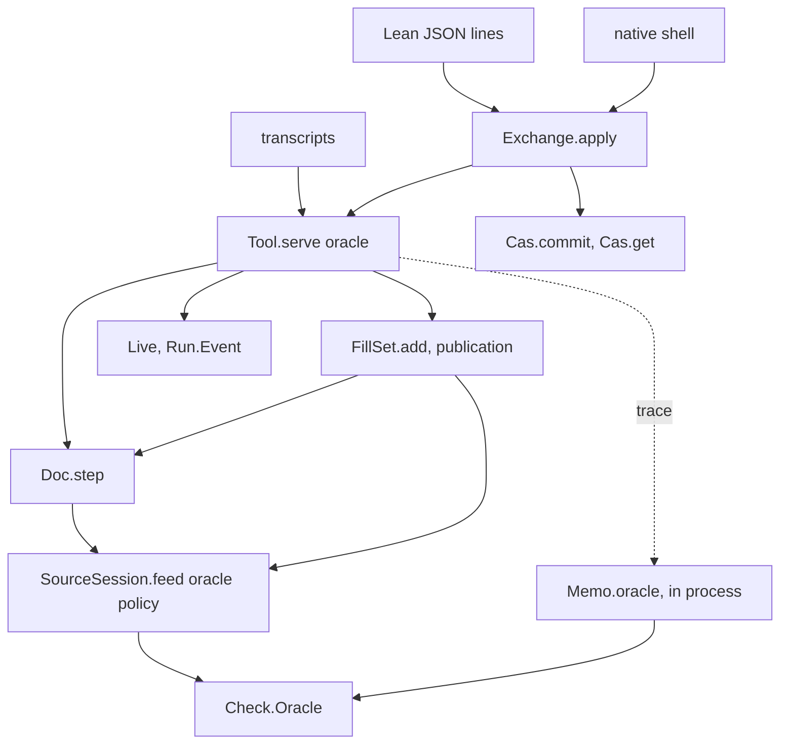
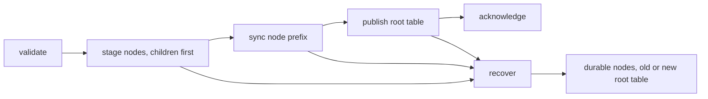
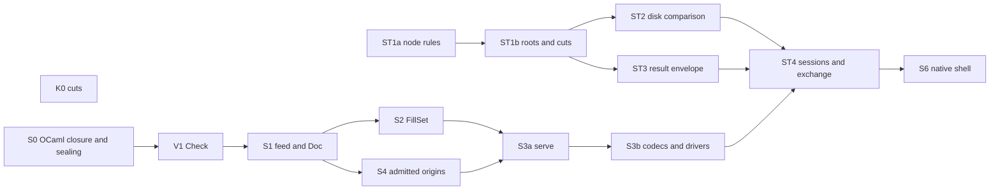

# The authoring system's seams: final interfaces and implementation plan (version 2)

Status: the plan for implementation (history, not authority). Base: `774ddc3d7` on
`refactor/phase1-phase3`. This version folds three inputs into one plan:

- Codex's amended proposal, [README.md](README.md) version 2, with its [ledger](ledger.md);
- the adversarial [self-review](self-review.md) of version 1 (findings SR-1 to SR-21);
- version 1 itself, kept as [interfaces-v1.md](interfaces-v1.md), the text the self-review read.

README.md version 2 and this note now agree on every contract; where they differed, §9 names the
choice and its reason. The declarations of §4 elaborate in
[interface-probe/SeamsInterfaces.lean](interface-probe/SeamsInterfaces.lean), with warnings as
errors. Its proofs rest on `[propext, Quot.sound]`.

## The one thing to know first

Codex's 27 findings and the self-review's 21 come from four causes. Each cause is removed in the
design, not patched at its symptoms.

1. **A cache could change an answer.** A checker is now a value of a type with one element up to
   equality (`Oracle.eq_uncached`, proved). Traces and memos carry their own validity, so a memo is
   valid by construction. The memo lives in one process; nothing imports entries, so no call site
   is trusted.
2. **Checking ran through four paths that disagreed.** One feed with a policy now decides a commit,
   a fill's certification and a suggestion. The root goes through the module check. Publication is
   an ordinary commit.
3. **A derived state was persisted.** A session now persists as its accepted actions, kept as data,
   in a chain of typed references. Loading is a validating replay that refuses a failed action by
   its index.
4. **A transaction hid its stages.** The store now has an atomic commit with a receipt and
   interrupted commits of validated transactions. Roots compare a head, stale first. The store's
   node check tests a result's association on every path.

## 1. The self-review: each finding, its cause, and what removes it

### 1.1 Codex's findings

| Finding | Cause | What removes it |
| --- | --- | --- |
| SM-C-1 unrestricted checker | an oracle was any function | `Oracle := ask + agrees`; `Oracle.eq_uncached` makes every consumer agree (`Oracle.transparent`, proved) |
| SM-C-11 no learning | a pure oracle returns no entries | consumers run in `Checked`, a sealed writer; drivers keep `Memo.learn`'s result across requests |
| SM-C-12 provenance in answers | replies carried the cache | the trace sits beside the reply; no answer type mentions a cache |
| SM-C-15 trusting stored results | uniqueness taken for truth | the store holds no checker results (§9 D1); the memo has no import |
| SM-C-2 `fill` as sugar | two operations shared one name | `fill` adds to the pending set; `edit (commit …)` changes the document |
| SM-C-9 certification beside references | certification read the program as written | certification is the `keepExact` feed at the anchor, through the expansion |
| SM-C-10 splice beside a layer | splice decided without the whole expansion | the feed keeps the whole-expansion comparison; a mismatch rechecks |
| SM-C-3 ambiguous hole | an index named a row, not an occurrence | `Place.resolve` refuses an absent and a repeated occurrence (probe control) |
| SM-C-4 batches, events, `dry` | per-item revisions, prefix-keeping folds | one revision per batch on a temporary document; `Except` folds; nested `dry` |
| SM-C-5 the trace | wrong selectors and a missing helper | loop 1 uses the elaborated spellings (self-review probe) |
| SM-C-6 lost anchor | an image kept entries, not anchors | the transcript is persisted; replay re-runs each `fill` at its snapshot |
| SM-C-7 load misses components | a transcript derived from an image | the transcript is data in the state and in the chain |
| SM-C-17 session fast-forward | an image named no parent | a chain of `SessionEntry` nodes with typed parents on a journal root |
| SM-C-8 layer projection | dependencies had a base, not a role | `Dep := role + base + input`, internal to `Check` |
| SM-C-13 explanation replay | a module refusal need not come from a part | `Explanation.part` is set only for a local failure |
| SM-C-14 result bypass | result nodes entered like any node | the node check tests the envelope on every path; no `record` move |
| SM-C-16 A→B→A | a digest alone was the expectation | `Head := digest + generation`, stale first (probe control) |
| SM-C-18 crashes | a returned commit has no inner stage | `Cut`: an interruption of a validated transaction, before or after publication |
| SM-C-19 refinement scope | byte equality without an abstraction | §4.6 defines the image with roots as data, one owned writer, and the Rocq reach |
| SM-C-20 the store trace | three executions in one table | §4.7 keeps ordinary, damaged and interrupted executions apart |
| SM-C-21 typed reads | `Store.get` skipped spec and version | `Cas.get` checks version, kind, spec and exact payload |
| SM-C-22 gate cache | a false defect claim | the command enters the key; today's command check stays during migration |
| SM-C-23 to SM-C-25 | cut rows with wrong scope | [cuts.md](cuts.md) K-08, K-07, K-10 and K-11, as amended |
| SM-C-26 slice order | checks placed before their consumers | §6 states each slice's acceptance in its own module's operations |
| SM-C-27 pedigree | claims wider than sources | §8 narrows each source; version selection belongs to the connection |

### 1.2 The self-review's findings

| Finding | Cause | What removes it |
| --- | --- | --- |
| SR-1 erased transcript, total replay | the list lived inside `∃` | `StateOf` keeps `transcript` as data; `replayAccepted` returns `Except (Nat × Refusal)`; six-step load (§4.4) |
| SR-2 raw digest links | a `Digest` field encodes bytes | every stored link is a `Ref` (probe: `Ref SessionEntry` nests) |
| SR-3 two entry paths for results | `Move.record` and interruption disagreed | no `record` move; the envelope rule runs inside the node check |
| SR-4 interruption of any transaction | `interrupt` was total | `Cut` applies only to a transaction that `commit` accepts |
| SR-5 cache argument in Lean only | erased proofs and imported entries | memo in-process only; `Checked` and `Memo` abstract in OCaml; no checker results stored |
| SR-6 a wrong first result holds a query | the store treated a record as a proof | results are host actions only; `poisoned` reports a reproducibility failure; a new action version names a new query |
| SR-7 acceptance before its code | loops stated as `serve` requests | S1 rows are `Doc.step` calls, S2 rows `FillSet` calls, S4 rows `Live` calls; loops land at S3a |
| SR-8 the root address | laws assumed a splice at `[]` | the root checks the module key; the laws say "below the root" |
| SR-9 publication inside `edit` | `DocAction.publish` | publication is a `commit` the fill set builds; `DocAction` has three arms |
| SR-10 nested revert | a forward per-address check | revert undoes items in reverse order, under the entry's policy |
| SR-11 refusal order | `noFocus` missing; `refused` late | `FeedRefusal` adds `noFocus`; `refused` precedes `typeChanged` |
| SR-12 lost extension hit | exact-key equality only | `HitRule`: the exact rule or today's extension rule, each with its law |
| SR-13 public `Checked` | no sealed constructor | `Checked` and `Memo` carry validity behind a private constructor |
| SR-14 exchange undeclared | no declaration, no new head | `Exchange.Base`, `Exchange.apply` returning the reply and the new head; `fork` |
| SR-15 store types | one `Except` for every answer | `Receipt` of node and move outcomes; `RootPolicy` replaces `RootKind` (§9 D2) |
| SR-16 disk image and generations | roots rebuilt from moves | the image stores the root table as data, generations included |
| SR-17 retry order | duplicate before stale | stale first, recorded in §9 D5 (probe control) |
| SR-18 load cost | unstated | §4.4 states it: linear in accepted actions |
| SR-19 negotiation | an inert query kept nothing | the connection selects versions; `Query.discover` lists them |
| SR-20 `Check` leaks | `deps` and `combine` public; key building split | `deps` and `combine` are internal; the edit engine is the one owner of part keys |
| SR-21 text errors | several | loop 3 stands alone; `Answer.fills` carries its anchor; `RunAnswer` per form |

## 2. What stays, and what goes

### 2.1 The deep modules that stay

| Module | Interface | What it hides | Owner today |
| --- | --- | --- | --- |
| program and checker | `NativeEff`, `Sketch`, `Checker`, `Annotate`, `Table` | the typing rules | unchanged |
| `Check` | `CheckInput`, `Verdict`, `run`, `Oracle`, `Checked`, `Memo`, `HitRule` | decomposition into parts, layer projection, hit rules | `Sketch.sourceCheck`, `Annotate.check`, `SigData`, `CheckCache.lookup`'s rules |
| the edit engine | `SourceSession.open`, `feed o policy`, `partKey`, `view`, `focusAt` | expansion, splice against recheck, part keys | `SourceSession`, `EditSession` |
| `Doc` | `open`, `check`, `step`, `snap`, `history` | validating replay, places, batches, revert | `SourceDocument.lean`, reworked |
| `FillSet` | `open`, `add`, `publication`, `pending` | certification, address order | `FillSet.lean`, reworked |
| admission and runs | `admitProgram`, `Api.Built.ofSketch`, `Live`, `LiveRecord`, `Run.Event` | the machine | unchanged, plus `Built.ofSketch` |
| `Tool` | `serve`, `transcript` | dispatch, the refusal wrapper, allocation, origins, `dry` | new; replaces the dispatcher |
| `Exchange` | `load`, `apply` | replay, head comparison, residency | new |
| `Cas` | `commit`, `read`, `get` | node rules, envelopes, root policies | `Store`, `putNode`, `putRoot`, `Word` |
| the disk | `Disk : CAS` | packs, index, control file, recovery, durability | `E4_cas`, `E4_pack`, `E4_index`, `E4_control` |
| codecs | generated groups and the tag ledger | encodings | `tools/Effect4Gen`, `wire-tags.json` |

### 2.2 What goes, and what replaces it

| Goes | Replaced by | Slice |
| --- | --- | --- |
| the 41-field request in `tools/Tools/Session.lean`, its string dispatch, nine state fields, `commitAnswer`, `feedAnswer`, the second `feedStep` | `Tool.serve` over `Action` and `Query` | S3a, S3b |
| `Tools.Query` as a protocol source, `fillPremises`, `omitPremises` | `Query.doc` and `Query.dry`, with the reads `Query.table`, `Query.addresses` and `Query.slots` | S3a; cut after S3b ([receipt](receipts/S3b-query.md)) |
| `Tools.Session.Snapshot` | `Doc`'s replayed state, after its callers move | S3b |
| `JsonBridge.valueFrom?`'s hex-over-JSON precedence | one generated encoding per field | S3b |
| `Doc`'s free `revision` field, `Doc.undo`, `Doc.fork`, `Doc.commit`'s own checks | `Doc.step` over the history; revert as an action | S1 |
| `FillSet.empty`, `FillSet.ofDoc` as open factories; `materializeDoc` | `FillSet.open`; publication as a `commit` | S2 |
| `Program.materialize` | publication; kept as the reference of `publish_eq_materialize` until S2's restated laws are proved | S2 |
| `certifiedB`, `CheckCache.evaluateCandidate`, `CheckKey`, `Entry`, `insert`, `Evidence.fromCache`, `SuggestResult.cache` | the `keepExact` feed; `Check` | V1, S1, S2 |
| `CheckCache.lookup` | `Memo.oracle` with `HitRule.exact` and `Check.extension` (moved, not lost) | V1 |
| the tools' calls of `Sketch.check`; `Run.Kit.check` as a second checker | `Check.run`, with the kit as a named restriction | V1 |
| the two hand-built `Built`s; `Run.runPure`, `Api.Runner.load`, `HostSession.start`, `Typed.replay`, `Live.start` | `Api.Built.ofSketch`, then `Live.open`; raw `Api.run` stays for tests | S4 |
| `Kit_serve` request execution; `E4_host.serve`, a hand copy of `driveFrom` | the generated core's `serve`; parsing and framing stay | S6 |
| Lean's `RootKind` (five planes) and OCaml's `root_kind` (seven) | `RootPolicy` and the target kind, one generated table | ST1b |
| `Root.version` alone; the Registry-only `prev` check; unchecked `Store.get` | `Head` on every root; `Cas.get` | ST1a, ST1b |
| the eighteen rows of [cuts.md](cuts.md) | their stated owners | K0, ST1a, ST2 |

Kept on purpose:

- `Word.Layered` and `LocalFirst`, proved and awaiting a consumer;
- `E4_wal`, `E4_checkpoint` and `E4_chunk`, for their persistence consumers;
- `Doc.history`, `Doc`'s own state, equal to the document projection of the tool's transcript.

Designs considered and not taken:

- a `Tree` state image, or a separate writable document chain;
- an existential witness as the only record of the transcript;
- digest-only root checks, and duplicate-before-stale retries;
- a `record` move, or a separate action table;
- a stored checker cache, imported or trusted by sampling;
- `fill` as commit sugar, `publish` as a document action, and profiles inside the checking key;
- a new kind byte.

## 3. The interfaces at a glance



The diagram records the data flow only. It is not proof evidence.

## 4. The interfaces

The declarations below are abbreviated. The probe holds each in full, under `SeamsProbe`.

### 4.1 Checking

```lean
inductive CheckInput                                   -- DecidableEq
  | module (app : SigApp) (holes : RowTable) (program : NativeEff)   -- the root is checked here
  | part (sig : SigData) (env : TyEnv) (program : NativeEff)        -- in its expansion's context
structure Verdict where result : Except TypeRefusal EffTy; table : List Table.Entry
def run : CheckInput → Verdict                          -- sourceCheck/sourceAnnotate; Annotate.check
structure Oracle where ask : CheckInput → Verdict; agrees : ∀ i, ask i = run i
theorem Oracle.eq_uncached (o : Oracle) : o = Oracle.uncached          -- proved
structure Checked (α) where private mk :: value : α; trace : Trace; valid : TraceValid trace
def Checked.ask : Oracle → CheckInput → Checked Verdict                 -- plus Monad Checked
structure Memo where private mk :: entries : Trace; valid : TraceValid entries
def Memo.empty : Memo
def Memo.learn : Memo → Checked α → Memo
structure HitRule where
  hit : CheckInput → CheckInput × Verdict → Bool
  sound : ∀ i e, hit i e = true → e.2 = run e.1 → e.2 = run i
def HitRule.exact : HitRule;  def HitRule.or : HitRule → HitRule → HitRule
def Check.extension : HitRule                          -- today's prefix-extension hit
def Memo.oracle : Memo → HitRule → Oracle               -- a hit, else run; agreement proved
```

- **The oracle.** Every consumer takes an `Oracle`, and every oracle equals `Oracle.uncached`. A
  memo or a later Incremental adapter can change cost, never an answer.
- **The trace.** `Checked` is a writer over the oracle. `pure`, `bind` and `ask` are its only
  producers, so its validity holds by construction. `Checked.ask` on a module key asks its parts
  first and combines them, so the parts are learned.
- **The memo.** A driver keeps `m' := m.learn (serve (m.oracle rule) s r)` between requests. The
  memo answers through a hit rule; a rule's `sound` field is its law. The exact rule is proved.
  The extension rule's law is `run_part_extends`, a V1 obligation.
- **Trust.** The memo never leaves its process, and nothing imports entries. In OCaml `Checked` and
  `Memo` are abstract types that only generated code builds. Their trust is the existing
  translation's (decisions row 391), with no new host assumption.
- **Internal.** `deps`, `combine` and `Dep := role + base + input` are internal to `Check`. Part
  keys have one owner, the edit engine's `partKey`.

| Law | Statement | Status or reuse |
| --- | --- | --- |
| `Oracle.eq_uncached`, `Oracle.transparent` | every oracle equals `uncached`; every consumer agrees | proved in the probe |
| `Checked` and `Memo` validity | traces and memos hold only uncached answers | by construction in the probe |
| `Memo.oracle` agreement | a memo-backed oracle agrees with `run` under a lawful rule | proved in the probe |
| `run_module`, `run_part` | the arms are the existing owners | `Sketch.sourceAnnotate_eq_sourceTable`, `Annotate.check_eq` |
| `run_placed` | a placed part verdict equals checking at its base address | new (V1); `Checker.check_rebase` |
| `combine_deps` | `combine i ((deps i).map (run ·.input)) = run i`, layers projected | new (V1) |
| `run_part_extends` | a positive part verdict equals the verdict at an extending row table | result half: `CheckCache.lookup_sound`; table half new (V1) |
| `explain_replays` | a local failure's part reproduces it, placed | `Checker.check_rebase` |

The connectors to the owners carry Codex's rules (README.md version 2, §4.1):

- `firstRefFault` precedence holds before the structural module checks.
- Layer addresses `[0,0] ++ p` project to `[2] ++ p`, and wrapper entries go.
- An empty spine is checked directly.
- A wrong dependency count falls back to `run i`, never to a partial table.

### 4.2 The edit engine, the document and the fill set

```lean
inductive FeedPolicy | draft | keepExact | recheck
inductive FeedRefusal | noProgram (path) | noFocus (path) | notKept (focus) (verdict)
  | refused (why) | typeChanged (old) (new) | localChanged (old new)          -- in this order
def SourceSession.feed : Oracle → FeedPolicy → SourceSession → Edit →
    Checked (Except FeedRefusal (SourceSession × Edit.Step))
def SourceSession.partKey : SourceSession → List Nat → NativeEff → Option CheckInput
inductive Place | hole (index : Nat) | at_ (path : List Nat) (expected : NativeEff)
def Place.resolve : SigApp → Sketch → Place → Except PlaceRefusal (List Nat × NativeEff)   -- real
structure Snap where doc : DocId; revision : Nat
inductive DocAction
  | commit (items : List (Place × Change)) (policy : FeedPolicy)   -- one revision for the batch
  | draft (e : Edit) | revert (entry : Nat)
structure Doc where private mk :: origin; history : List DocAction; session : SourceSession
  replayed : replayDoc origin history = .ok session                 -- Except (Nat × DocRefusal)
def Doc.check : Doc → Snap → Except DocRefusal Unit                  -- foreign, then stale
def Doc.step : Oracle → Doc → Snap → DocAction → Checked (Except DocRefusal (Doc × Receipt))
structure FillSet where private mk :: anchor : Snap; base : Sketch; app : SigApp
  entries : List (List Nat × NativeEff); constructed : ∃ s, addRaw anchor base app s = entries
def FillSet.add : Oracle → FillSet → List (List Nat × NativeEff) → Checked (FillSet × List AddOutcome)
def FillSet.publication : FillSet → Except PublishRefusal DocAction
```

- **The feed below the root.** `draft` is today's `SourceSession.feedStep`, with the splice's part
  check asked through the oracle. `keepExact` asks the filling's part verdict inside the candidate's
  expansion. Not kept, it refuses `notKept` with no whole recheck. Kept, it splices when the whole
  expanded edit agrees. Otherwise it rechecks and compares the root and local types. `recheck`
  applies, rechecks and refuses a sketch that does not check.
- **The feed at the root.** An edit at `[]` checks the module key and never splices. `keepExact`
  there compares the root type.
- **Staleness has one owner.** `Doc.check` refuses `foreign`, then `stale`. `Doc.step`, `fill`,
  `publish` and `start` all call it.
- **A batch** runs each item against the temporary document left by the items before it. The place
  refuses first, then the feed. The first refusal refuses the batch, and an empty batch refuses
  `empty`.
- **Revert** names an entry. It undoes the entry's items in reverse order on a temporary document.
  Each item first checks that the current sub-program equals the item's product. The inverse runs
  under the entry's own policy. An omission's hole row stays (R1).
- **The fill set.** `add` certifies each filling by the `keepExact` feed at the anchor, run and
  discarded. The root refuses `root`.
- **Publication.** `publication` builds one `commit`: the entries in the base's address order, as
  `Place.at_` items at their holes, kept exact. The tool steps it at the anchor, so a moved document
  refuses `stale`, reported as `fillsStale`.

| Law | Statement | Status or reuse |
| --- | --- | --- |
| `feed_draft` | `draft` is today's `feedStep` | `SourceSession.reached_coherent`, `feed_undo` unchanged |
| `feed_keepExact` | below the root, an accepted `keepExact` feed keeps the root and local types, and splices unless the expanded edit disagreed | `Sketch.check_fill_focusAt`, `SourceSession.feed_coherent` |
| `feed_root` | an edit at `[]` checks the module key | new (S1); the self-review control |
| `step_replay` | `replayDoc (h ++ [a]) = replayDoc h >>= step a` | `List.foldl_append` |
| `step_refuses` | a refused step changes nothing | the wrapper law |
| `revert_program` | a revert after its entry restores the program, keeping hole rows | `SourceSession.feed_undo` |
| `kept_eq_certified` | below the root, on a reference-free base, `keepExact` acceptance equals the old `certifiedB` | `evaluateCandidate_valid_and_sound`, `expandRefs_eq_self_of_refSites_nil` |
| `publish_eq_materialize` | on that fragment, an accepted publication gives `Program.materialize`'s sketch | new (S2) |
| D1 to D9, `FillSet.add_wf` | restated over the new certification and publication | S2 re-freezes them, keeping each premise until replaced |

### 4.3 The protocol

```lean
inductive Action | open_ (name) (app) (sketch) | edit (at_ : Snap) (a : DocAction)
  | fill (at_ : Snap) (batch) | publish (at_ : Snap) | reset | start (at_ : Snap) (budget)
  | restore (record : LiveRecord) | play (run : RunId) (events : List Run.Event)
inductive Query | doc (at_) | history | fills | suggest (at_) (place) (supplied) (cursor limit)
  | run (id) (form : RunForm) | preview (q) | dry (a : Action) | discover
inductive Request | act (a : Action) | ask (q : Query)
structure Reply where result : Except Refusal Answer; now : Option Snap
inductive Answer | acted | doc | history | fills (anchor : Option Snap) (pending)
  | suggested | run (id) (a : RunAnswer) | preview | dry (r : Except Refusal ActionAnswer) | methods
structure State where private mk ::
  transcript : List Action; raw : Raw
  replayed : replayAccepted Raw.empty transcript = .ok raw          -- Except (Nat × Refusal) Raw
def serve : Oracle → State → Request → Checked (State × Reply)
```

- **Refusal order.** `noDocument`, then the document's own (`foreign`, `stale`), then the action's.
- **Three outcome kinds.** A refused request changes nothing. A pending fill's refused item is an
  `AddOutcome` inside `filled`. A run command's refused phase sits inside `played`, and the journal
  grows.
- **Fills.** With an empty pending set, `fill at_` needs the current snapshot and opens the set
  there. With a nonempty set, `at_` must equal the anchor, or the request refuses `fillsStale`.
- **Events** fold through `Except` over a temporary run. An unresolved selector refuses the whole
  request, so `Live.feedAll`'s prefix-keeping is never visible.
- **A query changes nothing.** `dry` answers its action's result, nested, from the original state.
  `discover` lists the supported method versions.
- **`now`** names the current snapshot after every request. A caller copies it; it is scoped to the
  state it came from.

| Request outcome | Transcript rule |
| --- | --- |
| an accepted action, mixed fill outcomes and refused run phases included | append exactly that action |
| an accepted action that leaves `Raw` unchanged | append it; the accepted history is the identity |
| a refused request | append nothing |
| a query, `dry` and `discover` included | append nothing |

| Law | Statement | Status or reuse |
| --- | --- | --- |
| `serve_appends` | an accepted action appends exactly itself | statement elaborated in the probe; S3a |
| `serve_refuses` | a refused request leaves the state unchanged | statement elaborated; the composition review's `refusal_inert` |
| `serve_query` | a query leaves the state unchanged | statement elaborated; S3a |
| `serve_answers` | `RespondsTo r (serve o s r).value.2` | generated pairing (S3b) |
| `serve_transparent` | `serve o = serve uncached` | `Oracle.transparent` |
| `transcript_replays` | `replayAccepted empty s.transcript = .ok s.raw` | a field of `State` |

### 4.4 Persistence and the exchange

```lean
inductive SessionEntry                                  -- kind 7
  | origin (protocol codec : Nat) (engine : Digest)
  | action (parent : Ref SessionEntry) (a : Tool.Action) (after : Option (Ref NativeEff))
inductive Base
  | at_ (entry : Ref SessionEntry)                       -- queries only; an act refuses readOnly
  | head (name : String) (expected : Option (Head Digest))   -- none creates the session
  | fork (from_ : Ref SessionEntry) (name : String)      -- a new root continuing from_
structure Envelope where base : Base; request : Tool.Request
def Exchange.load : Oracle → Cas → Ref SessionEntry → Checked (Except LoadRefusal State)
def Exchange.apply : Oracle → Cas → Envelope →
    Checked (Except Exchange.Refusal (Reply × Option (Head Digest) × Cas))
```

A session's root `session/<name>` is a journal root over its chain. The action codec writes
first-order data only. It may factor repeated programs into `Ref NativeEff` through the same exact
codec. An entry's `after` is `none` exactly when replay has no current document.

**Loading**, in six steps, each with its refusal:

1. Read and re-hash every entry at the disk boundary (`unreadable`).
2. Check kind, spec, format versions, parent order and the one supported origin (`noOrigin`,
   `version`, `parent`).
3. Decode every action through the generated exact reader (`unreadable`).
4. Replay from empty with the canonical checker; the first failed action refuses (`refused index`).
5. Compare every stored `after` with replay's program at its prefix (`after index`).
6. Return the transcript, its raw state and the replay equation.

- **Engine changes.** Replay runs under the running engine. A different engine in the origin is
  accepted when every action replays and every `after` matches. Replay re-establishes the history,
  as `Core.Validated` reruns validation when trust changes.
- **Cost.** Loading is linear in the accepted actions: their checks, program admissions and run events, with
  the memo warming as replay goes. Refused requests and queries never entered the chain. No host
  effect repeats.
- **What persists apart from the chain.** Standalone `Job` and `Tape` exports stay for their
  consumers. Their contents and optional session origin are checked against the replay prefix.

**The exchange**, in seven steps:

1. Decode the envelope with the generated reader, at the connection's selected method version.
2. Resolve the base and load its chain.
3. Compare the head expectation before serving (`staleBase`).
4. Call `serve` with the oracle.
5. On a refused request, return the reply and publish nothing.
6. On an accepted action, commit its entry and the head move in one `Cas.commit`.
7. The commit's own head comparison catches a race after step 3, A→B→A included (`staleBase`).

- **Two stalenesses.** `staleBase` names a moved session head. `stale` names a moved document
  revision inside the chosen base. They stay apart.
- **A lost acknowledgement.** After an interruption at `Cut.published`, the caller reads the head.
  If its entry's parent is the expected head and its action is the request's, the act was applied.
  Content addressing gives this check without a retry table.
- **Version selection** belongs to the connection, outside the semantic state. The connection picks
  one version per method from `discover`'s list, and an unselected method refuses at decode.

| Law | Statement | Status or reuse |
| --- | --- | --- |
| `load_own` | loading a session's own chain gives back its transcript and state | `transcript_replays`, `LiveRecord.restore_save` (ST4) |
| `apply_commits_once` | an accepted act adds one entry and moves the head once | new (ST4) |
| `apply_refuses` | a refused request or a stale base changes no root | new (ST4) |

### 4.5 The store

```lean
inductive RootPolicy | swap | journal | pin             -- fixed at create, with the target kind
structure Head (D) where digest : D; generation : Nat    -- generation: today's Root.version
inductive Move | create (name) (policy) (target : AnyRef)
  | advance (name) (expected : Head Digest) (target : AnyRef)
structure Txn where nodes : List Node; moves : List Move  -- nodes children first
structure Receipt where nodes : List (Digest × NodeOutcome); moves : List MoveOutcome
def Cas.commit : Cas → Txn → Except TxnRefusal (Receipt × Cas)          -- atomic
def Cas.read : Cas → Read → List (Digest × Node)
def Cas.get [Content α] : Cas → Ref α → Except ReadRefusal α             -- version, kind, spec, payload
inductive Cut | nodes (kept : Nat) | published
def Cas.interrupted : Cas → Txn → Cut → Except TxnRefusal Cas           -- the model's event
structure ActionId where name : String; version : Nat; engine : Digest
structure Query (κ) where action : ActionId; input : κ                  -- kind 8
structure Answered (κ) where version : Nat; query : Ref (Query κ); output : Val   -- kind 9
```

**The node check**, for every node on every path (commit, import, recovery):

1. Bytes from disk or a far store pass `Node.read` first.
2. Then `oversize`, `badVersion`, `malformedRef`, `handleInContent` (M2), then the edges, spec first.
3. A kind-9 node must decode as the envelope (`badEnvelope`). Its query must resolve at kind 8.
4. For one query, a second distinct result refuses `poisoned`, naming both.

A resident address waives no check. A transaction checks its nodes in order against the store they
grow, then its moves in order against the roots they grow. The first refusal returns, and nothing
changes. Disk `Capacity` and `Fault` stay outside the refusal type: OCaml returns
`Model of Admission | Capacity of string | Fault of fault`.

**Roots**, stale first:

| Move | Rule |
| --- | --- |
| `create` | the name must be absent, or the move refuses `staleRoot`; generation 1; policy and kind fixed |
| `advance` | refuses `noRoot` when absent |
| | refuses `staleRoot` unless the head equals `expected` |
| | an identical target is a duplicate, generation unchanged |
| | a pin refuses `pinned` |
| | the target must resolve at the root's kind |
| | on a journal root, the target's designated-parent chain must reach the head, or it refuses `fork` |

The policy replaces Lean's `RootKind` and OCaml's `root_kind` (§9 D2). A plane is the root name's
first segment. Session entries and tapes declare their designated parent fields.

**Results** are host actions only: gates and outside oracles (§9 D1). An action whose output varies
puts a run identity in its input. `poisoned` on any other action reports a reproducibility failure;
a new action version names a new query. The gate key includes the command, and today's command
check stays during migration.

**Interrupted commits.** An interruption applies only to a transaction that `commit` accepts.

- `Cut.nodes k`: the first `k` fresh nodes are durable, and the roots stay old. The prefix is closed,
  since the node check accepted each node against the store its predecessors grew.
- `Cut.published`: every node is durable and the whole new root table is published. The
  acknowledgement is lost.
- Recovery keeps every earlier durable node. It never mixes old and new roots, and no root names a
  discarded node.
- A damaged sealed segment returns `Fault` as a value. It is never a truncated tail.



| Law | Statement | Status or reuse |
| --- | --- | --- |
| `commit_grows`, `bytes_never_change`, `commit_reads` | nodes only grow, never change, and read back | Rocq `put_grows`, `put_bytes_never_change`, `put_get`, regenerated for M2 |
| `advance_head` | an advance raises the generation by one; a stale head refuses | new (ST1b); probe control |
| `journal_ff` | a journal root moves only along designated parents | new (ST1b) |
| `result_once` | at most one result per query, on every path | new (ST3) |
| `interrupted_closed`, `interrupted_roots` | a closed node prefix; the whole old or new root table | new (ST1b) |
| `cas_resident_inj` | one node per address among residents | `address_inj_resident` (decisions row 411 (1)) |
| `get_exact` | a typed read answers only an exact payload at its kind and spec | new (ST1a), from `Node.decode_exact` |

### 4.6 The disk against the model

| Clause | Content |
| --- | --- |
| the image | the accepted node bytes in order; the root table as data, with policy, kind, digest and generation; the durable boundary |
| the abstraction | admit each node in order from empty; read the root table and check that each root names a durable node at its kind |
| the writer | one owned writer per store; retained snapshots stay frozen values |
| the comparison | a qcheck-stm differential over finite command lists, and a kill harness at write, sync and publication |
| the proofs | the node laws carry over after regenerating `rocq/StoreCode.v`, with an accepted-new-to-old connector |

`rocq/StoreLaws.v` proves node laws only. Its `Built` permits arbitrary roots, and it holds no root,
result, transaction or crash theorem. `address_inj_resident` keeps its two own-address premises and
needs no hash assumption. `put_get` excludes conflict; `put_ranked` needs its prior rank;
`verify_sound` needs `DecodeExact`.

### 4.7 The store's calculations, one domain each

`S` is `probeSchema`, `E` is `probeEntry`, and lowercase letters are their addresses.

| Run | Operation | Answer | Law |
| --- | --- | --- | --- |
| ordinary 1 | commit nodes `[S, E]` | fresh, fresh | `putNode_fresh` |
| ordinary 2 | commit nodes `[E]` | duplicate | `putNode_duplicate` |
| ordinary 3 | `create "docs/a" swap ⟨export, e⟩` | created, generation 1 | `putRoot_root?` |
| ordinary 4 | the same `create` again | `staleRoot` (expected absent, found `⟨e, 1⟩`) | stale first |
| ordinary 5 | `advance "docs/a" ⟨e, 1⟩ ⟨export, e⟩` | duplicate, generation 1 | `advance_head` |
| ordinary 6 | `advance "docs/a" ⟨s, 1⟩ ⟨export, s⟩` | `staleRoot`, before the wrong kind | stale first |
| ordinary 7 | nodes `q`, `r1`, then `r2` for `q`, with no moves | fresh, fresh, then `poisoned` | `result_once` |
| damaged | a record forged at `r` with bytes hashing elsewhere; read `r` | `Fault (Corrupt r)` | outside the model |
| interrupted | `[T, U]`, `U` referencing `T`, cut `nodes 1` | `T` kept, `U` gone, roots old | `interrupted_closed` |
| interrupted | the same, cut `published` | both kept, new roots, no acknowledgement | `interrupted_roots` |

## 5. The editing loops

The application `A` has one host row `ask : unit → nat`. `h0 := Row.hole "h0" .nat`, and
`s0 := ⟨.bind (.perform (.external 0) (.lit .unit)) (Sketch.hole A 0), [h0]⟩`.

### Loop 1: an agent writes a program

Rows 1 to 4 are S1's acceptance as `Doc` calls, and rows 5 to 7 are S4's as `Live` calls. S3a runs
the whole loop through `serve`.

| # | Request | Reply | Why |
| --- | --- | --- | --- |
| 1 | `act (open_ "demo" A s0)` | `opened`: type `nat!never`; hole 0 at `[1]`, focus `([nat], nat!never)`; now `n0` | `SourceSession.reached_view` |
| 2 | `act (edit n0 (commit [(.hole 0, .fill (.succeed (.var 1)))] .keepExact))` | refused `doc (feed 0 (notKept ([nat], nat!never) (error ⟨[], term …⟩)))`; now `n0` | one part check, nothing applied |
| 3 | the same with `.var 0` | `edited`: revision 1, `spliced [[1]]`, no holes; now `n1` | `feed_keepExact` |
| 4 | step 3 again, at `n0` | refused `doc (stale n1)` | `Doc.check` |
| 5 | `act (start n1 {})` | `started 0 (snapshot n1 A s1)`; awaiting one call on `ask` | `Built.ofSketch`, then `.start` |
| 6 | `act (play 0 [.apply (.row "ask")])` | `played 0 [played [refused noCall]]`; the journal grows by one | `Api.Runner.step_refused` |
| 7 | `act (play 0 [.receive (.key k) (.ofExit (.success (.nat 7))), .apply (.key k), .control .flush])` | finished, exit `success 7`; four commands more | `Live.journal_replays` |

### Loop 2: independent fills, published at once, then reverted

The sketch has three `nat` holes, at `[0]`, `[1,0]` and `[1,1]`. S2 runs rows 1 to 3 as `FillSet`
calls.

| # | Request | Reply |
| --- | --- | --- |
| 1 | `act (fill n0 [([0], q1), ([1,0], qBad), ([1,1], q3)])` | `filled [applied [0], refused [1,0] notCertified, applied [1,1]]` |
| 2 | `ask fills` | `fills (some n0) [([0], q1), ([1,1], q3)]` |
| 3 | `act (publish n0)` | `published`: revision 1, one `commit` in the history; the set is empty |
| 4 | `act (edit n1 (revert 0))` | `edited`: revision 2; items undone in reverse order; hole rows kept |
| 5 | `act (fill n0 …)` | refused `doc (stale n2)` |

### Loop 3: suggest, then commit through the memo

A document at snapshot `m` has hole row 1 at `[0]`, with focus `τ`. The driver holds memo `M0`.

| # | Request | Reply | Memo |
| --- | --- | --- | --- |
| 1 | `ask (suggest m (.hole 1) [q] 0 8)` | `suggested [⟨q, ok τ, part σ ρ q⟩]` | `M1 := M0.learn trace`: one part entry |
| 2 | `act (edit m (commit [(.hole 1, .fill q)] .keepExact))` under `M1.oracle exact` | `edited`: revision `m + 1` | the part key hits; no check runs |

Under an empty memo, row 2's reply is the same (`serve_transparent`). Only the cost changes.

### Loop 4: the view builds a program as frames

`plan p` gives a sketch of holes and one fill per hole, top down. The view folds
`edit now (commit [(.hole k, .fill q)] .keepExact)` over the plan, threading `now`. Each fill below
the root splices. A plan whose program is a single hole rechecks once at the root. A refused fill
draws its refusal, and `now` stays. Today's list of guessed revisions and expected holes goes.

### Loop 5: persist, stop, resume

| # | Host | Store | Result |
| --- | --- | --- | --- |
| 1 | serves loop 1 under `Base.head "demo" none`, then the new heads | each accepted action commits one entry and moves `session/demo` | the head names the chain |
| 2 | the process stops | nothing | the chain stays |
| 3 | a new process, `Base.head "demo" ⟨e7, 7⟩` | the chain is read and replayed | the same state: run 0 at its origin (`load_own`) |
| 4 | the native shell serves the same requests | | the same replies (S6's transcript) |

### Loop 6: two writers on one session

A and B both read head `⟨e5, 5⟩`. A's act commits; the head becomes `⟨e6, 6⟩`. B's commit refuses at
step 7 as `staleBase ⟨e5, 5⟩ ⟨e6, 6⟩`. B reloads at `e6`. B's next edit at its old snapshot refuses
`stale`, and B copies the new `now`. Alternatively B forks: `Base.fork e5 "demo-b"`.

### Loop 7: save a run, restore it elsewhere

`ask (run 0 .record)` answers `RunAnswer.record`. A host may store it as a `Job` and its `Tape`s.
`act (restore record)` reruns `admitProgram`, replays the journal, and starts a run with origin
`standalone`.

## 6. The slices



The diagram records implementation dependencies, not proof evidence.

| Slice | Deliverable | Acceptance in its own operations |
| --- | --- | --- |
| K0 | [cuts.md](cuts.md)'s rows at their owners | each row's stated check; nothing else changes |
| S0 | the start and load closure in OCaml; the oracle argument; sealed `Checked` and `Memo` | no unknown type; a public alias cannot build a sealed package; R9 and R13 |
| V1 | `Check`: keys, `run`, `Oracle`, `Checked`, `Memo`, `HitRule`, internal decomposition, explanations | the probe's proofs moved in; `run_placed`, `combine_deps`, `run_part_extends`; empty spine; reference-fault precedence; aggregate explanations; learn then hit |
| S1 | the policy feed, `partKey`, `Place`, `Doc` with `check`, `step`, revert | loop 1 rows 1 to 4 as `Doc` calls; absent and repeated holes; empty batch; late rollback; nested revert; a root edit checks the module key; `noFocus` |
| S2 | `FillSet` over its witness; publication as a `commit`; D1 to D9 re-frozen | loop 2 rows 1 to 3 as `FillSet` calls; root refused; filling beside a reference; stale anchor; reset; `kept_eq_certified` |
| S4 | `Api.Built.ofSketch`; origins; restore | loop 1 rows 5 to 7 as `Live` calls; an unadmitted program refused; row spellings; both budgets; standalone restore |
| S3a | `Tool.serve`, `StateOf`, `replayAccepted`, `dry`, `discover` | loops 1 to 3 through `serve`; the three outcome kinds; `serve_appends`, `serve_query`, `serve_refuses`; event rollback |
| S3b | `Tool` and `Check` codec groups; Lean driver; the view's caller | unknown tags, missing fields, the `Option Unit` profile refused (R8, R12); loop 4; both drivers' transcripts; old dispatcher deleted |
| ST1a | the node check with M2; `Node.read`; `Cas.get`; generated shared facts | the double-fault controls; kind, spec, version and payload checks; re-hash; Rocq regenerated with its connector |
| ST1b | `RootPolicy`, `Head`, `Move`, `Receipt`; atomic commit; `Cut`; the control file's root byte, its goldens and the Rocq export regenerated | §4.7's ordinary and interrupted rows; A→B→A; journal fast-forward and `fork`; atomic rollback |
| ST2 | the owned disk writer; `Disk.image`; recovery; differential and kill harnesses | sealed damage as a value; capacity; kills at write, sync and publication; generations after reopen |
| ST3 | the kind-9 envelope inside the node check; action ids; the command-aware gate key | a result with no move refused when it conflicts; malformed envelopes; varying output; repeated gate commands |
| ST4 | `SessionEntry` chains; `Exchange.load`, `Exchange.apply` | loops 5 and 6; `load_own`; a refused stored action; a false `after`; versions; parents; both stalenesses; a lost acknowledgement |
| S6 | the native shell over the generated `serve` and exchange | native and Lean transcripts equal; cached and uncached transcripts equal; hostile records refused |
| S5a | command receipts beside each slice | each command with its version, result and evidence scope |

Start K0, S0 and ST1a at once. V1's design can proceed beside S0, but V1 lands after S0's result.
ST2 precedes any persistent use in ST4 and S6.

## 7. Proof placement

Every obligation below is proposed. Its slice registers the exact statement before proof work. The
starting placement is the [composition plan](../2026-10-17-session-composition/plan.md)'s.

| Concept and property | Question and role | Reach and hypotheses | What it does not establish | Consumer |
| --- | --- | --- | --- | --- |
| `initial-algebras-folds`: source checking and typed replacement | extend `source-session-coherent` and `typed-replacement` with `combine_deps`, `run_part_extends`, `feed_keepExact`, `feed_root` | exact verdicts, address projection, signature support, the whole-expansion guard | program admission, arbitrary reference edits, progress | V1, S1, S2; R14 |
| `host-session-protocol`: checker substitution and learning | the oracle and writer connectors behind memo validity | pointwise agreement, sealed `Checked`, lawful hit rules | an arbitrary native callback, or a forged package | V1, S3a, S6; R6, R14 |
| `host-session-protocol`: the tool's transitions | `serve_appends`, `serve_refuses`, `serve_query`, `serve_answers` | the canonical replay, atomic wrappers, semantic replies | native closure correctness, IO rollback | S3a; R6 |
| `host-session-protocol`: typed replay | start and origin compatibility; `load_own` | full program admission, record versions, origins, ordered commands | repeating host effects, host progress | S4, ST4; R6, R13 |
| `exact-codecs`: stored carriers | typed reads, the envelope, the session chain | version, kind, spec, exact decoding, accepted histories | execution truth, rendering or hash injectivity | ST1a, ST3, ST4; R13 |
| `translation-simulation`: adapter observations | store and tool equal-observation claims | the image abstraction, the owned writer, capacity and fault, `Cut` | universal host correctness from finite tests | ST2, S6; R13 |

Keep the core independent of Laws. Each landing runs its narrow build, `#axiom_audit` over its
modules, and the behaviour gates it reaches.

## 8. The pedigree, narrowed to what each source shows

| Precedent | What we take | Its limit |
| --- | --- | --- |
| `Core.Validated` | checked construction; validation reruns when trust changes, as our load does | replay is our validation; the library proves nothing of it |
| `Base.Result`, `Or_error` | refusals as values; `Or_error` only for context at a boundary | refusal cases stay distinct |
| `Base.Comparator` | key comparison generated from its owner | it validates nothing; names keep their own checked constructor |
| `Core.Stable`, `Stable_unit_test` | versioned representations with saved fixtures | fixtures are examples, not a compatibility proof |
| `ppx_expect` | transcripts compared across both drivers | changed expectations need review |
| dune's cache and Jenga | content-keyed results for host actions; detection of a nonreproducible result | sampled reruns construct no memo validity; we store no checker results |
| Merlin | a pure request boundary, and a cache-disabled mode to compare replies | not every phase reads an input digest |
| dune-rpc | the connection selects supported method versions or refuses | `discover` lists them; it does not select |
| ocaml-lsp's `Io.Make` | framing apart from request execution | its exceptions map to explicit faults |
| Incremental | the plug-in point: an oracle, and `Check`'s internal decomposition | observer lifetime, cutoff and stabilization wait for its own design pass |
| Git; qcheck-stm | designated-parent fast-forward for journal roots; a model-based differential | finite tests; kills need their own harness |

Keep today's exact canonical bytes; add no Bin_prot encoding, scheduler or dependency graph library.

## 9. The decisions this version makes

| # | Decision | Calculation or evidence |
| --- | --- | --- |
| D1 | The store holds no checker results; the memo lives in one process. | Under the no-trust rule an imported result is recomputed, so storing it saves no check. Load replay warms the memo anyway. Storing only adds bytes and a trust question. |
| D2 | `RootPolicy` and the target kind replace both root-kind enums. | `Store.putRoot` never reads Lean's five planes; they are bytes in the control file, the goldens and the Rocq export. OCaml adds `Registry`, whose `prev` check becomes universal, and `Pin`, a policy. Old roots map `Pin` to pin and the rest to swap. |
| D3 | Publication is a `commit` the fill set builds. | One owner changes the document. Each item is one part check, already certified at the anchor. `Program.materialize` stays as the reference law's other side. |
| D4 | A changed engine is accepted when replay re-establishes the history. | The stored `after` programs are the evidence replay needs. Refusing every engine change would end every session at an upgrade. |
| D5 | Root retries check staleness first. | Codex's choice, and today's `putRoot` order. A caller can rely on its generation check after A→B→A (probe control). |
| D6 | `Base.at_` is read-only; branching is `Base.fork` to a new root. | An act needs a head to move. A fork names its new root and its parent entry. |
| D7 | The extension hit stays, as a `HitRule` with its law. | Every omission adds a hole row. Exact keys alone would make each new row miss every part entry (self-review probe). |

One option stays outside this plan: a persistent checker cache, or a load checkpoint, trusted at a
declared host boundary. Either moves `docs/core/host-boundary.md`, so it needs its own ruling.

## What this note does not establish

- The probe elaborates the declarations. It proves the oracle, trace, memo, hit-rule and
  reachability claims, and runs the place, transcript, memo and root controls. Every law marked
  new is unproved.
- No slice has run. The loops are hand traces, checked against Codex's and the self-review's finite
  probes where those exist.
- The OCaml form of the oracle argument and the sealed packages is S0's subject.
