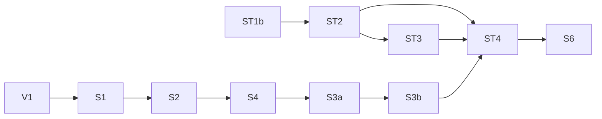

# Seams pause checkpoint

The owner requests a pause after the checked V1 landing.
The goal remains unfinished.
The coordinator must retain V1's two placed goals and the resulting proof dependency when reviewing this branch.

Branch: `codex/seams`.
Worktree: `/Users/pooks/.codex/worktrees/seams/lean4-effect4`.
Original base: `c752e565b4e1afac95d1258b0a4a570b81bcdf81`.
V1 implementation: `d6ad9482303a1998bfbcc826bf0d12ab4f6aa3c9`.
V1 receipt: `6406fa8d47b99e1b6224dffac5025f622235893c`.
The branch has no push or merge from this work.

[The receipt index](../../receipts/README.md) maps every slice and records the landed corrections and proposed decisions.
[The pause state](state.json) records the measured commits, remaining slices, source hashes, and completed agent reports.
The archive contains preparation only.
It adds no slice acceptance claim.

## Verified stopping boundary

K0, S0, ST1a, ST1b, and V1 have implementation commits and receipts.
V1's current narrow build, `#axiom_audit`, touched batteries, native checks, and required generation pass.
Its audit covers 1,879 declarations at `[propext, Quot.sound]`.
The audit reports two planned goals and one declaration modulo planned goals.
`Checked.ask_value` retains its exact statement and depends on `Check.combine_deps`.
[The V1 receipt](../../receipts/V1.md) gives their placement, scope, controls, and evidence limits.

The agent commands stop after their final reported results.
No next slice enters production at this boundary.
The remaining slices are S1, S2, S4, S3a, S3b, ST2, ST3, ST4, and S6.

## Frozen preparation

Archive paths below are relative to `/private/tmp` after restoration.
Each source and evidence file has its byte count and SHA-256 in [manifest.json](manifest.json).

| Slice | Preparation | Checked scope | Remaining work |
| --- | --- | --- | --- |
| S1 | `seams-check-sol/S1-package.patch`; `seams-s1-ledger/` | Source and caller preparation, red controls, and separate runtime ledger checks. | Integrate both packages, rerun every production gate, and record the placed goals. |
| S2 | `seams-check-sol/S2-package.patch` | Source and caller preparation, exact retained reference statements, and finite controls. | Integrate after S1 and rerun every production gate. Three new laws remain placed goals. |
| S4 | `seams-s4-sol/` | Main module train, origin controls, cumulative S2 dispatcher, and audit. | Migrate `typedReplayExit` in `Test/Program/InvocationContract.lean`. Native sealing and final production gates remain open. |
| S3a | `seams-s3a-sol/` | Source inspection and placed obligations only. | All draft protocol, interpreter, query, replay, and serve modules remain uncompiled. |
| S3b | `seams-s3b-sol/` | Qualified generator, actual Check codecs, numeric and optional-value controls, and the successful-write connector. | Tool codecs, pairing, wire, views, driver deletion, and native transcripts remain uncompiled or unfinished. |
| ST2 | `seams-st2-sol/` | Recovery proofs, actual producers, five Rocq files, native store tests, and bounded crash controls. | Integrate after ST1b and rerun every production gate. Preparation is not a landing. |
| ST3 | `seams-st3-scout/` | Envelope and result helpers, exact designated-query connector, profile controls, and command-sensitive gate probes. | Store, Word, Cas, native result admission, authority integration, and final generation remain open. |
| ST4 | `seams-st4-scout/` | Placement and source investigation only. | Implement Exchange after ST2, ST3, and S3b. |
| S6 | `seams-s6-scout/` | Caller inventory and owner-boundary investigation only. | Migrate actual clients and delete the remaining protocol and serving owners. |

The archive retains failed controls without rewriting their bytes.
Its source patches and logs may contain original whitespace.
Compiled Lean artifacts, native build directories, dependency packages, and repository metadata are excluded.
The archive retains source and evidence, so restored probes require rebuilding their dependencies.

The S4 failed caller check is retained in `seams-s4-sol/evidence/Test-Program-InvocationContract-1.log`.
The successful S4 audit does not discharge that failure.
ST2's 300 command lists and six process interruptions remain finite host evidence.
They establish no general filesystem or power-loss theorem.
S3a draft corrections remain receipt proposals, not decisions-register rulings.

## Restore and resume

Resume implementation only after the owner resumes this task.
Use GPT-6.1 Sol for subagents, as the owner requests.
Keep the existing worktree and branch.

1. Read the plan, brief, `AGENTS.md`, and current receipt index.
2. Verify the archive with `python3 restore.py` from this checkpoint directory.
3. Restore missing temporary sources with `python3 restore.py --restore /private/tmp`.
4. Inspect any existing-file conflict before changing either copy.
5. Check the current branch, head, and working tree.
6. Integrate one slice and run its production checks before committing it by explicit paths.

The restore tool checks the archive and every member before writing.
It refuses changed destinations and writes no replacement over them.
[verification.json](verification.json) records a full restore, a no-write repeated restore, and the changed-destination refusal control.

Interleave the protocol and store chains.
Run one Lean command through `seams-lean-one.py` at a time.
That wrapper enters the original `scratch/lean-slot.sh` with `LEAN_NUM_THREADS=3`.
Do not nest the wrapper.
Run OCaml through `opam exec --switch=effect4`.
Never run `lake build Test`, `make build`, or `make check-full`.
Never push or merge this branch into the coordinator's branch.

### Prepared integration commands

The scripts below remain unrun at the pause boundary.
Each apply script takes the current slice base commit and checks its expected source hashes.
Their hard-coded production directory is the worktree named above.
Review the script and its frozen source manifest before execution.

| Slice | Apply | Required addition before gates | Production checks | Commit helper |
| --- | --- | --- | --- | --- |
| S1 | `python3 /private/tmp/seams-s1-apply.py <base>` | `python3 /private/tmp/seams-s1-ledger/integrate.py` | `python3 /private/tmp/seams-s1-production.py` | `python3 /private/tmp/seams-finish-s1.py` |
| S2 | `python3 /private/tmp/seams-s2-apply.py <base>` | Retain S1's integrated runtime ledger. | `python3 /private/tmp/seams-s2-production.py` | `python3 /private/tmp/seams-finish-s2.py` |
| ST2 | `python3 /private/tmp/seams-st2-apply.py <base>` | Review current manifest and root placements. | `python3 /private/tmp/seams-st2-production.py` | `python3 /private/tmp/seams-finish-st2.py` |

S1's runtime ledger stores derived undo entries only in the sealed in-memory document.
Its exact replay-state witness remains attached.
Persistence still contains accepted actions alone.
Its controls require nested reverts to avoid replaying earlier checks.
The separate supplement must enter before S1's production checks.

For S4, exclude `tools/Tools/Session.lean` and `ocaml/gen/roots.json` from the full draft patch.
Apply `Tools-Session-focused-S2.patch` to the recorded cumulative S2 source.
Merge the explicit roots and nominal annotations into the current recipe.
`seams-s4-authorities.py` prepares central placements but remains unrun.
Repair the retained InvocationContract failure before any S4 landing claim.

For S3a, rebuild against the integrated S1 runtime ledger, S2, and S4.
Its old preparation script names an obsolete artifact directory.
Keep actual suggestion evidence, inspection fields, and preview observations from its recorded interface corrections.
Coordinate protocol field changes with S3b before generating its codecs.

ST3's checked helpers do not implement the result-admission invariant.
Keep all retained node bindings, including shadowed bindings, in its conflict scope.
The common envelope and designated query determine result ownership.
The native route must use ST2's single checked byte entrance.

ST4 must commit one accepted action sequence once, with full expected heads and exact retained replies.
S6 must replace the actual native serving owners and clients.
Its inventory retains the existing host interpretation differences and prevents an unsupported equal-observation claim.
