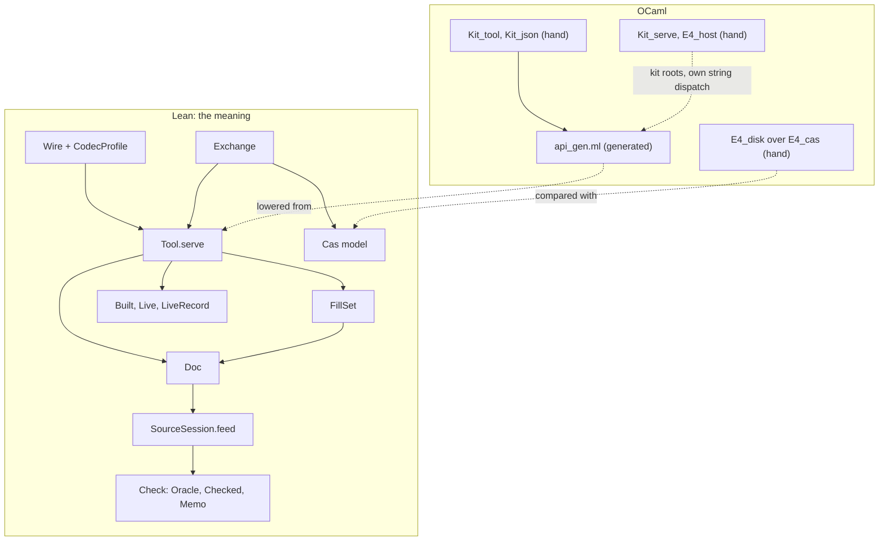

# The seams work: an adversarial review

Status: review (history, not authority). Base `774ddc3d7`, head `f21b94032`, branch
`refactor/phase1-phase3`. Read only: no build, no test, no edit outside this note.

Inputs: the plan folder, with `interfaces.md` version 2, `README.md` version 2, the ledger, both
reviews, the cuts and the probes. Also the earlier plans it cites, the owner's steers, the fifteen
slice receipts with their summary, and the code at head.

Evidence labels used below:

- **verified**: read in the code at head, or shown by the grep quoted beside it.
- **measured**: a number from a committed receipt log; this review did not rerun it.
- **suspected**: an inference; its reason follows it.
- "proved" and "tested" repeat a receipt's word; nothing was rerun here.

## 1. The one thing to know first

The Lean model is sound and mostly proved; the native face is not yet the same system. Its
generated interface lets a caller forge the tool state and the memo, and the gate key that should
regenerate it ignores every `Tool` source.

## 2. The engineering model, simply

### 2.1 The pieces

| Piece | What it owns | Where |
| --- | --- | --- |
| Protocol | requests (`Action`, `Query`), replies, refusals, as first-order data | `src/Effect4/Tool/Protocol.lean` |
| `Tool.serve` | the one transition: an accepted action appends; a query or a refusal changes nothing | `Tool/Serve.lean`, `Tool/Actions.lean`, `Tool/Queries.lean` |
| `Tool.State` | the accepted actions, the raw state they replay to, and the proof of that replay | `Tool/Replay.lean` |
| `Doc` | one document: its origin and its accepted actions; one interpreter for commit, draft, revert | `src/Effect4/Program/Typing/SourceDocument.lean` |
| `SourceSession.feed` | one edit under a policy: splice a part's table, or recheck the module | `Program/Typing/SourceSession.lean` |
| `FillSet` | pending fills, certified at one snapshot; publication is one commit | `Program/Typing/FillSet.lean` |
| `Check` | check keys, `run`, `Oracle`, `Checked` (a writer of checks), `Memo`, `HitRule` | `src/Effect4/Program/Check.lean` |
| Runs | `Built.ofSketch` admits; `Live` runs; `LiveRecord` saves and restores | `src/Effect4/Api/Built.lean`, `src/Effect4/Run/` |
| Wire | the JSON envelope, the version check, the reply pairing, the JSON profile | `Tool/Wire.lean`, `Tool/WireTypes.lean`, `Tool/CodecProfile.lean` |
| Exchange | sessions as entry chains on journal roots; load by replay; publish one commit | `Tool/Exchange.lean`, `Tool/Session.lean` |
| `Cas` | the store model: atomic commits, cut commits, root heads, one result per query | `src/Effect4/Store/Domain/Cas.lean`, `Store.lean`, `Transaction.lean` |
| `api_gen.ml` | the generated OCaml of `Tool.serve` and its closure (67,696 lines) | `ocaml/gen/` |
| `Kit_tool`, `Kit_json` | `eff tool`: JSON lines in and out over the generated serve | `ocaml/engine/kit/` |
| `E4_disk`, `E4_cas` | the disk store: packs, control file, recovery, one writer | `ocaml/engine/cas/` |

Two words recur. A **seal** makes a type abstract, so only its checked producer builds a value.
A **memo** remembers check answers, so a later identical check need not run again.



The diagram records ownership and data flow only. No native code calls `Exchange`.

### 2.2 One request's path

```mermaid
sequenceDiagram
  participant A as agent
  participant P as text parser
  participant R as shape reader
  participant W as Wire.check
  participant S as Tool.serve
  participant M as Memo
  A->>P: one JSON line
  P->>R: JSON tree (Lean: binary64; native: OCaml int)
  R->>W: Envelope Request, through the exact codec
  W->>S: the request, at the selected version
  S->>M: every check asked through the oracle
  S-->>W: next state, reply, trace of checks
  W-->>A: the reply line, or a wire refusal with the old state
  M->>M: learn the trace
```

In Lean the parser is `Tools.WireText.parseTree`, the reader is `Canonical.ofJsonAnyOrder`
(`src/Effect4/Store/Domain/ShapeRead.lean`), and the adapter is `Wire.serveJson`. Natively the
parser is `Kit.Json.parse`, the reader is `Kit_json.read`, and the adapter is the generated
`Tool.Native.serveEnvelope`.

### 2.3 The invariant at each boundary

| Boundary | What crosses | What holds there | Status |
| --- | --- | --- | --- |
| text → JSON | one line | Lean refuses a number that binary64 rounds; native refuses one outside OCaml's `int` | two domains (§7.3) |
| JSON → request | a value tree | it reads only the canonical print of one value (`Canonical.ofJsonAnyOrder_exact`) | proved in Lean; native twin tested |
| envelope | method, version | the payload's method, a selected and supported version (`Wire.check`) | verified, one owner |
| `serve` | request → state, reply | append exactly once; refusal and query change nothing; the oracle changes nothing | proved, no goal |
| `Doc` | history → session | the runtime state is the replay of the history (`Doc.replayedState`) | by construction |
| `Doc` | session → table | the table is the sketch's source table (`Doc.coherent`) | planned goal |
| `Check` | key → verdict | an oracle equals `run`; a memo hit is sound; a module ask is `combine` of parts | `combine_deps` is a planned goal |
| `Cas` | transaction → store | atomic; nodes only grow; one result per query; heads stale first | proved |
| session chain | head → state | loading the head an exchange reports gives `serve`'s next state (`load_own`) | proved, model only |
| OCaml interface | Lean types → `.mli` | `Checked`, `Memo`, `Oracle`, `HitRule`, `Live`, `Built` abstract | `state`, `doc`, `fill_set` concrete (§5 M1) |
| disk ↔ model | commands → images | equal images on 14 commands and 6 kill points | tested, finite |

### 2.4 What is proved, tested, or only trusted

| Kind | What |
| --- | --- |
| Proved in Lean, no planned goal | `serve_appends`, `serve_refuses`, `serve_query`, `serve_transparent`, `transcript_replays`, `serve_answers`; `Oracle.eq_uncached`; hit-rule soundness, `run_part_extends`; `CodecProfile.write_read`; the `Cas` laws (`commit_grows`, `bytes_never_change`, `commit_reads`, `advance_head`, `journal_ff`, `interrupted_closed`, `interrupted_roots`, `Cas.result_once`, `Cas.get_exact`); `load_own`, `apply_commits_once`, `apply_refuses` |
| Proved modulo planned goals | `Checked.ask_value` (rests on `combine_deps`); `SourceSession.reached_view` (rests on `Doc.coherent`); 18 goals stay open: V1 two, S1 thirteen, S2 three |
| Tested natively against Lean | `test_tool.ml` N1–N3 (ten requests); `test_seams_v1.ml` (six module verdicts); `test_disk_stm.ml` (Lean's 12-state table); `test_disk_kill.ml` (six cuts); `test_cas.ml` G1–G8 goldens |
| Only trusted | the LCNF translation (decisions row 391); `Kit_json` beyond its tests; `E4_cas` admission order beyond the goldens; `Kit_serve`; `E4_host.serve`; native naturals as `int` |

## 3. What the plan wanted

Each desire is in the owner's or planners' own terms, with its source.

1. **P1. One protocol, made in Lean, served by every face.** Nothing names a request by hand
   (`2026-10-16-tooling-design/README.md` §0, §3.2, §3.3; `interfaces.md` §4.3).
2. **P2. No second program representation, run language or edit interpreter**
   (`implementation-brief.md` §7; `brief-common.md`, constraints).
3. **P3. A cache changes cost, never an answer.** Every checker is an `Oracle`. No checker result
   is stored (`interfaces.md`, first item and D1; the incremental steer).
4. **P4. Persist accepted actions, never derived state.** Load is a validating replay, and the
   exchange keeps resident states (`interfaces.md` cause 3, §2.1 `Exchange` row, §4.4).
5. **P5. An atomic store.** A commit with a receipt, cut commits, and heads checked stale first.
   One result per query, and no mutation path around the checks (`interfaces.md` §4.5;
   `README.md` §5.3).
6. **P6. Checked packages sealed whole in OCaml.** The document, fill set, live run and tool state
   follow that rule (`2026-10-17-session-composition/plan.md` §8; estate `plan.md` §2.3, rule 1).
7. **P7. The native shell serves the same `serve` and exchange.** Transcripts equal; cached
   equals uncached; hostile records refused (`interfaces.md` §6, S6; loop 5, row 4).
8. **P8. Hand code only at real boundaries.** `Kit_serve` request execution and `E4_host.serve`
   go (`interfaces.md` §2.2; estate `plan.md` §5; `README.md` §1).
9. **P9. Disk compared with the model.** A differential and a kill harness; rerun with session
   and result carriers at ST4 (`README.md` §5.4 and §9, ST4 row).
10. **P10. Located, precise refusals.** Three outcome kinds apart; a decode refusal names a root
    path and a reason (composition `plan.md` §6, §7, control R8).
11. **P11. Honest proof status.** Placement before proof; no proofs to nowhere; build first
    (`AGENTS.md`, Trust; the steers of 2026-10-14 and 2026-10-16).
12. **P12. Every "goes" row deleted with its callers** (`implementation-brief.md` §6.3; the
    greenfield steer).
13. **P13. One owner per fact; a table as data** (the simplicity and robust-fix steers).
14. **P14. Fast, incremental generation and gates** (the lowering steer of 2026-10-14; the gate
    steers).
15. **P15. Agent first.** An MCP tool table generated from the request owner, with constructor
    docstrings as descriptions (`tooling-design` §3.2, §3.3; `README.md` §3.4).
16. **P16. Version selection belongs to the connection** (`interfaces.md` §4.4, D-rows).
17. **P17. The store wired to real consumers:** session chains, job and tape records, an action
    cache (`2026-10-17-authoring-and-store/README.md` §6–§8).
18. **P18. A clean plug-in point for Incremental later**, behind the oracle (`brief-common.md`;
    the incremental steer).

## 4. Gap table

| # | Landed evidence | Status | What remains |
| --- | --- | --- | --- |
| P1 | `Tool.serve` (`23f710f28`); generated codecs (`3969699e4`); `tools/Drivers/Session.lean`; `eff tool` (`8703ab832`) | partial | `Kit_serve` still dispatches `check`, `run`, `explore` by string; no generated tool table |
| P2 | one `Internal.action`; one `DocInternal.apply` | met | `Doc.history` repeats the transcript's document part with no connecting law |
| P3 | `Oracle.eq_uncached`; `Memo.oracle` agreement; `serve_transparent` | drifted | a module ask answers `combine`, equal to `run` only modulo `combine_deps` (§8 O2) |
| P4 | `SessionEntry` chains; `Exchange.load`; `load_own` (`6bb098a24`) | partial | no residency: every request reloads and replays the whole chain (§7.4) |
| P5 | `Cas.commit`, `Cut`, `Head`, `RootPolicy`, the result rule (ST1a–ST3) | partial | `E4_cas` still exports seven mutating entries beside `commit_transaction` (§5 M9) |
| P6 | `Checked`, `Memo`, `Oracle`, `HitRule`, `Live`, `Built` abstract (S0) | drifted | `state`, `raw`, `doc`, `fill_set`, `source_session` concrete; the memo crosses `tool_native_*` as a list (§5 M1) |
| P7 | N1–N3 in `test_tool.ml` | partial | no native exchange or persistence (S6b); 15 of 19 methods never compared |
| P8 | `tools/Tools/Session.lean`, `Tools.Query`, `Snapshot`, `valueFrom?` deleted | partial | `Kit_serve`, `E4_host.serve` kept (S6 receipt, recorded); `Kit_json` hand twin |
| P9 | `test_disk_stm.ml`, `test_disk_kill.ml`, `disk-oracle.tsv` | partial | the ST4 rerun with entry and result carriers is absent, and no receipt records why |
| P10 | `Refusal`, `AddOutcome`, `Run.Verdict` kept apart | partial | a wire decode refusal is bare `unreadable`; `notCertified` drops its reason (§7.2) |
| P11 | placement in every receipt | drifted | `source-session-undo` and `source-session-coherent` were proved at base; now open or modulo |
| P12 | 14 of the 15 "goes" rows of `interfaces.md` §2.2 done (verified by grep) | partial | the S6 row (`Kit_serve`, `E4_host.serve`) |
| P13 | generated store facts (`e4_kind`, `e4_admission`, `e4_root_policy`, `e4_result`) | partial | hand copies listed in §5 (gate key, method list, parent fields, JSON) |
| P14 | — | drifted | check-ocaml 231.7 s at ST4 → 412.4 s at S6 (measured); the LCNF key misses the tool |
| P15 | — | missing | no MCP or JSON Schema face for `Tool.Request` |
| P16 | `Wire.Connection`, `Wire.check`, `supportedMethods` | partial | both drivers hard-code `Connection.v1`; nothing negotiates |
| P17 | session chains | partial | no Job or Tape carrier; the result envelope has no producer (§5 M11) |
| P18 | `Oracle` and `HitRule` as the seam | met | Incremental must also answer through `Checked`, which carries `combine` |

## 5. Module deepening, ranked by value over cost

A deep module has a small interface over much function. Each finding names the deeper shape,
what it deletes, and its rough cost.

**M1. Seal the tool's packages natively (high value, small cost; verified).**
- `ocaml/gen/api_gen.mli` declares `and state = { transcript : action list; raw : raw; }`,
  `and raw = { doc …; fills …; runs …; generation : int; }`, a concrete `doc`, `fill_set` and
  `source_session`. Lean seals `Tool.State`, `Doc` and `FillSet` with a private constructor and
  a proof field.
- `tool_native_start`, `tool_native_serve_val` and `tool_native_serve_envelope` take and return
  `state * (check_input * verdict) list`. The memo is abstract (`and memo`), but these roots
  carry its representation instead. `Memo.oracle` answers a hit with no recheck.
- So a native caller can pass a forged memo or a forged state, and the tool answers from it.
- Deeper shape: put `Effect4.Tool.State`, `Program.Doc` and `Program.FillSet` in the `abstract`
  list of `ocaml/gen/roots.json`. Add the twelve `Tool.Native` roots to `nominal`, so their
  signatures say `state * memo`.
- Extend `scripts/check-lcnf-sealing.py` with three hostile clients: a state literal, a document
  literal, and a list passed as the memo. Deletes nothing.
- The S1 receipt deferred this: "Add sealing controls when S3a exports the actual protocol
  closure". S6 exported it and added no control; no receipt records why.

**M2. Derive the LCNF gate key from the recipe (high value, tiny cost; verified).**
- `LCNF_KEY` in the `Makefile` lists its Lean modules by hand. The list omits `Effect4.Tool.Native`,
  which `roots.json` added at S6.
- Its source closure misses 30 files that `api_gen`'s imports now reach: all of
  `src/Effect4/Tool/`, `SourceDocument`, `FillSet`, `CheckCache`, `Run/Preview`, and the store's
  `Cas`, `Store` and `Word`. The repository's own `source_closure` computes both sets.
- So an edit to `Tool/Actions.lean` leaves the key unchanged. `make check-ocaml` can then pass on
  a stale `api_gen.ml`.
- Deeper shape: read the `import` fields of `ocaml/gen/roots.json` into the key. Deletes the hand
  list.

**M3. One wire adapter (medium value, small cost; verified).**
- `Wire.serveJson` and `Tool.Native.serveEnvelope` repeat one sequence: read, `Wire.check`,
  `serve`, `responds`, encode.
- They differ only at the ends: JSON with the profile guard in Lean, value trees natively.
- Deeper shape: one `Wire.serveVal` over value trees; `serveJson` wraps it with the profile.
  Deletes `serveEnvelope`'s copy and the native skip of the profile's write guard.

**M4. One JSON owner (high value, medium cost; verified duplication).**
- `ocaml/engine/kit/kit_json.ml` calls itself "the OCaml twin of `ShapeDoc.print` and of
  `ShapeDoc.order`, `ShapeDoc.arrays` and `ShapeDoc.read` … arm for arm". That is a hand copy of
  Lean definitions in `src/Effect4/Store/Domain/ShapeRead.lean` and `Shape.lean`.
- The copy already differs in its number domain (§7.3).
- Deeper shape: lower `Canonical.ofJsonAnyOrder`, `printArrays` and `CodecProfile` into `api_gen`,
  and keep only the text parser and printer by hand. Deletes most of `kit_json.ml`'s 423 lines.
- Blocker: Lean's JSON keeps a number as binary64 bits in a `UInt64`, and the lowered `UInt64` is
  a 63-bit `int` (`src/Effect4/Run/Kit.lean`, header). So lowering waits on exact numbers.
- Interim shape: Lean writes a corpus of JSON lines, each with its value or refusal. The native
  reader must agree, as the G-goldens do for bytes. It needs decision A (§10).

**M5. Narrow the carriers the wire leaks (high value, medium cost; chain verified, size
suspected).**
- `Live.WaitView.registration : Option EffName` (`src/Effect4/Run/View.lean`) puts the
  compiler's continuation-name alphabet on the wire. `EffName` (`src/Effect4/Program/Compile.lean`)
  carries `Point`, `Ctx`, `ExitV`, `DeferredKey` and `FinName`.
- `PreviewAnswer.settled` and `frames` return `Run.Tree.Outcome`, whose `stores : Stores` is the
  machine's whole store set.
- So `src/Effect4/Tool/ToolDerived.lean` (10,913 generated lines) derives codecs for `Machine.Ctx`,
  `ScopeState`, `DeferredStore`, `MemoMap`, `TimerStore` and the 57-arm `EffName`.
- Those namespaces span about half the file (from `ArgSite` to `EffName`, and from `WakeMode` to
  `Stores`). `EffName`'s codec is among the largest declarations of the `api_gen` closure.
- Each suggestion `Candidate.key` and each `Inspection.context` carries a `SigData`, which holds
  the whole `SigApp` and hole table. A page of candidates repeats the application once each.
- Deeper shape: answer first-order views (a registration's kind and identity; a preview's steps,
  stop and cells; a key's digest). Deletes about half of `ToolDerived.lean` and shrinks the
  native closure and every reply.

**M6. Give the exchange resident states before generating it (high value before S6b, medium
cost; verified).**
- `Exchange.apply` calls `resolve`, which calls `load` for every request, queries included.
- `load` walks the chain, reads each entry through `Cas.get`, replays every action through
  `serve`, and hashes the program at each step (`afterOf`).
- `interfaces.md` §2.1 lists residency as part of the module. S6b would lower this cost into the
  native shell.
- Deeper shape: a pure map from head digest to `State`, with a law that a hit equals `load`.
  Then S6b generates the exchange over `E4_disk`.

**M7. One owner of a stored parent field (medium value, small cost; verified).**
- `Node.designatedParent` (`src/Effect4/Store/Domain/Cas.lean`) reads parents by position:
  `.entry, .ctor 1 [parent, _, _, _]`, `.tape, .ctor 0 [_, .some parent, _]`, and a
  seven-field checkpoint pattern. `e4_cas.ml` repeats it.
- `SessionEntry.write` (`src/Effect4/Tool/Session.lean`) owns the entry layout. No Lean carrier
  exists for tapes or checkpoints (ST4 receipt).
- Deeper shape: a parent reader in each carrier's `Content` instance, generated into OCaml.

**M8. One suggestion owner (medium value, small cost; verified).**
- `CheckCache.suggest` and `SuggestResult` have no production caller. Only
  `Test/Program/CheckCacheControls.lean` and `Test/Program/FillSetControls.lean` call them.
- `Tool.Internal.query .suggest` repeats their paging. `Tool.Candidate` repeats
  `CheckCache.Suggestion` field for field.
- The module is still named `CheckCache`; its docstring says the cache "is gone".
- Deeper shape: rename it `Suggest`; keep one paging function; let the tool return `Suggestion`.

**M9. One store interface natively (medium value, medium cost; verified).**
- `E4_disk` (`ocaml/engine/cas/e4_disk.mli`) wraps `E4_cas` with nine values. `E4_cas` still
  exports 45, with seven mutating entries beside `commit_transaction`: `put`, `put_bytes`,
  `commit`, `advance_root`, `pin`, `pin_all` and `apply_word`.
- `E4_disk.read` builds a whole checked image for one address, and so does every
  `commit_transaction` before it writes (§7.4).
- Deeper shape: make `E4_disk` the only public store; the transaction is its only mutation.
  Keep `E4_cas` internal.

**M10. One method table (low cost; verified).** `supportedMethods`
(`src/Effect4/Tool/Protocol.lean`) is a hand list of nineteen names beside the match
`Request.method`. Derive the list, with a completeness lemma as `Internal.mem_allSlots` does.

**M11. One action-cache design (owner decision; verified).**
- ST3 added `ActionId`, `Query`, `Answered`, `Shape.value`, the result rule and `E4_result`.
- No code outside tests and goldens writes a result node. `grep` finds `Answered` only in the
  store, its laws, `CasGoldens`, the Rocq export and `Test/Store/SeamsResults.lean`.
- The gate cache stays a separate JSON action cache (`scripts/lib/gate_cache.py`, `query_key`).
- Choose: move gate passes onto result nodes, or mark the envelope as prepared and stop
  extending it.

**M12. One byte codec per carrier, and names that are data (low cost; verified).**
- `LiveRecord.encode` and `decode` (`src/Effect4/Run/LiveRecord.lean`) encode a hand tuple. S3b's
  generated `Canonical LiveRecord` in `ToolDerived.lean` encodes a struct. The bytes differ.
- Only `Test/Program/LiveRecordControls.lean` (control 2b) and `Laws/Api/LiveRecord.lean` use the
  tuple codec. Deeper shape: delete it and read the generated instance.
- The generator's `--qualified-names` mangling reaches the data: 75 shape names in
  `ToolDerived.lean` read like `"_root_.Effect4.Program.Sketch"`. `SessionEntry.shapeDoc` embeds
  `shape Action`, so they enter every session entry's spec digest: a generator flag decides
  stored identities.

**M13. One owner for the store's node laws (low urgency; verified).**
- Lean proves `putNode_sound` with the result rule. `rocq/StoreLaws.v` proves `put_sound` over
  regenerated code, and its `Sound` has no result field.
- No Lean declaration cites `StoreLaws` (`grep -rn StoreLaws src tools Test` is empty).
- ST1a still had to regenerate and patch the Rocq file. Choose one owner, or declare the Lean
  facts from Rocq.

## 6. Cruft to cut

Each item names its path, what to cut, and the proof that nothing needs it.

**Tracked bulk and binaries (verified).**
- `receipts/evidence/S4/preparation/` holds six compiled OCaml objects (`forged_built*_baseline.cmi`
  and `.cmo`). Proof: `git ls-files docs/research/2026-10-17-seams | grep -E '\.(cmo|cmi)$'`.
- `preparation/paused-2026-10-18/artifacts.tar.gz` (2.1 MB) and its `manifest.json` (254 KB)
  restore a pause that ended. The S1–S6 landings superseded them.
- `receipts/evidence/` tracks 822 files and 5.26 MB: 334 logs and 313 JSON files. The cleanup
  steer of 2026-10-03 drops build logs and bulk evidence; keep each receipt's command table.

**Dead code (verified).**
- `Tool.Native` imports `Effect4.Tool.Exchange` and uses nothing of it. Proof: `grep -n
  'Exchange\|Cas\|SessionEntry' src/Effect4/Tool/Native.lean` finds only the import.
- `Wire.Refusal.response` and the `responds` checks in `Wire.serveJson` and
  `Native.serveEnvelope` never fire: `serve_answers` proves every reply pairs.
- `Wire.decode` checks `connection.valid`, then calls `Wire.check`, which checks it again.
- `FillSet.publication`'s `empty` refusal cannot fire after `Internal.action` checks emptiness, and
  its arm maps to `fillsEmpty`. `PublishRefusal` has no other constructor.
- `CheckCache.suggest` and `SuggestResult`: only two batteries call them (M8).
- `LiveRecord.encode`, `decode`, `toTuple`, `ofTuple`: one battery and their own law (M12).
- `E4_instance.step` ignores its `_i : interp` argument, and `E4_engine` computes that interpreter
  at load for nothing. Its own comment keeps it "for INSTANCE compatibility".

**Shims and retained references (owner confirms).**
- `E4_control`'s version-1 decoder (`legacy_valid_name`, `legacy_policy_of_index`). The plan's D2
  asked for it, but no store existed to migrate: the store survey found no consumer outside
  tests. The greenfield steer says stored bytes are no compatibility constraint.
- `src/Effect4/Laws/Program/FillReference.lean` and the old-form D1–D9 laws in
  `Laws/Program/FillSet.lean` (32 mentions). They wait on `kept_eq_certified` and
  `publish_eq_materialize`. Prove both soon, or delete all three together.

**Stale text (verified; each cited name is absent or wrong at head).**
- `Laws/Store/Results.lean`: "ST4's session chains read results through `Cas.read`, and S6 serves
  them"; and "The gate cache keys a result by its command". Neither holds (O5, M11).
- `Laws/Tool/Exchange.lean`: "S6's native shell, which serves the same exchange" (O3).
- `Laws/Tool/Serve.lean`, `transcript_replays`: "Consumer: ST4's load" (O11).
- `Tool/Wire.lean`: "The pairing is one exhaustive match" (O6).
- `Laws/Program/FillSet.lean`, the D6 and D9 placements: consumers `FillSet.materializeSketch`
  and `FillSet.materializeDoc`, which no longer exist.
- `ocaml/engine/cas/e4_cas.mli` D8: "`RootPolicy.pin` is not in Lean". It is, in
  `src/Effect4/Store/Domain/Transaction.lean`. The same header cites `e4_pack.ml:766-768` by line.
- `ocaml/engine/kit/bin/eff.ml`: its header's usage and dependencies omit `eff tool` and `Kit_tool`.
- `ocaml/engine/kit/kit_json.ml` K1: "prints … inexactly in Lean". The Lean driver refuses that
  print (`CodecProfile.write` answers `unprintable`).
- `ocaml/README.md`: "It seals checked packages as whole abstract types" (O9). Its generated table
  omits `e4_root_policy`, `e4_result` and the disk oracle's producers.
- `docs/GENERATED.md`, the `cas` row, omits `e4_result.ml`. `docs/ARCHITECTURE.md` has no row for
  `src/Effect4/Tool/`.
- The module name `Program.Typing.CheckCache` names a cache its docstring says "is gone" (M8).

**Duplicated scaffolding and names (verified).**
- `ocaml/engine/test/kit/tool-requests.jsonl` is a byte copy of
  `Test/fixtures/session/requests.jsonl` (`cmp` finds no difference). Keep one.
- `serve1` is defined in three batteries (`SessionToolControls`, `QueryControls`,
  `SketchAdmissionControls`). A shared `Test` support module would hold it.
- Fourteen batteries and three native tests are named after plan slices (`SeamsS0`, `SeamsS3a`,
  `test_seams_v1`, …). Name each after its subject; a slice name means nothing after the plan.
  `Test/Store/SeamsHeadPrinter.lean` tests the Gallina printer, not the store.
- `scripts/lib/store_facts.py` lists the generated files by hand beside their producer.

This list comes from this review's own reading and greps. It is not a census of every unused
export: two automated sweeps (Lean declarations, OCaml exports) were stopped before they reported.

## 7. Engineering refinements

### 7.1 Types: illegal states still representable

- `Internal.Raw` (`Tool/Actions.lean`) allows `fills` without `doc`, and a fill set whose anchor
  names another document. `doc : Option (Doc × Option FillSet)` removes both. **verified**
- `Program.Snap` derives no `DecidableEq`. So `Internal.action` compares its fields one by one,
  twice. **verified**
- `Root.name : String` and `Exchange.rootName name := "session/" ++ name` accept an empty name
  and nested slashes. **verified**
- `Exchange.finish` maps a `staleRoot` to `staleBase ((resolved.publish.name?).getD "")`: an
  empty name stands for "no session". **verified**
- Staleness has two owners. `Doc.check` compares a snapshot with the document. The fill and
  publish arms of `Internal.action` compare the fill anchor field by field themselves. One call,
  `d.check fs.anchor`, would serve both. **verified**
- `Built.rowNames` defaults to `[]` in a public structure. `ofProgram` fills it; a hand literal
  can omit it. **verified**
- Generated OCaml naturals are `int` (`snap.revision : int`), while Lean's `Nat` has no bound.
  **verified**

### 7.2 Refusals: precise, total and located?

- `CodecProfile.Refusal.unreadable` names no path and no reason. Control R8 asked for both
  (composition `plan.md` §7). `readIn` returns `Option`, so the cause is lost at its source.
  **verified**
- `FillSetInternal.addEntry` maps every refused `keepExact` feed to `AddRefusal.notCertified`.
  The same candidate through `edit (commit …)` reports `notKept` with the verdict. **verified**
- `Exchange.LoadRefusal.parent` covers two causes: an origin where an action belongs, and an
  index out of order. **verified**
- `Tool.Refusal.fillsEmpty` also answers a refused publication, a branch that cannot fire.
  **verified**
- `CheckCache.suggest` turns any page refusal into `none`; the tool's query keeps it. **verified**
- A `suggest` with `limit = 0` answers an empty page whose next cursor equals its cursor. A
  client that follows the cursor never ends (`Tool.Internal.query`). **verified**
- `E4_cas` still raises `Locked` and `Store_error`. `E4_disk.commit` turns any `Invalid_argument`
  into `Capacity`, which also hides a programming error. **verified**

### 7.3 Boundaries

- **Value trees against JSON text.** Lean reads a number as binary64 and refuses one that rounds
  (`Tools.WireText.parseTree`, `natOfBinary64`). The native parser reads an OCaml `int` and
  refuses a fraction or anything past 2^62 (`kit_json.ml`, K4). **verified**
  - 2^53 + 1 is refused by Lean and accepted natively.
  - 2^62 is exact in binary64, so Lean accepts it; `int_of_string_opt` refuses it natively.
  - `Wire.serveJson` returns the old state when the reply cannot print. `Native.serveEnvelope`
    has no write guard, so it keeps the new state. The drivers' states can then differ, not only
    their text.
- **Lean model against the native store.** The disk oracle (`disk-oracle.tsv`) has 12 states and
  14 commands. It holds no journal root, no session entry and no result node. **verified**
- **Two drivers' refusal text.** A line that does not parse prints a different reason in each
  driver. N3 checks only that both refuse. **verified**

### 7.4 Performance

- **Generation.** check-ocaml took 231.7 s at ST4 and 412.4 s at S6. The `api_gen` closure step
  took 21.6 s for 2,302 declarations, then 239.5 s for 2,891. **measured** (receipt logs)
  - The inference-round loop (`translateClosureInferring`) re-walks the whole closure each round.
    It does not explain `api_gen`: rounds need carrier rows, which only the externs table of
    `api_engine` gives. **verified**
  - The 589 new declarations cost about 218 s. **suspected** cause: large closed terms and type
    spelling in the tool closure (M5), not the declaration count.
  - Measure before fixing: the manifest already counts code nodes per declaration; add its time.
- **The exchange.** Each request replays the whole session: linear per request, quadratic per
  session. **verified** (M6)
- **The memo.** `Memo.learn` prepends each trace, and `Memo.oracle` scans with `find?`. An exact
  hit compares whole `CheckInput` values, each holding the application and the program.
  - Over a long agent session a lookup can cost more than the check it saves. **suspected**: the
    structure is verified, nothing was measured.
  - `README.md` §4.4 asked to measure checking, expansion, tables, hashing and lookup apart. No
    receipt does.
- **Proofs moved into the core.** `HitRule.sound` is a proof field, so `Check.extension` must be
  proved where it is built. V1 therefore moved 898 lines of support lemmas from
  `Laws/Program/Signature.lean` into the core's `Program/Typing/SignatureSupport.lean`. Every
  core build now elaborates them. **verified**; the time cost is not measured.
- **The stable step.** `Program.stepChecked` rebuilds `interpOf program table` at every machine
  step. `E4_instance.step` ignores the interpreter `E4_engine` passes it. **verified**; the cost
  is recorded unmeasured in the S0 receipt.
- **The native commit.** `E4_cas.commit_transaction` first calls `checked_image`. That walks every
  record from the pack's start, re-hashes it, decodes it, re-admits it and copies its bytes.
  So each commit costs the whole store, and a session of n actions costs O(n²) bytes. **verified**
  - S6b would put one commit behind every accepted action. Verify once at open, then keep the
    invariant by ownership, or check only the tail past the durable boundary.
- **`E4_disk.read`** calls the same `checked_image` to read one node. **verified**

### 7.5 Tests

- N1 compares ten replies over four methods: `open`, `doc`, `edit` (draft, revert, commit) and
  `history`. No fill, publish, reset, start, restore, play, suggest, run, preview, dry,
  discover, table, addresses or slots reply is compared. **verified**
- N1's oracle, `tool-replies.jsonl`, is pinned by hand. `scripts/generate.py` writes only `*.txt`
  fixtures, so no producer refreshes it. **verified**
- N2 compares cached and uncached replies, but counts no hit; it would pass with an empty memo.
  `serve_transparent` already proves the Lean side. **verified**
- The disk differential uses one fixed seed (1739) and 300 lists, so each run tests the same
  finite set. **verified**
- `combine_deps` has six native module verdicts as its only evidence (`test_seams_v1.ml`, P1).
  **verified**
- Solid comparisons: the G8 goldens compare Lean's cut with `E4_cas.put_bytes`. The kill harness
  compares six real kills with Lean's `Cut` images. The ST4 Lean controls hold twenty guards.

### 7.6 Against `ocaml/STANDARDS.md`

- Rule 5 (every library module has an `.mli`; a checked package is abstract whole): the new
  `kit_tool.ml` has none, so its mutable `session` field is public. M1 covers the package part.
  **verified**
- Rule 6 (a refusal is a value; a raising function ends in `_exn`): `E4_cas.put`, `commit` and
  `advance_root` raise `Store_error` after a refused recovery (its D6). **verified**
- Rule 7 (a Lean `Nat` is exact wherever it carries meaning): the generated tool types and
  `Kit_json` hold naturals as `int`. The estate plan's phase 2.2b owns the switch. **verified**

## 8. Claims that overstate their reach

**O1. `checker-oracle-agrees` (verified).** Its registry title says no "forged package is
admitted". The `tool_native_*` roots admit a forged memo as a plain list (M1). The premise that
carries the weight: every root that takes a memo names the abstract `memo` type.

**O2. "A cache can change cost, never an answer" (verified).**
- It holds for `Memo`: each hit rule carries its soundness, and `Oracle.eq_uncached` is proved.
- `Checked.ask` on a module key answers `combine i (parts)`, not `o.ask i`. Its equality to
  `run` is the planned goal `combine_deps` (`src/Effect4/Laws/Program/CheckAgreement.lean`).
- `SourceSession.open` and `recheck` take every table from that path. So each document's
  coherence rests on the goal, and registry claim `ref-cache-agrees` titles it unconditionally.

**O3. `load_own` (verified).** Proved, over the Lean `Cas` that the same `apply` returned. Its
module docstring names "S6's native shell, which serves the same exchange" as a consumer. No
native exchange exists.

**O4. `apply_commits_once` (verified).** The plan states it as "adds one entry and moves the
head once". The theorem proves less: the transaction's last node is the entry, and it has one
move. A new session commits two entries, the origin and the action. Nothing fixes the entry's
parent or its index.

**O5. `Cas.result_once` (verified).** Proved. Its docstring names consumers that do not exist:
"ST4's session chains read results through `Cas.read`, and S6 serves them". Only
`Test/Store/SeamsResults.lean` calls `Cas.read`.

**O6. `serve_answers` and the pairing match (verified).** The theorem is proved. The `Wire.lean`
header says the pairing "is one exhaustive match", but `actionPairs` and `queryPairs` end in
`| _, _ => false`. The guarantee is the theorem; the runtime `responds` check is dead under it.

**O7. "Replies equal Lean's driver" (verified).** True on ten requests over four methods, against
a hand-pinned file. It says nothing of fills, runs, suggestions or previews, and the two drivers
read different numbers.

**O8. S1's receipt (verified).** "Required checks pass; thirteen placed goals remain" is true but
hides a regression. At base, `feed_undo` (claim `source-session-undo`), `feed_coherent`,
`feed_keeps` and `Doc.commit_sound` were theorems, and `reached_view` (claim
`source-session-coherent`) was proved. Now the first four are planned goals, restated for the
policy feed, and `reached_view` rests on the goal `Doc.coherent`.

**O9. `ocaml/README.md` (verified).** "It seals checked packages as whole abstract types" holds
for `Check`'s packages, `Live` and `Built` only.

**O10. The S6 receipt's number item (verified).** It frames the number profile as a missing
control. The difference also changes driver state (§7.3).

**O11. `transcript_replays` (verified).** Proved. Its docstring names "ST4's load" as its
consumer, but `Exchange.load` replays through `serve` and never calls `replayAccepted`. So the
tool has two replay paths, `Internal.replayCursor` and `Exchange.replay`, joined only by
`State.accept`'s proof.

**O12. The G8 goldens hold (verified).** Each case is Lean's `Store.putNode` answer, cut by
`src/OCaml5/Tools/CasGoldens.lean`, against `E4_cas.put_bytes` on the same preload. The premise:
the preload is forged past admission, so G8 checks one put at a time, not a reached store.

## 9. What is solid: do not churn it

- `Tool.serve` over one action interpreter, with a state sealed by its transcript's replay. Its
  laws are proved from the definitions, with no goal.
- `Doc` as origin and accepted actions, with one interpreter for commit, draft and revert. The
  undo ledger lives only in memory and is rebuilt by replay.
- `FillSet` built only by `open_` and `add`; publication is an ordinary `Doc.step` commit.
- `Check.Oracle` with `eq_uncached`, `Memo` valid by construction, and `HitRule` with a
  soundness field. The extension rule is proved (`run_part_extends`).
- The store model: events, atomic commit, `Cut`, full heads checked stale first, journal
  fast-forward, one result rule at every entrance, checked recovery. All proved.
- Session chains with a transcript index: the walk is structural, and `load_own` needs no fuel or
  hash premise.
- `Built.ofSketch` and `Built.ofProgram` as the single admission for starts and restores.
- Store facts generated from Lean into OCaml (`e4_kind`, `e4_admission`, `e4_root_policy`,
  `e4_result`), and the disk oracle and cut images generated from `Cas`.
- The codec generator's arm-lemma template: nine codec groups compile in 19.9 s instead of
  66.4 s (measured in commit `025df9b34`'s message). And the K0 cuts.

## 10. The refinement plan

Twelve slices, ranked by value over cost. Each lands alone with a narrow build, an axiom audit
and the gate it reaches.

| # | Slice | Files | Done when | Deletes | Size |
| --- | --- | --- | --- | --- | --- |
| 1 | Gate key from the recipe | `Makefile`, `scripts/gate-cache.py` or `scripts/lib/lean_imports.py` | an edit to `Tool/Actions.lean` changes the `gen-lcnf` key (red control) | the hand `--lean` list | XS |
| 2 | Seal the tool natively | `ocaml/gen/roots.json`, `scripts/check-lcnf-sealing.py`, generated `api_gen.mli` | forged state, document and memo clients fail to compile; `tool_native_*` name `memo` | — | S |
| 3 | One wire adapter | `Tool/Wire.lean`, `Tool/Native.lean`, `Kit_tool` | both drivers call one `Wire.serveVal`; the dead `responds` check and `Wire.Refusal.response` go | `serveEnvelope`'s copy | S |
| 4 | Narrow leaked carriers | `Run/View.lean`, `Tool/Protocol.lean`, the Tool codec group | `WaitView` and preview answers carry first-order views; closure time measured before and after | about half of `ToolDerived.lean` | M |
| 5 | One JSON number domain, then one owner | `kit_json.ml`, a Lean corpus writer beside `ocaml/engine/test/kit/write.lean`, later `ShapeRead.lean` | decision A in both drivers; a Lean-written JSON corpus (values and refusals, 2^53 + 1, 2^62, an unprintable reply) agrees natively | first the drift; after exact numbers, the shape-directed half of `kit_json.ml` | S, then M |
| 6 | Precise, located refusals | `CodecProfile.lean`, `ShapeRead.lean`, `FillSet.lean`, `Exchange.lean` | decode refusals carry a path and a reason; `notCertified` carries the feed refusal; `parent` splits | — | S–M |
| 7 | Memo as a keyed map | `Program/Check.lean`, the Check codec group | lookup by key; the validity field unchanged; a long-session timing recorded | the linear scan | S–M |
| 8 | Prove `combine_deps`, or ask `run` for modules | `Laws/Program/CheckAgreement.lean`, `Program/Check.lean` | `Checked.ask_value` rests on no goal | one planned goal | M |
| 9 | Restore S1's proof status | `Laws/Program/SourceTable.lean`, `SourceDocument.lean` | `feed_undo`, `feed_coherent` and `Doc.coherent` proved for the policy feed | three or more goals | M–L |
| 10 | Exchange residency, then S6b | `Tool/Exchange.lean`, its laws, roots, `E4_disk`, `e4_cas.ml`, `Kit_tool` | a resident hit equals `load`; a commit no longer re-verifies the store; native chains over `E4_disk`; the disk oracle covers entries and results | the per-request replay; the per-commit whole-store check | L |
| 11 | Suggestion owner and method table | `CheckCache.lean` → `Suggest`, `Tool/Queries.lean`, `Protocol.lean` | one paging function; `Candidate` gone; `supportedMethods` derived | `suggest`, `SuggestResult`, `Candidate` | S |
| 12 | Cruft sweep | the items of §6 | each item's grep comes back empty | §6 | S |

### Owner decisions on the way

- **A. The JSON number domain.** Option 1: binary64 in both drivers; the native reader refuses
  past 2^53, as Lean does. Option 2: exact naturals in both, as decimal numbers. Option 3: option
  1, plus an explicit decimal-string case for larger naturals. Recommendation: option 1 now.
  JavaScript and MCP clients read binary64, and `ShapeRead.lean` already names 2^53 as the MCP
  profile. Option 3 can follow when a real natural needs it.
- **B. The kit's face** (`eff serve`, `eff mcp`: `check`, `run`, `explore`). Option 1: move them
  to `Tool` queries and generate the MCP table from `Tool.Request`. Option 2: keep the kit as a
  second face. Recommendation: option 1; it also closes P1 and P15.
- **C. The result envelope with no producer.** Option 1: put gate passes on result nodes. Option
  2: mark it prepared and stop extending it. Recommendation: option 2 until a gate needs a store.
- **D. The store's node laws.** Option 1: Lean owns them and Rocq keeps the byte grammar only.
  Option 2: Lean declares them from Rocq. Recommendation: option 1; Lean already proves more.

## What this review does not establish

- No build or test ran. Each "measured" number comes from a committed receipt log.
- The size of M5's saving and the cause of the closure slowdown are suspected, not measured.
- The memo's lookup cost is inferred from its structure.
- Findings about generated OCaml read the committed `api_gen.mli`, not a fresh generation.
- The stale-key path of M2 is read from the `Makefile` and `scripts/lib/gate_cache.py`; no `make`
  ran to reproduce it.
- Axiom status repeats each receipt's `#axiom_audit`; no audit ran here.
- §6 is not exhaustive; it lists what this reading found.
