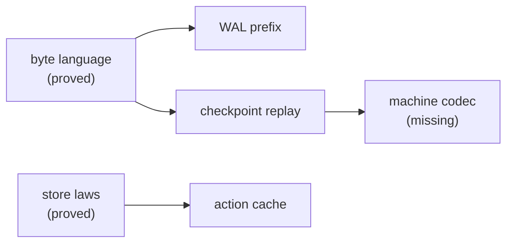

# The content-addressed store in Rocq: the byte language and the next statements

**The one thing to know first:** Lean's own store code now prints to Rocq (`rocq/StoreCode.v`), over
an abstract hash. Every proved property below holds of that printed code for every hash. The
byte language that both Lean and OCaml must implement is stated in §2. The three differences
in §3 are the code seat's work.

Status: research note (history, not authority). Seat rocq-cas, 2026-10-17, branch `seat/rocq-cas`
from `6689f0833`. The receipt is `docs/research/2026-10-17-seat-rocq-cas-receipt.md`.

## 1. What is proved, and over what

`make gen-rocq` prints the store's code from the base-phase LCNF of `Effect4.Store`
(`OCaml5.Lcnf.Gallina`, `storeSpec`). The module type `Prim` holds the parameters. They are the
hash, the byte codecs of numbers and strings, the float test, `Node.decode`, the zero digest and
three equality deciders. A proof takes three laws of the deciders: each decides equality, which is
what the compiler erased from the `DecidableEq` instance.

| Property | Rocq theorems | File |
| --- | --- | --- |
| 1. The hash is injective on a sound store's residents | `residents_hash_injective`, `residents_bytes_injective`, `address_inj_resident` | `rocq/StoreLaws.v` |
| 2. Domain separation | `version_byte_separates`, `val_tag_range`, `domain_separation`, `kind_separation`, `address_cid_collision` | `rocq/StoreLaws.v` |
| 3. A built store is ranked by insertion order | `put_ranked`, `built_ranked`, `rank_below_length`, `put_sound`, `built_sound`, `built_closure_premises` | `rocq/StoreLaws.v` |
| 4. The store as a growing map from digest to bytes | `putNode_ok`, `put_get`, `put_grows`, `put_bytes_never_change`, `put_conflict`, `put_conflict_collision`, `apply_grows`, `apply_built`, `verify_sound` | `rocq/StoreLaws.v` |
| 5. One byte language | `encode_prefix_free`, `encode_injective`, `node_encode_injective`, `put_conflict_bytes` | `rocq/StoreGrammar.v` |

Property 3 needs no hash assumption. `closure_closed` takes a rank that descends along every
edge. A store built from empty by puts has one: the position of a digest's first binding. A fresh
node's edges resolved among the bindings already there when the put filed it.

Property 4 classifies a conflict. The occupant either hashes to the address, so two nodes share
one address, or it does not, so the store is not addressed. A re-hash of the occupant tells the
two apart. In a sound store a conflict exhibits two different node byte strings with one hash
(`put_conflict_bytes`).

## 2. The byte language

One frame is a tag byte, the payload's length as eight big-endian bytes, and the payload. A
well-formed frame's payload is shorter than 2^64 bytes, so the length prefix is exact.

| Tag | Value | Payload | Refused when |
| --- | --- | --- | --- |
| 1 | `bool` | one byte, 0 or 1 | any other payload |
| 2 | `nat n` | `natBytes n`: big-endian digits, no leading zero; 0 is empty | a leading zero |
| 3 | `str s` | the UTF-8 bytes of `s` | not shortest-form UTF-8 |
| 4 | `list xs` | the frames of `xs`, back to back | a byte left over |
| 5 | `pair a b` | exactly two frames | a byte left over |
| 6 | `none` | empty | any payload |
| 7 | `some a` | exactly one frame | a byte left over |
| 8 | `bytes bs` | `bs`, a leaf | never |
| 9 | `unit` | empty | any payload |
| 10 | `ctor i args` | a tag-2 frame of `i`, then the frames of `args` | a leading zero in `i` |
| 11 | `ref k d` | the kind byte, then the digest bytes | an empty payload |
| 12 | `handle k n` | the kind byte, then `natBytes n` | a leading zero in `n` |
| 13 | `negInt n` | `natBytes n`; the value is −(n+1) | a leading zero |
| 14 | `float b` | eight big-endian bytes of `b` | `floatFrame b` is false |
| 0, 15–255 | none | none | always |

A node is the version byte 0, the kind byte, the thirty-two spec bytes and one value frame, with
nothing after it. The kind byte is a row of Lean's kind table, today bytes 1 to 15. A node's `ref`
frame must carry a registered kind byte and thirty-two digest bytes, or admission refuses it as
`malformedRef`.

Exactness is proved twice. In Lean the decoder is exact: `Val.decode_encode`, `Val.decode_exact`,
`Node.decode_encode` and `Node.decode_exact`. In Rocq the encoder is prefix-free, by a different
argument over the printed encoder: `encode_prefix_free`. So the grammar is unambiguous, and two
well-formed values with one byte string are one value (`encode_injective`).

The Rocq argument takes four codec laws as a premise (`Grammar.CodecLaws`). Each is a Lean
theorem:

* `be64` writes eight bytes: `Effect4.Store.length_be64`;
* `be64` is injective below 2^64: `Effect4.Store.natOfDigits_be64`;
* `natBytes` is injective: `Effect4.Store.natOfDigits_natBytes`;
* the UTF-8 bytes of a string are injective: `Effect4.Store.decodeString_toUTF8`.

## 3. Where OCaml and Lean differ, and the fix

| Difference | Lean | OCaml today | One language |
| --- | --- | --- | --- |
| Tags 13 and 14 | admitted (`decodeBody_int`, `decodeBody_float`) | `E4_node.walk` refuses them as `Bad_frame`, reported `Oversize`; `test_bytes.ml` pins "tag 13" as refused | OCaml admits both with Lean's payload rules; goldens for a `negInt` and a `float` node |
| Kinds 16 to 23 | refused (`Kind.ofByte?`) | admitted as registered kinds and scanned as edges; `E4_checkpoint` mints kind 21 | DI-25's kinds land in `Kind.lean`, or OCaml refuses them; until then OCaml mints none |
| An unknown tag | refused | refused as `Bad_frame`, then reported as `Oversize` | a distinct `Unknown_tag` refusal |

Two more items are refusals, not a second language:

* OCaml refuses a frame at 2^62 bytes (`Host_limit`, amendment M9), and Lean at 2^64. A host
  limit is a refusal outside the profile, so it stays, under its own name.
* OCaml refuses a handle frame in a content kind (`Handle_in_content`), and Lean's
  `Store.putNode` admits it (attack B2). The node language should refuse it in Lean too.

The Rocq proofs hold for any kind table, since `kind_separation` reads the printed `Kind.byte`. A
kind append reruns `make gen-rocq` and the compile command of `rocq/README.md`.

## 4. The next statements, scope only (item 6)

**WAL prefix semantics.** A log is records, each `be32 length, be32 crc, body`. The statement is
that recovery returns the longest prefix of records whose bytes were written whole. A torn tail
yields no record that was not written. The CRC check is the only test of a record, so the
statement is modulo a CRC-32 collision, exhibited as at level 0. A model needs the record codec printed from
whichever side owns it. Today only OCaml writes a log (`e4_wal.mli`).

**Checkpoint replay.** The statement is that restoring a saved machine gives the saved machine:
`restore (save m) = some m`, an exact embedding of the machine state into store content. Nothing
rebuilds a machine today. CP5, CP7 and CP11 round-trip rendered rows only. The first piece is a
machine codec with `decode_encode` and `decode_exact`. The store laws then carry the rest:
`put_get` and `put_bytes_never_change`.

**An action cache.** LLVM's model maps the digest of a key to the digest of a result. The
statement is that a hit equals running the action, given two premises. The action is
deterministic, and the key holds every input. A key collision is the one way to break it. So the
honest form is level 0: a hit is the run's result, or two different keys share a digest,
exhibited. The cache must keep each key's bytes for that check, as `put_conflict` does.
