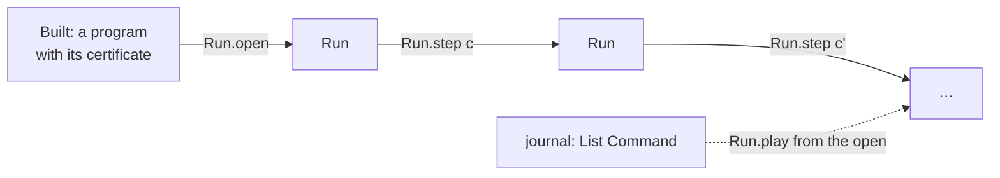
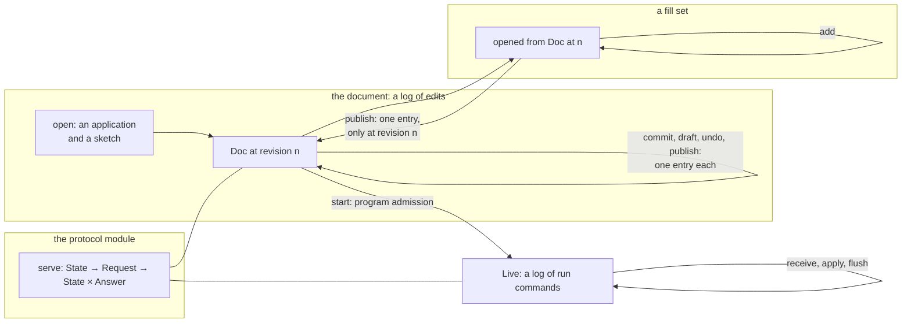
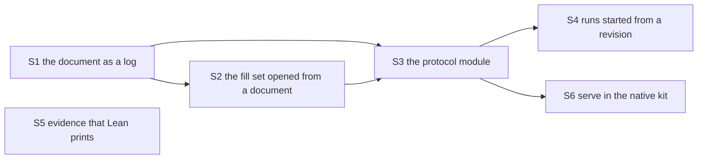

# 2026-10-17 Editing and running as one composition: the plan

Status: research note and plan, version 1 (history, not authority). Version 2 is `plan.md`,
after Codex's review (`codex-review.md`). Base: `03a4cf7fd` on
`refactor/phase1-phase3`. The authoring branch `gemini/authoring` is at `8984bd15e`, with the
coordinator's repair of the review's findings uncommitted in its worktree. This plan changes no
code and no ruling.

## The one thing to know first

The run side of the tree already has the right structure. A run is a fold of its journal, and
its type carries the proof that an open and a list of commands reached it. The edit side has the
same fold, but not the type. So the authoring tool kept the document, the journal, the revision
and the fill set as unrelated fields. Each defect of the review lives in that gap.

The plan adds no new pattern. The edit document becomes a second instance of the run's pattern.
Program admission joins it to the run. The tool becomes the protocol module that the tooling
design already specified.

## Question

1. Why did the authoring slices leave so many gaps, beyond the implementer's care?
2. Which structures, already in the tree or its documents, exclude that class of error?
3. Should editing and running be one composition, and how does the work tie into what exists?

## What was read or run

| Item | Evidence | Result |
| --- | --- | --- |
| Codex's review of `03a4cf7fd` to `8984bd15e`, and the coordinator's check of each finding | tested: the findings rerun, the repair's controls (`docs/research/2026-10-17-authoring-gemini/receipt.md` §3.7, on the branch) | eight findings hold; one more found |
| `Run.step`, `Run.play`, `Run.Reached`, `journal_replays` (`src/Effect4/Run/Basic.lean`, `src/Effect4/Laws/Run.lean`) | reading | the run is a fold of its journal, proved |
| `Live` and its field `opened`, `Live.feed` (`src/Effect4/Run/Live.lean`) | reading | the run's reachability is carried in the type |
| `Api.Runner.Command` (`src/Effect4/Api/Runner.lean`) and its generated codecs (`src/Effect4/Api/RunnerDerived.lean`) | reading | the run's commands are an inductive with exact codecs |
| `SourceSession.feed`, `SourceSession.run` (`src/Effect4/Program/Typing/SourceSession.lean`); `reached_coherent`, `reached_view`, `feed_undo` (`src/Effect4/Laws/Program/SourceTable.lean`) | reading | the edit side has the fold and its laws, stated over reached sessions |
| `Doc`, `Doc.commit`, `Doc.undo` (`src/Effect4/Program/Typing/SourceDocument.lean`, on the branch) | reading | the revision is a free counter, and `undo` is a draft |
| `State`, `Request`, `answer` (`tools/Tools/Session.lean`, on the branch) | tested: `grep` counts | one record of 41 fields for 26 operations matched by name, 8 defaults by `getD`, no theorem |
| `Tools.JsonBridge.valueFrom?`, `read?`, `locate` (`tools/Tools/JsonBridge.lean`) | reading | any type with a canonical instance reads exactly, and a refusal is located |
| The tooling design, §3.2, §3.3 and §3.10 (`docs/research/2026-10-16-tooling-design/README.md`) | reading | the protocol module: requests as an inductive, one pure `serve`, generated codecs |
| The authoring model review, §3 and §4 (`docs/research/2026-10-17-authoring-model-review/README.md`) | reading | content, context and execution identity kept apart; separate tagged requests |
| The scout plan's proof DAG, §3 (`docs/research/2026-10-17-proof-scout/README.md`) | reading | every node is a core law; the tool's state has no node |
| `Comodel` (`Effects/Coalgebra/Comodel.lean` in the pinned `effects` package) | reading | `answer : (operation : S.Op) → σ → Option (S.Answer operation × σ)` |
| Concept 7 of `docs/core/semantics.md` | reading | `typed-replacement`, `focus-function`, `address-table` |

## Findings

### 1. The run's composition, as it stands

The diagram records the data flow only. It is not proof evidence.

- **Commands are data.** `Api.Runner.Command` is an inductive, and its codecs are generated.
- **The state is a fold.** `Run.play` is `List.foldl Run.step`.
- **Reachability is in the type.** `Live` holds a run with the proof that an open and a list of
  commands reached it. No other constructor of a `Live` exists.
- **The state replays.** `journal_replays` proves that the open, played through the journal,
  gives the run back. A run is data because its journal is.

### 2. The edit side has the fold, but not the type

`SourceSession.run` is the fold of `SourceSession.feed` over a list of edits. The laws
`reached_coherent` and `reached_view` hold at every session that an open and a list of edits
reach. `feed_undo` proves that feeding the replaced program back restores the session.

The branch's `Doc` does not use that fold. It holds a session and a revision counter. The
counter is a field like any other, so nothing ties it to the edits made. The tool then keeps five
fields beside it: the session, the journal, the revision, the document identity and the fill set.
No invariant relates them.

| Defect of the review | What the code did | The structure that excludes it |
| --- | --- | --- |
| 1. `fill` and `omit` drafted without a target | a string arm chose checked or draft by the fields present | a request type whose checked edit has a target field with no default |
| 2. a missing target came from the current document | eight `getD` defaults | the same: an absent field is a decode refusal, located by `locate` |
| 3. the list merge dropped and applied what the set refuses | a second public path beside `FillSet.add` | one path: a list becomes a set through `add`, or is refused |
| 4. fills joined a set anchored at an old revision | the anchor was a copied number | the set opened from a document value, and a staleness test on revisions |
| 5. a published set had no journal entry | the revision moved without the journal | the revision is the journal's length, so nothing moves one without the other |
| 6. `replace` with no replacement declared a hole | the absent field selected another operation | the request type, as in 1 |
| The forged anchor | `FillSet.empty` took any identity | the same as 4 |
| Two theorems named that do not exist | names typed by hand | a receipt whose theorem list a Lean command writes from the environment |
| The audit's scope | a module list chosen by hand | an audit of the modules a diff touches, as `batteries-touched` selects batteries |

### 3. Why the plan let them through

The scout plan's proof DAG holds core laws only (§3 of its README). The tool's state, the journal,
the revision and the fill set's life across edits have no node, and no acceptance control at the
tool. Defects 4 and 5 are not slips. The plan never says what a fill set becomes when the document
moves. It never says how a published set is undone. The implementer filled each gap the shortest
way.

The model review had already said to keep separate tagged requests for each operation (its §4).
The tooling design had already said to replace the tool by a protocol module with an inductive of
requests (its §3.2). The slices extended the old dispatcher instead.

### 4. The structures, and where each already lives

| Structure | Literature mark | What it says here | In the tree or its documents |
| --- | --- | --- | --- |
| A log acting on a state: event sourcing, the dictionary's monoid action | Fowler, 2005, *Event Sourcing*, by name | the state is the fold of its log; a revision is the log's length; a state carries its reachability | `Run.play`, `Run.Reached`, `Live.opened`, `SourceSession.run` |
| A machine with output | Mealy, 1955, *A Method for Synthesizing Sequential Circuits*, by name; Plotkin and Power, 2008, *Tensors of Comodels and Models for Operational Semantics*, by name | the tool is `serve : State → Request → State × Answer`, a comodel of the request signature | `Effects.Comodel`; `Run.Reactor`; the tooling design §3.2 |
| Parse, then use | King, 2019, *Parse, Don't Validate*, by name; Minsky, 2011, *OCaml for the Masses*, by name | a request is decoded into a type with no absent target; an invalid state has no value | the generated codecs; `Tools.JsonBridge.read?` |
| Independent edits commute | Cartier and Foata, 1969, *Problèmes combinatoires de commutation et réarrangements*, by name; Mazurkiewicz, 1977, *Concurrent Program Schemes and their Interpretations*, by name | a fill set is a set of pairwise independent edits; one canonical order, the base's address order, stands for every order | `FillSet`, `ordered`, D6 (`materialize_congr`), `Node.at_replaceAt_disjoint`; the schedule independence of 2026-10-10 has the same shape |
| A version-stamped capability, checked by compare-and-set | Kung and Robinson, 1981, *On Optimistic Methods for Concurrency Control*, by name | a target names the revision it was read at; a commit at another revision refuses | `EditTarget`, `Doc.commit`, `Store.putRoot` |

## Proposals (not rulings)

### A. One composition

The diagram records the data flow only. It is not proof evidence.

Editing and running are two instances of one pattern, a log acting on a state, joined by
program admission. The tool is a third fold: its state is the fold of its requests through
`serve`. So the owner's question of 2026-10-17 has the answer yes: they are one composition. The
edit side ties into the run's pattern rather than standing beside it.

### B. The document as a log

- `Doc` holds the application, the opening sketch, its identity and its log of entries.
- It caches its session with the proof that the opening session, run through the log's edits,
  gives that session. That is `Live.opened`'s shape. The constructor is private.
- The revision is the log's length, a definition and not a field. It grows with every entry,
  and only with one.
- An entry is a checked edit with its policy, a draft, an undo or a published fill set. Each
  records the program it replaced, so an undo is computable.
- `undo` appends an entry that puts the replaced program back. The log stays append-only, and
  `feed_undo` is its law. A target read before the undo refuses as stale, by the length alone.
- `commit` keeps `Doc.commit`'s checks. Staleness is a comparison of a revision with the log's
  length.

The laws to place: the replay law (from `SourceSession.run` and the cached proof), the undo law
(from `feed_undo`), and `Doc.commit_sound` restated over the log. The first two are short. The
third exists.

### C. The fill set opened from a document

- `FillSet.open d` takes the base, the application and the revision from the document value.
  No other constructor exists, so the anchor cannot be forged.
- `add` keeps its five refusals and the construction invariant (`FillSet.add_wf`).
- A list reaches the materializer only through `add`. The list function stays an implementation
  step inside the set's own materializer, with D5 to D9 as its laws.
- `Doc.publish` appends one entry, only when the set's revision is the document's. It applies the
  fills in the base's address order, and checks the source once at the end. A refusal appends
  nothing.
- A set that holds no fill follows the document. A set that holds fills refuses new fills once
  the document has moved, until `reset`. Rebasing a set onto a later revision is a later feature,
  with its own law.

### D. The protocol module

This is the tooling design's §3.2, without change of direction.

- `Tool.Request` and `Tool.Answer` are inductives in `src/Effect4/Tool/`. A checked edit's
  constructor has a target field with no default. A draft is its own constructor.
- Their codecs come from `tools/Effect4Gen`, a new group `Tool`. An absent field is a decode
  refusal, and `locate` names the place.
- `serve : State → Request → State × Answer` is total and pure. A refusal is a located refusal
  inside the answer, and the state stays as it was.
- The tool's state holds the document, its fill set and its live runs. Each live run records the
  document identity and revision that it started from.
- `tools/Tools/Session.lean` becomes a thin driver: decode a line, `serve`, encode the answer. The
  hand table of operations becomes the generated request table.
- Law names travel as strings, and one battery checks that each resolves (tooling design §3.2).

### E. Evidence that Lean prints

- A command lists the theorems a slice adds, with their statements, for the receipt to paste.
- A target `audit-touched BASE=` audits every module that a diff touches, as `batteries-touched`
  builds batteries. Its answer states which modules are outside the axiom gate.
- A check resolves each declaration name that a receipt cites.

### F. The slices

The diagram records implementation dependencies, not proof evidence.

| Slice | Owner modules | Acceptance controls, at its own boundary |
| --- | --- | --- |
| S1 | `Effect4.Program.Typing.SourceDocument` and its law module | a stale target after a commit, a draft, an undo and a publication; undo after each; the revision equals the log's length after every request |
| S2 | `Effect4.Program.Typing.FillSet` and its law module | the review's controls 3, 4 and 5, and the coordinator's 9 to 12; a set opened from one document refused by another |
| S3 | `src/Effect4/Tool/`, the `Tool` codec group, `tools/Tools/Session.lean` as a driver | each request with an absent field, refused with its location; a refused request leaves the state unchanged; the JSON transcript of the session battery |
| S4 | the protocol module | a live run names its document revision; `start` at a draft with refusals refuses |
| S5 | `tools/ProofGraph`, the `Makefile` | a receipt that cites a missing theorem is refused |
| S6 | `ocaml/gen/roots.json` | the native kit answers the session transcript as Lean does |

Each slice owes the five placement facts of `AGENTS.md` for each theorem, a narrow build,
`make batteries-touched` and `#axiom_audit`. S3 adds a generated group, so it runs
`python3 scripts/generate.py --only derived`. S6 owes `make check-ocaml`.

Stop rules:

1. Stop at a slice that needs a new pattern beside the run's.
2. Stop at a second request type, or at a defaulted field in a checked request.
3. Stop when a law needs a weaker statement than the one placed.
4. Then correct the goal, keep the counterexample as its control, and report (row 390).

### G. What becomes of the branch

- The core modules keep their laws: `SketchAdmission`, `CheckCache`, `LiveRecord`, `Preview`, and
  `FillSet`'s D1 to D9. S1 and S2 rework `Doc` and the set's anchoring, and keep their laws'
  statements where they hold.
- The repair in the worktree is the behavioural baseline. Its controls become S1 to S3's
  acceptance controls. Several become impossible to write once requests are typed, and their
  JSON forms become codec refusals.
- `Tools.Session`'s growth on the branch is replaced in S3, not extended.

### H. What the owner decides

1. The wire: the session's JSON becomes the generated print of `Tool.Request`, one JSON language
   (row 378). The constructors can keep today's operation names as their tags.
2. Undo: an append-only revert entry (recommended), or a cursor with redo.
3. The branch: commit the repair and merge the core modules now, with S1 to S3 next; or hold the
   merge until S3.
4. A shared module for the pattern: factor `play`, `Reached` and the replay law once, with `Doc`
   as its first user. `Run` moves onto it in a later slice, since its modules feed the gates.

## What this does not establish

- No slice has run. Each law named for S1 and S2 is proposed; only those cited from the tree are
  proved.
- The literature is cited by name. Its use here is a reading of shapes, not an imported theorem.
- A typed request removes the defects that come from absent fields. It does not check a request's
  values, which the checker and the located refusals still do.
- The plan covers the authoring tool. The native host driver's refusal defect (A0 of
  `docs/research/2026-10-17-ocaml-estate-review/README.md`) has the same cause, a hand copy of a
  Lean loop. S6 and slice LC-8 of the LCNF route retire that copy; this plan does not.
