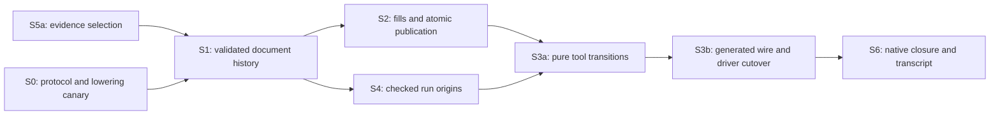

# Review of the session composition plan

## 1. The one thing before building

**Amend the plan before building. Keep the composition, but strengthen what its proof fields certify.**

A cached session matching a list of edits does not certify the entries' policies or undo records.
A revision derived from length does not distinguish two histories with the same identity and length.
A private constructor does not make copied immutable values unique.
The controls below exhibit these gaps.

Use one validated transition for each domain, and derive its replay from that transition.
Let one tool transition coordinate the document, fills, and live run.
Distinguish a rejected tool request from a recorded run command whose phase reports refusal.
This retains the existing owners without adding another program representation.

The continued review reads main at `ec39923a78c0d40fd4adec6610cbe7faaf4bcd42` and authoring at `8984bd15e03efdb31b2821b0ace5a60fa73f0751`.
The authoring evidence includes the coordinator's uncommitted repair.
[The continued baseline](/Users/pooks/Dev/lean4-effect4/docs/research/2026-10-17-session-composition/review-probes/continued-baseline.json) records tracked-byte fingerprints, input hashes, branches, commits, and dirty paths.
“Authoring” below means that repaired working tree, not its commit alone.
The plan still names `03a4cf7fd` as its main base.
The continued probes rerun the earlier controls against these recorded inputs.

The OCaml seat's new shape witness checks at this main revision.
`ShapeDoc.document` loses wire tags before hashing, so `specOf` cannot replace a tag-sensitive compatibility check.
Keep that repair in its codec owner and retain the existing tag guard during this implementation.
The revised slices below make these amendments acceptance conditions; they do not require another architecture survey.

Finishing criteria: answer every question, retain executable controls, check the report's language, and leave both input trees unchanged.
Evidence labels distinguish source reading, finite controls, and Lean proofs.
The proposed declarations below remain proposals unless a probe explicitly proves them.

## 2. Verdicts on the plan

| Plan section | Verdict | Required amendment or evidence |
| --- | --- | --- |
| Opening and question | amend | `Live` carries reachability. A raw `Run` does not. Types can exclude inconsistent internal state while still admitting draft programs and requests that semantic checks reject. |
| What was read or run | amend | `JsonBridge.read?` decides reading. `locate` offers a diagnostic, sometimes none. R8 refutes an unconditional located-refusal claim. |
| Findings 1: run composition | holds with its stated reachability premise | `journal_replays` requires `Run.Reached`. `Live.opened` supplies a connector through `Live.reached`. The public `Live` constructor requires that proof. |
| Findings 2: edit gap | amend | The diagnosis holds. Log length alone excludes neither a publication without its intended effect nor false undo metadata. R2 and R3 require a stronger history invariant. |
| Findings 3: missing tool obligation | holds | The scout's graph covers the core operations. The state composition and its lifecycle need their own consumer and acceptance controls. |
| Findings 4: mathematical structures | amend | The state projection is a free-monoid action. Outputs give a Mealy machine. D6 establishes canonical materializer agreement, not arbitrary execution-order agreement. R7 separates those claims. |
| A: one composition | holds with amendments | Keep domain logs and one tool transition. Tool reachability can use an erased existential witness without storing another physical request log. |
| B: document log | amend; blanket undo claim refuted | Replay must validate entry meaning and metadata. `feed_undo` covers an immediate successful fill. R1 refutes exact session restoration after omission. R10 also refutes unconditional checker-answer restoration. |
| C: fill set | amend | Retain the repaired identity, revision, base, and application checks. Opening from a document does not establish exclusive ownership. R3 supplies the control. |
| D: protocol | amend; blanket refusal claim refuted | Define whole-request refusal separately from batch item outcomes and run phases. R4 and R5 refute unchanged state under every existing refusal indication. R11 and R12 require explicit wire observations. |
| E: evidence from Lean | holds with amendments | Reuse environment enumeration and the axiom walker. Distinguish added declarations from all declarations in touched modules. Resolve theorem kind and imported environment too. |
| F: slices | amend | Move run origins into the state design. Split S3 into pure transitions and wire cutover. Test checked start/load dependencies early. `Run.Kit.admit` alone is insufficient, as R13 shows. Publication controls belong with S2. |
| G: branch treatment | holds with amendments | Keep the repaired behaviour as a control baseline. Do not freeze its mixed-batch error meaning or its independent state fields as the new specification. |
| H: owner decisions | recommendations in §7 | Generated wire, append-only revert, hold integration through protocol cutover, and share the existing fold shape before extracting a module. |
| Limits | amend | Add metadata validity, identity allocation, deserialization, proof erasure, and diagnostic coverage to the remaining boundaries. |

| Brief question | Answer location |
| --- | --- |
| 1: composition | §3 and §4.1 |
| 2: reuse | §3 |
| 3: invariant forms | §4.2–§4.4 |
| 4: request-dependent answers | §4.5 |
| 5: undo | §4.2 |
| 6: fill independence | §4.3 |
| 7: fill lifecycle | §4.3 |
| 8: boundary and refusal | §4.4–§4.5 |
| 9: evidence from Lean | §4.6 |
| 10: authoring branch | §6 and §7 |
| 11: slice order | §6 |
| 12: owner decisions | §7 |

## 3. Reuse audit

Paths in this table identify the owner of each named declaration.
The mathematical words use the [dictionary's meanings](/Users/pooks/Dev/lean4-effect4/docs/core/controlled-english.md).

| Proposed piece | Existing owner | Action |
| --- | --- | --- |
| Run transition and journal | `Run.step`, `Run.play`, `driveFrom` in [Run.Basic](/Users/pooks/Dev/lean4-effect4/src/Effect4/Run/Basic.lean) | Reuse. `driveFrom` records the commands chosen by a reactor. Replay consumes those commands without calling the reactor. |
| Run reachability and replay | `Run.Reached`, `journal_replays` in [Laws.Run](/Users/pooks/Dev/lean4-effect4/src/Effect4/Laws/Run.lean) | Keep the induction predicate here. Do not move the Laws graph into the core. |
| Certified run carrier | `Live.opened`, `Live.feed` in [Run.Live](/Users/pooks/Dev/lean4-effect4/src/Effect4/Run/Live.lean) | Copy the proof-field shape, not the run implementation. `opened` is an equation over core functions. |
| Output-producing replay | `Api.Runner.replay` in [Api.Runner](/Users/pooks/Dev/lean4-effect4/src/Effect4/Api/Runner.lean) | Keep the command interpreter and phase list. |
| Action and uniqueness laws | `Play`, `replay_append`, `replayPlay_append`, `replay_unique`, `behaviour_unique` in [Laws.Api.Runner](/Users/pooks/Dev/lean4-effect4/src/Effect4/Laws/Api/Runner.lean) | Reuse the existing explanation of state and output composition. Do not prove a competing Runner action. |
| The other functions named `replay` | `Api.Typed.replay` in [Run.Live](/Users/pooks/Dev/lean4-effect4/src/Effect4/Run/Live.lean), `Api.replay` in [Api](/Users/pooks/Dev/lean4-effect4/src/Effect4/Api.lean), `Machine.Witnesses.replay` in [Witnesses](/Users/pooks/Dev/lean4-effect4/src/Effect4/Laws/Machine/Witnesses.lean) | These complete the dictionary's four names. The typed route checks session replies. The raw decision route and witness helper remain test uses. They are not interchangeable interpreters. |
| Edit transition and replay | `SourceSession.feed`, `feedStep`, `run` in [SourceSession](/Users/pooks/Dev/lean4-effect4/src/Effect4/Program/Typing/SourceSession.lean) | Reuse the cache, delta, and edit machinery. Add validated document history around it. |
| Lower-level edit replay | `EditSession.run` in [Program.Edit](/Users/pooks/Dev/lean4-effect4/src/Effect4/Program/Edit.lean) | Retain its consumer. Add no third generic edit interpreter around the source-session fold. |
| Edit coherence and fill inverse | `reached_coherent`, `reached_view`, `feed_undo`, `Coherent.ext` in [SourceTable](/Users/pooks/Dev/lean4-effect4/src/Effect4/Laws/Program/SourceTable.lean) | Derive document observations from these laws. Keep the inverse's actual premises. |
| Document transactions | `Doc.commit`, `Doc.target` in authoring [SourceDocument](/Users/pooks/Dev/lean4-effect4-gemini/src/Effect4/Program/Typing/SourceDocument.lean) | Retain target, source-check, and exact local-type checks. Replace the independent counter and permissive carrier. |
| Fill checks and canonical order | `certifiedB`, `ordered`, `FillSet.add`, `materializeDoc` in authoring [FillSet](/Users/pooks/Dev/lean4-effect4-gemini/src/Effect4/Program/Typing/FillSet.lean) | Retain these computations behind one public construction path. Move publication ownership into the document transaction. |
| Fill laws | D1–D9 and `FillSet.add_wf` in authoring [Laws.Program.FillSet](/Users/pooks/Dev/lean4-effect4-gemini/src/Effect4/Laws/Program/FillSet.lean) | Retain their statements and scope. Derive `WellFormed` from an intrinsic construction witness. |
| Comodel adapter | `Comodel`, `run`, `run_bind` in [Comodel](/Users/pooks/Dev/lean4-effect4/.lake/packages/effects/Effects/Coalgebra/Comodel.lean), `ofTotal` in [Coalgebra.Run](/Users/pooks/Dev/lean4-effect4/.lake/packages/effects/Effects/Coalgebra/Run.lean) | Adapt `serve` if a consumer needs this interface. Put refusal in the answer. `none` denotes absence of an answer. |
| Answer constraints | `Protocol`, `Comodel.Meets` in [Protocol](/Users/pooks/Dev/lean4-effect4/.lake/packages/effects/Effects/Coalgebra/Protocol.lean), `ISignature`, `IProtocol` in [Indexed](/Users/pooks/Dev/lean4-effect4/.lake/packages/effects/Effects/Coalgebra/Indexed.lean) | Reuse for actual protocol laws. An indexed signature includes the next world. It is not a replacement for the document cache invariant. |
| Run wire alphabet | `Api.Runner.Command` and [RunnerDerived](/Users/pooks/Dev/lean4-effect4/src/Effect4/Api/RunnerDerived.lean) | Nest the existing command or event in tool requests. Do not invent another bind/submit/apply/control language. |
| Run selectors and compound events | `Run.Event.commands`, `Run.feed` in [Run.Event](/Users/pooks/Dev/lean4-effect4/src/Effect4/Run/Event.lean) | Reuse selector resolution and conversion to commands. An unresolved selector differs from a played command with a refused phase. |
| JSON conversion and diagnostics | `valueFrom?`, `read?`, `locate` in [JsonBridge](/Users/pooks/Dev/lean4-effect4/tools/Tools/JsonBridge.lean) | Keep these at the driver boundary. Do not import this module into core: it already imports Laws. R8 limits `locate`. |
| Generated codecs and tags | [Effect4Gen.Main](/Users/pooks/Dev/lean4-effect4/tools/Effect4Gen/Main.lean), [wire-tags.json](/Users/pooks/Dev/lean4-effect4/tools/Effect4Gen/wire-tags.json) | Add the Tool carrier group to the existing generation path. Keep one tag assignment and generated request metadata. |
| Independent generated-tag guard | `Effect4Check.Skeleton.agrees` and the `toVal` checks in [Effect4Gen.Check](/Users/pooks/Dev/lean4-effect4/tools/Effect4Gen/Check.lean) | Retain the independent comparison with the environment and tag ledger. A rendered-schema digest cannot replace it. |
| Versioned publication | `Store.putRoot`, `putRoot_root?` in [Store](/Users/pooks/Dev/lean4-effect4/src/Effect4/Store/Domain/Store.lean) | Reuse for stored root movement. It checks the next version in one store value, target existence, and kind. It does not serialize concurrent external callers. |
| Once-only run keys | `session_keys_once` in [Run.Journal](/Users/pooks/Dev/lean4-effect4/src/Effect4/Laws/Run/Journal.lean) | Reuse within reached runs. It gives no globally unique document identity, revision, or session name. |
| Persistent live state | `LiveRecord.save`, `restore` in authoring [LiveRecord](/Users/pooks/Dev/lean4-effect4-gemini/src/Effect4/Run/LiveRecord.lean) | Reuse admission and journal replay. Its record carries no document origin. Add a checked association or mark the origin as unattested. |
| Scheduling independence | [The schedule note](/Users/pooks/Dev/lean4-effect4/docs/research/2026-10-10-schedule-independence/README.md) and its `RD` probe | Reuse the distinction between a diamond premise and its consequences. Do not import an unproved machine instance into fill-set reasoning. |
| Authored-theorem inventory | `ProofGraph.censusTheorems` in [StatementCensus](/Users/pooks/Dev/lean4-effect4/tools/ProofGraph/StatementCensus.lean) | Reuse the existing exclusion of auxiliaries and planned goals. Compare separate base and reviewed inventories. |
| Full audit population | `Audit.auditedFacts` in [Audit](/Users/pooks/Dev/lean4-effect4/tools/ProofGraph/Audit.lean), [Plan](/Users/pooks/Dev/lean4-effect4/tools/ProofGraph/Plan.lean), and [AxiomAudit](/Users/pooks/Dev/lean4-effect4/tools/ProofGraph/AxiomAudit.lean) | Keep the broader population for auditing. Report planned goals separately. An authored-theorem filter must not narrow the axiom gate. |
| Tool state composition and run origin | No consolidated owner in the reviewed tree | Add one pure tool module. Remove the displaced dispatcher and independent state fields during cutover. |

## 4. Recommended abstractions and laws

### 4.1 The shared mathematical object

**Answer to question 1:** the state projection is a right action of the free monoid `List Event`.
Its defining laws are `play s [] = s` and `play s (xs ++ ys) = play (play s xs) ys`.
The second law is `List.foldl_append` for `SourceSession.run` and `Run.play`.
[CoreSketches](/Users/pooks/Dev/lean4-effect4/docs/research/2026-10-17-session-composition/review-probes/CoreSketches.lean) checks that short edit-fold proof.

Keeping the answer makes the transition a Mealy machine, `S → Request → S × Answer`.
Its replay accumulates answers, as Runner already does with phases.
The state-action law alone says nothing about acceptance, undo, source typing, or unique identities.
Reachability is an additional predicate over a chosen initial state and transition.
The recorded-journal equation needs that additional invariant.
ContinuedCompositionReuse constructs a raw run whose journal disagrees with replayed phases.

The document journal records accepted document actions.
The tool transcript also includes queries and refused requests.
`SourceSession.run` includes unsuccessful edits as unchanged transitions.
Their common list action does not impose one revision policy on all three sequences.

For the comodel reading, take `Signature.Op := Request` and a constant answer family containing successful answers and refusals.
`Comodel.ofTotal` adapts the transition after swapping the pair's components.
`Comodel.run` then interprets effect requests against that same transition.
No second dispatcher is needed.
ContinuedCompositionReuse checks that a refused answer permits the next request, while package-level `none` stops interpretation.
`IProtocol` constrains worlds, operations, and answers; it does not certify the cached session's history.
The package's `IComodel` does not index its host state by the protocol world.

The document and live run share the action shape, but retain their existing transition owners.
Use the existing list laws directly before extracting another generic module.
Keep optional coalgebra adapters in Laws until a production consumer needs them.
The current core has no direct `Effects.*` import outside Laws.
`Effects.Program` and `IProgram` carry continuations.
They can describe interaction in proofs, but must not become stored Effect4 program content.

### 4.2 Document history, invariant forms, and undo

**Answers to questions 3 and 5:** use a named structure with a proof field, following `Live.opened`.
Use a `Subtype` at local validating boundaries where a second public API name adds nothing.
Keep an inductive reachability predicate in Laws when induction consumes it.
An inductive execution derivation in `Type` would retain redundant runtime data.

The following signatures are proposed, not implemented declarations.
`DocOrigin` contains the identity, application, and opening sketch.
`DocAction` contains checked edits, drafts, explicit reverts, and fill publication.
The action alphabet is session data, not another representation of a program.

```lean
structure Doc where
  private mk ::
  origin : DocOrigin
  history : List DocAction
  session : SourceSession
  replayed : replayDoc origin history = .ok session

def Doc.revision (d : Doc) : Nat := d.history.length
```

`replayDoc` folds the same validating transaction used by append.
It checks each checked action at its prefix's revision and policy.
It computes replaced programs from that prefix.
If entries store receipts, replay also checks those receipts against the computed answers.
Replaying only `entries.map edit` leaves both metadata and policy labels unauthenticated, as R2 shows.

The proof field belongs in core because its statement mentions only core computations.
Laws derives coherence and the view theorem from it.
The private constructor prevents routine bypasses, but the proof field states the guarantee independently of visibility.
ContinuedDocumentConstruction confirms that Lean refuses an external record update through the existing private fill constructor.
Retain that protection and add the invariant; neither mechanism grants exclusive ownership of copied values.

Proofs in `Prop` erase from compiled data.
The lowering probe emits only `log` and `cached` for its sample history record.
The history and cache themselves remain runtime data.
The witnesses inside `Live.opened` also erase because the existential belongs to `Prop`.
Store document origins and replay inputs explicitly when the runtime needs them.
Extracting them through `Classical.choose` conflicts with the stated axiom ceiling.
The native boundary must reconstruct certificates by checked loading or replay.
It must not decode a cache and assume an erased proof survived.

`SourceSession.feed_undo` requires a coherent starting session, an existing program at the path, and a successful `fillAt`.
It restores that session after the fill and its immediate inverse.
It has no typing premise, so an ill-typed draft fill can be undone exactly.
The positive reader in BranchControls checks this with an unbound variable.

An omission changes both the program and the hole table.
Putting the previous program back retains the new hole row.
R1 proves the resulting sketches differ while their programs agree.
Keep this existing behaviour and name its observation explicitly.
Exact sketch restoration would require a different inverse carrying the previous hole table and checking its later uses.

R10 shows why program restoration alone does not restore every checker observation.
Its original draft uses an absent external row.
Omission allocates that row, and replacing the original program leaves it available.
The restored program then checks where the original program refused.
This counterexample concerns an invalid original draft, not every omission.

Reuse `Sketch.check_more_holes` and `sketch_reads_its_holes` in [Laws.Program.Sketch](/Users/pooks/Dev/lean4-effect4/src/Effect4/Laws/Program/Sketch.lean).
The former retains a previous successful check; the latter needs `SigProgram` for equality including refusals.
`hasTy_sigProgram` and `moduleHasTy_sigProgram` in [Typing.Restrict](/Users/pooks/Dev/lean4-effect4/src/Effect4/Laws/Program/Typing/Restrict.lean) supply signature-support facts from typing.
Those are raw-check laws.
A source-check claim also needs the unchanged reference check and `Sketch.expand` in [Typing.Source](/Users/pooks/Dev/lean4-effect4/src/Effect4/Program/Typing/Source.lean).

A published fill set changes the program while retaining its base's hole table.
An immediate root replacement with the saved program can use the fill inverse.
LifecycleControls checks publication followed by undo on the repaired branch.
Revert retains the document identity.
Its revision and history differ from those before the reverted edit.

Specify which action `undo` selects.
Blindly reverting the last entry can undo the previous revert and behave as redo.
Use an explicit entry reference, or derive the most recent unreverted action from the history.
Reverting an older action also needs a current-target check or a declared overwrite policy.
The immediate inverse theorem proves no commutation across intervening edits.
Retain the repaired tool's refusal of a draft at a nonexistent address.
ContinuedDocumentUndo checks that this refusal adds no entry and leaves the preceding edit undoable.

An append-only revert retains revision monotonicity within one history.
A cursor is a separate view over history if redo becomes necessary.
It must not reuse the document revision as the cursor position.

### 4.3 Fill construction, independence, lifecycle, and rebase

**Answers to questions 6 and 7:** retain base address order and D6 at its actual strength.
`materialize_congr` assumes the same members and conflict-free input lists.
It equates two calls that both normalize through `ordered`.
It does not quantify over sequential edit executions.
R7 gives equal canonical results for overlapping fills whose raw execution orders differ.

For accepted sets, keep `Incomparable` together with exact certification at the fixed base and application.
Certification includes the focus environment, signature, and exact local type.
The C4-shaped control R6 rejects the changed binder type.
Keeping only the root type would accept both separate edits and reject their combination.

D4 and D5 justify composing these certified replacements while retaining typing.
D9 additionally requires a checked base and no layer references in the base or fillings.
Only that fragment has its stated unconditional materialization result.
The general publisher retains the final source check through references.
Source typing gives no equality of runtime behaviour.

If arbitrary sequential-order agreement becomes a requirement, state its observation as the final sketch.
Prove the disjoint-replacement diamond and lift it through permutations of the accepted fills.
Do not cite D6 as that theorem.
Canonical materialization needs no such stronger claim to serve the present interface.

The schedule note's `RD` theorem requires both bisimulation and a diamond.
Its machine instance still needs the relation over traces, minted names, and armed queues.
Its finite fire-tape probes do not cover host replies.
Fill replacement and machine scheduling therefore have different steps, observations, and premises.
Share a proved abstract theorem only after both consumers need it.
Do not add a common independence framework in these slices.

For the fill carrier, use the same erased construction-witness shape.
`DocSnapshot` below identifies the opening and history, with their derived revision, application, and base sketch.
`addRaw` is the existing checked `add` fold over an internal raw carrier.

```lean
structure FillSet where
  private mk ::
  anchor : DocSnapshot
  entries : List (List Nat × NativeEff)
  constructed : ∃ submissions,
    (addRaw anchor [] submissions).entries = entries
```

The existential submissions erase.
This avoids storing another submission log.
Laws derives `WellFormed` using `empty_wf` and `add_wf`.
Those existing predicates use `Certified` and typing evidence from Laws.
Importing them directly into core would break root separation.
A core Boolean invariant is another valid choice, but should not duplicate the existing certification computation.

Retain all repaired publication guards: identity, revision, application, and base.
R3 constructs distinct document values with the same identity and revision through ordinary draft operations.
The repaired `foreignBase` guard refuses their cross-publication.
Replacing a free revision counter by history length does not remove this case.
Exact snapshot identity can compare the opening and history, whose equality determines the cached session through replay.
The repaired base checks protect publication content without proving that two histories are identical.
Within one authoritative tool state, allocate document generations and run identifiers centrally.
External concurrency still needs atomic publication against that authoritative state.
`Store.putRoot` supplies a checked store transition, not external synchronization.

The lifecycle rules hold with these amendments:

| Situation | Required transition |
| --- | --- |
| Empty set | Derive it from the current document when needed. An empty publication refuses without adding an entry. |
| Nonempty set after any document change | Keep its original anchor and entries. Refuse addition and publication. Permit inspection and explicit reset. |
| Publication at the exact anchor | Validate and materialize once. Append one document action. Reset the fill state only after success. |
| Publication refusal | Retain the document, history, revision, and pending fills. |
| Reset | Discard pending entries explicitly and derive an empty set at the current document. |

A lawful rebase is a new checked operation, not a revision-field update.
It must map each old occurrence to a current occurrence and reject missing or ambiguous targets.
It must check expected content, application, context, exact type, conflicts, and pairwise incomparability again.
Publication must still check references in the resulting source.
The rebase law must name which edits and which observation it retains.
Retain reset-only behaviour until that operation has a consumer and a placed law.

### 4.4 Tool state, origins, and one refusal law

**Answer to question 8:** move pure request handling into core, but retain JSON and environment reflection in tools.
Core requests use data carriers and existing run events.
Core answers use data refusals and law identifiers represented as strings.
`Tools.Session`, `Tools.Query`, and `JsonBridge` currently import Laws, so none can become a core dependency unchanged.

The proposed state should contain certified domain values rather than copies of their component fields.
An empty tool, an open document, and a restored standalone live run need explicit valid cases.
A stale pending fill set is valid state whose mutation operations refuse.
It is not evidence that the state invariant failed.

```lean
structure State where
  private mk ::
  raw : RawState
  valid : StateInvariant raw

-- All whole-request refusals pass through this function.
def serve (state : State) (request : Request) : State × Except Refusal Answer :=
  match attempt state request with
  | .error why => (state, .error why)
  | .ok (next, answer) => (next, .ok answer)
```

`StateInvariant` states the cross-field facts, including identity allocation and run origins.
Open establishes it, and successful transitions retain it.
An existential replay witness can derive induction facts without retaining a third runtime journal.
Reachability alone cannot establish a property that the transition violates.

[CoreSketches](/Users/pooks/Dev/lean4-effect4/docs/research/2026-10-17-session-composition/review-probes/CoreSketches.lean) proves this wrapper's refusal law for every pure attempt function.
Its `#axiom_audit` passes within `[propext, Quot.sound]`, with no planned goals.
The law equates the entire returned state on a top-level `Except.error`.
It says nothing about IO rollback.

Choose one batch meaning now.
I recommend retaining per-item `AddOutcome` values as a successful batch answer.
A batch can then retain accepted fills and report rejected items without claiming whole-request refusal.
R4 shows why the repaired `ok = false` convention cannot serve as the new top-level refusal predicate.
An atomic batch is also coherent, but would require rollback and changed acceptance controls.

A played run command can append a refused phase.
R5 confirms that its journal and phase list grow.
`Api.Runner.step_refused` equates the runner projection, not the entire recorded `Run`.
Return a successful “played” answer containing those phases.
Keep unresolved selectors and malformed requests in the whole-request refusal case.

Attach origin evidence when starting a live run, before the protocol cutover.
The origin identifies the document snapshot and the exact admitted program and application derived from it.
The application includes the sketch's hole rows through `app.withHoles`.
Use `admitProgram`, not just the presence of a source type.
`Sketch.sourceCheck_of_admitted` gives only the forward implication.

`LiveRecord.restore` certifies replay, but its record has no document origin.
Represent such a restored run as standalone unless a checked companion record establishes its origin.
Do not label it with the currently open document's revision.
If the tool holds several live runs, requests must select them explicitly and the state must enforce distinct identifiers.
The per-run key theorem does not supply that allocation law.

### 4.5 Requests, codecs, and the remaining boundary

**Answer to question 4:** use one flat `Request` inductive and one flat `Answer` inductive now.
Dependent answers fit Lean, but the current native translator does not support the required general dependent function.
F3 already handles families over finite nullary indexes.
A request constructor carrying a target or program is not such an index.
R9 checks this against the current translator.
`finiteIndexIn` and `kernelTy` in [Lcnf.Types](/Users/pooks/Dev/lean4-effect4/src/OCaml5/Lcnf/Types.lean) own these restrictions.
`kernelTy` also rejects function types whose result depends on the argument.
A generated nullary method index can organize metadata, but does not remove that dependent-arrow restriction.

The dependent function field becomes unknown in the probe.
A packed dependent answer also leaves a non-inductive matcher reference in its generated type closure.
Checking only the field's `unknown` list would miss that second failure.
The flat function type translates without unknown fields in this finite probe.

Use a generated request-to-answer relation and prove it for every call to `serve`.
A sample per constructor checks examples, not every payload-dependent branch.
The relation can also be read as a constant-answer `Effects.Protocol`.
Do not introduce another handwritten request type for an OCaml client.

```lean
-- Proposed law shapes, after placing their claims.
RespondsTo : Request → Except Refusal Answer → Prop
serve_answers : ∀ s r, RespondsTo r (serve s r).2
serve_refuses : ∀ s r e,
  (serve s r).2 = .error e → (serve s r).1 = s
```

Required constructor fields eliminate absent checked targets from typed requests.
They do not eliminate stale targets, invalid addresses, ill-typed programs, or unauthorized host replies.
The generated reader checks carrier shape before the existing semantic checks run.
WireControls decodes a fully specified key that no live call owns.

Generated `Canonical` instances carry retraction and exactness laws for their carrier representations.
They do not prove Lean's JSON parser, every numeric conversion, or the transport driver against another runtime.
They also do not establish JSON retraction for every carrier.
R12 prints both `none` and `some ()` of `Option Unit` as the same JSON.
Reading that JSON returns `some none`, although the two canonical values differ.
`Canonical.ofJsonAnyOrder_exact` in [Laws.Store.ShapeRead](/Users/pooks/Dev/lean4-effect4/src/Effect4/Laws/Store/ShapeRead.lean) states exactness after `ShapeDoc.order`.
Its successful-read premise does not prove that printing and reading recovers every original value.
S3b must check the actual Tool fields against the declared JSON profile and retain explicit refusals outside it.
Where null aliases a valid payload, use explicit generated constructor cases or restrict that field's declared profile.
`JsonBridge.valueFrom?` also chooses hex when both alternatives are present.
The new wire should have one representation, or an explicit sum of encodings with one decision rule.
Do not retain two optional fields with implicit precedence.

R8 passes an empty digest string.
The reader refuses it, while `locate` returns none.
Therefore `locate` is not the dictionary's completeness theorem for a located refusal.
The new boundary must at least return a root path and decode reason when detailed diagnosis is unavailable.
If the plan promises precise field locations, the reader must carry those locations or prove its diagnostic coverage.

The remaining external boundaries include line IO, parser behaviour, generated artifacts, host execution, persistence, and any native caller that bypasses checked restoration.
Law-name resolution establishes that a declaration exists.
It does not establish that the answer satisfies that theorem's premises.
The semantic answer theorem must make that connection.

The OCaml seat's [shape witness](/Users/pooks/Dev/lean4-effect4/docs/research/2026-10-17-seat-rocq-cas/ShapeWitness.lean) supplies a separate compatibility control, R11.
`Effect4.Store.renderCases` in [Schema.OfShape](/Users/pooks/Dev/lean4-effect4/src/Effect4/Schema/OfShape.lean) discards numeric tags; the nullary rendering does too.
`specOf` in [Store.Domain.Node](/Users/pooks/Dev/lean4-effect4/src/Effect4/Store/Domain/Node.lean) hashes the resulting document.
The loss therefore precedes any hash assumption.
ContinuedShapeWitness copies the seat's proof unchanged; ContinuedShapeAudit checks its module against the permitted axiom ceiling.
ContinuedBoundaryShapePins also checks equal rendered schemas and JSON spellings with different canonical binary frames.

OCaml's `render` in [test_shapes.ml](/Users/pooks/Dev/lean4-effect4/ocaml/engine/test/kit/test_shapes.ml) includes numeric tags but omits reference kinds through `Placeholder_kind`.
Neither pin describes the entire shape.
Keep `Effect4Gen.Check` and the tag ledger when implementing the OCaml estate's C4 pin replacement.
That independent guard checks names, order, arity, shape tags, and emitted value tags.
Its field-type, content-kind, proof, and byte exclusions still require their own checks.
Adding tags fixes this witness; it does not by itself prove rendering injectivity.
Keep method versions, codec versions, and value/JSON/byte fixtures explicit at the new wire boundary.

### 4.6 Evidence tooling

**Answer to question 9:** S5 is practical as a small extension of existing tooling.
EvidenceControls enumerates SourceTable's theorem declarations, resolves a real name, rejects a fabricated name, and reads `feed_undo`'s status.
Its log records the measured inventory and audit result.

Use `ProofGraph.censusTheorems` for authored theorem declarations and their names and types.
It already excludes auxiliaries and declarations marked as planned goals.
ContinuedCompositionReuse checks that selector against the imported source-session module.
Use `isGoal`, `goalsIn`, and `Plan` to report planned goals and dependencies on them separately.
Keep `Audit.auditedFacts` for the full audit population, including auxiliary declarations.
Compare inventories at the base and reviewed tree to identify added theorems.
A touched-module inventory alone cannot identify additions.
Produce those inventories in separate imported environments.

Build the audit's module set from the actual diff, including dirty, added, renamed, and removed source paths.
Report deleted modules separately because the current environment cannot import them.
Do not copy the battery selector's filtering unchanged.
`scripts/lean-imports.py --touched` selects dependent tests and can ignore proof-only changes for that purpose.
The audit must include the edited law module regardless.

Invoke the existing axiom walker on each applicable module set.
List modules outside the whole-tree gate's policy explicitly.
If their audit fails, report the failure rather than converting exclusion into success.
Include the chosen base, head, dirty-source fingerprint, module set, and command in the receipt.

For receipt citations, require a fully qualified name, a matching declaration kind, and the intended imported environment.
Resolve names in a structured receipt list before rendering prose.
Arbitrary prose parsing would reintroduce an ambiguous second inventory.
Existing `#plan_status` supplies proved, modulo-goal, and goal status.
Name resolution does not replace that check or `#axiom_audit`.

### 4.7 Native implementation and Jane Street patterns

The native requirement affects the first slice, not only the final transcript test.
`Run.Kit.admit` in [Run.Kit](/Users/pooks/Dev/lean4-effect4/src/Effect4/Run/Kit.lean) explicitly omits `Formation.checkInput`.
Its documentation names the unsupported dependent child representation that prevents this lowering.
It also delegates typing refusals to `Run.Kit.check`.
R13 checks that an unbound-variable program receives `none` from this partial admission function while the checker refuses it.
`admitProgram` in [Program.Admission](/Users/pooks/Dev/lean4-effect4/src/Effect4/Program/Admission.lean) refuses the same program.
This is the documented division of checks, not a defect in `Run.Kit.admit`.

The native start/load path must perform the full admission required by its Lean owner.
The early experiment must reach those actual dependencies and inspect required unknown types and placeholders.
If a dependency cannot lower, repair that lowering or give an explicit located target-profile refusal.
Such a refusal remains an unmet export requirement where the plan requires that operation.
Keep the full program-admission check at this boundary.

Generate an opaque OCaml interface for the whole checked package after proof erasure.
An abstract child certificate does not protect a public parent record whose program field can change independently.
The [round-three OCaml review](/Users/pooks/Dev/lean4-effect4/docs/research/2026-10-17-ocaml-estate-review/reviews/round-3-codex.md) retains that earlier compiled counterexample and its sealed-package control.
This continuation reads those receipts; it does not rerun their OCaml experiments.
Apply the whole-package rule to generated document, fill, live-run, and tool-state values.
Generate checked producers and read-only observations from the same owners.
Retain a saved value and a sibling during native mutation tests, so internal mutation cannot silently change their observations.

Base is eligible inside generated libraries.
The target profile should state its dependencies and generate qualified calls where their semantics match the source operation.
`targetLibrary` in [Lcnf.Builtins](/Users/pooks/Dev/lean4-effect4/src/OCaml5/Lcnf/Builtins.lean) already owns target calls and their evaluator rules.
Make additions there and generate required mechanical adapters.
Delete a handwritten shim when its generated replacement serves the real consumer and passes its behaviour controls.
No general prohibition on Base follows from Lean's proof or representation rules.

The following are recommendations from primary library interfaces, not imported semantic theorems.
They map an implementation problem to an existing pattern and a bounded adoption point.

| Problem | Jane Street precedent | Application and acceptance |
| --- | --- | --- |
| Checked construction and loading | [Core.Validated](https://github.com/janestreet/core/blob/master/core/src/validated_intf.ml) restricts construction and discusses validation changes across serialized versions. | Generate opaque whole packages around the Lean producer. Revalidate loaded data. S0/S6 reject forged parent records, aliases, and stale saved caches. |
| Expected failures | [Base.Result](https://github.com/janestreet/base/blob/master/src/result.mli) keeps success and error types explicit. | Keep generated domain refusal variants. Use result combinators for sequential checks and explicit per-item results for batches. S3a distinguishes top-level refusal from recorded run phases. |
| Ordered keys and collections | [Base.Comparator](https://raw.githubusercontent.com/janestreet/base/v0.16/src/comparator.mli) witnesses a particular comparison function. | Generate nominal key modules and their comparisons where native collections need them. S6 rejects mixed key classes. A comparator witness establishes no document identity or history validity. |
| Format stability | [Core.Stable_unit_test](https://github.com/janestreet/core/blob/master/core/src/stable_unit_test_intf.ml) tests values against saved textual and binary representations. | Keep canonical value, JSON, and byte fixtures with explicit versions. S3b/S6 change tags and reference kinds independently. Reuse this test pattern without replacing the canonical wire language with Bin_prot. |
| Cached live views | [Incremental's interface](https://github.com/janestreet/incremental/blob/master/src/incremental_intf.ml) separates updates from stabilization and gives observers explicit lifecycles. | Keep the graph as a derived cache of the certified state. Compare the actual cached checker result and diagnostic with uncached computation after each published revision. Retain all checker inputs in its dependency keys. |

Incremental callbacks that raise can disable subsequent stabilization, according to that interface.
Represent expected refusals as values inside callbacks and keep host effects outside them.
Dispose of replaced observers explicitly.
Test a refused revision followed by a valid revision, and rebuild a failed graph from authoritative state after an unexpected exception.
This cache work follows the pure dispatcher and measured need; it does not block the first document slice.
These patterns leave the Lean transition, generated codecs, and canonical state as the existing semantic owners.

### 4.8 Placement of the work that remains

These are proposed claim groups, not additional completed registry entries.
Each group names its consumer before any proof work begins.

| Proposed claim group and role | Concept and required property | Reach and consumer | Exclusions | Requirement |
| --- | --- | --- | --- | --- |
| Document history, preservation | `initial-algebras-folds`, `source-session-coherent` and `typed-replacement` | Validated document actions. Consumers: append, checked commit, revision, and the document view. | No runtime behaviour equality. Drafts may have source refusals. | R14 |
| Document inverse, compatibility | `initial-algebras-folds`, `source-session-undo` | Immediate fill inverse, explicit publication inverse, and a separate program-only omission observation. Consumer: revert. | No exact omission-session inverse or unchecked historical overwrite. | R14 |
| Fill construction and publication, compatibility | `initial-algebras-folds`, `typed-replacement` | Accepted fixed-base fills. Consumers: publication and exact anchor refusal. Derive the existing D6/D9 conclusions with their premises. | No general scheduling result or rebase. D9 remains reference-free. | R14 |
| Tool state and refusal, preservation | `host-session-protocol`, proposed tool transition property | Every typed request. Consumers: the pure dispatcher and each driver. State the invariant and whole-request refusal predicate. | No IO rollback or host progress. Nested run phases remain observable. | R6 |
| Run origin and restoration, compatibility | `host-session-protocol`, `typed-replay-session` | Certified document starts and checked saved records. Consumers: start, inspect, save, and load. | No invented origin for a standalone record or repeated external side effects. | R6, R13 |
| Request-answer pairing, compatibility | `host-session-protocol`, proposed tool response property | Every request and payload handled by `serve`. Consumer: generated wire and clients. | No parser or native-runtime theorem from a shape table alone. | R6 |

Place missing tool properties in the semantics registry during their implementation slice.
Do not treat existing planned-goal counts as coverage of these new obligations.

## 5. Controls, commands, and results

The controls have local review identifiers R1–R13.
They do not amend the counterexample register.
Every probe and its log lives under [review-probes](/Users/pooks/Dev/lean4-effect4/docs/research/2026-10-17-session-composition/review-probes).

| Control | Claim tested | Observed result |
| --- | --- | --- |
| R1, BranchControls | Feeding the old program back always restores the session | Refuted for omission. The restored program agrees, but the hole table has one extra row. |
| R2, BranchControls | An edit-only replay equation validates entry metadata | Refuted. A constructed value satisfies the equation while its recorded replaced program is false. |
| R3, BranchControls | Identity and revision identify a unique base | Refuted for immutable branches. Two drafts share those fields and differ in their sketches. The repaired base guard refuses publication. |
| R4, BranchControls | Every tool error leaves state unchanged | Refuted by a batch containing a valid fill and an unknown address. The answer reports error and retains the valid fill. |
| R5, BranchControls | A refused run command leaves the whole run unchanged | Refuted by applying an unknown key. The journal and phase list grow. |
| R6, BranchControls | Incomparable edits retaining the root type compose | Refuted by dependent `bind` children. Exact focus certification rejects the offending edit. |
| R7, BranchControls | Equal canonical materializations establish agreement of raw execution orders | Refuted by ancestor and descendant fills. Their normalized results agree while their raw executions differ. This does not refute D6. |
| R8, WireControls | Every generated-reader refusal receives a location from `locate` | Refuted by the empty digest string. The missing Command field control does receive a diagnostic. |
| R9, LoweringControls | Existing F3 supports arbitrary request-dependent answer functions | Refuted at the translator's type boundary. The dependent function is unknown, and a packed answer leaves a non-inductive type reference. |
| R10, ContinuedDocumentUndo | Restoring the old program after omission always restores checker answers | Refuted for a draft with an absent external row. Omission creates that row. The restored program has a type where the original refused. |
| R11, ContinuedShapeWitness and ContinuedBoundaryShapePins | The rendered schema or its digest distinguishes every wire-tag change | Refuted by the seat's closed Lean proof and finite tag controls. Schema and JSON stay equal while canonical binary frames differ. The copied proof's module audit passes. |
| R12, ContinuedBoundaryShapePins | A canonical carrier always round-trips through its JSON print | Refuted by `Option Unit`. `none` and `some ()` print identically; reading returns the former. Their canonical value encodings differ. |
| R13, ContinuedKitAdmission | `Run.Kit.admit = none` establishes full program admission | Refuted by an unbound variable. The partial function returns none; `Kit.check` and `admitProgram` refuse. The existing API documents this split. |
| Positive controls, LifecycleControls | Repaired fill lifecycle and immediate publication undo | Publication adds one entry. Undo restores the program. Empty sets follow edits. Nonempty sets refuse until reset. |
| Positive reader, BranchControls | Immediate undo of a successful draft fill | Lean checks the existing `feed_undo` law at a fill containing an unbound variable. |
| Proposed helper, CoreSketches and CoreAudit | Transaction wrapper refusal | Lean proves whole-state equality on top-level refusal. The module audit reports no outside axioms or planned goals. |
| EvidenceControls | Inventory, name resolution, and source-session audit | The inventory finds `feed_undo`. The missing-name control rejects. The selected source-session modules pass `#axiom_audit`. |
| BranchAudit | Repaired document and fill modules | The selected core and law modules pass `#axiom_audit`. This does not audit the tool's entire import closure. |
| Positive controls, ContinuedDocumentConstruction and ContinuedDocumentUndo | Constructor privacy and missing-address refusal | Lean rejects the external fill-record update. The tool refuses a missing-address draft without changing history; the preceding edit remains undoable. |
| ContinuedCompositionReuse | Action versus recorded history, comodel refusal, and authored inventory | A forged raw run does not replay. A semantic refusal permits another request; an absent answer stops. The authored selector excludes auxiliaries and goals. Existence alone accepts a definition as a name. |

[continued-results.json](/Users/pooks/Dev/lean4-effect4/docs/research/2026-10-17-session-composition/review-probes/continued-results.json) records the current commands and exit codes.
Each entry also records its source hash and log hash.
[continued-run.py](/Users/pooks/Dev/lean4-effect4/docs/research/2026-10-17-session-composition/review-probes/continued-run.py) runs the retained and new probes sequentially from their specified working trees.
It wraps every Lean invocation in `scratch/lean-slot.sh` and sets `LEAN_NUM_THREADS=3` after entering that wrapper.
The wrapper otherwise overrides the thread count.

```sh
cd /Users/pooks/Dev/lean4-effect4
PYTHONDONTWRITEBYTECODE=1 python3 docs/research/2026-10-17-session-composition/review-probes/continued-run.py
PYTHONDONTWRITEBYTECODE=1 python3 scripts/check-language.py --strict docs/research/2026-10-17-session-composition/codex-review.md
PYTHONDONTWRITEBYTECODE=1 python3 docs/research/2026-10-17-session-composition/review-probes/continued-run.py unchanged
```

The runner compiles CoreSketches and the copied ShapeWitness into the probe directory for their separate audits.
The other probes use the existing built dependencies.
The [artifact-time check](/Users/pooks/Dev/lean4-effect4/docs/research/2026-10-17-session-composition/review-probes/continued-artifact-times.json) confirms that the changed authoring modules' artifacts postdate their sources.
That check records the available environment; it is not a clean rebuild certificate.
No whole-tree build, battery sweep, or outside-runtime gate runs for this review.

The final results record exit zero for every probe command.
The private-constructor refusal is an expected compiler diagnostic checked by `#guard_msgs`.
The [first run](/Users/pooks/Dev/lean4-effect4/docs/research/2026-10-17-session-composition/review-probes/continued-results-first-run.json) and its failure logs retain probe corrections.
One initial missing-address hypothesis was false: the repaired tool already refuses that draft.
The final positive control retains the observed behaviour.
The [language check](/Users/pooks/Dev/lean4-effect4/docs/research/2026-10-17-session-composition/review-probes/continued-language.log) reports no findings.
The [unchanged-tree check](/Users/pooks/Dev/lean4-effect4/docs/research/2026-10-17-session-composition/review-probes/continued-unchanged.json) confirms identical tracked bytes, branches, commits, and Git status in both worktrees.

## 6. Revised slices and branch treatment

**Answers to questions 10 and 11:** retain the useful branch work and integrate at the protocol boundary.
Retain SketchAdmission's forward implication, CheckCache, LiveRecord, Preview, D1–D9, and the repaired acceptance controls.
Keep their scope restrictions, including source checking versus program admission and preview versus live execution.
Replace the independent document counter, unchecked anchor factory, and string dispatcher as their new owners land.



The diagram records implementation dependencies, not proof evidence.

| Slice | Deliverable | Acceptance at its own boundary |
| --- | --- | --- |
| S0 | Freeze history meaning, refusal categories, response pairing, and exported carrier shapes | Reproduce R9/R13. Exercise actual checked start/load dependencies, not only a flat carrier. Reject required unknowns, untranslated references, and erased-certificate bypasses through parent records and aliases. |
| S5a | Theorem inventory, exact touched-module selection, citation resolution | Reject a missing theorem, wrong declaration kind, deleted module presented as audited, and omitted dirty tool module. Reuse existing walkers. |
| S1 | Certified document history and one append transition | Reject false undo metadata and forged checked labels. Check replay, source coherence, revision growth, stale targets, draft inverse, omission's program observation, and explicit revert selection. Retain R10 and missing-address refusal. Publication belongs to S2. |
| S2 | Intrinsic fill construction and document-owned publication | Carry over repaired raw-path controls. Check different identity, revision, base, and application. Publication adds one entry. Refusal retains pending fills. Check empty follow, stale nonempty refusal, reset, and publication undo. |
| S4, before S3a | Run origins and the edited-to-running connection | Admit the exact snapshot at its hole-extended application. Refuse a source-typed but unadmitted program. Keep the recorded origin after later edits. Distinguish standalone restored records. |
| S3a | One pure typed dispatcher and state invariant | Prove response pairing and the wrapper refusal law. Decide mixed batches explicitly. Check refused run phases retain their journal rows. Check all operations against the composed state invariant. |
| S3b | Generated Tool codecs, request metadata, and thin JSON driver | Reject missing fields and unknown tags. Retain semantic refusals for decoded bad values. Check diagnostic fallback, actual fields' JSON profile, method/codec versions, value/JSON/byte fixtures, and the repaired transcript. Retain the independent tag guard. Delete displaced dispatch paths. |
| S6 | Native exports using the same dispatcher and checked restoration | Compile the reachable closure with no required placeholders or unknown types. Compare the native transcript with Lean. Test loading hostile state records after proof erasure. Run `make check-ocaml`. |

Each implementation slice places its claims, runs its narrow build, and audits its touched modules.
Use `make batteries-touched BASE=<slice-base>` for the batteries that its change reaches.
Run the behaviour gates reached by that change under the repository's working rules.
S3b regenerates the existing derived family, including its new Tool group.
If generated TypeScript changes, its checks use the pinned tsgo 7 compiler.
Do not postpone JSON acceptance controls until the native slice.
The shape-pin repair belongs to the codec owner before C4 replaces the existing pin.
S1 and S2 can proceed while those existing compatibility checks remain in place.
An Incremental cache remains a later optimization with the comparisons in §4.7.
It adds no second authoring or execution semantics.

The repaired branch is the baseline for intended behaviour, not the final interface specification.
Retain its dirty diff as a distinct input when the coordinator later commits it.
The commit hash alone does not identify the tested repair.

## 7. Recommendations for the owner's decisions

| Decision | Recommendation | Reason |
| --- | --- | --- |
| H1: wire | Adopt the generated `Tool.Request` print as the single JSON language, under an explicit field profile and version. Preserve expressible operation spellings. | Required fields and constructors remove the optional-field dispatcher. Retain tag checks and byte fixtures. Stable spellings do not retain the old envelope. R11/R12 bound schema-digest and JSON claims. |
| H2: undo | Use append-only revert with explicit action selection. Keep omission's hole rows and name the program-only observation. | This fits current edit laws and prevents revision reuse. R10 requires a signature-support premise before claiming checker-answer restoration. Redo can use explicit reverts later. |
| H3: branch | Hold integration until S3b supplies the consolidated tool boundary. | Merging the repaired dispatcher first would expose the same independent state construction during the transition. Its controls remain valuable implementation inputs. |
| H4: shared module | Share the existing action shape and list laws now. Extract a module only with a concrete second consumer and a simultaneous connector. | `List.foldl_append` already proves the common law. A Doc-only framework followed by a deferred Run migration creates another mechanism during this work. |

H1 needs an explicit compatibility/version decision for existing clients.
A compatibility adapter, if required, should decode into the same request type and call the same dispatcher.
It must not become another protocol owner.

## 8. Limits of this review

The finite controls refute the stated broader claims at their exhibited inputs.
They do not prove a future dispatcher correct for all requests.
The wrapper proof establishes only its stated pure refusal law.
The existing module audits establish the measured axiom ceiling, not correctness of every plan claim.

The lowering controls query the actual type translator.
They do not compile or execute the proposed protocol in OCaml.
No codec group, protocol module, history implementation, or native export is built here.
No TypeScript or OCaml behaviour claim follows from this review.
The earlier OCaml round-three receipts remain earlier host evidence, not newly executed controls.
The Jane Street interface readings justify implementation patterns, not a proof of this tool or a new dependency installation.
The copied shape witness establishes non-injectivity before hashing; no repaired rendering or replacement digest is verified here.

The schedule note remains research evidence with an open machine instance.
This review neither proves that instance nor imports its literature claims as theorems.
The review leaves rebase, global identity allocation across processes, and persistence atomicity as explicit boundaries.
The native driver's separate A0 defect remains outside this plan review.

Only this report and its probe directory are authored.
No production file, authority document, branch, or commit is changed.
