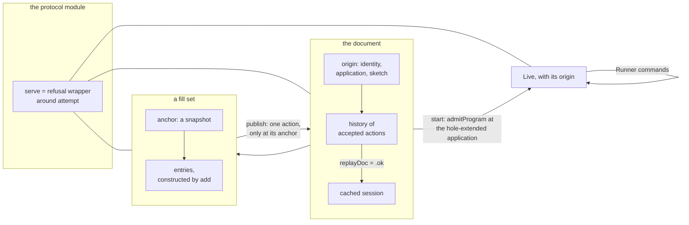
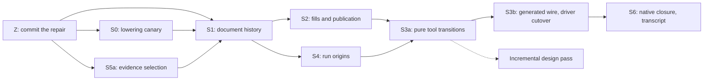

# Editing and running as one composition: the plan (version 2)

Status: plan (history, not authority). Base: `ec39923a7` on `refactor/phase1-phase3`. The authoring
branch `gemini/authoring` is at `8984bd15e`, with the coordinator's repair uncommitted in its
worktree. Version 1 is `README.md` beside this file, kept as history. Codex's review of version 1
is `codex-review.md`, with fifteen probes in `review-probes/`; `ledger.md` gives each of its
findings a disposition here. This plan changes no code and no ruling.

## The one thing to know first

The composition stands. Editing and running are two instances of a log acting on a state, joined
by program admission. The tool is one transition over both. The review changes what the proof
fields certify. A document's proof covers its whole validated history, not a cached session and a
length. A fill set's proof covers its construction. The tool keeps three kinds of outcome apart: a
refused request, a refused item inside a batch, and a run command whose recorded phase refuses.

## 1. What version 2 changes

| Version 1 said | Version 2 says | Evidence |
| --- | --- | --- |
| the cached session matches a replay of the log's edits | the cache matches a replay of the validating transition, which recomputes or checks every entry's receipt and policy | R2 |
| the revision is the log's length, so identity and revision name a base | the length orders one history only; a snapshot is named by its origin and history, and the base guards stay | R3 |
| an undo puts the replaced program back, and `feed_undo` is its law | the law holds for an immediate fill; an omission restores the program, not the hole table; an undo names the entry it reverts | R1, R10 |
| a refused request leaves the state unchanged | that law holds for whole-request refusals only; batch items and run phases are recorded outcomes of a successful request | R4, R5 |
| `locate` names the place of every decode refusal | the reader returns a root path and a reason when `locate` has none | R8 |
| an answer type computed from the request is an option | one flat `Request` and one flat `Answer`, with a generated relation between them | R9 |
| a published set's schema digest checks wire compatibility | the tag guard stays; the rendered schema drops wire tags | R11, R12 |
| run origins come after the tool | run origins come before the tool, with full program admission | R13 |
| S6 checks the native kit at the end | an OCaml lowering canary (S0) runs first, on the real start and load dependencies | R9, R13 |

## 2. The composition



The diagram records the data flow only. It is not proof evidence.

- **One validating transition per domain.** Each domain has one `step` that accepts or refuses.
  Its replay is the fold of that `step`, and its cache carries a proof that the replay produced
  it. This is the shape of `Live.opened` (`src/Effect4/Run/Live.lean`).
- **The mathematical object.** The state projection is a right action of the free monoid of
  actions: `play s [] = s`, and `play s (xs ++ ys) = play (play s xs) ys`, which is
  `List.foldl_append`. With answers kept, the transition is a Mealy machine,
  `State → Request → State × Answer`, as `Api.Runner.replay` already accumulates phases.
- **Reachability is an extra invariant.** The action law says nothing about acceptance, undo,
  typing or identity. Each invariant is a proof field or a predicate, stated beside its transition.
- **No new generic module (decision H4).** The document and the run share the shape and use the
  list laws directly. A shared module waits for a second consumer and its connector in one slice.
- **The coalgebra stays an adapter.** `Comodel.ofTotal` (`Effects/Coalgebra/Run.lean`) reads
  `serve` as a comodel if a consumer needs one, with refusal inside the answer. It lives in
  `Effect4.Laws`, since the core imports no `Effects.*` module today.

## 3. The document

```lean
structure Doc where
  private mk ::
  origin   : DocOrigin            -- identity, application, opening sketch
  history  : List DocAction       -- accepted actions only
  session  : SourceSession
  replayed : replayDoc origin history = .ok session

def Doc.revision (d : Doc) : Nat := d.history.length
```

These Lean declarations are proposals, not declarations in the tree.

- `DocAction` holds a checked edit with its policy, a draft, a revert of a named entry, and a
  publication of a fill set. It is session data, not a second program representation.
- `replayDoc` folds the same validating `Doc.step` that `append` calls. It checks each checked
  action at its prefix's revision and policy. It computes each replaced program from its prefix,
  or checks a stored receipt against the computed one. A history that replays only its edits is
  refused as a design: R2 builds a value whose stored replaced program is false.
- The proof field is a `Prop` and erases from compiled data. The history and the cached session
  stay runtime data. Native loading rebuilds the proof by replay and never assumes it survived.
- **Revisions and snapshots.** The revision orders the actions of one history and goes up by one
  per accepted action. Two documents may share identity and revision with different histories
  (R3). A snapshot is named by its origin and history. Exact snapshot equality compares those
  two, which fixes the session by replay.
- **Undo is an append-only revert (decision H2).** The revert names the entry it undoes by
  position, or the tool derives the most recent unreverted entry. Reverting the last entry blindly
  can undo a revert and act as redo.
- **What undo restores.** `SourceSession.feed_undo` restores the session after an immediate,
  successful fill at an existing program, with no typing premise. An omission's revert restores
  the program and keeps the allocated hole row (R1); name that observation as program-only.
  Restoring checker answers needs a signature-support premise (R10), from `Sketch.check_more_holes`
  and `sketch_reads_its_holes` (`src/Effect4/Laws/Program/Sketch.lean`). Reverting an older entry
  checks the current target first.
- `Doc.commit` keeps its target, source-check and exact local-type checks. A stale target is a
  revision that is not the history's length.

## 4. The fill set

```lean
structure FillSet where
  private mk ::
  anchor      : DocSnapshot
  entries     : List (List Nat × NativeEff)
  constructed : ∃ submissions, (addRaw anchor [] submissions).entries = entries
```

- `addRaw` is the existing checked `add` fold. The witness erases, so no submission log is stored.
  `Effect4.Laws` derives `WellFormed` from it with `FillSet.empty_wf` and `FillSet.add_wf`, which
  keeps the certification predicates out of the core.
- Every repaired publication guard stays: identity, revision, application and base. R3 shows that
  replacing the free counter with a length does not remove the cross-publication case.
- The independence relation stays `Incomparable` with exact certification at the fixed base: the
  focus environment, the signature and the exact local type. R6 shows root-type agreement too
  weak at dependent `bind` children.
- D6 (`materialize_congr`) equates two canonical materializations; it says nothing about raw
  execution orders (R7). Cite it at that strength. A diamond theorem waits for a consumer.
- Fill sets and schedule exploration share no independence framework in these slices.

| Situation | Transition |
| --- | --- |
| empty set | derived from the current document; an empty publication refuses and adds nothing |
| nonempty set after a document change | keeps its anchor and entries; add and publish refuse; inspect and reset work |
| publication at the exact anchor | validates and materializes once, appends one action, then resets the set |
| refused publication | keeps the document, its history and the pending fills |
| reset | drops the pending entries and derives an empty set at the current document |

A rebase is a later checked operation with its own law. It maps each old address to a current one,
refuses a missing or ambiguous target, and rechecks content, context, exact type and conflicts.

## 5. Run origins

- `start` admits the exact snapshot with `admitProgram` (`src/Effect4/Program/Admission.lean`) at
  the application extended by the sketch's hole rows. `Run.Kit.admit` omits `Formation.checkInput`
  by design (R13), so it is not this check.
- One library declaration turns a snapshot into a `Built` (`src/Effect4/Api/Built.lean`). Today the
  tool's `start` and `run` arms each assemble a `Built` by hand, and only `start` sets `rowNames`.
- A live run records its origin: the snapshot, and the admitted program and application derived
  from it. The origin survives later edits.
- `LiveRecord.restore` replays a saved run, but its record names no document. A restored run is
  standalone until a checked companion record gives its origin.
- The tool state allocates document generations and run identifiers, and enforces distinct run
  identifiers. `session_keys_once` (`src/Effect4/Laws/Run/Journal.lean`) is per run and does not.

## 6. The protocol module

```lean
structure State where
  private mk ::
  raw   : RawState
  valid : StateInvariant raw

def serve (state : State) (request : Request) : State × Except Refusal Answer :=
  match attempt state request with
  | .error why => (state, .error why)
  | .ok (next, answer) => (next, .ok answer)
```

| Outcome | Where it lives | State |
| --- | --- | --- |
| a refused request: an unknown selector, a stale target, a decode refusal | `Except.error` of `serve` | unchanged, proved once for every `attempt` |
| a refused item in a batch | a per-item `AddOutcome` inside a successful answer | accepted items kept |
| a run command whose phase refuses | a successful "played" answer with its phases | the journal and phase list grow |

- `Request` and `Answer` are flat inductives in `src/Effect4/Tool/`. A checked edit has a target
  field with no default. A draft is its own constructor. Run commands nest
  `Api.Runner.Command` and `Run.Event`; no second run language.
- `RespondsTo : Request → Except Refusal Answer → Prop` is generated. The laws are
  `serve_answers : ∀ s r, RespondsTo r (serve s r).2` and the wrapper's refusal law, which
  `review-probes/CoreSketches.lean` proves for every pure `attempt`.
- The tool's core lives in `src/` under the `Effect4` root. JSON, `Tools.JsonBridge` and law-name
  reflection stay in `tools/`, which imports the Laws graph today.
- `StateInvariant` states the cross-field facts: run origins, distinct identifiers, and the fill
  set's anchor against the document. Open establishes it, and each successful transition keeps it.
- Law names travel as strings. Resolution shows a name exists; the answer theorem connects it to
  the answer.

## 7. The wire

- The generated print of `Tool.Request` is the one JSON language (decision H1), under a declared
  field profile and a method version. Operation names survive as constructor tags.
- No field aliases a valid payload with `null`: `Option Unit` prints `none` and `some ()` alike
  (R12). Use explicit constructors, or restrict the field's profile.
- One representation per field, or an explicit sum of encodings with one decision rule. No two
  optional fields with an implicit precedence, as `JsonBridge.valueFrom?` has for hex.
- A decode refusal carries at least the root path and the reason when `locate` has none (R8).
- Fixtures pin value, JSON and byte forms with explicit versions, after `Core.Stable_unit_test`.
- The independent tag guard stays: `Effect4Gen.Check` and `tools/Effect4Gen/wire-tags.json`. The
  rendered schema drops wire tags (`Effect4.Store.renderCases`), so its digest is no compatibility
  check (R11). The store review's item C4 waits for `render` to write the tags.

## 8. The native boundary

- **S0 comes first.** It lowers the real checked start and load dependencies, not a flat carrier.
  It refuses required unknown types, untranslated references and placeholders.
- A checked package is abstract in OCaml as a whole, as the estate plan's rule 1 says (§2.3 of
  `docs/research/2026-10-17-ocaml-estate-review/plan.md`). The document, the fill set, the live run
  and the tool state follow that rule.
- The native tool calls the same lowered `serve`, through the estate plan's export model (its
  decision D-11). S0 depends on that ruling.
- `E4_host.serve` (`ocaml/engine/e4_host.ml`) is the host drive, a hand copy of `driveFrom`.
  `Tool.serve` is the authoring transition. The two stay distinct; slice LC-8 of the LCNF route
  retires the hand copy.
- Native tests keep a saved value and a sibling across mutation, so an internal mutation cannot
  change their observations.

## 9. Evidence that Lean prints (S5a)

- The theorem inventory is `ProofGraph.censusTheorems` (`tools/ProofGraph/StatementCensus.lean`),
  run in the base and the head environments; the difference is the added theorems.
- The audited population stays `Audit.auditedFacts` (`tools/ProofGraph/Audit.lean`). Planned goals
  are reported apart, through `isGoal`, `goalsIn` and `Plan`.
- The touched modules come from the diff, with dirty, added, renamed and removed paths. A deleted
  module is reported, never counted as audited. The edited law module is always included.
- A receipt's citations are a structured list: full name, declaration kind and environment.

## 10. The slices



The diagram records implementation dependencies, not proof evidence.

| Slice | Deliverable | Acceptance at its own boundary |
| --- | --- | --- |
| Z | the repair committed on `gemini/authoring` as its own commit | the commit reproduces the repair's controls; `Tools.View.Build.requests` sends a target with each `fill`, or a `draft`, since the repair refuses a targetless `fill`; the slices start from it |
| S0 | history meaning, refusal kinds, response pairing and exported carrier shapes, frozen | R9 and R13 reproduced; the real start and load closure lowers with no unknown type or untranslated reference; a forged parent record or alias is refused |
| S5a | inventory, touched-module selection, citation resolution | a missing theorem, a wrong kind, a deleted module and an omitted dirty module each refused |
| S1 | `Doc` with its validated history and one `append` | false undo metadata and a forged policy label refused; replay, coherence, revision growth, stale targets, the draft inverse, omission's program-only observation, explicit revert selection; R10 and the missing-address refusal kept |
| S2 | the constructed fill set; publication owned by the document | the repaired raw-path controls; identity, revision, base and application each refused; one action per publication; a refused publication keeps the fills; empty follow, stale refusal, reset, publication undo |
| S4 | run origins; one snapshot-to-`Built` declaration | the snapshot admitted at the hole-extended application; a source-typed but unadmitted program refused; the origin kept after edits; a restored record standalone |
| S3a | `serve` and `StateInvariant` | response pairing; the refusal law; mixed batches per item; refused phases keep their journal rows; every operation against the invariant |
| S3b | the `Tool` codec group and a thin JSON driver | missing fields and unknown tags refused; decoded bad values refused by the checker; the diagnostic fallback; the field profile; versions; fixtures; the repaired transcript; the tag guard kept; the old dispatch paths deleted |
| S6 | the native tool over the same `serve` | the closure compiles with no unknown type; the native transcript equals Lean's; hostile saved records refused after erasure; `make check-ocaml` |

Each slice places its claims (§12), runs its narrow build, `#axiom_audit` over its touched modules
and `make batteries-touched BASE=<slice base>`. S3b regenerates the derived family with its new
`Tool` group; a changed TypeScript print runs tsgo 7. Every slice lands on `refactor/phase1-phase3`;
slice Z landed at `774ddc3d7`.

**The Incremental design pass** follows S3a, at the owner's steer of 2026-10-17. It designs the
verdict graph and the live view over the certified state, under the eight graph rules of the
estate plan's §2.6. It may refactor the existing graph code so the cache stays a derived view.
Its acceptance is fixed now. The cached verdict and diagnostic equal the uncached ones after each
published revision. A refused revision followed by a valid one recovers.

## 11. The owner's decisions

| Decision | Adopted in this plan | Reason |
| --- | --- | --- |
| H1: the wire | the generated `Tool.Request` print, with a field profile and a method version | required fields remove the optional-field dispatcher; a compatibility adapter, if needed, decodes into the same `Request` |
| H2: undo | an append-only revert of a named entry; omission's observation named program-only | fits `feed_undo` and keeps revisions growing; redo is a later revert of a revert |
| H3: the branch | merged into `refactor/phase1-phase3` at `774ddc3d7`, after the repair (`0693a4d1a`) and the view build's targets (`a658c656a`) | the owner keeps one integration branch; no client calls the transitional dispatcher, so merging it exposes nothing (the authoring survey) |
| H4: a shared module | none now; the list laws are shared | a document-only framework would be one more mechanism until the run moves |
| H5 (new): who builds | seats from the coordinator, on the integration branch, one per file set | the owner's steer of 2026-10-17 |

## 12. The claims to place

Each group names its consumer before any proof starts (`AGENTS.md`, the five placement facts).

| Claim group | Concept and property | Consumer | Excludes | Requirement |
| --- | --- | --- | --- | --- |
| document history | `initial-algebras-folds`; `source-session-coherent`, `typed-replacement` | append, commit, revision, the document view | runtime behaviour; drafts may refuse | R14 |
| document inverse | `source-session-undo` | revert | an exact omission inverse; unchecked overwrite | R14 |
| fill construction and publication | `typed-replacement` | publication, anchor refusal | scheduling; rebase; D9 stays reference-free | R14 |
| tool state and refusal | `host-session-protocol` | `serve` and each driver | IO rollback; host progress | R6 |
| run origin and restoration | `host-session-protocol`, `typed-replay-session` | start, inspect, save, load | an invented origin; repeated side effects | R6, R13 |
| request and answer pairing | `host-session-protocol` | the generated wire and its clients | a parser or native-runtime theorem | R6 |

The tool properties enter `docs/core/semantics.md` and the registry in their implementation slice.

## What this plan does not establish

- No slice has run. Each signature here is a proposal; only the probes' theorems are proved.
- The fifteen probes are finite controls at their inputs, and the wrapper law is the only proof.
- Rebase, identity allocation across processes and persistence atomicity stay boundaries.
- The literature and Jane Street interfaces justify patterns, not theorems about this tool.
