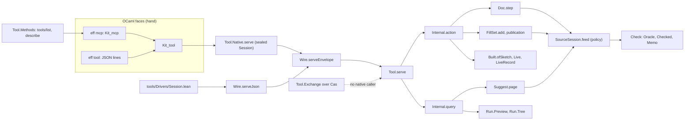

# Probe 1: the authoring tooling, its theory and its peers

Status: research note (history, not authority). Base `refactor/phase1-phase3` at `4a81cc034`. No
tracked file was edited. Sources read are in [reading.md](reading.md). The probes and the session
transcripts are in [probes/](probes/) and [session/](session/).

## 1. The one thing to know

The authoring core holds: every law it claims is proved except two planned goals, and an agent can
drive a whole session through `eff mcp` today. What costs an agent most is missing explanation at
the point of failure, not missing semantics. Five of the thirteen refusals this probe met carry no
location at all, and four more carry only part of what a repair needs. The theory has no concept for
typed editing, so the properties that would fix this have no owner yet. They are located codec
refusals, an expected type at an error, total marking, rebase, and fill by answer.

## 2. What has landed

In the diagram, the dashed arrow marks the one landed module with no production caller. Every other
box is on the request path of both drivers, except `Tool.Methods`, which only the MCP face reads. The
authoring surface for people (`src/Effect4/Program/Authoring/*`, `Api.Author.build`) also builds a
`Built`, and is not on the agent's path.

## 3. Sanity findings, ranked by what they cost an agent

### 3.1 The honest status of the laws, from the tree

Measured by `probes/Status.lean` and `probes/Audit.lean`. The first runs `#plan_status` on every
claim pointer of the authoring lanes, and a census of every theorem of each law module by its
standing. The second runs `#axiom_audit`.

| Law module | Proved | Modulo goals | Goals |
| --- | --- | --- | --- |
| `Effect4.Laws.Tool.{Serve,Wire,Exchange,CodecProfile}` | 36 | 0 | 0 |
| `Effect4.Laws.Program.Author` | 53 | 0 | 0 |
| `Effect4.Laws.Program.SourceDocument` | 18 | 0 | 1: `Doc.revert_program` |
| `Effect4.Laws.Program.FillSet` | 43 | 0 | 0 |
| `Effect4.Laws.Program.{Sketch,SketchAdmission,SketchWire,Edit}` | 59 | 0 | 0 |
| `Effect4.Laws.Program.SourceTable` | 94 | 0 | 0 |
| `Effect4.Laws.Program.CheckAgreement` | 21 | 0 | 1: `Check.explain_replays` |
| `Effect4.Laws.Program.FillReference` | 0 | 0 | 0 |

- Every other claim pointer of these lanes reads `proved`. Among them are `serve_appends`,
  `load_own`, `combine_deps`, `feed_coherent`, `feed_keepExact`, `Doc.coherent`,
  `kept_eq_certified` and `publish_eq_materialize`.
- In the loaded environment each goal blocks one claim, its own (`#goal_impact`):
  `checker-explanation-replays` and `source-document-revert`. No theorem of these modules rests on
  either.
- `#axiom_audit` reads 3,831 tool declarations, 1,947 API and program declarations, 681 authoring
  surface declarations and 1,456 law declarations within `[propext, Quot.sound]`. None rests on a
  goal.
- The refinements report's earlier count (15 modulo, 4 goals) predates the S1 repair. That repair
  proved two of the goals and everything that rested on them.

### 3.2 An agent's session, measured

`session/drive.py` drove one `eff mcp` process the way an agent would. It opened a sketch with one
host row and one hole, then inspected and asked for suggestions. It made two wrong fills, one schema
slip and one good fill, then hit a stale snapshot. It previewed, started, played and saved a run.
It drafted, reverted and restored. Last, it filled two holes in a set and published them.
`session/frictions.py` added thirteen deliberate mistakes.

| Measure | Value | How measured |
| --- | --- | --- |
| `tools/list` reply | 41,250 bytes, 20 tools, no `annotations`, no `outputSchema`, no `title` | `session/summary.json` |
| Grammar an agent must fetch | `describe Eff` 22,867 bytes; `Val` 2,387 more for host replies | `describe` structured content |
| Work calls in the session | 30 (plus 3 `describe`), median reply 1,394 bytes | `session/summary.json` |
| Reply bytes, 30 work calls | 56,116 on the wire; 23,940 as structured JSON | the wire line carries the payload twice (text and structured) |
| Calls from a known grammar to a finished run | 4: `open`, `edit`, `start`, `play` | `session/transcript.jsonl` |

Every documented behaviour this session reached matched its description and its laws:
- refused requests left `now` unchanged, and batches were atomic;
- fill items and run phases kept their own outcomes;
- `revert` worked as a stack (F8), and `restore` gave back the finished run;
- `eff tool` on the pinned fixture gives Lean's ten replies (`ocaml/engine/test/kit/tool-replies.jsonl`).

### 3.3 The findings

**A1. A schema slip gets a refusal with no place and no reason.** Four of the thirteen refusals
were `-32602 "Arguments do not match the tool schema"` with `data: {"refused": {"_tag": "codec",
"why": "unreadable"}}`: a misnamed field (session step 9), a misspelt tag (F4), a `Val` written in
`Lit`'s spelling (F5b) and a natural past 2^53 (F12). The cause is `CodecProfile.Refusal`
(`src/Effect4/Tool/CodecProfile.lean`): three constructors, no path, no expected shape. Kit_mcp
passes it through (`call`, `ocaml/engine/kit/kit_mcp.ml`). The refinements report lists path-located
decode refusals as not done. The generated schema, resolved through `describe`, places all four
(`session/locate.txt`): at `a.items[0][1]`, `sketch.program`, `q` and `at_[0]`. Its `oneOf` messages
are coarse, though: for step 9 it names the wrong case. A reader that knows the `_tag` dispatch can
say "case `fill` has no field `program`; it expects `q`".

**A2. Four refusal forms drop or misplace what a repair needs.**
- A pending fill refuses `notCertified` with no reason. The same candidate through `edit` refuses
  `notKept` with the focus `[nat] ⊢ nat` and the verdict `string` (`session/certify.txt`). The cause
  is `FillSetInternal.addEntry` (`src/Effect4/Program/Typing/FillSet.lean`). The `fill` tool's own
  description promises "refused with its reason" (`Methods.descriptions`): text and behaviour differ.
- `start` on a refused program answers `admission illTyped` with no path (F9c). `AdmitRefusal.illTyped`
  (`src/Effect4/Program/Admission.lean`) carries no refusal.
- A `notKept` verdict's path is relative to the edited address: step 7 reports `path: []` for an error
  at `[1]`. `SourceSession.feed` returns the part verdict unplaced; `Suggest.suggestOne` relocates it
  (`path ++ why.path`). So one tool speaks two address frames.
- `TypeReason.term` (`src/Effect4/Program/Typing/Blame.lean`) covers an unbound variable, an unknown
  atom, an atom at refused argument types and a literal outside the alphabet. F3 (`inc`), F9 (`var 3`)
  and step 7 (`var 1`) all read `term`.

The first two cost the agent a second call, to a `dry` edit or to `doc`, before it can repair. The
last two leave it to guess the cause.

Of the thirteen refusals, four were actionable in one step: steps 8 and 11, F10 and F11. Five were
not: steps 9, F4, F5b, F12 and F9c. Four were actionable only in part: steps 7 and 21, F1b and F13.

**A3. A miscounted hole opens silently.** A hole is written `perform (external (app.rows.length + k))`
(`Sketch.hole`, `src/Effect4/Program/Sketch.lean`). F1 wrote hole 0 as `external 0`, the application's
own row. The document opened with `holes: []` and no warning. `Place.hole 0` then refused `absent 0`.
The view has no list of declared holes that the program never performs.

**A4. Replies repeat what the agent already holds.** Measured on the session's structured replies:
- memo keys are 70% of a suggestion page (`Suggest.Suggestion.key`);
- the origin's application and sketch are 50% of `start`'s reply (`ActionAnswer.started`);
- `SigData` is 30% of an inspection;
- a saved run's journal repeats the row table in each `bind` command (593 of 1,014 bytes, one call);
- each hole repeats its twelve-field row in every view.

**A5. Suggestions are noisiest where they are least needed, and absent where they are most needed.**
At hole 0 the page offered the hole itself as an exact fit. It offered the whole program as a
`differentEnv` candidate, and one row twice (`Suggest.localCandidates`,
`src/Effect4/Program/Typing/Suggest.lean`). At an ill-typed address the page refuses `noFocus` (F10).
A kept-exact fix at a refused root refuses `typeChanged` with `old: null` (F13). No query answers the
type an address is expected to have.

**A6. The vocabulary is not discoverable.** `Term.app.atom` is a free string in the schema. No query
lists the atoms or their schemes, though `NativeAtom.spec` (`src/Effect4/Program/NativeAtom.lean`)
holds both. The focus lists the types of the variables in scope, not where each was bound. Field names
differ for one idea: `Lit.nat` is `value` and `Val.nat` is `n`; `Change.fill` is `q` and `Edit.fill`
is `program`.

**A7. The MCP surface hides what the laws prove, and forgets everything at exit.**
- No tool carries `annotations`. MCP 2025-06-18's defaults are `readOnlyHint: false`,
  `destructiveHint: true` and `openWorldHint: true` (`mcp-spec` schema, `ToolAnnotations`). Yet
  `serve_query` (`src/Effect4/Laws/Tool/Serve.lean`) proves the eleven `ask` methods change nothing.
- The server holds one in-memory session. The proved exchange (`load_own`, `apply_commits_once`,
  `apply_refuses`, `src/Effect4/Laws/Tool/Exchange.lean`) has no native caller, so nothing resumes.
- MCP 2026-07-28 removes protocol sessions and asks servers to mint handles that tools take as
  arguments (`docs/specification/2026-07-28/changelog.mdx`, major change 1). The exchange's
  `Base.head name expected` is that handle.

**A8. One fact, two owners, and dead surface (small items).**
- Wire method names are spelled three times: `Request.method`, `supportedMethods`
  (`src/Effect4/Tool/Protocol.lean`) and `Methods.descriptions` (`src/Effect4/Tool/Methods.lean`). A
  proof and a battery guard hold them together.
- A tool state has two replay paths, `Internal.replayCursor` (`Tool/Replay.lean`) and
  `Exchange.replay` through `serve` (`Tool/Exchange.lean`), joined by `State.accept`'s proof.
- `FillReference.materialize` (`src/Effect4/Laws/Program/FillReference.lean`) is a second
  materializer kept as the reference side of `publish_eq_materialize`.
- `Check.explain` is a lowered root (`ocaml/gen/roots.json`) that no tool query reaches; its goal
  `explain_replays` has no production consumer. `Wire.decode` is called only by batteries.
- `ocaml/engine/test/kit/tool-requests.jsonl` is still a byte copy of
  `Test/fixtures/session/requests.jsonl`. The fixtures exercise five methods of nineteen.
- The dictionary's "session" is the host session, but code has four sessions (`HostSession`,
  `SourceSession`, `EditSession`, `Tool.Native.Session`). "Oracle" means the outside implementation
  in the dictionary and the certified checker in `Check.Oracle`.
- The system map's layer 10 still reads "MCP authoring are the next expansion"
  (`docs/core/system-map.md` §2).

## 4. The peer table

Each row: what the peer offers authoring, what we have, the gap, and a proposal. Literature is cited
by authors, title, venue and year; each was checked in this pass (reading.md §5, §6).

| Peer | What it offers authoring | What we have | Gap | Proposal |
| --- | --- | --- | --- | --- |
| Plotkin and Pretnar, *Handlers of Algebraic Effects*, ESOP 2009 | one program, many interpretations by handler | `Check.run`, `Run.Tree`, `Live` read one `Eff`; a hole is a host row (decisions row 288) | answering a hole and filling it are not related by a law | P12: fill by answer |
| Plotkin and Power, *Algebraic Operations and Generic Effects*, ACS 11(1), 2003 | operations with equations, so a rewrite can carry a proof that it keeps the meaning | free theories only (DB-01) | no equational refactoring | no slice now (row 387 pauses composition) |
| Uustalu, *Stateful Runners of Effectful Computations*, MFPS 2015; Ahman and Bauer, *Runners in Action*, ESOP 2020 | a host as a comodel; a tape as a runner | `Run.Reactor`; `Comodel.replies` in `effects`; preview tapes | a live run is driven only event by event | P13: a `play` event that answers from a tape until a frontier |
| Xia et al., *Interaction Trees*, POPL 2020 | executable denotation with a proved relation | `Run.Tree`; `Tree.ofProgram_approx` declared from Rocq | the tree's agreement with the meaning is a planned goal (`ofProgram_eq_denoteRowsB`) | keep in Rocq; no new slice |
| Omar, Voysey, Hilton, Aldrich and Hammer, *Hazelnut*, POPL 2017 | typed actions: sensibility (Theorem 1), constructability (Theorem 6), determinism (Theorems 7, 8) | `Doc.step`, `feed_keepExact`, `Doc.step_coherent`, `Doc.commit_sound` | its actions never fail: they insert non-empty holes; ours refuse | no gap in sensibility; marking covers the rest |
| Zhao, Maroof, Dukkipati, Blinn, Pan and Omar, *Total Type Error Localization and Recovery with Holes*, POPL 2024 | every subterm typed after any error | `Sketch.table` stops at a refused sibling ("not reached") | no types downstream of an error; R14's `marking-agrees` is open | P9: a marked table |
| Omar, Voysey, Chugh and Hammer, *Live Functional Programming with Typed Holes*, POPL 2019 | evaluation around holes; fill and resume | a hole waits as a host call; F6 answered `h0` and finished | filling the document does not resume a run | P12 |
| Dunfield and Krishnaswami, *Bidirectional Typing*, ACM Computing Surveys 2021 | an expected type from the context, so errors stay local | synthesis only (`Checker.check`); a hole's row gives its type | no expected type at an ill-typed address (A5) | P8: `expectAt` |
| Blinn, Li, Kim and Omar, *Statically Contextualizing Large Language Models with Typed Holes*, OOPSLA 2024 | the hole's type and context select what the model sees | `doc at_` returns focus and the whole `SigData` | context is complete but not selected; it repeats the application | P5: a query of a hole's typing context, with the rows and atoms that fit |
| Mündler et al., *Type-Constrained Code Generation with Language Models*, PLDI 2025 | decoding constrained to well-typed programs | JSON Schema constrains the program syntax; checking comes after | a server cannot steer decoding | no slice; P5 and P8 serve the same need |
| Aniva, Sun, Miranda, Barrett and Koyejo, *Pantograph*, TACAS 2025; Yang et al., *LeanDojo*, NeurIPS 2023 | a machine interface with explicit state handles | a typed protocol over MCP; `Base.fork` in the exchange | handles exist only in the Lean model | P11 |
| Yang et al., *AutoVerus*, arXiv 2409.13082, 2024; Sun, Sheng, Padon and Barrett, *Clover*, arXiv 2310.17807, 2023; Chakraborty et al., *Towards Neural Synthesis for SMT-Assisted Proof-Oriented Programming*, ICSE 2025 | repair loops driven by the verifier's errors | refusals as data | loops need located, specific errors (A1, A2) | P1, P2 |
| Effekt's typed holes (`effekt-lang/effekt` PRs #1055, #1062, #1085, #1120, 2025); Koka's editor support (Koka book, v2.6.0–v3.1.0) | hole panels with bindings; inlay types | `doc`, `table`, `slots` | bindings show types, not binders | P5 adds each variable's binder address |
| rust-analyzer term search (`completion.termSearch`, shelf `70e0c46be740`) | candidates of the expected type built from in-scope terms | `Suggest.localCandidates`: supplied, variables, unit rows, table entries | no composed candidates (`succ (var 0)` is never offered) | P14: atom term search |
| Duregård, Jansson and Wang, *Feat*, Haskell Symposium 2012 | enumeration by index, complete and reproducible | `Run.Kit.samples`: a few small values per type | exploration is a sample with no completeness law | later: `Ty.enum` with a membership law |
| Reynolds, *Definitional Interpreters for Higher-Order Programming Languages*, ACM Annual Conference 1972; Danvy and Nielsen, *Defunctionalization at Work*, BRICS RS-01-23, 2001 | first-order continuations make runs data | `Eff`, `Prim`, journals | none | no gap |
| Meijer, Fokkinga and Paterson, *Functional Programming with Bananas, Lenses, Envelopes and Barbed Wire*, FPCA 1991; Gibbons, *Calculating Functional Programs*, 2002 | folds with uniqueness and fusion | `cata_eff`, `hom_eq_cata_eff`, `annotate_eq_table` | an edit's cost is claimed, not proved | P7 (proved in probe) |
| Abbott, Altenkirch and Ghani, *Containers: Constructing Strictly Positive Types*, TCS 342(1), 2005; Niu and Spivak, *Polynomial Functors: A Mathematical Theory of Interaction*, 2024 draft; McBride, *The Derivative of a Regular Type is its Type of One-Hole Contexts* (extended abstract) | positions and one-hole contexts | `Node.at_`, `focusAt`, `Place.at_` | a hole's position is a count an agent must make (A3) | P6 |
| Hammer, Phang, Hicks and Foster, *Adapton: Composable, Demand-Driven Incremental Computation*, PLDI 2014; Jane Street Incremental (shelf `98b5750ec3c0`); Salsa (shelf `3e3ae0fa567b`) | demand-driven reuse | certified memo; 0.29–0.46 ms per native edit (refinements report) | none at this scale | no gap |
| Unison, *The Big Idea* (unison-lang.org documentation): names beside hashes of syntax | reuse of certified fragments across a codebase | `Cas`, `Ref`, session chains | suggestions draw from the open document only | later, with relocation (scout slice F) |
| Leroy, *Formal Verification of a Realistic Compiler*, CACM 2009; Jung et al., *Iris: Monoids and Invariants as an Orthogonal Basis for Concurrent Reasoning*, POPL 2015 | verified compilation; program logic | lowering trusted by row 391; protocol typing | no user property beyond types | no slice now |
| The MCP specification, versions 2025-06-18 and 2026-07-28 (shelf `86f6e0c675af`) | `annotations`, `outputSchema`; handles as arguments | neither; one session per process | A7 | P3, P11 |

## 5. The base theory: consolidation, simplification, deepening

### 5.1 Consolidation

**K1. Authoring has no concept of its own.** `docs/core/semantics.md` files the source, document and
fill laws under `initial-algebras-folds` (§2.7), whose literature is folds and handlers. It files the
tool's transitions under `host-session-protocol`, whose subject is answers entering a run. The
agent-to-tool protocol is neither. An eleventh concept, typed editing, would own: sketches, places,
policies, documents, pending fills, suggestions, the tool's transitions and the cost and marking
laws. Its literature is Hazelnut, the marking calculus, Live, bidirectional typing and incremental
attribute evaluation (Reps, Teitelbaum and Demers 1983, cited in the dictionary). This is decision O1.

**K2. Four journals are one construction.** Each of these seals a state with the proof that a
validating fold reaches it:
- the run's `List Command` (`journal_replays`);
- the document's `List DocAction` (`replayDoc`, `Doc.step_replay`);
- the tool's `List Action` (`replayAccepted`, `transcript_replays`);
- the session chain (`Exchange.load`, `load_own`).

Each proves its own append law (`replayCursor_snoc`, `DocInternal.replayState_snoc`,
`Checked.fold_value`). The system map's K5 names only the total action on `List Command`. The
classical form is a partial action of a free monoid: a Kleisli fold in `Except (Nat × E)`. One
structure with one append law and one refusal law would replace four. The seams plan chose "without a
generic replay framework" (`2026-10-17-seams/README.md` §2) before its three new journals existed. All
four exist now. This is decision O2.

**K3. One judgment, two refusal vocabularies.** The kept-exact feed refuses `notKept (focus,
verdict)`; a fill set reports the same failure as `notCertified` (A2). One owner, `FeedRefusal`,
should cross both routes.

**K4. One word, several meanings.** "Session" (four types) and "oracle" (two meanings) break the
dictionary's one-meaning rule. The authoring words document, snapshot, place, policy, pending fill,
publication, suggestion, transcript and memo have no dictionary entry.

### 5.2 Simplification

**S1. A hole's address is a count.** `Sketch.hole app k` is `external (app.rows.length + k)`. Row
288 rules out a new constructor, and that ruling stands. The simple fix is in the view: list each
declared hole the program does not perform, and give each hole's exact `perform` term (P6).

**S2. A refused root needs one sentence, not a type.** F13's `typeChanged (old := none)` says what
happened in the wrong terms. The S1 repair's rule ("a refused document is edited under draft") should
be its own refusal, `rootRefused`, that names the remedy.

**S3. The oracle parameter is not a simplification target.** `Oracle.eq_uncached` makes every oracle
equal; the parameter exists to carry the memo at run time. It is the right shape: cost travels,
meaning does not.

### 5.3 Deepening

Each proposed theorem carries the five placement items of `AGENTS.md` (Trust).

**D1. `feed-checks-subtree`: an edit's checking is bounded by what it changes.** The dictionary's
edit-session entry says an edit that keeps its focus's type "checks only the new subtree". No theorem
said it. `probes/Cost.lean` proves `Probe1.Cost.feed_keepExact_trace_of`. On the kept-exact splice
route, the trace is exactly one part key. That key's program is the candidate expansion's sub-program
at the edited address. Its `#plan_status` reads proved, within the ceiling. Finite controls in the same
file show the recheck route asks one key that reads the whole program.
1. Concept `initial-algebras-folds` (K1's typed editing if ruled); property: an edit's checking is
   bounded by what it changes.
2. Question: proposed claim `feed-checks-subtree`, role compatibility; this theorem is its pointer.
3. Reach: every oracle and session on the splice route's premises (those of `feed_keepExact_of`).
4. Does not establish wall-clock cost: the expansion, `canSplice` and `Table.splice` still walk the
   program. Says nothing of the recheck or draft routes.
5. Serves R14; makes the dictionary sentence true; lets a reply report what it checked.

**D2. `codec-refusal-located`: a located refusal at the wire.** `CodecProfile.read` would answer
`Except (Path × Expected) α`.
1. Concept `exact-codecs`; property: located refusal (K4) at the codec boundary.
2. Question: proposed claim `codec-refusal-located`, role compatibility.
3. Reach: the JSON profile's shapes. Statement: a refusal's path exists in the input, and the
   sub-tree there reads under no value of the expected shape. Acceptance stays
   `Canonical.ofJsonAnyOrder_exact` (`src/Effect4/Laws/Store/ShapeRead.lean`).
4. Does not establish anything of text parsing (`Kit.Json`, `Tools.WireText`) or MCP framing.
5. Serves R8 and R12; removes A1.

**D3. `expectAt`: the type an address is expected to have.** A function from the context alone,
`Sketch.expectAt app path : Option (TyEnv × EffTy)`, with the law that any program of that type in
that environment, placed there, keeps the root's type.
1. Concept `initial-algebras-folds` (or typed editing); property: an expected type (bidirectional
   analysis).
2. Question: R14's open part `expected-type-slice`, role substitution.
3. Reach: addresses whose parent rule fixes the child's type, at a fixed root type. Examples are a
   hole, the rest of a bind under a known answer, and an arm under a known join.
4. Does not establish principality, nor a type where the context leaves it free (the first of a bind).
5. Serves R14; lets `suggest` and kept-exact fixes work at an ill-typed address (A5).

**D4. `marking-agrees`: total marking.** A marked table that types every address after a refusal.
1. Concept `initial-algebras-folds`; property: a total checker marks every refusal (R14's shape).
2. Question: R14's open part `marking-agrees`, role compatibility.
3. Reach: formed programs. Statement, in three parts. Where the table has no refusal, the marked
   table is `Sketch.table`. Every refusal of `Sketch.refusals` is a mark. Every address has an
   environment.
4. Does not establish that a fallback type is principal, nor program admission, nor behaviour.
5. Serves R14; gives an agent types downstream of its first error.

**D5. `kept-edit-rebases`: carry an edit across an unrelated one.** `rebase_source` is proved in the
scout's `probes/R.lean` and waited for a consumer. The consumer is a stale commit or a pending fill
set, carried to the new snapshot. It is carried when its place still holds the expected sub-program
and its focus is unchanged.
1. Concept `initial-algebras-folds`; property `typed-replacement`.
2. Question: proposed claim `kept-edit-rebases`, role compatibility; pointer `rebase_source`.
3. Reach: the new source has no reference fault and its expansion is the old expansion's own fill.
4. Does not establish an order of concurrent publication, or behaviour.
5. Serves R14; lets two agents fill different holes without `stale` and `fillsStale` refusals.

**D6. `fill-by-term`: answer the hole, then commit the answer.** Its meaning is ruled (decisions row
373 (6)). F6 shows the run side: the hole waits as a host call and the answer finishes the run.
1. Concept `translation-simulation`; property: an equal-observation theorem.
2. Question: R14's open part `fill-by-term`, role simulation.
3. Reach: one occurrence of a data hole row, a literal answer, no handle; matched budgets; root exit
   and stores at a settled point.
4. Does not establish effectful fills, several occurrences, or host progress.
5. Serves R14; lets an agent try values live and commit the one that works. The proof lives in Rocq
   over the generated skeleton and is declared in Lean (the 2026-10-16 steer).

**D7. One partial-action law for the journals** (K2). A structure `Replayed step init` with `actions`,
`state` and `replayed : foldM step init actions = .ok state`, and two laws: an accepted step appends,
a refused step changes nothing.
1. Concept `host-session-protocol` today (typed editing if ruled); property: replay of an accepted
   history.
2. Question: one claim in place of `tool-transcript-replays`, `source-document-replay` and the append
   steps of `session-load-own`, role compatibility.
3. Reach: any step function into `Except`.
4. Does not establish anything of the store's chains, a host or a run's progress.
5. Serves R6 and R13; gives documents, tool sessions and runs one undo, fork and replay model.

## 6. Ranked opportunities for authoring

| # | Slice | Size | Files | Unlocks |
| --- | --- | --- | --- | --- |
| P1 | Located codec refusals (D2) | S–M | `CodecProfile.lean`, `ShapeRead.lean`, `Kit_mcp` | a schema slip is repaired in one call (A1: 4 of 13 refusals) |
| P2 | Precise tool refusals: `notCertified (why : FeedRefusal)`, `illTyped (why : TypeRefusal)`, absolute paths in `notKept`, `TypeReason.term` split into its three causes, `rootRefused` | S | `FillSet.lean`, `Admission.lean`, `SourceSession.lean`, `Blame.lean` | repair without a second query (A2) |
| P3 | MCP `annotations` derived from `Request`'s case (`ask` read-only, closed world), with `serve_query` as the law; `outputSchema` from `shape Reply` | XS–S | `Tool/Methods.lean`, `kit_mcp.ml` | a client may treat eleven queries as read-only (hints, untrusted by default); replies validate (A7) |
| P4 | Reply diet: suggestion keys as digests, `started` without the origin's tables, hole rows as name and type, a journal `bind` without the row table | S | `Protocol.lean`, `Suggest.lean`, `Run/Event.lean` | the measured 30–70% repetition goes (A4) |
| P5 | A query of a hole's typing context: expected type, variables with their binder addresses, rows and atoms whose answer fits; an atom catalogue in `describe` | S | `Queries.lean`, `Methods.lean`, `NativeAtom.lean` (read only) | an agent writes terms without guessing (A6) |
| P6 | Hole hygiene: the view lists declared holes the program never performs, and each hole's exact term; suggestions drop the hole itself and its ancestors | XS | `Actions.lean` (`docView`), `Suggest.lean` | F1's miscount shows at once; less noise (A3, A5) |
| P7 | Land `feed-checks-subtree` (D1) and report each reply's checks | S | `Laws/Program/SourceTable.lean`, `Tool/Protocol.lean` | the incremental claim becomes a theorem an agent can read |
| P8 | `expectAt` (D3) feeding `suggest` and kept-exact fixes | M | `Program/Typing/Focus.lean`, `Suggest.lean` | repair at an ill-typed address (F10, F13) |
| P9 | Total marking (D4) | M–L | a new marked-table fold beside `Sketch.table` | types downstream of the first error |
| P10 | Rebase stale commits and pending fills (D5) | M | `Tool/Actions.lean`, `FillSet.lean` | parallel agents on one document |
| P11 | The exchange natively (S6b), as MCP 2026-07-28 handles | L | `Tool/Exchange.lean`, `E4_disk`, `Kit_tool`, `Kit_mcp` | resume, fork and stale-writer detection; a stateless MCP face |
| P12 | `fill-by-term` in Rocq, declared in Lean (D6) | L | `rocq/`, a declared fact | try at run time, commit as code |
| P13 | A `play` event that answers from a tape until a frontier | S | `Run/Event.lean`, `Actions.lean` | a run finishes in one call with a recorded tape |
| P14 | Atom term search in `suggest` (bounded depth, schemes from `NativeAtom.spec`) | M | `Suggest.lean` | composed candidates such as `succ (var 0)` |
| P15 | Consolidations K1–K4 and D7 | S | `docs/core/semantics.md`, `controlled-english.md`, `system-map.md`; a generic `Replayed` | one model of journals; one word per meaning |

P1 to P6 change no law that is proved, except P2's constructor arguments, which reach the batteries
that name them and the generated Tool codecs. P1, P2 and P4 change replies, so `check-ocaml`'s
fixtures move with them.

## 7. The owner's decisions

| # | Decision | Options | Recommendation |
| --- | --- | --- | --- |
| O1 | A typed-editing concept in `docs/core/semantics.md` | (a) add it and move the authoring claims; (b) keep them under `initial-algebras-folds` and `host-session-protocol` | (a): the agent's properties need an owner (K1) |
| O2 | One partial-action construction for the four journals | (a) land `Replayed` (D7); (b) keep four instances as the seams plan chose | (a), after P1–P6: four instances meet the rule of three |
| O3 | The MCP version and the state model | (a) move to 2026-07-28 with exchange handles (P11); (b) stay at 2025-06-18 with one session per process | (a) as S6b's target: the exchange is already that model |
| O4 | `Check.explain` and its goal `explain_replays` | (a) expose it in `doc`'s inspection (site, `inCopy`, local part) and prove the goal; (b) delete both | (a): `inCopy` tells an agent to fix the layer, not the copy |
| O5 | Wire field names that change shape digests (`Val.nat`'s `n`, `Change.fill`'s `q`) | (a) one name per idea; (b) keep | (a): the greenfield steer allows it |
| O6 | `fill-by-term`'s place in the order | (a) after P8 and P9; (b) before | (a): build first (row 387); the run half already works |
| O7 | The kit's second face (`eff check`, `run`, `explore`) | as the refinements report lists it | fold into tool queries with an explicit cross-check query (Codex, question 4) |

## 8. Receipt

- **Base and head:** `4a81cc034`; no commit. Every file written is under this folder.
- **Files:** `README.md`, `reading.md`; `probes/Status.lean`, `probes/Audit.lean`, `probes/Cost.lean`;
  `session/drive.py`, `session/frictions.py`, `session/certify.py`, `session/locate.py`,
  `session/transcript.jsonl`, `session/frictions.jsonl`, `session/summary.json`,
  `session/certify.txt`, `session/locate.txt`.

| Command (from the repository root) | Result |
| --- | --- |
| `python3 /private/tmp/seams-lean-one.py lake env lean -DwarningAsError=true docs/research/2026-10-18-authoring-probe/probes/Status.lean` | exit 0; §3.1's table |
| the same on `probes/Audit.lean` | exit 0; 3,831, 1,947, 681 and 1,456 declarations within `[propext, Quot.sound]`; 0 modulo; 2 planned goals |
| the same on `probes/Cost.lean` | exit 0; every guard holds; `recheck_trace` and `feed_keepExact_trace_of` proved, `next goals: 0` |
| `python3 -I docs/research/2026-10-18-authoring-probe/session/drive.py ocaml/_build/default/engine/kit/bin/eff.exe docs/research/2026-10-18-authoring-probe/session` | 33 calls; 5 refusals |
| the same with `session/frictions.py` | 25 calls; 8 refusals |
| `python3 -I docs/research/2026-10-18-authoring-probe/session/certify.py ocaml/_build/default/engine/kit/bin/eff.exe` | `notCertified` beside `notKept`; text equals structured content |
| `ocaml/_build/default/engine/kit/bin/eff.exe tool < ocaml/engine/test/kit/tool-requests.jsonl` | ten replies equal `tool-replies.jsonl` |
| `uv run --with jsonschema==4.25.1 python docs/research/2026-10-18-authoring-probe/session/locate.py ocaml/_build/default/engine/kit/bin/eff.exe docs/research/2026-10-18-authoring-probe/session` | the schema places all four `unreadable` refusals |
| `uv run --with jsonschema==4.25.1 python scripts/check-mcp-protocol.py --binary ocaml/_build/default/engine/kit/bin/eff.exe --schema ~/Dev/refs/ocaml-tooling/mcp-spec/schema/2025-06-18/schema.json` | PASS, 69 schema checks, 20 tools |

- **Axiom output:** above. `probes/Cost.lean`'s theorems are checked by `#plan_status`, whose plan
  refuses an axiom outside the ceiling; they are not in `#axiom_audit`, which needs an olean.
- **Bounded evidence:** the sessions are finite probes of one binary, built at `11:58` by its mtime.
  The probes read the tree's last build. Its goal list matches a source search
  (`grep -rn proof_goal src`). Literature facts come from the pages named in reading.md.
- **Not run:** `make`, `lake build`, `dune`, `tsc`, any gate or battery.
