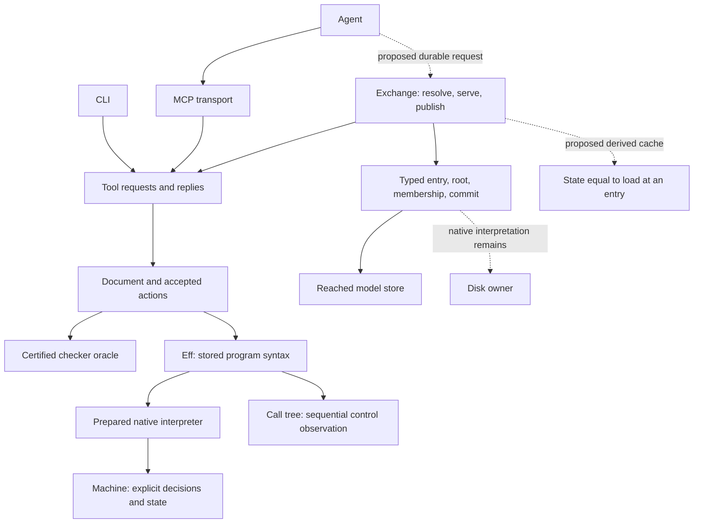
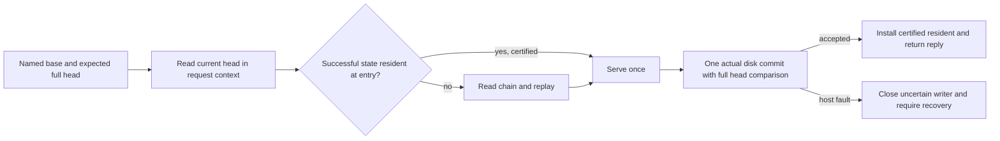
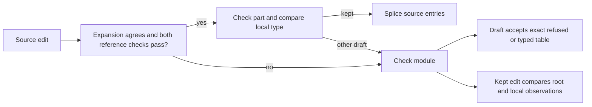

# Core abstractions: one owner, explicit laws, checked boundaries

The one thing to know first: keep exact observations at each boundary before adding caches or combining interfaces.
The source-table defect is repaired without weakening coherence.
The native interpreter now has one sealed owner.
The exchange has four store operations, and MCP has a tested protocol boundary.
The disk adapter, resident-cache proof and general source-coherence proof remain open.

Base: `cd2cea0de813ed2e22ecf53f1c0eb6c20468b131`, from `refactor/phase1-phase3`.
Integration branch: `codex/core-abstractions`.
The worktree is `/Users/pooks/.codex/worktrees/codex-abstractions/lean4-effect4`.
No push or merge occurs.

The finishing criteria are one sourced answer per question, explicit replacement laws, bounded landings, and reproducible receipts.
Each question includes the current owners, literature, implementation paths, options and a recommendation.
The landed slices pass focused builds, declaration audits and their reached OCaml gate.
Finite controls, proved laws, planned laws and trusted host boundaries remain separate.



The arrow from CLI to Tool is the recommended consolidation.
`Kit_serve` still provides overlapping CLI commands until the shared verification query lands.
The proof seat remains separate at `worktree-agent-af1c56be5c24596ff`, inspected at `67d13335540f55e3ea1ff8eda435b1113d58ecad`.
Its proved work is cited, not copied or redone.
Its counterexamples at `84f88cf6f` remain evidence about the earlier implementation.
The refinements already landed before this base remain intact.

## Question 1: sessions on disk

### What the tree has

| Owner | Declaration and path | Observation |
| --- | --- | --- |
| Canonical exchange | `Exchange.apply`, `src/Effect4/Tool/Exchange.lean` | Resolve a base, replay its chain, serve once, publish one transaction for an accepted action |
| Typed entry reading | `Exchange.entryAt`, same path | `Cas.get` checks the entry's node and exact payload |
| Mutable names | `Exchange.resolve`, `headOf`, `applied`, same path | Read a named root and compare its full `Head`, including generation |
| Schema support | `Exchange.schemas`, same path | Observe `Store.find` membership at genesis, entry specification, and program specification |
| Immutable journal content | `SessionEntry`, `src/Effect4/Tool/Session.lean` | Origin versions and engine, or parent, action index, action and program address after it |
| Reached model store | `Cas`, `Cas.commit`, `src/Effect4/Store/Domain/Cas.lean` | Atomic admission and root publication through the canonical event interpreter |
| Entry growth law | `Keeps`, `keeps_commit`, `src/Effect4/Laws/Tool/Exchange.lean` | Every successful old typed entry read remains successful with the same entry |
| New-head load law | `load_own`, same path | A committed exchange's reported head loads to the state reached by `serve` |
| Native disk owner | `E4_disk`, `ocaml/engine/cas/e4_disk.ml` and `.mli` | One locked writer, checked reads, frozen checked images, atomic commit, host faults as values |
| Frozen images | `E4_cas.checked_image`, `ocaml/engine/cas/e4_cas.ml` | Copy ordered node bytes, root table and durable boundary after whole-image admission |
| Native face | `Native.Session`, `src/Effect4/Tool/Native.lean`; `Kit_tool`, `ocaml/engine/kit/kit_tool.ml` | In-memory state and checker memo, with no native exchange caller |

The earlier S6b note omits schema membership from its proposed three-operation interface.
The exchange observes membership only, so the new fourth operation returns `Bool`, not a node payload.

`E4_disk.read` can return corruption, IO faults, a closed-writer fault, or an ordinary missing value.
Its existing public root reader consumes a full frozen image, through `E4_disk.roots`.
It has no live root accessor in `.mli`.
The present pure `Port` cannot encode those host faults as an ordinary missing root or schema.

`Checked` carries both a result and a checker trace (`src/Effect4/Program/Check.lean`).
Resident substitution concerns `Checked.value`.
A hit need not recreate the replay's trace or its memo-learning cost.
`Oracle.eq_uncached` controls result substitution for certified checker oracles.
It says nothing about an arbitrary native function.

`Exchange.load` checks protocol and codec versions, but records the origin engine without comparing it.
That digest does not freeze the running interpreter's semantics.
Native resume needs an explicit engine-compatibility check before reusing state.
Refuse a mismatching runtime identity until a named migration establishes the required observations.

### Literature and implementation reading

Farinier, Gazagnaire and Madhavapeddy's 2015 *Mergeable persistent data structures* separates immutable blocks from mutable named pointers.
It builds persistent data structures over that split and gives applications explicit merge behavior.
The source does not justify merging authoring journals without an action-level contract.
See [the paper](https://gazagnaire.org/pub/FGM15.pdf).

Fowler's 2005 *Event Sourcing* derives state from events and treats snapshots as acceleration for reconstruction.
It also separates replay from external updates, which must avoid repeating external effects.
This supports retaining accepted actions as the durable owner and keeping loaded states disposable.
See [the article](https://martinfowler.com/eaaDev/EventSourcing.html).

| Implementation | Pin and source paths | What it actually does | Local consequence |
| --- | --- | --- | --- |
| Irmin | `7a09a06fff67bc4981faca36a332c51fc16e819e`, `/Users/pooks/Dev/refs/irmin/src/irmin/content_addressable_intf.ml`, `atomic_write_intf.ml`, `commit_intf.ml` | Content-addressed objects are separate from atomic mutable pointers; a commit names a tree and parents | Keep immutable session entries separate from full-head compare-and-set |
| Irmin cache | Same pin, `src/irmin/store.ml`, `tree_and_head`; `src/irmin/tree_intf.ml`, `clear` | Re-read the current head; reuse the loaded tree only when its cached commit matches; clearing drops caches, not tree contents | Check the named head on every request, even when an entry's loaded state is resident |
| Tezos context | `f7d2ff9fcc738b087f4525026954624d7654c9a1`, `/Users/pooks/Dev/refs/ocaml-tooling/tezos/src/lib_context/disk/context.ml`, `checkout`, `raw_commit`, `flush` | Context holds an immutable tree and parent commits over an Irmin repository; checkout reads by commit; flush writes its overlay | A resident state is a derived immutable view over shared content, not a copy of the whole disk store |
| Tezos context contract | Same pin, `src/lib_context/sigs/context.ml`, `TREE`, `TEZOS_CONTEXT` | Trees mirror the context with lazy reads; GC can make checkout of removed commits return `None` | Cache validity must name retained entry reads; content addressing alone does not justify carrying a hit across GC |
| Git | [v2.50.1 `refs/files-backend.c`](https://github.com/git/git/blob/v2.50.1/refs/files-backend.c), `check_old_oid`, `lock_ref_for_update` | Lock the reference, read its current object id, compare the requested old id, then prepare publication | Copy the immutable-object/mutable-name split; retain Effect4's generation field because object-id comparison alone permits A-B-A |

Git's manual describes object-id compare-and-set and reference transactions.
It also states that concurrent readers can observe only some changes in a multi-reference update.
That contract does not replace Effect4's one-control-image publication contract.
See [the manual](https://git-scm.com/docs/git-update-ref).

The Tezos checkout files were sparse on the shelf.
I read their pinned blobs with `git show HEAD:<path>` after Git fetched those blobs.
The Irmin clone and its pin are recorded by the coordinator in `/Users/pooks/Dev/refs/ocaml-tooling/MANIFEST.txt`.
No reference implementation ran, except the finite Git control below.

### Options

| Option | Canonical stored data | Native read and commit route | Work saved | Obligation or cost | Decision |
| --- | --- | --- | --- | --- | --- |
| Whole checked disk image per request | Existing entries and roots | `E4_disk.image`, decode and restore `Cas`, run model exchange, publish through disk | Reuses the complete current model | Rechecks unrelated nodes and transfers a whole image; commit still needs actual disk compare-and-set | Useful bounded oracle, not the request path |
| Four-operation store port | Existing entries and roots | Typed entry, root, schema membership and commit over an owned writer or frozen view | One exchange algorithm, no full-image requirement | Represent faults explicitly; freeze read observations; specialize and generate; test actual disk publications | Choose as semantic interface |
| Durable loaded-state snapshots | Entries plus serialized derived state | Decode state at a journal head, then replay a suffix | Can reduce restart replay | New admission, codec, versioning and snapshot-to-replay laws; current state includes derived proof packages | Defer until restart measurements justify it |
| Four-operation port plus resident states | Existing entries and roots only | Re-read full named head, reuse certified loaded state, then commit once | Removes repeated replay for retained successful heads | Prove cache-hit result equality and retention across successful commits; invalidate when the retention premise ends | Choose as native target |

A store port and residency solve different problems.
The port chooses storage operations.
Residency avoids deriving the same state again.
A whole-store image is an oracle format, not a required session format.

### Recommended representation and laws

The landed `Exchange.Port σ` owns four pure operations in `src/Effect4/Tool/Exchange.lean`:

```lean
entry : σ → Digest → Except LoadRefusal SessionEntry
root : σ → String → Option Root
contains : σ → Digest → Bool
commit : σ → Txn → Except TxnRefusal (Receipt × σ)
```

`casPort` implements them from the existing reached store.
Every exchange definition now uses that owner, including schema membership and lost-acknowledgement reads.
`Exchange.apply` remains the sole algorithm.
Existing callers specialize by their `Cas` argument.

The native target needs a fault-aware interpretation of these operations.
Its reader must distinguish a host fault from a missing binding.
Its commit must retain model refusal, host refusal, and successful receipt as separate outcomes.
An IO exception must never become `LoadRefusal.unreadable`, `none`, or `false`.
The owned writer closes after uncertain commit failure, as `E4_disk.commit` already does.

Use one frozen request context under the writer's ownership.
Capture the root expectation once and retain the immutable entry reads needed by that request.
Read schema membership through the same context.
Publish through the actual disk transaction, which compares the full expected head again.
Do not publish a successful reply or install its new resident state before publication succeeds.

Choose a fault-aware monadic storage interpretation for native IO.
Specialize the same exchange to the pure model and lift existing checked action computations.
Keep the disk owner and its IO within the native interpretation.
This slice does not claim direct lowering of that monad or an opaque `E4_disk.t` parameter.
A narrow generation probe must validate their extraction before the native adapter lands.

The resident representation is proposed, not landed:

```lean
entries : List (Digest × State)
valid : ∀ d s, (d, s) ∈ entries →
  (Exchange.load Oracle.uncached cas ⟨d⟩).value = .ok s
```

Seal the whole package in Lean and generated OCaml.
Keep it within one owned store and interpreter context.
A dictionary or map can replace the list when measurements justify it.
The law is about successful loads only.
Do not cache a refusal under this predicate.

| Law | Premises and observation | Existing evidence or remaining work |
| --- | --- | --- |
| Typed entry retention | Accepted commit retains each old successful typed read | `keeps_commit`, proved at `Cas` |
| New committed entry read | Transaction contains `nodeOf e`; successful commit reads `e` at its address | `entryAt_committed`, proved at `Cas` |
| Published root | Successful one-move transaction exposes the target digest at the named root | `commit_move_root`, proved at model store |
| Full head comparison | Compare digest and generation before target checks and again at commit | `Store.move`, model definition; native controls already cover A-B-A |
| Schema membership | Each answer agrees with the same store view used by typed reads and publication | `casPort` is definitional; native adapter obligation |
| Cache hit | Valid resident lookup returns the same `State` as `load.value` | Proposed resident invariant and lookup proof |
| Old cache retention | `Keeps cas cas'` and successful old load imply successful same-state load in `cas'` | Missing `chainAt_keeps`/`load_keeps` bridge; `load_extend` alone does not state this |
| New cache insertion | Accepted cached serve followed by actual successful commit certifies the new head | Use `load_own` after proving cached resolution has the same result |
| Cache transparency | Cached exchange and uncached exchange have equal reply, head and model store | Proposed theorem over `Checked.value`; not a trace or cost equality |

Placement of the proposed proofs: `host-session-protocol`, replay compatibility, R6, and stored-entry reading under R13.
Their consumers are cached resolution and the native exchange.
The proposed registry claim is `session-resident-load-value`.
Its observation is exact loaded `State` at one entry, under entry retention and the same interpreter.
It establishes no host progress, repeated-effect safety, filesystem integrity, or hash injectivity.
The proof is not started in this slice.

The existing `load_extend` proves loading a newly extended chain.
It does not directly prove that every old cached head remains valid.
A successful `chainAt` uses successful entry reads only.
Induction through `originAt`, `walk`, and `chainAt` gives the missing old-chain retention bridge.
The replay result then stays unchanged because the chain and interpreter stay unchanged.

Root changes do not enter `load` at an exact entry.
They therefore need no cache invalidation while `Keeps` still holds.
GC, store replacement, uncertain recovery, or interpreter replacement require revalidation or dropping residents.
The full named head must still be checked on each named-base request.
A digest key for immutable content must not replace the full head's compare-and-set token.



This design removes repeated chain replay on retained hits.
It avoids a second durable state format and a handwritten OCaml exchange.
The landed factoring removes direct concrete-store access from exchange policy.
It leaves one concrete-store instance and unchanged `Cas` law statements.

### Measurements and probes

The finite replay probe publishes real accepted `.open_` actions through `serve`, `publication`, and `Cas.commit`.
It then measures one actual `load` and checks the loaded transcript length against the reached state.
It measures Lean's evaluation path, not the native disk exchange.
Its first load includes warm-up cost.
For a nonempty honest chain, the source makes `n + 2` typed entry calls and replays `n` actions.
`chainAt` reads the head before `walk` reads that head again.
The model uses list lookup in `Store.find`; these timings do not predict an indexed disk implementation.
It gives no asymptotic bound and no production latency forecast.

| Accepted actions | Store nodes | Load nanoseconds |
| --- | --- | --- |
| 1 | 6 | 99,884,667 |
| 10 | 15 | 18,320,625 |
| 50 | 55 | 72,472,125 |
| 100 | 105 | 155,667,292 |

Command: `python3 /private/tmp/seams-lean-one.py lake build Tools.StoreSessionProbe`.
Source: `store/StoreSessionProbe.lean` beside this note.
For reproduction, copy that source to temporary `tools/Tools/StoreSessionProbe.lean`, run the command, and remove the copy.
The probe's build takes 146 seconds on this run, including preparing the four stores.

The Git control creates two real objects and applies A-B-A followed by an old A compare-and-set.
Git accepts that stale comparison.
Command: `python3 docs/research/2026-10-18-codex-abstractions/store/git-aba.py`.
Output: `digest-only A->B->A: stale compare-and-set from A is accepted`.
Tool: `git version 2.50.1 (Apple Git-155)`.


## Question 2: incremental checking

### The tree now

`CheckInput`, `run`, `Oracle`, `Checked`, `Memo` and `HitRule` live in `src/Effect4/Program/Check.lean`.
A module key contains the application, hole rows and source program.
A part key contains `SigData`, the environment and the expanded part program.
These are immutable structural keys, rather than mutable database identifiers.
`Check.run` returns both the result and every annotation entry.
The full `Verdict` is the observation that a cache must reproduce.

`Oracle.agrees` requires pointwise equality with `run`.
`Oracle.eq_uncached` gives every consumer the same oracle value.
`Checked.valid` certifies each recorded request and answer.
`Memo.learn` accepts these certified traces only.
`Memo.oracle` scans entries with the selected `HitRule`.
`HitRule.exact` compares full keys.
`extension` additionally admits a guarded signature extension, through `guarded_extends` in `src/Effect4/Program/Typing/Support.lean`.
It requires equal programs, equal environments, extension, a positive cached result and supported operations.
It is not arbitrary dependency omission.

`Internal.deps` splits module expansion into bodies, main and a synthetic layers program.
`joinModule` reconstructs ordered tables, refusal priority and source-reference placement.
The proof seat proves `combine_deps` in `git:67d13335540f55e3ea1ff8eda435b1113d58ecad:src/Effect4/Laws/Program/CheckAgreement.lean`.
`Checked.ask_value` uses that law.
Its `explain_replays` remains a planned goal.
The seat does not redo those proofs.

For an expanded definition block, `deps` produces `b + 1 + l` part inputs.
Here `b` counts paired declarations and bodies, and `l` is one exactly when layers exist.
Other expanded programs produce one main input; a part input has no dependencies.
A miss against `m` memo entries calls the hit predicate `m` times.
Each predicate can compare full structured inputs, so this is not a constant-cost estimate.
These counts follow directly from `bodyDeps`, `deps` and `Memo.oracle`.
Command: `rg -n -A15 'def bodyDeps|def deps|def Memo.oracle' src/Effect4/Program/Check.lean`.

### Literature and implementations

Mokhov, Mitchell and Peyton Jones separate the scheduler from the rebuilder in *Build Systems à la Carte* (2018).
Verifying traces record dependency fingerprints.
Constructive traces retain results as well.
This distinction separates reuse evidence from the order of checking.
Effect4's certified memo resembles constructive memoization, but its trace is not a stored dynamic dependency graph.
Source: [the authors' paper](https://simon.peytonjones.org/assets/pdfs/build-systems-original.pdf).

Salsa stores query identities, dependencies and revision information.
It validates dependencies on demand and recomputes changed queries.
Equal results retain an older change revision, so downstream queries can remain valid.
Its revision is validation bookkeeping, rather than every query's semantic key.
Sources: `~/Dev/refs/salsa/book/src/reference/algorithm.md`, `book/src/plumbing/terminology/backdate.md`, `src/function/maybe_changed_after.rs` and `src/function/backdate.rs`.
The clone is pinned at `3e3ae0fa567b090f5e972c3e9d095fca654e83f5`.

The rust-analyzer architecture separates immutable program syntax values from derived semantic information.
Its `base-db` defines client-supplied inputs for Salsa.
Source: `~/Dev/refs/ocaml-tooling/rust-analyzer/docs/book/src/contributing/architecture.md`, sections `syntax` and `base-db`.
Its clone is the manifest's `70e0c46be740a471bcc95f2be290f4bbfdcffd87`.

Hammer, Phang, Hicks and Foster define demand-driven repair in *Adapton* (2014).
The computation records a graph of demanded work.
Changes dirty dependency edges, while forcing a result repairs the needed graph.
Source: [the authors' paper](https://matthewhammer.org/adapton/adapton-pldi2014.pdf).
The OCaml implementation exposes cells, thunks, `set` and `force` in `~/Dev/refs/adapton/src/core/art.ml`.
`Engine.dirty`, `node_force` and the repair closure implement that separation in `src/core/engine.ml`.
The clone is pinned at `a8e642ac1cc113b33e1837da960940c2dfcfa772`.

Jane Street Incremental recomputes necessary nodes in dependency order during stabilization.
Its cutoff decides whether a new node value propagates.
Its default uses physical equality, and clients can configure other cutoffs.
That configurability does not itself prove Effect4 verdict equality.
Sources: `~/Dev/refs/incremental/src/incremental_intf.ml`, sections `Stabilization` and `Bind, scopes, and invalidation`, and `src/cutoff.ml`.
The clone is pinned at `98b5750ec3c006641351bfd858a89136a5dbc52c`.

Lean's `Snapshot` keeps syntax, parser state and command state after a command.
It can restart Lean elaboration from that state.
Source: `~/.elan/toolchains/leanprover--lean4---v4.33.1/src/lean/Lean/Server/Snapshots.lean`, `Snapshot`.
`Lean.Elab.Frontend.processCommands` also accepts an earlier result for incremental reuse in the same toolchain's `Lean/Elab/Frontend.lean`.
This supports prefix reuse for ordered elaboration.
It does not make arbitrary subtrees independent of their environments.

### Options

| Path | Representation | Reuse rule | Cost and obligation | Decision |
| --- | --- | --- | --- | --- |
| Certified structural memo | Existing full `CheckInput`, valid entries and `HitRule` | Exact key or the existing proved extension rule | No mutable dependency invalidation; scan and retained-key costs remain | Use now |
| Keyed certified memo | Same keys and validity, with an exact-key index plus separate extension candidates | Structural key equality after any digest lookup | Prove indexed lookup agrees with the list oracle; measure hashing and transcript costs separately | First performance slice if profiling warrants it |
| Revisioned dependency engine | Stable query identities, input revisions, read traces and full verdicts | Salsa red-green validation with equality cutoff | Prove dependency read coverage, validation and cutoff agreement; reject cycles or specify their meaning | Defer |

### Recommendation, laws and deletions

Keep the module/part split.
Bodies, main and layers already match the checker owners and carry explicit context.
Keep module checking responsible for declaration arity, body declarations, refusal order and reference faults.
A part's type alone cannot reconstruct that observation.

Keep structural keys, without a document revision in each key.
An old entry remains valid for its old immutable key.
An edit changes the queried key, so an exact lookup misses.
A rollback can reuse the old key directly.
No invalidation is needed for these immutable semantic inputs.
Memory eviction may discard entries without changing any result.

Keep the whole signature and environment until a smaller key has a read-coverage theorem.
A persistent cache must also name checker semantics and codec versions.
A digest may index a bucket, but full-key equality must discharge a hit without assuming hash injectivity.
Source addresses belong to placement, since part verdicts are rooted at `[]`.
They need not defeat reuse of identical parts in identical contexts.

The required laws already have the right shape:

- Every selected entry equals `run` for the queried input: `HitRule.sound`.
- Learning keeps every entry valid: `Memo.valid` after `Memo.learn`.
- Combining uncached dependency answers equals the module verdict: `combine_deps`.
- Every consumer answers as the uncached oracle: `Oracle.transparent`.
- Any future cutoff compares full observed verdicts, including table entries and refusals.

Do not add a second incremental checker or a mutable graph now.
The earlier measurement is 0.29 ms for the first hundred edits and 0.46 ms for the last hundred of one thousand.
Source: `docs/research/2026-10-18-refinements/README.md`; recorded command: `ocaml/_build/default/engine/test/kit/bench_tool.exe 1000`.
That measurement does not isolate memo lookup from transcript append costs.
This seat takes no new timing measurement of that split.
An exact-key index would delete the linear exact lookup, while keeping the existing semantic owner.
A revision engine would add state and proof obligations that current measurements do not justify.

## Question 3: the document, holes and fills

### The tree now

`Doc` in `src/Effect4/Program/Typing/SourceDocument.lean` seals origin, accepted actions and their replayed runtime state.
`DocInternal.apply` is the one interpreter for commit, draft and revert.
`Doc.replayed` states equality with `replayDoc`.
`Doc.snap` contains identity and accepted-action count.
`Doc.step` rejects a foreign identity or stale revision before applying an action.

`SourceSession.Coherent` in `src/Effect4/Program/Typing/SourceSession.lean` means exact equality with `Sketch.sourceTable`.
It does not mean that the program checks.
`Sketch.sourceEntry` and `Table.atSource` in `src/Effect4/Program/Typing/Source.lean` give the source-address observation.
The root records `sourceCheck`, including its first ill-formed reference refusal.
Other entries describe the expansion at source addresses.

`FillSet.open_`, `add` and `publication` live in `src/Effect4/Program/Typing/FillSet.lean`.
The set retains its source session and snapshot.
`FillSetInternal.addEntry` rejects roots, unknown addresses, different fills at one address, overlaps and failed anchor certification.
Publication is one ordinary kept-exact document commit.
The tool supplies the anchor snapshot to `Doc.step`, so a moved document refuses.

The proof seat proves `wellFormed`, `add_wf`, `kept_eq_certified` and `publish_eq_materialize` in its `src/Effect4/Laws/Program/FillSet.lean`.
The last two retain explicit reference-free assumptions.
Publication agreement additionally requires a positive base, exact anchor, coherent session and successful publication.
Those laws do not certify arbitrary reference-bearing simultaneous fills.

### Literature and implementations

Omar and colleagues' *Hazelnut* (2017) defines typing and editing actions for expressions with holes and a cursor.
Its action sensibility theorem retains typing through permitted edit actions.
Non-empty holes hold a term whose type conflicts with its expected position.
Source: [the authors' project page](https://www.cs.cmu.edu/~comar/hazelnut-popl17/).

The frozen HZ implementation separates semantics from the UI.
`HExp.NonEmptyHole`, `Action.performSyn` and `Action.performAna` implement typing-directed edits in `~/Dev/refs/hazelnut-hz/src/hz_semantics.ml`.
`Model.t` is a cursor expression paired with a type in `src/hz_model.ml`.
Its clone is pinned at `2ec8a4ce37a3c1f6f6cacb2fc3a2421ae3126090` and recorded in the reference manifest.
These are literature implementation witnesses, not Effect4 proof witnesses.

Omar, Voysey, Chugh and Hammer's *Live Functional Programming with Typed Holes* (2019) gives holes runtime meaning.
Evaluation continues around indeterminate computations and retains contextual information for later filling.
Source: `vendor/papers/gradual-holes/omar-live-typed-holes-1805.00155v4.pdf`, indexed by its manifest, and [the authors' paper record](https://arxiv.org/abs/1805.00155).
Effect4's current unit-request hole operation does not carry such a hole closure.
Its document fill certificate therefore does not establish live execution resumption after filling.

Zhao and colleagues' *Total Type Error Localization and Recovery with Holes* (2024) defines marking of arbitrary syntax.
Marks act as non-empty holes around local type errors.
The resulting marked syntax has a defined type and binding structure.
Source: `vendor/papers/gradual-holes/zhao-marking-popl24.pdf` and [the authors' retained paper](https://hazel.org/papers/marking-popl24.pdf).
Hazel implements marks and analysis contexts in `~/Dev/refs/ocaml-tooling/hazel/src/language/statics/Statics.re`.
Its `CachedStatics.t` separates original term, elaborated term, information map and error identifiers in `src/haz3lcore/derived/CachedStatics.re`.
These views do not justify replacing an erroneous source program with an invented successful check.

### Options

| Path | Document representation | Error observation | Laws and deletion | Decision |
| --- | --- | --- | --- | --- |
| Exact source document | Existing origin, actions, session and exact source table | Draft may have refusals; kept edit retains root and local observations | Exact replay and coherence; delete faulty splice eligibility | Land now |
| Total marking view | Existing `Eff` plus a derived mark map and analysis view | Continue services around every local failure | Define mark erasure, total marking and agreement on unmarked accepted programs | Later design slice |
| Live contextual holes | Existing `Eff` plus explicit runtime hole obligations and captured data | Observe suspended hole instances and later fillings | Define runtime identity, environment membership, filling simulation and host constraints | Separate runtime contract |

### The true invariant

A draft document records accepted editing actions, including drafts whose root refuses.
Its exact table must describe the current source sketch, rather than the last successful program.
Its action history replays to the retained runtime state.
A draft at an absent address records an unchanged step.
An actual draft edit accepts its candidate and recomputes whenever local replacement cannot justify exact table equality.

A kept edit accepts only the same local environment and type below the root.
It also retains the root observation already present in the coherent session.
An unrelated ordinary type error can remain while a locally exact fill succeeds.
That behavior has an existing finite control in `Test/Program/SourceFeedControls.lean`.
An ill-formed reference is different because it changes the whole-document root overlay.
A reference fault in either sketch prevents partial table replacement.
A draft with a candidate rechecks it.
A kept edit that passes part certification takes the module route, which refuses an invalid candidate.
Coherence remains exact equality, without a fault-free premise.



### Replacement laws for the false S1 goals

The historical counterexamples remain at `git:84f88cf6f:src/Effect4/Laws/Program/SourceTable.lean`.
They are not deleted facts about that revision.

| Old false claim | Replacement law | Evidence and remaining work |
| --- | --- | --- |
| `feed_coherent` at the old implementation | Keep the exact original statement: coherent input plus accepted feed gives a coherent output | Repair eligibility, then prove the existing goal; no weakened invariant |
| `Doc.coherent` and `reached_view` at the old implementation | Every sealed document's table equals its current sketch's source table, including refused drafts | Proof seat derives these modulo `feed_coherent`; finite document and replay controls pass after repair |
| `replay_drafts_view` at the old implementation | Successful accepted-action replay returns the exact source table for its resulting sketch | Proof seat derives the existing law modulo `feed_coherent`; keep malformed-reference replay as a control |
| `feed_undo` at the old implementation | Filling an existing program and drafting its old program back restores the coherent session exactly | Proof seat derives this modulo `feed_coherent`; the malformed-reference undo control passes after repair |
| Unrestricted `feed_draft` agreement with the expansion editor | Require no reference fault in the old sketch or any edit candidate for that exact reference-editor comparison | Proof seat corrects the goal; malformed drafts still obey unconditional source coherence and acceptance |
| `feed_keepExact` says the splice reports only `[e.path]` | Its exact list is `(Node.addresses (.eff next.sketch.program)).filter (Table.under e.path)`, under `canSplice = true` | Wider-subtree and valid-reference finite controls pass; the exact statement remains planned |
| `feed_keepExact` says expansion agreement alone forces a splice | Use `SourceSession.canSplice` for that implication; its false case rechecks after part certification | New predicate adds old and candidate fault checks; root and local equality conclusions stay unchanged |

The repaired planned goal names the exact list above.
Its earlier existential clause identified a splice but did not constrain the reported addresses.
The exact expression retains source order and excludes addresses introduced only by reference expansion.
No proof of that exact statement lands in this seat.

`feed_keepExact_ok` and `feed_keepExact_of` on the proof branch also need `canSplice` in their route hypotheses.
`feed_ok_cases` must expose the same predicate.
The reference-free fill proofs discharge its new fault premises from their existing reference-free assumptions.
No new representation or second interpreter is needed.
The proof seat's counterexample declarations must remain historical evidence rather than compile against repaired definitions.

### Minimal representation, laws and deletions

Keep `Doc`, `FillSet`, `SourceSession` and `Eff` as their existing owners.
`Doc` owns accepted actions and replay.
`FillSet` owns certification at one snapshot.
`SourceSession` owns source-table updates.
`Eff` owns stored program syntax.
A future marked view must remain derived from `Eff`.
A future live hole needs a separate explicit runtime identity, rather than treating a source address as an invocation identity.

The minimal landed addition is one Boolean eligibility predicate, `SourceSession.canSplice`.
It deletes two unchecked uses of expansion agreement as sufficient splice permission.
It leaves the source-table invariant unchanged.
There is no theorem that replacing a hole resumes an already running program.
There is no new claim of total error localization, graduality or arbitrary reference-bearing fill commutation.


## Question 4: the agent face

### What the tree has

`Request`, `Action`, `Query`, replies and refusals live in `src/Effect4/Tool/Protocol.lean`.
`Tool.serve` in `Tool/Serve.lean` owns their execution.
`Tool.Methods.entries` in `Tool/Methods.lean` derives argument schemas from the request shape.
`Native.Session` in `Tool/Native.lean` seals the semantic state and checker memo.
`Kit_mcp` in `ocaml/engine/kit/kit_mcp.ml` supplies the stdio transport.

The connection currently holds one in-memory session.
`Kit_tool` has no disk exchange caller.
A document name, a document snapshot, a run index and an MCP request ID have different meanings.
None provides durable session resume by itself.

`Kit_serve.request` and `answer` in `ocaml/engine/kit/kit_serve.ml` own a second command face.
Its `check`, `run` and `explore` overlap existing tool queries and actions.
`Kit.run` selects a supported call tree or the machine.
Its optional cross-check compares a settled tree observation against the machine.
`Tool.Internal.preview` in `Tool/Queries.lean` exposes tree settling, frames and exploration without that extra machine comparison.

### Literature and reference implementations

The MCP specification separates protocol errors from tool execution errors.
It defines version negotiation, typed request identifiers, notifications, tool discovery and structured results.
Structured results can accompany the same JSON as text.
The implemented profile is stdio MCP `2025-06-18`, not every later version.
Sources: [MCP tools](https://modelcontextprotocol.io/specification/2025-06-18/server/tools), [lifecycle](https://modelcontextprotocol.io/specification/2025-06-18/basic/lifecycle), and [transports](https://modelcontextprotocol.io/specification/2025-06-18/basic/transports).

The exact shelf paths are `~/Dev/refs/ocaml-tooling/mcp-spec/docs/specification/2025-06-18/` and `schema/2025-06-18/schema.json`.
The shelf pin is `86f6e0c675afea9a8f233e09b6faf566b126086c`.
Its newer specifications remain separate migration inputs.
A server must select a version it implements, rather than echo an arbitrary client's version.

LSP identifies documents by URI and changes by version.
Diagnostics carry locations and can identify the document version they describe.
This supports explicit snapshot-scoped observations, rather than implicit mutable global state.
Source: [LSP document synchronization](https://microsoft.github.io/language-server-protocol/specifications/lsp/3.17/specification/#textDocument_synchronization).

| Reference | Implementation paths | What it contributes |
| --- | --- | --- |
| ocaml-lsp and Linol | `~/Dev/refs/ocaml-tooling/ocaml-lsp/ocaml-lsp-server/src/document_store.ml`, `document.ml`; `~/Dev/refs/ocaml-tooling/linol/src/server.ml` | URI-keyed documents, versioned content, typed requests and responses, and versioned diagnostics |
| Lean REPL | `vendor/refs/repl/README.md`, `REPL/Main.lean`, `REPL/Snapshots.lean` | Explicit environment and proof-state handles support branching; pickling omits caches and reconstructs imported environments |
| Pantograph | `vendor/refs/Pantograph/Pantograph/Protocol.lean`, `GoalTactic`, `GoalContinue`, `InteractionError` | Explicit state and goal IDs, branch selection, structured messages, and machine-readable error categories |

REPL snapshot handles belong to the process that allocated them.
Pickling adds an import/toolchain dependency and is not an accepted-action journal law.
Pantograph's `hasSorry` and `hasUnsafe` fields demonstrate why a structured success shape must still expose its trust conditions.
Effect4 should expose its actual program admission and proof status with the same care.

### Options

| Decision | Option | Gain | Cost or deletion | Recommendation |
| --- | --- | --- | --- | --- |
| Command owner | Keep `Kit_serve` dispatch beside Tool | Existing CLI behavior stays local | Two request languages and repeated dispatch remain | Reject as final architecture |
| Command owner | Fold checking and exploration into Tool queries; execution into existing start/play/run actions | One semantic owner across CLI, MCP and other faces | Delete hand command execution after callers move | Choose |
| Cross-check | Remove tree/machine comparison | Less work per call | Loses an independent finite observation | Reject |
| Cross-check | Explicit verification query and shared report, also used by the behavior gate | Comparison remains available with clear scope | Delete Kit-only comparison policy | Choose; never label an unchecked response as agreement |
| Session identity | Use connection or process-local indices | Small temporary interface | No durable resume or fork | Keep only for ephemeral mode |
| Session identity | Explicit named root plus expected full head, or immutable entry for reads | Resume, fork and stale-writer detection have stable meanings | Requires native exchange and store ownership | Choose for durable mode |
| Reply | Text only | Broad client compatibility | Every agent must parse and classify text | Delete this restriction now |
| Reply | Structured generated reply plus identical JSON text | Machines can act on typed fields; older clients still read text | Keep one underlying reply owner | Landed |
| Refusal | Host strings reconstruct domain meaning | Easy local formatting | Two owners and missing location data | Reject |
| Refusal | Generated domain refusal in tool result; protocol error before execution | Stable codes and context remain visible | Add missing locations at Lean reader/certifier owners | Choose |

### Minimal representation and laws

Keep `Tool.Request` and its reply as the semantic protocol.
Treat MCP framing and initialization as transport state only.
The transport state has an initialization phase and one sealed native tool session.
A valid notification produces no response and never executes a tool action.
A malformed request never reaches `Tool.serve`.
A supported tool call runs exactly once.
Its structured reply equals the parsed JSON text reply.
These transport properties have finite native controls, not Lean proofs.

The existing semantic laws remain `serve_appends`, `serve_query`, `serve_refuses` and `serve_transparent` in `src/Effect4/Laws/Tool/Serve.lean`.
They do not prove MCP framing or native parsing.
The method-table audit does not establish protocol conformance either.

Durable calls should carry a session name and expected `Head` for actions.
Immutable-entry reads should name their entry directly.
A fork action creates a new entry whose parent is the retained entry, then creates the fresh named root.
A query at `Base.fork` publishes nothing.
A separate fork-only command would need its own explicit operation and law.
A resume should resolve the actual head and validate its chain before serving.
A lost acknowledgement can consult `Exchange.applied` for immediate parent/action recognition.
That function ignores the expected generation and carries no unique request identity.
Native recovery must reconcile the full head and retained action chain before deciding whether to retry.
This helper alone does not establish durable idempotency or exactly-once host effects.
MCP request IDs correlate replies; they are not persistent action identities or session heads.
Transport session headers, where supported, do not own Effect4's durable sessions.

A stale refusal should expose the expected and actual head or snapshot.
A type refusal should expose its source address and checker reason.
A fill refusal should retain the certifier's reason.
A shape refusal should expose its field path and expected shape.
The latter two remain separate Lean-owned follow-ups.
A schema mismatch now reaches MCP as a protocol error with the generated wire refusal in its data.
Domain refusals reach agents as `isError: true` with the unchanged generated payload.

The command consolidation needs a typed verification query and an exact observation for the existing tree/machine comparison.
The existing `run` query reads a live run; it must not silently acquire execution semantics.
Use `check`, `preview`, and `start`/`play`/`run` according to those meanings.
Only delete `Kit_serve.answer` after CLI callers use that shared protocol and comparison route.
This migration remains larger than the transport repair because it also changes generated request/reply schemas and CLI behavior.

### Protocol verification and deletion

The existing native tests covered discovery and a few messages, without proving conformance.
New behavioral controls first reported fifteen failures against the old implementation.
The repaired transport selects one supported version, validates envelopes and initialization, and distinguishes protocol errors from domain refusals.
It accepts ordinary JSON metadata without widening Effect4's numeric value profile.
It retains arbitrarily large integer request IDs through `Yojson.Raw`.
It accepts exact integral decimal and exponent notation without floating conversion.
JSON integer types include those forms: [JSON Schema numeric rules](https://json-schema.org/understanding-json-schema/reference/numeric).
It rejects malformed UTF-8 and lone surrogate strings without throwing or emitting malformed output.

`test_mcp.ml` runs inside `make check-ocaml`.
`scripts/check-mcp-protocol.py` also starts the real executable and validates its trace against the official schema.
It validates generated argument schemas and compares structured replies with text.
A valid open notification uses a different document name, so the no-mutation control can detect accidental execution.
The schema trace also checks that refused calls leave the document unchanged.
The source shelf supplies the official schema; it is not a rewritten local copy.

This deletes the text-only response wrapper, arbitrary version echo, and transport dependence on the tool's integer-only parser.
It does not delete the tool-value reader or claim HTTP, arbitrary concurrency, cancellation latency, later-version conformance, or a verified parser.
The official schema disallows null error IDs, while base JSON-RPC requires null when an invalid request has no usable ID.
Malformed-envelope controls follow JSON-RPC and check those errors separately from the identified official-schema trace.

Protocol receipt commands and final results appear in the consolidated receipt table.

## Question 5: the run semantics

### What the tree has

| Owner | Declaration and path | Role and limit |
| --- | --- | --- |
| Program syntax | `Eff`, `src/Effect4/Program/Eff.lean` | Canonical first-order program data |
| Operational execution | `RunMachine`, `Cmd`, `stepDecisionState`, `src/Effect4/Machine/Fibers.lean` | Explicit fibers, saved frames, stores and decision input |
| Native interpretation | `interpOf`, `evaluatorFor`, `src/Effect4/Program/Compile.lean` | Two parts of one source interpreter: bookkeeping and evaluation |
| Reached run | `Live`, `src/Effect4/Run/Live.lean` | A run plus proof that an admitted open and ordered commands reach it |
| Sequential call semantics | `Run.Tree`, `src/Effect4/Run/Tree.lean` | `done`, `cut`, `call`, `cell`; continuation functions belong to semantics, never persisted syntax |
| Fragment routing | `Run.atBudget`, `src/Effect4/Run/Tree.lean` | Check the supported fragment, then select the tree or the machine |
| Native driver | `E4_engine.Make`, `ocaml/engine/e4_engine.ml` | Before this slice, stores program/table/interpreter and calls a step that ignores the interpreter |

`Tree` has no scheduler state or concurrent-fiber constructor.
Its `cut` records a finite budget frontier, never divergence or a program failure.
`Live` adds reachability evidence, rather than another execution language.
The current tree/machine connection remains fragment-bounded and partly open.
`ofProgram_approx` is declared from Rocq, while `ofProgram_eq_denoteRowsB` remains a planned goal.
See `src/Effect4/Laws/Run/Tree.lean` and `src/Effect4/Laws/Run/Outcome.lean`.

### Literature and reference implementations

Plotkin and Pretnar's handlers give a target model of operations and equations.
Handling uses the map induced from the free model.
This supports one source syntax with several interpretations.
It does not make a mutable fiber scheduler equal to a sequential call tree.
Source: [Handlers of Algebraic Effects](https://homepages.inf.ed.ac.uk/gdp/publications/Effect_Handlers.pdf), audit P29.

Xia et al.'s interaction trees are coinductive computations with return, silent and visible-event nodes.
A visible node has a response-indexed continuation.
Source: [Interaction Trees](https://www.cis.upenn.edu/~stevez/papers/XZHH%2B20.pdf), audit P37.

| Reference | Actual implementation paths | What it does |
| --- | --- | --- |
| InteractionTrees | `~/Dev/refs/ocaml-tooling/InteractionTrees/theories/Core/ITreeDefinition.v`, `Interp/Interp.v`, `Interp/Handler.v` | `itreeF` has `RetF`, `TauF`, `VisF`; `interp` lifts an event handler through an iteration operator |
| Vellvm | `~/Dev/refs/ocaml-tooling/vellvm/src/rocq/Semantics/Denotation.v`, `InterpretationStack.v`, `Handlers/` | Denotes LLVM events, then interprets their families; the executable stack fuses state handlers to avoid repeated structural rebuilding |
| Eio | `~/Dev/refs/ocaml-tooling/eio/lib_eio/core/suspend.ml`, `core/eio__core.mli`, `lib_eio_posix/sched.ml` | `Suspend`, `Fork`, `Get_context` use OCaml continuations; the scheduler owns resumption and cancellation |

Eio's continuation is a host runtime object.
It cannot replace Effect4's stored first-order frames without changing replay and inspection contracts.
Use Eio for host IO behind the existing reply boundary if useful.
Do not introduce Eio continuations into `Eff`, stored machine state or the action journal.

The pinned Effect interpreter maintains `_stack` and runs `FiberImpl.runLoop`.
Source: `vendor/effect-4.0.0-rc.112/src/internal/effect.ts`, `_stack` at 515 and `runLoop` at 629.
The same owners remain in `vendor/effect-4.0.1/src/internal/effect.ts`, at 513 and 622.
That source reading does not extend the rc.112 behavior gate to 4.0.1.
These explicit control obligations explain the machine's role beyond a row-call tree.

### Options

| Option | Minimal change | Benefit | Cost and deletion |
| --- | --- | --- | --- |
| Keep machine and tree, seal the prepared interpreter | One runtime package, fixed source/table/interpreter/evaluator | Removes repeated construction and contradictory source arguments | Deletes `stepChecked`, ignored interpreter argument and redundant engine source fields |
| Replace tree with a view generated from machine waits | Machine plus observation projection | One execution implementation | Deletes the independent test oracle; needs exact frontier, budget and event correspondence before cutover |
| Replace machine with a richer interaction-tree runtime | Add scheduling, cancellation, stores and resumption events plus interpreter | Uniform event-handler machinery | Recreates scheduler state in handlers; requires new source/machine simulation and first-order resume representation |

Recommendation: the first option.
The machine/tree split serves general replayable execution and an independent sequential control oracle.
The tree shares term evaluation, contexts and cell operations with the machine.
Its control traversal does not independently validate those shared primitives.
It is not a mathematical claim that no smaller design exists.
A future deletion needs the named machine/tree relation, including live frontiers, rather than agreement on completed examples.

### Minimal prepared package and laws

`Program.Prepared` retains its program, row table, `RunInterp` and `FiberEvaluator`.
Its private constructor requires both retained values to equal `interpOf` and `evaluatorFor` at that same source.
`Prepared.make` constructs these values once.
`Prepared.step` reads them, and `Prepared.admit` reads their row table.
The generated OCaml interface hides the whole package.
The engine stores only this package alongside the machine, fuel and outcome fields.

`Prepared.step_eq` states exact equality of the full resulting machine and command-sufficiency flag.
It quantifies over every package, machine, decision and fuel.
It does not require typing or successful reply admission.
It does not establish that an unrelated machine belongs to the package's source.
The public engine's load path supplies that association.
Lowering, host replies and machine/tree agreement remain outside this equality theorem.

Placement proposal: concept `translation-simulation`; claim `native-prepared-step`; role compatibility; requirement R6.
Pointer: `Effect4.Program.Prepared.step_eq`, `src/Effect4/Laws/Program/Admit.lean`.
Consumer: `E4_instance.step`, then `E4_engine.Make.step`.
The coordinator can add this small claim to the registry without changing any frozen statement.

## Question 6: generated-code trust

### What the tree has

`OCaml5.Lcnf.translateClosure` lowers Lean compiler data into `Ml.Decl`.
`OCaml5.Lcnf.Builtins` and `TypeRows` state primitive and representation contracts.
The generated OCaml is compiled, its interface is sealed, and finite behavior gates compare observations.
These checks do not prove the lowering theorem.
Decision row 391 explicitly trusts this lowering.
The disk implementation remains finite-tested against its modeled operations.

`rocq/StoreCode.v` prints executable definitions from Lean's compiler data.
`rocq/StoreLaws.v` and `StoreGrammar.v` prove propositions over that printed code and explicit primitive assumptions.
`rocq/README.md` records the owner's 2026-10-16 ruling: hard proofs live in Rocq, and Lean declares them.
The printer, its representation choices and any declared bridge remain explicit trust boundaries.

### Literature and reference implementations

| Reference | Actual implementation paths | Established scope |
| --- | --- | --- |
| CompCert | `~/Dev/refs/ocaml-tooling/compcert/driver/Compiler.v`, `common/Smallstep.v`, `common/Behaviors.v` | `cstrategy_semantic_preservation` composes pass simulations; the main theorem relates source and assembly semantics |
| Vellvm | `~/Dev/refs/ocaml-tooling/vellvm/src/rocq/Semantics/Denotation.v`, `InterpretationStack.v`, `Interfaces/`, `Implementations/` | Explicit LLVM event semantics and executable handlers; choosing an executable handler does not prove every LLVM optimization |
| Aeneas | `vendor/refs/aeneas/README.md`, `src/Translate.ml`, `src/TranslateCore.ml`, `src/interp/` | Rust verification through functional translation; formal papers cover the calculus/translation and symbolic borrow checking |
| lean-mlir | `vendor/refs/lean-mlir/README.md`, `LeanMLIR/LeanMLIR/Transforms/Rewrite/Rewrite.lean` | A typed SSA semantics and `denote_rewritePeepholeAt` for semantics-preserving rewrites |

Primary links: [CompCert's stated theorem](https://compcert.org/man/manual001.html), [Vellvm](https://github.com/vellvm/vellvm), [Aeneas](https://github.com/AeneasVerif/aeneas), [lean-mlir](https://github.com/opencompl/lean-mlir).

CompCert's theorem excludes additional bad target observations under its named source assumptions.
Typechecking generated OCaml provides a different kind of evidence.
Aeneas's published calculus results do not make Effect4's separate LCNF lowering verified.
Likewise, lean-mlir's rewrite theorem does not verify the parser, extractor or OCaml backend here.

### Assurance options

| Option | Representation and law | What it deletes | Recommendation |
| --- | --- | --- | --- |
| Keep trusted lowering with explicit contracts and independent finite gates | Existing `Ml.Decl`, primitive catalogue, declared profiles and exact observed comparisons | Hand semantic twins only when the generated replacement passes their boundary tests | Current route, consistent with row 391 |
| Add per-artifact translation validation | Source LCNF, target syntax and a certificate checked against a source/target relation | Repeated trust in each accepted lowering step | Future bounded fragment; needs a checker acceptance theorem, not merely OCaml compilation |
| Prove the lowering universally | Formal source LCNF and target OCaml semantics plus pass simulations | Trust in the modeled lowering passes | Large project; not a one-day prerequisite for this brief |

### Decision D: store laws

Recommendation: Rocq owns new hard node/store proofs, as the owner already ruled.
Lean remains the executable-definition owner and exposes declared facts with exact propositions and citations.
Keep easy kernel-checked local construction or codec facts where Rocq takes them as explicit assumptions.
Do not maintain two independently evolving proofs of the same node law.

| Ownership option | Benefit | Cost |
| --- | --- | --- |
| Lean owns all node laws | Existing downstream proof terms stay kernel-checked | Contradicts the owner's hard-proof ruling and retains duplicated Rocq work |
| Rocq owns hard laws, Lean declares exact matched statements | Follows the ruling and uses one proof development | Needs proposition alignment and explicit primitive assumptions before replacement |
| Both own the same laws | Two implementations can expose errors | Permanent duplicated maintenance; no single owner |

A concrete alignment blocker prevents a safe mechanical replacement today.
Lean's `Store.Sound` includes `results : ResultsOnce s.nodes` in `src/Effect4/Store/Domain/Store.lean`.
Rocq's `Sound` in `rocq/StoreLaws.v` has only version, well-formedness, references, handles, addressing and closure.
`StoreCode.v` already contains `resultConflict` and result-query operations.
Rocq's `put_sound` therefore establishes a weaker invariant than current Lean's `putNode_sound`.

First add `ResultsOnce` and its put-preservation proof to the Rocq proposition.
Then verify each imported statement and primitive premise against its Lean counterpart.
Replace the matching Lean proof in place with its declaration only after that alignment.
Keep the existing Lean theorem until this happens.
This prevents a silent weakening of result uniqueness.

### Exact native 64-bit numbers

Current owners: `UInt64` in `src/OCaml5/Lcnf/TypeRows.lean`, its rows in `Builtins.lean`, literals in `Translate.lean`.
The OCaml representation is currently `int`, while the type contract needs all 64 bits.
`Store.Val.float`, `Float64` and JSON number payloads expose this mismatch.
`Kit_json` copies `ShapeDoc.print` and `ShapeDoc.read` to avoid it.

A direct OCaml probe reports OCaml 5.1.1, `Sys.int_size = 63`, and `max_int = 4611686018427387903`.
The current nonnegative carrier holds `2^62` of the `2^64` bit patterns: one quarter.
Binary64 `2.0` has bits `0x4000000000000000`, which is already `2^62`.
Negative zero has bits `0x8000000000000000`.
Both lie outside that carrier.
Command: `opam exec --switch=effect4 -- ocaml docs/research/2026-10-18-codex-abstractions/runtime/word-probe.ml`.

| Representation | Laws and conversions | Cost |
| --- | --- | --- |
| OCaml `Int64.t` for words, Zarith for meaning-bearing `Nat`/`Int` | Full bit identity; unsigned order; `toNat` exact; `ofNat n` wraps modulo `2^64`; checked index crossings | Recommended: conventional exact word operations and explicit quantity/index separation |
| Zarith `Z.t` for words too | Normalize every constructor and operation modulo `2^64` | Easier shared number carrier, but every word operation must maintain the modulus |
| Eight bytes | Fixed width and canonical big-endian encoding | Excellent wire representation; costly arithmetic and conversion interface |

The recommended minimal word interface has `equal`, unsigned `compare`, `of_nat_wrap`, `to_nat`, and big-endian reads/writes.
It also needs exact literal emission and the actual bit operations reached by each generated closure.
`Float64` equality compares bits, including signed zero and NaN payloads.
A checked index conversion never truncates a meaning-bearing natural.

A type-row-only edit cannot implement this change.
`UInt64.toNat` currently lowers as identity, and `Nat` still lowers to a bounded `int`.
`binary64OfNat` computes the exponent through natural shifts before constructing `UInt64`.
The exact natural bridge must therefore land with the word carrier and its primitive rows.
`Fin`/`BitVec` constructor erasure and `USize` index crossings must agree with that bridge.

After those contracts and controls pass, generate shape printing/reading from the existing Lean owners.
Keep the JSON text parser and IO shell small.
Delete the hand `Kit_json` semantic reader/printer only after generated output matches its positive and refusal controls.
The existing binary64-safe natural profile remains a separate codec choice.
Exact storage of binary64 bits does not make every natural exact in JSON.


## Measurements and landing receipts

Every measurement below names its command and scope.
The load timings in question 1 measure Lean evaluation, including a cold first load.
The number probe in question 6 measures the current OCaml carrier.
Neither predicts native disk latency or proves compiler correctness.

### Native interpreter allocation

Command, from `ocaml/`:

```sh
opam exec --switch=effect4 -- dune exec engine/test/test_stable_step.exe
```

The control repeats one closed source and decision 10,000 times.
It compares preparing each step with retaining one prepared package.
It does not compare against a separate build of the old implementation.

| Instance | Prepare and step: bytes per decision | Reuse: bytes per decision | Reduction |
| --- | --- | --- | --- |
| Fast | 10071.3 | 9020.1 | 1051.2 |
| Ref | 10494.0 | 9440.4 | 1053.6 |
| Gen | 9236.0 | 8188.2 | 1047.8 |

CPU differences change direction across runs and instances.
This finite control supports about one KiB less allocation per decision, without a general speed claim.
Only the native engine path retains this package.
`Program.replayCheckedFrom`, `replayStepsFrom` and `Api.HostSession` retain their current construction paths.

### Receipt commands

The temporary PATH shim routes the gate's nested Lake calls through the prescribed wrapper:

```sh
#!/bin/sh
exec python3 /private/tmp/seams-lean-one.py /Users/pooks/.elan/bin/lake "$@"
```

The shim is installed at `/private/tmp/abstractions-lean-bin/lake`.
The exact gate command is:

```sh
PATH=/private/tmp/abstractions-lean-bin:$PATH make check-ocaml LAKE=lake
```

The initial MCP and documents gates used only a Makefile override, which missed the generator's nested Lake calls.
The final gates use the PATH shim.
The integrated gate regenerates shared output from the combined inputs.
No whole-tree battery, whole-tree axiom gate, TypeScript gate or semantics generation runs.

The combined audit source is retained at `validation/AbstractionsAudit.lean` beside this note.
Copy it to temporary `tools/Drivers/AbstractionsAudit.lean`, run the command below, and remove that temporary module.

```sh
python3 /private/tmp/seams-lean-one.py lake build Drivers.AbstractionsAudit Test.Program.SourceDocumentControls Effect4.Api
```

| Slice | Integration commit | Focused build and audit | Reached gate | What remains outside the receipt |
| --- | --- | --- | --- | --- |
| MCP stdio | `bb95dbacbdee5ea269e8585f8dbd655afb18e786` | `Drivers.AbstractionsMcpAudit`: 748 jobs; 73 declarations, zero modulo or planned goals | Final `check-ocaml` and official-schema probe pass | Conformance for every trace, other transports, parser proof and later versions |
| Four-operation exchange | `f4a01c5c40fd1d1dd22b39586354b4a229093db7` | Combined command above passes; 492 declarations, zero modulo or planned goals | Final `check-ocaml` passes | Native adapter, arbitrary-port laws and resident equality proof |
| Reference-fault edits and corrected planned statements | `4b2193074201161b1b378f164afe6f062bedf375` | Combined command passes; 269 declarations, two modulo planned goals and eight planned goals | Final `check-ocaml` passes, including nine N5 native controls | General source coherence and proof-seat integration |
| Prepared native interpreter | `4b2193074201161b1b378f164afe6f062bedf375` | Combined command passes; 809 declarations, zero modulo or planned goals, including the typed battery | Final `check-ocaml` and package-sealing controls pass | Other replay walkers, machine ownership, host behavior and lowering correctness |

The combined focused build completes successfully with 1,178 jobs, including cache hits.
Every audit row above is within `[propext, Quot.sound]`.
The source-coherence goal remains planned; passing controls do not change that status.
The document and prepared-interpreter slices share one integration commit because their generated closure overlaps.
Their independent source receipts remain separately recorded.

The source seats commit the exchange at `b180c4cbd66e6e1f5dd57ae87ea24365bdfa7180` and runtime at `79e2c4d84601f32ca6d2ae0cff2eb8ca4f4952e8`.
The document seat commits its core repair at `f94116005e52047837ddccb06d615fb77a836350`.
It corrects planned statements at `7d4987dbdd2611329f8ecc3c05d2514536bcfaa3`, then strengthens the exact address list at `41d44d75d622022597d9ec09e99d20ffb8c0922c`.
The parent applies those source changes and regenerates the combined output; it merges no branch.

The final integrated gate exits zero.
It reports `PASS native: shared result eae05ee17bd3` and `PASS compiler: shared result 623ea144ee19`.
It records `PASS ocaml: recorded 51a359f1f372 (34.639s)` and `gen-check: PASS`.
The recorded OCaml duration excludes the preceding generation work.
The package checks accept two lawful aliases and reject twelve hostile clients.
The final gate log is `validation/check-ocaml.log` beside this note.
Its command is the wrapped `make check-ocaml` command above.

The complete store logs and probe sources live under `store/` beside this note.
The requested Irmin, Salsa, Adapton and Incremental clones are pinned in `~/Dev/refs/ocaml-tooling/MANIFEST.txt`.
The additional frozen Hazelnut implementation is recorded there too.
The document control excerpts and scope receipt live beside this note.
Runtime evidence and the number probe live under `runtime/`.
MCP evidence lives under `mcp/`, with its runnable schema probe in `scripts/check-mcp-protocol.py`.

### MCP protocol evidence

The first regression run reports fifteen failures against the old transport.
A later exact-number control reports six failures before integral notation is accepted.
The subprocess trace also rejects an earlier internal-error classification for malformed tool numbers.
That case now reports invalid arguments, with the original reader refusal retained.
The final protocol controls and real-server schema trace pass.

Focused native command, from `ocaml/engine/test/kit/`:

```sh
opam exec --switch=effect4 -- dune exec --root ../../.. engine/test/kit/test_mcp.exe
```

Official-schema command, from the worktree root:

```sh
uv run --with jsonschema==4.25.1 python scripts/check-mcp-protocol.py --binary ocaml/_build/default/engine/kit/bin/eff.exe --schema /Users/pooks/Dev/refs/ocaml-tooling/mcp-spec/schema/2025-06-18/schema.json
```

The focused native suite passes 52 controls, with zero failures.
The final official-schema trace passes 61 checks across 15 input messages and 13 replies.
It discovers 19 tools and retains request ID `18446744073709551616` exactly.
The emitted result and native controls are retained in `mcp/schema.json` and `mcp/controls.log`.
The MCP audit walks 73 declarations within `[propext, Quot.sound]`, without planned goals or dependencies on them.
For its original command, copy `mcp/Audit.lean` to temporary `tools/Drivers/AbstractionsMcpAudit.lean`.
Run `python3 /private/tmp/seams-lean-one.py lake build Drivers.AbstractionsMcpAudit`, then remove the temporary module.

The schema trace checks initialization, framing, discovery, accepted calls, domain refusals and protocol errors.
It also checks silence and unchanged state after a valid notification.
The native controls cover malformed envelopes, metadata, UTF-8, surrogate strings and exact numeric identifiers.
These checks do not prove all MCP traces, cancellation latency, HTTP transport, parser correctness or later versions.
The semantic `serve` laws do not establish the transport contract.

## Proposed register rows

The live decision register and `AGENTS.md` remain unchanged.
These proposals state ownership and scope for the coordinator.

| Proposed row or claim | Ruling or exact pointer | Reach and consumer |
| --- | --- | --- |
| Store access | One four-operation exchange interface; native interpretation retains host faults | `Exchange.apply`; typed reads, roots, membership and publication |
| Resident state | `session-resident-load-value`, replay compatibility, R6/R13 | Exact successful `load.value` at a retained entry; cached resolution and native exchange; proof remains planned |
| Checker reuse | Full immutable keys and full verdict equality; exact or proved extension hits | `Check.Oracle`, `Memo`, `HitRule`; keep module/part reconstruction |
| Source coherence | Preserve exact `sourceTable`, including refused drafts | Existing `source-feed-coherent`, R14; repair eligibility, then prove the original goal |
| Prepared execution | `native-prepared-step`, compatibility, R6; `Prepared.step_eq` in `src/Effect4/Laws/Program/Admit.lean` | Full machine and flag equality; native engine; no admission, progress or lowering theorem |
| Agent protocol | Tool owns semantics; MCP owns framing and lifecycle for its stated version | Generated structured replies plus identical text; typed refusal remains a tool result |
| Store proof owner | Rocq owns hard proofs over Lean-exported definitions | Align `ResultsOnce` before replacing any Lean theorem with a declared fact |
| Native numbers | Int64 words, exact quantities and checked indices | Exact word conversions precede generated shape reading and printing |

The prepared theorem's concept is `translation-simulation`.
Its question is the proposed compatibility claim in the table.
Its reach is every prepared package, machine, decision and fuel.
Its observation is the full returned machine and command-sufficiency flag.
Its consumer is `E4_instance.step`, then `E4_engine.Make.step`.
It serves R6 under the trusted lowering boundary in decision row 391.
It proves no machine ownership, host behavior, progress or machine/tree relation.

## Ranked slices

The first four slices are landed and checked.
The remaining slices need the stated contract or wider migration before their completion can be promised within one day.

| Rank | Slice and files | Done when | What it deletes | Status or blocking choice |
| --- | --- | --- | --- | --- |
| 1 | Reference-fault source edits: `Program/Typing/SourceSession.lean`, `Laws/Program/SourceTable.lean`, source-feed and native tool controls | Old/candidate reference faults use module checking; exact table controls pass; false goal clauses name their true premises and exact subtree | Two insufficient splice guards and two false planned clauses | Landed; general coherence proof stays on the proof path |
| 2 | Prepared native execution: `Program/Admit.lean`, its law and typed battery, native engine/instance files, generation recipe | One sealed package; exact step law; rejected forged clients; repeated-source controls and gate pass | Rebuilt native interpreter, ignored interpreter argument, redundant engine fields and `stepChecked` | Landed; other replay/session walkers remain separate follow-ups |
| 3 | MCP protocol: `kit_mcp.ml`, `.mli`, kit dune file, `test_mcp.ml`, `scripts/check-mcp-protocol.py` | Version/lifecycle/error rules pass native controls and an official-schema subprocess trace | Arbitrary version echo, text-only replies and tool-profile transport parsing | Landed for stdio 2025-06-18 |
| 4 | Store interface: `Tool/Exchange.lean`, `Laws/Tool/Exchange.lean` | One generic exchange; all four observed operations; existing model law statements and controls pass | Concrete-store access within exchange policy | Landed at the pure model instance |
| 5 | Native exchange: the same exchange owner, generation roots, `e4_disk.ml/.mli`, native exchange driver | Extraction probe passes; frozen reads distinguish faults; actual disk commit owns publication; resume/fork/stale/crash controls pass | Whole-store restoration per request and any hand native exchange twin | Requires fault-aware generated interpretation; no direct opaque-disk lowering claim |
| 6 | Residency: exchange laws and a sealed resident package at the native exchange | Place and prove old-load retention, hit equality and insertion; cache follows successful commit; GC/recovery invalidate its premise | Repeated replay for retained successful heads | Depends on slice 5's exact ownership and fault contract |
| 7 | Document proof closure: `Laws/Program/SourceTable.lean`, source document/fill laws on the proof seat | Original coherence goal is proved; update only route hypotheses to `canSplice`; reuse existing proofs | Remaining coherence dependency, without weakening the invariant | Proof-seat integration; no duplicate proofs here |
| 8 | Store invariant alignment: `rocq/StoreLaws.v`, matching Lean declarations and receipts | Rocq includes `ResultsOnce`; every imported proposition and primitive premise matches | Duplicate hard node-law proofs after exact replacement | Owner already chose Rocq; proposition alignment is unfinished |
| 9 | Exact numbers: `OCaml5/Lcnf/TypeRows.lean`, `Builtins.lean`, `Translate.lean`, native word/quantity support | Full-width bits, unsigned order, exact conversions and checked index boundaries pass native controls | Bounded-int word spelling and identity `toNat` | Crosses primitive and quantity boundaries; larger than a type-row edit |
| 10 | Generated shape JSON: `Run/Kit.lean`, generation roots, `kit_json.ml`, native controls | Generated reader/printer has the same positive and refusal observations under its profile | Hand shape reader/printer twin | Depends on exact-number slice |
| 11 | Shared command face: `Tool/Protocol.lean`, queries/actions, `Kit_serve`, CLI and generated schemas | CLI uses tool operations; explicit verification query retains the scoped tree/machine comparison | Second command interpreter and Kit-only comparison policy | Needs request/reply and CLI migration; `run` query keeps its read meaning |
| 12 | Indexed certified memo: `Program/Check.lean`, checker laws and benchmark | Profiling isolates lookup cost; exact-key index agrees with current oracle; full verdict cutoff retained | Linear exact-key scan | No new timing evidence justifies a revision engine |
| 13 | Marked source view and contextual runtime holes | Separate contracts name total marking, erasure and runtime fill observations | No current owner is deleted merely to imitate Hazel | Design work; source addresses cannot stand in for runtime invocation identities |
