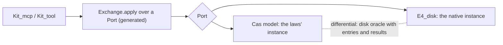

# The native session exchange (S6b): design note

Status: design, not landed code. It is the next large slice after the 2026-10-18 refinements.

The one thing to know first: the exchange reads the store through three operations only. So it can
be written once over a small store interface, proved over the Lean model, and generated to run over
the native disk store.

## What exists

- `Tool.Exchange` (`src/Effect4/Tool/Exchange.lean`) serves one request at a base over the Lean
  store model `Cas`. Its laws (`load_own`, `apply_commits_once`, `apply_refuses`) are proved.
- The laws touch the store in three ways:
  - one entry's typed read (`entryAt`, through `Cas.get`);
  - one root's head (`cas.store.root?`);
  - one transaction (`Cas.commit`).

  Their monotonicity is one predicate, `Keeps cas cas'` (every entry read stays readable), and
  `keeps_commit` proves an accepted commit keeps it.
- The native disk store (`E4_disk`) commits a transaction atomically and reads one node by
  address. Since `f5883b8ae` a commit costs its own transaction, not the whole store.
- The native shell (`Kit_tool`, `Kit_mcp`) serves `Tool.serve` over a sealed in-memory `Session`.
  No native code calls the exchange yet.

## The design

1. **A port, not a value.** `structure Port (σ : Type)` holds three fields:
   - `entry : σ → Digest → Except ReadRefusal SessionEntry`;
   - `root : σ → String → Option Root`;
   - `commit : σ → Txn → Except TxnRefusal (Receipt × σ)`.

   `Exchange.apply` becomes generic in `σ`. The model instance is `Cas` with today's functions, so
   every law keeps its statement at that instance.
2. **The port's laws** are what the proofs use, stated once:
   - an accepted commit keeps every entry read (`Keeps`);
   - a committed entry reads back (`commit_reads`);
   - a moved root names the transaction's last entry.

   The Lean model proves them (`keeps_commit`, `commit_reads`, `commit_move_root`). The native
   instance is tested against them: extend the disk oracle (`disk-oracle.tsv`) with session-entry
   and result nodes, the ST4 rerun the review found missing.
3. **The native instance.** The generated `Exchange.apply` takes an OCaml record of three
   functions. `Kit_tool` supplies them over `E4_disk`: `entry` reads bytes by address and decodes
   them through the generated `SessionEntry` codec, `root` reads the control file's root, and
   `commit` is `E4_disk.commit`. Only these three are hand code, and each is a reader or writer the
   store already owns.
4. **Residency.** `Resident` maps a head digest to the state it loads to. Its invariant is that
   every entry equals `load` at that head. `load_own` makes a commit's new head a valid entry, and
   `load_extend` keeps the old ones valid across `Keeps`. So a resident hit replaces a replay with a
   proved-equal state, and a request no longer replays its whole chain.
5. **The agent face.** `Kit_mcp` gains a session name per connection, or a `session` argument:
   `Base.head name expected` for acts, `Base.at_ entry` for reads. An agent can resume after a
   restart, fork a session, and recover a lost acknowledgement (`Exchange.applied`).

## Slices

| Slice | Done when |
| --- | --- |
| S6b-1 Port | `Exchange` generic over `Port`; the `Cas` instance; the three laws re-proved at it with unchanged statements |
| S6b-2 Residency | `Resident` with its invariant and the hit theorem; `ExchangeControls` shows a hit equal to a load |
| S6b-3 Native port | an `api_gen` root for the generic exchange; `Kit_tool` over `E4_disk`; the disk oracle covers entries and results; a native transcript (open, edit, restart, resume, two writers, fork) equals the Lean model's |
| S6b-4 Agent sessions | `Kit_mcp` names sessions; resume and fork through MCP; a lost acknowledgement is recovered |

## What this does not establish

- The native instance satisfies the port's laws by finite differential tests, not by proof
  (decisions row 391: the lowered code is trusted; the disk is tested).
- Exactly-once host effects and host acknowledgements stay outside the model, as in ST4.
