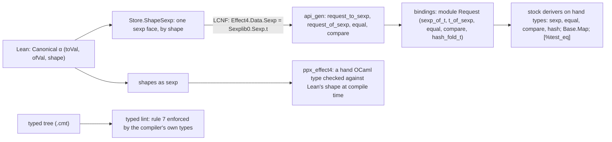

# The OCaml estate and ppx: a survey, and a Lean-generated sexp face (2026-10-18)

Status: research and probes. Nothing here is merged into the integration branch's code. The Lean
probe is on the local branch `probe/sexp-face`:
- `d7b02d1a9` holds the face and the lowering rows;
- `6c1485863` holds the exactness law, proved.

The OCaml probe sources are in [probe/](probe/).

## The one thing to know first

The best use of ppx here is not a stock deriver on our types. It is Lean generating the functions
that Jane Street's derivers look for: `sexp_of_t`, `t_of_sexp`, `equal`, `compare` and `hash`.
Then every stock deriver works on any hand type that holds a Lean carrier.

The probe built this end to end, and it works:
- Lean's sexp face lowers onto `Sexplib0.Sexp.t` itself.
- Its printer equals Sexplib's printer byte for byte.
- Its round trip holds with no fragment, where JSON's has one.
- It serves the tool exactly as the JSON driver does.
- It is 7 times faster than the hand JSON twin on the measured request.

## The estate today, measured

| What | Value | Command |
| --- | --- | --- |
| Hand OCaml | 207 files, 43,473 lines: 20,984 library, 22,489 test and bench | header scan of `git ls-files ocaml` for `GENERATED` |
| Generated OCaml | 37 files, 122,573 lines | the same scan |
| ppx in any dune file | none | `grep -rn preprocess --include=dune ocaml` |
| Hand test harnesses | 46 files declare `let failures = ref 0`, and 102 declare their own `check` | `grep -rl "let failures = ref 0" ocaml` |
| Polymorphic compares at a type rule 7 forbids | 83 sites in hand library code, 45 of them in `e4_pack.ml` and `e4_cas.ml` | [probe/typed_lint](probe/typed_lint/) over the `.cmt` files |
| Error paths with rule 6's attribute triple | 1 site | `grep -rn "inline never" --include='*.ml' ocaml` |
| The kit's disabled warnings | stale: with `+a`, `engine/kit` raises none; only the generated `eff_wire.ml` and `eff_json.ml` warn (120 × warning 39) | `dune build ./engine/kit ./eff` in a scratch copy with the flags changed |
| `eff mcp` start and `tools/list` | 20 ms; 353,485 bytes of JSON Schema, `dry` alone 102,714 | `printf '…tools/list…' \| eff.exe mcp` |
| `core_bench` (the runner `ppx_bench` needs) | 16 installs and 55 upgrades to Jane Street v0.17, which the estate refused before | `opam install --dry-run core_bench` |

The switch already holds the whole Jane Street v0.16 ppx set, `ppxlib`, `base_quickcheck`,
`qcheck-stm`, `csexp`, `parsexp` and `js_of_ocaml-ppx` (`opam list --switch=effect4`). STANDARDS
rule 9 admits a ppx only with its measured cost.

## The catalogue: Jane Street's ppx, judged against our rules

Lean owns every data format (rule 3, decisions row 391). So a stock deriver on a Lean carrier
makes a second owner of a fact. The verdicts follow from that one rule.

| ppx | What it gives | Verdict |
| --- | --- | --- |
| `ppx_expect`, `ppx_inline_test`, `expect_test_helpers_core` | tests that capture output, with diffs and `dune promote` | **Adopt for host behaviour.** They replace the 46 hand harnesses. Not for Lean-owned answers: promotion would let OCaml rewrite Lean's truth (see "Out-of-band uses", item 5) |
| `ppx_assert`, `ppx_here` | `[%test_eq: t]` with a located diff | **Adopt in tests.** It needs `sexp_of_t`, which the generated bindings give |
| `ppx_sexp_conv`, `ppx_compare`, `ppx_hash` | derived printers, equality, order, hash | **Adopt on hand types only.** A Lean carrier gets them from Lean (probed below) |
| `base_quickcheck` with `ppx_quickcheck` | derived generators and shrinkers | **Adopt on hand types.** A Lean carrier gets one generator by its shape (item 6) |
| `ppx_cold` | `[@cold]` expands to `[@inline never][@specialise never][@local never]` | **Adopt.** That is rule 6's error-path triple, word for word; one site carries it today |
| `ppx_enumerate` | every value of a finite type | Narrow: hand finite enums in tests |
| `ppx_fields_conv`, `ppx_variants_conv` | per-field and per-constructor accessors and folds | No. Lean generates the folds over its carriers; few hand records need them |
| `ppx_let` | monadic `let%bind` | No. OCaml 5's `let*` covers the host code. Revisit with Incremental |
| `ppx_bench` | inline benchmarks | Blocked: its runner `core_bench` drags the set to v0.17 |
| `ppx_module_timer` | module start-up times | No: `eff` starts in 20 ms |
| `ppx_bin_prot`, `ppx_yojson_conv` | binary and JSON codecs | **No.** A second owner of the canonical bytes or of the JSON face |
| `ppx_stable`, `ppx_stable_witness` | versioned types and their migrations | No for stored formats, which Lean owns |
| `ppx_typerep_conv` | runtime type representations | No. Shape documents are our runtime type representation, and Lean writes them |
| `ppx_string`, `ppx_custom_printf`, `ppx_sexp_message`, `ppx_sexp_value`, `ppx_log` | text conveniences | Optional, small |
| `ppx_optional`, `ppx_pipebang`, `ppx_fixed_literal`, `ppx_tydi`, `ppx_optcomp`, `ppx_ignore_instrumentation`, `ppx_disable_unused_warnings` | niche | No |
| `ppx_globalize` | OxCaml local values | A no-op on OCaml 5.1 |

## The out-of-band uses



### 1. Lean generates the Jane Street bindings (probed)

**What.** Lean defines one generic face per law and per carrier class:
- `Canonical.toSexp`, `Canonical.ofSexp`;
- `Canonical.equal`, `Canonical.compare`, on the canonical bytes.

The lowering names them per carrier as roots. A binding module gives them Jane Street's names
(`probe/sexp_probe/sexp_interop.ml`, module `Request`).

**Why it is a simplification.** It writes each fact once, in Lean, and lowers it. In return, every
stock deriver composes with our carriers:
- a hand record `{at; request : Request.t; note}` derives `sexp, equal, compare, hash`
  unchanged;
- `Base.Map` keys on a Lean carrier;
- `[%test_eq: logged]` and an expect test print through Lean's face.

All of these pass. The printed record is:

```
((at 3) (request ((method history) (version 1) (payload (ask (q history))))) (note ()))
```

**What a landing generates instead of writing.** The binding module is 25 mechanical lines per
carrier. Lean should emit it. Either a recipe field names the carriers, or a Lean command
(`sexp_binding Request : Wire.Envelope Request`) declares the roots and the binding together.

### 2. The sexp face: an exact text face with no fragment (probed)

**What.** Two modules on the probe branch:
- `Effect4.Data.Sexp` (`src/Effect4/Data/Sexp.lean`) holds the tree, Sexplib0's
  `to_string_mach` transcribed byte for byte (`printMach`), and Rivest's canonical bytes
  (`canonical`).
- `Effect4.Store.ShapeSexp` (`src/Effect4/Store/Domain/ShapeSexp.lean`) prints and reads a value
  tree by its shape document, in the `[@@deriving sexp]` spelling:
  - `((field value) …)` for a structure;
  - `Name` or `(Name (field value) …)` for a case;
  - `()` and `(x)` for an option.

**Why it beats the JSON face on the math.** JSON's round trip holds on a fragment only. A JSON
number is binary64, and a JSON option is invisible (`ShapeRead.lean`'s header says so).
In the sexp face, a natural is its decimal atom and an option is visible. So reading the print
returns the value for every value that fits, with no profile bound.

**Why it beats the JSON face natively.** The JSON reader could not be lowered, so `Kit_json.ml`
(425 lines) is a hand twin of `ShapeDoc.print/order/arrays/read`. Two things blocked the
lowering:
- the binary64 numbers;
- `canonicalHex?`, which reads bytes through `ByteArray.toList`, a primitive the route lacks.

The sexp face reads bytes as `Nat` codes, and it lowered with no missing primitive
(`todos (0)`). The native side's reading is then Lean's own:
- Sexplib's parser gives the tree;
- everything after the tree is lowered Lean.

**Measured, on the kit's fixture lines** (15 readable requests, 13 readable replies;
`dune test ./engine/test/sexp_probe` in a scratch copy with the probe's `api_gen.ml`):

| Check | Result |
| --- | --- |
| S1 Lean's lowered `printMach` equals `Sexplib0.Sexp.to_string_mach` | 28 of 28 |
| S2 Lean's `canonical` equals the `csexp` library's `to_string` | 15 of 15 |
| S3 text round trip (Parsexp reads, Lean's reader returns an equal carrier) | 28 of 28 |
| S4 the typed face equals the value-tree face | 15 of 15 |
| S5 a reordered field, a padded natural and a dropped field are refused | all refused |
| S6 a session served over sexp (`serveSexp`) answers the JSON driver's replies | 10 of 10 lines, one session each |
| Size: JSON / sexp machine / sexp human / canonical | 11,480 / 8,082 / 11,890 / 10,211 bytes |
| One 653-byte request read and written, 2,000 runs, two builds | JSON (`Kit_json`) 424.6 and 434.2 µs; sexp (Parsexp + lowered Lean) 60.7 and 62.1 µs |

**Cost** (fresh build directories, cache off, `-j 4`, two runs each):

| Build of `ocaml/gen` | Lines of `api_gen.ml` | Cold time |
| --- | --- | --- |
| today, with the generated `api_gen.mli` | 65,380 | 4.0 s |
| today, without the `.mli` (the probe's copies have none) | 65,380 | 7.6–7.9 s |
| with the value-tree face | 66,555 | 7.9–8.7 s |
| with the typed faces of both envelopes | 73,332 | 8.3–8.5 s |

The face itself costs well under a second. The generated interface saves about 4 s, so a landing
keeps it. The typed bindings add 6,777 lines for the two envelopes, because they lower the
carriers' `ofVal`. Bind a carrier typed only where hand code holds it typed.

`#axiom_audit` over the face, its laws and the lane: 335 declarations within
`[propext, Quot.sound]`.

### 3. Our own ppx: `[@@deriving effect4]` (probe running)

A ppxlib deriver turns a hand OCaml type into a carrier. It generates the type's `to_val`,
`of_val` and shape document. With `~lean:"<carrier>"`, it checks the derived shape against
Lean's at compile time, so a mismatch is a located compile error. This is the interop face for
OCaml authors: a native host's own types cross into the machine without a hand adapter
(`native_todo.ml`'s `REPO` adapter is today's hand version).

The prototype's results follow when its seat reports.

### 4. The typed tree as a lint (probed)

A ppx runs before type checking, so it cannot see a polymorphic compare's type. OCaml's typed tree
can. [probe/typed_lint/typed_lint.ml](probe/typed_lint/typed_lint.ml) is 70 lines over
`compiler-libs`. It reads each `.cmt` and reports every `compare`, `=`, `<>`, `<`, `>`, `min`,
`max`, `Hashtbl.hash` or `List.mem`/`assoc` applied at a type outside `int`, `char`, `bool`,
`string` and `unit`.

On 48 hand library modules it reports 83 sites
([findings.txt](probe/typed_lint/findings.txt)). Examples:
- `=` on `E4_node.t` in `e4_cas.ml`;
- `=` on `(E4_kind.t * E4_addr.Addr.t) list` in `e4_cas.ml`;
- `<>` on `seg * off` pairs in `e4_cas.ml`;
- ten polymorphic helpers whose own type is `'a`.

That is rule 7's open work ("the other sites move in the plan's phase 6"), found exactly instead
of swept by hand. As a dune rule over the `.cmt` files, it is incremental and costs no gate.

### 5. Where expectations come from decides the tool

- **Host behaviour** (the store, the WAL, the scheduler): OCaml's output is the specification
  a person reviews. `ppx_expect` fits: a diff on failure, and `dune promote` on purpose.
- **Lean-owned answers** (the lanes, the verdicts, the transcripts): Lean writes the
  expectation, so promotion must be impossible. Lean writes the expected sexp, the lowered code
  prints its own, and a dune `diff` rule compares them. One form replaces each lane's own fixture
  format and reader.

### 6. One generator by shape, and model-based tests

Base_quickcheck derives a generator per hand type. For a Lean carrier, one generic function does it
for every carrier: a generator of value trees by shape document, filtered through the lowered
`of_val`. The shape document is already the runtime type, so no ppx is needed. With `qcheck-stm`
(installed, used once in `engine/cas/test`), the lowered `Tool.Native.serve` is the model and the
native shell over the disk store is the system under test. That is the S6b port's differential
test, including two writers (`STM_domain`). Not probed.

### 7. Sexp as the estate's own control language

Dune reads sexp, and `csexp` is dune's own RPC framing. Two consequences follow, neither probed:
- Lean could write the generation recipe as a dune fragment (`(include …)`). Dune would then own
  the incrementality that `scripts/gate-cache.py` computes for the OCaml half by hand.
- Canonical sexp is exact, needs no escapes, and parses with a proof in a few lines over bytes. It
  is the natural format for every Lean↔OCaml exchange a gate makes: fixtures, expectations and
  verdicts.

The typed lint extends the same way to rule 6. It can report a `raise` or `failwith` reached in a
function whose name does not end in `_exn`.

### 8. Smaller wins

- Re-enable the kit's warnings: they are stale.
- Mark error paths `[@cold]`.
- Keep the generated `.mli`: it saves about 4 s of a cold `gen` build.

## Laws, placed

Each law below sits in concept `exact-codecs` (`docs/core/semantics.md` §2.5), beside
`json-read-exact` and `codec-profile-retains-value`. Each serves R14 (program as data), as
`json-read-exact` does: it is the text form an agent or a native host writes.

| Law | Statement | Reach | Does not establish |
| --- | --- | --- | --- |
| `sexp-face-exact` | `readSexpIn defs n s x = some v → sexpIn defs s v = x`; so `Canonical.ofSexp x = some a → Canonical.toSexp a = x` | every document, every sexp, every budget. **Proved** on the probe branch (`src/Effect4/Laws/Store/ShapeSexp.lean`, `6c1485863`), the mirror of `readIn_exact` | that anything reads |
| `sexp-face-retains-value` | under the two hypotheses below, `acceptsIn defs s v → readSexpIn defs (sexpBudget (sexpIn defs s v)) s (sexpIn defs s v) = some v` | every fitting value; no number bound, no option condition. Open: finite evidence only (S3) | text parsing (Sexplib's) |
| `canonical-order` | `Canonical.compare a b = .eq ↔ a = b`, and the order is a total order | from `Val.encode`'s exactness and `toVal_injective` | any meaning of the order |
| (tested) Sexplib agreement | `printMach x = Sexp.to_string_mach x` | finite: S1 | a proof: Sexplib is outside |

The round trip needs two hypotheses, which the JSON face would also need and does not state:
1. **The bindings of a name agree.** The reader takes a name's first binding (`headShape`), and the
   acceptance check takes any binding (`candidates`). A generated document repeats a definition
   only as a copy.
2. **Each reachable sum names its cases apart.** `caseAt i cases = some (name, fields)` gives
   `tagOfName name cases = some (i, fields)`. `wellTagged` already gives distinct tags; the names
   are Lean constructor names, distinct by construction.

The proof is by induction on the value. Each reader step takes one unit of the budget, and each list
or field cell takes one. So the need is bounded by the printed sexp's node count, which
`sexpBudget` covers eight times over. Each carrier can check both hypotheses on its document by
`decide`, as `wellTagged` is checked today.

## Ranked slices

| Slice | Files | Done when | Deletes |
| --- | --- | --- | --- |
| 1. The sexp face | `src/Effect4/Data/Sexp.lean`, `src/Effect4/Store/Domain/ShapeSexp.lean`, laws in `src/Effect4/Laws/Store/ShapeSexp.lean`, the type row and native constructors | `sexp-face-exact` (done on the probe branch) and `sexp-face-retains-value` proved; registry rows; audit clean; S1–S5 as a native test | nothing yet |
| 2. Generated bindings | a binding declaration in Lean; `lcnfgen` emits `effect4_bindings.ml` with Jane Street names | hand types in tests derive over carriers; no hand binding module | the hand binding |
| 3. The native sexp face | `Kit_tool` and `eff serve --sexp` over `serveSexp` | the transcript in sexp equals the JSON one | `Kit_json`'s reading role, once MCP's JSON face reads through a lowered reader too |
| 4. Tests in one shape | host tests on `ppx_expect`; lanes on Lean-written sexp with dune `diff` | the 46 harnesses gone | the per-lane fixture formats and readers |
| 5. The typed lint as a dune rule | `ocaml/tools/typed_lint`, a rule over each library's `.cmt` | 83 sites fixed or each typed, rule green | rule 7's hand sweep |
| 6. `ppx_effect4` | a ppx under `ocaml/tools/ppx_effect4`; Lean writes `shapes.sexp` | a native host's types derive their carrier and their check | `native_todo.ml`'s hand adapter |
| 7. Small wins | `engine/kit/dune`, error paths | warnings on, `[@cold]` on refusals | the stale flags |

Not ranked: an agent-facing sexp argument for MCP. A program as sexp text is 30% smaller than its
JSON, but MCP's arguments are JSON objects. That is a choice for the owner.

## What this does not establish

- The round trip is not proved. Its evidence is finite: 28 fixture carriers. Exactness is proved.
- The speed figure is one request shape, 2,000 runs, on a machine running other sessions.
  Its cause is not isolated between `Kit_json`'s normalising pass and its text parser.
- The probe's `api_gen.ml` has no generated `.mli`. Its build times are compared with a baseline
  without one.
- The typed lint resolves a type through the `.cmt` environment. An abstract type that is `int`
  inside its module counts as a finding. Rule 7 says it should compare through its own `compare`
  anyway.
- `Kit_json` stays the MCP face's JSON reader. Only the sexp face is lowered.
