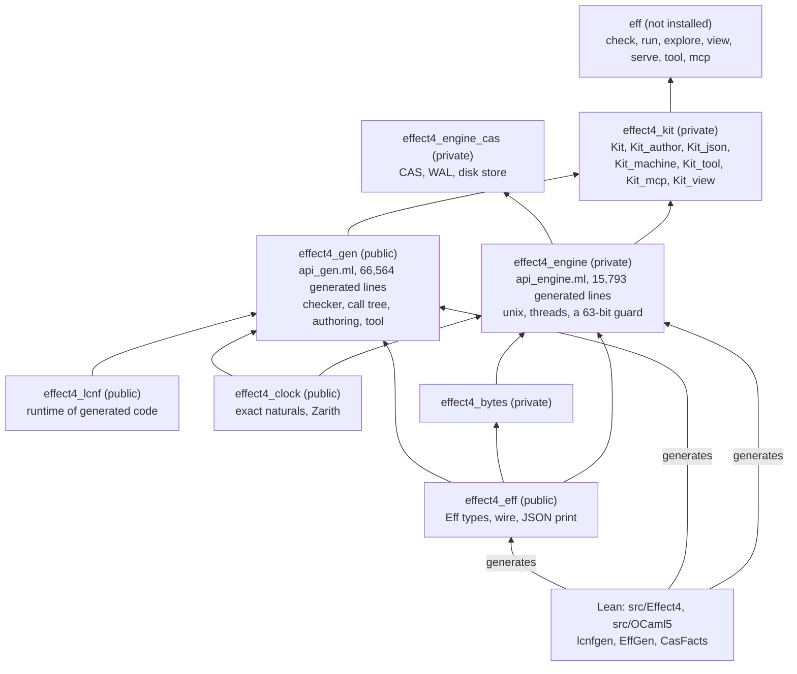
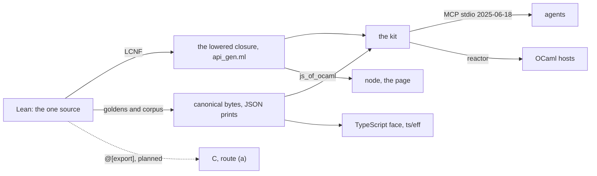
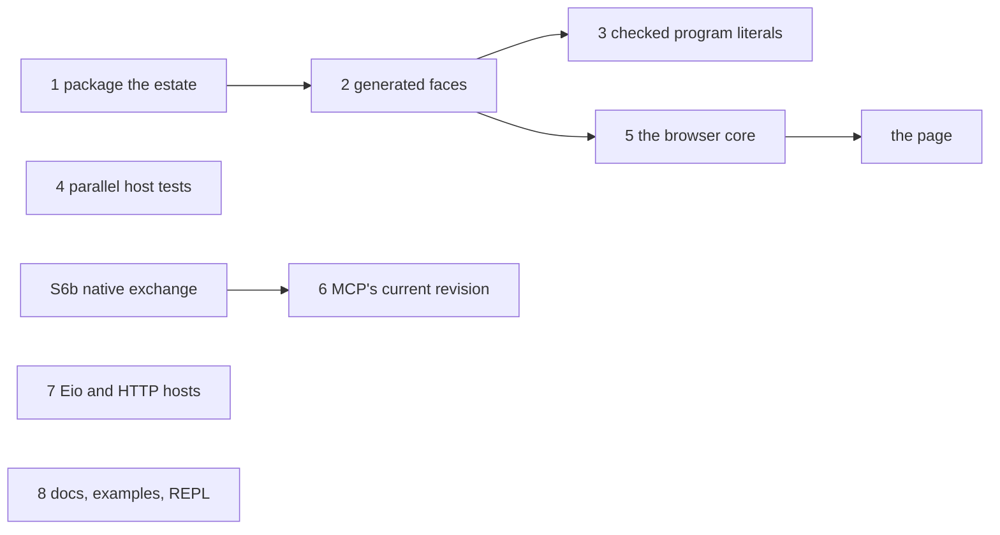

# Probe 2: the OCaml estate as a first-class home for tooling and interop (2026-10-18)

Status: research note, not authority. Base: `refactor/phase1-phase3` at `4a81cc034`. Every path is
in this repository at that commit unless it names the shelf (`~/Dev/refs/…`, commits in
`~/Dev/refs/ocaml-tooling/MANIFEST.txt`). The brief is `brief.md`; the sources read are in
`reading.md`; every script and log is under `probes/`.

Evidence words:
- **tested**: this probe ran it here;
- **reproduced**: this probe reran an earlier note's check, and it held;
- **assumed**: a figure taken from an earlier note and not rerun.

## 1. The one thing to know

The estate's engine is already first class; its faces are not.

- Lean's checker, call tree and authoring tool run natively from one closure lowered by LCNF.
  `eff` checks or runs a program in about 8 ms (tested).
- The same checker runs under node in a 281,082-byte bundle and agrees with native on all 408
  corpus programs (tested).
- But an OCaml developer outside `ocaml/` cannot install the kit or `eff` (tested). Only four
  libraries install, through `dune install` from a checkout, and no opam file exists.
- Around the generated code, the faces are written by hand or missing. Host module types and
  refusal text are hand-written, names are the compiler's, and no carrier exports an equality.
- A program written in OCaml meets its type errors at run time.
- A 135-line probe shows Lean's own checker refusing a quoted program at compile time and in the
  editor (tested). Lean stays the one owner of the judgment.

So the next slices are packaging and generated faces over the closure that exists, not new
semantics.

## 2. The estate today

### 2.1 The map

An arrow points from a library to one that depends on it.

Six dune projects share one workspace (`ocaml/dune-workspace`): `gen`, `eff`, `engine`, `clock`,
`lcnf` and `tools`. Each declares `(lang dune 3.0)`; dune 3.24.2 is installed.

### 2.2 The measurements

The machine is an Apple M3 with 8 cores and 16 GB, shared with other sessions (load averages 5 to
33 during the runs). CPU time is the figure to compare. Builds ran into fresh build directories
with the shared cache off (`--cache=disabled`), never in `ocaml/_build`. Edits ran in a copy of
`ocaml/` (`probes/measure/copy.sh` recreates it; the copy was removed after the runs).

| Measure | Value | Command and log |
| --- | --- | --- |
| Cold build, whole workspace | 19.6 s wall, 73.7 s CPU, 720 processes; a second sample, 25.5 s and 108.7 s | `probes/measure/cold.sh` (`cold1.log`); `warm.sh`, row `cold-copy` (`warm.log`) |
| The generated closures in that build | `api_gen.ml` 13.0 s CPU in two passes (bytecode 6.9, native 6.1); `api_engine.ml` 8.8 s; `todo_gen.ml` 6.3 s: 28.1 of 73.7 s | `dune_trace.py` over the cold trace |
| Each library alone, cold, with its dependencies | `lcnf` 0.9 s; `clock` 0.4 s; `eff` 1.1 s; `bytes` 0.7 s; `cas` 2.7 s; `gen` 7.9 s (5.5 s native only); `engine` 9.0 s; `kit` 1.8 s; `eff.exe` 11.4 s wall and 28.3 s CPU | `perlib.sh` (`perlib.log`) |
| Warm, nothing changed | 0.28 to 0.41 s | `warm.sh` |
| Warm, a comment added to a hand `.ml` | 0.3 to 1.3 s, 3 or 4 processes; `-opaque` stops the dependents | `warm.sh`, rows `impl-*` |
| Warm, a value added to a bottom interface (`lcnf_string`, `e4_clock`, `eff_frame`, `eff_types`) | 21.5 to 26.9 s wall, 410 to 463 processes, 83 to 90 s CPU | `warm.sh`, rows `intf-*` |
| Warm, a value added higher up | `e4_host` 18.7 s; `api_gen` 15.2 s; `kit` 2.8 s | `warm.sh` |
| Warm, a generated body re-cut | `api_gen.ml` 8.4 s (14.0 s CPU); `api_engine.ml` 10.0 s; `todo_gen.ml` 5.0 s | `warm.sh`, rows `recut-*` |
| The gate's tests (built tree) | `dune test eff gen clock lcnf tools`: 4.9 s wall, 0.4 s CPU; `dune test engine`: 17.9 s wall, 31.6 s CPU, led by `test_diff` 6.8 s, `test_checkpoint` 5.3 s, `prop_fibers_view` 4.4 s; both exit 0 | `tests.sh` (`tests.log`) |
| Lines | hand 45,084 (libraries 21,463, tests and executables 23,621); generated 122,939 | `census.py` (`census.out`) |
| Library modules with no `.mli` | 25 of 91: 3 exempt by rule 5 (`e4_engine_intf`, `api_engine_inst`, `api_engine_ref`); 16 hand (`eff_json_text`, `corpora`, the 7 list twins, `kit_json`, `kit_serve`, `kit_view`, `todo_core`, `native_todo`, `todo_fixture`, `disk_test_support`); 6 generated (`eff_ctors`, `eff_layout`, `eff_wire`, `eff_subterm`, `eff_json`, `eff_native`) | `census.py` |
| Public surface, values per library | `lcnf` 25; `clock` 18; `eff` 429; `gen` 110; `bytes` 21; `cas` 372; `engine` 547; `kit` 118. The kit library calls 65 of `gen`'s 110 | `probes/surface` (`surface.out`, `kit-uses-api_gen.out`) |
| The `eff` binary | 6,936,888 bytes (5,535,248 stripped); byte-identical in three build directories (SHA-256 `084ff38b…`); links `/opt/homebrew/opt/gmp/lib/libgmp.10.dylib` | `shasum -a 256`, `otool -L` |
| `eff` start and commands, median of 30 | `serve` on empty input 8.2 ms; `check` 8.0 to 8.5 ms; `run` 8.1 ms; MCP `initialize`, `initialized`, `tools/list` 8.8 ms with 41,250 bytes and 20 tools | `time_eff.py` (`time_eff.log`) |
| opam packaging | no `.opam` file; four dune packages (`effect4_eff`, `effect4_gen`, `effect4_lcnf`, `effect4_clock`), declared so that sibling projects can name them; `dune install` installs those four (`effect4_gen` 27 MB) and no executable | `dune build @install`, `dune install --prefix` |
| An outside project | links the installed `effect4_eff` and `effect4_gen` and checks a corpus program (`ok: answer void, error never`); naming `effect4_kit` fails: `Library "effect4_kit" not found` (red control) | `probes/consumer` |
| odoc | builds once installed (this probe installed it: six additions): `@doc` 1.4 s, `@doc-private` 2.0 s on a built tree, 208 pages, 0 errors, 26 warnings, 18 of them unresolved `@raise Invalid_argument` | `dune build @doc-private` (`odoc-doc-private.log`) |

Three readings of the table:

- The three generated files take 38 % of a cold build's CPU, and `api_gen.ml` is compiled twice
  because a library builds in both modes by default. The kit's own archive needs only
  `api_gen.mli`, so it builds in 1.8 s.
- An edit to a bottom interface rebuilds nearly the whole workspace (410 to 463 of 720
  processes). That is the shape of the dependency graph, not a defect: the closure depends on
  everything below it.
- The surface is already small where it is generated. The generated interface exports 110 values,
  and the kit uses 65; the plan's figure of 1,972 exported values predates the generated `.mli`.

## 3. Peers: what first class means

Each row says what the peer gives a user, what the estate has, the gap, and the slice of §5 that
closes it.

| Peer | What it gives | What we have | Gap | Slice |
| --- | --- | --- | --- | --- |
| Merlin, ocaml-lsp | types, errors and navigation in any LSP editor | `ocamllsp` 1.18.0 in the switch. On the estate: `initialize` 108 ms, hover 2 to 59 ms, an injected type error reported in 258 ms (tested, `probes/lsp`) | a binder in a `Kit_author` program hovers as `term`: no Eff type | 3: a checked literal's refusal appears in the editor in 302 ms (tested) |
| linol | an LSP server for a new language, on Eio | not installed (4 additions) | no editor face for programs written as JSON or TypeScript | later: the tooling design defers LSP (its decision 4) |
| dune-rpc | a watched build that answers diagnostics over RPC | dune 3.24.2 `--watch`, `dune diagnostics`, `dune rpc` (20 versioned methods); the `dune-rpc` 3.20.2 library | none for builds: an error shows 0.21 s after an edit, located (tested, `probes/watch/watch_raw.out`) | no gap |
| Eio | capabilities, structured concurrency, `Eio_mock` | Eio 1.2 installed and used nowhere in `ocaml/`; the engine uses `unix` and `threads` | hosts and the shell use ambient IO; no tape replays as a mock | 7 |
| cohttp | HTTP client and server on Eio | not installed (`cohttp-eio`: 14 additions) | no HTTP host, no HTTP transport for MCP | 7 |
| Brr, Note, Lwd | browser bindings, signals, one reactive document for page and terminal | none installed (Brr 2 additions, Note 1, Lwd 1); `Kit_view` writes a static HTML page | no live page | 5 |
| Bonsai | Jane Street's incremental UI | not installable: it downgrades dune to 3.23.1 (72 installs, 120 recompiles, 6 downgrades) | refused by the tooling design's decision 1 | no gap |
| js_of_ocaml, wasm_of_ocaml | OCaml in node and the browser | js_of_ocaml 5.7.1 pinned. The lowered checker alone agrees with native on 408 of 408 under node (tested) | the kit refuses to start; naturals from 2^31 decode wrong (tested, §4.2); wasm_of_ocaml conflicts with the pin (it needs js_of_ocaml 6.0.1 or later) | 5 |
| odoc | API documentation from interface comments | builds: 208 pages, 0 errors (tested) | odoc was absent from the switch; 26 warnings | 8 |
| mdx | Markdown examples checked by `dune test` | not installed (4 additions) | the kit's examples are unchecked prose (`docs/research/2026-10-16-native-kit/README.md`) | 8 |
| utop | a REPL with completion | not installed (15 additions). The plain toplevel works: `dune top engine/kit`, then a check and a run in 0.36 s (tested, `probes/repl`) | completion only | 8 |
| ppx | syntax extensions and derivers | no ppx in any build; `ppx_effect4` was built and set aside as a second owner (`docs/research/2026-10-18-ocaml-ppx/README.md`) | ill-typed programs written in OCaml fail at run time | 3 |
| qcheck-stm | model-based and parallel tests of stateful code | one sequential test, `ocaml/engine/cas/test/test_disk_stm.ml`, whose model is Lean's `Cas` transitions as a table | no parallel test of the concurrent host code | 4 |
| Irmin | immutable objects, atomic named pointers | `E4_disk`, `E4_cas`, the four-operation `Tool.Exchange.Port` | none: the split is already copied (`docs/research/2026-10-18-codex-abstractions/README.md`, question 1) | no gap |
| Incremental | self-adjusting computation with cutoffs | the certified memo (`src/Effect4/Program/Check.lean`); diff-and-patch views written in Lean | not installable without 55 upgrades to Jane Street v0.17 | no gap now (the Codex note, question 2) |
| Salsa, Adapton | revisioned or demand-driven queries | references on the shelf | none | no gap now |
| ctypes | C types and calls from OCaml | ctypes 0.24.0 installed, unused | the C face is Lean's route (a); route (b) waits on P4 (`docs/research/2026-10-16-c-interop/README.md`) | later |
| GADT encodings | OCaml's checker types an embedded language | none since `eff_typed.ml` was retired on 2026-09-13; the probe `probes/typed` | a hand GADT face is a second owner of the typing | decision 2 |
| Tezos's Michelson | a typed IR that only the translator builds (`ty` in `script_typed_ir.mli`, `parse_ty` in `script_ir_translator.ml`, shelf `f7d2ff9fc`) | `Kit.check` answers a type; `Checked` is sealed in `api_gen.mli` | the checked result is not an OCaml value of its own | 3: the literal's value is the checked program |
| Rocq extraction | proved code run as OCaml | `ocaml/engine/test/rocq`: Rocq's extracted runner against the lowered tree | none for the estate | no gap |
| CompCert | one file of trusted extraction rows; an untrusted oracle checked by a proved validator | `OCaml5.Lcnf.Builtins` and `ocaml/gen/roots.json`; decisions row 391 | none: slices 2 and 3 keep "OCaml computes, Lean decides" | no gap |

## 4. The interop crossings

### 4.1 The table

| Crossing | Today | Gap | Slice |
| --- | --- | --- | --- |
| Lean to OCaml: the generated closure | `ocaml/gen/api_gen.ml`, 66,564 lines; 110 exported values; the kit calls 65 (tested) | compiler-made names (`program_authoring_bind_with`, `Todo_gen.test_dogfood_scenario_todo_typed_host_reactor`); no generated type exports `equal` or `compare` (`ocaml/eff/eff_types.mli`), so under rule 7 hand code compares carriers by their canonical bytes, as the typed probe does, or writes its own `equal` | 2 |
| Lean to OCaml: the `Eff` library | generated codecs over a hand framing kernel; exact on the 408 printed programs (the engine lanes pass, reproduced) | naturals refused above 2^62−1 natively; wrapped from 2^31 under node | 5 |
| Lean to OCaml: derived `Modeled` codecs | `'a image = { to_val; of_val }` over native types Lean declares (`image` in `ocaml/engine/test/modeled/modeled_gen.ml`) | type-prefixed constructors (`Status_pending`), escaped fields (`done_`) | 2 |
| Lean to OCaml: the sexp face | on branch `probe/sexp-face` (`d7b02d1a9`, `6c1485863`): exact, Sexplib's own type, 7 times faster than `Kit_json` on one request (assumed, the ppx note) | not merged; `Kit_json` (426 lines) is a hand twin of `ShapeDoc.print` and `read`, and `Kit_author.refusal_text` restates Lean's eleven reasons | 2 |
| OCaml and TypeScript | both faces read Lean's goldens and corpus; OCaml's wire carries naturals to 2^62−1, TypeScript's to 2^53−1 (`ts/eff/test/wire.test.ts`), the tool's profile to 2^53−1 | no lane feeds TypeScript's bytes to OCaml; Lean's goldens are the hub, which suffices; no tool carrier is in `ts/eff/*.gen.ts` (tested, `grep`) | none |
| OCaml hosts | a host is a reactor (`Kit.reactor`); the typed to-do host through the lowered record and a hand `REPO` (`ocaml/engine/test/todo/native_todo.ml`); a host call costs 12 to 16 µs, the host's own answer about 1 % (assumed, the 2026-10-16 interop note) | `REPO` is hand-written for one lane; no Eio | 2, 7 |
| C | nothing in `ocaml/`; the C frame codec agrees with Lean's decoder on 144,978 inputs (assumed, the C note) | no `@[export]` entry exists | outside the estate (LC-9) |
| Agents | MCP over stdio, revision 2025-06-18; 20 tools generated from Lean's method table; handshake and list in 8.8 ms (tested); `test_mcp` passes in this run (reproduced, `tests.sh`); Codex counted 52 native controls (assumed) | one in-memory session per connection; no HTTP; revisions 2025-11-25 and 2026-07-28 not served | 6 |
| Typed authoring in OCaml | `Kit_author` (`ocaml/engine/kit/kit_author.mli`): binders are OCaml functions, every builder is one lowered Lean function, `build` is Lean's elaborator | a wrong request type fails at run time, in `build_checked` | 3 |

### 4.2 The page's numbers (tested, `probes/jsoo`)

- The kit refuses to start under node. A bisection found the cause: the first item of
  `E4_engine.Make` (`ocaml/engine/e4_engine.ml`) raises `Profile_refusal` when
  `Sys.int_size <> 63`. `E4_engine.Fast` and `E4_engine.Ref` apply `Make` at the top level, so
  linking the kit's machine runner triggers it.
- Before that guard, two more blocks appear: Zarith has no JavaScript primitives without
  `zarith_stubs_js` (`ml_z_init is not a function`), and js_of_ocaml 5.7.1 has no
  `caml_thread_initialize` for `threads.posix`.
- The checker alone (`api_gen` with the `eff` library, no kit) starts. It agrees with native on
  408 of 408 corpus programs: answer, error and refusing address.
- Width red control. A program holding 2^40 decodes under node, but re-encoding changes its bytes:
  a silent repair. A program holding 2^31 decodes negative, then raises
  `Invalid_argument("Eff_frame.nat_digits: negative")`. Natively, both round-trip. This is the
  32-bit `int` fault that finding F7 of `docs/research/2026-10-03-session-from-lean.md` named,
  found here in the wire's decoder.
- Build cost. In the dev profile, js_of_ocaml spends 428.9 s of CPU and 3.3 GB on `api_gen`'s
  archive, and the kit's bundle is 17.3 MB. Whole-program mode in the dev profile still takes
  295 s and gives 8.1 MB. The release profile builds the checker's bundle cold in 6.3 s: 281,082
  bytes, 90,971 gzipped. So the cost is the dev profile's js_of_ocaml flags (`--pretty`,
  `--source-map-inline`), not separate compilation; which flag costs most was not isolated.
- wasm_of_ocaml lists Wasm GC's 31-bit integers among the features it requires
  ([its README](https://github.com/ocsigen/js_of_ocaml/blob/master/README_wasm_of_ocaml.md)). So
  Wasm does not give the engine a 63-bit `int` either.

### 4.3 Can OCaml's type checker catch an ill-typed program early?

Yes, two ways, each tested. They differ in what they cost against one owner per fact.

**A. Phantom types over `Kit_author`** (`probes/typed`, 117 lines).

- `('a, 'e) t` and `'a term` carry an index, and each atom's signature transcribes a row of
  Lean's atom table, `Effect4.Program.NativeAtom.spec` (`src/Effect4/Program/NativeAtom.lean`).
- A request of the wrong type fails to compile, located at the argument (`probes/typed/bad`).
  The message: `This expression has type nat term but an expression was expected of type str
  term`.
- Two programs compile, and Lean's answer type equals the index on both.
- Hover shows the index: a binder reads `str lst term`, where `Kit_author` reads `term`.
- The cost is the reach. Lean's atom table has 45 atoms (tested, `probes/lean/AtomSchemes.lean`):
  - 15 have a monomorphic signature whose types OCaml states exactly;
  - 6 more are monomorphic over `unknown`, `never` or a variable;
  - 14 are `poly`, 1 is `alts`, 1 is `variadic` and 8 are `custom`.
- Lean joins where OCaml unifies. A list of a natural and a string, which Lean types
  `ReadonlyArray<number | string>`, fails to compile (`probes/typed/over`): an over-refusal.
- Written by hand, the face is a second owner of the typing, the copy retired with `eff_typed.ml`
  on 2026-09-13. Printed from `spec`, it keeps one owner, but covers a fragment.

**B. A checked program literal** (`probes/ppx/ppx_eff_check.ml`, 135 lines).

- `[%eff.program …]` quotes a program in `Kit_author`'s vocabulary. At compile time the rewriter
  builds it with `Kit_author` and calls `build_checked`: Lean's elaborator, then Lean's checker.
- On success, the literal becomes the program's canonical bytes and Lean's answer type. The value
  at run time is the checked program itself.
- Both good literals compile, including the union-typed list that face A cannot state.
- Three red fixtures fail to compile, located, with Lean's reasons:
  - `requestNotSubtype` at path `[0]` (`probes/ppx/bad`);
  - `no row is named "Todos.remove", at node 0` (`probes/ppx/bad2`);
  - `a term outside the checked fragment` (`probes/ppx/bad3`).
- Merlin runs the rewriter, so the editor shows Lean's refusal 302 ms after the edit (tested,
  `probes/lsp/lsp_probe.out`).
- Cost: the driver's link takes 0.4 s once; a file with two literals preprocesses in 0.03 s of CPU.
- Limits. A quotation is closed: a program computed by OCaml code still meets `build_checked` at
  run time. The rewriter's vocabulary table is hand-written in the probe.

**Verdict.** B keeps Lean the one owner of the judgment and covers the whole language. A gives
OCaml-level indices and better hovers, but only on a fragment, and only one owner if printed from
`spec`. Recommended order: B first, as slice 3; A only if printed from `spec`, never by hand.

## 5. The ranked slices

| Rank | Slice | Size | What it unlocks | Gate |
| --- | --- | --- | --- | --- |
| 1 | Package the estate | small | an OCaml project, or an agent's MCP configuration, uses an installed kit and `eff` from outside this repository | `make check-ocaml`, with `dune build @install` and the outside consumer in it |
| 2 | Generated faces for Lean carriers and hosts | medium to large | hosts written as OCaml modules the compiler checks; carriers usable as map keys and in expect tests; stable names for the packaged API | `make check-ocaml`; `scripts/check-lcnf-interfaces.py`, `scripts/check-lcnf-sealing.py` |
| 3 | Checked program literals | small | compile-time and in-editor errors from Lean's own checker for programs written in OCaml; programs embedded as canonical bytes | `make check-ocaml`, with the good file and the red fixtures as expected failures |
| 4 | Parallel model tests for the concurrent host code | small | evidence for the OCaml that row 391 leaves hand-written and that neither Lean nor a finite test reaches | `dune test engine` inside `make check-ocaml` |
| 5 | The browser core | medium | the page face (the tooling design's probe 7), with Lean's checker in a Worker | a node run of the core over the corpus and the width controls, in the page's own `dune test` |
| 6 | MCP's current revision, sessions as handles | medium, after S6b | agents resume and fork sessions; an agent answers a held host call; clients cache the tool list | `scripts/check-mcp-protocol.py` against both revisions' schemas |
| 7 | Hosts on Eio, then HTTP | large | real IO hosts with capabilities; HTTP hosts; MCP over HTTP | the interop plan's P2, P4 and P6 gates |
| 8 | Docs, examples and the REPL | small | browsable API docs; examples that `dune test` checks | `dune build @doc` with no warning; the mdx tests in `dune test` |

**1. Package the estate.**
- Files:
  - `ocaml/engine/dune-project` gains packages for the engine and the kit;
  - `public_name` on `effect4_engine`, `effect4_bytes`, `effect4_engine_cas` and `effect4_kit`,
    and on `eff` (`ocaml/engine/kit/bin/dune`);
  - `(generate_opam_files true)`, with each package's dependencies (`zarith`, `yojson`,
    `conf-gmp`).
- Done when: `dune build @install` installs the kit and `eff`. The consumer of `probes/consumer`
  builds against the installed prefix, and a kit consumer joins it. A test library stays
  unnameable: the red control.
- Evidence for the need: tested in §2.2. The `eff` binary links Homebrew's `libgmp`, so the
  package must declare it.

**2. Generated faces for Lean carriers and hosts.** This is the estate plan's phase 1 remainder
(`docs/research/2026-10-17-ocaml-estate-review/plan.md`, slices 1.2, 1.4 and 1.5) with the ppx
note's slice 2.
- Names at their Lean owner, as `Effect4.Program.Eff.Succeed`, never as compiler-made spellings.
- `equal`, `compare` and `hash` for every public carrier, generated, with the sexp binding of the
  ppx note. A stock deriver goes only on a hand type.
- Host module types and adapters printed from a typed host structure, so `REPO` and
  `Native_todo.host` go.
- `Kit_author`'s wrappers and `refusal_text` printed from Lean, so the hand restatements go.
- Done when: the plan's "done when" rows for 1.2, 1.4 and 1.5 hold; the hand `REPO`, wrappers and
  refusal text are deleted; `ocaml/tools/typed_lint` stays green.

**3. Checked program literals.** Land the probe's rewriter with three changes:
- its vocabulary read from slice 2's generated `Kit_author` adapters, not a hand table;
- each refusal located at the quoted sub-expression its address names;
- rows from a named application value, and the literal's value a sealed checked program with its
  digest.

Done when: a lane compiles good literals and the red fixtures fail with Lean's reasons. The owner
decides whether a ppx enters (decision 2).

**4. Parallel model tests for the concurrent host code.** The probe `probes/stm/stm_mailbox.ml`
is ready to land.
- `E4_mailbox` agrees with a bounded-FIFO model on 500 sequential command lists (tested,
  `probes/stm/run.log`).
- It agrees on 200 parallel triples of 25 runs each: one producer domain beside one consumer
  domain, as its contract has them. The four tests take 1.3 s.
- Red controls: a bound off by one fails after 24 cases. A mailbox with no lock fails on its first
  parallel triple, shrunk to one `Push 22` against `Pop 2` answering `Stdlib.Queue.Empty` and a
  later `Pop 2` answering `[22]`.
- Next: `E4_inbox`, `E4_sched`'s admission, the disk writer and the native tool session, each
  with its red control. The interop note's recommendation 3 named this gap.

**5. The browser core.**
- Split the kit's core from its machine runner. The core (check, call tree, authoring, JSON)
  then links without `unix`, `threads` or the 63-bit guard.
- Make the wire's naturals width-exact: `Eff_frame` and `Eff_val` refuse above the host's
  `max_int` at any width, and never wrap (§4.2).
- Link `zarith_stubs_js`, which this probe installed.
- Build the page in the release profile, with Brr and Note or Lwd (the tooling design's
  decision 1).
- Done when: the core starts under node; it agrees on the corpus; 2^31 and 2^40 refuse instead of
  wrapping.

**6. MCP's current revision.** The shelf's 2026-07-28 changelog
(`~/Dev/refs/ocaml-tooling/mcp-spec/docs/specification/2026-07-28/changelog.mdx`) reads as
Effect4's own state model:
- no `initialize` handshake and no connection session;
- `server/discover`;
- cross-call state as server-minted handles passed as tool arguments: S6b's session name with its
  expected head;
- `input_required` with `requestState`: the tooling design's held call, answered by the agent;
- `resultType` on every result, and `ttlMs` with `cacheScope` on list results, which fit a tool
  table that Lean generates.

Serve it beside 2025-06-18, after S6b-3 (`docs/research/2026-10-18-native-exchange/README.md`).

**7. Hosts on Eio, then HTTP.** These are the interop plan's P2 (`effect4_eio` and its method
adapters), P4 (the session on Eio) and P6 (HTTP, with `cohttp-eio`, 14 additions). The plan owns
their detail (`docs/research/2026-10-15-interop-plan/README.md`).

**8. Docs, examples and the REPL.**
- Fix odoc's 26 warnings. Most are `@raise Invalid_argument` tags that odoc cannot resolve.
- Check the kit's examples with mdx (4 additions).
- Write down the REPL recipe that works today: `dune top engine/kit`, then the plain `ocaml`
  toplevel. utop adds completion for 15 packages.

## 6. The owner's decisions

1. **Publish the estate as opam packages?** The questions are the package names, the version
   scheme, and whether `effect4_gen`'s 110 values are public API.
   - Recommended: yes, as 0.x packages pinned from this repository, now, marked unstable until
     slice 2 settles the names.
2. **A ppx in the build** (STANDARDS rule 9: a ppx enters with its measured cost). The options:
   - the checking literal (one owner, the whole language, closed quotations; 0.4 s link, 0.03 s
     per file);
   - phantom types printed from `spec` (OCaml indices, a fragment);
   - neither.
   - Recommended: the checking literal. Phantom types only if printed from `spec`, never by hand.
3. **The web targets' numbers.** The options:
   - keep js_of_ocaml 5.7.1 and make the wire width-exact;
   - move to js_of_ocaml 6.x, which wasm_of_ocaml needs, though Wasm's `int` is narrower still.
   - Recommended: keep 5.7.1, fix the width (slice 5), and build the page in the release profile.
4. **Which MCP revisions to serve.**
   - Recommended: add 2026-07-28 with S6b's named sessions; keep 2025-06-18 for older clients.
5. **The kit's commands** (open since `docs/research/2026-10-18-refinements/README.md`). Packaging
   publishes whatever command face exists.
   - Recommended: fold `check`, `run` and `explore` into Tool queries before slice 1 publishes a
     name.
   - Keep the tree-against-machine comparison as an explicit verification query (the Codex note's
     slice 11).

Two choices follow from rulings already made, and are not asked:
- Incremental and Bonsai stay out of the `effect4` switch. They need a Jane Street upgrade or a
  dune downgrade (§3).
- Slice 4's parallel tests use qcheck-stm, which is installed and already runs in one test. Rule
  2's "tested" mark then names them.

## 7. What this does not establish

- Every check here is a finite run on this Mac under load. No theorem relates any probe to Lean.
- CPU figures moved up to 1.5 times between two cold samples. The per-library and warm figures
  come from one run each.
- The checker's agreement under node covers the 408 corpus programs and three literals. The page,
  the Worker and Brr were not built.
- The checking ppx is a probe. Its vocabulary covers 25 builders, and a refusal from Lean is
  located at the quotation, not at the sub-expression.
- The typed face covers four exact atoms and four polymorphic ones. Its coverage figures come from
  the atom table, not from programs.
- The MCP revisions after 2025-06-18 were read, not run.
- Figures marked "assumed" come from the cited notes and were not rerun.
- Changes outside this folder: `odoc` 3.2.1 (with five dependencies) and `zarith_stubs_js`
  v0.17.0 were installed into the `effect4` switch, after dry runs showed additions alone.
  Nothing was upgraded or removed. No tracked file changed; `ocaml/_build` was not written.

## 8. Rerunning

Run everything through `opam exec --switch=effect4 --`. Each script's header says what it reads
and writes.

1. `probes/measure/copy.sh`: it recreates the copy at `probes/estate` with the probes installed.
2. `cold.sh`, `perlib.sh`: these build `ocaml/` read-only into fresh build directories.
3. `warm.sh`, `tests.sh`: these run in the copy; `tests.sh` sets `E4_LEAN_CORPUS`.
4. In the copy, build a probe's target, such as
   `dune build --root . ./engine/jsoo_probe/gencheck/gencheck.bc.js`, or
   `./engine/stm_probe/stm_mailbox.exe`.
5. For the outside project, run `dune build @install` and `dune install --prefix DIR` in the copy.
   Then run `OCAMLPATH=DIR/lib dune build --root . ./ok/ok.exe` in `probes/consumer`.
6. A compile-failure fixture (`probes/typed/bad`, `over`, `probes/ppx/bad*`) goes into the copy
   beside its probe. Its build must fail with the error in its `compile-error.txt`.
