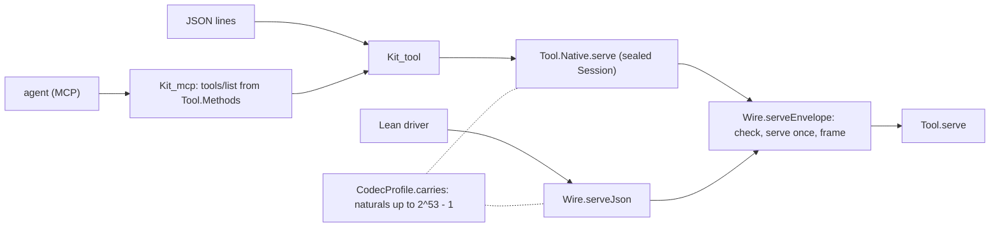

# Overnight refinements, 2026-10-18: the morning report

The one thing to know first: the review's top findings are fixed and landed. The native tool is
sealed, both drivers share one wire core and one number domain, the OCaml gate is about three
times faster, and `eff mcp` now serves the authoring tool from a table generated in Lean.

Base `1b9c351b7^` (the review, `1b7869eea`), head `338fab800`, branch `refactor/phase1-phase3`.
Nothing is pushed. The review this answers is
[review-2026-10-18.md](../2026-10-17-seams/review-2026-10-18.md).

## The request path now

Everything left of `Kit_tool` and `Wire.serveJson` is text and IO. Everything from
`Wire.serveEnvelope` on is Lean, generated into OCaml for the native side.

## What landed

| Commit | What changed, in plain words | Evidence |
| --- | --- | --- |
| `1b9c351b7` | The OCaml gate's cache key reads its Lean modules from `roots.json`. The hand list had missed all 30 tool and store files, so the gate could pass on stale OCaml. | Red/green: an edit to `Tool/Actions.lean` was outside the old key and is inside the new one; gate-cache tests 17/17 |
| `5a3875b16` | Dropped 9.5 MB of tracked research cruft: 822 evidence logs, the ended pause archive, compiled OCaml objects. | No tracked file outside `docs/research` cited them; they remain at `1b9c351b7` |
| `f7677fb54` | The native store reads only its current control-file version; the version-1 decoder for stores that never existed is gone. Two stale notes corrected. | Native store tests pass |
| `fc4ed752d` | One wire core (`Wire.serveEnvelope`) for both drivers. The native tool's state and memo are one abstract `Session`: native code can no longer forge either. 7 native entry points instead of 12. One owner for suggestions (`Suggest.page`); the duplicate `Candidate` type, the unused `CheckCache.suggest` and the dead `response` refusal are gone. A zero page limit no longer loops a client. | 1,869-job build green; audit 4,211 declarations within `[propext, Quot.sound]`; ten hostile sealing clients refused; native replies equal Lean's (10/10) |
| `81f342733` | Stale docs and law docstrings corrected: the missing `src/Effect4/Tool` architecture row, the generated-file tables, three laws that named consumers that do not exist. | Docstring edits; laws built |
| `f5883b8ae` | A store commit now costs its own transaction, not the whole store. A read costs its own node. | `bench_commit`: before 0.95 → 3.96 ms per commit over 400 commits (growing); after 0.27 → 0.25 ms over 1,500 (flat) |
| `43e7cb7d5` | Both drivers carry naturals up to 2^53 − 1 and refuse the same values, keeping the same state (decision A). Replies stop leaking machine internals: previews drop the machine's store set, and waits drop the compiler's continuation names. The run record's second, hand-written codec is gone. | Audit 3,235 within ceiling; Tool codec file 10,908 → 8,335 lines; a new cross-driver fixture N4 (6/6); `write_read` re-proved |
| `26fa723e4` | The OCaml generator runs compiled (`lake exe lcnfgen`) instead of interpreted. This was the 412 s. | `api_gen` step 231 s → 10.6 s, output byte-identical; a cold `check-ocaml` reached its last step in 3 min 3 s (was 8 min 20 s) |
| `338fab800` | `eff mcp` serves the authoring tool to agents. Its 19 tools and their JSON Schemas are generated from Lean's request shape (`Tool.Methods`); the only hand input is each method's description, checked against the method list. The kit's hand-written MCP server is gone (decision B, its MCP half). | Every fixture request validates against its schema (JSON Schema 2020-12), except the two ids both drivers refuse; MCP tests C1–C3 pass; transcript 40/40 |

## Measured, before and after

| What | Before | After | Command |
| --- | --- | --- | --- |
| `api_gen` closure | 231.3 s | 10.6 s alone, 5.5 s in the gate | `lake exe lcnfgen --stage DIR --recipe ocaml/gen/roots.json --one 1` |
| Cold `make check-ocaml` | 8 min 20 s (412 s at S6) | 3 min 3 s to the last step | `make check-ocaml` |
| Store commit, late in a session | 3.96 ms, growing | 0.25 ms, flat | `dune exec engine/cas/test/bench_commit.exe -- 1500` |
| Tool codec file | 10,908 lines | 8,335 lines | `wc -l src/Effect4/Tool/ToolDerived.lean` |
| Native tool entry points | 12, state forgeable | 7, sealed | `ocaml/gen/api_gen.mli` |

## The review's plan, slice by slice

| Review slice | Status |
| --- | --- |
| 1. Gate key from the recipe | Done (`1b9c351b7`) |
| 2. Seal the tool natively | Done (`fc4ed752d`) |
| 3. One wire adapter | Done (`fc4ed752d`) |
| 4. Narrow leaked carriers | Done for previews and waits (`43e7cb7d5`). It did not speed the generator: compiling the generator did. |
| 5. One JSON number domain | Done (`43e7cb7d5`). One owner of the JSON *text* (Lean versus `kit_json.ml`) stays open: lowering it waits on exact 64-bit numbers. |
| 6. Precise, located refusals | Partly: the native unreadable line now prints Lean's refusal. Path-located decode refusals are not done. |
| 7. Memo as a keyed map | Not done; its cost is still unmeasured. |
| 8. `combine_deps` | A proof agent is working on it in its own worktree |
| 9. Restore S1's proofs | The same proof agent: `feed_coherent`, `feed_undo`, `Doc.coherent` and the fill-set agreement |
| 10. Exchange residency, then S6b | Not done. A session cache has no consumer until the native exchange exists. The native store's commit cost, its prerequisite, is fixed. |
| 11. Suggestion owner and method table | Done (`fc4ed752d`); `method_supported` guards the method list |
| 12. Cruft sweep | Mostly done: evidence logs, the legacy decoder, dead refusals, the tuple codec, stale docs |

The decisions:
- **A (numbers):** taken, binary64-safe naturals in both drivers.
- **B (the kit's face):** taken for MCP. The kit's `check`/`run`/`explore` remain CLI and JSON-lines commands.
- **C (the result envelope):** taken; it is prepared, not extended, and its laws say so.
- **D (store laws):** not taken. It runs against the 2026-10-16 steer that hard proofs live in Rocq, so it is yours.

## For you

- **`AGENTS.md`:** a one-page draft that leads with the core abstractions is at
  [2026-10-18-agents-md-draft.md](../2026-10-18-agents-md-draft.md). The live file is unchanged.
- **Decision D:** who owns the store's node laws, Lean or Rocq.
- **The kit's commands:** whether `check`/`run`/`explore` fold into tool queries. That would drop
  the tree-versus-machine cross-check they run, or move it into the tool.
- **S6b, the native exchange over the disk store:** the next large slice. It needs the exchange
  written against a store interface, so the generated code can run over the disk store.

## Not verified

- No full battery run (`lake build Test`) and no whole-tree axiom gate. Each landing built the
  touched modules and batteries and audited its modules.
- The generator's speed-up is measured on this machine, with other sessions idle.
- `check-ts` was not run: nothing tonight reaches the TypeScript face. The Tool carriers are not in
  `ts/eff`.
