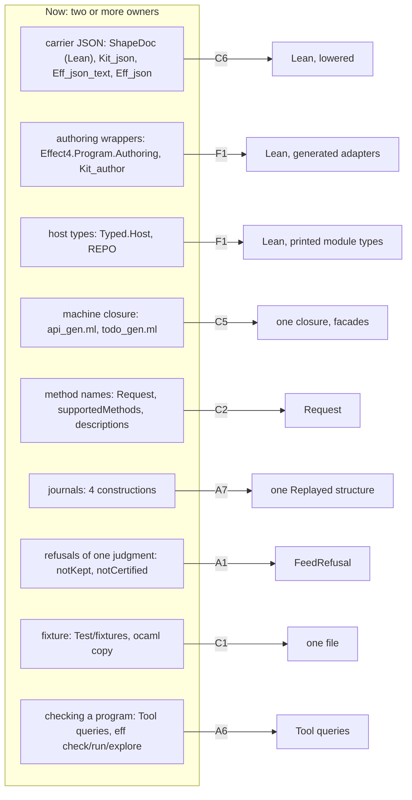
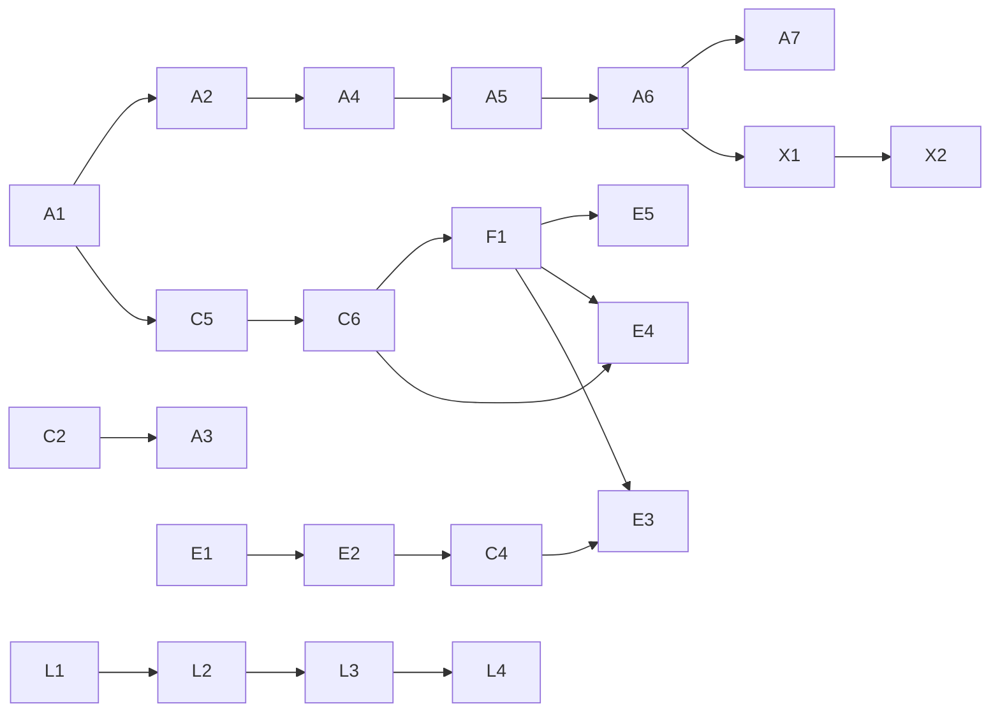

# The slices plan: cut the second owners, then deepen the agent face

Status: plan, for the owner's approval. Base `refactor/phase1-phase3` at `4a81cc034`. Inputs: the
authoring probe ([README](../2026-10-18-authoring-probe/README.md)) and the OCaml tooling probe
([README](../2026-10-18-ocaml-tooling-probe/README.md)). Every baseline number below comes from
[measure.py](measure.py) (output: [baseline.txt](baseline.txt)) or from a probe's named log.

## 0. The one thing to know

The semantics needs no new layer. The burden is in three places:
- second owners: hand OCaml that restates Lean, generated closures that repeat each other, and
  several Lean owners of one fact;
- faces that drop what the laws know: refusals without a place or a reason, and MCP tools
  without hints;
- an estate that no project outside this repository can install.

The plan cuts first and deepens second. Every slice names what it removes, the one owner left, its
build effect and its gate. Every wave ends by rerunning `measure.py` and the probes' scripts.

## 1. The baseline

| Measure | Now | Source |
| --- | --- | --- |
| OCaml lines, hand and generated | 43,477 hand; 125,038 generated | `measure.py` §1 |
| Hand OCaml that restates a Lean fact | 1,271 lines in 7 places | `measure.py` §2 |
| Generated definitions that repeat `api_gen.ml` | 1,429 of `todo_gen.ml`'s 1,535; 25 of `modeled_gen.ml`'s 72 | `measure.py` §3 |
| A cold OCaml build | 73.7 s CPU; the three largest generated files take 28.1 s of it | probe 2, `probes/measure/cold1.log`, `dune_trace.py` |
| `todo_gen.ml` in that build | 6.3 s CPU cold; 5.0 s to recompile after a regeneration | probe 2, `warm.log` |
| Owners of the wire method names | 3: `Request.method`, `supportedMethods`, `Methods.descriptions` | `measure.py` §6 |
| Journal constructions, each with its own append law | 4 (run, document, tool transcript, session chain) | probe 1 §5.1 K2; `measure.py` §6 |
| Byte copies of a fixture | 1: `ocaml/engine/test/kit/tool-requests.jsonl` | `measure.py` §6 |
| The probe's 13 refusals: actionable in one step / in part / not at all | 4 / 4 / 5 | probe 1, `session/frictions.jsonl` |
| MCP tools with `annotations` or `outputSchema` | 0 of 20 | `measure.py` §7; probe 1, `session/summary.json` |
| Installable OCaml libraries and executables | 4 libraries, 0 executables; no `.opam` file | `measure.py` §4; probe 2, `probes/consumer` |
| Hand library modules with no `.mli` | 21: 3 exempt by rule 5, 6 test drivers, 12 owing one | `measure.py` §5 |
| Planned goals in `src` | 6, of which 2 are authoring goals | `measure.py` §7 |

## 2. The rules the plan follows

These are the owner's standing steers, applied:
- A fact has one owner. Lean owns meaning; OCaml is the shell (decisions row 391; tooling design,
  2026-10-16).
- Generated is generated: a face of a Lean carrier is printed from Lean, never written twice.
- Cut before adding. A slice that adds a feature names the owner it replaces, or says "new".
- Build first, a vertical slice on each face (decisions row 387).
- The LCNF lowering owes no proofs. Hard proofs live in Rocq, and Lean declares them.
- A constructor change in a hub (`Admission` had 959 dependents, measured 2026-10-17) is batched
  into one slice, so the cascade is paid once.
- No retired gate lane comes back. A landing owes its narrow build, `#axiom_audit` and the
  behaviour gate it reaches: `make check-ocaml` here. No slice reaches `check-ts`, since the Tool
  carriers are not in `ts/eff`.

## 3. The second owners, and the slice that removes each

| Fact | Owners now | Lines now | One owner after | Slice |
| --- | --- | --- | --- | --- |
| A carrier's JSON text | `ShapeDoc.print`/`read` (Lean); `kit_json.ml`, its arm-for-arm twin; `eff_json_text.ml`; `eff_json.ml`, a second spelling made by a second generator (`EffGen`) | 426 + 67 hand; `eff_json.ml` generated | Lean's printer and reader, lowered | C6 |
| The authoring vocabulary in OCaml | `Effect4.Program.Authoring`; `kit_author.ml` and `.mli` | 89 + 137 | generated adapters | F1 |
| A host's methods | the typed host in Lean; `REPO` and its adapter | 12 | a printed module type | F1 |
| A refusal's text | Lean's renderers; `Kit_author.refusal_text` | 18 | printed from Lean | F1 |
| The machine's closure | `api_gen.ml`; `todo_gen.ml` repeats 1,429 of its definitions | 28,199 generated | one closure, with a facade per consumer | C5 |
| Carrier behaviour | Lean's lowered carriers; the seven list twins of the Ref instance | 426 | Lean's, if the evidence of C4 holds | C4 |
| Checking and running a program | the Tool queries; `eff check`, `run`, `explore` | 114 in `kit_serve.ml` | the Tool queries, with an explicit cross-check query | A6 |
| The wire method names | `Request.method`, `supportedMethods`, `Methods.descriptions` | 3 owners | `Request` | C2 |
| A replayed history | run, document, tool transcript, session chain | 4 constructions, 6 laws | one `Replayed` structure and two laws | A7 |
| A failed kept-exact check | `notKept (focus, verdict)`; `notCertified` with no reason | 2 vocabularies | `FeedRefusal` on both routes | A1 |
| The session request fixture | `Test/fixtures/session/requests.jsonl`; its byte copy | 2 files | one file in `ocaml/`, read by the Lean battery through `include_str` | C1 |

## 4. The slices

Sizes: XS under a day of one seat, S about a day, M two to three days, L a week. Each slice is
one commit or a short chain on a seat's branch, merged by the coordinator.

### 4.1 Cuts (lane C)

**C1. One session fixture.** Move the owner of the request fixture into `ocaml/engine/test/kit/`.
The Lean battery reads it with `include_str`, as `Test/Program/PoolEngine.lean` reads `pool.txt`.
- Removes: the byte copy. Size XS. Gate: the battery's build and `make check-ocaml`.

**C2. Method names once.** Derive `supportedMethods` from `Request`'s constructors. Key
`Methods.descriptions` by the derived names, so a missing or extra description fails to elaborate.
- Removes: two owners and the guard that held them together. Size XS. Gate: narrow build, audit,
  `make check-ocaml` (the generated tool table).

**C4. The Ref instance, on evidence.** Run a mutant campaign over the seven fast carriers. If
`test_diff`'s comparison of the Fast instance with `api_gen` catches every mutant the Ref instance
catches, delete the list twins and `api_engine_ref.ml`.
- Removes: 426 lines of list twins and one engine instance. Size S. Gate: `make check-ocaml`.
- If one mutant escapes, the twins stay, and the receipt names the mutant.

**C5. One generated closure.** Today each test lane regenerates the machine: `todo_gen.ml` is a
28,199-line closure, and 93% of its definitions are `api_gen.ml`'s. The lanes' roots join the one
recipe (`ocaml/gen/roots.json`) under the estate plan's export classes (slice 1.1: public, linkage,
coverage, internal; ruling D-11). A lane's roots are `coverage`. A generated facade per consumer
re-exports its roots: `Api_gen` the public ones, `Todo_gen` the to-do lane's.
- Removes: 1,429 duplicate definitions, and about 6.3 s of cold build CPU (probe 2's trace).
- Adds: the facades, generated. The closure grows by the lanes' own definitions (about 106 from
  the to-do lane).
- Size M. Gate: `make check-ocaml`, with the to-do, constructor, modeled and Rocq lanes unchanged.
  A client that names a coverage root through `Api_gen` fails to compile: the red control.

**C6. One owner of carrier JSON.** Lower Lean's JSON text reader and printer and `ShapeDoc`'s
print and read. Numbers go over naturals, as the sexp probe did (`(Ascii.bytesOf s).map
(·.toNat)`; `docs/research/2026-10-18-ocaml-ppx/README.md`). Then move `Eff_json`'s consumers
(three `eff` tests) to the lowered printer.
- Removes: `kit_json.ml` (426), `eff_json_text.ml` (67), `eff_json.ml` and its `EffGen` family.
  It also removes the binary64 caveat K1 of `kit_json.ml`.
- Size M. Gate: narrow build, audit, `make check-ocaml` (the kit's 408 corpus prints).

### 4.2 Faces printed from Lean (lane F)

**F1. Generated faces for carriers and hosts.** This is the estate plan's slices 1.2, 1.4 and 1.5,
with the ppx note's slice 2.
- Names at their Lean owner.
- `equal`, `compare` and `hash`, with the sexp binding of branch `probe/sexp-face`. That branch's
  slice 1 merges first.
- `Kit_author`'s adapters, generated.
- Host module types and adapters, printed from the typed host.
- Refusal text, printed from Lean.
- Removes: `kit_author.ml`'s wrappers and `refusal_text`, the hand `.mli` (226 lines), and `REPO`
  with its adapter. Size M to L. Gate: `make check-ocaml`, the to-do lane's controls, `typed_lint`.

### 4.3 The agent face (lane A, Lean tool)

**A1. Precise refusals and hole hygiene** (probe 1's P2 and P6). One batched constructor change, so
the `Admission` cascade is paid once:
- `notCertified (why : FeedRefusal)`;
- `illTyped (why : TypeRefusal)`;
- absolute paths in `notKept`;
- `TypeReason.term` split into its causes: an unbound variable, an unknown atom, refused argument
  types, a literal outside the alphabet;
- a `rootRefused` refusal that names `draft` as the remedy;
- the view lists each declared hole that the program never performs;
- suggestions drop the hole itself.

Size S. Gate: narrow build, audit, batteries touched, `make check-ocaml` (fixtures move on
purpose). Acceptance: rerun probe 1's `frictions.py`. Step 7 and F9c then name their path, and F3
and F9 name their cause. F13 names its remedy.

**A2. Located codec refusals** (P1; probe 1's D2). `CodecProfile.read` answers a path and the
expected shape. The acceptance law stays `Canonical.ofJsonAnyOrder_exact`. A new law states that a
refusal's path exists in the input. Size S to M. Gate: as A1. Acceptance: the four `unreadable`
refusals of probe 1 name `a.items[0][1]`, `sketch.program`, `q` and `at_[0]`.

**A3. MCP hints and output schemas** (P3). Derive each tool's `annotations` from `Request`'s case,
with `serve_query` as the law behind `readOnlyHint`. Derive `outputSchema` from `shape Reply`.
Size XS to S. Gate: `make check-ocaml`, and `scripts/check-mcp-protocol.py` against the 2025-06-18
schema. Acceptance: 20 of 20 tools carry both.

**A4. Reply diet** (P4). Suggestion keys become digests. `started` drops the origin's tables. Hole
rows become a name and a type. A journal's `bind` drops the row table. Size S. Gate: as A1.
Acceptance: probe 1's `drive.py` rerun shows the 30–70% repetition gone (`session/summary.json`).

**A5. A hole's context** (P5). One query answers a hole's expected type and its variables, each
with its binder's address. It also answers the rows and atoms whose answer fits. `describe` gains
the atom catalogue from `NativeAtom.spec`. Size S. New: no owner is replaced.

**A6. The kit's commands as Tool queries** (probe 1's O7; probe 2's decision 5; estate plan slices
1.6 and 1.7). `check`, `run` and `explore` become queries. The comparison of the call tree with
the machine becomes an explicit query. `Kit_serve` keeps parsing, framing, and input and output.
Size S to M. Removes the second face. Gate: `make check-ocaml` with the kit's transcript.

**A7. One journal construction** (probe 1's D7). A structure `Replayed step init` with `actions`,
`state` and `replayed : foldM step init actions = .ok state`. It has two laws: an accepted step
appends, and a refused step changes nothing. The four journals become instances. Size S. Removes
four append laws. Gate: narrow build, audit.

### 4.4 Language features for authoring (lane L, requirement R14)

These four are the only language features in the plan. Each carries probe 1's five placement items
(§5.3, D1 to D5), and the concept is the typed-editing concept of decision 6.

| Slice | Theorem or construct | Size | Unlocks |
| --- | --- | --- | --- |
| L1 | `feed-checks-subtree`: land `feed_keepExact_trace_of` (proved in probe 1's `probes/Cost.lean`); each reply reports what it checked | S | the dictionary's "checks only the new subtree" becomes a theorem |
| L2 | `expectAt`: the type an address is expected to have, with its substitution law; feeds `suggest` and kept-exact fixes | M | repair at an ill-typed address (F10, F13) |
| L3 | total marking: a marked table that types every address after a refusal (`marking-agrees`) | M to L | types downstream of the first error |
| L4 | `kept-edit-rebases`: carry a stale commit or pending fill to the new snapshot (`rebase_source`) | M | two agents fill different holes without `stale` refusals |

`fill-by-term` (Rocq, declared in Lean) waits for L2 and L3.

### 4.5 The estate's outward face (lane E)

**E1. Package the estate.** Packages and `public_name` for `effect4_engine`, `effect4_bytes`,
`effect4_engine_cas` and `effect4_kit`, and for `eff`. Generate the opam files, declaring `zarith`,
`yojson` and `conf-gmp`. Size S. Done when `dune build @install` installs the kit and `eff`, and
probe 2's outside consumer builds against the installed prefix. A test library stays unnameable as
the red control. Names are marked unstable until F1 settles them.

**E2. Parallel model tests for hand concurrent code.** Land probe 2's `probes/stm/stm_mailbox.ml`
(qcheck-stm, already in the switch), with its two red controls. Then extend to `E4_inbox`,
`E4_sched`'s admission, the disk writer and the native tool session. Size S. Gate: `dune test
engine` inside `make check-ocaml`. This is new evidence for the code that row 391 leaves hand
written.

**E3. Docs, examples, the REPL.** Fix odoc's 26 warnings. Check the kit's examples with mdx. Write
the REPL recipe. Give each hand library module that remains after C4, C6 and F1 its `.mli`.
Size S. Gate: `dune build @doc` with no warning.

**E4. The browser core.** Split the kit's core from its machine runner. Make the wire's naturals
refuse above the host's `max_int` at any width: today 2^40 decodes wrong and 2^31 raises
(`Eff_frame.nat_digits`). Link `zarith_stubs_js`. Build the page in the release profile. It builds
in 6.3 s cold; the dev profile spends 428.9 s CPU (probe 2, `probes/jsoo`). Size M. After C6 and F1.

**E5. Checked program literals** (`[%eff.program …]`). Land probe 2's rewriter, with its vocabulary
read from F1's generated adapters, never a hand table. Size S. After F1. It needs decision 2.

**E6. Exact naturals in the generated code** (added 2026-10-19; the estate plan's slice 2.2b,
part 2). The estate plan (`docs/research/2026-10-17-ocaml-estate-review/plan.md`, D-2) recommended
`Nat` and `Int` as Zarith's `Z.t`. Three steps landed. The clock and the profile's arithmetic are
exact over Zarith (`effect4_clock`). Every builtin row has a receipt (2.2a, `619ddffe4`), and every
crossing refuses by name (2.2b part 1, `749daaa77`). The switch itself did not land. Inside the generated
code, `Nat.add` is still OCaml's `+`, which wraps at 2^62, and `Nat.mul` saturates at `max_int`.
`UInt64` is `int`, so a bit pattern at 2^62 or above has no carrier. The switch is one commit.
It moves the `Nat` row, about 45 builtin rows, 23 natural fields, the translator's literals and
every hand consumer. This plan of 2026-10-18 did not carry the slice over, so no wave held it.
Size M. It needs decision 12.

### 4.6 The exchange (lane X)

**X1.** S6b, the native exchange over the disk store
([design](../2026-10-18-native-exchange/README.md)). **X2.** MCP 2026-07-28 beside 2025-06-18:
handles as tool arguments, `server/discover`, `input_required` for a held host call, and cacheable
lists. Both are size L. They follow lanes A and C.

### 4.7 Not in this plan, and why

- Eio and HTTP hosts (interop plan P2, P4, P6): no consumer yet.
- Term search in `suggest` (P14), play from a tape (P13), Feat-style enumeration: features with no
  owner to replace. They come after lane L.
- Phantom-typed authoring in OCaml: it covers 15 of 45 atoms exactly (probe 2,
  `probes/lean/AtomSchemes.lean`). E5 covers the whole language with one owner.

## 5. The order

At most three seats run at once, the owner's ceiling of 2026-10-01. Each seat has its own worktree and owns
its files for the wave. Generated files are never merged by hand: the coordinator regenerates them
after each merge.

| Wave | Seat 1: Lean tool | Seat 2: OCaml estate | Seat 3: generator, then language |
| --- | --- | --- | --- |
| 1 | A1, C2, A3 | E1, E2 | C5 |
| 2 | A2, A4, C1 | C4, then E3's first half | C6 |
| 3 | A5, A6, A7 | E5 (after F1), E3 | F1 |
| 4 | X1, then X2 | E4 | L1, L2, L3, L4 |

Wave 1 needs no owner decision beyond this plan. Lane L waits for decision 6, which places its
claims.

A wave closes when the coordinator has done four things:
- merged the seats' branches;
- regenerated `api_gen.ml` and the generated families;
- run the narrow builds, `#axiom_audit` over the touched modules and `make check-ocaml` once;
- rerun `measure.py`, probe 1's `drive.py` and `frictions.py`, and probe 2's cold build trace,
  writing the deltas into this folder.

## 6. The projection

The "after" figures are targets, checked by the commands in §1 at each wave's close.

| Measure | Now | After | Slices |
| --- | --- | --- | --- |
| Hand OCaml that restates Lean | 1,271 lines | about 0; the I/O part of `kit_serve.ml` stays | C4, C6, F1, A6 |
| Generated definitions repeating `api_gen.ml` | 1,454 | 0 | C5 |
| Cold OCaml build CPU | 73.7 s | about 67 s; the page in 6.3 s instead of 428.9 s | C5, E4 |
| Owners of the method names | 3 | 1 | C2 |
| Journal constructions | 4 | 1, with 4 instances | A7 |
| Fixture copies | 1 | 0 | C1 |
| The probe's refusals actionable in one step | 4 of 13 | 13 of 13; each wave's receipt maps each refusal to its slice | A1, A2, L2 |
| MCP tools with hints and output schemas | 0 of 20 | 20 of 20 | A3 |
| Installable libraries and executables | 4 and 0 | 8 and 1 | E1 |
| Hand library modules owing an `.mli` | 12 | 0 | C4, C6, A6, E3 |
| Authoring planned goals | 2 | 1 (`explain_replays` proved or deleted, decision 8) | decision 8 |

## 7. The owner's decisions

Each has a recommendation. Only the first is needed before wave 1.

| # | Decision | Recommendation | Needed by |
| --- | --- | --- | --- |
| 1 | Approve this plan and its order | yes | wave 1 |
| 2 | A ppx enters the build (STANDARDS rule 9) | yes, for the checking literal only | E5 |
| 3 | Publish the packages | as 0.x, pinned from this repository, marked unstable until F1 | E1's release, not its build |
| 4 | Keep `js_of_ocaml` 5.7.1 | yes; the wire becomes width-exact | E4 |
| 5 | Fold `eff check`, `run` and `explore` into Tool queries | yes, with the cross-check as a query | A6 |
| 6 | A typed-editing concept in `docs/core/semantics.md` | yes; lane L's claims need it | lane L |
| 7 | One journal construction | yes | A7 |
| 8 | `Check.explain`: expose it in `doc`'s inspection and prove `explain_replays`, or delete both | expose | A5 |
| 9 | One wire field name per idea (`Val.nat`'s `n`, `Change.fill`'s `q`); shape digests change | yes | A4 |
| 10 | MCP 2026-07-28 beside 2025-06-18 | yes, after X1 | X2 |
| 11 | Delete the Ref instance if C4's evidence holds | yes | C4 |
| 12 | Naturals in the generated code: exact over Zarith everywhere (the estate plan's D-2), or Zarith only where a native use needs values above 2^62 (decisions row 108, open) | exact everywhere: then row 391 trusts the lowering with no numeric domain. **Ruled 2026-10-19, row 417 (1)**, with an exact `UInt64` carrier | E6 |

## 8. What this plan does not establish

- The "after" column is a projection until each wave's measure.
- C5's build saving comes from one trace on a shared machine. CPU time is the figure to compare.
- Lane L's theorems are placed in probe 1 (§5.3). Only `feed_keepExact_trace_of` is proved, in a
  probe file outside the tree.
- No slice changes the machine, the program syntax or a proved law's statement. A1's constructor
  arguments change batteries and generated codecs, not statements.

## 9. The rulings after Codex's API review (2026-10-18)

Codex's review is [codex-review/README.md](codex-review/README.md). Its claims were checked
against the tree: the option ambiguity, the case-spelling break, `Doc.revert_program`'s statement
and the MCP structured content hold. Its claim that the JSON slices reach `check-ts` found no
TypeScript consumer; C6 checks it before cutover.

The owner ruled, in two rounds:
1. **Codec compatibility:** greenfield until the first release. Wire shapes change freely now.
   Every public sum is spelled with an explicit tag, so a new case never respells an old value.
   Versions and old readers begin at the first published release.
2. **Located refusals:** share `Located Site Reason`, `mapSite` and one prefix rule at call
   boundaries. Each judgment keeps its own reason alphabet and its own law that a refusal is absent exactly when the judgment holds (as `Api.explain_none_iff`).
   Codex's `Judgment` record is not adopted.
3. **`checkProgram`:** full admission in one call: formation, typing and program admission, each
   refusal located.
4. **Packaging:** names first. E1 adds install metadata and the outside-consumer check now. The
   first release waits for the Lean-made name manifest and the scoped facades.
5. **Typed editing:** an eleventh concept in `docs/core/semantics.md`. The authoring claims move
   under it before lane L starts.
6. **Wave 1, amended:**
   - seat 1: A1 with located refusals and hole hygiene, and R5.1's method table and MCP hints;
   - seat 2: E1's install metadata and outside-consumer check, with no release, and E2;
   - seat 3: the export classes and the name manifest (R6.1 step 1, R6.2's naming slice),
     before C5.

The coordinator takes Codex's recommendation on four smaller points:
- total marking starts with explicit unknown contexts;
- the replay consolidation is the indexed fold and its adapters, keeping the stronger theorems;
- the Ref carriers are decided after C4's frozen mutant campaign;
- the checking ppx is approved separately from publication.

Proposed decisions row (the coordinator records it): the six rulings above.

## 10. The hygiene lane (H), measured 2026-10-18

The owner asked what separates this tree from a production one, by OCaml, Jane Street and Lean
practice. Each finding below comes from a command run at `f8eb23ea5`. The commands are in §10.5.

### 10.1 The one thing to know

The OCaml has never been formatted. 206 of 220 hand files differ from `ocamlformat
--profile=janestreet`, by 23,766 lines. Four of the eight installed packages are unwrapped, so
they put their modules at the top level of every client. These two block a release; the rest is
small.

The tree already holds several production habits:
- every Lean warning is an error;
- the axiom gate audits every declaration;
- generated files are marked and re-cut by the gates;
- `typed_lint` reads rule 7 off the typed tree;
- `.gitattributes` fixes line endings;
- every OCaml component opens with its behaviours;
- the opam metadata is generated, and model tests cover the concurrent code.

### 10.2 OCaml

| # | Finding | Fix | Size |
| --- | --- | --- | --- |
| H1 | No `.ocamlformat` anywhere. 206 of 220 hand files differ from the Jane Street profile (23,766 lines). | Add `ocaml/.ocamlformat` (`profile = janestreet`, `version = 0.29.0`); run `dune fmt` once; add `dune build @fmt` to `check-ocaml`. Generators print formatted text, or `.ocamlformat-ignore` lists their outputs. | S, one mechanical commit after seat 1 merges |
| H2 | `effect4_clock`, `effect4_eff`, `effect4_bytes` and `effect4_lcnf` are installed with `(wrapped false)`. A client then sees `Eff_types`, `E4_hex` and `Lcnf_string` as top-level modules. | Wrap the four; generated code reaches them through `-open`. Lands with C5's scoped emission. | M |
| H3 | `effect4_engine` installs 36 modules, among them the seven `_list` reference twins, `Api_engine_ref` and `Corpora`. Only tests and the reference engine use them. | Move them into a private test-support library. | S |
| H4 | `eff` parses `Sys.argv` by hand. It has no `--help` and no `--version`: `eff --version` prints the usage and exits 2. | Cmdliner, with the version from `dune-build-info`. It gives help, a man page and completion. | S |
| H5 | 45 test files define `let failures = ref 0`, and 41 define `let check name ok`. Six variables name a test's temporary folder (`E4_CAS_TMP`, `E4_PACK_TMP`, …). | One test-support library: `check`, the summary line, and `Filename.temp_dir`. Golden-text tests move to `ppx_expect` (installed, v0.16) when touched. | S |
| H6 | `dune build @doc` reports 39 warnings or errors. The installed packages' documentation is what an outside user reads. | Fix them; add `@doc` to `check-ocaml`. | S |
| H7 | The kit turns off the unused-variable, unused-value, unused-open and unused-field warnings (`-w -4-9-26-27-32-33-35-37-39-40-41-42-44-45-69-70`). Seven flag strings exist across the stanzas. | Remove the kit's suppressions and delete what they hide. Set one warning policy in an `env` stanza. | S |
| H8 | 14 hand library modules have no `.mli`, among them the installed kit's `Kit_json` and `Kit_serve`. The `eff/` generator writes no `.mli`, and its files carry the `GENERATED` line twice. | Add the interfaces; the `eff/` group infers its `.mli` as the LCNF group does. | S |
| H9 | Stale words: `dune-workspace` names `avatar/` and `server/`, which are archived. | Fix with H1. | XS |

### 10.3 Lean

| # | Finding | Fix | Size |
| --- | --- | --- | --- |
| H10 | 126 `set_option maxHeartbeats` in `src/`, 7 of them at 8,000,000 (40 times the default), and 52 `maxRecDepth`. Each marks a slow proof or a slow elaboration. | A ratchet: the count never grows. Profile the 32 largest with `scripts/profile-module.py` and remove what a lemma fixes. | M, ongoing |
| H11 | Panicking access in shipped code: 155 `]!`, 12 `head!` and 2 `get!` in `src/`. Where LCNF lowers one, the OCaml panics there too. | Audit the core (outside `Laws`). Use a total form or an index with its proof (`xs[i]'h`). | S |
| H12 | 1,473 `#guard` lines in `src/`: `Store` 449, `Program` 206, `Api` 200, `OCaml5` 264. They run in every build of those modules, and Batteries and Mathlib keep tests out of the library. | Measure their build time first. Move the batteries among them to `Test/`; keep a guard that pins rendered bytes beside its renderer. Owner's call. | M |
| H13 | 43 `src` files exceed 1,500 lines, Mathlib's file-length limit. The largest hand files are `Laws/Codegen/PrintTyped.lean` (8,231 lines) and `Laws/Machine/Handles.lean` (6,785). 45 `src` files have no `/-!` module docstring. | Split a large file when a slice touches it. Add the module docstrings now. | S for the docstrings |
| H14 | 13 linter switches: 7 `linter.unusedSectionVars false` and 6 `linter.unusedSimpArgs false in`. | Remove each with its cause. | XS |
| H15 | `warningAsError` reaches Lean through `moreLeanArgs`. Lake may pass only `leanOptions` to the editor's server, so the editor can show fewer errors than the build. | Check this, then move the option to `leanOptions` if so. | XS |

### 10.4 The repository

| # | Finding | Fix | Size |
| --- | --- | --- | --- |
| H16 | `docs/research` holds 8,587 tracked files (43 MB): 1,547 logs, 1,230 `.lean`, 761 `.ts` and 304 `.py`. Three evidence packets hold 2,056 of them. | Move the evidence packets to an archive branch, as with the Flow route and the avatar. Keep only the notes an authority cites, which `check-docs` already lists. Owner's call. | M |
| H17 | 168,572 generated lines are tracked, and `ocaml/gen/api_gen.ml` (3.9 MB) is the largest tracked file. No file is marked generated for review tools. | Mark the generated outputs `linguist-generated=true` in `.gitattributes`. | XS |
| H18 | 42 Python files outside `docs` and `vendor`. `scripts/` holds 32 of them, 7,270 lines. There is no `pyproject.toml` or linter configuration, and 13 of the 32 have type annotations. | One `ruff` configuration, for lint and format, run by `check-tools`. | S |
| H19 | No formatter for the TypeScript under `ts/` and `harness/`. | One formatter configuration, run by `check-ts`. tsgo stays the one type checker. | S |
| H20 | No `CHANGES.md`, `.editorconfig` or `SECURITY.md`. opam's release tools read `CHANGES.md`. | Add `CHANGES.md` and `.editorconfig` before the first release. | XS |
| H21 | The `Makefile` holds 749 lines and 77 targets; 34 targets carry a `##` help line. | Help on every public target; an `_` prefix on every internal one. | XS |

### 10.5 The order, and the commands

The order:
1. Now: H9, H14, H17, H20 and the docstrings of H13.
2. After seat 1 merges: H1, the one formatting commit. H1 and H9 landed on 2026-10-18.
3. With wave 2's cuts: H3, H5, H7 and H8. H2 lands with C5.
4. Before the first release: H4, H6, H18 and H19.
5. Ongoing: H10 and H11.
6. H12 and H16 wait for the owner's call.

The measurements came from these commands, run from the repository root unless `ocaml/` is named:
- **formatting:** `ocamlformat --enable-outside-detected-project --profile=janestreet`, compared
  with each hand file;
- **odoc:** `dune build @doc`, run in `ocaml/`;
- **wrapping:** `grep -l "wrapped false"` over the `dune` files;
- **test helpers:** `grep -h "^let check \|^let failures"` over the test files;
- **Lean counts:** `grep -c` over `git ls-files 'src/*.lean'`;
- **research size:** `git ls-files docs/research`, piped to `du -ch`;
- **generated lines:** `wc -l` over the `ocaml/` and `src/` files that carry `GENERATED`.
